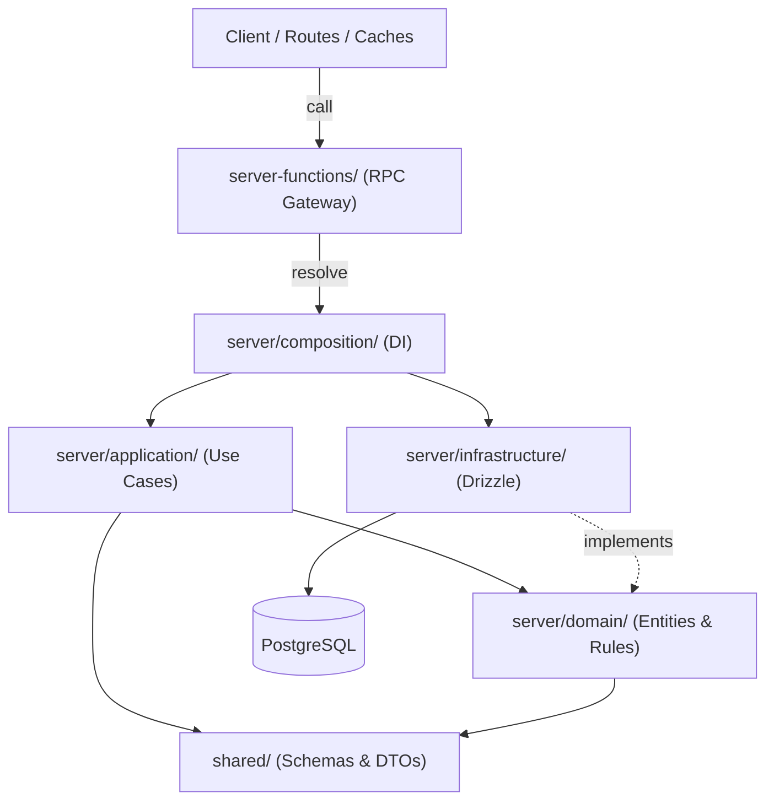
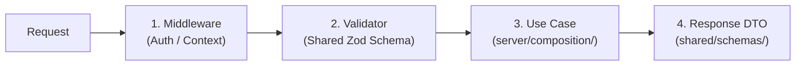
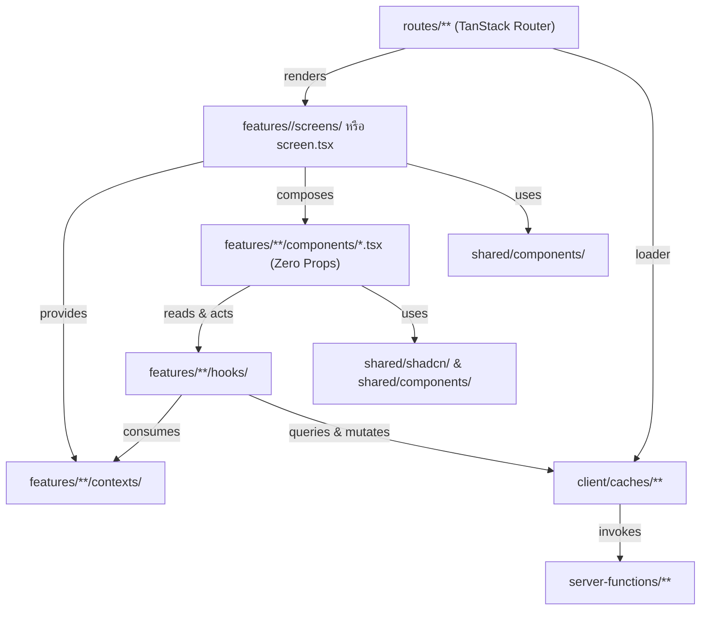

# Architecture Boundary

ข้อกำหนดขอบเขตสถาปัตยกรรม (Architectural Boundaries) และทิศทางการพึ่งพา (Dependency Flow) ของระบบ

---

## Folder Structure

### Main Responsibilities

- `client/`: **Frontend & State Layer** — UI/UX, State, TanStack Query Caches ภายใต้ข้อกำหนด **Zero Props**
- `routes/`: **TanStack Router File Routes** — URL routing, Route Guards (`beforeLoad`), Preload (`loader`), Head tags โดยไม่ประกอบ UI ย่อย และจัดกลุ่มหน้าสาธารณะผ่าน Pathless Layout Route (`_public/**`)
- `server/`: **Backend Domain & Core Logic** — Clean Architecture & DDD แยกขาดจาก UI ห้าม Client/Routes เรียกตรง
- `server-functions/`: **TanStack Start RPC Gateway** — ทางผ่านเดียวระหว่าง Client กับ Server พร้อม Middleware (Auth, Error, Validation)
- `shared/`: **Isomorphic Layer** — Zod Schemas, DTOs และ Utilities ที่ใช้ร่วมกันแบบไร้ Framework Side-effects

---

### Server Boundary

**`server/`**: แกนกลางฝั่งเซิร์ฟเวอร์ ออกแบบตาม Clean Architecture & DDD เพื่อแยก Business Logic ออกจาก Framework และ Database

- `application/`: จัดการ Use Cases ประจำแต่ละโมดูล และ Data Mappers แปลงระหว่าง Entity กับ DTO
- `composition/`: DI Container รวม Object Graph (ผูก Infrastructure Repositories เข้ากับ Use Cases) แบบ Singleton
- `config/`: ตรวจสอบความถูกต้องของ Server Environment Variables ด้วย Zod Schema (`env.ts`) แบบ Fail-fast
- `domain/`: Business Invariants และกฎทางธุรกิจหลัก (Entities, Aggregate Roots, Interfaces, Domain Errors)
- `infrastructure/`: เชื่อมต่อระบบภายนอกจริง (PostgreSQL ผ่าน Drizzle ORM, External Auth Provider เช่น Better Auth หรือ Clerk) ตาม Repository / Gateway Interface

#### Domain

`server/domain/`: กฎทางธุรกิจบริสุทธิ์ ปราศจาก dependency ภายนอก

- `server/domain/<module>/`: Entity, Aggregate Root, Repository Interface และ Domain Error ประจำโมดูล
- `server/domain/common/`: Base Classes และ Abstractions กลาง (`aggregate-root.base.ts`, `entity.base.ts`, `errors.ts`, `unit-of-work.interface.ts`)

#### Application

`server/application/`: นำพา Workflow และขับเคลื่อน Use Cases

- `server/application/<module>/`: Use Case Classes รับ Input สั่ง Entity ทำงาน เรียก Repository และคืนค่า DTO
- `server/application/mappers/`: แปลงระหว่าง Domain Entity (Internal Model) กับ DTO เพื่อไม่ให้ Domain รั่วไหล

#### Infrastructure

`server/infrastructure/`: การติดต่อระบบภายนอกและ I/O จริง

- `server/infrastructure/<module>/`: Implement Repository Interface ด้วย Drizzle ORM หรือ External Provider
- `server/infrastructure/drizzle/`: Database Client (`db.ts`), Table Schema (`schema.ts`), Transaction Context และ Unit of Work

#### Composition

`server/composition/`: ศูนย์รวม Dependency Injection (DI)

- `server/composition/<module>.container.ts`: ประกอบ Use Cases ประจำโมดูลและ Inject Repositories เข้าไป
- `server/composition/repositories.ts`: สร้าง Instance ของ Repositories, Unit of Work และ External Providers จาก `db`

#### Config

`server/config/`: ตรวจสอบและจัดการ Environment Variables (`env.ts`) ด้วย Zod แบบ Fail-fast ตอนเริ่มต้นระบบ

#### Server Dependency Flow

### Server Functions

`server-functions/`: ทำหน้าที่เป็น **Thin Driving Adapter (RPC Gateway)** ทางผ่านเดียวระหว่าง Client กับ Server เพื่อแยก Network/Transport Protocol ออกจาก Core Business Logic

- `middlewares/`: จัดการ Cross-cutting Concerns ระดับ Gateway เช่น Authentication Guard (`auth.middleware.ts`), Logging หรือ Rate Limiting ผ่าน TanStack Start Middleware
- `<module>/*.fn.ts`: Server Function Endpoints ประจำแต่ละโมดูล สร้างด้วย `createServerFn` ทำหน้าที่ Validate Input, รัน Middleware และ Dispatch งานไปยัง Use Case

#### Standard Pipeline

ทุก Server Function ต้องปฏิบัติตาม Pipeline 4 ขั้นตอนอย่างเคร่งครัด:

#### Responsibilities & Invariants

1. **Thin Adapter**: มีหน้าที่เฉพาะประสานงาน (Orchestration) ระดับ Transport ห้ามเขียน Business Logic, State Transition หรือเรียก Database (Drizzle ORM) โดยตรง
2. **One Function per File (`*.fn.ts`)**: แยก 1 RPC Endpoint ต่อ 1 ไฟล์ โดยตั้งชื่อสอดคล้องกับ Use Case พร้อมต่อท้ายด้วย `.fn.ts` (เช่น `get-user-by-id.fn.ts`) และ Export ตัวแปรลงท้ายด้วย `Fn` (เช่น `getUserByIdFn`)
3. **Shared Contract Only**: บังคับตรวจสอบ Input Payload ด้วย Schema จาก `shared/schemas/**` ผ่าน `.validator()` และระบุ Explicit Return Type เป็น DTO จาก Shared Schema เสมอ
4. **DI Resolution**: ดึง Use Case มาจาก Composition Container (`server/composition/**`) เท่านั้น ห้าม New Repository หรือ Service ขึ้นมาเอง
 

---

### Client Boundary

`client/`: เลเยอร์ Frontend ยึดหลัก **Zero Props**, Feature-Sliced Cohesion และ Centralized Server-State

- `caches/`: จัดการ Server State, Caching, Invalidation, Toast Feedback ด้วย TanStack Query
- `core/`: Root Shell, Theme Provider, Global Error / Not Found Screens, App Providers, Toaster
- `features/`: โครงสร้าง UI/UX แยกตาม Business Domain (รองรับทั้ง Single-screen และ Multi-screen)
- `shared/`: Application Primitives, Router Wrappers และ Read-Only shadcn primitives
- `styles/`: Global CSS, Tailwind CSS v4, Fonts, Theme Tokens (OKLCH)

#### Caches

`client/caches/`: ศูนย์กลาง Server State ห้าม Component เรียก `server-functions` โดยตรง

- `client/caches/<module>/queries/*.query.ts`: กำหนด `queryOptions` ระบุ `queryKey` และเรียก `server-functions`
- `client/caches/<module>/mutates/*.mutate.ts`: Mutation Hooks จัดการ Optimistic Update, Rollback, Cache Invalidation และ Toast meta
- `client/caches/<module>/keys.ts`: Query Key Factory สร้าง Cache Keys แบบ Type-safe
- `client/caches/global.ts`: กำหนด `QueryClient` และดักจับ `mutationCache` เพื่อยิง Sonner Toast อัตโนมัติจาก `meta`

### Core

`client/core/`: โครงสร้างรากฐานระดับแอปพลิเคชัน (Global Providers & System Shell)

- `client/core/components/*.ts`: จัดเก็บคอมโพเนนต์ต่างๆ ที่ใช้ภายใน Core
- `client/core/hooks/*.ts`: Hooks ที่ใช้เฉพาะภายใน Core
- `client/core/contexts/*.ts`: Global Contexts เช่น `session-cache-boundary.tsx`
- `client/core/screens/*.tsx`: หน้าจอกลางระดับ Application Shell เช่น `not-found.tsx`
- `client/core/app-root.tsx`: Root HTML Shell (`<html>`, `<head>`, `<body>`), Providers, DevTools, Toaster โดยไม่ใส่ Layout Components (เพื่อให้ Layout ของแต่ละ Route Group จัดการ Shell ของตนเองอย่างอิสระ)

### Features

`client/features/`: รวมศูนย์ UI และ Business Interactions ประจำฟีเจอร์ภายใต้กฎ **Zero Props**

- `client/features/**/*`: รวมศูนย์พื้นที่ทั้งหมด ตามโครงสร้าง Multi-Screen:
  - `screens/*.tsx`: Composition Roots ประจำแต่ละหน้าและ Layout (`layout.screen.tsx`, `home.screen.tsx`, `contact.screen.tsx`, `profile.screen.tsx`) ประกอบ Layout และ Zero Props Components จาก `components/`
  - `layout/`: Public Header, Navigation, Footer, และ Auth Controls
- โครงสร้างทั่วไปของโมดูลฟีเจอร์:
  - `components/**/*.tsx`: Presentation Components แบบ **Zero Props** (Pure UI ไม่ถือ Logic อ่าน State/Actions ผ่าน Hooks เท่านั้น)
  - `contexts/**/*.tsx`: Compound Context ประจำฟีเจอร์ กระจาย State โดยไม่ใช้ Prop Drilling (ถ้ามี)
  - `hooks/**/*.ts`: Single-Responsibility Hooks (Form, Dialog, Filter, Data, State) เป็นเจ้าของ Logic ทั้งหมด
  - `models/`: Feature View Models และ Type ประจำฟีเจอร์
  - `home/`, `contact/`, `profile/`: ส่วนประกอบย่อย, Containers และ Hooks ประจำแต่ละมุมมอง

### Authentication & Route Protection Boundary

- **Flexible Auth Flow (Dedicated Routes หรือ Modal-based Auth)**: ระบบรองรับทั้งการทำ Authentication ผ่านหน้าเฉพาะ (`/sign-in`, `/sign-up` ภายใต้ Pathless Layout Route เช่น `_public/**`) หรือในรูปแบบ Modal Dialog ตามความต้องการของโปรเจกต์
- **Route Guard หรือ Polite Auth Gate**: เมื่อผู้ใช้งานเข้าถึงหน้าที่ต้องการ Authentication สามารถเลือกใช้ Route Guard (`beforeLoad` พร้อม `redirect({ to: "/sign-in" })` ภายใต้ Pathless Layout Route เช่น `_auth/**`) หรือแสดง Polite Auth Gate Component บนหน้าจอได้ตาม UX ที่โปรเจกต์กำหนด โดยต้องแยก Logic การตรวจสอบสิทธิ์ไว้ที่ Route / Hook / Cache / Middleware เสมอ

### Shared

`client/shared/`: สิ่งที่ใช้ร่วมกันข้ามฟีเจอร์

- `components/`: โครงสร้าง Layout ร่วม และ Wrappers สำหรับ Application (เช่น `AppShellRoot`, `AppShellHeader`, `AppShellMain`, `AppShellFooter`)
- `hooks/`: Hook กลางที่สามารถใช้ได้ทั่วทั้ง Client
- `components/app-router.tsx`: Router Wrappers เชื่อม Primitives เข้ากับ TanStack Router
- `helpers/`: สำหรับฟังก์ชันช่วยเหลือทั่วไปที่ใช้ทั่วทั้ง Client
- `shadcn/`: Read-Only UI Primitives จาก shadcn ห้ามดัดแปลงแก้ไขตรงๆ

### Styles

`client/styles/`: จัดการสไตล์หลักระดับระบบ (`global.css`), Tailwind CSS v4, Variable Fonts และ Theme CSS Variables (ห้ามเขียน Custom CSS Classes หรือทำ Custom Design แฝงในเลเยอร์นี้)

#### Client Dependency Flow

