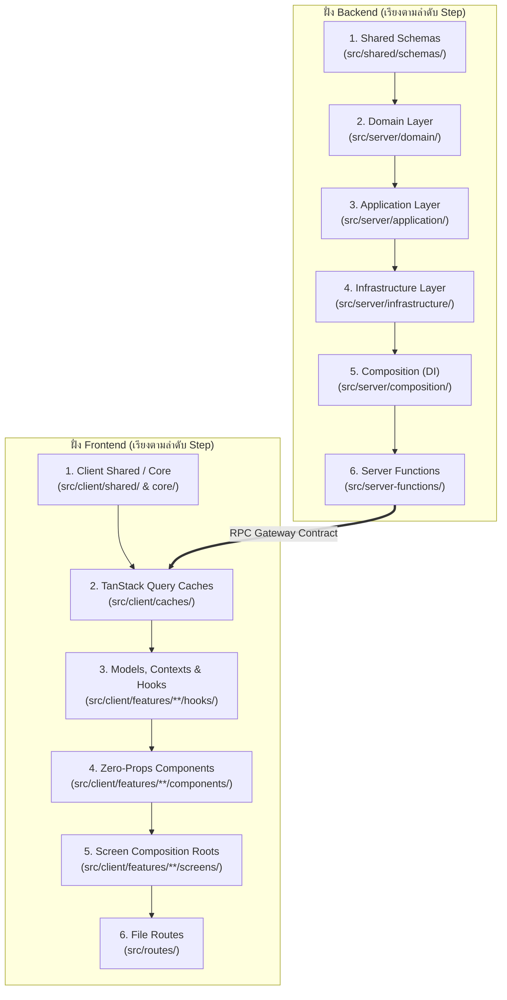
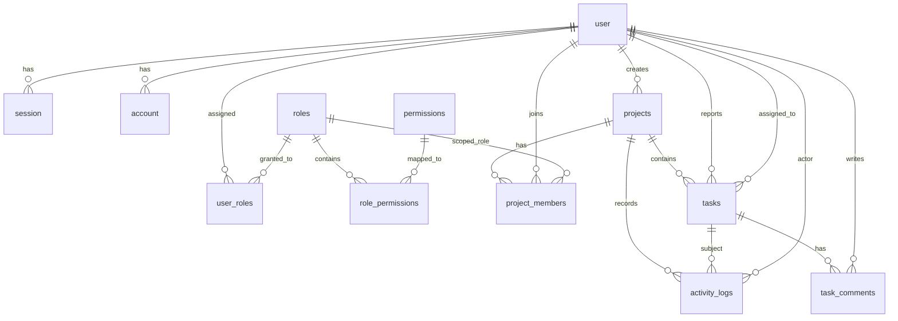

# แผนแม่บทการเรียนรู้และพัฒนา: TaskFlow (Clean Architecture, DDD & Zero-Props Frontend)

เอกสารชุดนี้คือคู่มือการเรียนรู้แบบ Step-by-Step สำหรับสร้างระบบ **TaskFlow (Project & Task Management System)** ตั้งแต่การเริ่มต้นสร้างโปรเจกต์ใหม่จากศูนย์ (`Project Initialization`) ไปจนถึงระบบระดับ Production ครบทุกฟีเจอร์ โดยแบ่งบทเรียนออกตาม **Milestone** และแยกย่อยตาม **Architectural Boundary** ของฝั่ง **Backend** และ **Frontend** อย่างชัดเจน

---

## 1. ข้อตกลงสถาปัตยกรรมและเทคโนโลยีหลัก (Architecture & Tech Stack)

| หมวดหมู่ | เทคโนโลยี / รูปแบบสถาปัตยกรรม | เหตุผลเชิงวิศวกรรมและกฎที่บังคับใช้ |
| :--- | :--- | :--- |
| **Runtime & Package Manager** | **Bun** (`bun install`, `bun run`, `bun x`) | บังคับใช้ตาม `globals.md` ข้อ 11 เพื่อให้การจัดการแพ็กเกจและการรันสคริปต์รวดเร็วและเป็นมาตรฐานเดียว |
| **Full-Stack Framework** | **TanStack Start** + **TanStack Router** (File-Based Routing + SSR) | รองรับ Isomorphic SSR, Type-Safe Routing (`validateSearch`, `loader`, `beforeLoad`) และ RPC Gateway (`createServerFn`) |
| **Linter & Formatter** | **Biome** (`biome.json`) | บังคับใช้ `useImportType` (`separatedType`), `noBarrelFile`, `noNamespaceImport`, `useTailwindSortedClasses` อัตโนมัติ |
| **Database & ORM** | **PostgreSQL** + **`pg`** + **Drizzle ORM** + **`drizzle-kit`** | แยก Database Schema ออกจาก Domain Entity และรองรับ ACID Transaction ผ่าน `AsyncLocalStorage` (`DrizzleUnitOfWork`) |
| **Authentication** | **Better Auth** (`emailAndPassword` + `tanstackStartCookies`) | ซ่อนไว้หลัง `IAuthGateway` Port ใน Application Layer พร้อม Dedicated Routes (`/sign-in`, `/sign-up`) และ Route Guard (`_auth`) |
| **Authorization (RBAC)** | **Dynamic Hybrid RBAC (`role:permission`)** แยกตาราง | รองรับทั้งสิทธิ์ระดับระบบ (`scope = 'system'`) และสิทธิ์ระดับโครงการ (`scope = 'project'`) พร้อมหน้า Admin Permission Matrix |
| **Backend Architecture** | **Clean Architecture + Tactical DDD + CQRS Read Projections** | ทิศทาง Dependency ไหลเข้าหาศูนย์กลาง (`Infrastructure → Application → Domain`) แยก Write Model (Aggregate Root) กับ Read Model (CQRS Queries) |
| **Frontend Architecture** | **Feature-Sliced Design + Zero Props Architecture** | ห้ามส่ง Props เข้า Feature Components (`features/**/components/*.tsx`) ทุก Component อ่าน State/Action จาก Single-Responsibility Hook และ Context เท่านั้น |
| **Server State & Forms** | **TanStack Query v5** + **TanStack Form v1** + **TanStack Table v9** | รวมศูนย์ Cache & Mutation Toast ที่ `client/caches/` ใช้ Shared Zod v4 Schema ร่วมกับฟอร์ม และทำ Server-Side Pagination/Filter/Sort ซิงก์กับ URL |

---

## 2. แผนภาพ Architectural Boundaries และลำดับการพัฒนาในแต่ละ Milestone

ในทุกๆ Milestone เราจะสร้างโค้ดเรียงตามลำดับ Dependency จริงจาก **ข้างในออกข้างนอก (Inside-Out)** สำหรับฝั่ง Backend และจาก **ฐานข้อมูลแคชขึ้นสู่หน้าจอและ Route (Bottom-Up)** สำหรับฝั่ง Frontend เพื่อไม่ให้เกิดการเขียนโค้ดย้อนกลับไปมา:

---

## 3. การออกแบบฐานข้อมูล (PostgreSQL Entity-Relationship Diagram)

ตารางทั้งหมดในระบบถูกนิยามไว้ที่ `src/server/infrastructure/drizzle/schema.ts` แบ่งเป็น 3 กลุ่มหลัก (Better Auth, Dynamic RBAC และ Projects/Tasks/Activity):

---

## 4. สารบัญบทเรียนราย Step (Milestones 1–8)

> [!IMPORTANT]
> **มาตรฐานการเรียนและการทำ Git Commit**:
> เมื่อทำจบในแต่ละ Step และรันคำสั่งตรวจสอบ (`bun run check` / `bun run typecheck`) ผ่านแล้ว ให้ทำการบันทึกประวัติด้วยคำสั่ง:
> `git commit -m "milestone-{n}.{backend|frontend}.step-{n}: <หัวข้อของ Step>"`

---

### Milestone 1: การเริ่มต้นโปรเจกต์ เครื่องมือ และโครงสร้างหลัก (Project Initialization & Core Architecture Shell)

วางรากฐานโปรเจกต์ตั้งแต่การรัน CLI เริ่มต้น, ตั้งค่า Biome/TypeScript/Tailwind v4, วางกฎสถาปัตยกรรม `.agents/rules/`, สร้าง Tactical DDD Base Classes และประกอบ Core Frontend Shell + Shared Primitives (`AppForm`, `AppDataTable`, `AppShell`, `QueryClient`) ฉบับสมบูรณ์

#### Backend
- [Milestone 1 — Backend Step 1: Project Initialization, Tooling & Architectural Rules](./milestone-1.backend.step-1.md)
  - สร้างโปรเจกต์ด้วย CLI, ตั้งค่า `package.json`, `tsconfig.json`, `tsr.config.json`, `vite.config.ts`, `biome.json`, `components.json`, `.env.example`, `.gitignore` และ `.agents/rules/{architecture,globals,server,client}.md`
- [Milestone 1 — Backend Step 2: Server Config Boundary (`src/server/config/`)](./milestone-1.backend.step-2.md)
  - สร้าง `src/server/config/env.ts` สำหรับตรวจสอบ Environment Variables ด้วย Zod แบบ Fail-Fast
- [Milestone 1 — Backend Step 3: Domain Common Boundary (`src/server/domain/common/`)](./milestone-1.backend.step-3.md)
  - สร้าง Base Abstractions ของ Tactical DDD ได้แก่ `entity.base.ts`, `aggregate-root.base.ts`, `value-object.base.ts`, `errors.ts` และ `unit-of-work.interface.ts`
- [Milestone 1 — Backend Step 4: Server Functions Middleware Core (`src/server-functions/middlewares/`)](./milestone-1.backend.step-4.md)
  - สร้าง `src/server-functions/middlewares/domain-error.middleware.ts` เพื่อแปลง `DomainError` เป็น HTTP Status Codes ที่ระดับ RPC Gateway

#### Frontend
- [Milestone 1 — Frontend Step 1: Global Styles & shadcn UI Primitives (`src/client/styles/` & `src/client/shared/shadcn/`)](./milestone-1.frontend.step-1.md)
  - ตั้งค่า `global.css` (OKLCH Tokens & Variable Fonts), `theme-provider.tsx` และติดตั้ง shadcn Read-Only Primitives ทั้ง 18 รายการ
- [Milestone 1 — Frontend Step 2: Client Shared Primitives (`src/client/shared/components/`)](./milestone-1.frontend.step-2.md)
  - สร้าง Wrapper Primitives กลางฉบับสมบูรณ์: `app-shell.tsx`, `app-brand.tsx`, `app-theme-switcher.tsx`, `app-link.tsx`, `app-form.tsx` (TanStack Form Context & Field Components) และ `app-data-table.tsx` (Reusable Server-Side TanStack Table)
- [Milestone 1 — Frontend Step 3: Client Caches Global (`src/client/caches/`)](./milestone-1.frontend.step-3.md)
  - สร้าง `src/client/caches/global.ts` ตั้งค่า `QueryClient` และ `MutationCache` เพื่อยิง Toast อัตโนมัติจาก `mutation.meta`
- [Milestone 1 — Frontend Step 4: Client Core Shell (`src/client/core/`)](./milestone-1.frontend.step-4.md)
  - สร้าง `app-root.tsx`, `components/app-header.tsx`, `components/app-footer.tsx`, `screens/not-found.screen.tsx` และ `screens/entry-point.tsx`
- [Milestone 1 — Frontend Step 5: Router & Root Route (`src/router.tsx` & `src/routes/`)](./milestone-1.frontend.step-5.md)
  - สร้าง `src/router.tsx`, `src/routes/__root.tsx`, หน้าเริ่มต้น `src/routes/index.tsx` และรัน `bun run generate-routes`

---

### Milestone 2: ฐานข้อมูล PostgreSQL, Drizzle ORM, Unit of Work และข้อมูลตั้งต้น (Database Foundation & Seed)

ออกแบบสัญญาข้อมูล RBAC พื้นฐาน, ตั้งค่า Drizzle ORM เชื่อมต่อ PostgreSQL, สร้างกลไก Transaction Context (`AsyncLocalStorage`) สำหรับ `DrizzleUnitOfWork`, สร้างตารางทั้งหมด 11 ตาราง และเขียนสคริปต์ Idempotent Seed

#### Backend
- [Milestone 2 — Backend Step 1: Shared Pagination & RBAC Schemas (`src/shared/schemas/`)](./milestone-2.backend.step-1.md)
  - สร้าง `src/shared/schemas/pagination.schema.ts` และ `src/shared/schemas/rbac.schema.ts` (Permission Catalog, Scope, Default Roles & RBAC DTO Contracts ฉบับสมบูรณ์)
- [Milestone 2 — Backend Step 2: Domain RBAC Permission Constants (`src/server/domain/rbac/`)](./milestone-2.backend.step-2.md)
  - สร้าง `src/server/domain/rbac/permission-codes.ts`
- [Milestone 2 — Backend Step 3: Infrastructure Drizzle ORM, Unit of Work & Database Schema (`src/server/infrastructure/drizzle/`)](./milestone-2.backend.step-3.md)
  - สร้าง `drizzle.config.ts`, `tx-context.ts`, `base.repository.ts`, `unit-of-work.ts`, `pg-error.ts`, `db.ts`, `schema.ts` และรัน `bun run db:generate` & `bun run db:migrate`
- [Milestone 2 — Backend Step 4: Infrastructure Idempotent Seed & Composition Foundation (`src/server/infrastructure/drizzle/` & `src/server/composition/`)](./milestone-2.backend.step-4.md)
  - สร้าง `src/server/infrastructure/drizzle/seed.ts` และผูก `unitOfWork` ใน `src/server/composition/repositories.ts` พร้อมทดสอบรัน `bun run db:seed`

---

### Milestone 3: ระบบยืนยันตัวตนและ Route Guards (Better Auth & Dedicated Auth Routes)

เชื่อมต่อ Better Auth เข้ากับ PostgreSQL ภายใต้สถาปัตยกรรม Port & Adapter (`IAuthGateway`), สร้าง Middleware ตรวจสอบตัวตน (`requireAuthMiddleware`), และสร้างหน้า `/sign-in`, `/sign-up` แบบ Zero Props พร้อม `_auth` Route Guard

#### Backend
- [Milestone 3 — Backend Step 1: Shared Auth Schemas (`src/shared/schemas/`)](./milestone-3.backend.step-1.md)
  - สร้าง `src/shared/schemas/auth.schema.ts`
- [Milestone 3 — Backend Step 2: Application Auth Port & Use Cases (`src/server/application/auth/`)](./milestone-3.backend.step-2.md)
  - สร้าง `auth-gateway.interface.ts` (`IAuthGateway`) และ Use Cases ทั้ง 5 ไฟล์ (`get-current-session`, `sign-in-with-email`, `sign-up-with-email`, `sign-out`, `handle-auth-request`)
- [Milestone 3 — Backend Step 3: Infrastructure Better Auth & Gateway (`src/server/infrastructure/auth/`)](./milestone-3.backend.step-3.md)
  - สร้าง `better-auth.ts` (`drizzleAdapter` + `tanstackStartCookies` + `databaseHooks`) และ `better-auth.gateway.ts` (`BetterAuthGateway` พร้อม Single Round-Trip Session + RBAC Hydration)
- [Milestone 3 — Backend Step 4: Composition Auth Container (`src/server/composition/`)](./milestone-3.backend.step-4.md)
  - สร้าง `src/server/composition/auth.container.ts`
- [Milestone 3 — Backend Step 5: Server Functions Auth & Middleware (`src/server-functions/`)](./milestone-3.backend.step-5.md)
  - สร้าง `middlewares/auth.middleware.ts` (`requireAuthMiddleware`), `auth/handle-auth-request.ts`, `get-session.fn.ts`, `get-auth-check.fn.ts`, `sign-in.fn.ts`, `sign-up.fn.ts` และ `sign-out.fn.ts`

#### Frontend
- [Milestone 3 — Frontend Step 1: Client Caches Auth (`src/client/caches/auth/`)](./milestone-3.frontend.step-1.md)
  - สร้าง `keys.ts`, `queries/session.query.ts` และ `mutates/` (`sign-in`, `sign-up`, `sign-out`, `verify-auth-check`)
- [Milestone 3 — Frontend Step 2: Feature Auth Models & Hooks (`src/client/features/auth/` & `workspace/`)](./milestone-3.frontend.step-2.md)
  - สร้าง `models/sign-up-form.schema.ts`, `hooks/use-session.ts`, `use-sign-in-form.ts`, `use-sign-up-form.ts`, `use-auth-header-controls.ts` และ `workspace/hooks/use-workspace-session.ts`
- [Milestone 3 — Frontend Step 3: Feature Auth & Session Zero-Props Components (`src/client/features/**/components/`)](./milestone-3.frontend.step-3.md)
  - สร้าง `sign-in-form.tsx`, `sign-up-form.tsx`, `auth-header-controls.tsx`, `workspace-session-card.tsx` และอัปเดต `src/client/core/components/app-header.tsx`
- [Milestone 3 — Frontend Step 4: Feature Auth & Workspace Screens (`src/client/features/**/screens/`)](./milestone-3.frontend.step-4.md)
  - สร้าง `auth.layout.tsx`, `sign-in.screen.tsx`, `sign-up.screen.tsx`, `workspace.layout.tsx` และ `workspace.screen.tsx`
- [Milestone 3 — Frontend Step 5: Auth API & Guarded File Routes (`src/routes/`)](./milestone-3.frontend.step-5.md)
  - สร้าง `routes/api/auth/$.ts`, `routes/_public/{route,sign-in,sign-up}.tsx`, `routes/_auth/{route,index}.tsx` (ลบ `routes/index.tsx` เดิม) และรัน `bun run generate-routes`

---

### Milestone 4: ระบบจัดการสิทธิ์แบบไดนามิกและหน้าผู้ดูแลระบบ (Dynamic RBAC Engine & Admin UI)

สร้าง Aggregate Root `Role` และ `Permission` ที่บังคับใช้ Scope Invariants (`system` vs `project`), สร้าง `AuthorizationService` และ `permission.middleware.ts`, พร้อมหน้าผู้ดูแลระบบจัดการบทบาท (`/admin/roles`) และกำหนดบทบาทให้ผู้ใช้งาน (`/admin/users`)

#### Backend
- [Milestone 4 — Backend Step 1: Shared User Schemas (`src/shared/schemas/`)](./milestone-4.backend.step-1.md)
  - สร้าง `src/shared/schemas/user.schema.ts`
- [Milestone 4 — Backend Step 2: Domain RBAC & Users (`src/server/domain/rbac/` & `users/`)](./milestone-4.backend.step-2.md)
  - สร้าง `permission.entity.ts`, `role.entity.ts`, `rbac.errors.ts`, `rbac.repository.ts` (`IRbacRepository`) และ `users/user.errors.ts`
- [Milestone 4 — Backend Step 3: Application RBAC, Users & Authorization Service (`src/server/application/`)](./milestone-4.backend.step-3.md)
  - สร้าง `common/authorization.service.ts`, `mappers/rbac.mapper.ts`, RBAC Use Cases ทั้ง 6 ไฟล์ (`list-roles`, `list-assignable-roles`, `create-role`, `update-role-permissions`, `delete-role`, `get-my-permissions`), `users/user-queries.interface.ts` และ Users Use Cases (`list-users`, `assign-user-system-roles`)
- [Milestone 4 — Backend Step 4: Infrastructure RBAC & Users (`src/server/infrastructure/rbac/` & `users/`)](./milestone-4.backend.step-4.md)
  - สร้าง `rbac/drizzle-rbac.repository.ts` และ `users/drizzle-user.queries.ts`
- [Milestone 4 — Backend Step 5: Composition RBAC & Users (`src/server/composition/`)](./milestone-4.backend.step-5.md)
  - ต่อเติม `repositories.ts` และสร้าง `rbac.container.ts`, `users.container.ts`
- [Milestone 4 — Backend Step 6: Server Functions RBAC, Users & Permission Middleware (`src/server-functions/`)](./milestone-4.backend.step-6.md)
  - สร้าง `middlewares/permission.middleware.ts`, `rbac/*.fn.ts` (6 ไฟล์) และ `users/*.fn.ts` (2 ไฟล์)

#### Frontend
- [Milestone 4 — Frontend Step 1: Client Caches RBAC & Users (`src/client/caches/rbac/` & `users/`)](./milestone-4.frontend.step-1.md)
  - สร้าง `caches/rbac/` (`keys.ts`, 3 queries, 3 mutates) และ `caches/users/` (`keys.ts`, `users.query.ts`, `assign-user-roles.mutate.ts`)
- [Milestone 4 — Frontend Step 2: Feature RBAC, Users & Workspace Nav Contexts/Hooks (`src/client/features/**/contexts/` & `hooks/`)](./milestone-4.frontend.step-2.md)
  - สร้าง `roles-admin.context.tsx`, RBAC hooks (4 ไฟล์), `users-admin.context.tsx`, Users hooks (3 ไฟล์) และ `workspace/hooks/use-workspace-nav.ts`
- [Milestone 4 — Frontend Step 3: Feature RBAC, Users & Workspace Nav Components (`src/client/features/**/components/`)](./milestone-4.frontend.step-3.md)
  - สร้าง RBAC components (4 ไฟล์), Users components (3 ไฟล์), `workspace/components/workspace-nav.tsx` และอัปเดต `src/client/core/components/app-header.tsx`
- [Milestone 4 — Frontend Step 4: Feature RBAC & Users Screens (`src/client/features/**/screens/`)](./milestone-4.frontend.step-4.md)
  - สร้าง `rbac/screens/roles-admin.screen.tsx` และ `users/screens/users-admin.screen.tsx`
- [Milestone 4 — Frontend Step 5: Admin File Routes (`src/routes/_auth/admin/`)](./milestone-4.frontend.step-5.md)
  - สร้าง `routes/_auth/admin/roles/index.tsx`, `routes/_auth/admin/users/index.tsx` และรัน `bun run generate-routes`

---

### Milestone 5: โมดูลจัดการโครงการและตารางข้อมูลฝั่งเซิร์ฟเวอร์ (Projects Module & URL-Synced Server-Side Table)

สร้าง Aggregate Root `Project` และ Value Object `ProjectKey`, การสร้างโครงการแบบ Atomic Transaction ร่วมกับ `IUnitOfWork` (สร้างโครงการ + ผูก `Project Owner` + บันทึก `ActivityLog`), CQRS Projection สำหรับตารางโครงการ และหน้า `/projects` ที่ซิงก์ Search/Filter/Sort/Pagination กับ URL

#### Backend
- [Milestone 5 — Backend Step 1: Shared Project Schemas (`src/shared/schemas/`)](./milestone-5.backend.step-1.md)
  - สร้าง `src/shared/schemas/project.schema.ts` (ส่วน Project Summary, Search Query Params และ Create/Update/Archive/Restore Contracts)
- [Milestone 5 — Backend Step 2: Domain Projects (`src/server/domain/projects/`)](./milestone-5.backend.step-2.md)
  - สร้าง `project-key.vo.ts`, `project.entity.ts`, `project.errors.ts` และ `project.repository.ts`
- [Milestone 5 — Backend Step 3: Application Projects & Mapper (`src/server/application/projects/` & `mappers/`)](./milestone-5.backend.step-3.md)
  - สร้าง `mappers/project.mapper.ts`, `projects/project-queries.interface.ts` และ Use Cases ทั้ง 5 ไฟล์ (`create-project`, `update-project`, `archive-project`, `restore-project`, `list-projects`)
- [Milestone 5 — Backend Step 4: Infrastructure Projects (`src/server/infrastructure/projects/`)](./milestone-5.backend.step-4.md)
  - สร้าง `drizzle-project.repository.ts` และ `drizzle-project.queries.ts`
- [Milestone 5 — Backend Step 5: Composition Projects (`src/server/composition/`)](./milestone-5.backend.step-5.md)
  - ต่อเติม `repositories.ts` และสร้าง `projects.container.ts`
- [Milestone 5 — Backend Step 6: Server Functions Projects (`src/server-functions/projects/`)](./milestone-5.backend.step-6.md)
  - สร้าง `list-projects.fn.ts`, `create-project.fn.ts`, `update-project.fn.ts`, `archive-project.fn.ts` และ `restore-project.fn.ts`

#### Frontend
- [Milestone 5 — Frontend Step 1: Client Caches Projects (`src/client/caches/projects/`)](./milestone-5.frontend.step-1.md)
  - สร้าง `keys.ts`, `queries/projects.query.ts` และ `mutates/` (`create-project`, `update-project`, `archive-project`, `restore-project`)
- [Milestone 5 — Frontend Step 2: Feature Projects Context & Hooks (`src/client/features/projects/`)](./milestone-5.frontend.step-2.md)
  - สร้าง `contexts/projects.context.tsx` และ Hooks ทั้ง 6 ไฟล์ (`use-projects-search`, `use-projects-table`, `use-projects-toolbar`, `use-create-project-form`, `use-edit-project-form`, `use-archive-project-dialog`)
- [Milestone 5 — Frontend Step 3: Feature Projects Zero-Props Components (`src/client/features/projects/components/`)](./milestone-5.frontend.step-3.md)
  - สร้าง `projects-toolbar.tsx`, `projects-table.tsx`, `create-project-dialog.tsx`, `edit-project-dialog.tsx` และ `archive-project-dialog.tsx`
- [Milestone 5 — Frontend Step 4: Feature Projects Screen (`src/client/features/projects/screens/`)](./milestone-5.frontend.step-4.md)
  - สร้าง `projects.screen.tsx`
- [Milestone 5 — Frontend Step 5: Projects File Route (`src/routes/_auth/projects/`)](./milestone-5.frontend.step-5.md)
  - สร้าง `routes/_auth/projects/index.tsx` พร้อมรัน `bun run generate-routes`

---

### Milestone 6: รายละเอียดโครงการ สมาชิก สิทธิ์ระดับโครงการ และประวัติกิจกรรม (Project Detail, Scoped Members & Activity Feed)

ขยายโมดูลโครงการสู่การจัดการสมาชิกรายโครงการ (`ProjectMember`), กฎห้ามถอดหรือลดสิทธิ์ `Project Owner` คนสุดท้าย (Last-Owner Invariant), การตรวจสอบสิทธิ์ระดับโครงการ (`requireProjectPermission`), และหน้า Nested Layout `/projects/$projectId`

#### Backend
- [Milestone 6 — Backend Step 1: Shared Project Detail & Member Schemas (`src/shared/schemas/`)](./milestone-6.backend.step-1.md)
  - ต่อเติม `src/shared/schemas/project.schema.ts` (Project Detail, Members, Activity Log และ Input Schemas)
- [Milestone 6 — Backend Step 2: Domain Project Member & Scoped Rules (`src/server/domain/projects/`)](./milestone-6.backend.step-2.md)
  - สร้าง `project-member.entity.ts` และต่อเติม `project.errors.ts`, `project.repository.ts`
- [Milestone 6 — Backend Step 3: Application Project Detail, Members & Scoped Auth (`src/server/application/`)](./milestone-6.backend.step-3.md)
  - ต่อเติม `common/authorization.service.ts` (`requireProjectReadAccess`, `requireProjectPermission`), `projects/project-queries.interface.ts` และสร้าง Use Cases ทั้ง 7 ไฟล์ (`get-project-detail`, `delete-project`, `list-project-members`, `add-project-member`, `change-project-member-role`, `remove-project-member`, `list-project-activity`)
- [Milestone 6 — Backend Step 4: Infrastructure Project Detail & Members (`src/server/infrastructure/projects/`)](./milestone-6.backend.step-4.md)
  - ต่อเติม `drizzle-project.repository.ts` และ `drizzle-project.queries.ts`
- [Milestone 6 — Backend Step 5: Composition Project Detail & Members (`src/server/composition/`)](./milestone-6.backend.step-5.md)
  - ต่อเติม `src/server/composition/projects.container.ts`
- [Milestone 6 — Backend Step 6: Server Functions Project Detail & Members (`src/server-functions/projects/`)](./milestone-6.backend.step-6.md)
  - สร้าง `get-project-detail.fn.ts`, `delete-project.fn.ts`, `list-project-members.fn.ts`, `add-project-member.fn.ts`, `change-project-member-role.fn.ts`, `remove-project-member.fn.ts` และ `list-project-activity.fn.ts`

#### Frontend
- [Milestone 6 — Frontend Step 1: Client Shared Activity Formatter (`src/client/shared/helpers/`)](./milestone-6.frontend.step-1.md)
  - สร้าง `src/client/shared/helpers/activity-formatter.ts` สำหรับแปลง `ActivityLogDto` เป็นข้อความภาษาไทยที่ใช้ร่วมกันทั้งระบบ
- [Milestone 6 — Frontend Step 2: Client Caches Project Detail & Members (`src/client/caches/projects/`)](./milestone-6.frontend.step-2.md)
  - ต่อเติม `keys.ts`, สร้าง `queries/` (`project-detail`, `project-members`, `project-activity`) และ `mutates/` (`delete-project`, `add-project-member`, `change-project-member-role`, `remove-project-member`)
- [Milestone 6 — Frontend Step 3: Feature Project Detail Contexts & Hooks (`src/client/features/projects/`)](./milestone-6.frontend.step-3.md)
  - สร้าง `contexts/` (`project-overview.context.tsx`, `project-members.context.tsx`) และ Hooks ทั้ง 10 ไฟล์
- [Milestone 6 — Frontend Step 4: Feature Project Detail Zero-Props Components (`src/client/features/projects/components/`)](./milestone-6.frontend.step-4.md)
  - สร้าง Components ทั้ง 9 ไฟล์ (`project-header`, `project-summary-card`, `project-settings-card`, `delete-project-dialog`, `add-project-member-card`, `project-members-table`, `change-member-role-dialog`, `remove-member-dialog`, `project-activity-feed-card`)
- [Milestone 6 — Frontend Step 5: Feature Project Detail Screens (`src/client/features/projects/screens/`)](./milestone-6.frontend.step-5.md)
  - สร้าง `project-detail.layout.tsx`, `project-route-error.screen.tsx`, `project-overview.screen.tsx`, `project-members.screen.tsx` และ `project-activity.screen.tsx`
- [Milestone 6 — Frontend Step 6: Project Nested File Routes (`src/routes/_auth/projects/$projectId/`)](./milestone-6.frontend.step-6.md)
  - สร้าง `route.tsx`, `index.tsx`, `members.tsx`, `activity.tsx` และรัน `bun run generate-routes`

---

### Milestone 7: โมดูลจัดการงาน Finite State Machine ความคิดเห็น และประวัติกิจกรรม (Tasks Module, FSM, Comments & Task Detail)

สร้างหัวใจหลักของการจัดการงาน: Value Object `TaskStatus` ที่ควบคุมการเปลี่ยนสถานะด้วย Finite State Machine, การออกรหัสงานอัตโนมัติ (`KEY-N`) ภายใน Transaction เดียวกัน, ระบบความคิดเห็น (`TaskComment`), ตารางงาน Server-Side และหน้ารายละเอียดงาน

#### Backend
- [Milestone 7 — Backend Step 1: Shared Task Schemas (`src/shared/schemas/`)](./milestone-7.backend.step-1.md)
  - สร้าง `src/shared/schemas/task.schema.ts`
- [Milestone 7 — Backend Step 2: Domain Tasks & Finite State Machine (`src/server/domain/tasks/` & `projects/`)](./milestone-7.backend.step-2.md)
  - สร้าง `task-status.vo.ts`, `task.entity.ts`, `task-comment.entity.ts`, `task.errors.ts`, `task.repository.ts` และต่อเติม `incrementTaskSequence` ใน `project.entity.ts` & `project.repository.ts`
- [Milestone 7 — Backend Step 3: Application Tasks & Mapper (`src/server/application/tasks/` & `mappers/`)](./milestone-7.backend.step-3.md)
  - สร้าง `mappers/task.mapper.ts`, `tasks/task-queries.interface.ts` และ Use Cases ทั้ง 9 ไฟล์ (`create-task`, `update-task`, `transition-task-status`, `assign-task`, `delete-task`, `get-task-detail`, `list-tasks`, `add-task-comment`, `delete-task-comment`)
- [Milestone 7 — Backend Step 4: Infrastructure Tasks (`src/server/infrastructure/tasks/` & `projects/`)](./milestone-7.backend.step-4.md)
  - สร้าง `drizzle-task.repository.ts`, `drizzle-task.queries.ts` และต่อเติม `incrementTaskSequence` ใน `drizzle-project.repository.ts`
- [Milestone 7 — Backend Step 5: Composition Tasks (`src/server/composition/`)](./milestone-7.backend.step-5.md)
  - ต่อเติม `repositories.ts` และสร้าง `tasks.container.ts`
- [Milestone 7 — Backend Step 6: Server Functions Tasks (`src/server-functions/tasks/`)](./milestone-7.backend.step-6.md)
  - สร้าง RPC Functions ทั้ง 9 ไฟล์ใน `src/server-functions/tasks/*.fn.ts`

#### Frontend
- [Milestone 7 — Frontend Step 1: Client Shared Task Display Helper (`src/client/shared/helpers/`)](./milestone-7.frontend.step-1.md)
  - สร้าง `src/client/shared/helpers/task-display.ts` สำหรับแปลงค่า Status, Priority, Badge Variant และวันที่ของงาน
- [Milestone 7 — Frontend Step 2: Client Caches Tasks (`src/client/caches/tasks/`)](./milestone-7.frontend.step-2.md)
  - สร้าง `keys.ts`, `queries/` (`tasks.query.ts`, `task-detail.query.ts`) และ `mutates/` ทั้ง 7 ไฟล์
- [Milestone 7 — Frontend Step 3: Feature Tasks Models, Contexts & Hooks (`src/client/features/tasks/`)](./milestone-7.frontend.step-3.md)
  - สร้าง `models/task-ui.ts`, `contexts/` (`tasks-list.context.tsx`, `task-detail.context.tsx`) และ Hooks ทั้ง 13 ไฟล์
- [Milestone 7 — Frontend Step 4: Feature Tasks Zero-Props Components (`src/client/features/tasks/components/`)](./milestone-7.frontend.step-4.md)
  - สร้าง Components ทั้ง 10 ไฟล์ (`tasks-toolbar`, `tasks-table`, `create-task-dialog`, `task-summary-header`, `task-edit-card`, `task-status-actions-card`, `task-assignee-card`, `task-comments-card`, `task-activity-card`, `task-delete-dialog`) และต่อเติมลิงก์หน้างานใน `project-header.tsx` & `project-summary-card.tsx`
- [Milestone 7 — Frontend Step 5: Feature Tasks Screens (`src/client/features/tasks/screens/`)](./milestone-7.frontend.step-5.md)
  - สร้าง `project-tasks.screen.tsx`, `task-detail.screen.tsx` และ `task-route-error.screen.tsx`
- [Milestone 7 — Frontend Step 6: Tasks File Routes (`src/routes/_auth/projects/$projectId/tasks/`)](./milestone-7.frontend.step-6.md)
  - สร้าง `index.tsx`, `$taskId.tsx` และรัน `bun run generate-routes`

---

### Milestone 8: แดชบอร์ดพื้นที่ทำงานและการตรวจสอบสถาปัตยกรรมอัตโนมัติ (Workspace CQRS Dashboard & Automated Architecture Audit)

สร้างหน้าแดชบอร์ดหลัก (`/`) ด้วย CQRS Read Projections (สรุป KPI, ตารางงานที่ได้รับมอบหมายข้ามโครงการแบบ Server-Side, โครงการที่กำลังดำเนินการ และกิจกรรมล่าสุด) พร้อมสร้างสคริปต์ตรวจสอบกฎสถาปัตยกรรมอัตโนมัติ (`scripts/audit-architecture.ts`)

#### Backend
- [Milestone 8 — Backend Step 1: Shared Workspace Schemas (`src/shared/schemas/`)](./milestone-8.backend.step-1.md)
  - สร้าง `src/shared/schemas/workspace.schema.ts`
- [Milestone 8 — Backend Step 2: Application Workspace CQRS Use Cases (`src/server/application/workspace/`)](./milestone-8.backend.step-2.md)
  - สร้าง `workspace-queries.interface.ts`, `get-workspace-overview.use-case.ts` และ `list-my-assigned-tasks.use-case.ts`
- [Milestone 8 — Backend Step 3: Infrastructure Workspace Queries (`src/server/infrastructure/workspace/`)](./milestone-8.backend.step-3.md)
  - สร้าง `src/server/infrastructure/workspace/drizzle-workspace.queries.ts`
- [Milestone 8 — Backend Step 4: Composition Workspace (`src/server/composition/`)](./milestone-8.backend.step-4.md)
  - ต่อเติม `repositories.ts` และสร้าง `workspace.container.ts`
- [Milestone 8 — Backend Step 5: Server Functions Workspace (`src/server-functions/workspace/`)](./milestone-8.backend.step-5.md)
  - สร้าง `get-workspace-overview.fn.ts` และ `list-my-assigned-tasks.fn.ts`

#### Frontend
- [Milestone 8 — Frontend Step 1: Client Caches Workspace & Cross-Module Invalidation (`src/client/caches/workspace/`)](./milestone-8.frontend.step-1.md)
  - สร้าง `keys.ts`, `queries/` (`workspace-overview.query.ts`, `my-assigned-tasks.query.ts`) และต่อเติมการ Invalidate `workspaceKeys.all` ใน Mutations ของ `projects` และ `tasks`
- [Milestone 8 — Frontend Step 2: Feature Workspace Hooks (`src/client/features/workspace/hooks/`)](./milestone-8.frontend.step-2.md)
  - สร้าง `use-workspace-search.ts`, `use-workspace-overview.ts`, `use-my-tasks-toolbar.ts` และ `use-my-tasks-table.ts`
- [Milestone 8 — Frontend Step 3: Feature Workspace Zero-Props Components (`src/client/features/workspace/components/`)](./milestone-8.frontend.step-3.md)
  - สร้าง `workspace-summary-cards.tsx`, `workspace-my-tasks-toolbar.tsx`, `workspace-my-tasks-table.tsx`, `workspace-my-tasks-card.tsx`, `workspace-active-projects-card.tsx` และ `workspace-recent-activity-card.tsx`
- [Milestone 8 — Frontend Step 4: Feature Workspace Screen, Route & Automated Architecture Audit (`src/client/features/workspace/screens/`, `src/routes/_auth/`, `scripts/`)](./milestone-8.frontend.step-4.md)
  - อัปเดต `workspace.screen.tsx`, `routes/_auth/index.tsx` และสร้าง `scripts/audit-architecture.ts` พร้อมรัน `bun run audit`, `bun run typecheck`, `bun run check` และ `bun run build` ปิดท้ายโปรเจกต์
