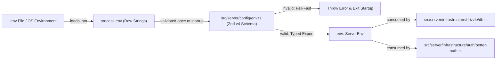

# Milestone 1 — Backend Step 2: Server Config Boundary (src/server/config/)

## 1. เป้าหมายและขอบเขต Boundary (Boundary Context & Goal)

ในขั้นตอนนี้ เราจะสร้างเลเยอร์ **Server Config Boundary** (`src/server/config/env.ts`) ซึ่งทำหน้าที่เป็นด่านหน้าสุดของฝั่งเซิร์ฟเวอร์ในการอ่านและตรวจสอบความถูกต้องของตัวแปรสภาพแวดล้อม (Environment Variables) ทั้งหมดด้วย **Zod v4** แบบ **Fail-Fast** ตั้งแต่จังหวะที่เซิร์ฟเวอร์เริ่มทำงาน

### ตารางสรุปไฟล์ใน Step นี้

| ลำดับ | เส้นทางไฟล์ (Path) | หน้าที่ความรับผิดชอบ (Responsibility) |
| :--- | :--- | :--- |
| 1 | `src/server/config/env.ts` | ตรวจสอบความถูกต้องของ `process.env` ด้วย Zod Schema แบบ Fail-Fast และส่งออกออบเจกต์ `env` ที่มี Type Safety เต็มรูปแบบ |

### แผนภาพการไหลของข้อมูลใน Server Config Boundary



---

## 2. ทฤษฎี ความสำคัญ และกฎสถาปัตยกรรมเฉพาะ Boundary นี้

### 2.1 กฎ Fail-Fast Configuration (`server.md` ข้อ 19)
ตามกฎใน `.agents/rules/server.md` ข้อ 19:
- **ต้องตรวจสอบ Environment Variables ทั้งหมดผ่าน Zod Schema ใน `src/server/config/env.ts` ตอนเริ่มต้นระบบ พร้อม Fail-Fast ทันทีหากค่าที่จำเป็นไม่ครบถ้วนหรือมีรูปแบบไม่ถูกต้อง**
- **ห้ามเข้าถึง `process.env` โดยตรงแบบกระจายตัวในเลเยอร์ Domain, Application หรือ Infrastructure**

### 2.2 เหตุผลเชิงวิศวกรรม (Why Fail-Fast & Single Access Point?)
1. **ป้องกัน Runtime Crash กลางคัน**: หากไม่มีการตรวจสอบตั้งแต่เริ่มต้น แอปพลิเคชันอาจสตาร์ทขึ้นได้ตามปกติ แต่พังทลายลงเมื่อผู้ใช้พยายามล็อกอินครั้งแรกเพราะ `BETTER_AUTH_SECRET` สั้นเกินไป หรือเชื่อมต่อฐานข้อมูลไม่ได้เพราะ `DATABASE_URL` สะกดโปรโตคอลผิด การทำ Fail-Fast ช่วยให้เรารู้ปัญหาตั้งแต่วินาทีแรกที่บูตระบบ
2. **Type Safety & Auto-completion**: `process.env` ของ Node/Bun มีชนิดข้อมูลเป็น `Record<string, string | undefined>` การแปลงผ่าน Zod Schema ทำให้โมดูลอื่นๆ ที่นำเข้า `env` ได้รับชนิดข้อมูลที่แคบและชัดเจน (เช่น `NODE_ENV` เป็น `"development" | "test" | "production"` เท่านั้น)
3. **การใช้ฟีเจอร์ของ Zod v4**:
   - ใช้ `z.url()` ซึ่งเป็น Top-level Validator รูปแบบใหม่ใน Zod v4 สำหรับตรวจสอบความถูกต้องของ URL (`BETTER_AUTH_URL`)
   - ใช้ `z.flattenError(result.error)` ของ Zod v4 เพื่อจัดรูปแบบข้อความแจ้งเตือนข้อผิดพลาดแยกตามชื่อฟิลด์ (`fieldErrors`) ทำให้นักพัฒนาอ่าน Log ใน Terminal แล้วเข้าใจได้ทันทีว่าต้องแก้ค่าใดในไฟล์ `.env`

---

## 3. ลงมือเขียนโค้ด (Step-by-Step Implementation)

### 3.1 ไฟล์ `src/server/config/env.ts`

สร้างไฟล์ `src/server/config/env.ts` และเขียนโค้ดฉบับเต็มดังต่อไปนี้:

```typescript
import { z } from "zod";

const serverEnvSchema = z.object({
	NODE_ENV: z
		.enum(["development", "test", "production"])
		.default("development"),
	DATABASE_URL: z
		.string()
		.min(1, "DATABASE_URL is required")
		.refine(
			(value) =>
				value.startsWith("postgres://") || value.startsWith("postgresql://"),
			"DATABASE_URL must start with postgres:// or postgresql://",
		),
	BETTER_AUTH_SECRET: z
		.string()
		.min(32, "BETTER_AUTH_SECRET must be at least 32 characters"),
	BETTER_AUTH_URL: z
		.url("BETTER_AUTH_URL must be a valid URL")
		.default("http://localhost:3000"),
});

function parseServerEnv() {
	const result = serverEnvSchema.safeParse(process.env);

	if (!result.success) {
		const flattened = z.flattenError(result.error);
		console.error(
			"Invalid server environment variables:",
			flattened.fieldErrors,
		);
		throw new Error(
			"Invalid server environment variables. Check your .env file.",
		);
	}

	return result.data;
}

export const env = parseServerEnv();
export type ServerEnv = typeof env;
```

**คำอธิบายโค้ดอย่างละเอียด:**
1. **`NODE_ENV`**: จำกัดค่าที่เป็นไปได้ให้อยู่ใน `["development", "test", "production"]` เท่านั้น และกำหนดค่าเริ่มต้นเป็น `"development"` หากไม่ได้ระบุไว้
2. **`DATABASE_URL`**: บังคับให้ต้องไม่เป็นสตริงว่าง (`.min(1)`) และตรวจสอบเพิ่มเติมด้วย `.refine(...)` ว่าต้องขึ้นต้นด้วยโปรโตคอล `postgres://` หรือ `postgresql://` เพื่อรับประกันความถูกต้องของ Connection String ก่อนส่งให้ Drizzle ORM และไดรเวอร์ `pg`
3. **`BETTER_AUTH_SECRET`**: บังคับความยาวขั้นต่ำ 32 ตัวอักษร (`.min(32)`) เพื่อความปลอดภัยในการเข้ารหัสและลงนาม Session Token ของ Better Auth
4. **`BETTER_AUTH_URL`**: ตรวจสอบด้วย `z.url(...)` ว่าต้องเป็น URL ที่ถูกต้องตามมาตรฐาน และมีค่าเริ่มต้นเป็น `"http://localhost:3000"`
5. **`parseServerEnv()`**:
   - เรียกใช้ `serverEnvSchema.safeParse(process.env)` เพื่อตรวจสอบค่าทั้งหมดในคราวเดียวโดยไม่โยน `ZodError` ดิบออกไปทันที
   - หากไม่ผ่าน (`!result.success`) จะใช้ `z.flattenError(result.error)` เพื่อสรุปข้อผิดพลาดของทุกฟิลด์ออกทาง `console.error` แล้วจึงโยน `Error("Invalid server environment variables. Check your .env file.")` เพื่อหยุดการทำงานของเซิร์ฟเวอร์ทันที (Fail-Fast)
6. **`export const env` & `export type ServerEnv`**: ประมวลผลทันทีเมื่อโมดูลถูกโหลดครั้งแรก และส่งออกทั้งค่า `env` และชนิดข้อมูล `ServerEnv` เพื่อให้ชั้น Infrastructure นำไปใช้งานต่อ

---

## 4. การตรวจสอบความถูกต้องและ Git Commit (Verification & Commit)

ตรวจสอบคุณภาพโค้ด ความถูกต้องของ Type และการโหลดไฟล์ `env.ts` ด้วยคำสั่งต่อไปนี้:

```bash
# 1. ตรวจสอบ Linting และ Formatting ด้วย Biome
bun run check

# 2. ตรวจสอบ Type Safety ด้วย TypeScript Compiler
bun run typecheck

# 3. ทดสอบรันไฟล์ env.ts ด้วย Bun เพื่อยืนยันว่าไฟล์ .env ผ่านการตรวจสอบ
bun -e 'import { env } from "./src/server/config/env"; console.log("Loaded NODE_ENV:", env.NODE_ENV);'
```

เมื่อตรวจสอบผ่านทั้งหมดแล้ว ให้ทำการบันทึกเข้าสู่ระบบ Git:

```bash
git add src/server/config/env.ts
git commit -m "milestone-1.backend.step-2: Server Config Boundary (env.ts)"
```
