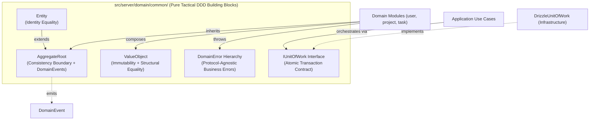

# Milestone 1 — Backend Step 3: Domain Common Boundary (src/server/domain/common/)

## 1. เป้าหมายและขอบเขต Boundary (Boundary Context & Goal)

ในขั้นตอนนี้ เราจะสร้างรากฐานของ **Tactical Domain-Driven Design (DDD)** ไว้ในโฟลเดอร์ `src/server/domain/common/` ซึ่งเป็นหัวใจหลักชั้นในสุดของสถาปัตยกรรม (Pure Domain Layer) ที่ปราศจากการพึ่งพา Framework, Database ORM หรือไลบรารีภายนอกใดๆ ทั้งสิ้น เพื่อให้ทุกโมดูลทางธุรกิจ (เช่น `user`, `project`, `task`) สามารถสืบทอดพฤติกรรมมาตรฐานเดียวกันได้อย่างมั่นคง

### ตารางสรุปไฟล์ใน Step นี้

| ลำดับ | เส้นทางไฟล์ (Path) | หน้าที่ความรับผิดชอบ (Responsibility) |
| :--- | :--- | :--- |
| 1 | `src/server/domain/common/entity.base.ts` | คลาสแม่แบบสำหรับ Domain Entity ที่ตัดสินความเท่ากันด้วย Identity (`_id`) |
| 2 | `src/server/domain/common/aggregate-root.base.ts` | คลาสแม่แบบสำหรับ Aggregate Root ที่สืบทอดจาก `Entity` พร้อมระบบจัดการ `DomainEvent` |
| 3 | `src/server/domain/common/value-object.base.ts` | คลาสแม่แบบสำหรับ Value Object ที่เป็น Immutable และตัดสินความเท่ากันด้วยโครงสร้างข้อมูลภายใน (Structural Equality) |
| 4 | `src/server/domain/common/errors.ts` | ลำดับชั้นของข้อผิดพลาดทางธุรกิจ (`DomainError` และคลาสลูก) ที่ไม่ผูกติดกับโปรโตคอล HTTP |
| 5 | `src/server/domain/common/unit-of-work.interface.ts` | สัญญา (`IUnitOfWork`) สำหรับควบคุม Atomic Transaction ข้ามหลาย Aggregate โดยไม่รั่วไหลรายละเอียดของ Database |

### แผนภาพโครงสร้างและความสัมพันธ์ของ Domain Common Building Blocks



---

## 2. ทฤษฎี ความสำคัญ และกฎสถาปัตยกรรมเฉพาะ Boundary นี้

### 2.1 กฎความบริสุทธิ์ของ Domain (`server.md` ข้อ 1 และ ข้อ 4)
- **Inward Dependency Rule (`server.md` ข้อ 1)**: โฟลเดอร์ `src/server/domain/` ห้ามนำเข้า (import) สิ่งใดจาก `application/`, `infrastructure/`, `composition/`, `server-functions/` หรือไลบรารีภายนอก สังเกตได้ว่าทั้ง 5 ไฟล์ใน `src/server/domain/common/` เขียนด้วย Pure TypeScript ล้วน 100%
- **Encapsulation & Rich Domain Model (`server.md` ข้อ 4)**: สถานะภายในของ Entity และ Value Object จะถูกเก็บไว้ใน `protected props` หรือ `private` เพื่อบังคับให้การเปลี่ยนแปลงสถานะต้องทำผ่าน Domain Methods ที่มีการตรวจสอบกฎทางธุรกิจ (Business Invariants) เท่านั้น ห้ามแก้ไขฟิลด์จากภายนอกโดยตรง

### 2.2 ความแตกต่างระหว่าง `Entity`, `AggregateRoot` และ `ValueObject`
1. **`Entity` (Identity Equality)**:
   - คือสิ่งที่ระบุตัวตนได้ด้วยรหัสอ้างอิง (`_id`) แม้ข้อมูลภายใน (`props`) เช่น ชื่อผู้ใช้หรือสถานะของงานจะเปลี่ยนไปตามกาลเวลา แต่ตราบใดที่เป็นคลาสเดียวกันและมี `_id` เดียวกัน ระบบจะถือว่าเป็น Entity ตัวเดียวกันเสมอ (`this._id === other._id`)
2. **`AggregateRoot` (Consistency Boundary & Domain Events)**:
   - คือ Entity หลักที่ทำหน้าที่เป็นประตูทางเข้าและผู้พิทักษ์ความถูกต้องของกลุ่มออบเจกต์ (Aggregate)
   - มีกลไกเก็บสะสมเหตุการณ์ทางธุรกิจ (`_domainEvents`) ผ่าน `addDomainEvent(...)` และดึงออกไปประมวลผลพร้อมล้างคิวผ่าน `pullDomainEvents()`
3. **`ValueObject` (Structural Equality & Immutability)**:
   - คือออบเจกต์ที่ไม่มีรหัสประจำตัว (`id`) เช่น อีเมล ช่วงวันที่ หรือสถานะ แต่มีความหมายจาก "ค่าข้างใน" ล้วนๆ
   - ต้องเป็น **Immutable** (ไม่สามารถแก้ไขค่าได้หลังสร้างเสร็จ จึงใช้ `Object.freeze({ ...props })` ใน constructor) หากต้องการเปลี่ยนค่าต้องสร้างอินสแตนซ์ใหม่เสมอ
   - การเปรียบเทียบความเท่ากัน (`equals`) ใช้การเปรียบเทียบค่าทุกฟิลด์เชิงลึก (`areValuesEqual`) รองรับทั้ง Primitive, `Date`, `Array` และ Plain Object

### 2.3 การออกแบบ `DomainError` โดยไม่ผูกติดกับ HTTP Status Code (`server.md` ข้อ 7)
- ตามกฎ `server.md` ข้อ 7: **ข้อผิดพลาดใน Domain ต้องสะท้อนถึงการละเมิดกฎทางธุรกิจ ไม่ใช่สถานะของโปรโตคอลเครือข่าย**
- ดังนั้น `DomainError` จึงกำหนดรหัสความหมายทางธุรกิจ (`DomainErrorCode`) ได้แก่ `"DOMAIN_VALIDATION_ERROR"`, `"NOT_FOUND"`, `"CONFLICT"`, `"FORBIDDEN"`, และ `"INVALID_STATE_TRANSITION"` โดยไม่มีตัวเลข HTTP เช่น `400`, `403`, `404`, `409`, `422` ปะปนอยู่ในเลเยอร์ Domain เลย (การแปลงเป็น HTTP Status จะเป็นหน้าที่ของ Gateway Middleware ใน Step 4)

### 2.4 สัญญา `IUnitOfWork` เพื่อรักษา Consistency Boundary (`server.md` ข้อ 12 และ ข้อ 16)
- เมื่อ Use Case จำเป็นต้องบันทึกข้อมูลหลาย Aggregate หรือหลายตารางพร้อมกันภายใต้ Transaction เดียวกัน Use Case จะเรียกผ่าน `IUnitOfWork.withTransaction(...)`
- สัญญานี้รับเพียงฟังก์ชัน `work: () => Promise<T>` โดยไม่มีการส่งตัวแปร `tx` ของ Database เข้าไปในพารามิเตอร์ เพื่อป้องกันไม่ให้รายละเอียดของ Drizzle ORM รั่วไหลเข้าสู่ Domain และ Application Layer

---

## 3. ลงมือเขียนโค้ด (Step-by-Step Implementation)

### 3.1 ไฟล์ `src/server/domain/common/entity.base.ts`

สร้างไฟล์ `src/server/domain/common/entity.base.ts`:

```typescript
export abstract class Entity<TProps, TId = string> {
	protected readonly _id: TId;
	protected props: TProps;

	protected constructor(id: TId, props: TProps) {
		this._id = id;
		this.props = props;
	}

	get id(): TId {
		return this._id;
	}

	equals(other?: Entity<TProps, TId>): boolean {
		if (!other) {
			return false;
		}
		if (this === other) {
			return true;
		}
		if (other.constructor !== this.constructor) {
			return false;
		}
		return this._id === other._id;
	}
}
```

**คำอธิบายโค้ด:**
- `protected constructor(id: TId, props: TProps)`: กำหนดให้เป็น `protected` เพื่อห้ามไม่ให้โค้ดภายนอกสั่ง `new Entity(...)` โดยตรงตามกฎ `server.md` ข้อ 5 (ต้องสร้างผ่าน Static Factory Method ของคลาสลูกเท่านั้น)
- `equals(other?: Entity<TProps, TId>)`: ตรวจสอบว่ามีออบเจกต์เปรียบเทียบหรือไม่ เป็นอินสแตนซ์เดียวกันหรือไม่ มาจากคลาสเดียวกันหรือไม่ (`other.constructor !== this.constructor`) และสุดท้ายเปรียบเทียบความเท่ากันด้วย `this._id === other._id`

---

### 3.2 ไฟล์ `src/server/domain/common/aggregate-root.base.ts`

สร้างไฟล์ `src/server/domain/common/aggregate-root.base.ts`:

```typescript
import { Entity } from "./entity.base";

export interface DomainEvent {
	readonly eventName: string;
	readonly occurredAt: Date;
}

export abstract class AggregateRoot<TProps, TId = string> extends Entity<
	TProps,
	TId
> {
	private readonly _domainEvents: DomainEvent[] = [];

	protected addDomainEvent(event: DomainEvent): void {
		this._domainEvents.push(event);
	}

	pullDomainEvents(): readonly DomainEvent[] {
		const events = [...this._domainEvents];
		this._domainEvents.length = 0;
		return events;
	}
}
```

**คำอธิบายโค้ด:**
- `DomainEvent`: อินเทอร์เฟซมาตรฐานสำหรับเหตุการณ์ที่เกิดขึ้นในโดเมน ประกอบด้วยชื่อเหตุการณ์ (`eventName`) และเวลาที่เกิดเหตุการณ์ (`occurredAt`)
- `addDomainEvent(event)`: เมธอด `protected` สำหรับให้ Aggregate Root บันทึกเหตุการณ์เมื่อเกิดการเปลี่ยนแปลงสถานะที่สำคัญ
- `pullDomainEvents()`: คืนค่าสำเนาของรายการเหตุการณ์ทั้งหมดที่สะสมไว้ พร้อมล้างอาร์เรย์ภายใน (`this._domainEvents.length = 0`) เพื่อไม่ให้เหตุการณ์ถูกส่งซ้ำ

---

### 3.3 ไฟล์ `src/server/domain/common/value-object.base.ts`

สร้างไฟล์ `src/server/domain/common/value-object.base.ts`:

```typescript
function isPlainObject(value: unknown): value is Record<string, unknown> {
	return (
		typeof value === "object" &&
		value !== null &&
		!(value instanceof Date) &&
		!Array.isArray(value)
	);
}

function areValuesEqual(left: unknown, right: unknown): boolean {
	if (Object.is(left, right)) {
		return true;
	}

	if (left instanceof Date && right instanceof Date) {
		return left.getTime() === right.getTime();
	}

	if (Array.isArray(left) && Array.isArray(right)) {
		if (left.length !== right.length) {
			return false;
		}
		return left.every((item, index) => areValuesEqual(item, right[index]));
	}

	if (isPlainObject(left) && isPlainObject(right)) {
		const leftKeys = Object.keys(left);
		const rightKeys = Object.keys(right);
		if (leftKeys.length !== rightKeys.length) {
			return false;
		}
		return leftKeys.every(
			(key) =>
				Object.hasOwn(right, key) && areValuesEqual(left[key], right[key]),
		);
	}

	return false;
}

export abstract class ValueObject<TProps extends object> {
	protected readonly props: Readonly<TProps>;

	protected constructor(props: TProps) {
		this.props = Object.freeze({ ...props });
	}

	equals(other?: ValueObject<TProps>): boolean {
		if (!other) {
			return false;
		}
		if (this === other) {
			return true;
		}
		if (other.constructor !== this.constructor) {
			return false;
		}
		return areValuesEqual(this.props, other.props);
	}
}
```

**คำอธิบายโค้ด:**
- `Object.freeze({ ...props })`: แช่แข็ง `props` ทันทีที่สร้าง Value Object เพื่อรับประกันคุณสมบัติ Immutability ในระดับรันไทม์
- `areValuesEqual(left, right)`: ฟังก์ชันเปรียบเทียบความเท่ากันเชิงโครงสร้างแบบ Recursive ที่จัดการกรณีพิเศษของ JavaScript ได้อย่างครบถ้วน ทั้ง `Object.is` (จัดการ `NaN` และ `-0/+0`), `Date` (เทียบด้วย `.getTime()`), `Array` และ Plain Object

---

### 3.4 ไฟล์ `src/server/domain/common/errors.ts`

สร้างไฟล์ `src/server/domain/common/errors.ts`:

```typescript
export type DomainErrorCode =
	| "DOMAIN_VALIDATION_ERROR"
	| "NOT_FOUND"
	| "CONFLICT"
	| "FORBIDDEN"
	| "INVALID_STATE_TRANSITION";

export abstract class DomainError extends Error {
	readonly code: DomainErrorCode;

	protected constructor(message: string, code: DomainErrorCode) {
		super(message);
		this.name = new.target.name;
		this.code = code;
	}
}

export class ValidationDomainError extends DomainError {
	constructor(message: string) {
		super(message, "DOMAIN_VALIDATION_ERROR");
	}
}

export class NotFoundDomainError extends DomainError {
	constructor(message: string) {
		super(message, "NOT_FOUND");
	}
}

export class ConflictDomainError extends DomainError {
	constructor(message: string) {
		super(message, "CONFLICT");
	}
}

export class ForbiddenDomainError extends DomainError {
	constructor(message: string) {
		super(message, "FORBIDDEN");
	}
}

export class InvalidStateTransitionError extends DomainError {
	constructor(message: string) {
		super(message, "INVALID_STATE_TRANSITION");
	}
}
```

**คำอธิบายโค้ด:**
- `this.name = new.target.name`: ตั้งชื่อของ Error Instance ตามชื่อคลาสลูกที่ถูก `new` ขึ้นมาจริง (เช่น `"NotFoundDomainError"`) ช่วยให้การตรวจสอบ Stack Trace และ Log ชัดเจน
- คลาสลูกทั้ง 5 ตัวครอบคลุมสถานการณ์ทางธุรกิจหลักทั้งหมด:
  - `ValidationDomainError` (`"DOMAIN_VALIDATION_ERROR"`): ข้อมูลไม่ผ่านกฎความถูกต้องของโดเมน
  - `NotFoundDomainError` (`"NOT_FOUND"`): ไม่พบข้อมูลที่ร้องขอในระบบ
  - `ConflictDomainError` (`"CONFLICT"`): ข้อมูลซ้ำซ้อนหรือขัดแย้งกับสถานะปัจจุบัน (เช่น อีเมลซ้ำ หรือ Optimistic Lock Version ไม่ตรงกัน)
  - `ForbiddenDomainError` (`"FORBIDDEN"`): ผู้ใช้ไม่มีสิทธิ์กระทำการดังกล่าวตามกฎธุรกิจ
  - `InvalidStateTransitionError` (`"INVALID_STATE_TRANSITION"`): การเปลี่ยนสถานะหรือการฝ่าฝืน Invariant ของสถานะที่ไม่สามารถทำได้

---

### 3.5 ไฟล์ `src/server/domain/common/unit-of-work.interface.ts`

สร้างไฟล์ `src/server/domain/common/unit-of-work.interface.ts`:

```typescript
export interface IUnitOfWork {
	withTransaction<T>(work: () => Promise<T>): Promise<T>;
}
```

**คำอธิบายโค้ด:**
- นิยามสัญญา `IUnitOfWork` ที่เรียบง่ายและบริสุทธิ์ที่สุด เพื่อให้ Application Use Case สามารถห่อหุ้มการทำงานหลายขั้นตอนไว้ภายใต้ `uow.withTransaction(async () => { ... })` ได้โดยไม่ต้องรู้จัก Database Driver

---

## 4. การตรวจสอบความถูกต้องและ Git Commit (Verification & Commit)

รันคำสั่งตรวจสอบมาตรฐานโค้ดด้วย Biome และตรวจสอบ Type Safety ด้วย TypeScript:

```bash
# 1. ตรวจสอบ Linting และ Formatting
bun run check

# 2. ตรวจสอบ Type Safety
bun run typecheck
```

เมื่อไม่มีข้อผิดพลาด ให้บันทึกไฟล์ทั้งหมดใน Step ที่ 3 เข้าสู่ Git Repository:

```bash
git add src/server/domain/common/entity.base.ts src/server/domain/common/aggregate-root.base.ts src/server/domain/common/value-object.base.ts src/server/domain/common/errors.ts src/server/domain/common/unit-of-work.interface.ts
git commit -m "milestone-1.backend.step-3: Tactical DDD Domain Common Building Blocks"
```
