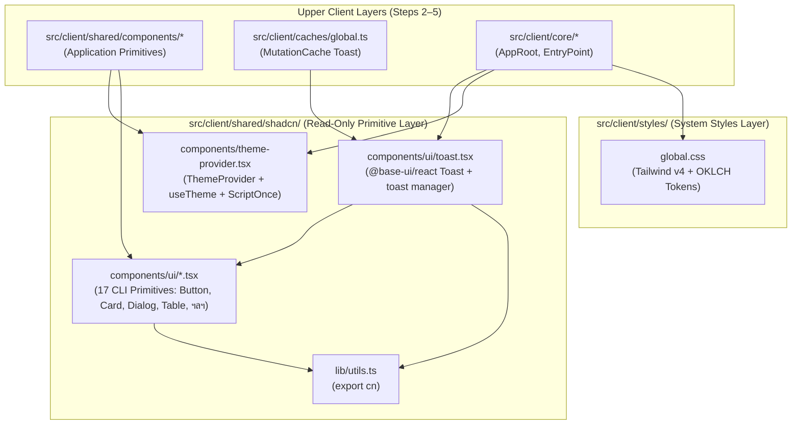

# Milestone 1 — Frontend Step 1: Global Styles & shadcn UI Primitives (src/client/styles/ & src/client/shared/shadcn/)

ในขั้นตอนแรกของฝั่ง Frontend (Milestone 1 — Step 1) เราจะวางรากฐานของระบบ **Design System**, **Global Styles (Tailwind CSS v4 + OKLCH Tokens)**, **Theme Provider (Light/Dark/System SSR-safe)** และชุด **shadcn UI Primitives (`base-vega` / `@base-ui/react`)** ซึ่งทำหน้าที่เป็นเลเยอร์พื้นฐานด้านการแสดงผลระดับล่างสุดของแอปพลิเคชัน TaskFlow

---

## 1. เป้าหมายและขอบเขต Boundary (Boundary Context & Goal)

ในสถาปัตยกรรมฝั่ง Client (`src/client/`) เลเยอร์ `styles/` และ `shared/shadcn/` คือรากฐานของ Visual Language ทั้งระบบ ทุกหน้าจอและทุกคอมโพเนนต์ในชั้นถัดไปจะอ้างอิง Semantic Tokens และ Headless UI Primitives จากเลเยอร์นี้โดยตรง

### ตารางสรุปไฟล์ใน Step นี้

| ลำดับ | เส้นทางไฟล์ / คำสั่ง | บทบาทหน้าที่ |
| :--- | :--- | :--- |
| 1 | `components.json` | ไฟล์กำหนดค่าโครงสร้าง `shadcn` (สไตล์ `base-vega`, พิกัด CSS และ Path Aliases) |
| 2 | `src/client/styles/global.css` | ไฟล์สไตล์หลักระดับระบบ: Tailwind CSS v4 Directives, ฟอนต์ Google Sans Variable และ OKLCH Theme Tokens (`:root`, `.dark`) |
| 3 | `src/client/shared/shadcn/lib/utils.ts` | Utility มาตรฐานสำหรับผสานคลาส Tailwind CSS (`cn`) |
| 4 | `src/client/shared/shadcn/components/theme-provider.tsx` | Context Provider สำหรับจัดการธีม (`light`, `dark`, `system`) พร้อม `<ScriptOnce>` ป้องกันปัญหาหน้าจอกะพริบตอนโหลด (FOUC) บน SSR |
| 5 | `src/client/shared/shadcn/components/ui/*.tsx` (17 ไฟล์) | ชุด UI Primitives มาตรฐานที่ติดตั้งผ่าน CLI `bun x shadcn@latest add ...` |
| 6 | `src/client/shared/shadcn/components/ui/toast.tsx` | Custom Toast Primitive ที่ขับเคลื่อนด้วย `@base-ui/react/toast` พร้อม `createToastManager()` สำหรับแจ้งเตือนทั่วทั้งแอปพลิเคชัน |

### แผนผังสถาปัตยกรรมและการพึ่งพา (Architecture & Dependency Diagram)



---

## 2. ทฤษฎี ความสำคัญ และกฎสถาปัตยกรรมเฉพาะ Boundary นี้

การวางโครงสร้าง `styles/` และ `shared/shadcn/` ในโปรเจกต์ TaskFlow อยู่ภายใต้กฎเหล็กจาก `.agents/rules/client.md` เพื่อป้องกันหนี้ทางเทคนิค (Technical Debt) และความเพี้ยนของ UI ดังนี้:

### 2.1 กฎข้อ 14: `src/client/shared/shadcn/**` คือ Read-Only Primitive Layer
- **หลักการ**: ถือว่าไฟล์ทั้งหมดภายใต้ `src/client/shared/shadcn/**` เป็น **Read-Only Primitive Layer** ห้ามแก้ไขหรือดัดแปลงโค้ดภายในคอมโพเนนต์เหล่านี้เพื่อรองรับ Business Logic เฉพาะจุดโดยเด็ดขาด
- **เหตุผลเชิงวิศวกรรม**: shadcn primitives เป็น Headless/Unstyled Primitives พื้นฐานระดับระบบ หากเราเข้าไปแก้โค้ดใน `button.tsx` หรือ `select.tsx` โดยตรง จะทำให้เกิดผลกระทบข้างเคียง (Side-effects) กับทุกหน้าจอที่ใช้คอมโพเนนต์นั้น และทำให้ไม่สามารถอัปเกรดผ่าน CLI ในอนาคตได้ หากต้องการเพิ่มพฤติกรรมเฉพาะของแอปพลิเคชัน ให้สร้าง Wrapper ใน `src/client/shared/components/*` (ซึ่งเราจะทำใน Step 2) เท่านั้น

### 2.2 กฎข้อ 15: ห้ามใส่ `border-*` หรือ `ring-*` บน HTML Element ดิบโดยพลการ
- **หลักการ**: การสร้างกรอบ (Visual Boundary), เส้นคั่น หรือเงา ต้องทำผ่าน Primitive Component ของ shadcn เท่านั้น เช่น ใช้ `<Card>` สำหรับกรอบคอนเทนเนอร์, ใช้ `<Separator />` สำหรับเส้นแบ่งส่วน หรือใช้ Variant ของคอมโพเนนต์ เช่น `<Button variant="outline">` **ห้ามเขียน `<div className="border ...">` หรือ `<div className="border-border">` เองเด็ดขาด**
- **เหตุผลเชิงวิศวกรรม**: เพื่อให้ Visual Boundary ทั้งระบบถูกควบคุมจากศูนย์กลางผ่าน Semantic Tokens (`--border`, `--ring`, `--input`, `--radius`) รับประกันความสม่ำเสมอของความโค้งมนและสีสันทั้งในโหมด Light และ Dark

### 2.3 กฎข้อ 17: ห้ามสร้าง Custom CSS Classes ใน `src/client/styles/*`
- **หลักการ**: ไฟล์ `src/client/styles/global.css` มีหน้าที่เฉพาะโครงสร้างระดับระบบ (System-level Infrastructure) เท่านั้น ได้แก่ `@import` ของ Tailwind CSS v4, การผูก `@theme inline`, การประกาศ CSS Variables ใน `:root` และ `.dark` (ด้วยปริภูมิสี OKLCH) และ `@layer base` เบื้องต้น ห้ามสร้าง Custom CSS Class หรือ Keyframes แยกเอง
- **เหตุผลเชิงวิศวกรรม**: ป้องกันปัญหา "Shadow CSS" หรือสไตล์แฝงที่อยู่นอกเหนือระบบ Utility-first ของ Tailwind CSS ซึ่งมักนำไปสู่ปัญหา Class Collision และ Dead CSS

### 2.4 กฎข้อ 18: ห้ามใช้ Emoji บน UI เด็ดขาด (ใช้เฉพาะ Lucide SVG Icons)
- **หลักการ**: สัญลักษณ์และไอคอนทั้งหมดในระบบต้องใช้ SVG Icon จาก `lucide-react` เท่านั้น (เช่น `CircleCheckIcon`, `TriangleAlertIcon`, `OctagonXIcon` ใน `toast.tsx`) ห้ามใช้ตัวอักษร Emoji
- **เหตุผลเชิงวิศวกรรม**: Emoji แสดงผลไม่เหมือนกันในแต่ละระบบปฏิบัติการ (Windows, macOS, Linux) และไม่สามารถปรับสีตาม `currentColor` หรือขนาดตาม Design Token ได้

---

## 3. ลงมือเขียนโค้ด (Step-by-Step Implementation)

### 3.1 ตรวจสอบไฟล์กำหนดค่า `components.json`

ไฟล์ `components.json` ที่ระดับ Root ของโปรเจกต์กำหนดให้ shadcn CLI ทราบว่าต้องติดตั้งคอมโพเนนต์แบบ `base-vega` (ขับเคลื่อนด้วย `@base-ui/react`) ลงในพาธ `#/client/shared/shadcn/...`

**ไฟล์: `components.json`**
```json
{
	"$schema": "https://ui.shadcn.com/schema.json",
	"style": "base-vega",
	"rsc": false,
	"tsx": true,
	"tailwind": {
		"config": "",
		"css": "src/client/styles/global.css",
		"baseColor": "neutral",
		"cssVariables": true,
		"prefix": ""
	},
	"iconLibrary": "lucide",
	"rtl": false,
	"aliases": {
		"components": "#/client/shared/shadcn/components",
		"utils": "#/client/shared/shadcn/lib/utils",
		"ui": "#/client/shared/shadcn/components/ui",
		"lib": "#/client/shared/shadcn/lib",
		"hooks": "#/client/shared/shadcn/hooks"
	},
	"menuColor": "default",
	"menuAccent": "subtle",
	"registries": {}
}
```

---

### 3.2 สร้างไฟล์ Global Styles และ OKLCH Design Tokens

สร้างไฟล์ `src/client/styles/global.css` เพื่อนำเข้า Tailwind CSS v4, แอนิเมชัน `tw-animate-css`, สไตล์ฐานของ `shadcn` และฟอนต์ `Google Sans Variable` พร้อมกำหนดตัวแปรสีแบบ OKLCH สำหรับทั้งโหมดสว่าง (`:root`) และโหมดมืด (`.dark`)

**ไฟล์: `src/client/styles/global.css`**
```css
@import "tailwindcss";
@import "tw-animate-css";
@import "shadcn/tailwind.css";
@import "@fontsource-variable/google-sans";

@custom-variant dark (&:is(.dark *));

@theme inline {
	--font-heading: var(--font-sans);
	--font-sans: "Google Sans Variable", sans-serif;
	--color-sidebar-ring: var(--sidebar-ring);
	--color-sidebar-border: var(--sidebar-border);
	--color-sidebar-accent-foreground: var(--sidebar-accent-foreground);
	--color-sidebar-accent: var(--sidebar-accent);
	--color-sidebar-primary-foreground: var(--sidebar-primary-foreground);
	--color-sidebar-primary: var(--sidebar-primary);
	--color-sidebar-foreground: var(--sidebar-foreground);
	--color-sidebar: var(--sidebar);
	--color-chart-5: var(--chart-5);
	--color-chart-4: var(--chart-4);
	--color-chart-3: var(--chart-3);
	--color-chart-2: var(--chart-2);
	--color-chart-1: var(--chart-1);
	--color-ring: var(--ring);
	--color-input: var(--input);
	--color-border: var(--border);
	--color-destructive: var(--destructive);
	--color-accent-foreground: var(--accent-foreground);
	--color-accent: var(--accent);
	--color-muted-foreground: var(--muted-foreground);
	--color-muted: var(--muted);
	--color-secondary-foreground: var(--secondary-foreground);
	--color-secondary: var(--secondary);
	--color-primary-foreground: var(--primary-foreground);
	--color-primary: var(--primary);
	--color-popover-foreground: var(--popover-foreground);
	--color-popover: var(--popover);
	--color-card-foreground: var(--card-foreground);
	--color-card: var(--card);
	--color-foreground: var(--foreground);
	--color-background: var(--background);
	--radius-sm: calc(var(--radius) * 0.6);
	--radius-md: calc(var(--radius) * 0.8);
	--radius-lg: var(--radius);
	--radius-xl: calc(var(--radius) * 1.4);
	--radius-2xl: calc(var(--radius) * 1.8);
	--radius-3xl: calc(var(--radius) * 2.2);
	--radius-4xl: calc(var(--radius) * 2.6);
}

:root {
	--background: oklch(1 0 0);
	--foreground: oklch(0.145 0 0);
	--card: oklch(1 0 0);
	--card-foreground: oklch(0.145 0 0);
	--popover: oklch(1 0 0);
	--popover-foreground: oklch(0.145 0 0);
	--primary: oklch(0.205 0 0);
	--primary-foreground: oklch(0.985 0 0);
	--secondary: oklch(0.97 0 0);
	--secondary-foreground: oklch(0.205 0 0);
	--muted: oklch(0.97 0 0);
	--muted-foreground: oklch(0.556 0 0);
	--accent: oklch(0.97 0 0);
	--accent-foreground: oklch(0.205 0 0);
	--destructive: oklch(0.577 0.245 27.325);
	--border: oklch(0.922 0 0);
	--input: oklch(0.922 0 0);
	--ring: oklch(0.708 0 0);
	--chart-1: oklch(0.87 0 0);
	--chart-2: oklch(0.556 0 0);
	--chart-3: oklch(0.439 0 0);
	--chart-4: oklch(0.371 0 0);
	--chart-5: oklch(0.269 0 0);
	--radius: 0.875rem;
	--sidebar: oklch(0.985 0 0);
	--sidebar-foreground: oklch(0.145 0 0);
	--sidebar-primary: oklch(0.205 0 0);
	--sidebar-primary-foreground: oklch(0.985 0 0);
	--sidebar-accent: oklch(0.97 0 0);
	--sidebar-accent-foreground: oklch(0.205 0 0);
	--sidebar-border: oklch(0.922 0 0);
	--sidebar-ring: oklch(0.708 0 0);
}

.dark {
	--background: oklch(0.145 0 0);
	--foreground: oklch(0.985 0 0);
	--card: oklch(0.205 0 0);
	--card-foreground: oklch(0.985 0 0);
	--popover: oklch(0.205 0 0);
	--popover-foreground: oklch(0.985 0 0);
	--primary: oklch(0.922 0 0);
	--primary-foreground: oklch(0.205 0 0);
	--secondary: oklch(0.269 0 0);
	--secondary-foreground: oklch(0.985 0 0);
	--muted: oklch(0.269 0 0);
	--muted-foreground: oklch(0.708 0 0);
	--accent: oklch(0.269 0 0);
	--accent-foreground: oklch(0.985 0 0);
	--destructive: oklch(0.704 0.191 22.216);
	--border: oklch(1 0 0 / 10%);
	--input: oklch(1 0 0 / 15%);
	--ring: oklch(0.556 0 0);
	--chart-1: oklch(0.87 0 0);
	--chart-2: oklch(0.556 0 0);
	--chart-3: oklch(0.439 0 0);
	--chart-4: oklch(0.371 0 0);
	--chart-5: oklch(0.269 0 0);
	--sidebar: oklch(0.205 0 0);
	--sidebar-foreground: oklch(0.985 0 0);
	--sidebar-primary: oklch(0.488 0.243 264.376);
	--sidebar-primary-foreground: oklch(0.985 0 0);
	--sidebar-accent: oklch(0.269 0 0);
	--sidebar-accent-foreground: oklch(0.985 0 0);
	--sidebar-border: oklch(1 0 0 / 10%);
	--sidebar-ring: oklch(0.556 0 0);
}

@layer base {
	* {
		@apply border-border outline-ring/50;
	}
	body {
		@apply bg-background text-foreground;
	}
	button:not(:disabled),
	[role="button"]:not(:disabled) {
		cursor: pointer;
	}
	html {
		@apply font-sans;
	}
}
```

#### คำอธิบายโค้ด `global.css`:
1. **`@custom-variant dark (&:is(.dark *));`**: กำหนดให้ตัวแปร `dark:` ของ Tailwind v4 ทำงานเมื่อมีคลาส `.dark` อยู่บน `<html>`
2. **`@theme inline`**: ผูก CSS Variables ของ shadcn เข้ากับระบบ Theme Token ของ Tailwind v4 เช่น `bg-background`, `text-foreground`, `border-border` และสเกลความโค้งมน `--radius-sm` ถึง `--radius-4xl` จากฐาน `--radius: 0.875rem`
3. **`@layer base`**: กำหนดให้ `<button>` และ `[role="button"]` ที่ไม่ได้ถูก `disabled` แสดงเมาส์เป็น `cursor: pointer` เสมอ และใช้ฟอนต์ `Google Sans Variable` เป็นค่าเริ่มต้นของ `html`

---

### 3.3 สร้างไฟล์ Utility `src/client/shared/shadcn/lib/utils.ts`

สร้างไฟล์ `utils.ts` ซึ่งส่งออกฟังก์ชัน `cn` สำหรับรวมคลาส CSS อย่างปลอดภัย

**ไฟล์: `src/client/shared/shadcn/lib/utils.ts`**
```ts
export { cn } from "cn"
```

---

### 3.4 สร้างไฟล์ `src/client/shared/shadcn/components/theme-provider.tsx`

สร้าง `ThemeProvider` และ Hook `useTheme()` สำหรับควบคุมโหมดสี (`light`, `dark`, `system`) โดยใช้ `<ScriptOnce>` จาก `@tanstack/react-router` เพื่อฉีดสคริปต์ตรวจสอบค่าจาก `localStorage` และ `prefers-color-scheme` ลงใน `<head>` ก่อนที่เบราว์เซอร์จะวาดหน้าจอ (ป้องกันอาการหน้าจอกะพริบขาวหรือ Flash of Unstyled Content ในระบบ SSR)

**ไฟล์: `src/client/shared/shadcn/components/theme-provider.tsx`**
```tsx
import { createContext, useContext, useEffect, useState } from "react"
import { ScriptOnce } from "@tanstack/react-router"

type Theme = "dark" | "light" | "system"

type ThemeProviderProps = {
  children: React.ReactNode
  defaultTheme?: Theme
  storageKey?: string
}

type ThemeProviderState = {
  theme: Theme
  setTheme: (theme: Theme) => void
}

function getThemeScript(storageKey: string, defaultTheme: Theme) {
  const key = JSON.stringify(storageKey)
  const fallback = JSON.stringify(defaultTheme)

  return `(function(){try{var t=localStorage.getItem(${key});if(t!=='light'&&t!=='dark'&&t!=='system'){t=${fallback}}var d=matchMedia('(prefers-color-scheme: dark)').matches;var r=t==='system'?(d?'dark':'light'):t;var e=document.documentElement;e.classList.add(r);e.style.colorScheme=r}catch(e){}})();`
}

const ThemeProviderContext = createContext<ThemeProviderState>({
  theme: "system",
  setTheme: () => {},
})

function applyTheme(theme: Theme) {
  const root = document.documentElement
  root.classList.remove("light", "dark")

  const resolved =
    theme === "system"
      ? window.matchMedia("(prefers-color-scheme: dark)").matches
        ? "dark"
        : "light"
      : theme

  root.classList.add(resolved)
  root.style.colorScheme = resolved
}

export function ThemeProvider({
  children,
  defaultTheme = "system",
  storageKey = "theme",
}: ThemeProviderProps) {
  const [theme, setThemeState] = useState<Theme>(defaultTheme)
  const [mounted, setMounted] = useState(false)

  useEffect(() => {
    const stored = localStorage.getItem(storageKey)
    setThemeState(
      stored === "light" || stored === "dark" || stored === "system"
        ? stored
        : defaultTheme
    )
    setMounted(true)
  }, [defaultTheme, storageKey])

  useEffect(() => {
    if (!mounted) return
    applyTheme(theme)
  }, [theme, mounted])

  useEffect(() => {
    if (!mounted || theme !== "system") return

    const media = window.matchMedia("(prefers-color-scheme: dark)")
    const onChange = () => applyTheme("system")
    media.addEventListener("change", onChange)
    return () => media.removeEventListener("change", onChange)
  }, [theme, mounted])

  const setTheme = (next: Theme) => {
    localStorage.setItem(storageKey, next)
    setThemeState(next)
  }

  return (
    <ThemeProviderContext value={{ theme, setTheme }}>
      <ScriptOnce>{getThemeScript(storageKey, defaultTheme)}</ScriptOnce>
      {children}
    </ThemeProviderContext>
  )
}

export function useTheme() {
  const context = useContext(ThemeProviderContext)
  if (context === undefined)
    throw new Error("useTheme must be used within a ThemeProvider")
  return context
}
```

---

### 3.5 ติดตั้ง shadcn UI Primitives ทั้ง 17 รายการผ่าน CLI

รันคำสั่ง CLI ด้วย `bun` (ตามกฎ `globals.md` ข้อ 11 ห้ามใช้ `npx`/`npm`) เพื่อติดตั้ง UI Primitives พื้นฐานลงใน `src/client/shared/shadcn/components/ui/`:

```bash
bun x shadcn@latest add avatar badge button card checkbox dialog dropdown-menu empty field input input-group item kbd label select separator skeleton table tabs textarea toast
```

คำสั่งนี้จะสร้างไฟล์ Primitive 17 ไฟล์ใน `src/client/shared/shadcn/components/ui/` ได้แก่:
- `avatar.tsx`, `badge.tsx`, `button.tsx`, `card.tsx`, `checkbox.tsx`, `dialog.tsx`, `dropdown-menu.tsx`, `empty.tsx`, `field.tsx`, `input.tsx`, `input-group.tsx`, `item.tsx`, `kbd`, `label.tsx`, `select.tsx`, `separator.tsx`, `skeleton.tsx`, `table.tsx`, `tabs.tsx`, `textarea.tsx`, `toast.tsx`

---

## 4. การตรวจสอบความถูกต้องและ Git Commit (Verification & Commit)

ตรวจสอบว่าไฟล์ทั้งหมดใน `src/client/styles/` และ `src/client/shared/shadcn/` ไม่มีปัญหาด้าน Type:

```bash
bun run typecheck
```

เมื่อตรวจสอบผ่านแล้ว ให้บันทึกสถานะงานของ Step 1 ลงใน Git:

```bash
git add components.json src/client/styles/global.css src/client/shared/shadcn/
git commit -m "milestone-1.frontend.step-1: Global Styles, Theme Provider & shadcn Primitives"
```
