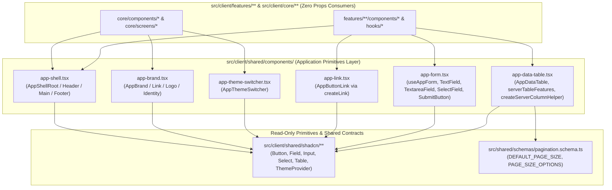

# Milestone 1 — Frontend Step 2: Client Shared Primitives (src/client/shared/components/)

ในขั้นตอนที่ 2 ของฝั่ง Frontend (Milestone 1 — Step 2) เราจะสร้างเลเยอร์ **Client Shared Application Primitives (`src/client/shared/components/`)** ซึ่งทำหน้าที่เป็นสะพานเชื่อม (Adapter/Wrapper Layer) ระหว่าง Read-Only shadcn Primitives (`src/client/shared/shadcn/`) และไลบรารีตระกูล TanStack (`@tanstack/react-router`, `@tanstack/react-form`, `@tanstack/react-table`) เข้าด้วยกัน เพื่อให้ชั้น Feature Components สามารถนำไปประกอบหน้าจอภายใต้กฎ **Zero Props** ได้อย่างสะอาด

---

## 1. เป้าหมายและขอบเขต Boundary (Boundary Context & Goal)

เลเยอร์ `src/client/shared/components/` เป็นที่เก็บรวม Application-level Primitives ที่ใช้ซ้ำข้ามทุกโมดูลในระบบ (เช่น โครงสร้าง Shell หลักของแอป, โลโก้แบรนด์, ปุ่มสลับธีม, ปุ่มลิงก์ของ Router, ระบบฟอร์มกลาง และตารางข้อมูลฝั่งเซิร์ฟเวอร์)

### ตารางสรุปไฟล์ใน Step นี้

| ลำดับ | เส้นทางไฟล์ | บทบาทหน้าที่ |
| :--- | :--- | :--- |
| 1 | `src/client/shared/components/app-shell.tsx` | โครงสร้าง Layout มาตรฐานของแอปพลิเคชัน (`AppShellRoot`, `AppShellHeader`, `AppShellMain`, `AppShellFooter`) |
| 2 | `src/client/shared/components/app-brand.tsx` | คอมโพเนนต์แสดงอัตลักษณ์แบรนด์และโลโก้ที่ปรับตามโหมด Light/Dark อัตโนมัติ (`AppBrand`, `AppBrandLink`, `AppBrandLogo`, `AppBrandIdentity`) |
| 3 | `src/client/shared/components/app-theme-switcher.tsx` | ปุ่มสลับโหมดสี Light / Dark พร้อมไอคอน `Sun` และ `Moon` จาก `lucide-react` |
| 4 | `src/client/shared/components/app-link.tsx` | ผสาน `<Button>` ของ shadcn เข้ากับ `createLink` ของ `@tanstack/react-router` เป็น `AppButtonLink` แบบ Type-safe |
| 5 | `src/client/shared/components/app-form.tsx` | ระบบฟอร์มกลางด้วย `createFormHook` ของ `@tanstack/react-form` (`useAppForm`, `withForm`, `TextField`, `TextareaField`, `SelectField`, `SubmitButton`) |
| 6 | `src/client/shared/components/app-data-table.tsx` | ตารางข้อมูลมาตรฐานสำหรับ Server-Side Pagination & Sorting ขับเคลื่อนด้วย `@tanstack/react-table` v9 (`AppDataTable`, `serverTableFeatures`, `createServerColumnHelper`) |

### แผนผังสถาปัตยกรรมและการพึ่งพา (Architecture & Dependency Diagram)



---

## 2. ทฤษฎี ความสำคัญ และกฎสถาปัตยกรรมเฉพาะ Boundary นี้

หลายคนอาจสงสัยว่า **"ในเมื่อโปรเจกต์เรายึดกฎ Zero Props และ 1 ไฟล์ต่อ 1 Component ทำไมไฟล์ใน `src/client/shared/components/*` ถึงรับ Props และมีหลาย Component ในไฟล์เดียวกันได้?"** คำตอบถูกกำหนดไว้อย่างชัดเจนใน `.agents/rules/client.md`:

### 2.1 กฎข้อ 14: การแยก Application Wrapper ออกจาก Read-Only shadcn Primitive
- **หลักการ**: ห้ามแก้ไขโค้ดใน `src/client/shared/shadcn/**` โดยตรง แต่ให้สร้าง Wrapper ใน `src/client/shared/components/**` ตามหน้าที่รับผิดชอบ
- **เหตุผลเชิงวิศวกรรม**: ตัวอย่างเช่น `<Button>` ใน `shadcn` ไม่รู้จักระบบ Routing ของ `@tanstack/react-router` แทนที่เราจะไปแก้ `button.tsx` ให้ผูกกับ Router เราจึงสร้าง `app-link.tsx` ที่ใช้ `createLink(Button)` เพื่อสร้าง `AppButtonLink` ที่ทั้งมีหน้าตาเหมือนปุ่ม shadcn ทุกประการ และตรวจสอบ Type ของ URL Path/Params ได้ 100%

### 2.2 กฎข้อ 19: ข้อยกเว้นของ Shared Primitives สำหรับ Composition Pattern
- **หลักการ**: กฎ `1 ไฟล์ต่อ 1 Component` และ `Zero Props` บังคับใช้อย่างเคร่งครัดกับ `src/client/features/**`, `screens/` และ `src/client/core/**` **แต่อนุญาตให้กลุ่ม Primitive กลางใน `src/client/shared/components/*` และ `src/client/shared/shadcn/**` มีหลาย Component ในไฟล์เดียวกันและรับ Props เชิงโครงสร้าง (Configuration / Composition Props) ได้**
- **เหตุผลเชิงวิศวกรรม**:
  1. **Compound / Slot Composition**: คอมโพเนนต์อย่าง `AppShellRoot`, `AppShellHeader`, `AppShellMain`, `AppShellFooter` หรือ `AppBrand`, `AppBrandLink`, `AppBrandLogo` เป็น UI Primitives ไร้ Business State ที่ออกแบบมาให้ประกอบเข้าด้วยกันผ่าน `children`
  2. **Encapsulating Complex Libraries เพื่อปลดล็อก Zero Props ในชั้น Feature**: การห่อหุ้ม `@tanstack/react-form` ไว้ใน `app-form.tsx` และ `@tanstack/react-table` ไว้ใน `app-data-table.tsx` ช่วยให้ Feature Hook สามารถสร้างอินสแตนซ์ `form` หรือ `table` แล้วส่งให้ Primitive แสดงผลได้ทันที โดยที่ Feature Component ไม่ต้องส่ง Props ข้ามหากันเองเลย

---

## 3. ลงมือเขียนโค้ด (Step-by-Step Implementation)

### 3.1 สร้างโครงสร้าง Layout กลาง (`src/client/shared/components/app-shell.tsx`)

สร้างไฟล์ `app-shell.tsx` เพื่อกำหนด Semantic HTML Tags (`<div>`, `<header>`, `<main>`, `<footer>`) พร้อมการจัดวาง Flexbox มาตรฐานของแอปพลิเคชัน

**ไฟล์: `src/client/shared/components/app-shell.tsx`**
```tsx
import { cn } from "cn";
import type { ComponentProps } from "react";

export function AppShellRoot({ className, ...props }: ComponentProps<"div">) {
	return (
		<div
			className={cn(
				"flex min-h-svh flex-col items-center justify-center p-4",
				className,
			)}
			{...props}
		/>
	);
}

export function AppShellHeader({
	className,
	...props
}: ComponentProps<"header">) {
	return (
		<header
			className={cn(
				"flex min-h-12 w-full items-center justify-center py-2",
				className,
			)}
			{...props}
		/>
	);
}

export function AppShellMain({ className, ...props }: ComponentProps<"main">) {
	return (
		<main
			className={cn("flex w-full flex-1 flex-col gap-4", className)}
			{...props}
		/>
	);
}

export function AppShellFooter({
	className,
	...props
}: ComponentProps<"footer">) {
	return (
		<footer
			className={cn("flex items-center justify-between text-xs", className)}
			{...props}
		/>
	);
}
```

---

### 3.2 สร้างคอมโพเนนต์แสดงแบรนด์และโลโก้ (`src/client/shared/components/app-brand.tsx`)

สร้างไฟล์ `app-brand.tsx` สำหรับแสดงโลโก้และชื่อแอปพลิเคชัน โดย `AppBrandLogo` จะอ่านค่า `theme` จาก `useTheme()` เพื่อเลือกไฟล์ภาพโลโก้จาก `/assets/logo/dark-*.webp` หรือ `/assets/logo/light-*.webp` ตามขนาด `sm` (64x64), `md` (128x128) หรือ `lg` (256x256) โดยอัตโนมัติ

**ไฟล์: `src/client/shared/components/app-brand.tsx`**
```tsx
import { Link } from "@tanstack/react-router";
import { cn } from "cn";
import type { ComponentProps } from "react";
import { useTheme } from "../shadcn/components/theme-provider";

export function AppBrand({ className, ...props }: ComponentProps<"div">) {
	return <div data-slot="app-brand" className={className} {...props} />;
}

export function AppBrandLink({
	className,
	children,
	...props
}: ComponentProps<typeof Link>) {
	return (
		<Link
			data-slot="app-brand-link"
			className={cn("flex items-center gap-2 px-2", className)}
			{...props}
		>
			{children}
		</Link>
	);
}

export function AppBrandLogo({
	className,
	size = "sm",
	...props
}: ComponentProps<"img"> & { size?: "sm" | "md" | "lg" }) {
	const { theme } = useTheme();
	const isDarkTheme = theme !== "light";

	const logoSize = {
		sm: "64x64",
		md: "128x128",
		lg: "256x256",
	};

	const sizeMapClasses = {
		sm: "size-8",
		md: "size-16",
		lg: "size-24",
	};

	const imageSrc = props.src
		? props.src
		: isDarkTheme
			? `/assets/logo/dark-${logoSize[size]}.webp`
			: `/assets/logo/light-${logoSize[size]}.webp`;

	return (
		
	);
}

export function AppBrandIdentity({
	className,
	children,
	...props
}: ComponentProps<"span">) {
	return (
		<span
			data-slot="app-brand-identity"
			className={cn("hidden font-semibold md:block md:text-xl", className)}
			{...props}
		>
			{children}
		</span>
	);
}
```

---

### 3.3 สร้างปุ่มสลับธีม (`src/client/shared/components/app-theme-switcher.tsx`)

สร้างคอมโพเนนต์ `AppThemeSwitcher` สำหรับสลับโหมดสีระหว่าง `light` และ `dark` พร้อมแอนิเมชันหมุนไอคอน `Sun` และ `Moon`

**ไฟล์: `src/client/shared/components/app-theme-switcher.tsx`**
```tsx
import { Moon, Sun } from "lucide-react";
import { useTheme } from "../shadcn/components/theme-provider";
import { Button } from "../shadcn/components/ui/button";

export function AppThemeSwitcher() {
	const { setTheme } = useTheme();

	const handleToggle = () => {
		const isDark = document.documentElement.classList.contains("dark");
		setTheme(isDark ? "light" : "dark");
	};

	return (
		<Button variant="outline" size="icon" onClick={handleToggle}>
			<Sun className="size-4 scale-100 rotate-0 transition-all dark:scale-0 dark:-rotate-90" />
			<Moon className="absolute size-4 scale-0 rotate-90 transition-all dark:scale-100 dark:rotate-0" />
			<span className="sr-only">สลับธีม</span>
		</Button>
	);
}
```

---

### 3.4 สร้าง Router Button Link (`src/client/shared/components/app-link.tsx`)

สร้าง `AppButtonLink` ด้วยฟังก์ชัน `createLink` จาก `@tanstack/react-router` ที่ห่อหุ้ม `<Button>` ของ shadcn ทำให้เราสามารถเขียน `<AppButtonLink to="/projects" variant="outline" size="sm">` ได้อย่างมี Type Safety เต็มรูปแบบ

**ไฟล์: `src/client/shared/components/app-link.tsx`**
```tsx
import { createLink } from "@tanstack/react-router";
import { Button } from "../shadcn/components/ui/button";

export const AppButtonLink = createLink(Button);
```

---

### 3.5 สร้างระบบฟอร์มกลาง (`src/client/shared/components/app-form.tsx`)

สร้างไฟล์ `app-form.tsx` โดยผสาน `@tanstack/react-form` (`createFormHookContexts`, `createFormHook`) เข้ากับ `<Field>`, `<Input>`, `<Textarea>`, `<Select>` และ `<Button>` ของ shadcn เพื่อส่งออก `useAppForm` และ `withForm`

**ไฟล์: `src/client/shared/components/app-form.tsx`**
```tsx
import { createFormHook, createFormHookContexts } from "@tanstack/react-form";
import { Loader2 } from "lucide-react";
import type { ReactNode } from "react";
import { Button } from "../shadcn/components/ui/button";
import {
	Field,
	FieldDescription,
	FieldError,
	FieldLabel,
} from "../shadcn/components/ui/field";
import { Input } from "../shadcn/components/ui/input";
import {
	Select,
	SelectContent,
	SelectItem,
	SelectTrigger,
	SelectValue,
} from "../shadcn/components/ui/select";
import { Textarea } from "../shadcn/components/ui/textarea";

export const { fieldContext, formContext, useFieldContext, useFormContext } =
	createFormHookContexts();

interface AppFormTextFieldProps {
	label: string;
	type?: "text" | "email" | "password" | "date";
	placeholder?: string;
	autoComplete?: string;
	description?: string;
	disabled?: boolean;
}

function normalizeFieldErrors(
	errors: ReadonlyArray<unknown>,
): Array<{ message?: string } | undefined> {
	return errors.map((error) => {
		if (typeof error === "string") {
			return {
				message: error,
			};
		}
		if (
			typeof error === "object" &&
			error !== null &&
			"message" in error &&
			typeof error.message === "string"
		) {
			return { message: error.message };
		}
		return undefined;
	});
}

export function AppFormTextField({
	label,
	type = "text",
	placeholder,
	autoComplete,
	description,
	disabled,
}: AppFormTextFieldProps) {
	const field = useFieldContext<string>();
	const isInvalid =
		field.state.meta.isTouched && field.state.meta.errors.length > 0;
	const normalizedErrors = normalizeFieldErrors(field.state.meta.errors);

	return (
		<Field data-invalid={isInvalid}>
			<FieldLabel htmlFor={field.name}>{label}</FieldLabel>
			<Input
				id={field.name}
				name={field.name}
				type={type}
				value={field.state.value}
				placeholder={placeholder}
				autoComplete={autoComplete}
				disabled={disabled}
				aria-invalid={isInvalid}
				onBlur={field.handleBlur}
				onChange={(event) => field.handleChange(event.target.value)}
			/>
			{description ? <FieldDescription>{description}</FieldDescription> : null}
			{isInvalid ? <FieldError errors={normalizedErrors} /> : null}
		</Field>
	);
}

interface AppFormSubmitButtonProps {
	children: ReactNode;
	loadingLabel?: string;
	className?: string;
	disabled?: boolean;
}

export function AppFormSubmitButton({
	children,
	loadingLabel,
	className,
	disabled = false,
}: AppFormSubmitButtonProps) {
	const form = useFormContext();

	return (
		<form.Subscribe selector={(state) => state.isSubmitting}>
			{(isSubmitting) => (
				<Button
					type="submit"
					className={className}
					disabled={disabled || isSubmitting}
				>
					{isSubmitting ? (
						<>
							<Loader2 className="size-4 animate-spin" />
							<span>{loadingLabel ?? children}</span>
						</>
					) : (
						children
					)}
				</Button>
			)}
		</form.Subscribe>
	);
}

interface AppFormTextareaFieldProps {
	label: string;
	placeholder?: string;
	description?: string;
	disabled?: boolean;
	rows?: number;
}

export function AppFormTextareaField({
	label,
	placeholder,
	description,
	disabled,
	rows = 3,
}: AppFormTextareaFieldProps) {
	const field = useFieldContext<string>();
	const isInvalid =
		field.state.meta.isTouched && field.state.meta.errors.length > 0;
	const normalizedErrors = normalizeFieldErrors(field.state.meta.errors);

	return (
		<Field data-invalid={isInvalid}>
			<FieldLabel htmlFor={field.name}>{label}</FieldLabel>
			<Textarea
				id={field.name}
				name={field.name}
				rows={rows}
				value={field.state.value}
				placeholder={placeholder}
				disabled={disabled}
				aria-invalid={isInvalid}
				onBlur={field.handleBlur}
				onChange={(event) => field.handleChange(event.target.value)}
			/>
			{description ? <FieldDescription>{description}</FieldDescription> : null}
			{isInvalid ? <FieldError errors={normalizedErrors} /> : null}
		</Field>
	);
}

export interface AppFormSelectOption {
	label: string;
	value: string;
}

interface AppFormSelectFieldProps {
	label: string;
	options: readonly AppFormSelectOption[];
	placeholder?: string;
	description?: string;
	disabled?: boolean;
}

export function AppFormSelectField({
	label,
	options,
	placeholder,
	description,
	disabled,
}: AppFormSelectFieldProps) {
	const field = useFieldContext<string>();
	const isInvalid =
		field.state.meta.isTouched && field.state.meta.errors.length > 0;
	const normalizedErrors = normalizeFieldErrors(field.state.meta.errors);

	return (
		<Field data-invalid={isInvalid}>
			<FieldLabel htmlFor={field.name}>{label}</FieldLabel>
			<Select
				items={options}
				value={field.state.value || null}
				disabled={disabled}
				onValueChange={(nextValue) => {
					if (nextValue) {
						field.handleChange(nextValue);
					}
				}}
			>
				<SelectTrigger
					id={field.name}
					className="w-full"
					aria-invalid={isInvalid}
					onBlur={field.handleBlur}
				>
					<SelectValue placeholder={placeholder} />
				</SelectTrigger>
				<SelectContent alignItemWithTrigger={false}>
					{options.map((option) => (
						<SelectItem key={option.value} value={option.value}>
							{option.label}
						</SelectItem>
					))}
				</SelectContent>
			</Select>
			{description ? <FieldDescription>{description}</FieldDescription> : null}
			{isInvalid ? <FieldError errors={normalizedErrors} /> : null}
		</Field>
	);
}

export const { useAppForm, withForm } = createFormHook({
	fieldContext,
	formContext,
	fieldComponents: {
		TextField: AppFormTextField,
		TextareaField: AppFormTextareaField,
		SelectField: AppFormSelectField,
	},
	formComponents: {
		SubmitButton: AppFormSubmitButton,
	},
});
```

#### คำอธิบายโค้ด `app-form.tsx`:
1. **`normalizeFieldErrors`**: แปลง Error ที่ได้จาก Standard Schema (Zod v4) ซึ่งอาจเป็นทั้ง `string` หรือออบเจกต์ `{ message: string }` ให้เป็นรูปแบบที่ `<FieldError>` ของ shadcn รองรับอย่างปลอดภัย
2. **Field Components (`TextField`, `TextareaField`, `SelectField`)**: ดึงสถานะฟิลด์ปัจจุบันผ่าน `useFieldContext<string>()` โดยตรวจสอบ `isInvalid = field.state.meta.isTouched && field.state.meta.errors.length > 0` เพื่อแสดงข้อความแจ้งเตือนเฉพาะเมื่อผู้ใช้แตะฟิลด์นั้นแล้ว (นอกจากนี้ โครงสร้าง `fieldComponents` ของ `createFormHook` ยังออกแบบให้สามารถลงทะเบียน Field ชนิดอื่นๆ เพิ่มเติมได้ในที่เดียวเมื่อต้องการขยายระบบ)
3. **`AppFormSubmitButton`**: ใช้ `<form.Subscribe selector={(state) => state.isSubmitting}>` เพื่อติดตามสถานะการส่งฟอร์มแบบละเอียด (Fine-grained Reactivity) โดยไม่ทำให้ทั้งฟอร์มต้อง Re-render พร้อมแสดงไอคอนหมุน `Loader2` และปิดปุ่มอัตโนมัติขณะกำลังส่งข้อมูล

---

### 3.6 สร้างตารางข้อมูลกลางฝั่งเซิร์ฟเวอร์ (`src/client/shared/components/app-data-table.tsx`)

สร้างไฟล์ `app-data-table.tsx` สำหรับแสดงผลตารางข้อมูลที่รองรับ **Server-Side Pagination** และ **Server-Side Sorting** ด้วย `@tanstack/react-table` v9 โดยดึงค่าคงที่ `DEFAULT_PAGE_SIZE` และ `PAGE_SIZE_OPTIONS` มาจาก `src/shared/schemas/pagination.schema.ts`

**ไฟล์: `src/client/shared/components/app-data-table.tsx`**
```tsx
import type { Cell, ReactTable, RowData } from "@tanstack/react-table";
import {
	createColumnHelper,
	rowPaginationFeature,
	rowSortingFeature,
	tableFeatures,
} from "@tanstack/react-table";
import {
	ArrowDown,
	ArrowUp,
	ArrowUpDown,
	ChevronLeft,
	ChevronRight,
	ChevronsLeft,
	ChevronsRight,
} from "lucide-react";
import type { ReactNode } from "react";
import {
	DEFAULT_PAGE_SIZE,
	PAGE_SIZE_OPTIONS,
} from "#/shared/schemas/pagination.schema";
import { Button } from "../shadcn/components/ui/button";
import {
	Select,
	SelectContent,
	SelectItem,
	SelectTrigger,
	SelectValue,
} from "../shadcn/components/ui/select";
import { Skeleton } from "../shadcn/components/ui/skeleton";
import {
	Table,
	TableBody,
	TableCell,
	TableHead,
	TableHeader,
	TableRow,
} from "../shadcn/components/ui/table";

export const serverTableFeatures = tableFeatures({
	rowPaginationFeature,
	rowSortingFeature,
});

export function createServerColumnHelper<TData extends RowData>() {
	return createColumnHelper<typeof serverTableFeatures, TData>();
}

interface AppDataTableProps<TData extends RowData> {
	table: ReactTable<typeof serverTableFeatures, TData>;
	columnCount: number;
	isLoading?: boolean;
	emptyMessage?: string;
	pageSizeOptions?: readonly number[];
	renderCell?: (
		cell: Cell<typeof serverTableFeatures, TData, unknown>,
	) => ReactNode;
}

export function AppDataTable<TData extends RowData>({
	table,
	columnCount,
	isLoading = false,
	emptyMessage = "ไม่พบข้อมูล",
	pageSizeOptions = PAGE_SIZE_OPTIONS,
	renderCell,
}: AppDataTableProps<TData>) {
	if (isLoading) {
		return (
			<div className="flex flex-col gap-2">
				<Skeleton className="h-10 w-full" />
				<Skeleton className="h-12 w-full" />
				<Skeleton className="h-12 w-full" />
				<Skeleton className="h-12 w-full" />
			</div>
		);
	}

	const rows = table.getRowModel().rows;
	const { pageIndex, pageSize } = table.state.pagination;
	const pageCount = Math.max(1, table.getPageCount());
	const totalRows = table.getRowCount();
	const currentPageSize = pageSize || DEFAULT_PAGE_SIZE;

	const pageSizeItems = pageSizeOptions.map((size) => ({
		label: `${size} / หน้า`,
		value: String(size),
	}));

	return (
		<div className="flex flex-col gap-4">
			<Table>
				<TableHeader>
					{table.getHeaderGroups().map((headerGroup) => (
						<TableRow key={headerGroup.id}>
							{headerGroup.headers.map((header) => {
								if (header.isPlaceholder) {
									return <TableHead key={header.id} />;
								}

								const canSort = header.column.getCanSort();
								const sortedState = header.column.getIsSorted();

								return (
									<TableHead key={header.id}>
										{canSort ? (
											<Button
												type="button"
												variant="ghost"
												size="sm"
												className="-ml-2 h-8 px-2 font-medium"
												onClick={header.column.getToggleSortingHandler()}
											>
												<table.FlexRender header={header} />
												{sortedState === "asc" ? (
													<ArrowUp className="size-3.5" aria-hidden="true" />
												) : sortedState === "desc" ? (
													<ArrowDown className="size-3.5" aria-hidden="true" />
												) : (
													<ArrowUpDown
														className="size-3.5 text-muted-foreground"
														aria-hidden="true"
													/>
												)}
											</Button>
										) : (
											<table.FlexRender header={header} />
										)}
									</TableHead>
								);
							})}
						</TableRow>
					))}
				</TableHeader>
				<TableBody>
					{rows.length === 0 ? (
						<TableRow>
							<TableCell
								colSpan={columnCount}
								className="h-24 text-center text-muted-foreground"
							>
								{emptyMessage}
							</TableCell>
						</TableRow>
					) : (
						rows.map((row) => (
							<TableRow key={row.id}>
								{row.getAllCells().map((cell) => (
									<TableCell key={cell.id}>
										{renderCell ? (
											renderCell(cell)
										) : (
											<table.FlexRender cell={cell} />
										)}
									</TableCell>
								))}
							</TableRow>
						))
					)}
				</TableBody>
			</Table>

			<div className="flex flex-wrap items-center justify-between gap-3 text-sm">
				<div className="flex items-center gap-3 text-xs text-muted-foreground">
					<span>ทั้งหมด {totalRows} รายการ</span>
					<Select
						items={pageSizeItems}
						value={String(currentPageSize)}
						onValueChange={(nextValue) => {
							if (nextValue) {
								table.setPageSize(Number(nextValue));
							}
						}}
					>
						<SelectTrigger size="sm" aria-label="จำนวนรายการต่อหน้า">
							<SelectValue />
						</SelectTrigger>
						<SelectContent alignItemWithTrigger={false} align="end">
							{pageSizeItems.map((item) => (
								<SelectItem key={item.value} value={item.value}>
									{item.label}
								</SelectItem>
							))}
						</SelectContent>
					</Select>
				</div>

				<div className="flex items-center gap-1.5">
					<span className="mr-2 text-xs text-muted-foreground">
						หน้า {pageIndex + 1} จาก {pageCount}
					</span>
					<Button
						type="button"
						variant="outline"
						size="icon-sm"
						aria-label="หน้าแรก"
						disabled={!table.getCanPreviousPage()}
						onClick={() => table.firstPage()}
					>
						<ChevronsLeft aria-hidden="true" />
					</Button>
					<Button
						type="button"
						variant="outline"
						size="icon-sm"
						aria-label="หน้าก่อนหน้า"
						disabled={!table.getCanPreviousPage()}
						onClick={() => table.previousPage()}
					>
						<ChevronLeft aria-hidden="true" />
					</Button>
					<Button
						type="button"
						variant="outline"
						size="icon-sm"
						aria-label="หน้าถัดไป"
						disabled={!table.getCanNextPage()}
						onClick={() => table.nextPage()}
					>
						<ChevronRight aria-hidden="true" />
					</Button>
					<Button
						type="button"
						variant="outline"
						size="icon-sm"
						aria-label="หน้าสุดท้าย"
						disabled={!table.getCanNextPage()}
						onClick={() => table.lastPage()}
					>
						<ChevronsRight aria-hidden="true" />
					</Button>
				</div>
			</div>
		</div>
	);
}
```

#### คำอธิบายโค้ด `app-data-table.tsx`:
1. **`serverTableFeatures`**: เปิดใช้งานเฉพาะฟีเจอร์ `rowPaginationFeature` และ `rowSortingFeature` ตามสถาปัตยกรรม Modular Features ของ `@tanstack/react-table` v9 ช่วยลดขนาด Bundle ฝั่ง Client
2. **`createServerColumnHelper<TData>()`**: Helper สำหรับให้ Feature Hook นิยามคอลัมน์ของตารางแบบ Type-safe
3. **Loading Skeleton & Empty State**: เมื่อ `isLoading` เป็นจริง จะแสดง `<Skeleton>` 4 แถวแทนตารางทันที และเมื่อไม่มีข้อมูล (`rows.length === 0`) จะแสดงข้อความ `emptyMessage` ("ไม่พบข้อมูล") ตรงกลางตาราง
4. **Custom Cell Rendering (`renderCell`)**: เปิดช่องให้ Feature Component สามารถกำหนดวิธีแสดงผลแต่ละ Cell ตาม `cell.column.id` ได้โดยไม่ต้องเขียน JSX ใน Hook

---

## 4. การตรวจสอบความถูกต้องและ Git Commit (Verification & Commit)

ตรวจสอบ Type Safety และกฎการจัดรูปแบบโค้ดด้วย Biome:

```bash
bun run typecheck
bun run check
```

เมื่อผ่านเรียบร้อยแล้ว ให้ Commit ไฟล์ทั้ง 6 ใน `src/client/shared/components/`:

```bash
git add src/client/shared/components/
git commit -m "milestone-1.frontend.step-2: Client Shared Application Primitives (Shell, Form, DataTable, Link)"
```
