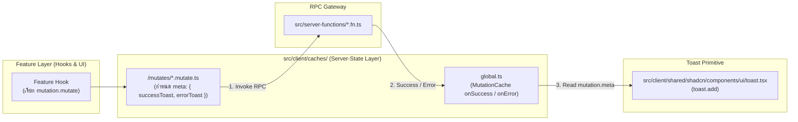

# Milestone 1 — Frontend Step 3: Client Caches Global (src/client/caches/)

ในขั้นตอนที่ 3 ของฝั่ง Frontend (Milestone 1 — Step 3) เราจะสร้างศูนย์บัญชาการของ **Server-State Layer (`src/client/caches/global.ts`)** ซึ่งทำหน้าที่สร้างอินสแตนซ์ `QueryClient` ของ `@tanstack/react-query` พร้อมผูกระบบแจ้งเตือนอัตโนมัติ (Centralized Toast Feedback) เข้ากับ `MutationCache`

---

## 1. เป้าหมายและขอบเขต Boundary (Boundary Context & Goal)

ในสถาปัตยกรรมของ TaskFlow เลเยอร์ `src/client/caches/` เป็นเจ้าของ **Server State** ทั้งหมดเพียงผู้เดียว ไม่ว่าจะเป็นการดึงข้อมูล (`queries/`), การเปลี่ยนแปลงข้อมูล (`mutates/`) หรือการแจ้งเตือนผลลัพธ์ของการทำรายการ (`MutationCache` ใน `global.ts`)

### ตารางสรุปไฟล์ใน Step นี้

| ลำดับ | เส้นทางไฟล์ | บทบาทหน้าที่ |
| :--- | :--- | :--- |
| 1 | `src/client/caches/global.ts` | นิยาม Type Augmentation สำหรับ `mutationMeta` และสร้างฟังก์ชัน `createQueryClient()` ที่ดักจับ `onSuccess` / `onError` ของทุก Mutation เพื่อยิง Toast อัตโนมัติ |

### แผนผังสถาปัตยกรรมและการไหลของข้อมูล (Server-State & Toast Lifecycle Diagram)



---

## 2. ทฤษฎี ความสำคัญ และกฎสถาปัตยกรรมเฉพาะ Boundary นี้

การออกแบบ `src/client/caches/global.ts` เป็นหัวใจสำคัญในการบังคับใช้กฎจาก `.agents/rules/client.md` และ `.agents/rules/server.md`:

### 2.1 กฎ `client.md` ข้อ 8: Success/Error ของ Mutation เป็นส่วนหนึ่งของ Server-State Lifecycle
- **หลักการ**: การแสดง Toast แจ้งเตือนเมื่อสร้าง แก้ไข หรือลบข้อมูลสำเร็จ/ล้มเหลว ต้องถูกจัดการรวมศูนย์อยู่ใน `src/client/caches/**` เท่านั้น **ห้ามใส่ `toast.add(...)` สำหรับ Server Mutation กระจายอยู่ใน Screen, Component หรือ Feature Hook โดยเด็ดขาด**
- **เหตุผลเชิงวิศวกรรม**:
  1. **Single Owner**: ป้องกันปัญหาการยิง Toast ซ้ำซ้อนเมื่อมีหลาย Component หรือหลาย Hook เรียกใช้ Mutation ตัวเดียวกัน
  2. **Consistent Error Handling**: หากเกิดข้อผิดพลาดจาก Server Function (เช่น สิทธิ์ไม่เพียงพอ หรือข้อมูลซ้ำ) `MutationCache.onError` จะดักจับและแสดง `error.message` เป็น Toast สีแดง (`type: "error"`) ให้โดยอัตโนมัติ แม้ว่าผู้เขียน Mutation นั้นจะไม่ได้ระบุ `errorToast` ไว้ก็ตาม (เว้นแต่ตั้งใจปิดด้วย `errorToast: false`)

### 2.2 กฎ `client.md` ข้อ 9: แยก Server-State Feedback ออกจาก Local UI Feedback
- **หลักการ**: `src/client/caches/` ดูแลเฉพาะสิ่งที่เกี่ยวข้องกับ Server-State เท่านั้น ส่วน Interaction ที่เกิดเฉพาะฝั่ง Client ล้วนๆ (เช่น การคัดลอกลิงก์ลง Clipboard) ให้จัดการใน Feature Hook ที่รับผิดชอบพฤติกรรมนั้นโดยตรง

### 2.3 Type-Safe `mutationMeta` ด้วย Module Augmentation
- โดยปกติ Property `meta` ของ TanStack Query จะมีชนิดข้อมูลเป็น `Record<string, unknown>` ซึ่งไม่ปลอดภัยต่อการสะกดผิด เราจึงใช้ `declare module "@tanstack/react-query"` เพื่อขยาย Interface `Register` ให้รู้จัก `mutationMeta` ที่มีโครงสร้างชัดเจน:
  - `successToast?: string | ((data: unknown) => string)`
  - `errorToast?: string | ((error: Error) => string) | false`

---

## 3. ลงมือเขียนโค้ด (Step-by-Step Implementation)

### 3.1 สร้างไฟล์ `src/client/caches/global.ts`

สร้างไฟล์ `src/client/caches/global.ts` เพื่อกำหนดค่า `QueryClient` และ `MutationCache` ระดับ Global ของแอปพลิเคชัน

**ไฟล์: `src/client/caches/global.ts`**
```ts
import { MutationCache, QueryClient } from "@tanstack/react-query";
import { toast } from "#/client/shared/shadcn/components/ui/toast";

declare module "@tanstack/react-query" {
	interface Register {
		mutationMeta: {
			successToast?: string | ((data: unknown) => string);
			errorToast?: string | ((error: Error) => string) | false;
		};
	}
}

export function createQueryClient() {
	return new QueryClient({
		defaultOptions: {
			queries: {
				staleTime: 30_000,
			},
		},
		mutationCache: new MutationCache({
			onSuccess: (data, _variables, _context, mutation) => {
				const meta = mutation.meta;
				if (!meta?.successToast) return;

				const message =
					typeof meta.successToast === "function"
						? meta.successToast(data)
						: meta.successToast;

				toast.add({
					description: message,
					type: "success",
				});
			},
			onError: (error, _variables, _context, mutation) => {
				const meta = mutation.meta;
				if (meta?.errorToast === false) return;

				const message =
					typeof meta?.errorToast === "function"
						? meta.errorToast(error)
						: (meta?.errorToast ?? error.message);

				toast.add({
					description: message,
					type: "error",
				});
			},
		}),
	});
}
```

#### คำอธิบายการทำงานอย่างละเอียด:
1. **`createQueryClient()` Factory Function**: แทนที่จะสร้าง `export const queryClient = new QueryClient()` แบบ Global Singleton ตัวเดียว เราสร้างเป็นฟังก์ชัน `createQueryClient()` เพื่อรองรับ **SSR (Server-Side Rendering)** ของ TanStack Start ใน `src/router.tsx` โดยแต่ละ Request บนเซิร์ฟเวอร์จะได้ `QueryClient` แยกอิสระต่อกัน ไม่เกิดปัญหาข้อมูลรั่วไหลข้ามผู้ใช้ (Cross-Request State Pollution)
2. **`staleTime: 30_000` (30 วินาที)**: กำหนดค่าเริ่มต้นให้ข้อมูลที่ดึงมาจากเซิร์ฟเวอร์ถือว่ายังสดใหม่เป็นเวลา 30 วินาที ลดการยิง Request ซ้ำโดยไม่จำเป็นเมื่อผู้ใช้สลับหน้าไปมาอย่างรวดเร็ว
3. **`MutationCache.onSuccess`**:
   - ตรวจสอบว่า `mutation.meta?.successToast` มีค่าหรือไม่
   - รองรับทั้งข้อความคงที่ (`string`) และฟังก์ชันที่รับ `data` ผลลัพธ์จากเซิร์ฟเวอร์มาสร้างข้อความแบบไดนามิก
   - เรียก `toast.add({ description: message, type: "success" })` ทันที
4. **`MutationCache.onError`**:
   - ถ้าระบุ `meta: { errorToast: false }` จะข้ามการแสดง Toast (เผื่อกรณีที่ต้องการจัดการ Error เองแบบพิเศษ)
   - หากไม่ได้ปิดไว้ จะใช้ข้อความจาก `meta.errorToast` หรือตกไปใช้ `error.message` ที่ส่งมาจาก Server Function โดยอัตโนมัติ

---

## 4. การตรวจสอบความถูกต้องและ Git Commit (Verification & Commit)

รันคำสั่งตรวจสอบ Type และ Biome Linter/Formatter:

```bash
bun run typecheck
bun run check
```

เมื่อตรวจสอบผ่านแล้ว ให้บันทึกสถานะงานของ Step 3 ลงใน Git:

```bash
git add src/client/caches/global.ts
git commit -m "milestone-1.frontend.step-3: Global QueryClient & Centralized MutationCache Toast"
```
