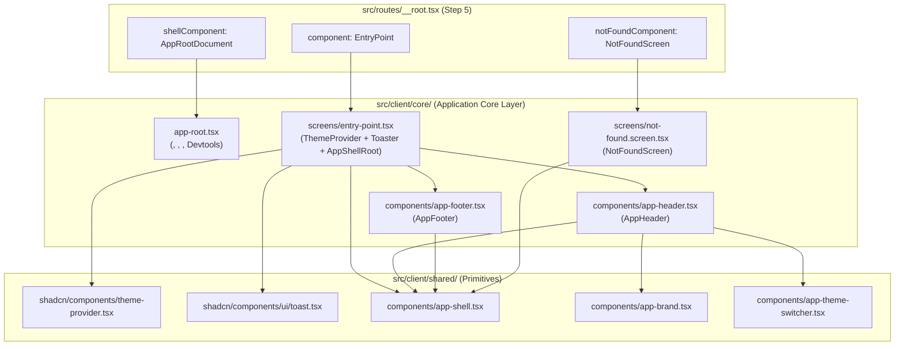

# Milestone 1 — Frontend Step 4: Client Core Shell (src/client/core/)

ในขั้นตอนที่ 4 ของฝั่ง Frontend (Milestone 1 — Step 4) เราจะสร้างเลเยอร์ **Client Core (`src/client/core/`)** ซึ่งทำหน้าที่เป็นโครงสร้างรากฐานระดับแอปพลิเคชัน (Application Shell & System Providers) ได้แก่ โครงสร้าง HTML Document (`<html>`, `<head>`, `<body>`), จุดเริ่มต้นของ UI (`EntryPoint`), ส่วนหัว (`AppHeader`), ส่วนท้าย (`AppFooter`) และหน้าจอเมื่อไม่พบเส้นทาง (`NotFoundScreen`)

---

## 1. เป้าหมายและขอบเขต Boundary (Boundary Context & Goal)

เลเยอร์ `src/client/core/` คือเปลือกนอกสุด (Outer Shell) ของฝั่ง Client ที่ห่อหุ้มทุก Route ของแอปพลิเคชันไว้ โดยแยกบทบาทระหว่าง **Document Shell (`AppRootDocument`)** และ **Application Layout & Providers (`EntryPoint`)** อย่างชัดเจน

### ตารางสรุปไฟล์ใน Step นี้

| ลำดับ | เส้นทางไฟล์ | บทบาทหน้าที่ |
| :--- | :--- | :--- |
| 1 | `src/client/core/app-root.tsx` | โครงสร้าง Root HTML Document (`<html>`, `<head>`, `<body>`), `<HeadContent />`, `<Scripts />` และ `<TanStackDevtools />` |
| 2 | `src/client/core/components/app-header.tsx` | แถบส่วนหัวหลักของแอปพลิเคชัน ประกอบด้วยโลโก้แบรนด์ `AppBrand` และปุ่มสลับธีม `AppThemeSwitcher` |
| 3 | `src/client/core/components/app-footer.tsx` | แถบส่วนท้ายของแอปพลิเคชันพร้อมเส้นคั่น `<Separator />` |
| 4 | `src/client/core/screens/not-found.screen.tsx` | หน้าจอมาตรฐานเมื่อผู้ใช้เปิด URL ที่ไม่มีอยู่จริง (404 Not Found) |
| 5 | `src/client/core/screens/entry-point.tsx` | จุดเริ่มต้นของ Application UI ที่ครอบ `ThemeProvider`, `Toaster`, `AppShellRoot`, `AppHeader`, `<Outlet />` และ `AppFooter` |

### แผนผังสถาปัตยกรรมและการประกอบร่าง (Core Shell Composition Diagram)



---

## 2. ทฤษฎี ความสำคัญ และกฎสถาปัตยกรรมเฉพาะ Boundary นี้

การออกแบบ `src/client/core/` ปฏิบัติตามข้อกำหนดใน `.agents/rules/architecture.md` และ `.agents/rules/client.md` อย่างเคร่งครัด:

### 2.1 การแยก `AppRootDocument` ออกจาก `EntryPoint`
- **`AppRootDocument` (`app-root.tsx`)**: ทำหน้าที่เฉพาะการเรนเดอร์โครงสร้าง HTML ระดับเอกสาร (`<html lang="th" suppressHydrationWarning>`, `<head>`, `<body>`) เท่านั้น โดยไม่ยึดติดกับ Layout ของหน้าจอ เพื่อให้ TanStack Start สามารถจัดการ SSR Streaming, Asset Links (`<HeadContent />`) และ Hydration Scripts (`<Scripts />`) ได้อย่างถูกต้อง
- **`EntryPoint` (`screens/entry-point.tsx`)**: ทำหน้าที่เป็นศูนย์รวม Global Context Providers (`ThemeProvider`, `Toaster`) และประกอบโครงสร้าง `AppShellRoot` ที่มี `AppHeader`, `<Outlet />` (พื้นที่แสดงผลของแต่ละ Route) และ `AppFooter`

### 2.2 กฎ `client.md` ข้อ 15 และข้อ 19 ในระดับ Core
- **กฎข้อ 15 (Visual Boundary จาก Primitive เท่านั้น)**: สังเกตใน `app-footer.tsx` เราใช้ `<Separator />` จาก `shadcn` ในการสร้างเส้นคั่นส่วนท้ายของหน้าจอ แทนการเขียน `border-t` บน `<footer>` หรือ `<div>` ดิบ
- **กฎข้อ 19 (1 ไฟล์ต่อ 1 Component & Zero Props)**: ทุกไฟล์ใน `src/client/core/**` มีเพียง 1 Component ต่อ 1 ไฟล์ (`AppHeader`, `AppFooter`, `NotFoundScreen`, `EntryPoint`) และไม่มีการส่ง Props ข้ามคอมโพเนนต์ (ยกเว้น `AppRootDocument` ซึ่งเป็น `shellComponent` ตามสัญญาของ TanStack Router ที่ต้องรับ `{ children }`)

---

## 3. ลงมือเขียนโค้ด (Step-by-Step Implementation)

### 3.1 สร้าง Root HTML Document (`src/client/core/app-root.tsx`)

สร้างไฟล์ `src/client/core/app-root.tsx` เพื่อกำหนดโครงสร้าง HTML หลักของระบบ พร้อมติดตั้ง `TanStackDevtools` และ `TanStackRouterDevtoolsPanel` ที่มุมขวาล่างสำหรับการตรวจสอบสถานะ Route

**ไฟล์: `src/client/core/app-root.tsx`**
```tsx
import { TanStackDevtools } from "@tanstack/react-devtools";
import { HeadContent, Scripts } from "@tanstack/react-router";
import { TanStackRouterDevtoolsPanel } from "@tanstack/react-router-devtools";

export function AppRootDocument({ children }: { children: React.ReactNode }) {
	return (
		<html lang="th" suppressHydrationWarning>
			<head>
				<HeadContent />
			</head>
			<body>
				{children}
				<TanStackDevtools
					config={{
						position: "bottom-right",
					}}
					plugins={[
						{
							name: "Tanstack Router",
							render: <TanStackRouterDevtoolsPanel />,
						},
					]}
				/>
				<Scripts />
			</body>
		</html>
	);
}
```

#### คำอธิบายโค้ด `app-root.tsx`:
- **`suppressHydrationWarning` บน `<html>`**: เนื่องจาก `<ScriptOnce>` ของ `ThemeProvider` จะเติมคลาส `"light"` หรือ `"dark"` และ `style="color-scheme: ..."` ลงบน `<html>` ฝั่งเบราว์เซอร์ทันทีตั้งแต่ก่อน Hydration การใส่ `suppressHydrationWarning` จึงช่วยป้องกันไม่ให้ React แจ้งเตือน Attribute Mismatch บนแท็ก `<html>`

---

### 3.2 สร้างส่วนหัวของแอปพลิเคชัน (`src/client/core/components/app-header.tsx`)

สร้างไฟล์ `src/client/core/components/app-header.tsx` เพื่อแสดงโลโก้ `TaskFlow` และปุ่มสลับธีม `AppThemeSwitcher`

> [!IMPORTANT]
> **ลำดับการพัฒนาตาม Milestone**:
> ใน **Milestone 1** เรายังไม่ได้สร้างโมดูล `auth` (`AuthHeaderControls`) และโมดูล `workspace` (`WorkspaceNav`) ดังนั้นในขั้นตอนนี้ ให้เราเขียน `app-header.tsx` รุ่นเริ่มต้นที่มีเฉพาะ `<AppBrand>` และ `<AppThemeSwitcher />` ก่อน เพื่อให้โปรเจกต์สามารถคอมไพล์และรันทดสอบได้ทันที จากนั้นเราจะนำ `<AuthHeaderControls />` และ `<WorkspaceNav />` มาเสียบเพิ่มเติมใน **Milestone 3** และ **Milestone 4** ตามลำดับ

**ไฟล์: `src/client/core/components/app-header.tsx` (รุ่นเริ่มต้นสำหรับ Milestone 1)**
```tsx
import {
	AppBrand,
	AppBrandIdentity,
	AppBrandLink,
	AppBrandLogo,
} from "#/client/shared/components/app-brand";
import { AppShellHeader } from "#/client/shared/components/app-shell";
import { AppThemeSwitcher } from "#/client/shared/components/app-theme-switcher";

export function AppHeader() {
	return (
		<AppShellHeader>
			<nav className="flex w-full max-w-6xl flex-wrap items-center justify-between gap-3">
				<div className="flex flex-wrap items-center gap-3">
					<AppBrand>
						<AppBrandLink to="/">
							<AppBrandLogo />
							<AppBrandIdentity>TaskFlow</AppBrandIdentity>
						</AppBrandLink>
					</AppBrand>
				</div>
				<div className="flex items-center gap-2">
					<AppThemeSwitcher />
				</div>
			</nav>
		</AppShellHeader>
	);
}
```

*(สำหรับการอ้างอิง: เมื่อเราพัฒนาถึง Milestone 3 และ Milestone 4 แล้ว ไฟล์ `src/client/core/components/app-header.tsx` ฉบับสมบูรณ์ใน Repository จะมีหน้าตาดังนี้)*

```tsx
import { AuthHeaderControls } from "#/client/features/auth/components/auth-header-controls";
import { WorkspaceNav } from "#/client/features/workspace/components/workspace-nav";
import {
	AppBrand,
	AppBrandIdentity,
	AppBrandLink,
	AppBrandLogo,
} from "#/client/shared/components/app-brand";
import { AppShellHeader } from "#/client/shared/components/app-shell";
import { AppThemeSwitcher } from "#/client/shared/components/app-theme-switcher";

export function AppHeader() {
	return (
		<AppShellHeader>
			<nav className="flex w-full max-w-6xl flex-wrap items-center justify-between gap-3">
				<div className="flex flex-wrap items-center gap-3">
					<AppBrand>
						<AppBrandLink to="/">
							<AppBrandLogo />
							<AppBrandIdentity>TaskFlow</AppBrandIdentity>
						</AppBrandLink>
					</AppBrand>
					<WorkspaceNav />
				</div>
				<div className="flex items-center gap-2">
					<AuthHeaderControls />
					<AppThemeSwitcher />
				</div>
			</nav>
		</AppShellHeader>
	);
}
```

---

### 3.3 สร้างส่วนท้ายของแอปพลิเคชัน (`src/client/core/components/app-footer.tsx`)

สร้างไฟล์ `src/client/core/components/app-footer.tsx` โดยใช้ `AppShellFooter` ร่วมกับ `<Separator />`

**ไฟล์: `src/client/core/components/app-footer.tsx`**
```tsx
import { AppShellFooter } from "#/client/shared/components/app-shell";
import { Separator } from "#/client/shared/shadcn/components/ui/separator";

export function AppFooter() {
	return (
		<AppShellFooter className="mt-8 w-full max-w-6xl flex-col gap-3 py-4 text-muted-foreground">
			<Separator />
			<div className="flex w-full flex-wrap items-center justify-between gap-2">
				<span>TaskFlow &mdash; Project &amp; Task Management</span>
				<span>Clean Architecture &middot; DDD &middot; TanStack Start</span>
			</div>
		</AppShellFooter>
	);
}
```

---

### 3.4 สร้างหน้าจอ 404 Not Found (`src/client/core/screens/not-found.screen.tsx`)

สร้างไฟล์ `src/client/core/screens/not-found.screen.tsx` สำหรับแสดงผลเมื่อไม่พบหน้าที่ต้องการ

**ไฟล์: `src/client/core/screens/not-found.screen.tsx`**
```tsx
import { SearchIcon } from "lucide-react";
import { AppShellMain } from "#/client/shared/components/app-shell";
import {
	Empty,
	EmptyContent,
	EmptyDescription,
	EmptyHeader,
	EmptyTitle,
} from "#/client/shared/shadcn/components/ui/empty";
import {
	InputGroup,
	InputGroupAddon,
	InputGroupInput,
} from "#/client/shared/shadcn/components/ui/input-group";
import { Kbd } from "#/client/shared/shadcn/components/ui/kbd";
import { Button } from "#/client/shared/shadcn/components/ui/button";

export function NotFoundScreen() {
	return (
		<AppShellMain className="mx-auto max-w-6xl flex-1">
			<Empty>
				<EmptyHeader>
					<EmptyTitle>404 - Not Found</EmptyTitle>
					<EmptyDescription>
						หน้าเว็บที่คุณกำลังมองหาไม่มีอยู่จริง โปรดลองค้นหาสิ่งที่คุณต้องการด้านล่าง
					</EmptyDescription>
				</EmptyHeader>
				<EmptyContent>
					<InputGroup className="sm:w-3/4">
						<InputGroupInput placeholder="Try searching for pages..." />
						<InputGroupAddon>
							<SearchIcon />
						</InputGroupAddon>
						<InputGroupAddon align="inline-end">
							<Kbd>/</Kbd>
						</InputGroupAddon>
					</InputGroup>
					<EmptyDescription>
						ต้องการความช่วยเหลือ? <Button variant="link">ติดต่อฝ่ายสนับสนุน</Button>
					</EmptyDescription>
				</EmptyContent>
			</Empty>
		</AppShellMain>
	);
}

```

---

### 3.5 สร้างจุดเริ่มต้นของ UI (`src/client/core/screens/entry-point.tsx`)

สร้างไฟล์ `src/client/core/screens/entry-point.tsx` เพื่อผูก `ThemeProvider` (ใช้คีย์ `_taskflow-theme`), `Toaster` และโครงสร้าง `AppShellRoot` เข้าด้วยกัน โดยวาง `<Outlet />` จาก `@tanstack/react-router` ไว้ตรงกลางระหว่าง `<AppHeader />` และ `<AppFooter />`

**ไฟล์: `src/client/core/screens/entry-point.tsx`**
```tsx
import { Outlet } from "@tanstack/react-router";
import { AppShellRoot } from "#/client/shared/components/app-shell";
import { ThemeProvider } from "#/client/shared/shadcn/components/theme-provider";
import { Toaster } from "#/client/shared/shadcn/components/ui/toast";
import { AppFooter } from "../components/app-footer";
import { AppHeader } from "../components/app-header";

/**
 * เพิ่ม Context Providers ที่นี่
 */
export function EntryPoint() {
	return (
		<ThemeProvider defaultTheme="system" storageKey="_taskflow-theme">
			<Toaster>
				<AppShellRoot>
					<AppHeader />
					<Outlet />
					<AppFooter />
				</AppShellRoot>
			</Toaster>
		</ThemeProvider>
	);
}
```

---

## 4. การตรวจสอบความถูกต้องและ Git Commit (Verification & Commit)

ตรวจสอบ Type Safety และมาตรฐานโค้ดด้วย Biome:

```bash
bun run typecheck
bun run check
```

เมื่อผ่านเรียบร้อยแล้ว ให้ Commit ไฟล์ทั้งหมดใน `src/client/core/`:

```bash
git add src/client/core/
git commit -m "milestone-1.frontend.step-4: Client Core Shell, Header, Footer & EntryPoint"
```
