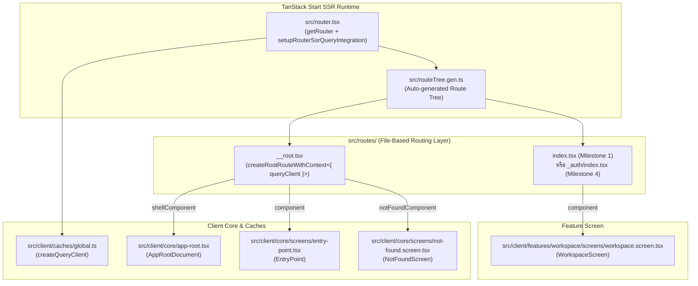

# Milestone 1 — Frontend Step 5: Router & Root Route (src/router.tsx & src/routes/)

ในขั้นตอนที่ 5 ซึ่งเป็นขั้นตอนสุดท้ายของ **Milestone 1 (Frontend)** เราจะเชื่อมโยงทุกระบบที่สร้างมาใน Steps 1–4 เข้ากับ **TanStack Router** และ **TanStack Start SSR** ผ่านไฟล์ `src/router.tsx` และ `src/routes/__root.tsx` พร้อมสร้างหน้าแรกชั่วคราวเพื่อให้สามารถรัน `bun run dev` เปิดเบราว์เซอร์ทดสอบ Application Shell แรกได้ทันที

---

## 1. เป้าหมายและขอบเขต Boundary (Boundary Context & Goal)

ในสถาปัตยกรรมของ TaskFlow เลเยอร์ `src/router.tsx` และ `src/routes/` ทำหน้าที่เป็น **Routing & Preloading Boundary** ซึ่งรู้เพียงว่า URL ใดต้องโหลดข้อมูลอะไรผ่าน `loader` และต้องเรนเดอร์ `Screen` ใดจาก `src/client/features/**/screens/` โดยไม่ประกอบ UI ย่อยภายในไฟล์ Route เอง

### ตารางสรุปไฟล์ใน Step นี้

| ลำดับ | เส้นทางไฟล์ | บทบาทหน้าที่ |
| :--- | :--- | :--- |
| 1 | `src/router.tsx` | สร้างอินสแตนซ์ TanStack Router พร้อมผูก `QueryClient` เข้ากับ SSR Streaming ผ่าน `setupRouterSsrQueryIntegration` |
| 2 | `src/routes/__root.tsx` | กำหนด Root Route ของระบบ: `<head>` metadata/links, `shellComponent` (`AppRootDocument`), `component` (`EntryPoint`) และ `notFoundComponent` (`NotFoundScreen`) |
| 3 | `src/client/features/workspace/screens/workspace.screen.tsx` | หน้าจอหลักของพื้นที่ทำงาน (สร้างโครงร่างเริ่มต้นใน Milestone 1 เพื่อทดสอบ Shell ก่อนขยายเต็มรูปแบบใน Milestone 4) |
| 4 | `src/routes/index.tsx` | เส้นทางหน้าแรก (`/`) สำหรับทดสอบ Application Shell ใน Milestone 1 (ก่อนย้ายเข้าสู่ `_auth/index.tsx` เมื่อเพิ่มระบบ Route Guard) |

### แผนผังสถาปัตยกรรมการทำงานของ Router & SSR (Router & SSR Integration Diagram)



---

## 2. ทฤษฎี ความสำคัญ และกฎสถาปัตยกรรมเฉพาะ Boundary นี้

การวางโครงสร้าง `src/router.tsx` และ `src/routes/` ยึดตามกฎเหล็กใน `.agents/rules/client.md` และ `.agents/rules/architecture.md`:

### 2.1 กฎ `client.md` ข้อ 1 และข้อ 2: Route รู้จักเฉพาะ Screen ห้ามประกอบ UI เอง
- **หลักการ**: ไฟล์ใน `src/routes/**` มีหน้าที่กำหนดเฉพาะ URL Path, การตรวจสอบพารามิเตอร์ (`validateSearch`), การป้องกันเส้นทาง (`beforeLoad`), การดึงข้อมูลล่วงหน้า (`loader`) และการผูก `component` เข้ากับ `Screen` จาก `src/client/features/**/screens/*.tsx` เท่านั้น **ห้ามเขียน JSX ประกอบ UI จาก `components/*` ลงในไฟล์ Route โดยตรง**
- **เหตุผลเชิงวิศวกรรม**: เพื่อแยก Routing Concerns ออกจาก UI Presentation อย่างเด็ดขาด ทำให้แต่ละ Feature เป็นเจ้าของโครงสร้างหน้าจอของตนเอง 100%

### 2.2 การผสาน TanStack Router กับ TanStack Query บน SSR (`setupRouterSsrQueryIntegration`)
- ใน `src/router.tsx` เราใช้ `setupRouterSsrQueryIntegration({ router, queryClient })` จาก `@tanstack/react-router-ssr-query` ซึ่งทำหน้าที่สำคัญ 3 ประการโดยอัตโนมัติ:
  1. ห่อหุ้มแอปด้วย `<QueryClientProvider client={queryClient}>` ให้ทันทีโดยที่เราไม่ต้องเขียนเองใน `EntryPoint`
  2. จัดการ Dehydrate ข้อมูลที่ถูกดึงใน Route `loader` ฝั่งเซิร์ฟเวอร์ แล้วส่งผ่าน HTML Stream มายังเบราว์เซอร์
  3. จัดการ Hydrate ข้อมูลกลับเข้าสู่ `QueryClient` ฝั่งเบราว์เซอร์อย่างแนบเนียนโดยไม่เกิดการยิง Request ซ้ำตอนเปิดหน้าเว็บครั้งแรก

---

## 3. ลงมือเขียนโค้ด (Step-by-Step Implementation)

### 3.1 สร้างไฟล์ตั้งค่า Router (`src/router.tsx`)

สร้างไฟล์ `src/router.tsx` เพื่อสร้างอินสแตนซ์ของ Router พร้อมฉีด `queryClient` เข้าไปใน Router Context และตั้งค่า `defaultPreload: "intent"` (โหลดข้อมูลล่วงหน้าทันทีที่ผู้ใช้เลื่อนเมาส์ไปวางเหนือลิงก์)

**ไฟล์: `src/router.tsx`**
```tsx
import { createRouter as createTanStackRouter } from "@tanstack/react-router";
import { setupRouterSsrQueryIntegration } from "@tanstack/react-router-ssr-query";

import { createQueryClient } from "#/client/caches/global";
import { routeTree } from "./routeTree.gen";

export function getRouter() {
	const queryClient = createQueryClient();
	const router = createTanStackRouter({
		routeTree,
		context: {
			queryClient,
		},
		scrollRestoration: true,
		defaultPreload: "intent",
		defaultPreloadStaleTime: 0,
	});

	setupRouterSsrQueryIntegration({ router, queryClient });

	return router;
}

declare module "@tanstack/react-router" {
	interface Register {
		router: ReturnType<typeof getRouter>;
	}
}
```

---

### 3.2 สร้าง Root Route (`src/routes/__root.tsx`)

สร้างไฟล์ `src/routes/__root.tsx` ด้วย `createRootRouteWithContext<{ queryClient: QueryClient }>()` เพื่อกำหนด Metadata ภาษาไทย, โหลดไฟล์ CSS `global.css?url`, ตั้งค่า Favicon ตามโหมดสี (`prefers-color-scheme`) และผูก `AppRootDocument`, `EntryPoint`, `NotFoundScreen` เข้ากับ Root Route

**ไฟล์: `src/routes/__root.tsx`**
```tsx
import type { QueryClient } from "@tanstack/react-query";
import { createRootRouteWithContext } from "@tanstack/react-router";

import { AppRootDocument } from "#/client/core/app-root";
import { EntryPoint } from "#/client/core/screens/entry-point";
import { NotFoundScreen } from "#/client/core/screens/not-found.screen";

import appCss from "#/client/styles/global.css?url";

export const Route = createRootRouteWithContext<{ queryClient: QueryClient }>()(
	{
		head: () => ({
			meta: [
				{
					charSet: "utf-8",
				},
				{
					name: "viewport",
					content: "width=device-width, initial-scale=1",
				},
				{
					title: "TaskFlow — ระบบจัดการโครงการและงาน",
				},
				{
					name: "description",
					content:
						"ระบบจัดการโครงการและงานที่สร้างด้วย TanStack Start, Drizzle ORM และ Better Auth",
				},
			],
			links: [
				{
					rel: "stylesheet",
					href: appCss,
				},
				{
					rel: "icon",
					type: "image/svg+xml",
					href: "/favicon-light.svg",
					media: "(prefers-color-scheme: light)",
				},
				{
					rel: "icon",
					type: "image/svg+xml",
					href: "/favicon-dark.svg",
					media: "(prefers-color-scheme: dark)",
				},
			],
		}),
		notFoundComponent: NotFoundScreen,
		shellComponent: AppRootDocument,
		component: EntryPoint,
	},
);
```

---

### 3.3 สร้างหน้าจอเริ่มต้นและเส้นทางหน้าแรกสำหรับทดสอบ Milestone 1

เพื่อให้เราสามารถรัน `bun run generate-routes` และเปิดเว็บเซิร์ฟเวอร์ทดสอบ Application Shell ได้ทันทีในท้าย Milestone 1 เราจะสร้างหน้าจอ `WorkspaceScreen` รุ่นเริ่มต้น และเส้นทาง `src/routes/index.tsx` ก่อน

**ไฟล์: `src/client/features/workspace/screens/workspace.screen.tsx` (รุ่นเริ่มต้นสำหรับทดสอบใน Milestone 1)**
```tsx
import { LayoutDashboard } from "lucide-react";
import { AppShellMain } from "#/client/shared/components/app-shell";
import {
	Card,
	CardDescription,
	CardHeader,
	CardTitle,
} from "#/client/shared/shadcn/components/ui/card";

export function WorkspaceScreen() {
	return (
		<AppShellMain className="mx-auto max-w-6xl py-8">
			<Card>
				<CardHeader>
					<div className="flex flex-wrap items-center justify-between gap-3">
						<div className="flex items-center gap-2">
							<LayoutDashboard
								className="size-5 text-primary"
								aria-hidden="true"
							/>
							<div className="flex flex-col gap-0.5">
								<CardTitle className="text-xl">
									ภาพรวมพื้นที่ทำงาน TaskFlow
								</CardTitle>
								<CardDescription>
									ติดตามงานที่ได้รับมอบหมาย โครงการล่าสุด และความเคลื่อนไหวทั้งหมดในที่เดียว
								</CardDescription>
							</div>
						</div>
					</div>
				</CardHeader>
			</Card>
		</AppShellMain>
	);
}
```

**ไฟล์: `src/routes/index.tsx` (รุ่นเริ่มต้นสำหรับทดสอบใน Milestone 1)**
```tsx
import { createFileRoute } from "@tanstack/react-router";
import { WorkspaceScreen } from "#/client/features/workspace/screens/workspace.screen";

export const Route = createFileRoute("/")({
	component: WorkspaceScreen,
});
```

> [!NOTE]
> **การต่อยอดใน Milestone 3 และ Milestone 4**:
> เมื่อเราเพิ่มระบบ Authentication Route Guard (`src/routes/_auth/route.tsx`) และสร้างคอมโพเนนต์ของฟีเจอร์ Workspace ครบทั้งหมดใน Milestone 4 แล้ว:
> 1. ไฟล์ `src/routes/index.tsx` จะถูกย้ายไปเป็น `src/routes/_auth/index.tsx` พร้อม `loader` ดึงข้อมูลภาพรวมพื้นที่ทำงาน
> 2. ไฟล์ `src/client/features/workspace/screens/workspace.screen.tsx` จะถูกขยายให้ประกอบการ์ดย่อยแบบ Zero Props ครบทั้งหน้า ดังโค้ดฉบับเต็มใน Repository ด้านล่างนี้:

**ไฟล์อ้างอิงฉบับสมบูรณ์ (เมื่อถึง Milestone 4): `src/client/features/workspace/screens/workspace.screen.tsx`**
```tsx
import { LayoutDashboard } from "lucide-react";
import { AppButtonLink } from "#/client/shared/components/app-link";
import { AppShellMain } from "#/client/shared/components/app-shell";
import {
	Card,
	CardDescription,
	CardHeader,
	CardTitle,
} from "#/client/shared/shadcn/components/ui/card";
import { WorkspaceActiveProjectsCard } from "../components/workspace-active-projects-card";
import { WorkspaceMyTasksCard } from "../components/workspace-my-tasks-card";
import { WorkspaceRecentActivityCard } from "../components/workspace-recent-activity-card";
import { WorkspaceSessionCard } from "../components/workspace-session-card";
import { WorkspaceSummaryCards } from "../components/workspace-summary-cards";

export function WorkspaceScreen() {
	return (
		<AppShellMain className="mx-auto max-w-6xl py-8">
			<Card>
				<CardHeader>
					<div className="flex flex-wrap items-center justify-between gap-3">
						<div className="flex items-center gap-2">
							<LayoutDashboard
								className="size-5 text-primary"
								aria-hidden="true"
							/>
							<div className="flex flex-col gap-0.5">
								<CardTitle className="text-xl">
									ภาพรวมพื้นที่ทำงาน TaskFlow
								</CardTitle>
								<CardDescription>
									ติดตามงานที่ได้รับมอบหมาย โครงการล่าสุด และความเคลื่อนไหวทั้งหมดในที่เดียว
								</CardDescription>
							</div>
						</div>
						<AppButtonLink to="/projects" variant="outline" size="sm">
							จัดการโครงการทั้งหมด
						</AppButtonLink>
					</div>
				</CardHeader>
			</Card>

			<WorkspaceSummaryCards />
			<WorkspaceMyTasksCard />

			<div className="grid gap-4 lg:grid-cols-2">
				<WorkspaceActiveProjectsCard />
				<WorkspaceRecentActivityCard />
			</div>

			<WorkspaceSessionCard />
		</AppShellMain>
	);
}
```

**ไฟล์อ้างอิงฉบับสมบูรณ์ (เมื่อถึง Milestone 4): `src/routes/_auth/index.tsx`**
```tsx
import { createFileRoute } from "@tanstack/react-router";
import { myAssignedTasksQueryOptions } from "#/client/caches/workspace/queries/my-assigned-tasks.query";
import { workspaceOverviewQueryOptions } from "#/client/caches/workspace/queries/workspace-overview.query";
import { WorkspaceScreen } from "#/client/features/workspace/screens/workspace.screen";
import { myTasksSearchSchema } from "#/shared/schemas/workspace.schema";

export const Route = createFileRoute("/_auth/")({
	validateSearch: myTasksSearchSchema,
	loaderDeps: ({ search }) => search,
	loader: ({ context, deps }) =>
		Promise.all([
			context.queryClient.query(workspaceOverviewQueryOptions()),
			context.queryClient.query(myAssignedTasksQueryOptions(deps)),
		]),
	component: WorkspaceScreen,
});
```

---

## 4. การตรวจสอบความถูกต้อง ทดสอบรันจริง และ Git Commit (Verification & Commit)

เมื่อสร้างไฟล์ครบทั้ง 5 ขั้นตอนของ Milestone 1 แล้ว ให้รันคำสั่งต่อไปนี้ตามลำดับเพื่อสร้าง `src/routeTree.gen.ts` และตรวจสอบความถูกต้องของทั้งโปรเจกต์:

### 4.1 สร้าง Route Tree และตรวจสอบ Type / Lint

```bash
# 1. สร้างไฟล์ src/routeTree.gen.ts จากโครงสร้างใน src/routes/
bun run generate-routes

# 2. ตรวจสอบ TypeScript Type ทั้งโปรเจกต์
bun run typecheck

# 3. ตรวจสอบมาตรฐานโค้ดด้วย Biome
bun run check
```

### 4.2 ทดสอบเปิดเซิร์ฟเวอร์พัฒนา (`bun run dev`)

```bash
bun run dev
```

เปิดเบราว์เซอร์ไปที่ `http://localhost:3000` และตรวจสอบรายการต่อไปนี้:
1. **Application Shell**: แสดงส่วนหัว (`AppHeader` พร้อมโลโก้ TaskFlow), เนื้อหาตรงกลาง (`WorkspaceScreen`) และส่วนท้าย (`AppFooter` พร้อมเส้นคั่น `<Separator />`)
2. **Theme Switching (Dark / Light Mode)**: คลิกปุ่มสลับธีม (`AppThemeSwitcher`) ที่มุมขวาบน หน้าจอและโลโก้แบรนด์จะสลับระหว่างโหมดสว่างและโหมดมืดด้วยสี OKLCH ทันที และเมื่อกด Refresh หน้าเว็บ (F5) หน้าจอจะต้องไม่กะพริบเปลี่ยนสี (ด้วยการทำงานของ `<ScriptOnce>`)
3. **404 Not Found**: ลองเปิด `http://localhost:3000/unknown-page` จะต้องแสดงหน้าจอ `404 ไม่พบหน้าที่ต้องการ` จาก `NotFoundScreen`

### 4.3 บันทึก Git Commit ปิดท้าย Milestone 1

```bash
git add src/router.tsx src/routeTree.gen.ts src/routes/ src/client/features/workspace/screens/workspace.screen.tsx
git commit -m "milestone-1.frontend.step-5: TanStack Router SSR Integration & Root Route"
```
