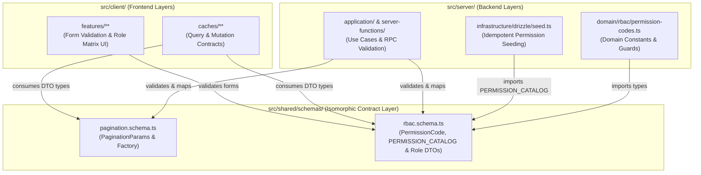

# Milestone 2 — Backend Step 1: Shared Pagination & RBAC Schemas (src/shared/schemas/)

ในขั้นตอนแรกของ Milestone 2 เราจะเริ่มต้นจากเลเยอร์นอกสุดที่เป็นจุดร่วมสัญญาระหว่างฝั่ง Server และ Client นั่นคือ **Shared Schemas (`src/shared/schemas/`)** โดยสร้าง Schema กลางสำหรับการแบ่งหน้าข้อมูล (`pagination.schema.ts`) และสัญญาข้อมูลระบบสิทธิ์แบบ Hybrid RBAC (`rbac.schema.ts`) ฉบับสมบูรณ์ เพื่อให้ทั้ง Domain Layer, Database Seed และ UI ในอนาคตอ้างอิงจากแหล่งความจริงเดียว (Single Source of Truth)

---

## 1. เป้าหมายและขอบเขต Boundary (Boundary Context & Goal)

### เป้าหมายของ Step นี้
1. สร้าง **Pagination Schema** มาตรฐานที่ใช้ร่วมกันได้กับทุกตารางและทุกโมดูลในระบบ (Users, Projects, Tasks) พร้อมฟังก์ชัน Factory สำหรับสร้าง Paginated Response Schema แบบ Generic
2. สร้าง **RBAC Schema & Permission Catalog** ที่นิยามขอบเขตบทบาท (`system` และ `project`), รหัสสิทธิ์ทั้งหมดในระบบ (`PermissionCode`), รายการ Catalog มาตรฐาน (`PERMISSION_CATALOG`), และ DTO/Input Schemas สำหรับการจัดการบทบาทครบทั้งระบบในครั้งเดียว (ไม่ต้องกลับมาแก้ไขไฟล์นี้ซ้ำใน Milestone 4)

### ตารางสรุปไฟล์ใน Step นี้

| เส้นทางไฟล์ (File Path) | บทบาทหน้าที่ (Responsibility) |
| :--- | :--- |
| `src/shared/schemas/pagination.schema.ts` | นิยามค่าคงที่หน้าเริ่มต้น, `sortOrderSchema`, `paginationParamsSchema` และ Generic Factory `createPaginatedResultSchema` |
| `src/shared/schemas/rbac.schema.ts` | นิยาม `roleScopeSchema`, รหัสสิทธิ์ระดับ System/Project, `PERMISSION_CATALOG` 16 รายการ และ Zod Schemas สำหรับ Role & Permission DTOs/Inputs |

### แผนผังสถาปัตยกรรมและทิศทางการพึ่งพา (Boundary Dependency Flow)



---

## 2. ทฤษฎี ความสำคัญ และกฎสถาปัตยกรรมเฉพาะ Boundary นี้

### 2.1 กฎ Shared Schemas จาก `.agents/rules/globals.md`
การออกแบบไฟล์ใน `src/shared/schemas/` อยู่ภายใต้กฎเหล็ก 4 ข้อของระบบ:

1. **Single Source of Truth (ข้อ 1)**: `shared/schemas/**` คือแหล่งความจริงกลางของ Data Contract ระหว่าง Server และ Client ห้ามฝั่ง Server และ Client นิยาม Type ของข้อมูลชุดเดียวกันแยกกัน เพื่อป้องกันปัญหา Schema Drift
2. **Zod-First Contract (ข้อ 2)**: ทุก Contract ต้องเริ่มจากการเขียน Zod Schema ก่อนเสมอ แล้วจึงสกัด TypeScript Type ออกมาด้วย `z.infer<typeof ...>` ห้ามเขียน `interface` ของ DTO แยกต่างหากจาก Zod Schema
3. **Consume Contract Across Layers (ข้อ 3)**: ทั้ง `server/`, `server-functions/`, `client/caches/` และ `client/features/` ต้องนำเข้า Schema และ Type จาก `shared/schemas/**` ไปใช้งานโดยตรง
4. **Application Boundary Only (ข้อ 4)**: เก็บเฉพาะ DTO, Input Payload, Query Params และ Domain Constants ที่ต้องมีความหมายตรงกันข้ามฝั่ง Application Boundary โดยไม่มีโค้ดที่ผูกกับ Framework หรือ Database

### 2.2 แนวคิดการออกแบบ Hybrid RBAC Catalog (`scope: "system" | "project"`)
ระบบ TaskFlow ใช้สถาปัตยกรรมสิทธิ์แบบ **Hybrid Dynamic RBAC** ที่แบ่งสิทธิ์ออกเป็น 2 ขอบเขต (`RoleScope`) อย่างชัดเจน:
- **`system` scope (6 สิทธิ์)**: สิทธิ์ระดับพื้นที่ทำงานส่วนกลาง เช่น การดู/จัดการบทบาท (`role:read`, `role:manage`), การดูและกำหนดบทบาทผู้ใช้ (`user:read`, `user:assign_role`), การสร้างโปรเจกต์ใหม่ (`project:create`), และการเข้าถึงทุกโปรเจกต์โดยไม่ต้องเป็นสมาชิก (`project:read_all`)
- **`project` scope (10 สิทธิ์)**: สิทธิ์เฉพาะภายในโปรเจกต์ที่ผูกกับตาราง `project_members` เช่น การอ่าน/แก้ไข/ลบโปรเจกต์ (`project:read`, `project:update`, `project:delete`), การจัดการสมาชิก (`project:manage_members`), การจัดการงาน (`task:create`, `task:update`, `task:assign`, `task:delete`), และการจัดการความคิดเห็น (`comment:create`, `comment:delete_any`)

การประกาศ `PERMISSION_CATALOG` ไว้ใน `src/shared/schemas/rbac.schema.ts` ช่วยให้:
1. **Database Seed (`seed.ts`)** นำรายการทั้งหมดไป Upsert ลงตาราง `permissions` ได้โดยตรง
2. **Type System** บังคับให้ทุก `code` ใน Catalog ต้องตรงกับ `PermissionCode` ที่สกัดมาจาก Zod Enum เท่านั้น

### 2.3 การออกแบบ Resilient Pagination Schema
ใน `paginationParamsSchema` เราใช้เทคนิค `.default(...).catch(...)` ของ Zod:
- หากผู้เรียกไม่ส่งค่า `page` หรือ `pageSize` มา ระบบจะใช้ค่าเริ่มต้น (`DEFAULT_PAGE = 1`, `DEFAULT_PAGE_SIZE = 10`)
- หาก URL Query Parameter ส่งค่าที่ผิดพลาดมา (เช่น `page=-5` หรือ `pageSize=9999`) เมธอด `.catch(...)` จะช่วย Fallback กลับเป็นค่ามาตรฐานที่ปลอดภัยโดยไม่ทำให้หน้าเว็บพัง

---

## 3. ลงมือเขียนโค้ด (Step-by-Step Implementation)

### 3.1 ไฟล์ `src/shared/schemas/pagination.schema.ts`

สร้างไฟล์ `src/shared/schemas/pagination.schema.ts` เพื่อกำหนดมาตรฐานการแบ่งหน้าและการเรียงลำดับข้อมูลทั่วทั้งระบบ:

```typescript
import { z } from "zod";

export const DEFAULT_PAGE = 1;
export const DEFAULT_PAGE_SIZE = 10;
export const PAGE_SIZE_OPTIONS = [5, 10, 20, 50] as const;

export const sortOrderSchema = z.enum(["asc", "desc"]);
export type SortOrder = z.infer<typeof sortOrderSchema>;

export const paginationParamsSchema = z.object({
	page: z.number().int().min(1).default(DEFAULT_PAGE).catch(DEFAULT_PAGE),
	pageSize: z
		.number()
		.int()
		.min(1)
		.max(100)
		.default(DEFAULT_PAGE_SIZE)
		.catch(DEFAULT_PAGE_SIZE),
});
export type PaginationParams = z.infer<typeof paginationParamsSchema>;

export function createPaginatedResultSchema<TItem extends z.ZodTypeAny>(
	itemSchema: TItem,
) {
	return z.object({
		items: z.array(itemSchema),
		total: z.number().int().nonnegative(),
		page: z.number().int().min(1),
		pageSize: z.number().int().min(1),
		totalPages: z.number().int().min(1),
	});
}
```

#### คำอธิบายโค้ดอย่างละเอียด
- **`DEFAULT_PAGE`, `DEFAULT_PAGE_SIZE`, `PAGE_SIZE_OPTIONS`**: ค่าคงที่มาตรฐานสำหรับตารางและตัวเลือก Dropdown จำนวนแถวต่อหน้าใน UI
- **`sortOrderSchema` & `SortOrder`**: กำหนดทิศทางการเรียงลำดับข้อมูลให้เป็น `"asc"` หรือ `"desc"` เท่านั้น
- **`paginationParamsSchema`**: ตรวจสอบความถูกต้องของ `page` (จำนวนเต็มตั้งแต่ 1 ขึ้นไป) และ `pageSize` (จำนวนเต็มระหว่าง 1 ถึง 100 เพื่อป้องกันการดึงข้อมูลมากเกินไปในครั้งเดียว)
- **`createPaginatedResultSchema(itemSchema)`**: Higher-order Schema Factory ที่รับ Zod Schema ของข้อมูลย่อย (เช่น `userSummaryDtoSchema` หรือ `taskDtoSchema`) แล้วคืนค่า Zod Object Schema ที่มีโครงสร้าง `{ items, total, page, pageSize, totalPages }` แบบ Type-safe

---

### 3.2 ไฟล์ `src/shared/schemas/rbac.schema.ts`

สร้างไฟล์ `src/shared/schemas/rbac.schema.ts` ซึ่งรวบรวมทั้ง Permission Codes, Catalog มาตรฐาน และ DTO/Input Schemas สำหรับระบบ RBAC:

```typescript
import { z } from "zod";

export const roleScopeSchema = z.enum(["system", "project"]);
export type RoleScope = z.infer<typeof roleScopeSchema>;

export const systemPermissionCodeSchema = z.enum([
	"role:read",
	"role:manage",
	"user:read",
	"user:assign_role",
	"project:create",
	"project:read_all",
]);
export type SystemPermissionCode = z.infer<typeof systemPermissionCodeSchema>;

export const projectPermissionCodeSchema = z.enum([
	"project:read",
	"project:update",
	"project:delete",
	"project:manage_members",
	"task:create",
	"task:update",
	"task:assign",
	"task:delete",
	"comment:create",
	"comment:delete_any",
]);
export type ProjectPermissionCode = z.infer<typeof projectPermissionCodeSchema>;

export const permissionCodeSchema = z.union([
	systemPermissionCodeSchema,
	projectPermissionCodeSchema,
]);
export type PermissionCode = z.infer<typeof permissionCodeSchema>;

export interface PermissionCatalogItem {
	readonly code: PermissionCode;
	readonly scope: RoleScope;
	readonly description: string;
}

export const PERMISSION_CATALOG: readonly PermissionCatalogItem[] = [
	{
		code: "role:read",
		scope: "system",
		description: "ดูบทบาทระดับระบบและระดับโครงการพร้อมตารางสิทธิ์การใช้งาน",
	},
	{
		code: "role:manage",
		scope: "system",
		description: "สร้าง แก้ไข และลบบทบาทที่กำหนดเอง รวมถึงปรับเปลี่ยนสิทธิ์การใช้งาน",
	},
	{
		code: "user:read",
		scope: "system",
		description: "ดูรายชื่อผู้ใช้งานที่ลงทะเบียนในพื้นที่ทำงาน",
	},
	{
		code: "user:assign_role",
		scope: "system",
		description: "กำหนดหรือเพิกถอนบทบาทระดับระบบของผู้ใช้งาน",
	},
	{
		code: "project:create",
		scope: "system",
		description: "สร้างโครงการใหม่",
	},
	{
		code: "project:read_all",
		scope: "system",
		description: "ดูโครงการทั้งหมดในพื้นที่ทำงานโดยไม่ขึ้นกับการเป็นสมาชิก",
	},
	{
		code: "project:read",
		scope: "project",
		description: "ดูรายละเอียดโครงการ สมาชิก งาน และประวัติกิจกรรม",
	},
	{
		code: "project:update",
		scope: "project",
		description: "แก้ไขรายละเอียดโครงการ จัดเก็บ หรือกู้คืนโครงการ",
	},
	{
		code: "project:delete",
		scope: "project",
		description: "ลบโครงการอย่างถาวร",
	},
	{
		code: "project:manage_members",
		scope: "project",
		description: "เพิ่ม ปรับบทบาท หรือลบสมาชิกภายในโครงการ",
	},
	{
		code: "task:create",
		scope: "project",
		description: "สร้างงานใหม่ภายในโครงการ",
	},
	{
		code: "task:update",
		scope: "project",
		description: "แก้ไขรายละเอียดงาน ระดับความสำคัญ และเปลี่ยนสถานะงาน",
	},
	{
		code: "task:assign",
		scope: "project",
		description: "มอบหมายหรือเปลี่ยนผู้รับผิดชอบงานให้กับสมาชิกโครงการ",
	},
	{
		code: "task:delete",
		scope: "project",
		description: "ลบงานภายในโครงการ",
	},
	{
		code: "comment:create",
		scope: "project",
		description: "แสดงความคิดเห็นในงาน",
	},
	{
		code: "comment:delete_any",
		scope: "project",
		description: "ลบความคิดเห็นของสมาชิกทุกคนภายในโครงการ",
	},
] as const;

export const permissionDtoSchema = z.object({
	id: z.uuid(),
	code: permissionCodeSchema,
	scope: roleScopeSchema,
	description: z.string(),
});
export type PermissionDto = z.infer<typeof permissionDtoSchema>;

export const roleDtoSchema = z.object({
	id: z.uuid(),
	name: z.string(),
	slug: z.string(),
	scope: roleScopeSchema,
	description: z.string(),
	isSystem: z.boolean(),
	permissionIds: z.array(z.uuid()),
	permissionCodes: z.array(permissionCodeSchema),
	createdAt: z.string(),
	updatedAt: z.string(),
});
export type RoleDto = z.infer<typeof roleDtoSchema>;

export const createRoleInputSchema = z.object({
	name: z
		.string()
		.trim()
		.min(2, "ชื่อบทบาทต้องมีอย่างน้อย 2 ตัวอักษร")
		.max(100, "ชื่อบทบาทต้องไม่เกิน 100 ตัวอักษร"),
	slug: z
		.string()
		.trim()
		.toLowerCase()
		.min(2, "รหัสอ้างอิงต้องมีอย่างน้อย 2 ตัวอักษร")
		.max(100, "รหัสอ้างอิงต้องไม่เกิน 100 ตัวอักษร")
		.regex(
			/^[a-z][a-z0-9_]*$/,
			"รหัสอ้างอิงต้องขึ้นต้นด้วยตัวอักษรพิมพ์เล็ก a-z และใช้ได้เฉพาะ a-z, 0-9 หรือ _",
		),
	scope: roleScopeSchema,
	description: z.string().trim().max(300),
	permissionIds: z.array(z.uuid("รหัสสิทธิ์การเข้าถึงไม่ถูกต้อง")),
});
export type CreateRoleInput = z.infer<typeof createRoleInputSchema>;

export const updateRolePermissionsInputSchema = z.object({
	roleId: z.uuid("รหัสบทบาทไม่ถูกต้อง"),
	permissionIds: z.array(z.uuid("รหัสสิทธิ์การเข้าถึงไม่ถูกต้อง")),
});
export type UpdateRolePermissionsInput = z.infer<
	typeof updateRolePermissionsInputSchema
>;

export const deleteRoleInputSchema = z.object({
	roleId: z.uuid("รหัสบทบาทไม่ถูกต้อง"),
});
export type DeleteRoleInput = z.infer<typeof deleteRoleInputSchema>;

export const listRolesResultDtoSchema = z.object({
	roles: z.array(roleDtoSchema),
	permissions: z.array(permissionDtoSchema),
});
export type ListRolesResultDto = z.infer<typeof listRolesResultDtoSchema>;

export const myPermissionsDtoSchema = z.object({
	systemRoles: z.array(z.string()),
	systemPermissions: z.array(systemPermissionCodeSchema),
});
export type MyPermissionsDto = z.infer<typeof myPermissionsDtoSchema>;
```

#### คำอธิบายโค้ดอย่างละเอียด
- **`systemPermissionCodeSchema` & `projectPermissionCodeSchema`**: แยกสิทธิ์ระดับระบบ (6 สิทธิ์) และระดับโปรเจกต์ (10 สิทธิ์) ออกจากกันอย่างชัดเจน แล้วรวมเป็น `permissionCodeSchema` ด้วย `z.union([...])`
- **`PERMISSION_CATALOG`**: ตารางอ้างอิงสิทธิ์ทั้งหมด 16 รายการ พร้อม `scope` และคำอธิบายภาษาไทยสำหรับแสดงบนหน้า Permission Matrix UI และใช้เป็นข้อมูลต้นทางในขั้นตอนการ Seed ฐานข้อมูล
- **`permissionDtoSchema` & `roleDtoSchema`**: รูปแบบข้อมูลมาตรฐานที่ส่งกลับจาก Server ไปยัง Client โดย `roleDtoSchema` มีทั้ง `permissionIds` (สำหรับผูก Checkbox ในฟอร์มแก้ไขสิทธิ์) และ `permissionCodes` (สำหรับตรวจสอบสิทธิ์เชิงความหมาย)
- **`createRoleInputSchema`, `updateRolePermissionsInputSchema`, `deleteRoleInputSchema`**: Input Validation Schemas สำหรับการสร้าง แก้ไขสิทธิ์ และลบบทบาท โดยบังคับรูปแบบ `slug` ให้เป็น `snake_case` พิมพ์เล็ก (`/^[a-z][a-z0-9_]*$/`)
- **`myPermissionsDtoSchema`**: โครงสร้างข้อมูลสิทธิ์ระดับระบบของผู้ใช้ที่ล็อกอินอยู่ (`systemRoles` และ `systemPermissions`) สำหรับใช้ซ่อน/แสดงเมนูและปุ่มต่างๆ บนฝั่ง Client

---

## 4. การตรวจสอบความถูกต้องและ Git Commit (Verification & Commit)

หลังจากสร้างไฟล์ทั้งสองเสร็จสิ้น ให้ตรวจสอบ Type Safety และมาตรฐานการจัดรูปแบบโค้ดด้วยคำสั่งต่อไปนี้:

```bash
bun run typecheck
bun run check
```

เมื่อผลลัพธ์ผ่านทุกการตรวจสอบโดยไม่มีข้อผิดพลาด ให้บันทึกการเปลี่ยนแปลงเข้าสู่ Git Repository:

```bash
git add src/shared/schemas/pagination.schema.ts src/shared/schemas/rbac.schema.ts
git commit -m "milestone-2.backend.step-1: Shared Pagination & RBAC Schemas"
```
