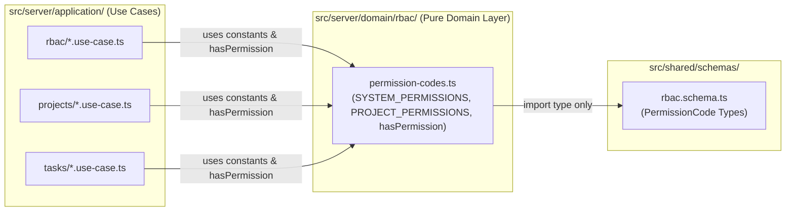

# Milestone 2 — Backend Step 2: Domain RBAC Permission Constants (src/server/domain/rbac/)

ในขั้นตอนที่ 2 ของ Milestone 2 เราจะเข้าสู่แกนกลางของระบบฝั่งเซิร์ฟเวอร์ นั่นคือ **Domain Layer (`src/server/domain/rbac/`)** โดยสร้างไฟล์ `permission-codes.ts` เพื่อรวบรวมค่าคงที่ของสิทธิ์การเข้าถึง (`SYSTEM_PERMISSIONS` และ `PROJECT_PERMISSIONS`) และฟังก์ชันตรวจสอบสิทธิ์ระดับโดเมน (`hasPermission`) ที่ปลอดภัยต่อ Type System 100%

---

## 1. เป้าหมายและขอบเขต Boundary (Boundary Context & Goal)

### เป้าหมายของ Step นี้
1. สร้างค่าคงที่ `SYSTEM_PERMISSIONS` และ `PROJECT_PERMISSIONS` ในเลเยอร์ Domain เพื่อให้ Use Cases และ Domain Logic อ้างอิงรหัสสิทธิ์ผ่าน Object Constants แทนการเขียน Hardcoded String กระจายตามไฟล์ต่างๆ
2. ใช้ตัวดำเนินการ `as const satisfies Record<string, ...>` ของ TypeScript เพื่อรับประกันว่าทุกค่าคงที่ใน Domain ตรงกับ `SystemPermissionCode` และ `ProjectPermissionCode` ใน `shared/schemas/rbac.schema.ts` เสมอ
3. สร้าง Pure Domain Helper Function `hasPermission` สำหรับตรวจสอบว่าชุดสิทธิ์ที่ผู้ใช้ได้รับมอบหมายมีสิทธิ์ที่ต้องการหรือไม่

### ตารางสรุปไฟล์ใน Step นี้

| เส้นทางไฟล์ (File Path) | บทบาทหน้าที่ (Responsibility) |
| :--- | :--- |
| `src/server/domain/rbac/permission-codes.ts` | นิยาม `SYSTEM_PERMISSIONS`, `PROJECT_PERMISSIONS` และฟังก์ชัน `hasPermission` สำหรับตรวจสอบสิทธิ์ใน Domain และ Application Layer |

### แผนผังสถาปัตยกรรมและทิศทางการพึ่งพา (Boundary Dependency Flow)



---

## 2. ทฤษฎี ความสำคัญ และกฎสถาปัตยกรรมเฉพาะ Boundary นี้

### 2.1 ทำไม Domain Layer จึงเข้าถึง Shared Schema ได้? (`server.md` ข้อ 1)
ตามกฎเหล็กใน `.agents/rules/server.md` ข้อ 1 (**Architectural Boundaries & Dependency Direction**):
> - กำหนดให้ทิศทางการพึ่งพาไหลเข้าสู่ศูนย์กลางเสมอ: `Infrastructure → Application → Domain`
> - ห้าม `server/domain/` นำเข้า (import) สิ่งใดจาก `server/application/`, `server/infrastructure/`, `server/composition/`, `server-functions/` หรือ library ภายนอก **ยกเว้น `shared/schemas/`**

เหตุผลที่อนุญาตให้ `server/domain/` นำเข้า Type จาก `shared/schemas/` ได้:
1. `shared/schemas/` เป็น Isomorphic Contract Layer ที่ปราศจากผลข้างเคียงของ Framework หรือ Database (Pure Contract)
2. การใช้ `import type { PermissionCode, ... } from "#/shared/schemas/rbac.schema"` (ตามกฎ `globals.md` ข้อ 3 ที่บังคับแยก `import type` ออกจาก Runtime Import) ไม่สร้าง Runtime Dependency ใดๆ ให้กับ Domain Layer เมื่อโค้ดถูก Compile
3. ช่วยให้ TypeScript ตรวจสอบความสอดคล้องของรหัสสิทธิ์ระหว่าง Domain Layer กับ Shared Schema ได้ตั้งแต่ขั้นตอน Compile-time

### 2.2 พลังของ `as const satisfies Record<string, ...>`
ในไฟล์ `permission-codes.ts` เราใช้ไวยากรณ์:
```typescript
export const SYSTEM_PERMISSIONS = {
	ROLE_READ: "role:read",
	ROLE_MANAGE: "role:manage",
	USER_READ: "user:read",
	USER_ASSIGN_ROLE: "user:assign_role",
	PROJECT_CREATE: "project:create",
	PROJECT_READ_ALL: "project:read_all",
} as const satisfies Record<string, SystemPermissionCode>;
```
การใช้ทั้ง `as const` และ `satisfies` ร่วมกันให้ประโยชน์เชิงวิศวกรรม 2 ด้านพร้อมกัน:
- **`satisfies Record<string, SystemPermissionCode>`**: บังคับให้ทุก Value ใน Object ต้องเป็นสมาชิกที่ถูกต้องของ `SystemPermissionCode` หากสะกดผิดแม้แต่ตัวอักษรเดียว (เช่น `"role:raed"`) TypeScript Compiler จะแจ้ง Error ทันที
- **`as const`**: รักษา Literal Type ของแต่ละ Property ไว้ (เช่น `SYSTEM_PERMISSIONS.ROLE_READ` มี Type เป็น `"role:read"` ไม่ใช่ `string` กว้างๆ) ทำให้ส่งค่าเข้าไปในฟังก์ชันที่รับเฉพาะ `PermissionCode` ได้อย่างแม่นยำ

### 2.3 การใช้ฟังก์ชัน `hasPermission` ในระดับ Domain และ Application
เมื่อ Use Case ใน `src/server/application/**` ต้องการตรวจสอบสิทธิ์ของผู้ใช้ก่อนอนุญาตให้ทำรายการ (เช่น การสร้างโปรเจกต์ การลบงาน หรือการเปลี่ยนบทบาทสมาชิก):
1. Use Case จะดึงรายการรหัสสิทธิ์ที่ผู้ใช้ได้รับมอบหมายจาก `IRbacRepository` (เช่น `getUserSystemPermissions(userId)` หรือ `getUserProjectPermissions(userId, projectId)`)
2. เรียกใช้ `hasPermission(grantedPermissions, SYSTEM_PERMISSIONS.PROJECT_CREATE)` หรือ `hasPermission(grantedPermissions, PROJECT_PERMISSIONS.TASK_UPDATE)`
3. หากผลลัพธ์เป็น `false` จะโยน `ForbiddenError` จาก Domain Common Errors ทันที ทำให้อ่านโค้ดเข้าใจง่ายและไม่ผูกติดกับ Transport Protocol

---

## 3. ลงมือเขียนโค้ด (Step-by-Step Implementation)

### 3.1 ไฟล์ `src/server/domain/rbac/permission-codes.ts`

สร้างไฟล์ `src/server/domain/rbac/permission-codes.ts` ด้วยโค้ดฉบับเต็มดังนี้:

```typescript
import type {
	PermissionCode,
	ProjectPermissionCode,
	SystemPermissionCode,
} from "#/shared/schemas/rbac.schema";

export const SYSTEM_PERMISSIONS = {
	ROLE_READ: "role:read",
	ROLE_MANAGE: "role:manage",
	USER_READ: "user:read",
	USER_ASSIGN_ROLE: "user:assign_role",
	PROJECT_CREATE: "project:create",
	PROJECT_READ_ALL: "project:read_all",
} as const satisfies Record<string, SystemPermissionCode>;

export const PROJECT_PERMISSIONS = {
	PROJECT_READ: "project:read",
	PROJECT_UPDATE: "project:update",
	PROJECT_DELETE: "project:delete",
	PROJECT_MANAGE_MEMBERS: "project:manage_members",
	TASK_CREATE: "task:create",
	TASK_UPDATE: "task:update",
	TASK_ASSIGN: "task:assign",
	TASK_DELETE: "task:delete",
	COMMENT_CREATE: "comment:create",
	COMMENT_DELETE_ANY: "comment:delete_any",
} as const satisfies Record<string, ProjectPermissionCode>;

export function hasPermission(
	grantedPermissions: readonly string[],
	requiredPermission: PermissionCode,
): boolean {
	return grantedPermissions.includes(requiredPermission);
}
```

#### คำอธิบายโค้ดอย่างละเอียด
- **บรรทัดที่ 1–5 (`import type`)**: นำเข้าเฉพาะ Type (`PermissionCode`, `ProjectPermissionCode`, `SystemPermissionCode`) จาก `#/shared/schemas/rbac.schema` ตามกฎ `globals.md` ข้อ 2 (ใช้ Path Alias `#/` แทน Deep Relative Import) และข้อ 3 (แยก `import type` ชัดเจน)
- **บรรทัดที่ 7–14 (`SYSTEM_PERMISSIONS`)**: รวบรวมรหัสสิทธิ์ระดับพื้นที่ทำงาน (System Scope) ทั้ง 6 รายการในรูปแบบ Constant Object ที่อ่านเข้าใจง่ายและค้นหาการใช้งานผ่าน IDE (Find References) ได้ทั่วทั้งโปรเจกต์
- **บรรทัดที่ 16–27 (`PROJECT_PERMISSIONS`)**: รวบรวมรหัสสิทธิ์ระดับโครงการ (Project Scope) ทั้ง 10 รายการ ครอบคลุมการจัดการโปรเจกต์ สมาชิก งาน และความคิดเห็น
- **บรรทัดที่ 29–34 (`hasPermission`)**: ฟังก์ชันบริสุทธิ์ (Pure Function) ที่รับ `grantedPermissions: readonly string[]` (รายการรหัสสิทธิ์ที่ดึงมาจากฐานข้อมูล) และ `requiredPermission: PermissionCode` (สิทธิ์ที่ต้องการตรวจสอบ) แล้วคืนค่า `boolean` ว่าผู้ใช้มีสิทธิ์ดังกล่าวหรือไม่

---

## 4. การตรวจสอบความถูกต้องและ Git Commit (Verification & Commit)

รันคำสั่งตรวจสอบ TypeScript และ Biome Linter/Formatter เพื่อยืนยันว่าไฟล์ใน Domain Layer ถูกต้องตามกฎสถาปัตยกรรมทุกประการ:

```bash
bun run typecheck
bun run check
```

เมื่อผ่านการตรวจสอบเรียบร้อยแล้ว ให้ Commit โค้ดของ Step ที่ 2:

```bash
git add src/server/domain/rbac/permission-codes.ts
git commit -m "milestone-2.backend.step-2: Domain RBAC Permission Constants"
```
