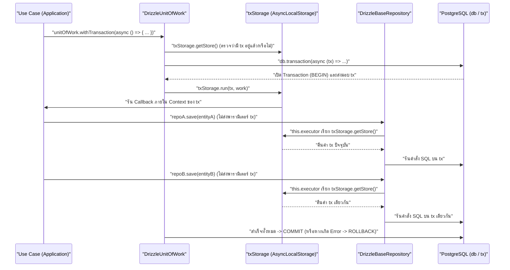
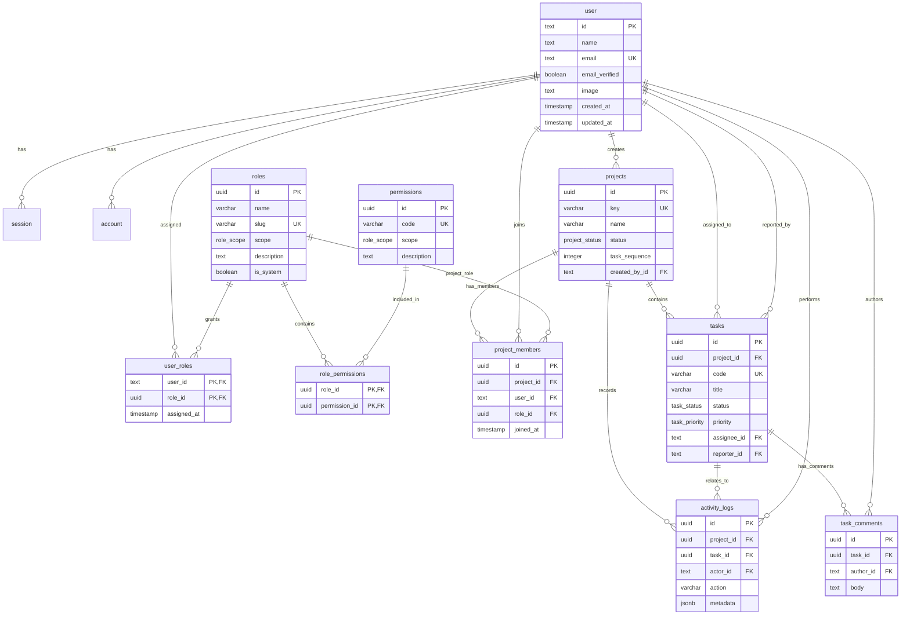

# Milestone 2 — Backend Step 3: Infrastructure Drizzle ORM, Unit of Work & Database Schema (src/server/infrastructure/drizzle/)

ในขั้นตอนที่ 3 ของ Milestone 2 เราจะวางรากฐานของ **Infrastructure Layer (`src/server/infrastructure/drizzle/`)** สำหรับการเชื่อมต่อฐานข้อมูล PostgreSQL ด้วย Drizzle ORM การจัดการ ACID Transaction แบบโปร่งใสด้วย `AsyncLocalStorage` (`Unit of Work`) และการออกแบบโครงสร้างตารางฐานข้อมูลทั้งหมดของระบบ TaskFlow (`schema.ts`)

---

## 1. เป้าหมายและขอบเขต Boundary (Boundary Context & Goal)

### เป้าหมายของ Step นี้
1. ตั้งค่า **Drizzle Kit (`drizzle.config.ts`)** และ **Database Connection Pool (`db.ts`)** ที่รองรับ Hot Module Replacement (HMR) ในโหมดพัฒนาโดยไม่ทำให้เกิดปัญหา Connection Leak
2. สร้างกลไก **Ambient Transaction Context (`tx-context.ts`, `base.repository.ts`, `unit-of-work.ts`)** ด้วย `AsyncLocalStorage` เพื่อให้ทุก Repository สลับใช้ `tx` อัตโนมัติเมื่ออยู่ใน Transaction โดยไม่ต้องส่ง `tx` ผ่านพารามิเตอร์ของ Domain Interface
3. สร้างฟังก์ชันช่วยเหลือ **`hasPgErrorCode` (`pg-error.ts`)** สำหรับตรวจสอบรหัสข้อผิดพลาดของ PostgreSQL (เช่น Unique Constraint Violation `23505`) แบบ Recursive
4. นิยาม **Database Schema ฉบับสมบูรณ์ (`schema.ts`)** ครอบคลุมทั้งตารางของ Better Auth, Hybrid Dynamic RBAC, Projects, Members, Tasks, Comments, Activity Logs และ Relational Definitions

### ตารางสรุปไฟล์ใน Step นี้

| เส้นทางไฟล์ (File Path) | บทบาทหน้าที่ (Responsibility) |
| :--- | :--- |
| `drizzle.config.ts` | ตั้งค่า Drizzle Kit CLI สำหรับการสร้างไฟล์ Migration (`db:generate`) และการรัน Migration (`db:migrate`) |
| `src/server/infrastructure/drizzle/tx-context.ts` | นิยาม `TransactionRunner` Interface และ `txStorage` (`AsyncLocalStorage`) สำหรับเก็บ Transaction Context |
| `src/server/infrastructure/drizzle/base.repository.ts` | คลาสแม่ `DrizzleBaseRepository` ที่มี getter `executor` คอยสลับระหว่าง `tx` กับ `db` อัตโนมัติ |
| `src/server/infrastructure/drizzle/unit-of-work.ts` | คลาส `DrizzleUnitOfWork` ที่ Implement `IUnitOfWork` ควบคุมขอบเขต Transaction ผ่าน `txStorage.run` |
| `src/server/infrastructure/drizzle/pg-error.ts` | ฟังก์ชัน `hasPgErrorCode` สำหรับตรวจจับ PostgreSQL Error Code (แม้ถูกห่อหุ้มอยู่ใน `error.cause`) |
| `src/server/infrastructure/drizzle/db.ts` | สร้าง Singleton `pg.Pool` และ Drizzle Client (`db`) พร้อม Export ชนิดข้อมูล `AppDb` และ `AppTx` |
| `src/server/infrastructure/drizzle/schema.ts` | นิยาม PostgreSQL Enums, ตารางทั้งหมด 13 ตาราง, Indexes, Relations และ `dbSchema` Registry |

### แผนผังการทำงานของ Ambient Transaction (`AsyncLocalStorage` Flow)



### แผนผังความสัมพันธ์ของฐานข้อมูล (Entity-Relationship Diagram)



---

## 2. ทฤษฎี ความสำคัญ และกฎสถาปัตยกรรมเฉพาะ Boundary นี้

### 2.1 การป้องกัน Transaction Leakage เข้าสู่ Domain (`server.md` ข้อ 12 และ 16)
ในระบบ Clean Architecture เรามีกฎเหล็ก 2 ข้อที่ทำงานคู่กันใน `.agents/rules/server.md`:
- **ข้อ 12 (Atomic Multi-Entity Operations)**: เมื่อ Use Case จำเป็นต้องบันทึกข้อมูลข้ามหลายตารางหรือหลาย Aggregate พร้อมกัน ต้องควบคุมผ่าน `IUnitOfWork.withTransaction(...)` เท่านั้น ห้ามเปิด Transaction ตรงๆ ผ่าน Drizzle Client ใน Use Case
- **ข้อ 16 (No Transaction Parameter in Domain Interface)**: ห้ามส่ง Transaction Object (`tx`, `AppTx`) ผ่านพารามิเตอร์ของเมธอดใน Repository Interface เช่น ห้ามเขียน `save(project: Project, tx?: unknown)` เพราะจะทำให้รายละเอียดของเทคโนโลยีฐานข้อมูลรั่วไหลเข้าไปปนเปื้อนใน Domain Layer

**วิธีแก้ปัญหาด้วย `AsyncLocalStorage` (`node:async_hooks`)**:
1. **`txStorage` (`tx-context.ts`)**: สร้างพื้นที่จัดเก็บข้อมูลประจำ Async Execution Context ปัจจุบันของ Node.js/Bun
2. **`DrizzleUnitOfWork.withTransaction(work)` (`unit-of-work.ts`)**:
   - ตรวจสอบก่อนว่า `txStorage.getStore()` มี `tx` อยู่แล้วหรือไม่ (รองรับ Nested Transaction Calls โดยใช้ Transaction เดิมต่อทันที)
   - หากยังไม่มี จะเปิด `this.db.transaction(async (tx) => txStorage.run(tx, work))` เพื่อผูก `tx` เข้ากับ Async Call Stack ของฟังก์ชัน `work`
3. **`DrizzleBaseRepository.executor` (`base.repository.ts`)**:
   - ทุก Repository และ Query Service ใน Infrastructure จะสืบทอดจาก `DrizzleBaseRepository<AppDb, AppTx>`
   - เมื่อภายในเมธอดเรียก `this.executor.select(...)` หรือ `this.executor.insert(...)` ตัว getter `executor` จะดึง `txStorage.getStore()` ออกมา หากกำลังรันอยู่ใน `withTransaction` จะได้ `tx` ไปใช้งานโดยอัตโนมัติ แต่หากรันอยู่นอก Transaction จะได้ `this.db` ปกติ

### 2.2 การหลีกเลี่ยง Wildcard Import ใน Schema (`globals.md` ข้อ 4)
โดยปกติเอกสารของ Drizzle ORM มักแนะนำให้เขียน `import * as schema from "./schema"` แต่กฎ `.agents/rules/globals.md` ข้อ 4 ห้ามใช้ Wildcard Import (`import * as ...`) เพื่อให้ Dependency ของทุกไฟล์ชัดเจนและผ่านกฎ Biome Linter (`noNamespaceImport`)
ดังนั้น ในส่วนท้ายของไฟล์ `schema.ts` เราจึงสร้าง Object `export const dbSchema = { ... }` ที่รวบรวมทุกตารางและทุก Relation ไว้ด้วย Named Export เพื่อให้ `db.ts` นำเข้าไปใช้งานด้วย `import { dbSchema } from "#/server/infrastructure/drizzle/schema"` ได้อย่างสะอาด

---

## 3. ลงมือเขียนโค้ด (Step-by-Step Implementation)

### 3.1 ไฟล์ `drizzle.config.ts` (ที่ Root ของโปรเจกต์)

สร้างไฟล์ `drizzle.config.ts` ที่โฟลเดอร์รากของโปรเจกต์เพื่อกำหนดค่าให้ Drizzle Kit CLI:

```typescript
import { defineConfig } from "drizzle-kit";
import { env } from "./src/server/config/env";

export default defineConfig({
	out: "./drizzle",
	schema: "./src/server/infrastructure/drizzle/schema.ts",
	dialect: "postgresql",
	dbCredentials: {
		url: env.DATABASE_URL,
	},
});
```

#### คำอธิบายโค้ดอย่างละเอียด
- นำเข้า `env` จาก `./src/server/config/env` เพื่อให้มั่นใจว่า `DATABASE_URL` ผ่านการตรวจสอบด้วย Zod Schema แบบ Fail-fast ก่อนที่ Drizzle Kit จะทำงาน
- กำหนดโฟลเดอร์ปลายทางของไฟล์ SQL Migration เป็น `./drizzle` และชี้ต้นทาง Schema ไปที่ `./src/server/infrastructure/drizzle/schema.ts`

---

### 3.2 ไฟล์ `src/server/infrastructure/drizzle/tx-context.ts`

สร้างไฟล์ `src/server/infrastructure/drizzle/tx-context.ts`:

```typescript
import { AsyncLocalStorage } from "node:async_hooks";

/**
 * Transaction Runner Interface
 * Abstraction สำหรับ Drizzle Database Client ที่มีความสามารถในการเปิด transaction
 */
export interface TransactionRunner<TTx = unknown> {
	transaction<T>(txWork: (tx: TTx) => Promise<T>): Promise<T>;
}

/**
 * Transaction Context Storage
 * ใช้ AsyncLocalStorage จัดเก็บ Transaction Context (tx) ในแต่ละ Async Call Stack
 * ทำให้ Repository สามารถดึง tx ไปใช้งานได้โดยอัตโนมัติ โดยไม่ต้องรับเป็นพารามิเตอร์
 */
export const txStorage = new AsyncLocalStorage<unknown>();
```

#### คำอธิบายโค้ดอย่างละเอียด
- **`TransactionRunner<TTx>`**: กำหนดสัญญาขั้นต่ำของออบเจกต์ที่เปิด Transaction ได้ (มีเมธอด `.transaction(...)`) ช่วยให้ `DrizzleUnitOfWork` ทดสอบด้วย Mock/Stub ได้ง่าย
- **`txStorage`**: อินสแตนซ์ของ `AsyncLocalStorage` ที่ทำหน้าที่ส่งต่อ `tx` ไปตามสายการเรียกฟังก์ชันแบบ Asynchronous อัตโนมัติ

---

### 3.3 ไฟล์ `src/server/infrastructure/drizzle/base.repository.ts`

สร้างไฟล์ `src/server/infrastructure/drizzle/base.repository.ts`:

```typescript
import { txStorage } from "./tx-context";

/**
 * Base Repository สำหรับ Drizzle ORM
 * มี getter `executor` คอยสลับระหว่าง `db` ปกติ กับ `tx` ใน Transaction Context อัตโนมัติ
 * ทำให้ Repository Method ไม่ต้องรับ `tx` ผ่านพารามิเตอร์ตามกฎข้อ 16 ใน server.md
 */
export abstract class DrizzleBaseRepository<TDb, TTx = TDb> {
	constructor(protected readonly db: TDb) {}

	protected get executor(): TDb | TTx {
		const tx = txStorage.getStore() as TTx | undefined;
		return tx ?? this.db;
	}
}
```

#### คำอธิบายโค้ดอย่างละเอียด
- คลาสแม่แบบ Abstract ที่รับ `db: TDb` เข้ามาทาง Constructor
- มี `protected get executor(): TDb | TTx` ซึ่งตรวจสอบ `txStorage.getStore()` ทุกครั้งที่ถูกเรียกใช้ หากมี Transaction เปิดอยู่จะคืนค่า `tx` ทันที หากไม่มีจะคืนค่า `this.db`

---

### 3.4 ไฟล์ `src/server/infrastructure/drizzle/unit-of-work.ts`

สร้างไฟล์ `src/server/infrastructure/drizzle/unit-of-work.ts`:

```typescript
import type { IUnitOfWork } from "#/server/domain/common/unit-of-work.interface";
import type { TransactionRunner } from "./tx-context";
import { txStorage } from "./tx-context";

export class DrizzleUnitOfWork<TTx = unknown> implements IUnitOfWork {
	constructor(private readonly db: TransactionRunner<TTx>) {}

	async withTransaction<T>(work: () => Promise<T>): Promise<T> {
		const existingTx = txStorage.getStore();
		if (existingTx) {
			return work();
		}

		return this.db.transaction(async (tx) => {
			return txStorage.run(tx, work);
		});
	}
}
```

#### คำอธิบายโค้ดอย่างละเอียด
- Implement `IUnitOfWork` จาก `#/server/domain/common/unit-of-work.interface`
- ในเมธอด `withTransaction(work)`:
  - หากตรวจพบ `existingTx` ใน `txStorage` อยู่แล้ว จะรัน `work()` ต่อภายใต้ Transaction เดิมโดยไม่เปิดซ้อน (Re-entrant / Nested-safe)
  - หากยังไม่มี จะเรียก `this.db.transaction(...)` แล้วครอบการรัน `work` ด้วย `txStorage.run(tx, work)`

---

### 3.5 ไฟล์ `src/server/infrastructure/drizzle/pg-error.ts`

สร้างไฟล์ `src/server/infrastructure/drizzle/pg-error.ts`:

```typescript
export function hasPgErrorCode(error: unknown, targetCode: string): boolean {
	if (typeof error !== "object" || error === null) {
		return false;
	}
	if ("code" in error && error.code === targetCode) {
		return true;
	}
	if ("cause" in error) {
		return hasPgErrorCode(error.cause, targetCode);
	}
	return false;
}
```

#### คำอธิบายโค้ดอย่างละเอียด
- Drizzle ORM มักจะห่อหุ้ม `DatabaseError` ของแพ็กเกจ `pg` ไว้ภายใต้พร็อพเพอร์ตี้ `error.cause`
- ฟังก์ชัน `hasPgErrorCode` จึงตรวจสอบทั้งที่ตัว `error.code` โดยตรง และเรียกซ้ำ (Recursive) เข้าไปใน `error.cause` เพื่อให้ตรวจจับรหัสข้อผิดพลาดของ PostgreSQL (เช่น `"23505"` สำหรับ `unique_violation` หรือ `"23503"` สำหรับ `foreign_key_violation`) ได้อย่างแม่นยำ

---

### 3.6 ไฟล์ `src/server/infrastructure/drizzle/db.ts`

สร้างไฟล์ `src/server/infrastructure/drizzle/db.ts`:

```typescript
import { drizzle } from "drizzle-orm/node-postgres";
import { Pool } from "pg";
import { env } from "#/server/config/env";
import { dbSchema } from "#/server/infrastructure/drizzle/schema";

declare global {
	var __taskflowPgPool: Pool | undefined;
}

export const pool =
	globalThis.__taskflowPgPool ??
	new Pool({
		connectionString: env.DATABASE_URL,
	});

if (env.NODE_ENV !== "production") {
	globalThis.__taskflowPgPool = pool;
}

export const db = drizzle(pool, { schema: dbSchema });

export type AppDb = typeof db;
export type AppTx = Parameters<Parameters<AppDb["transaction"]>[0]>[0];
```

#### คำอธิบายโค้ดอย่างละเอียด
- **`globalThis.__taskflowPgPool`**: ในโหมด Development เมื่อ Vite ทำ Hot Reload โมดูลฝั่งเซิร์ฟเวอร์อาจถูกโหลดซ้ำ การเก็บ `Pool` ไว้ใน `globalThis` ช่วยป้องกันการสร้าง Connection Pool ใหม่ซ้ำๆ จนเต็มขีดจำกัดของ PostgreSQL
- **`db = drizzle(pool, { schema: dbSchema })`**: ผูก `dbSchema` เข้ากับ Drizzle Client เพื่อให้สามารถใช้งานทั้ง SQL-like Query Builder (`db.select()`, `db.insert()`) และ Relational Query API (`db.query.*`)
- **`AppDb` & `AppTx`**: สกัด Type ของ Drizzle Database Client และ Transaction Client ออกมาเพื่อใช้ระบุ Generic Type ให้กับ `DrizzleBaseRepository<AppDb, AppTx>` และ `DrizzleUnitOfWork<AppTx>`

---

### 3.7 ไฟล์ `src/server/infrastructure/drizzle/schema.ts`

สร้างไฟล์ `src/server/infrastructure/drizzle/schema.ts` ฉบับสมบูรณ์ทั้งหมด 470 บรรทัด:

```typescript
import { relations } from "drizzle-orm";
import {
	boolean,
	index,
	integer,
	jsonb,
	pgEnum,
	pgTable,
	primaryKey,
	text,
	timestamp,
	uniqueIndex,
	uuid,
	varchar,
} from "drizzle-orm/pg-core";

// ============================================================================
// 1. PostgreSQL Enums (Finite Domain States & Scopes)
// ============================================================================

export const roleScopeEnum = pgEnum("role_scope", ["system", "project"]);
export const projectStatusEnum = pgEnum("project_status", [
	"active",
	"archived",
]);
export const taskStatusEnum = pgEnum("task_status", [
	"todo",
	"in_progress",
	"in_review",
	"done",
	"cancelled",
]);
export const taskPriorityEnum = pgEnum("task_priority", [
	"low",
	"medium",
	"high",
	"urgent",
]);

// ============================================================================
// 2. Better Auth Core Tables
// ============================================================================

export const user = pgTable("user", {
	id: text("id").primaryKey(),
	name: text("name").notNull(),
	email: text("email").notNull().unique(),
	emailVerified: boolean("email_verified").default(false).notNull(),
	image: text("image"),
	createdAt: timestamp("created_at").defaultNow().notNull(),
	updatedAt: timestamp("updated_at")
		.defaultNow()
		.$onUpdate(() => new Date())
		.notNull(),
});

export const session = pgTable(
	"session",
	{
		id: text("id").primaryKey(),
		expiresAt: timestamp("expires_at").notNull(),
		token: text("token").notNull().unique(),
		createdAt: timestamp("created_at").defaultNow().notNull(),
		updatedAt: timestamp("updated_at")
			.defaultNow()
			.$onUpdate(() => new Date())
			.notNull(),
		ipAddress: text("ip_address"),
		userAgent: text("user_agent"),
		userId: text("user_id")
			.notNull()
			.references(() => user.id, { onDelete: "cascade" }),
	},
	(table) => [index("session_user_id_idx").on(table.userId)],
);

export const account = pgTable(
	"account",
	{
		id: text("id").primaryKey(),
		accountId: text("account_id").notNull(),
		providerId: text("provider_id").notNull(),
		userId: text("user_id")
			.notNull()
			.references(() => user.id, { onDelete: "cascade" }),
		accessToken: text("access_token"),
		refreshToken: text("refresh_token"),
		idToken: text("id_token"),
		accessTokenExpiresAt: timestamp("access_token_expires_at"),
		refreshTokenExpiresAt: timestamp("refresh_token_expires_at"),
		scope: text("scope"),
		password: text("password"),
		createdAt: timestamp("created_at").defaultNow().notNull(),
		updatedAt: timestamp("updated_at")
			.defaultNow()
			.$onUpdate(() => new Date())
			.notNull(),
	},
	(table) => [index("account_user_id_idx").on(table.userId)],
);

export const verification = pgTable(
	"verification",
	{
		id: text("id").primaryKey(),
		identifier: text("identifier").notNull(),
		value: text("value").notNull(),
		expiresAt: timestamp("expires_at").notNull(),
		createdAt: timestamp("created_at").defaultNow().notNull(),
		updatedAt: timestamp("updated_at")
			.defaultNow()
			.$onUpdate(() => new Date())
			.notNull(),
	},
	(table) => [index("verification_identifier_idx").on(table.identifier)],
);

// ============================================================================
// 3. Hybrid Dynamic RBAC Tables (role:permission)
// ============================================================================

export const permissions = pgTable(
	"permissions",
	{
		id: uuid("id").defaultRandom().primaryKey(),
		code: varchar("code", { length: 100 }).notNull().unique(),
		scope: roleScopeEnum("scope").notNull(),
		description: text("description").notNull(),
		createdAt: timestamp("created_at").defaultNow().notNull(),
	},
	(table) => [index("permissions_scope_idx").on(table.scope)],
);

export const roles = pgTable(
	"roles",
	{
		id: uuid("id").defaultRandom().primaryKey(),
		name: varchar("name", { length: 100 }).notNull(),
		slug: varchar("slug", { length: 100 }).notNull().unique(),
		scope: roleScopeEnum("scope").notNull(),
		description: text("description").notNull().default(""),
		isSystem: boolean("is_system").notNull().default(false),
		createdAt: timestamp("created_at").defaultNow().notNull(),
		updatedAt: timestamp("updated_at")
			.defaultNow()
			.$onUpdate(() => new Date())
			.notNull(),
	},
	(table) => [index("roles_scope_idx").on(table.scope)],
);

export const rolePermissions = pgTable(
	"role_permissions",
	{
		roleId: uuid("role_id")
			.notNull()
			.references(() => roles.id, { onDelete: "cascade" }),
		permissionId: uuid("permission_id")
			.notNull()
			.references(() => permissions.id, { onDelete: "cascade" }),
	},
	(table) => [
		primaryKey({ columns: [table.roleId, table.permissionId] }),
		index("role_permissions_permission_id_idx").on(table.permissionId),
	],
);

export const userRoles = pgTable(
	"user_roles",
	{
		userId: text("user_id")
			.notNull()
			.references(() => user.id, { onDelete: "cascade" }),
		roleId: uuid("role_id")
			.notNull()
			.references(() => roles.id, { onDelete: "cascade" }),
		assignedAt: timestamp("assigned_at").defaultNow().notNull(),
	},
	(table) => [
		primaryKey({ columns: [table.userId, table.roleId] }),
		index("user_roles_role_id_idx").on(table.roleId),
	],
);

// ============================================================================
// 4. Projects, Tasks, Comments & Activity Logs
// ============================================================================

export const projects = pgTable(
	"projects",
	{
		id: uuid("id").defaultRandom().primaryKey(),
		key: varchar("key", { length: 10 }).notNull().unique(),
		name: varchar("name", { length: 150 }).notNull(),
		description: text("description").notNull().default(""),
		status: projectStatusEnum("status").notNull().default("active"),
		taskSequence: integer("task_sequence").notNull().default(0),
		createdById: text("created_by_id")
			.notNull()
			.references(() => user.id, { onDelete: "restrict" }),
		createdAt: timestamp("created_at").defaultNow().notNull(),
		updatedAt: timestamp("updated_at")
			.defaultNow()
			.$onUpdate(() => new Date())
			.notNull(),
	},
	(table) => [
		index("projects_status_idx").on(table.status),
		index("projects_created_by_id_idx").on(table.createdById),
	],
);

export const projectMembers = pgTable(
	"project_members",
	{
		id: uuid("id").defaultRandom().primaryKey(),
		projectId: uuid("project_id")
			.notNull()
			.references(() => projects.id, { onDelete: "cascade" }),
		userId: text("user_id")
			.notNull()
			.references(() => user.id, { onDelete: "cascade" }),
		roleId: uuid("role_id")
			.notNull()
			.references(() => roles.id, { onDelete: "restrict" }),
		joinedAt: timestamp("joined_at").defaultNow().notNull(),
	},
	(table) => [
		uniqueIndex("project_members_project_user_uidx").on(
			table.projectId,
			table.userId,
		),
		index("project_members_user_id_idx").on(table.userId),
		index("project_members_role_id_idx").on(table.roleId),
	],
);

export const tasks = pgTable(
	"tasks",
	{
		id: uuid("id").defaultRandom().primaryKey(),
		projectId: uuid("project_id")
			.notNull()
			.references(() => projects.id, { onDelete: "cascade" }),
		code: varchar("code", { length: 24 }).notNull().unique(),
		title: varchar("title", { length: 200 }).notNull(),
		description: text("description").notNull().default(""),
		status: taskStatusEnum("status").notNull().default("todo"),
		priority: taskPriorityEnum("priority").notNull().default("medium"),
		assigneeId: text("assignee_id").references(() => user.id, {
			onDelete: "set null",
		}),
		reporterId: text("reporter_id")
			.notNull()
			.references(() => user.id, { onDelete: "restrict" }),
		dueDate: timestamp("due_date"),
		createdAt: timestamp("created_at").defaultNow().notNull(),
		updatedAt: timestamp("updated_at")
			.defaultNow()
			.$onUpdate(() => new Date())
			.notNull(),
	},
	(table) => [
		index("tasks_project_status_idx").on(table.projectId, table.status),
		index("tasks_project_priority_idx").on(table.projectId, table.priority),
		index("tasks_assignee_id_idx").on(table.assigneeId),
	],
);

export const taskComments = pgTable(
	"task_comments",
	{
		id: uuid("id").defaultRandom().primaryKey(),
		taskId: uuid("task_id")
			.notNull()
			.references(() => tasks.id, { onDelete: "cascade" }),
		authorId: text("author_id")
			.notNull()
			.references(() => user.id, { onDelete: "cascade" }),
		body: text("body").notNull(),
		createdAt: timestamp("created_at").defaultNow().notNull(),
		updatedAt: timestamp("updated_at")
			.defaultNow()
			.$onUpdate(() => new Date())
			.notNull(),
	},
	(table) => [index("task_comments_task_id_idx").on(table.taskId)],
);

export const activityLogs = pgTable(
	"activity_logs",
	{
		id: uuid("id").defaultRandom().primaryKey(),
		projectId: uuid("project_id")
			.notNull()
			.references(() => projects.id, { onDelete: "cascade" }),
		taskId: uuid("task_id").references(() => tasks.id, {
			onDelete: "set null",
		}),
		actorId: text("actor_id")
			.notNull()
			.references(() => user.id, { onDelete: "restrict" }),
		action: varchar("action", { length: 80 }).notNull(),
		metadata: jsonb("metadata")
			.$type<Record<string, unknown>>()
			.notNull()
			.default({}),
		createdAt: timestamp("created_at").defaultNow().notNull(),
	},
	(table) => [
		index("activity_logs_project_created_idx").on(
			table.projectId,
			table.createdAt,
		),
		index("activity_logs_task_id_idx").on(table.taskId),
	],
);

// ============================================================================
// 5. Drizzle Relational Definitions (for db.query API)
// ============================================================================

export const userRelations = relations(user, ({ many }) => ({
	sessions: many(session),
	accounts: many(account),
	userRoles: many(userRoles),
	projectMemberships: many(projectMembers),
	createdProjects: many(projects),
	assignedTasks: many(tasks, { relationName: "taskAssignee" }),
	reportedTasks: many(tasks, { relationName: "taskReporter" }),
	taskComments: many(taskComments),
	activityLogs: many(activityLogs),
}));

export const sessionRelations = relations(session, ({ one }) => ({
	user: one(user, { fields: [session.userId], references: [user.id] }),
}));

export const accountRelations = relations(account, ({ one }) => ({
	user: one(user, { fields: [account.userId], references: [user.id] }),
}));

export const roleRelations = relations(roles, ({ many }) => ({
	rolePermissions: many(rolePermissions),
	userRoles: many(userRoles),
	projectMembers: many(projectMembers),
}));

export const permissionRelations = relations(permissions, ({ many }) => ({
	rolePermissions: many(rolePermissions),
}));

export const rolePermissionRelations = relations(
	rolePermissions,
	({ one }) => ({
		role: one(roles, {
			fields: [rolePermissions.roleId],
			references: [roles.id],
		}),
		permission: one(permissions, {
			fields: [rolePermissions.permissionId],
			references: [permissions.id],
		}),
	}),
);

export const userRoleRelations = relations(userRoles, ({ one }) => ({
	user: one(user, { fields: [userRoles.userId], references: [user.id] }),
	role: one(roles, { fields: [userRoles.roleId], references: [roles.id] }),
}));

export const projectRelations = relations(projects, ({ one, many }) => ({
	createdBy: one(user, {
		fields: [projects.createdById],
		references: [user.id],
	}),
	members: many(projectMembers),
	tasks: many(tasks),
	activityLogs: many(activityLogs),
}));

export const projectMemberRelations = relations(projectMembers, ({ one }) => ({
	project: one(projects, {
		fields: [projectMembers.projectId],
		references: [projects.id],
	}),
	user: one(user, { fields: [projectMembers.userId], references: [user.id] }),
	role: one(roles, { fields: [projectMembers.roleId], references: [roles.id] }),
}));

export const taskRelations = relations(tasks, ({ one, many }) => ({
	project: one(projects, {
		fields: [tasks.projectId],
		references: [projects.id],
	}),
	assignee: one(user, {
		fields: [tasks.assigneeId],
		references: [user.id],
		relationName: "taskAssignee",
	}),
	reporter: one(user, {
		fields: [tasks.reporterId],
		references: [user.id],
		relationName: "taskReporter",
	}),
	comments: many(taskComments),
	activityLogs: many(activityLogs),
}));

export const taskCommentRelations = relations(taskComments, ({ one }) => ({
	task: one(tasks, {
		fields: [taskComments.taskId],
		references: [tasks.id],
	}),
	author: one(user, {
		fields: [taskComments.authorId],
		references: [user.id],
	}),
}));

export const activityLogRelations = relations(activityLogs, ({ one }) => ({
	project: one(projects, {
		fields: [activityLogs.projectId],
		references: [projects.id],
	}),
	task: one(tasks, {
		fields: [activityLogs.taskId],
		references: [tasks.id],
	}),
	actor: one(user, {
		fields: [activityLogs.actorId],
		references: [user.id],
	}),
}));

// ============================================================================
// 6. Named Schema Registry (หลีกเลี่ยง import * as schema ตามกฎ Biome)
// ============================================================================

export const dbSchema = {
	roleScopeEnum,
	projectStatusEnum,
	taskStatusEnum,
	taskPriorityEnum,
	user,
	session,
	account,
	verification,
	permissions,
	roles,
	rolePermissions,
	userRoles,
	projects,
	projectMembers,
	tasks,
	taskComments,
	activityLogs,
	userRelations,
	sessionRelations,
	accountRelations,
	roleRelations,
	permissionRelations,
	rolePermissionRelations,
	userRoleRelations,
	projectRelations,
	projectMemberRelations,
	taskRelations,
	taskCommentRelations,
	activityLogRelations,
};
```

#### คำอธิบายโครงสร้าง `schema.ts` อย่างละเอียด
1. **ส่วนที่ 1 — PostgreSQL Enums**: นิยาม `role_scope` (`system`, `project`), `project_status` (`active`, `archived`), `task_status` (`todo`, `in_progress`, `in_review`, `done`, `cancelled`) และ `task_priority` (`low`, `medium`, `high`, `urgent`) เพื่อให้ฐานข้อมูลบังคับค่าที่ถูกต้องในระดับ Column Type
2. **ส่วนที่ 2 — Better Auth Core Tables**: ตาราง `user`, `session`, `account` และ `verification` ตามมาตรฐานของ Better Auth พร้อม Foreign Key `onDelete: "cascade"` และ Index บน `userId` และ `identifier`
3. **ส่วนที่ 3 — Hybrid Dynamic RBAC Tables**:
   - `permissions`: เก็บสิทธิ์ทั้ง 16 รายการโดยมี `code` เป็น Unique Key
   - `roles`: เก็บบทบาททั้งแบบ Built-in (`isSystem: true`) และ Custom (`isSystem: false`) โดยมี `slug` เป็น Unique Key
   - `rolePermissions` & `userRoles`: Junction Tables ที่มี Composite Primary Key ป้องกันการผูกสิทธิ์หรือบทบาทซ้ำซ้อน
4. **ส่วนที่ 4 — Projects, Tasks, Comments & Activity Logs**:
   - `projects`: มีคอลัมน์ `taskSequence` สำหรับรันเลขรหัสงานอัตโนมัติ (เช่น `TF-1`, `TF-2`) แบบ Atomic Counter ในระดับฐานข้อมูล
   - `projectMembers`: มี `uniqueIndex("project_members_project_user_uidx")` บังคับว่าผู้ใช้ 1 คนมีได้เพียง 1 บทบาทต่อ 1 โปรเจกต์ และผูก `roleId` แบบ `onDelete: "restrict"` เพื่อป้องกันการลบบทบาทที่ยังมีสมาชิกใช้งานอยู่
   - `tasks`: เชื่อมกับทั้ง `assigneeId` (`onDelete: "set null"`) และ `reporterId` (`onDelete: "restrict"`) พร้อม Composite Indexes สำหรับการกรองตาม `projectId + status` และ `projectId + priority`
   - `taskComments` & `activityLogs`: เก็บความคิดเห็นและประวัติกิจกรรมภายในโปรเจกต์ โดย `activityLogs.metadata` ใช้ชนิดข้อมูล `jsonb`
5. **ส่วนที่ 5 & 6 — Relations & `dbSchema` Registry**: นิยามความสัมพันธ์สำหรับ Drizzle Relational Queries (ระบุ `relationName` สำหรับ `taskAssignee` และ `taskReporter` ที่ชี้ไปยังตาราง `user` เหมือนกัน) และรวมออกเป็น `dbSchema`

---

## 4. การตรวจสอบความถูกต้องและ Git Commit (Verification & Commit)

### 4.1 สร้างไฟล์ Migration และอัปเดตฐานข้อมูล PostgreSQL
ตรวจสอบให้แน่ใจว่าฐานข้อมูล PostgreSQL กำลังทำงานอยู่และตั้งค่า `DATABASE_URL` ใน `.env` เรียบร้อยแล้ว จากนั้นรันคำสั่งต่อไปนี้ตามลำดับ:

```bash
bun run db:generate
bun run db:migrate
```

- `bun run db:generate` จะอ่าน `src/server/infrastructure/drizzle/schema.ts` แล้วสร้างไฟล์ SQL Migration ลงในโฟลเดอร์ `drizzle/`
- `bun run db:migrate` จะรันคำสั่ง SQL เพื่อสร้าง Enums, ตาราง, Foreign Keys และ Indexes ทั้งหมดลงใน PostgreSQL

### 4.2 ตรวจสอบ Type Safety, Linter และบันทึก Git Commit

```bash
bun run typecheck
bun run check
```

เมื่อทุกอย่างผ่านเรียบร้อย ให้บันทึกการเปลี่ยนแปลงเข้าสู่ Git Repository:

```bash
git add drizzle.config.ts drizzle/ src/server/infrastructure/drizzle/tx-context.ts src/server/infrastructure/drizzle/base.repository.ts src/server/infrastructure/drizzle/unit-of-work.ts src/server/infrastructure/drizzle/pg-error.ts src/server/infrastructure/drizzle/db.ts src/server/infrastructure/drizzle/schema.ts
git commit -m "milestone-2.backend.step-3: Drizzle ORM, AsyncLocalStorage Unit of Work & PostgreSQL Schema"
```
