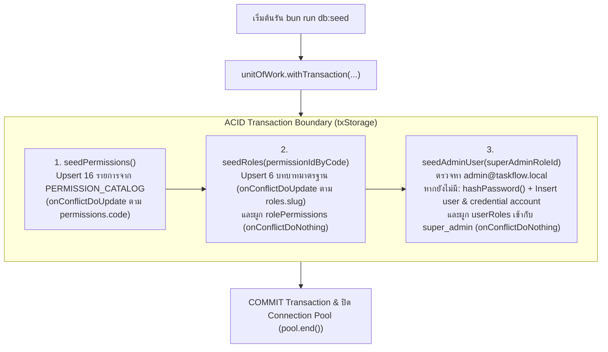

# Milestone 2 — Backend Step 4: Infrastructure Idempotent Seed & Composition Foundation (src/server/infrastructure/drizzle/ & src/server/composition/)

ในขั้นตอนที่ 4 ซึ่งเป็นขั้นตอนสุดท้ายของ Milestone 2 เราจะสร้างรากฐานของ **Composition Layer (`src/server/composition/repositories.ts`)** สำหรับฉีด `unitOfWork` เข้าสู่ระบบ และสร้างสคริปต์ **Idempotent Database Seed (`src/server/infrastructure/drizzle/seed.ts`)** เพื่อเติมข้อมูลเริ่มต้นที่จำเป็นต่อการทำงานของระบบ ได้แก่ สิทธิ์การใช้งาน 16 รายการ (`PERMISSION_CATALOG`), บทบาทมาตรฐาน 6 บทบาท (`DEFAULT_ROLES`) และบัญชีผู้ดูแลระบบเริ่มต้น (`admin@taskflow.local`)

---

## 1. เป้าหมายและขอบเขต Boundary (Boundary Context & Goal)

### เป้าหมายของ Step นี้
1. สร้างจุดเริ่มต้นของ **Composition Root (`src/server/composition/repositories.ts`)** โดยประกอบ `unitOfWork` (`new DrizzleUnitOfWork<AppTx>(db)`) เป็น Singleton ตัวแรกของระบบ
2. สร้างสคริปต์ **Idempotent Seed (`src/server/infrastructure/drizzle/seed.ts`)** ที่รันซ้ำได้ไม่จำกัดครั้งโดยไม่เกิดข้อมูลซ้ำซ้อนหรือพังกลางคัน ภายใต้ ACID Transaction เดียวของ `unitOfWork.withTransaction(...)`
3. ทดสอบวงจรฐานข้อมูลครบทุกขั้นตอนของ Milestone 2 ตั้งแต่ `db:migrate`, `db:seed`, `typecheck`, `check` ไปจนถึงการตรวจสอบข้อมูลจริงผ่าน `db:studio`

### ตารางสรุปไฟล์ใน Step นี้

| เส้นทางไฟล์ (File Path) | บทบาทหน้าที่ (Responsibility) |
| :--- | :--- |
| `src/server/composition/repositories.ts` | ศูนย์กลางการสร้าง Singleton Instances ของ `unitOfWork` (และ Repositories ประจำโมดูลที่จะทยอยเพิ่มใน Milestone ถัดไป) |
| `src/server/infrastructure/drizzle/seed.ts` | สคริปต์เติมข้อมูลเริ่มต้น (Permissions, Default Roles, Role-Permissions และ Admin User) แบบ Idempotent |

### แผนผังการทำงานของ Idempotent Seed Pipeline



---

## 2. ทฤษฎี ความสำคัญ และกฎสถาปัตยกรรมเฉพาะ Boundary นี้

### 2.1 การทำ Idempotent Seed ด้วย Single Round-Trip Upsert (`server.md` ข้อ 14)
ตามกฎ `.agents/rules/server.md` ข้อ 14 (**Infrastructure Layer: Persistence & High Performance**):
> - ออกแบบ Repository และ Use Case ให้ทำ Query เท่าที่จำเป็น โดยใช้ความสามารถของ Database ให้จบใน Single Round-trip:
>   - ใช้ Upsert (`onConflictDoUpdate`) แทนการ Query ตรวจสอบก่อน Insert
>   - ใช้ WHERE conditions ร่วมกับ `returning()` ในคำสั่ง `UPDATE` / `DELETE` จบในคำสั่งเดียว

สคริปต์ `seed.ts` นำหลักการนี้มาใช้อย่างเคร่งครัด:
1. **`seedPermissions()`**: ใช้ `.insert(permissions).values(...).onConflictDoUpdate({ target: permissions.code, set: { scope, description } })` ทำให้หากรันซ้ำหรือมีการปรับปรุงคำอธิบายใน `PERMISSION_CATALOG` ฐานข้อมูลจะอัปเดตข้อมูลให้ตรงกับโค้ดล่าสุดทันทีโดยไม่เปลี่ยน UUID เดิม
2. **`seedRoles()`**: ใช้ `.insert(roles).values(...).onConflictDoUpdate({ target: roles.slug, ... }).returning({ id: roles.id, slug: roles.slug })` เพื่อได้ทั้งการ Upsert บทบาทและการดึง `id` กลับมาในคำสั่งเดียว จากนั้นผูกตารางเชื่อม `rolePermissions` ด้วย `.onConflictDoNothing()`
3. **ทำไมแยก `isSystem: true` และ `isSystem: false` ใน `DEFAULT_ROLES`?**:
   - บทบาทหลักที่ระบบต้องใช้เป็นแกนกลาง (`super_admin`, `standard_member`, `project_owner`) ถูกตั้งค่า `isSystem: true` เพื่อป้องกันไม่ให้ใครลบออกจากระบบ
   - บทบาทเริ่มต้นอื่นๆ ในโปรเจกต์ (`project_manager`, `contributor`, `viewer`) ถูกตั้งค่า `isSystem: false` เพื่อให้ผู้ดูแลระบบสามารถปรับแต่งหรือบริหารจัดการได้อย่างยืดหยุ่น

### 2.2 การสร้างบัญชีเริ่มต้นให้สอดคล้องกับ Better Auth Credential Provider
Better Auth เก็บข้อมูลผู้ใช้แยกเป็น 2 ตารางหลักเมื่อใช้การเข้าสู่ระบบด้วยอีเมลและรหัสผ่าน (`emailAndPassword`):
1. **ตาราง `user`**: เก็บข้อมูลโปรไฟล์หลัก (`id`, `name`, `email`, `emailVerified: true`)
2. **ตาราง `account`**: เก็บข้อมูลการยืนยันตัวตน โดยต้องกำหนด `providerId: "credential"`, `accountId: adminUserId` และเก็บค่า `password` ที่ผ่านการเข้ารหัสด้วยฟังก์ชัน `hashPassword` จาก `"better-auth/crypto"` เท่านั้น เพื่อให้อัลกอริทึมการเปรียบเทียบรหัสผ่านตอน Sign In ทำงานตรงกัน 100%

### 2.3 รากฐานของ Pure Manual DI (`server.md` ข้อ 17)
ตามกฎ `.agents/rules/server.md` ข้อ 17 (**Composition Layer: Pure Dependency Injection**):
- เราสร้าง Singleton Instances ของ Infrastructure ชั้นล่างสุดไว้ใน `src/server/composition/repositories.ts`
- ใน Milestone 2 นี้ เรามี `DrizzleUnitOfWork` พร้อมใช้งานแล้ว จึงประกาศ `export const unitOfWork = new DrizzleUnitOfWork<AppTx>(db);` ไว้เป็นตัวแรก และเมื่อเราสร้าง Repositories ของแต่ละโมดูลใน Milestone 3–6 เราจะนำมาลงทะเบียนต่อท้ายในไฟล์นี้

---

## 3. ลงมือเขียนโค้ด (Step-by-Step Implementation)

### 3.1 ไฟล์ `src/server/composition/repositories.ts`

ในขั้นตอนนี้ ให้สร้างไฟล์ `src/server/composition/repositories.ts` โดยเริ่มจากการประกอบ `unitOfWork` เข้ากับ `db`:

```typescript
import type { AppTx } from "#/server/infrastructure/drizzle/db";
import { db } from "#/server/infrastructure/drizzle/db";
import { DrizzleUnitOfWork } from "#/server/infrastructure/drizzle/unit-of-work";

export const unitOfWork = new DrizzleUnitOfWork<AppTx>(db);
```

> [!NOTE]
> เมื่อคุณดำเนินการต่อจนครบทุก Milestone (Milestone 3 ถึง Milestone 6) ไฟล์ `src/server/composition/repositories.ts` ฉบับสมบูรณ์ที่จะรวม Repositories และ Query Services ของทุกโมดูลจะมีหน้าตาดังนี้:
>
> ```typescript
> import type { AppTx } from "#/server/infrastructure/drizzle/db";
> import { db } from "#/server/infrastructure/drizzle/db";
> import { DrizzleUnitOfWork } from "#/server/infrastructure/drizzle/unit-of-work";
> import { DrizzleProjectQueries } from "#/server/infrastructure/projects/drizzle-project.queries";
> import { DrizzleProjectRepository } from "#/server/infrastructure/projects/drizzle-project.repository";
> import { DrizzleRbacRepository } from "#/server/infrastructure/rbac/drizzle-rbac.repository";
> import { DrizzleTaskQueries } from "#/server/infrastructure/tasks/drizzle-task.queries";
> import { DrizzleTaskRepository } from "#/server/infrastructure/tasks/drizzle-task.repository";
> import { DrizzleUserQueries } from "#/server/infrastructure/users/drizzle-user.queries";
> import { DrizzleWorkspaceQueries } from "#/server/infrastructure/workspace/drizzle-workspace.queries";
>
> export const unitOfWork = new DrizzleUnitOfWork<AppTx>(db);
> export const rbacRepository = new DrizzleRbacRepository(db);
> export const userQueries = new DrizzleUserQueries(db);
> export const projectRepository = new DrizzleProjectRepository(db);
> export const projectQueries = new DrizzleProjectQueries(db);
> export const taskRepository = new DrizzleTaskRepository(db);
> export const taskQueries = new DrizzleTaskQueries(db);
> export const workspaceQueries = new DrizzleWorkspaceQueries(db);
> ```
> ใน Milestone 2 ให้ใส่เฉพาะ `unitOfWork` ก่อนเพื่อให้ `bun run typecheck` และ `bun run db:seed` ทำงานได้ทันทีโดยไม่ติด Import ของไฟล์ใน Milestone ถัดไป

---

### 3.2 ไฟล์ `src/server/infrastructure/drizzle/seed.ts`

สร้างไฟล์ `src/server/infrastructure/drizzle/seed.ts` ฉบับสมบูรณ์ทั้งหมด 262 บรรทัด:

```typescript
import { randomUUID } from "node:crypto";
import { hashPassword } from "better-auth/crypto";
import { eq } from "drizzle-orm";
import { unitOfWork } from "#/server/composition/repositories";
import type { AppDb, AppTx } from "#/server/infrastructure/drizzle/db";
import { db, pool } from "#/server/infrastructure/drizzle/db";
import {
	account,
	permissions,
	rolePermissions,
	roles,
	user,
	userRoles,
} from "#/server/infrastructure/drizzle/schema";
import { txStorage } from "#/server/infrastructure/drizzle/tx-context";
import type { PermissionCode, RoleScope } from "#/shared/schemas/rbac.schema";
import { PERMISSION_CATALOG } from "#/shared/schemas/rbac.schema";

interface SeedRoleDefinition {
	readonly name: string;
	readonly slug: string;
	readonly scope: RoleScope;
	readonly description: string;
	readonly isSystem: boolean;
	readonly permissions: readonly PermissionCode[];
}

const DEFAULT_ROLES: readonly SeedRoleDefinition[] = [
	{
		name: "Super Admin",
		slug: "super_admin",
		scope: "system",
		description:
			"Full administrative access across roles, users, and all projects",
		isSystem: true,
		permissions: [
			"role:read",
			"role:manage",
			"user:read",
			"user:assign_role",
			"project:create",
			"project:read_all",
		],
	},
	{
		name: "Standard Member",
		slug: "standard_member",
		scope: "system",
		description:
			"Default workspace member with ability to create projects and view teammates",
		isSystem: true,
		permissions: ["project:create", "user:read"],
	},
	{
		name: "Project Owner",
		slug: "project_owner",
		scope: "project",
		description: "Full control over a project, its members, and tasks",
		isSystem: true,
		permissions: [
			"project:read",
			"project:update",
			"project:delete",
			"project:manage_members",
			"task:create",
			"task:update",
			"task:assign",
			"task:delete",
			"comment:create",
			"comment:delete_any",
		],
	},
	{
		name: "Project Manager",
		slug: "project_manager",
		scope: "project",
		description:
			"Manage project settings, members, and all tasks without deleting the project",
		isSystem: false,
		permissions: [
			"project:read",
			"project:update",
			"project:manage_members",
			"task:create",
			"task:update",
			"task:assign",
			"task:delete",
			"comment:create",
			"comment:delete_any",
		],
	},
	{
		name: "Contributor",
		slug: "contributor",
		scope: "project",
		description: "Create and update tasks and collaborate via comments",
		isSystem: false,
		permissions: [
			"project:read",
			"task:create",
			"task:update",
			"comment:create",
		],
	},
	{
		name: "Viewer",
		slug: "viewer",
		scope: "project",
		description:
			"Read-only access to project details, tasks, and activity logs",
		isSystem: false,
		permissions: ["project:read"],
	},
];

const SEED_ADMIN_EMAIL = "admin@taskflow.local";
const SEED_ADMIN_NAME = "TaskFlow Admin";
const SEED_ADMIN_PASSWORD = "Password123!";

function getExecutor(): AppDb | AppTx {
	const tx = txStorage.getStore() as AppTx | undefined;
	return tx ?? db;
}

async function seedPermissions(): Promise<Map<string, string>> {
	const executor = getExecutor();

	for (const item of PERMISSION_CATALOG) {
		await executor
			.insert(permissions)
			.values({
				code: item.code,
				scope: item.scope,
				description: item.description,
			})
			.onConflictDoUpdate({
				target: permissions.code,
				set: {
					scope: item.scope,
					description: item.description,
				},
			});
	}

	const rows = await executor.select().from(permissions);
	return new Map(rows.map((row) => [row.code, row.id]));
}

async function seedRoles(
	permissionIdByCode: Map<string, string>,
): Promise<Map<string, string>> {
	const executor = getExecutor();
	const roleIdBySlug = new Map<string, string>();

	for (const roleDef of DEFAULT_ROLES) {
		const [upsertedRole] = await executor
			.insert(roles)
			.values({
				name: roleDef.name,
				slug: roleDef.slug,
				scope: roleDef.scope,
				description: roleDef.description,
				isSystem: roleDef.isSystem,
			})
			.onConflictDoUpdate({
				target: roles.slug,
				set: {
					name: roleDef.name,
					scope: roleDef.scope,
					description: roleDef.description,
					isSystem: roleDef.isSystem,
				},
			})
			.returning({ id: roles.id, slug: roles.slug });

		roleIdBySlug.set(upsertedRole.slug, upsertedRole.id);

		const mappings = roleDef.permissions.map((code) => {
			const permissionId = permissionIdByCode.get(code);
			if (!permissionId) {
				throw new Error(`Missing seeded permission for code: ${code}`);
			}
			return {
				roleId: upsertedRole.id,
				permissionId,
			};
		});

		if (mappings.length > 0) {
			await executor
				.insert(rolePermissions)
				.values(mappings)
				.onConflictDoNothing();
		}
	}

	return roleIdBySlug;
}

async function seedAdminUser(superAdminRoleId: string): Promise<void> {
	const executor = getExecutor();
	const [existingUser] = await executor
		.select({ id: user.id })
		.from(user)
		.where(eq(user.email, SEED_ADMIN_EMAIL))
		.limit(1);

	let adminUserId = existingUser?.id;

	if (!adminUserId) {
		adminUserId = randomUUID();
		const hashedPassword = await hashPassword(SEED_ADMIN_PASSWORD);

		await executor.insert(user).values({
			id: adminUserId,
			name: SEED_ADMIN_NAME,
			email: SEED_ADMIN_EMAIL,
			emailVerified: true,
		});

		await executor.insert(account).values({
			id: randomUUID(),
			userId: adminUserId,
			accountId: adminUserId,
			providerId: "credential",
			password: hashedPassword,
		});
	}

	await executor
		.insert(userRoles)
		.values({
			userId: adminUserId,
			roleId: superAdminRoleId,
		})
		.onConflictDoNothing();
}

async function main(): Promise<void> {
	await unitOfWork.withTransaction(async () => {
		const permissionIdByCode = await seedPermissions();
		const roleIdBySlug = await seedRoles(permissionIdByCode);

		const superAdminRoleId = roleIdBySlug.get("super_admin");
		if (!superAdminRoleId) {
			throw new Error("Failed to resolve super_admin role ID after seeding");
		}

		await seedAdminUser(superAdminRoleId);
	});

	console.log("Seed completed successfully.");
	console.log(
		`Admin credentials: ${SEED_ADMIN_EMAIL} / ${SEED_ADMIN_PASSWORD}`,
	);
}

try {
	await main();
} finally {
	await pool.end();
}
```

#### คำอธิบายโค้ดอย่างละเอียด
- **`getExecutor()`**: ดึง Transaction (`tx`) ปัจจุบันจาก `txStorage.getStore()` เพื่อให้ทุกคำสั่งใน `seedPermissions()`, `seedRoles()` และ `seedAdminUser()` ทำงานอยู่ภายใต้ Transaction เดียวกันที่เปิดโดย `unitOfWork.withTransaction(...)`
- **`seedPermissions()`**: วนลูปอ่าน `PERMISSION_CATALOG` ทั้ง 16 รายการจาก `#/shared/schemas/rbac.schema` แล้วสั่ง Upsert ลงตาราง `permissions` จากนั้นคืนค่า `Map<string, string>` ที่จับคู่ระหว่าง `code -> id`
- **`seedRoles(permissionIdByCode)`**: วนลูปอ่าน `DEFAULT_ROLES` ทั้ง 6 บทบาท (2 บทบาทระดับ `system` และ 4 บทบาทระดับ `project`) ทำการ Upsert ลงตาราง `roles` พร้อมดึง `id` และ `slug` กลับมาผ่าน `.returning(...)` แล้วนำรายการสิทธิ์ของแต่ละบทบาทไปแปลงเป็น `permissionId` เพื่อบันทึกลงตาราง `rolePermissions` แบบ `.onConflictDoNothing()`
- **`seedAdminUser(superAdminRoleId)`**:
  - ตรวจสอบว่ามีผู้ใช้ที่มีอีเมล `admin@taskflow.local` อยู่แล้วหรือไม่
  - หากยังไม่มี จะสร้าง UUID ใหม่ เข้ารหัสรหัสผ่าน `"Password123!"` ด้วย `hashPassword` ของ Better Auth แล้วบันทึกข้อมูลลงทั้งตาราง `user` และ `account`
  - ผูกผู้ใช้ดังกล่าวเข้ากับบทบาท `super_admin` ในตาราง `userRoles` ด้วย `.onConflictDoNothing()`
- **`try { await main(); } finally { await pool.end(); }`**: รับประกันว่าเมื่อสคริปต์ทำงานเสร็จ (หรือเกิดข้อผิดพลาด) Connection Pool ของ PostgreSQL จะถูกปิดอย่างสะอาดเพื่อให้โปรเซสของ Bun จบการทำงานทันทีไม่ค้างอยู่ในเทอร์มินัล

---

## 4. การตรวจสอบความถูกต้องและ Git Commit (Verification & Commit)

เมื่อเขียนโค้ดครบทุกไฟล์ใน Milestone 2 แล้ว ให้รันขั้นตอนตรวจสอบความสมบูรณ์ท้าย Milestone ตามลำดับต่อไปนี้:

### 4.1 รัน Database Migration และ Idempotent Seed

```bash
bun run db:migrate
bun run db:seed
```

ผลลัพธ์ที่คาดหวังจาก `bun run db:seed`:
```text
Seed completed successfully.
Admin credentials: admin@taskflow.local / Password123!
```
ลองรัน `bun run db:seed` ซ้ำอีกครั้งเพื่อพิสูจน์คุณสมบัติ **Idempotency** — คำสั่งต้องทำงานสำเร็จโดยไม่เกิดข้อผิดพลาดเรื่อง Unique Constraint

### 4.2 ตรวจสอบ Typecheck และ Code Quality (Biome)

```bash
bun run typecheck
bun run check
```

### 4.3 ตรวจสอบข้อมูลในฐานข้อมูลผ่าน Drizzle Studio (ทางเลือกแนะนำ)

```bash
bun run db:studio
```
เปิดเบราว์เซอร์ตาม URL ที่แสดง (ปกติคือ `https://local.drizzle.studio`) เพื่อตรวจดูว่าตาราง `permissions` มี 16 แถว, ตาราง `roles` มี 6 แถว, และตาราง `user` มีบัญชี `admin@taskflow.local` พร้อมใช้งาน

### 4.4 บันทึก Git Commit ปิดท้าย Milestone 2

```bash
git add src/server/composition/repositories.ts src/server/infrastructure/drizzle/seed.ts
git commit -m "milestone-2.backend.step-4: Idempotent Database Seed & Composition Foundation"
```
