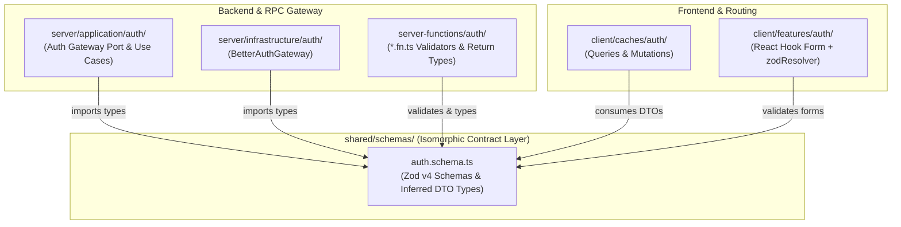

# Milestone 3 — Backend Step 1: Shared Auth Schemas (src/shared/schemas/)

เอกสารบทเรียนสำหรับ **Milestone 3 (Backend Step 1)** ซึ่งเป็นการวางรากฐานสัญญาข้อมูลกลาง (Data Contracts) ของระบบยืนยันตัวตนและสิทธิ์การเข้าถึง (Authentication & RBAC Session) ไว้ที่ชั้น Isomorphic Shared Layer (`src/shared/schemas/auth.schema.ts`) เพื่อให้ทั้งฝั่ง Backend (`server/`, `server-functions/`) และฝั่ง Frontend (`client/caches/`, `client/features/`, `routes/`) อ้างอิง Schema และ Type ชุดเดียวกันอย่างเคร่งครัด

---

## 1. เป้าหมายและขอบเขต Boundary (Boundary Context & Goal)

ใน Step แรกของ Milestone 3 เราจะสร้างไฟล์ `src/shared/schemas/auth.schema.ts` เพื่อนิยาม Zod v4 Schemas และ Inferred Types สำหรับการเข้าสู่ระบบ (`SignInInput`), การสมัครสมาชิก (`SignUpInput`), ข้อมูลผู้ใช้พร้อมสิทธิ์ระดับระบบ (`AuthUserDto`), ข้อมูล Session (`AuthSessionDto`, `CurrentSessionResultDto`) และผลลัพธ์การตรวจสอบสถานะการยืนยันตัวตน (`AuthCheckResultDto`)

### ตารางสรุปไฟล์ใน Step นี้

| ลำดับ | Path ของไฟล์ | บทบาทหน้าที่ (Responsibility) |
| :--- | :--- | :--- |
| 1 | `src/shared/schemas/auth.schema.ts` | นิยาม Zod v4 Schemas และ TypeScript Types สำหรับ Input Payloads และ Output DTOs ทั้งหมดของระบบ Authentication |

### แผนผังสถาปัตยกรรมและทิศทางการพึ่งพา (Architecture & Dependency Flow)



---

## 2. ทฤษฎี ความสำคัญ และกฎสถาปัตยกรรมเฉพาะ Boundary นี้

### 2.1 ทำไมต้องเริ่มที่ `shared/schemas/auth.schema.ts` ก่อนเสมอ?

ตามกฎเหล็กใน `.agents/rules/globals.md` (หมวด **Shared Schemas ข้อ 1–4**) และ `.agents/rules/architecture.md`:
- **Single Source of Truth ระหว่าง Server และ Client**: ห้ามให้ฝั่ง `server/` และ `client/` นิยาม `interface` หรือ `type` ของข้อมูลที่ส่งข้าม Network แยกกันโดยเด็ดขาด ทุก Contract ต้องเริ่มต้นจาก Zod Schema ใน `shared/schemas/**` แล้วค่อยใช้ `z.infer<typeof ...>` เพื่อสร้าง TypeScript Type เสมอ
- **Validation Pipeline ที่สอดคล้องกันทั้งระบบ**: ฟอร์มบนหน้าเว็บ (`sign-in`, `sign-up`) สามารถนำ `signInInputSchema` และ `signUpInputSchema` ไปผูกกับ `zodResolver` เพื่อตรวจจับข้อผิดพลาดทันทีฝั่ง Client ในขณะที่ `server-functions/` ก็นำ Schema ตัวเดียวกันไปใส่ใน `.validator(...)` เพื่อป้องกัน Request ที่ไม่ถูกต้องที่ระดับ RPC Gateway

### 2.2 การออกแบบ Data Normalization ด้วย Zod v4 (`pipe` + `z.email`)

ใน Zod v4 การตรวจสอบรูปแบบอีเมลมี Standalone Validator `z.email(...)` ที่แยกออกมาชัดเจน ใน `signInInputSchema` และ `signUpInputSchema` เราออกแบบ Pipeline การทำความสะอาดข้อมูล (Sanitization & Normalization) ก่อนตรวจสอบรูปแบบดังนี้:
1. `z.string().trim().toLowerCase()` — ตัดช่องว่างหัวท้ายที่ผู้ใช้เผลอพิมพ์ติดมา และแปลงตัวอักษรทั้งหมดเป็นตัวพิมพ์เล็กเสมอ เพื่อป้องกันปัญหา Case-Sensitivity ของอีเมล เช่น `User@Example.com` กับ `user@example.com`
2. `.pipe(z.email("กรุณากรอกรูปแบบอีเมลให้ถูกต้อง"))` — ส่งต่อสตริงที่ผ่านการ `trim()` และ `toLowerCase()` เข้าสู่ `z.email()` เพื่อตรวจสอบความถูกต้องของรูปแบบอีเมลด้วยข้อความแจ้งเตือนภาษาไทยที่เข้าใจง่าย

### 2.3 การแนบ `systemRoles` และ `systemPermissions` มาพร้อมกับ Session DTO

ใน `authUserDtoSchema` เราไม่ได้ส่งคืนเพียงข้อมูลพื้นฐานจากตาราง `user` (`id`, `name`, `email`, `emailVerified`, `image`) เท่านั้น แต่ยังบังคับให้มี:
- `systemRoles: z.array(z.string())` — รายชื่อ Role Slugs ระดับระบบของผู้ใช้ (เช่น `["standard_member"]` หรือ `["system_admin"]`)
- `systemPermissions: z.array(z.string())` — รายชื่อ Permission Codes ที่ผู้ใช้ได้รับผ่าน Role (เช่น `["project:create", "task:read", ...]`)

**เหตุผลเชิงวิศวกรรม**: การแนบ `systemRoles` และ `systemPermissions` มาตั้งแต่ขั้นตอนการโหลด Session (`getSessionFn`) ช่วยให้ทั้ง Route Guards (`_authed`), UI Components และ Server Middleware ทราบสิทธิ์ของผู้ใช้ได้ทันทีในการเรียกครั้งเดียว ไม่ต้องยิง Request แยกเพื่อถามสิทธิ์ซ้ำซ้อน

---

## 3. ลงมือเขียนโค้ด (Step-by-Step Implementation)

### ไฟล์ที่ 1: `src/shared/schemas/auth.schema.ts`

สร้างไฟล์ `src/shared/schemas/auth.schema.ts` โดยใส่โค้ดฉบับเต็มดังต่อไปนี้:

```typescript
import { z } from "zod";

export const signInInputSchema = z.object({
	email: z
		.string()
		.trim()
		.toLowerCase()
		.pipe(z.email("กรุณากรอกรูปแบบอีเมลให้ถูกต้อง")),
	password: z.string().min(8, "รหัสผ่านต้องมีอย่างน้อย 8 ตัวอักษร"),
});

export type SignInInput = z.infer<typeof signInInputSchema>;

export const signUpInputSchema = z.object({
	name: z
		.string()
		.trim()
		.min(2, "ชื่อผู้ใช้งานต้องมีอย่างน้อย 2 ตัวอักษร")
		.max(100, "ชื่อผู้ใช้งานต้องไม่เกิน 100 ตัวอักษร"),
	email: z
		.string()
		.trim()
		.toLowerCase()
		.pipe(z.email("กรุณากรอกรูปแบบอีเมลให้ถูกต้อง")),
	password: z
		.string()
		.min(8, "รหัสผ่านต้องมีอย่างน้อย 8 ตัวอักษร")
		.max(128, "รหัสผ่านต้องไม่เกิน 128 ตัวอักษร"),
});

export type SignUpInput = z.infer<typeof signUpInputSchema>;

export const authUserDtoSchema = z.object({
	id: z.string(),
	name: z.string(),
	email: z.string(),
	emailVerified: z.boolean(),
	image: z.string().nullable(),
	systemRoles: z.array(z.string()),
	systemPermissions: z.array(z.string()),
});
export type AuthUserDto = z.infer<typeof authUserDtoSchema>;

export const authSessionInfoDtoSchema = z.object({
	id: z.string(),
	userId: z.string(),
	expiresAt: z.string(),
});
export type AuthSessionInfoDto = z.infer<typeof authSessionInfoDtoSchema>;

export const authSessionDtoSchema = z.object({
	user: authUserDtoSchema,
	session: authSessionInfoDtoSchema,
});
export type AuthSessionDto = z.infer<typeof authSessionDtoSchema>;

export const currentSessionResultDtoSchema = authSessionDtoSchema.nullable();
export type CurrentSessionResultDto = z.infer<
	typeof currentSessionResultDtoSchema
>;

export const authCheckResultDtoSchema = z.object({
	authenticated: z.literal(true),
	userId: z.string(),
	email: z.string(),
	systemRoles: z.array(z.string()),
	systemPermissions: z.array(z.string()),
});
export type AuthCheckResultDto = z.infer<typeof authCheckResultDtoSchema>;
```

#### คำอธิบายการทำงานอย่างละเอียด
1. **`signInInputSchema` และ `SignInInput`**:
   - กำหนดโครงสร้างข้อมูลขาเข้าสำหรับการเข้าสู่ระบบด้วยอีเมลและรหัสผ่าน
   - `email` ถูกจัดรูปแบบด้วย `.trim().toLowerCase()` ก่อนส่งเข้า `.pipe(z.email(...))`
   - `password` กำหนดความยาวขั้นต่ำ 8 ตัวอักษรให้สอดคล้องกับข้อกำหนดของ Better Auth
2. **`signUpInputSchema` และ `SignUpInput`**:
   - กำหนดโครงสร้างข้อมูลสำหรับการลงทะเบียนผู้ใช้ใหม่
   - `name` ต้องมีความยาวระหว่าง 2 ถึง 100 ตัวอักษรหลังตัดช่องว่างหัวท้าย (`.trim()`)
   - `password` กำหนดความยาวตั้งแต่ 8 ถึง 128 ตัวอักษรตรงตามการตั้งค่า `minPasswordLength` และ `maxPasswordLength` ของระบบ
3. **`authUserDtoSchema` และ `AuthUserDto`**:
   - เป็น DTO มาตรฐานของข้อมูลผู้ใช้ที่ผ่านการยืนยันตัวตนแล้ว พร้อม `systemRoles` และ `systemPermissions` ที่ถูก Hydrate จากฐานข้อมูล RBAC
4. **`authSessionInfoDtoSchema`, `authSessionDtoSchema` และ `currentSessionResultDtoSchema`**:
   - `authSessionInfoDtoSchema` เก็บข้อมูล Metadata ของ Session ปัจจุบัน โดยแปลง `expiresAt` เป็น ISO String (`z.string()`) เพื่อให้ Serialize ข้าม RPC ได้อย่างปลอดภัย
   - `authSessionDtoSchema` รวม `user` และ `session` เข้าด้วยกัน
   - `currentSessionResultDtoSchema` ใช้ `.nullable()` เพื่อรองรับกรณีที่ผู้ใช้ยังไม่ได้เข้าสู่ระบบ (`null`)
5. **`authCheckResultDtoSchema` และ `AuthCheckResultDto`**:
   - ใช้สำหรับ Endpoint ตรวจสอบสิทธิ์ที่มี `requireAuthMiddleware` คอยป้องกันอยู่แล้ว จึงการันตีว่า `authenticated` มีค่าเป็น `z.literal(true)` เสมอ พร้อมคืนค่า `userId`, `email`, `systemRoles` และ `systemPermissions`

---

## 4. การตรวจสอบความถูกต้องและ Git Commit (Verification & Commit)

ตรวจสอบ Type Safety และ Format ของไฟล์ด้วยคำสั่งของ Bun:

```bash
bun run typecheck
bun run format
bun run check
```

เมื่อตรวจสอบผ่านโดยไม่มีข้อผิดพลาด ให้บันทึกการเปลี่ยนแปลงลง Git ตามมาตรฐานของ Step นี้:

```bash
git add src/shared/schemas/auth.schema.ts
git commit -m "milestone-3.backend.step-1: Shared Auth Schemas"
```
