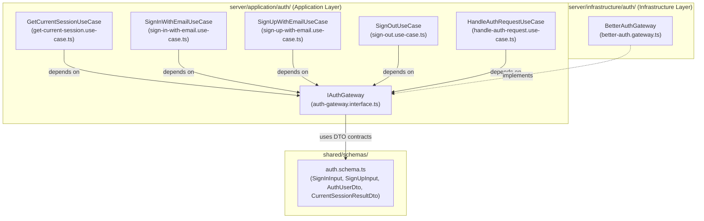

# Milestone 3 — Backend Step 2: Application Auth Port & Use Cases (src/server/application/auth/)

เอกสารบทเรียนสำหรับ **Milestone 3 (Backend Step 2)** ซึ่งเป็นการออกแบบชั้น Application Layer สำหรับระบบ Authentication (`src/server/application/auth/`) โดยใช้สถาปัตยกรรม **Port & Adapter (Dependency Inversion Principle)** ร่วมกับกฎ **1 ไฟล์ต่อ 1 Use Case** เพื่อให้ Application Workflow ไม่ผูกติดกับไลบรารี Better Auth หรือ Database ORM โดยตรง

---

## 1. เป้าหมายและขอบเขต Boundary (Boundary Context & Goal)

ใน Step ที่ 2 นี้ เราจะสร้าง Interface `IAuthGateway` (Application Port) เพื่อกำหนดสัญญาการทำงานของระบบยืนยันตัวตน และสร้าง Use Cases ทั้ง 5 ตัวสำหรับครอบคลุมทุกการกระทำของผู้ใช้และ HTTP Handler ของระบบ Auth

### ตารางสรุปไฟล์ใน Step นี้

| ลำดับ | Path ของไฟล์ | บทบาทหน้าที่ (Responsibility) |
| :--- | :--- | :--- |
| 1 | `src/server/application/auth/auth-gateway.interface.ts` | นิยาม Port Interface (`IAuthGateway`) สำหรับเชื่อมต่อกับระบบ Authentication ภายนอกโดยไม่ผูกติดกับ SDK |
| 2 | `src/server/application/auth/get-current-session.use-case.ts` | Use Case สำหรับดึงข้อมูล Session ปัจจุบันจาก HTTP Request Headers |
| 3 | `src/server/application/auth/sign-in-with-email.use-case.ts` | Use Case สำหรับเข้าสู่ระบบด้วยอีเมลและรหัสผ่าน |
| 4 | `src/server/application/auth/sign-up-with-email.use-case.ts` | Use Case สำหรับสมัครสมาชิกใหม่ด้วยชื่อ อีเมล และรหัสผ่าน |
| 5 | `src/server/application/auth/sign-out.use-case.ts` | Use Case สำหรับยกเลิก Session และออกจากระบบ |
| 6 | `src/server/application/auth/handle-auth-request.use-case.ts` | Use Case สำหรับส่งต่อ Raw HTTP `Request` ไปยัง Auth Engine Handler |

### แผนผังสถาปัตยกรรมและทิศทางการพึ่งพา (Architecture & Dependency Flow)



---

## 2. ทฤษฎี ความสำคัญ และกฎสถาปัตยกรรมเฉพาะ Boundary นี้

### 2.1 หลักการ Port & Adapter (`IAuthGateway`) เพื่อแยก Application Layer ออกจาก Better Auth SDK

ตามกฎใน `.agents/rules/architecture.md` และ `.agents/rules/server.md` (ข้อ 1 และข้อ 10):
- ชั้น `server/application/` มีหน้าที่ควบคุม Workflow (Orchestration) โดยต้องไม่ผูกติดกับรายละเอียดทางเทคนิคของ Infrastructure เช่น Better Auth SDK (`better-auth`), Drizzle ORM หรือการจัดการฐานข้อมูลโดยตรง
- เราจึงนิยาม **`IAuthGateway`** ไว้ใน `src/server/application/auth/auth-gateway.interface.ts` ทำหน้าที่เป็น **Outbound Port** ที่บอกชัดเจนว่า Application ต้องการความสามารถอะไรบ้าง (`getSession`, `signInWithEmail`, `signUpWithEmail`, `signOut`, `handleHttpRequest`)
- ส่วนการเรียก `auth.api.*`, การดึง Role/Permission จาก PostgreSQL และการแปลง Error ของ Better Auth จะถูกซ่อนไว้ใน `BetterAuthGateway` ที่ชั้น `server/infrastructure/auth/` (ใน Step 3) ซึ่ง Implement `IAuthGateway` อีกที
- ข้อดีคือ เราสามารถเขียน Unit Test ทดสอบ Use Case ทุกตัวได้ทันทีด้วยการส่ง Mock/Stub ของ `IAuthGateway` เข้าไปใน Constructor โดยไม่ต้องรัน Database หรือ Better Auth จริง

### 2.2 กฎ 1 ไฟล์ต่อ 1 Use Case และการใช้ Input Object (`server.md` ข้อ 8–9)

1. **Single Responsibility Principle (`server.md` ข้อ 8)**:
   - ห้ามสร้าง Monolithic Service เช่น `AuthService` หรือ `AuthUseCases` ที่รวมทุกเมธอดไว้ในคลาสเดียว
   - ต้องแยก **1 ไฟล์ต่อ 1 Use Case** (`get-current-session.use-case.ts`, `sign-in-with-email.use-case.ts`, ฯลฯ) โดยแต่ละคลาสมีเมธอด `execute(...)` เพียงเมธอดเดียวพร้อมระบุ Explicit Return Type เสมอ
2. **Explicit Input Contract (`server.md` ข้อ 9)**:
   - ห้ามส่งพารามิเตอร์แบบ Positional Arguments หลายตัวเรียงกันเข้าไปใน `execute(payload, headers)`
   - ต้องนิยาม `interface <UseCaseName>Input` สำหรับรับพารามิเตอร์แบบ Object เดียวเสมอ เช่น `SignInWithEmailUseCaseInput { payload: SignInInput; headers: Headers }` เพื่อให้การอ่านโค้ดชัดเจนและรองรับการขยายฟิลด์ในอนาคตโดยไม่ทำให้ Signature พัง
3. **กฎการ Import (`globals.md` ข้อ 2–3)**:
   - แยก `import type { ... }` ออกจาก Runtime Import อย่างเคร่งครัด
   - ใช้ `#/shared/schemas/auth.schema` สำหรับการอ้างอิงข้ามโมดูล และใช้ `./auth-gateway.interface` สำหรับไฟล์ในโฟลเดอร์เดียวกัน

---

## 3. ลงมือเขียนโค้ด (Step-by-Step Implementation)

### ไฟล์ที่ 1: `src/server/application/auth/auth-gateway.interface.ts`

สร้างไฟล์ `src/server/application/auth/auth-gateway.interface.ts` เพื่อนิยามสัญญา `IAuthGateway`:

```typescript
import type {
	AuthUserDto,
	CurrentSessionResultDto,
	SignInInput,
	SignUpInput,
} from "#/shared/schemas/auth.schema";

export interface IAuthGateway {
	getSession(headers: Headers): Promise<CurrentSessionResultDto>;
	signInWithEmail(input: SignInInput, headers: Headers): Promise<AuthUserDto>;
	signUpWithEmail(input: SignUpInput, headers: Headers): Promise<AuthUserDto>;
	signOut(headers: Headers): Promise<void>;
	handleHttpRequest(request: Request): Promise<Response>;
}
```

#### คำอธิบายการทำงาน
- `getSession(headers)`: รับ Web Standard `Headers` เพื่ออ่าน Session Cookie และคืนค่า `CurrentSessionResultDto` (`AuthSessionDto | null`)
- `signInWithEmail(input, headers)`: รับข้อมูลอีเมล/รหัสผ่านและ Headers เพื่อตรวจสอบสิทธิ์ ตั้งค่า Session Cookie และคืนค่า `AuthUserDto`
- `signUpWithEmail(input, headers)`: รับข้อมูลการสมัครสมาชิกและ Headers เพื่อสร้างบัญชีผู้ใช้ใหม่ กำหนด Default Role และคืนค่า `AuthUserDto`
- `signOut(headers)`: ล้าง Session ปัจจุบันจาก Headers
- `handleHttpRequest(request)`: รับ Web Standard `Request` และคืนค่า `Response` สำหรับรองรับ Auth API Endpoint มาตรฐาน

---

### ไฟล์ที่ 2: `src/server/application/auth/get-current-session.use-case.ts`

สร้างไฟล์ `src/server/application/auth/get-current-session.use-case.ts`:

```typescript
import type { CurrentSessionResultDto } from "#/shared/schemas/auth.schema";
import type { IAuthGateway } from "./auth-gateway.interface";

export interface GetCurrentSessionUseCaseInput {
	headers: Headers;
}

export class GetCurrentSessionUseCase {
	constructor(private readonly authGateway: IAuthGateway) {}

	async execute(
		input: GetCurrentSessionUseCaseInput,
	): Promise<CurrentSessionResultDto> {
		return this.authGateway.getSession(input.headers);
	}
}
```

#### คำอธิบายการทำงาน
- รับ `authGateway: IAuthGateway` ผ่าน Constructor Injection
- เมธอด `execute` รับ `GetCurrentSessionUseCaseInput` ที่มี `headers: Headers` และส่งต่อไปยัง `this.authGateway.getSession(input.headers)` พร้อมระบุ Return Type `Promise<CurrentSessionResultDto>` อย่างชัดเจน

---

### ไฟล์ที่ 3: `src/server/application/auth/sign-in-with-email.use-case.ts`

สร้างไฟล์ `src/server/application/auth/sign-in-with-email.use-case.ts`:

```typescript
import type { AuthUserDto, SignInInput } from "#/shared/schemas/auth.schema";
import type { IAuthGateway } from "./auth-gateway.interface";

export interface SignInWithEmailUseCaseInput {
	payload: SignInInput;
	headers: Headers;
}

export class SignInWithEmailUseCase {
	constructor(private readonly authGateway: IAuthGateway) {}

	async execute(input: SignInWithEmailUseCaseInput): Promise<AuthUserDto> {
		return this.authGateway.signInWithEmail(input.payload, input.headers);
	}
}
```

#### คำอธิบายการทำงาน
- นิยาม `SignInWithEmailUseCaseInput` ที่ห่อหุ้มทั้ง `payload: SignInInput` และ `headers: Headers` ไว้ใน Input Object เดียวตามกฎ `server.md` ข้อ 9
- เมธอด `execute` สั่งรัน `this.authGateway.signInWithEmail(input.payload, input.headers)` และคืนค่า `Promise<AuthUserDto>`

---

### ไฟล์ที่ 4: `src/server/application/auth/sign-up-with-email.use-case.ts`

สร้างไฟล์ `src/server/application/auth/sign-up-with-email.use-case.ts`:

```typescript
import type { AuthUserDto, SignUpInput } from "#/shared/schemas/auth.schema";
import type { IAuthGateway } from "./auth-gateway.interface";

export interface SignUpWithEmailUseCaseInput {
	payload: SignUpInput;
	headers: Headers;
}

export class SignUpWithEmailUseCase {
	constructor(private readonly authGateway: IAuthGateway) {}

	async execute(input: SignUpWithEmailUseCaseInput): Promise<AuthUserDto> {
		return this.authGateway.signUpWithEmail(input.payload, input.headers);
	}
}
```

#### คำอธิบายการทำงาน
- นิยาม `SignUpWithEmailUseCaseInput` ที่รับ `payload: SignUpInput` และ `headers: Headers`
- เมธอด `execute` ส่งต่อข้อมูลไปยัง `this.authGateway.signUpWithEmail(input.payload, input.headers)` และคืนค่า `Promise<AuthUserDto>` ของผู้ใช้ที่เพิ่งสร้างเสร็จพร้อมสิทธิ์เริ่มต้น

---

### ไฟล์ที่ 5: `src/server/application/auth/sign-out.use-case.ts`

สร้างไฟล์ `src/server/application/auth/sign-out.use-case.ts`:

```typescript
import type { IAuthGateway } from "./auth-gateway.interface";

export interface SignOutUseCaseInput {
	headers: Headers;
}

export class SignOutUseCase {
	constructor(private readonly authGateway: IAuthGateway) {}

	async execute(input: SignOutUseCaseInput): Promise<void> {
		return this.authGateway.signOut(input.headers);
	}
}
```

#### คำอธิบายการทำงาน
- นิยาม `SignOutUseCaseInput` ที่รับ `headers: Headers`
- เมธอด `execute` เรียก `this.authGateway.signOut(input.headers)` เพื่อเพิกถอน Session ปัจจุบันและล้าง Cookie

---

### ไฟล์ที่ 6: `src/server/application/auth/handle-auth-request.use-case.ts`

สร้างไฟล์ `src/server/application/auth/handle-auth-request.use-case.ts`:

```typescript
import type { IAuthGateway } from "./auth-gateway.interface";

export interface HandleAuthRequestUseCaseInput {
	request: Request;
}

export class HandleAuthRequestUseCase {
	constructor(private readonly authGateway: IAuthGateway) {}

	async execute(input: HandleAuthRequestUseCaseInput): Promise<Response> {
		return this.authGateway.handleHttpRequest(input.request);
	}
}
```

#### คำอธิบายการทำงาน
- นิยาม `HandleAuthRequestUseCaseInput` ที่รับ `request: Request`
- ทำหน้าที่เป็น Use Case กลางสำหรับส่งต่อ HTTP Request จาก Route `/api/auth/$` เข้าสู่ `IAuthGateway.handleHttpRequest` โดยที่ชั้น Route หรือ Gateway ไม่ต้องอ้างอิงถึง `betterAuth` instance โดยตรง

---

## 4. การตรวจสอบความถูกต้องและ Git Commit (Verification & Commit)

รันคำสั่งตรวจสอบคุณภาพโค้ดและ TypeScript Types ด้วย Bun:

```bash
bun run typecheck
bun run format
bun run check
```

เมื่อผ่านทั้งหมดแล้ว ให้ Commit ไฟล์ทั้ง 6 ใน `src/server/application/auth/`:

```bash
git add src/server/application/auth/
git commit -m "milestone-3.backend.step-2: Application Auth Gateway Port & Use Cases"
```
