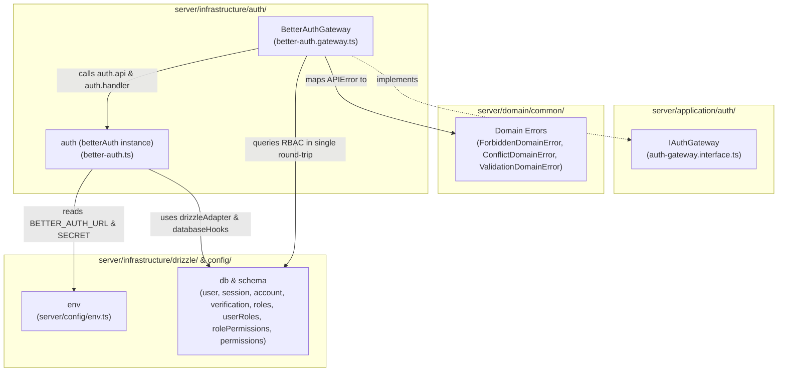

# Milestone 3 — Backend Step 3: Infrastructure Better Auth & Gateway (src/server/infrastructure/auth/)

เอกสารบทเรียนสำหรับ **Milestone 3 (Backend Step 3)** ซึ่งเป็นการสร้างชั้น Infrastructure สำหรับระบบ Authentication (`src/server/infrastructure/auth/`) โดยตั้งค่า Better Auth Engine เชื่อมต่อกับ PostgreSQL ผ่าน Drizzle ORM และสร้าง `BetterAuthGateway` ที่ Implement สัญญา `IAuthGateway` จาก Step 2

---

## 1. เป้าหมายและขอบเขต Boundary (Boundary Context & Goal)

ใน Step ที่ 3 นี้ เราจะสร้างไฟล์ใน `src/server/infrastructure/auth/` จำนวน 2 ไฟล์ เพื่อตั้งค่า Better Auth Instance (`auth`) พร้อม Database Hook สำหรับผูก Role เริ่มต้น (`standard_member`) ให้สมาชิกใหม่โดยอัตโนมัติ และสร้าง `BetterAuthGateway` ที่ดึงข้อมูล `systemRoles` + `systemPermissions` ด้วย Single Round-Trip Query ตลอดจนแปลง `APIError` ของ Better Auth ให้กลายเป็น `DomainError` ตามมาตรฐานสถาปัตยกรรม

### ตารางสรุปไฟล์ใน Step นี้

| ลำดับ | Path ของไฟล์ | บทบาทหน้าที่ (Responsibility) |
| :--- | :--- | :--- |
| 1 | `src/server/infrastructure/auth/better-auth.ts` | ตั้งค่า `betterAuth` เชื่อมต่อ Drizzle Adapter, เปิดใช้งาน `tanstackStartCookies()` และผูก `databaseHooks.user.create.after` เพื่อกำหนด Role `standard_member` |
| 2 | `src/server/infrastructure/auth/better-auth.gateway.ts` | Implement `IAuthGateway` ทำหน้าที่เรียก Better Auth API, Hydrate ข้อมูล `systemRoles` + `systemPermissions` ใน Single Query และแปลง Error เป็น `DomainError` |

### แผนผังสถาปัตยกรรมและทิศทางการพึ่งพา (Architecture & Dependency Flow)



---

## 2. ทฤษฎี ความสำคัญ และกฎสถาปัตยกรรมเฉพาะ Boundary นี้

### 2.1 การทำงานของ `better-auth.ts`: `drizzleAdapter`, `tanstackStartCookies()` และ `databaseHooks`

1. **`drizzleAdapter(db, { provider: "pg", schema: { user, session, account, verification } })`**:
   - เชื่อมต่อ Better Auth เข้ากับ Drizzle ORM instance (`db`) และตารางมาตรฐานทั้ง 4 ตารางที่สร้างไว้ใน Milestone 2 โดยอ่านค่า `BETTER_AUTH_URL` และ `BETTER_AUTH_SECRET` จาก `src/server/config/env.ts` ที่ผ่านการตรวจแบบ Fail-fast แล้ว (`server.md` ข้อ 19)
2. **`plugins: [tanstackStartCookies()]`**:
   - ในสภาพแวดล้อมของ TanStack Start การเรียก `auth.api.signInEmail`, `auth.api.signUpEmail` หรือ `auth.api.signOut` ภายใน Server Functions จำเป็นต้องซิงค์ `Set-Cookie` Header กลับไปยัง HTTP Response ของ TanStack Start โดยอัตโนมัติ ปลั๊กอิน `tanstackStartCookies()` จะดูแลการอ่านและเขียน Session Cookie ให้ครบวงจร
3. **`databaseHooks.user.create.after` (Automatic Default Role Assignment)**:
   - ทันทีที่ผู้ใช้สมัครสมาชิกสำเร็จและแถวในตาราง `user` ถูกสร้างขึ้น Hook `user.create.after` จะทำงานอัตโนมัติ
   - ระบบจะค้นหา `id` ของ Role ที่มี `slug = "standard_member"` จากตาราง `roles` (若ไม่พบจะโยน Error แจ้งให้รัน `bun run db:seed` ก่อน) แล้วบันทึกความสัมพันธ์ลงในตาราง `userRoles` พร้อม `.onConflictDoNothing()` เพื่อรับประกันความ Idempotent

### 2.2 การทำ Single Round-Trip Query ดึง `systemRoles` + `systemPermissions` (`server.md` ข้อ 14)

ตามกฎ `.agents/rules/server.md` ข้อ 14 (**เพื่อลด Database Round-trips และเพิ่มประสิทธิภาพสูงสุดในการเข้าถึงข้อมูล**) และข้อ 15:
- ห้ามยิง Query แยกหลายรอบแบบ N+1 (เช่น ยิงรอบแรกดึง `userRoles` แล้วยิงวนลูปดึง `roles` และ `permissions` ทีละตัว)
- ในเมธอด `loadUserSystemAccess(userId)` ของ `BetterAuthGateway` เราจึงรวมการดึงทั้ง `roleSlug` และ `permissionCode` ให้จบภายใน **Single Round-Trip Query** เดียว:
  - เริ่มจาก `from(userRoles)`
  - ทำ `innerJoin(roles, eq(userRoles.roleId, roles.id))` เพราะทุก `userRoles` ต้องมี `role` จริงเสมอ และกรองเฉพาะ `eq(roles.scope, "system")`
  - ทำ `leftJoin(rolePermissions, ...)` และ `leftJoin(permissions, ...)` เพื่อว่าแม้ Role นั้นจะยังไม่มี Permission ผูกอยู่เลย แถวของ `roleSlug` ก็ยังคงถูกดึงกลับมาอย่างครบถ้วนไม่ตกหล่น
  - นำผลลัพธ์มารวมใน `Set<string>` เพื่อตัดค่าซ้ำ (Deduplication) แล้วแปลงกลับเป็น Array ที่เรียงลำดับตัวอักษร (`.sort()`) เพื่อให้ได้ผลลัพธ์แบบ Deterministic เสมอ

### 2.3 การแปลง `APIError` เป็น `DomainError` (`server.md` ข้อ 7)

ตามกฎ `.agents/rules/server.md` ข้อ 7:
- ชั้น Application และ Gateway ของเราจัดการข้อผิดพลาดทางธุรกิจด้วย `DomainError` จาก `#/server/domain/common/errors` (ซึ่งจะถูก `domainErrorMiddleware` ในชั้น `server-functions/` แปลงเป็น HTTP Status Code ที่เหมาะสมอีกทอดหนึ่ง)
- เมื่อ Better Auth โยน `APIError` ออกมา เมธอด `mapAuthError` ใน `BetterAuthGateway` จะทำหน้าที่เป็น Anti-Corruption Translator:
  - หาก `error.statusCode === 401` → แปลงเป็น `new ForbiddenDomainError("อีเมลหรือรหัสผ่านไม่ถูกต้อง")`
  - หาก `error.statusCode === 409 || error.statusCode === 422` → แปลงเป็น `new ConflictDomainError(error.message || "อีเมลนี้ถูกใช้งานในระบบแล้ว")`
  - กรณีอื่นๆ → แปลงเป็น `new ValidationDomainError(error.message || fallbackMessage)`

---

## 3. ลงมือเขียนโค้ด (Step-by-Step Implementation)

### ไฟล์ที่ 1: `src/server/infrastructure/auth/better-auth.ts`

สร้างไฟล์ `src/server/infrastructure/auth/better-auth.ts`:

```typescript
import { drizzleAdapter } from "@better-auth/drizzle-adapter";
import { betterAuth } from "better-auth";
import { tanstackStartCookies } from "better-auth/tanstack-start";
import { eq } from "drizzle-orm";
import { env } from "#/server/config/env";
import { db } from "#/server/infrastructure/drizzle/db";
import {
	account,
	roles,
	session,
	user,
	userRoles,
	verification,
} from "#/server/infrastructure/drizzle/schema";

const DEFAULT_SIGN_UP_SYSTEM_ROLE_SLUG = "standard_member";

export const auth = betterAuth({
	appName: "TaskFlow",
	baseURL: env.BETTER_AUTH_URL,
	secret: env.BETTER_AUTH_SECRET,
	database: drizzleAdapter(db, {
		provider: "pg",
		schema: {
			user,
			session,
			account,
			verification,
		},
	}),
	emailAndPassword: {
		enabled: true,
		minPasswordLength: 8,
		maxPasswordLength: 128,
		requireEmailVerification: false,
	},
	databaseHooks: {
		user: {
			create: {
				after: async (createdUser) => {
					const [defaultRole] = await db
						.select({ id: roles.id })
						.from(roles)
						.where(eq(roles.slug, DEFAULT_SIGN_UP_SYSTEM_ROLE_SLUG))
						.limit(1);
					if (!defaultRole) {
						throw new Error(
							`Default system role '${DEFAULT_SIGN_UP_SYSTEM_ROLE_SLUG}' not found. Run 'bun run db:seed' first.`,
						);
					}

					await db
						.insert(userRoles)
						.values({
							userId: createdUser.id,
							roleId: defaultRole.id,
						})
						.onConflictDoNothing();
				},
			},
		},
	},
	plugins: [tanstackStartCookies()],
});
```

#### คำอธิบายการทำงานอย่างละเอียด
1. **`DEFAULT_SIGN_UP_SYSTEM_ROLE_SLUG = "standard_member"`**: กำหนดค่าคงที่ของ Role เริ่มต้นสำหรับสมาชิกใหม่ทุกคน
2. **`emailAndPassword`**: เปิดใช้งานการยืนยันตัวตนด้วยอีเมลและรหัสผ่าน กำหนดความยาวรหัสผ่าน 8–128 ตัวอักษร และปิดการบังคับยืนยันอีเมล (`requireEmailVerification: false`) เพื่อให้เข้าใช้งานได้ทันทีหลังสมัคร
3. **`databaseHooks.user.create.after`**: ดึง `defaultRole` จากตาราง `roles` ด้วย `eq(roles.slug, "standard_member")` แล้ว Insert ลงตาราง `userRoles` ทันทีหลังสร้าง User เสร็จ
4. **`plugins: [tanstackStartCookies()]`**: ต้องวางไว้เป็น Plugin ตัวสุดท้ายเพื่อให้จัดการ Cookie ในบริบทของ TanStack Start ได้อย่างถูกต้อง

---

### ไฟล์ที่ 2: `src/server/infrastructure/auth/better-auth.gateway.ts`

สร้างไฟล์ `src/server/infrastructure/auth/better-auth.gateway.ts`:

```typescript
import { APIError } from "better-auth/api";
import { and, eq } from "drizzle-orm";
import type { IAuthGateway } from "#/server/application/auth/auth-gateway.interface";
import {
	ConflictDomainError,
	ForbiddenDomainError,
	ValidationDomainError,
} from "#/server/domain/common/errors";
import { db } from "#/server/infrastructure/drizzle/db";
import {
	permissions,
	rolePermissions,
	roles,
	userRoles,
} from "#/server/infrastructure/drizzle/schema";
import type {
	AuthUserDto,
	CurrentSessionResultDto,
	SignInInput,
	SignUpInput,
} from "#/shared/schemas/auth.schema";
import { auth } from "./better-auth";

interface RawAuthUser {
	id: string;
	name: string;
	email: string;
	emailVerified: boolean;
	image?: string | null;
}

export class BetterAuthGateway implements IAuthGateway {
	async getSession(headers: Headers): Promise<CurrentSessionResultDto> {
		const result = await auth.api.getSession({ headers });
		if (!result) {
			return null;
		}

		const userDto = await this.buildAuthUserDto(result.user);

		return {
			user: userDto,
			session: {
				id: result.session.id,
				userId: result.session.userId,
				expiresAt: result.session.expiresAt.toISOString(),
			},
		};
	}

	async signInWithEmail(
		input: SignInInput,
		headers: Headers,
	): Promise<AuthUserDto> {
		try {
			const result = await auth.api.signInEmail({
				body: {
					email: input.email,
					password: input.password,
				},
				headers,
			});

			return this.buildAuthUserDto(result.user);
		} catch (error) {
			throw this.mapAuthError(error, "อีเมลหรือรหัสผ่านไม่ถูกต้อง");
		}
	}

	async signUpWithEmail(
		input: SignUpInput,
		headers: Headers,
	): Promise<AuthUserDto> {
		try {
			const result = await auth.api.signUpEmail({
				body: {
					name: input.name,
					email: input.email,
					password: input.password,
				},
				headers,
			});

			return this.buildAuthUserDto(result.user);
		} catch (error) {
			throw this.mapAuthError(error, "ไม่สามารถสร้างบัญชีผู้ใช้งานได้");
		}
	}

	async signOut(headers: Headers): Promise<void> {
		try {
			await auth.api.signOut({ headers });
		} catch (error) {
			throw this.mapAuthError(error, "ไม่สามารถออกจากระบบได้");
		}
	}

	async handleHttpRequest(request: Request): Promise<Response> {
		return auth.handler(request);
	}

	private async buildAuthUserDto(rawUser: RawAuthUser): Promise<AuthUserDto> {
		const { systemRoles, systemPermissions } = await this.loadUserSystemAccess(
			rawUser.id,
		);

		return {
			id: rawUser.id,
			name: rawUser.name,
			email: rawUser.email,
			emailVerified: rawUser.emailVerified,
			image: rawUser.image ?? null,
			systemRoles,
			systemPermissions,
		};
	}

	private async loadUserSystemAccess(userId: string): Promise<{
		systemRoles: string[];
		systemPermissions: string[];
	}> {
		const rows = await db
			.select({
				roleSlug: roles.slug,
				permissionCode: permissions.code,
			})
			.from(userRoles)
			.innerJoin(roles, eq(userRoles.roleId, roles.id))
			.leftJoin(rolePermissions, eq(roles.id, rolePermissions.roleId))
			.leftJoin(permissions, eq(rolePermissions.permissionId, permissions.id))
			.where(and(eq(userRoles.userId, userId), eq(roles.scope, "system")));

		const roleSet = new Set<string>();
		const permissionSet = new Set<string>();

		for (const row of rows) {
			roleSet.add(row.roleSlug);
			if (row.permissionCode) {
				permissionSet.add(row.permissionCode);
			}
		}

		return {
			systemRoles: [...roleSet].sort(),
			systemPermissions: [...permissionSet].sort(),
		};
	}

	private mapAuthError(error: unknown, fallbackMessage: string): Error {
		if (error instanceof APIError) {
			if (error.statusCode === 401) {
				return new ForbiddenDomainError("อีเมลหรือรหัสผ่านไม่ถูกต้อง");
			}
			if (error.statusCode === 409 || error.statusCode === 422) {
				return new ConflictDomainError(
					error.message || "อีเมลนี้ถูกใช้งานในระบบแล้ว",
				);
			}
			return new ValidationDomainError(error.message || fallbackMessage);
		}

		if (error instanceof Error) {
			return error;
		}

		return new ValidationDomainError(fallbackMessage);
	}
}
```

#### คำอธิบายการทำงานอย่างละเอียด
1. **`getSession(headers)`**:
   - เรียก `auth.api.getSession({ headers })` หากไม่มี Session หรือหมดอายุจะคืนค่า `null`
   - หากมี Session จะเรียก `this.buildAuthUserDto(result.user)` เพื่อ Hydrate ข้อมูลผู้ใช้พร้อม `systemRoles` และ `systemPermissions` และแปลง `result.session.expiresAt` จาก `Date` เป็น ISO String (`toISOString()`)
2. **`signInWithEmail` และ `signUpWithEmail`**:
   - เรียก `auth.api.signInEmail` และ `auth.api.signUpEmail` พร้อมแนบ `headers`
   - เมื่อสำเร็จจะเรียก `this.buildAuthUserDto(result.user)` เพื่อให้ผู้ใช้งานได้รับทั้งข้อมูลโปรไฟล์และสิทธิ์ RBAC กลับไปทันที
   - สำหรับ `signUpWithEmail` เนื่องจาก `databaseHooks.user.create.after` ใน `better-auth.ts` ทำงานเสร็จสิ้นก่อนที่ `signUpEmail` จะคืนค่า ดังนั้นเมื่อ `buildAuthUserDto` ทำงาน ผู้ใช้ใหม่จะมี Role `standard_member` และ Permissions ของ Role นั้นติดมาด้วยทันที
3. **`buildAuthUserDto` & `loadUserSystemAccess`**:
   - คิวรีตาราง `userRoles` เชื่อมกับ `roles` (`innerJoin`), `rolePermissions` (`leftJoin`) และ `permissions` (`leftJoin`) ด้วยเงื่อนไข `userRoles.userId = userId` และ `roles.scope = "system"` ในคำสั่ง SQL เดียว
   - รวบรวมรายชื่อ Role และ Permission ใส่ `Set` เพื่อกำจัดข้อมูลซ้ำซ้อน แล้วเรียงลำดับด้วย `.sort()`
4. **`mapAuthError`**:
   - ดักจับ `APIError` จาก `better-auth/api` และแปลงเป็น `ForbiddenDomainError`, `ConflictDomainError` หรือ `ValidationDomainError` โดยไม่ปล่อยให้ `APIError` ของไลบรารีภายนอกรั่วไหลออกไปยังชั้น Application

---

## 4. การตรวจสอบความถูกต้องและ Git Commit (Verification & Commit)

รันคำสั่งตรวจสอบความถูกต้องของโค้ดและ Type System ด้วย Bun:

```bash
bun run typecheck
bun run format
bun run check
```

เมื่อผ่านเรียบร้อยแล้ว ให้บันทึกเข้าสู่ Git ตามมาตรฐานของ Step ที่ 3:

```bash
git add src/server/infrastructure/auth/
git commit -m "milestone-3.backend.step-3: Infrastructure Better Auth Engine & Gateway Implementation"
```
