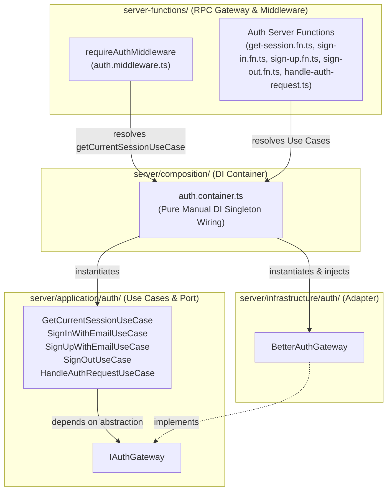

# Milestone 3 — Backend Step 4: Composition Auth Container (src/server/composition/)

เอกสารบทเรียนสำหรับ **Milestone 3 (Backend Step 4)** ซึ่งเป็นการประกอบ Object Graph ของโมดูล Authentication ที่ชั้น Composition Root (`src/server/composition/auth.container.ts`) ด้วยรูปแบบ **Pure Manual Dependency Injection (DI)**

---

## 1. เป้าหมายและขอบเขต Boundary (Boundary Context & Goal)

ใน Step ที่ 4 นี้ เราจะสร้างไฟล์ `src/server/composition/auth.container.ts` เพื่อทำหน้าที่เป็นจุดเดียวในระบบที่สร้าง Singleton Instance ของ `BetterAuthGateway` (จากชั้น Infrastructure) แล้วฉีด (Inject) เข้าไปใน Use Cases ทั้ง 5 ตัว (จากชั้น Application) เพื่อเตรียมพร้อมให้ชั้น `server-functions/` นำไปเรียกใช้งาน

### ตารางสรุปไฟล์ใน Step นี้

| ลำดับ | Path ของไฟล์ | บทบาทหน้าที่ (Responsibility) |
| :--- | :--- | :--- |
| 1 | `src/server/composition/auth.container.ts` | ประกอบ Object Graph ของโมดูล Auth ด้วยการ Instantiate `BetterAuthGateway` และ Inject เข้าสู่ Auth Use Cases ทั้ง 5 ตัว |

### แผนผังสถาปัตยกรรมและทิศทางการพึ่งพา (Architecture & Dependency Flow)



---

## 2. ทฤษฎี ความสำคัญ และกฎสถาปัตยกรรมเฉพาะ Boundary นี้

### 2.1 การประกอบ Object Graph แบบ Pure Manual DI (`server.md` ข้อ 17)

ตามกฎ `.agents/rules/server.md` ข้อ 17 (**เพื่อรวมศูนย์การประกอบ Object Graph แบบโปร่งใสและปราศจาก Magic Framework**) และ `.agents/rules/architecture.md`:
1. **ห้าม Use Case หรือ Server Function สั่ง `new BetterAuthGateway()` เองโดยเด็ดขาด**:
   - หาก Use Case สร้าง `BetterAuthGateway` เองภายในคลาส จะเป็นการละเมิด Dependency Inversion Principle ทันที เพราะทำให้ชั้น Application ผูกติดกับชั้น Infrastructure อย่างถาวร
   - หาก Server Function (`*.fn.ts`) สั่ง `new SignInWithEmailUseCase(new BetterAuthGateway())` เองในทุกไฟล์ จะทำให้การประกอบ Dependency กระจัดกระจายและสร้าง Instance ซ้ำซ้อน
2. **ทำไมต้องใช้ Pure Manual DI แทน Heavy DI Framework?**:
   - การประกอบ Instance ด้วยโค้ด TypeScript มาตรฐาน (`new BetterAuthGateway()` แล้วส่งเข้า `new GetCurrentSessionUseCase(authGateway)`) ทำให้ TypeScript Compiler ตรวจสอบความถูกต้องของ Type Contract (`IAuthGateway`) ได้ 100% ตั้งแต่ตอนเขียนโค้ด
   - ไม่มี Runtime Overhead จาก Reflection (`reflect-metadata`) หรือ Decorator Magic ทำให้เริ่มต้นเซิร์ฟเวอร์ได้รวดเร็วและติดตาม Dependency Graph ได้อย่างตรงไปตรงมา

---

## 3. ลงมือเขียนโค้ด (Step-by-Step Implementation)

### ไฟล์ที่ 1: `src/server/composition/auth.container.ts`

สร้างไฟล์ `src/server/composition/auth.container.ts`:

```typescript
import { GetCurrentSessionUseCase } from "#/server/application/auth/get-current-session.use-case";
import { HandleAuthRequestUseCase } from "#/server/application/auth/handle-auth-request.use-case";
import { SignInWithEmailUseCase } from "#/server/application/auth/sign-in-with-email.use-case";
import { SignOutUseCase } from "#/server/application/auth/sign-out.use-case";
import { SignUpWithEmailUseCase } from "#/server/application/auth/sign-up-with-email.use-case";
import { BetterAuthGateway } from "#/server/infrastructure/auth/better-auth.gateway";

const authGateway = new BetterAuthGateway();

export const getCurrentSessionUseCase = new GetCurrentSessionUseCase(
	authGateway,
);
export const signInWithEmailUseCase = new SignInWithEmailUseCase(authGateway);
export const signUpWithEmailUseCase = new SignUpWithEmailUseCase(authGateway);
export const signOutUseCase = new SignOutUseCase(authGateway);
export const handleAuthRequestUseCase = new HandleAuthRequestUseCase(
	authGateway,
);
```

#### คำอธิบายการทำงานอย่างละเอียด
1. **`const authGateway = new BetterAuthGateway()`**:
   - สร้าง Singleton Instance ของ `BetterAuthGateway` เพียงตัวเดียวภายในโมดูล และเก็บเป็นตัวแปร Private ของไฟล์ (`const` ที่ไม่ได้ `export`) เพื่อป้องกันไม่ให้ภายนอกข้ามชั้นไปเรียก `authGateway` โดยตรงโดยไม่ผ่าน Use Case
2. **การสร้างและส่งออก Use Case Singletons ทั้ง 5 ตัว**:
   - `getCurrentSessionUseCase`: สำหรับตรวจสอบและดึงข้อมูล Session ปัจจุบันพร้อมสิทธิ์ RBAC
   - `signInWithEmailUseCase`: สำหรับการเข้าสู่ระบบด้วยอีเมลและรหัสผ่าน
   - `signUpWithEmailUseCase`: สำหรับการสมัครสมาชิกใหม่
   - `signOutUseCase`: สำหรับการออกจากระบบ
   - `handleAuthRequestUseCase`: สำหรับจัดการ HTTP Request ของ Better Auth API Route

---

## 4. การตรวจสอบความถูกต้องและ Git Commit (Verification & Commit)

ตรวจสอบความถูกต้องของโค้ดและ TypeScript ด้วยคำสั่งของ Bun:

```bash
bun run typecheck
bun run format
bun run check
```

เมื่อตรวจสอบผ่านแล้ว ให้บันทึกการเปลี่ยนแปลงลง Git ตามมาตรฐานของ Step ที่ 4:

```bash
git add src/server/composition/auth.container.ts
git commit -m "milestone-3.backend.step-4: Composition Auth Container"
```
