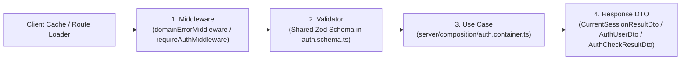

# Milestone 3 — Backend Step 5: Server Functions Auth & Middleware (src/server-functions/)

เอกสารบทเรียนสำหรับ **Milestone 3 (Backend Step 5)** ซึ่งเป็นการสร้างชั้น **Thin Driving Adapter (RPC Gateway)** ใน `src/server-functions/` ทั้งส่วนของ Authentication Guard Middleware (`requireAuthMiddleware`) และ Server Function Endpoints สำหรับระบบยืนยันตัวตนทั้งหมด

---

## 1. เป้าหมายและขอบเขต Boundary (Boundary Context & Goal)

ใน Step ที่ 5 (Step สุดท้ายของฝั่ง Backend ใน Milestone 3) เราจะสร้าง `requireAuthMiddleware` สำหรับป้องกัน RPC Endpoints ที่ต้องล็อกอินก่อนใช้งาน และสร้างไฟล์ใน `src/server-functions/auth/` อีก 6 ไฟล์เพื่อเป็นทางผ่านเดียวระหว่างฝั่ง Client/Routes กับ `server/composition/auth.container`

### ตารางสรุปไฟล์ใน Step นี้

| ลำดับ | Path ของไฟล์ | บทบาทหน้าที่ (Responsibility) |
| :--- | :--- | :--- |
| 1 | `src/server-functions/middlewares/auth.middleware.ts` | Middleware ตรวจสอบสถานะการเข้าสู่ระบบ (`requireAuthMiddleware`) พร้อมแนบ `authSession` เข้าสู่ Context ของ Server Function |
| 2 | `src/server-functions/auth/handle-auth-request.ts` | Gateway Adapter ส่งต่อ HTTP `Request` ไปยัง `handleAuthRequestUseCase` สำหรับ Route `/api/auth/$` |
| 3 | `src/server-functions/auth/get-session.fn.ts` | Server Function (`GET`) ดึงข้อมูล Session ปัจจุบันของผู้ใช้ (`CurrentSessionResultDto`) |
| 4 | `src/server-functions/auth/get-auth-check.fn.ts` | Server Function (`GET`) ที่ป้องกันด้วย `requireAuthMiddleware` เพื่อตรวจสอบสถานะ Auth และคืนค่า `AuthCheckResultDto` |
| 5 | `src/server-functions/auth/sign-in.fn.ts` | Server Function (`POST`) ตรวจสอบ Input ด้วย `signInInputSchema` และรัน `signInWithEmailUseCase` |
| 6 | `src/server-functions/auth/sign-up.fn.ts` | Server Function (`POST`) ตรวจสอบ Input ด้วย `signUpInputSchema` และรัน `signUpWithEmailUseCase` |
| 7 | `src/server-functions/auth/sign-out.fn.ts` | Server Function (`POST`) สำหรับสั่งออกจากระบบผ่าน `signOutUseCase` |

### แผนผังสถาปัตยกรรมและทิศทางการพึ่งพา (Architecture & Dependency Flow)



---

## 2. ทฤษฎี ความสำคัญ และกฎสถาปัตยกรรมเฉพาะ Boundary นี้

### 2.1 Standard Pipeline 4 ขั้นตอนของ Server Functions (`architecture.md` & `server.md` ข้อ 18)

ตามกฎใน `.agents/rules/architecture.md` (หมวด **Server Functions**) และ `.agents/rules/server.md` (ข้อ 2, 3 และ 18):
1. **Thin Driving Adapter**: `server-functions/` เป็นทางผ่านเดียวที่อนุญาตให้ `client/caches/**` และ `routes/**` เรียกเข้ามาหาฝั่ง Server ได้ โดยห้ามเขียน Business Logic หรือเรียก Database (`db`) ในเลเยอร์นี้โดยเด็ดขาด
2. **One Function per File (`*.fn.ts`)**: แยก 1 RPC Endpoint ต่อ 1 ไฟล์ ตั้งชื่อไฟล์ให้ตรงกับการกระทำพร้อมนามสกุล `.fn.ts` และตั้งชื่อตัวแปรที่ Export ลงท้ายด้วย `Fn` (`getSessionFn`, `getAuthCheckFn`, `signInFn`, `signUpFn`, `signOutFn`)
3. **Standard Pipeline 4 ขั้นตอน**:
   - **ขั้นที่ 1 Middleware**: ติดตั้ง Middleware สำหรับจัดการ Cross-cutting Concerns เช่น `domainErrorMiddleware` (เพื่อดักจับ `DomainError` แล้วแปลงเป็น HTTP Status Code `400`, `403`, `404`, `409`, `422`) หรือ `requireAuthMiddleware` (เพื่อบังคับล็อกอินและฉีด `context.authSession`)
   - **ขั้นที่ 2 Validator**: ตรวจสอบความถูกต้องของข้อมูลขาเข้าด้วย `.validator(signInInputSchema)` หรือ `.validator(signUpInputSchema)` จาก `shared/schemas/auth.schema.ts`
   - **ขั้นที่ 3 Use Case Execution**: ดึง Use Case สำเร็จรูปมาจาก `#/server/composition/auth.container` แล้วเรียก `.execute(...)`
   - **ขั้นที่ 4 Explicit Response DTO**: ระบุ Explicit Return Type บน `.handler(async (...): Promise<...Dto> => ...)` เสมอ เพื่อให้มั่นใจว่าข้อมูลที่ส่งออกตรงตามสัญญาใน `shared/schemas/`

### 2.2 การทำงานของ `requireAuthMiddleware` และการจัดการ Context

ใน `src/server-functions/middlewares/auth.middleware.ts`:
- เราสร้าง `requireAuthMiddleware` ด้วย `createMiddleware({ type: "function" })`
- ภายใน `.server(async ({ next }) => { ... })` จะดึง HTTP Headers ของคำขอปัจจุบันผ่าน `new Headers(getRequestHeaders())` แล้วเรียก `getCurrentSessionUseCase.execute({ headers })`
- หากผลลัพธ์เป็น `null` (ผู้ใช้ไม่ได้ล็อกอินหรือ Session หมดอายุ) จะตั้งค่า HTTP Status เป็น `401` (`setResponseStatus(401)`) และโยน Error `"กรุณาลงชื่อเข้าใช้ก่อนดำเนินการ"` ทันทีโดยไม่ปล่อยให้เข้าถึง Handler
- หากมี Session ถูกต้อง จะส่งต่อ `authSession` (ซึ่งมีทั้ง `user` พร้อม `systemRoles`, `systemPermissions` และ `session`) เข้าสู่ `next({ context: { authSession } })` เพื่อให้ Server Function ปลายทาง (หรือ Middleware ลำดับถัดไปที่ทำงานร่วมกับ `domainErrorMiddleware`) ดึง `context.authSession` ไปใช้งานต่อได้แบบ Type-safe โดยไม่ต้อง Query Session ซ้ำอีกรอบ

---

## 3. ลงมือเขียนโค้ด (Step-by-Step Implementation)

### ไฟล์ที่ 1: `src/server-functions/middlewares/auth.middleware.ts`

สร้างไฟล์ `src/server-functions/middlewares/auth.middleware.ts`:

```typescript
import { createMiddleware } from "@tanstack/react-start";
import {
	getRequestHeaders,
	setResponseStatus,
} from "@tanstack/react-start/server";
import { getCurrentSessionUseCase } from "#/server/composition/auth.container";

export const requireAuthMiddleware = createMiddleware({
	type: "function",
}).server(async ({ next }) => {
	const headers = new Headers(getRequestHeaders());
	const authSession = await getCurrentSessionUseCase.execute({ headers });

	if (!authSession) {
		setResponseStatus(401);
		throw new Error("กรุณาลงชื่อเข้าใช้ก่อนดำเนินการ");
	}

	return next({
		context: {
			authSession,
		},
	});
});
```

#### คำอธิบายการทำงาน
- อ่าน Request Headers จาก `@tanstack/react-start/server` แล้วส่งให้ `getCurrentSessionUseCase.execute({ headers })`
- ตรวจสอบว่า `authSession` มีค่าหรือไม่ ถ้าไม่มีให้ตอบกลับ HTTP `401 Unauthorized`
- ถ้าผ่านการตรวจสอบ จะแนบ `{ authSession }` เข้าไปใน `context` ของ Pipeline เพื่อให้ Handler ปลายทางเข้าถึง `context.authSession.user` ได้ทันที

---

### ไฟล์ที่ 2: `src/server-functions/auth/handle-auth-request.ts`

สร้างไฟล์ `src/server-functions/auth/handle-auth-request.ts`:

```typescript
import { handleAuthRequestUseCase } from "#/server/composition/auth.container";

export function handleAuthRequest(request: Request): Promise<Response> {
	return handleAuthRequestUseCase.execute({ request });
}
```

#### คำอธิบายการทำงาน
- ทำหน้าที่เป็น Gateway Function สำหรับให้ API Route (`src/routes/api/auth/$.ts`) เรียกใช้งานได้โดยไม่ละเมิดกฎ Server Boundary (เพราะ Route ห้าม import จาก `#/server/**` โดยตรง ต้องผ่าน `#/server-functions/**` เท่านั้น)

---

### ไฟล์ที่ 3: `src/server-functions/auth/get-session.fn.ts`

สร้างไฟล์ `src/server-functions/auth/get-session.fn.ts`:

```typescript
import { createServerFn } from "@tanstack/react-start";
import { getRequestHeaders } from "@tanstack/react-start/server";
import { getCurrentSessionUseCase } from "#/server/composition/auth.container";
import { domainErrorMiddleware } from "#/server-functions/middlewares/domain-error.middleware";
import type { CurrentSessionResultDto } from "#/shared/schemas/auth.schema";

export const getSessionFn = createServerFn({ method: "GET" })
	.middleware([domainErrorMiddleware])
	.handler(async (): Promise<CurrentSessionResultDto> => {
		const headers = new Headers(getRequestHeaders());
		return getCurrentSessionUseCase.execute({ headers });
	});
```

#### คำอธิบายการทำงาน
- ใช้เมธอด `GET` และติดตั้ง `domainErrorMiddleware`
- ไม่ใช้ `requireAuthMiddleware` เนื่องจาก `getSessionFn` ถูกเรียกได้ทั้งจากหน้าสาธารณะ (`_public`) และหน้าภายในระบบ (`_authed`) เพื่อตรวจดูว่ามีผู้ใช้ล็อกอินอยู่หรือไม่ หากยังไม่ล็อกอินจะคืนค่า `null` ตามสัญญา `CurrentSessionResultDto`

---

### ไฟล์ที่ 4: `src/server-functions/auth/get-auth-check.fn.ts`

สร้างไฟล์ `src/server-functions/auth/get-auth-check.fn.ts`:

```typescript
import { createServerFn } from "@tanstack/react-start";
import { requireAuthMiddleware } from "#/server-functions/middlewares/auth.middleware";
import type { AuthCheckResultDto } from "#/shared/schemas/auth.schema";

export const getAuthCheckFn = createServerFn({ method: "GET" })
	.middleware([requireAuthMiddleware])
	.handler(async ({ context }): Promise<AuthCheckResultDto> => {
		const { user } = context.authSession;

		return {
			authenticated: true,
			userId: user.id,
			email: user.email,
			systemRoles: user.systemRoles,
			systemPermissions: user.systemPermissions,
		};
	});
```

#### คำอธิบายการทำงาน
- ติดตั้ง `.middleware([requireAuthMiddleware])` เพื่อบังคับว่าผู้เรียกต้องมี Session ที่ถูกต้องเท่านั้น
- ใน `.handler` สามารถดึง `const { user } = context.authSession` ออกมาใช้งานได้โดยตรงด้วย Type Safety เต็มรูปแบบ และคืนค่า `AuthCheckResultDto`

---

### ไฟล์ที่ 5: `src/server-functions/auth/sign-in.fn.ts`

สร้างไฟล์ `src/server-functions/auth/sign-in.fn.ts`:

```typescript
import { createServerFn } from "@tanstack/react-start";
import { getRequestHeaders } from "@tanstack/react-start/server";
import { signInWithEmailUseCase } from "#/server/composition/auth.container";
import { domainErrorMiddleware } from "#/server-functions/middlewares/domain-error.middleware";
import type { AuthUserDto } from "#/shared/schemas/auth.schema";
import { signInInputSchema } from "#/shared/schemas/auth.schema";

export const signInFn = createServerFn({ method: "POST" })
	.middleware([domainErrorMiddleware])
	.validator(signInInputSchema)
	.handler(async ({ data }): Promise<AuthUserDto> => {
		const headers = new Headers(getRequestHeaders());
		return signInWithEmailUseCase.execute({
			payload: data,
			headers,
		});
	});
```

#### คำอธิบายการทำงาน
- ปฏิบัติตาม Standard Pipeline 4 ขั้นตอนครบถ้วน:
  1. `.middleware([domainErrorMiddleware])` — หากอีเมลหรือรหัสผ่านผิด `BetterAuthGateway` จะโยน `ForbiddenDomainError` และ `domainErrorMiddleware` จะแปลงเป็น HTTP Status `403`
  2. `.validator(signInInputSchema)` — ทำความสะอาดและตรวจสอบข้อมูล `email` และ `password`
  3. เรียก `signInWithEmailUseCase.execute({ payload: data, headers })`
  4. คืนค่า `Promise<AuthUserDto>` พร้อมแนบ Session Cookie กลับไปผ่าน `tanstackStartCookies()`

---

### ไฟล์ที่ 6: `src/server-functions/auth/sign-up.fn.ts`

สร้างไฟล์ `src/server-functions/auth/sign-up.fn.ts`:

```typescript
import { createServerFn } from "@tanstack/react-start";
import { getRequestHeaders } from "@tanstack/react-start/server";
import { signUpWithEmailUseCase } from "#/server/composition/auth.container";
import { domainErrorMiddleware } from "#/server-functions/middlewares/domain-error.middleware";
import type { AuthUserDto } from "#/shared/schemas/auth.schema";
import { signUpInputSchema } from "#/shared/schemas/auth.schema";

export const signUpFn = createServerFn({ method: "POST" })
	.middleware([domainErrorMiddleware])
	.validator(signUpInputSchema)
	.handler(async ({ data }): Promise<AuthUserDto> => {
		const headers = new Headers(getRequestHeaders());
		return signUpWithEmailUseCase.execute({
			payload: data,
			headers,
		});
	});
```

#### คำอธิบายการทำงาน
- ใช้เมธอด `POST`, ติดตั้ง `domainErrorMiddleware` (หากอีเมลซ้ำจะได้รับ `ConflictDomainError` สถานะ HTTP `409`) และตรวจสอบข้อมูลด้วย `.validator(signUpInputSchema)`
- ส่งต่อ `payload: data` และ `headers` เข้าสู่ `signUpWithEmailUseCase.execute` และคืนค่า `Promise<AuthUserDto>` ของผู้ใช้ใหม่ที่ได้รับ Role `standard_member` เรียบร้อยแล้ว

---

### ไฟล์ที่ 7: `src/server-functions/auth/sign-out.fn.ts`

สร้างไฟล์ `src/server-functions/auth/sign-out.fn.ts`:

```typescript
import { createServerFn } from "@tanstack/react-start";
import { getRequestHeaders } from "@tanstack/react-start/server";
import { signOutUseCase } from "#/server/composition/auth.container";
import { domainErrorMiddleware } from "#/server-functions/middlewares/domain-error.middleware";

export const signOutFn = createServerFn({ method: "POST" })
	.middleware([domainErrorMiddleware])
	.handler(async (): Promise<{ success: true }> => {
		const headers = new Headers(getRequestHeaders());
		await signOutUseCase.execute({ headers });
		return { success: true };
	});
```

#### คำอธิบายการทำงาน
- ใช้เมธอด `POST` และติดตั้ง `domainErrorMiddleware`
- ดึง Request Headers แล้วส่งให้ `signOutUseCase.execute({ headers })` เพื่อลบ Session ในฐานข้อมูลและเคลียร์ Session Cookie จากนั้นคืนค่า `{ success: true }`

---

## 4. การตรวจสอบความถูกต้องและ Git Commit (Verification & Commit)

รันคำสั่งตรวจสอบคุณภาพโค้ดและ TypeScript ทั้งโปรเจกต์ด้วย Bun:

```bash
bun run typecheck
bun run format
bun run check
```

เมื่อตรวจสอบผ่านทั้งหมดแล้ว ให้ Commit ไฟล์ทั้งหมดของ Step ที่ 5:

```bash
git add src/server-functions/middlewares/auth.middleware.ts src/server-functions/auth/
git commit -m "milestone-3.backend.step-5: Auth Middleware & Server Functions Gateway"
```
