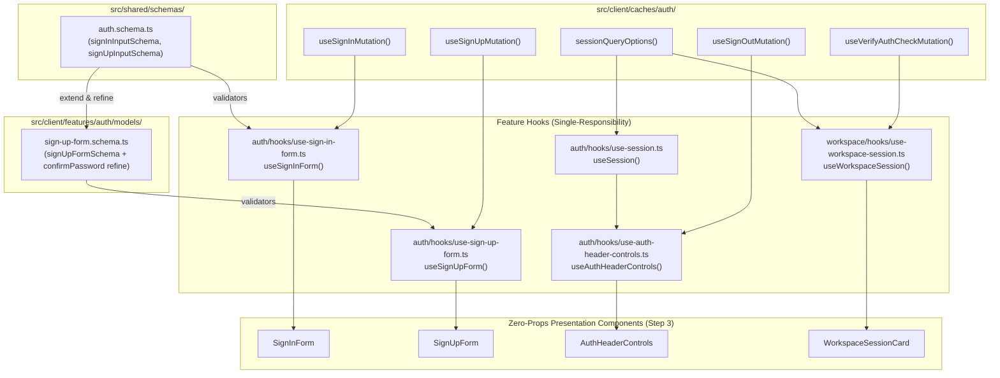

# Milestone 3 — Frontend Step 2: Feature Auth Models & Hooks (src/client/features/auth/ & workspace/)

หลังจากที่เราสร้างชั้น `src/client/caches/auth/` สำหรับจัดการ Server State เสร็จเรียบร้อยใน Step 1 แล้ว ในขั้นตอนนี้เราจะขยับขึ้นมาสร้าง **Feature Models & Single-Responsibility Hooks** ใน `src/client/features/auth/` และ `src/client/features/workspace/` เพื่อห่อหุ้ม (Encapsulate) ลอจิกของฟอร์ม การเปลี่ยนหน้า การคำนวณค่าแสดงผล และการโต้ตอบทั้งหมดไว้ใน Hook ก่อนนำไปผูกกับ Zero-Props Components ใน Step ถัดไป

---

## 1. เป้าหมายและขอบเขต Boundary (Boundary Context & Goal)

เป้าหมายของ Step นี้คือการสร้าง Client-only Form Schema สำหรับหน้าสมัครสมาชิก และสร้าง Custom Hooks ที่มีหน้าที่รับผิดชอบชัดเจน (Single-Responsibility Hooks) เพื่อเตรียมป้อน State และ Event Handlers ให้กับ Presentation Components โดยที่ตัว Component ไม่ต้องเขียน Business Logic หรือจัดการ State เองเลย

### ตารางสรุปไฟล์ใน Step นี้

| ลำดับ | เส้นทางไฟล์ (File Path) | หน้าที่ความรับผิดชอบ (Responsibility) |
| :--- | :--- | :--- |
| 1 | `src/client/features/auth/models/sign-up-form.schema.ts` | ขยาย `signUpInputSchema` จาก Shared Schema เพื่อเพิ่มฟิลด์ `confirmPassword` และตรวจสอบรหัสผ่านตรงกันเฉพาะฝั่ง Client |
| 2 | `src/client/features/auth/hooks/use-session.ts` | Hook อ่านสถานะ Session ปัจจุบันจาก Cache พร้อมแปลงเป็นค่า `session`, `isPending` และ `isAuthenticated` |
| 3 | `src/client/features/auth/hooks/use-sign-in-form.ts` | Hook จัดการสถานะฟอร์มเข้าสู่ระบบ การตรวจสอบค่า การกรอง `redirect` URL ให้ปลอดภัย และการเปลี่ยนหน้าหลังล็อกอินสำเร็จ |
| 4 | `src/client/features/auth/hooks/use-sign-up-form.ts` | Hook จัดการสถานะฟอร์มสมัครสมาชิก การตรวจสอบ `confirmPassword` การตัดฟิลด์ส่งเข้า Mutation และการนำทางไปหน้าหลัก |
| 5 | `src/client/features/auth/hooks/use-auth-header-controls.ts` | Hook คำนวณตัวย่อชื่อ (Initials) ตรวจสอบสิทธิ์การมองเห็นเมนู Admin และจัดการ Action การนำทางและการออกจากระบบบนแถบ Header |
| 6 | `src/client/features/workspace/hooks/use-workspace-session.ts` | Hook ดึงข้อมูลผู้ใช้ วันหมดอายุของ Session และจัดการคำสั่งกดปุ่มทดสอบการตรวจสอบสิทธิ์บนหน้า Workspace |

### แผนผังความสัมพันธ์ของ Feature Models & Hooks (Hook Architecture Diagram)



---

## 2. ทฤษฎี ความสำคัญ และกฎสถาปัตยกรรมเฉพาะ Boundary นี้

### 2.1 การแยก Client-Only Form Schema ออกจาก Shared Schema
ตามกฎ `.agents/rules/globals.md` (Shared Schemas ข้อ 1–4):
- `src/shared/schemas/**` มีไว้สำหรับ **ข้อมูลที่ข้าม Application Boundary** ระหว่าง Client กับ Server เท่านั้น ในการสมัครสมาชิก Server (`signUpFn`) ต้องการเพียง `name`, `email` และ `password` (`signUpInputSchema`)
- ส่วนช่อง **"ยืนยันรหัสผ่าน" (`confirmPassword`)** เป็นเพียงกลไกทาง UX ฝั่ง Client เพื่อป้องกันผู้ใช้พิมพ์รหัสผ่านผิดโดยไม่ตั้งใจ ไม่ใช่ข้อมูลที่ Server ต้องรับหรือบันทึกลงฐานข้อมูล
- เราจึงห้ามใส่ `confirmPassword` ลงใน `src/shared/schemas/auth.schema.ts` แต่ให้นำ `signUpInputSchema` มา `.extend({ confirmPassword: ... }).refine(...)` ภายใน `src/client/features/auth/models/sign-up-form.schema.ts` แทน แล้วเมื่อกด Submit ใน `useSignUpForm()` จึงค่อยคัดเฉพาะ `{ name, email, password }` ส่งไปให้ `signUpMutation.mutateAsync(...)`

### 2.2 กฎ Single-Responsibility Hooks และการแยก Logic ออกจาก UI
ตามกฎ `.agents/rules/client.md` (ข้อ 3, 4, 5, 6, 7):
- **Screen และ Component ต้องเป็น Pure Presentation (ข้อ 3)**: ห้ามเขียน Business Logic, การคำนวณค่า (เช่น การตัดคำสร้างตัวอักษรย่อ `computeInitials` หรือการเช็คสิทธิ์ `grantedPermissions.includes(...)`), การจัดการ Form State หรือการสั่ง `router.invalidate()` / `navigate()` ไว้ในไฟล์ `.tsx` โดยเด็ดขาด ทุกอย่างต้องถูกห่อหุ้มอยู่ใน `features/**/hooks/*.ts`
- **1 Hook ต่อ 1 Cohesive Scope of Work (ข้อ 6–7)**: เราไม่สร้าง God Hook ตัวเดียวชื่อ `useAuth()` ที่ยัดรวมทั้งฟอร์ม Sign-in, ฟอร์ม Sign-up, ปุ่ม Sign-out และสถานะ Header เข้าด้วยกัน เพราะจะทำให้ทุก Component ที่เรียกใช้ต้องแบกรับ Dependencies และเกิด Re-render ไม่จำเป็น แต่เราแยกตามขอบเขตหน้าที่ที่มีความหมายชัดเจน ได้แก่ `useSession`, `useSignInForm`, `useSignUpForm`, `useAuthHeaderControls` และ `useWorkspaceSession`

### 2.3 การป้องกันช่องโหว่ Open Redirect ใน `useSignInForm`
เมื่อผู้ใช้ที่ยังไม่ได้ล็อกอินพยายามเข้าหน้าภายในระบบ เช่น `/projects` Route Guard (`_auth/route.tsx`) จะเด้งไปที่ `/sign-in?redirect=/projects` เพื่อที่หลังล็อกอินเสร็จจะได้พากลับไปยังหน้าที่ตั้งใจจะเข้าตั้งแต่แรก อย่างไรก็ตาม หากผู้ไม่หวังดีส่งลิงก์ `/sign-in?redirect=https://evil.com` หรือ `/sign-in?redirect=//evil.com` มาหลอกผู้ใช้ หากโค้ดสั่ง Redirect ไปตาม Query Parameter ทันทีจะเกิดช่องโหว่ **Open Redirect**
- ใน `use-sign-in-form.ts` เราจึงเขียนฟังก์ชัน `sanitizeRedirectTarget(target)` เพื่อตรวจสอบว่าค่า `redirect` ต้องเป็น `string` ที่ขึ้นต้นด้วย `/` เสมอ และห้ามขึ้นต้นด้วย `//` (Protocol-relative URL) หากไม่ผ่านเงื่อนไขจะถูกบังคับให้กลับไปที่ `"/"` เสมอ

---

## 3. ลงมือเขียนโค้ด (Step-by-Step Implementation)

### 3.1 สร้าง Client Form Schema สำหรับสมัครสมาชิก (`src/client/features/auth/models/sign-up-form.schema.ts`)

สร้างไฟล์ `src/client/features/auth/models/sign-up-form.schema.ts` โดยต่อยอดจาก `signUpInputSchema`:

```typescript
import { z } from "zod";
import { signUpInputSchema } from "#/shared/schemas/auth.schema";

export const signUpFormSchema = signUpInputSchema
	.extend({
		confirmPassword: z.string().min(1, "กรุณายืนยันรหัสผ่าน"),
	})
	.refine((value) => value.password === value.confirmPassword, {
		message: "รหัสผ่านทั้งสองช่องไม่ตรงกัน",
		path: ["confirmPassword"],
	});

export type SignUpFormValues = z.infer<typeof signUpFormSchema>;
```

**คำอธิบายโค้ด:**
- `.extend({ confirmPassword: ... })`: เพิ่มฟิลด์ยืนยันรหัสผ่านต่อจาก `name`, `email`, `password` ของ `signUpInputSchema`
- `.refine(...)`: ตรวจสอบความสอดคล้องข้ามฟิลด์ (Cross-field Validation) ว่า `value.password === value.confirmPassword` หากไม่ตรงกันจะผูกข้อความแจ้งเตือน `"รหัสผ่านทั้งสองช่องไม่ตรงกัน"` ไปที่ `path: ["confirmPassword"]` เพื่อให้ `<form.AppField name="confirmPassword">` แสดงข้อความ Error ใต้ช่องยืนยันรหัสผ่านได้อย่างแม่นยำ

---

### 3.2 สร้าง Hook อ่านข้อมูล Session (`src/client/features/auth/hooks/use-session.ts`)

สร้างไฟล์ `src/client/features/auth/hooks/use-session.ts`:

```typescript
import { useQuery } from "@tanstack/react-query";
import { sessionQueryOptions } from "#/client/caches/auth/queries/session.query";

export function useSession() {
	const { data, isPending } = useQuery(sessionQueryOptions());

	return {
		session: data ?? null,
		isPending,
		isAuthenticated: Boolean(data),
	};
}
```

**คำอธิบายโค้ด:**
- เรียกใช้ `useQuery(sessionQueryOptions())` เพื่ออ่านข้อมูล Session จาก Cache
- คืนค่า `session` (แปลง `undefined` เป็น `null` เพื่อความชัดเจน), `isPending` (สถานะกำลังโหลดครั้งแรก) และ `isAuthenticated` (ค่า Boolean ที่บอกว่าล็อกอินอยู่หรือไม่)

---

### 3.3 สร้าง Hook จัดการฟอร์มเข้าสู่ระบบ (`src/client/features/auth/hooks/use-sign-in-form.ts`)

สร้างไฟล์ `src/client/features/auth/hooks/use-sign-in-form.ts`:

```typescript
import { useNavigate, useRouter, useSearch } from "@tanstack/react-router";
import { useSignInMutation } from "#/client/caches/auth/mutates/sign-in.mutate";
import { useAppForm } from "#/client/shared/components/app-form";
import { signInInputSchema } from "#/shared/schemas/auth.schema";

function sanitizeRedirectTarget(target: unknown): string {
	if (typeof target !== "string") {
		return "/";
	}
	if (!target.startsWith("/") || target.startsWith("//")) {
		return "/";
	}
	return target;
}

export function useSignInForm() {
	const router = useRouter();
	const navigate = useNavigate();
	const search = useSearch({ strict: false });
	const signInMutation = useSignInMutation();

	const rawRedirect = "redirect" in search ? search.redirect : undefined;
	const redirectTarget = sanitizeRedirectTarget(rawRedirect);

	const form = useAppForm({
		defaultValues: {
			email: "",
			password: "",
		},
		validators: {
			onBlur: signInInputSchema,
			onSubmit: signInInputSchema,
		},
		onSubmit: async ({ value }) => {
			try {
				await signInMutation.mutateAsync(value);
				await router.invalidate();
				if (redirectTarget === "/") {
					await navigate({ to: "/" });
					return;
				}
				await navigate({ href: redirectTarget });
			} catch {
				return;
			}
		},
	});

	return { form };
}
```

**คำอธิบายโค้ด:**
- ใช้ `useSearch({ strict: false })` เพื่ออ่านค่า `redirect` จาก URL Search Params แล้วคัดกรองความปลอดภัยผ่าน `sanitizeRedirectTarget`
- สร้างอินสแตนซ์ของฟอร์มด้วย `useAppForm` (จาก Shared Form Primitive ที่เราสร้างไว้ใน Milestone 2) โดยผูก `signInInputSchema` เข้ากับทั้ง `onBlur` และ `onSubmit`
- เมื่อกดปุ่ม Submit (`onSubmit`):
  1. เรียก `await signInMutation.mutateAsync(value)` เพื่อยืนยันตัวตนและอัปเดต Session Cache
  2. เรียก `await router.invalidate()` เพื่อให้ TanStack Router ประเมิน `beforeLoad` ของทุก Route ใหม่ด้วยสถานะที่ล็อกอินแล้ว
  3. นำทางไปยัง `redirectTarget` (หากเป็น `"/"` ใช้ `navigate({ to: "/" })` หากเป็น Path อื่นในระบบใช้ `navigate({ href: redirectTarget })`)
  4. ใช้ `try ... catch` ดักจับกรณีรหัสผ่านผิด เพื่อไม่ให้ Unhandled Promise Rejection หลุดออกไป (ส่วนการแสดง Toast แจ้งเตือน Error ถูกจัดการโดย Global `MutationCache` ใน `src/client/caches/global.ts` เรียบร้อยแล้ว)

---

### 3.4 สร้าง Hook จัดการฟอร์มสมัครสมาชิก (`src/client/features/auth/hooks/use-sign-up-form.ts`)

สร้างไฟล์ `src/client/features/auth/hooks/use-sign-up-form.ts`:

```typescript
import { useNavigate, useRouter } from "@tanstack/react-router";
import { useSignUpMutation } from "#/client/caches/auth/mutates/sign-up.mutate";
import { useAppForm } from "#/client/shared/components/app-form";
import { signUpFormSchema } from "../models/sign-up-form.schema";

export function useSignUpForm() {
	const router = useRouter();
	const navigate = useNavigate();
	const signUpMutation = useSignUpMutation();

	const form = useAppForm({
		defaultValues: {
			name: "",
			email: "",
			password: "",
			confirmPassword: "",
		},
		validators: {
			onBlur: signUpFormSchema,
			onSubmit: signUpFormSchema,
		},
		onSubmit: async ({ value }) => {
			try {
				await signUpMutation.mutateAsync({
					name: value.name,
					email: value.email,
					password: value.password,
				});
				await router.invalidate();
				await navigate({ to: "/" });
			} catch {
				return;
			}
		},
	});

	return { form };
}
```

**คำอธิบายโค้ด:**
- กำหนด `defaultValues` ให้ครบทั้ง 4 ช่อง (`name`, `email`, `password`, `confirmPassword`) และตรวจสอบความถูกต้องด้วย `signUpFormSchema`
- ใน `onSubmit`: ส่งเฉพาะ `name`, `email` และ `password` เข้า `signUpMutation.mutateAsync(...)` (ตัด `confirmPassword` ออกตามสัญญาของ `SignUpInput`) เมื่อสำเร็จจึงสั่ง `await router.invalidate()` และพาผู้ใช้เข้าสู่หน้าหลัก `await navigate({ to: "/" })` ทันที

---

### 3.5 สร้าง Hook สำหรับควบคุมเมนูผู้ใช้บน Header (`src/client/features/auth/hooks/use-auth-header-controls.ts`)

สำหรับไฟล์ `src/client/features/auth/hooks/use-auth-header-controls.ts` มีข้อควรระวังสำคัญด้าน Type Safety ของ TanStack Router:
- หากผู้เรียนกำลังทำตามลำดับ Milestone ทีละขั้น ใน **Milestone 3** เรายังไม่ได้สร้างไฟล์ Route `/projects` (จะสร้างใน Milestone 5) และ `/admin/roles`, `/admin/users` (จะสร้างใน Milestone 4) ดังนั้น `navigate({ to: "/projects" })` จะติด Typecheck ของ `routeTree.gen.ts` ใน Milestone 3
- ด้านล่างนี้จึงแสดงโค้ดฉบับเต็มทั้ง **เวอร์ชันสำหรับ Milestone 3 (ใช้คู่กับ Route ปัจจุบันใน M3)** และ **เวอร์ชันสมบูรณ์ของโปรเจกต์ (เมื่อเพิ่ม Route ครบทุก Milestone แล้ว)**

#### เวอร์ชันสำหรับ Milestone 3 (มีเฉพาะ `handleGoWorkspace` และ `handleSignOut` เพื่อให้ผ่าน Typecheck ใน M3)

```typescript
import { useNavigate, useRouter } from "@tanstack/react-router";
import { useSignOutMutation } from "#/client/caches/auth/mutates/sign-out.mutate";
import { useSession } from "./use-session";

function computeInitials(name: string): string {
	const parts = name.trim().split(/\s+/).filter(Boolean);
	if (parts.length === 0) {
		return "U";
	}

	if (parts.length === 1) {
		return parts[0].slice(0, 2).toUpperCase();
	}

	return `${parts[0][0]}${parts[parts.length - 1][0]}`.toUpperCase();
}

export function useAuthHeaderControls() {
	const router = useRouter();
	const navigate = useNavigate();
	const { session, isPending } = useSession();
	const signOutMutation = useSignOutMutation();

	const user = session?.user ?? null;
	const initials = user ? computeInitials(user.name) : "";
	const primaryRole = user?.systemRoles[0] ?? "member";

	const handleGoWorkspace = async () => {
		await navigate({ to: "/" });
	};

	const handleSignOut = async () => {
		await signOutMutation.mutateAsync();
		await router.invalidate();
		await navigate({ to: "/sign-in" });
	};

	return {
		isPending,
		user,
		initials,
		primaryRole,
		isSigningOut: signOutMutation.isPending,
		handleGoWorkspace,
		handleSignOut,
	};
}
```

#### เวอร์ชันสมบูรณ์ใน Repository (เมื่อสร้าง Route `/projects`, `/admin/roles`, `/admin/users` ครบแล้ว)

```typescript
import { useNavigate, useRouter } from "@tanstack/react-router";
import { useSignOutMutation } from "#/client/caches/auth/mutates/sign-out.mutate";
import { useSession } from "./use-session";

function computeInitials(name: string): string {
	const parts = name.trim().split(/\s+/).filter(Boolean);
	if (parts.length === 0) {
		return "U";
	}

	if (parts.length === 1) {
		return parts[0].slice(0, 2).toUpperCase();
	}

	return `${parts[0][0]}${parts[parts.length - 1][0]}`.toUpperCase();
}

export function useAuthHeaderControls() {
	const router = useRouter();
	const navigate = useNavigate();
	const { session, isPending } = useSession();
	const signOutMutation = useSignOutMutation();

	const user = session?.user ?? null;
	const initials = user ? computeInitials(user.name) : "";
	const primaryRole = user?.systemRoles[0] ?? "member";
	const grantedPermissions = user?.systemPermissions ?? [];
	const canReadRoles = grantedPermissions.includes("role:read");
	const canReadUsers = grantedPermissions.includes("user:read");

	const handleGoWorkspace = async () => {
		await navigate({ to: "/" });
	};

	const handleGoProjects = async () => {
		await navigate({ to: "/projects" });
	};

	const handleGoAdminRoles = async () => {
		await navigate({ to: "/admin/roles" });
	};

	const handleGoAdminUsers = async () => {
		await navigate({ to: "/admin/users" });
	};

	const handleSignOut = async () => {
		await signOutMutation.mutateAsync();
		await router.invalidate();
		await navigate({ to: "/sign-in" });
	};

	return {
		isPending,
		user,
		initials,
		primaryRole,
		canReadRoles,
		canReadUsers,
		isSigningOut: signOutMutation.isPending,
		handleGoWorkspace,
		handleGoProjects,
		handleGoAdminRoles,
		handleGoAdminUsers,
		handleSignOut,
	};
}
```

**คำอธิบายโค้ด:**
- `computeInitials(name)`: ฟังก์ชันบริสุทธิ์ (Pure Function) สำหรับแปลงชื่อที่แสดงเป็นอักษรย่อ 1–2 ตัวสำหรับแสดงใน `<AvatarFallback>` (เช่น `"System Admin"` จะได้ `"SA"`, `"สมชาย"` จะได้ `"สม"`)
- คำนวณ `primaryRole` จาก `user?.systemRoles[0] ?? "member"` และคำนวณสิทธิ์การเข้าถึงหน้าผู้ดูแลระบบ (`canReadRoles`, `canReadUsers`) จาก `user?.systemPermissions`
- `handleSignOut`: เรียก `await signOutMutation.mutateAsync()` (ซึ่งจะล้าง Query Cache และเซ็ต Session เป็น `null`), สั่ง `await router.invalidate()` เพื่อให้ Route Guard ทำงานใหม่ แล้วพาผู้ใช้กลับไปยังหน้า `/sign-in`

---

### 3.6 สร้าง Hook สำหรับการ์ดแสดงข้อมูล Session บนหน้า Workspace (`src/client/features/workspace/hooks/use-workspace-session.ts`)

สร้างไฟล์ `src/client/features/workspace/hooks/use-workspace-session.ts`:

```typescript
import { useQuery } from "@tanstack/react-query";
import { useVerifyAuthCheckMutation } from "#/client/caches/auth/mutates/verify-auth-check.mutate";
import { sessionQueryOptions } from "#/client/caches/auth/queries/session.query";

export function useWorkspaceSession() {
	const { data: session } = useQuery(sessionQueryOptions());
	const verifyAuthMutation = useVerifyAuthCheckMutation();

	const handleVerifyAuthCheck = async () => {
		try {
			await verifyAuthMutation.mutateAsync();
		} catch {
			return;
		}
	};

	return {
		user: session?.user ?? null,
		sessionExpiresAt: session?.session.expiresAt ?? null,
		authCheckResult: verifyAuthMutation.data ?? null,
		isCheckingAuth: verifyAuthMutation.isPending,
		handleVerifyAuthCheck,
	};
}
```

**คำอธิบายโค้ด:**
- ดึงข้อมูล `session` จาก `useQuery(sessionQueryOptions())` เพื่อส่งมอบ `user` (ที่มี `name`, `email`, `systemRoles`, `systemPermissions`) และ `sessionExpiresAt` ให้กับ `WorkspaceSessionCard`
- ผูก `useVerifyAuthCheckMutation()` เข้ากับฟังก์ชัน `handleVerifyAuthCheck` เพื่อใช้ทดสอบการยิง RPC ผ่าน `requireAuthMiddleware` และส่งค่าผลลัพธ์ `authCheckResult` พร้อมสถานะกำลังโหลด `isCheckingAuth` ออกไปแสดงผลบน UI

---

## 4. การตรวจสอบความถูกต้องและ Git Commit (Verification & Commit)

หมายเหตุ: หากในขณะนี้คุณยังอยู่ใน Milestone 3 และยังไม่ได้สร้าง Route `/sign-in`, `/sign-up` ใน Step 5 คำสั่ง `bun run typecheck` อาจแจ้งเตือนเรื่อง Path `"/sign-in"` ใน `navigate({ to: "/sign-in" })` จนกว่าเราจะสร้างไฟล์ Route และรัน `bun run generate-routes` ใน Step 5 แต่เราสามารถตรวจสอบ Format และ Lint เบื้องต้นด้วย Biome ได้ทันที:

```bash
bun run typecheck
bun run format
bun run check
```

บันทึกการเปลี่ยนแปลงของ Step 2 ลงใน Git Repository:

```bash
git add src/client/features/auth/models/ src/client/features/auth/hooks/ src/client/features/workspace/hooks/use-workspace-session.ts
git commit -m "milestone-3.frontend.step-2: Feature Auth Models & Single-Responsibility Hooks"
```
