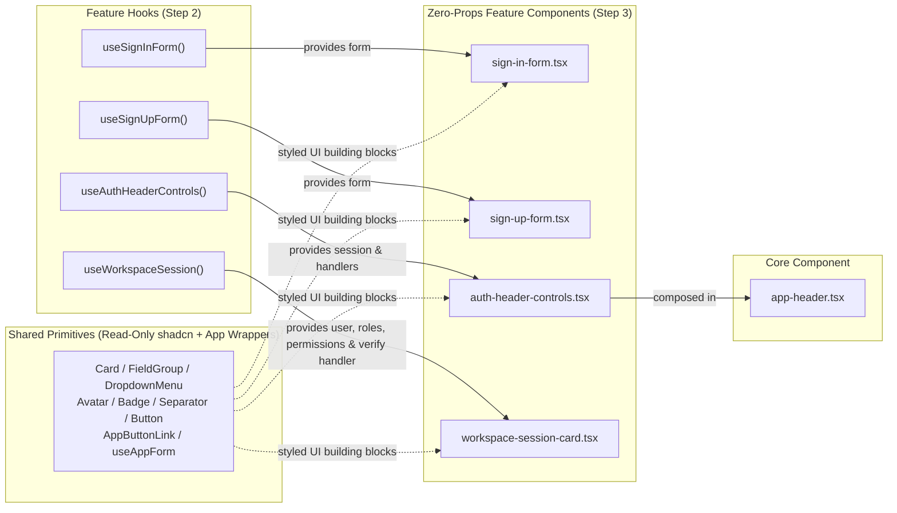

# Milestone 3 — Frontend Step 3: Feature Auth & Session Zero-Props Components (src/client/features/**/components/)

เมื่อเรามี Single-Responsibility Hooks ที่พร้อมส่งมอบทั้ง State, Form Instance และ Event Handlers จาก Step 2 แล้ว ในขั้นตอนนี้เราจะสร้าง **Zero-Props Presentation Components** สำหรับฟอร์มเข้าสู่ระบบ ฟอร์มสมัครสมาชิก เมนูควบคุมบัญชีผู้ใช้บนแถบ Header และการ์ดแสดงรายละเอียด Session & RBAC บนหน้า Workspace รวมถึงเชื่อมต่อ `<AuthHeaderControls />` เข้ากับ `<AppHeader />`

---

## 1. เป้าหมายและขอบเขต Boundary (Boundary Context & Goal)

เป้าหมายของ Step นี้คือการสร้าง UI Components ภายใต้กฎ **Zero Props Architecture** และ **One Component per File** โดยให้แต่ละ Component เรียกใช้ Hook ประจำตัวของตนเองโดยตรง ไม่รับ Props ใดๆ จากภายนอก และใช้ Shared Primitives (`Card`, `FieldGroup`, `DropdownMenu`, `Badge`, `Separator`, `AppButtonLink`) ร่วมกับไอคอนจาก `lucide-react`

### ตารางสรุปไฟล์ใน Step นี้

| ลำดับ | เส้นทางไฟล์ (File Path) | หน้าที่ความรับผิดชอบ (Responsibility) |
| :--- | :--- | :--- |
| 1 | `src/client/features/auth/components/sign-in-form.tsx` | Zero-Props Component แสดงการ์ดฟอร์มเข้าสู่ระบบ (`SignInForm`) คู่กับ `useSignInForm()` |
| 2 | `src/client/features/auth/components/sign-up-form.tsx` | Zero-Props Component แสดงการ์ดฟอร์มสมัครสมาชิก (`SignUpForm`) คู่กับ `useSignUpForm()` |
| 3 | `src/client/features/auth/components/auth-header-controls.tsx` | Zero-Props Component แสดงปุ่มเข้าสู่ระบบ/สมัครสมาชิก หรือเมนู Dropdown ของผู้ใช้ที่ล็อกอินแล้ว (`AuthHeaderControls`) คู่กับ `useAuthHeaderControls()` |
| 4 | `src/client/features/workspace/components/workspace-session-card.tsx` | Zero-Props Component แสดงข้อมูลผู้ใช้ วันหมดอายุเซสชัน บทบาท (`systemRoles`) สิทธิ์ (`systemPermissions`) และปุ่มทดสอบการตรวจสอบสิทธิ์ (`WorkspaceSessionCard`) |
| 5 | `src/client/core/components/app-header.tsx` | อัปเดต Global Header ของแอปพลิเคชันเพื่อวาง `<AuthHeaderControls />` คู่กับ `<AppThemeSwitcher />` |

### แผนผังการประกอบ Zero-Props Components (Component & Hook Binding)



---

## 2. ทฤษฎี ความสำคัญ และกฎสถาปัตยกรรมเฉพาะ Boundary นี้

### 2.1 Zero Props Architecture (`.agents/rules/client.md` ข้อ 2, 3, 4, 5)
- **ห้ามรับ Props ใดๆ ใน Feature Components**: สังเกตซิกเนเจอร์ของทั้ง 4 คอมโพเนนต์ใน Step นี้:
  - `export function SignInForm()`
  - `export function SignUpForm()`
  - `export function AuthHeaderControls()`
  - `export function WorkspaceSessionCard()`
  ทุกฟังก์ชันไม่มีพารามิเตอร์ `props` เลยแม้แต่ตัวเดียว!
- **ทำไมต้อง Zero Props?**:
  1. **ขจัดปัญหา Prop Drilling อย่างถาวร**: Parent (`Screen` หรือ `AppHeader`) ไม่ต้องดึงข้อมูลหรือสร้าง Callback เพื่อส่งต่อลงมาให้ลูก ทำให้เมื่อเราต้องการย้ายตำแหน่ง `<AuthHeaderControls />` หรือ `<WorkspaceSessionCard />` ไปวางที่ใดในหน้าจอ ก็สามารถวาง `<WorkspaceSessionCard />` ได้ทันทีโดยไม่ต้องแก้ Data Contract ของคอมโพเนนต์แม่
  2. **จำกัดวงจรการ Re-render (Local State Ownership)**: เมื่อผู้ใช้พิมพ์ตัวอักษรใน `SignInForm` หรือกดปุ่มทดสอบสิทธิ์ใน `WorkspaceSessionCard` การ Re-render จะเกิดขึ้นเฉพาะภายในตัว Component นั้นที่เรียก Hook เอง ไม่ทำให้ทั้งหน้าจอ (`Screen`) ต้อง Re-render ตามไปด้วย

### 2.2 กฎ 1 ไฟล์ต่อ 1 Component (`.agents/rules/client.md` ข้อ 19)
- ห้ามประกาศ Sub-component ย่อยไว้ในไฟล์เดียวกัน และห้ามสร้าง Nested Component ภายใน Function Body ของ Component อื่นโดยเด็ดขาด เพื่อให้แต่ละไฟล์มีความรับผิดชอบเดียว ค้นหาง่าย และไม่แอบส่ง Props ระหว่าง Sub-component ภายในไฟล์

### 2.3 กฎ Visual Boundary และการใช้ SVG Icons (`.agents/rules/client.md` ข้อ 15 และ 18)
- **ห้ามใส่คลาส `border-*` หรือ `ring-*` เองโดยพลการ (ข้อ 15)**: ในการตีกรอบฟอร์มและการ์ด เราใช้ `<Card>` จาก `src/client/shared/shadcn/components/ui/card` และใช้ `<Separator />` ในการคั่นระหว่างเนื้อหากับส่วนท้าย (`<CardFooter>`) เสมอ เพื่อให้เส้นขอบและสีปรับเปลี่ยนตาม Semantic Tokens ของ Light/Dark Mode อย่างถูกต้อง
- **ห้ามใช้ Emoji บน UI (ข้อ 18)**: ใช้ SVG Icons จาก `lucide-react` (`LogIn`, `UserRoundPlus`, `ShieldCheck`, `KeyRound`, `CheckCircle2`, `LogOut` ฯลฯ) พร้อมระบุ `aria-hidden="true"` เพื่อรองรับ Accessibility (Screen Readers)

---

## 3. ลงมือเขียนโค้ด (Step-by-Step Implementation)

### 3.1 สร้างคอมโพเนนต์ฟอร์มเข้าสู่ระบบ (`src/client/features/auth/components/sign-in-form.tsx`)

สร้างไฟล์ `src/client/features/auth/components/sign-in-form.tsx`:

```tsx
import { LogIn } from "lucide-react";
import { AppButtonLink } from "#/client/shared/components/app-link";
import {
	Card,
	CardContent,
	CardDescription,
	CardFooter,
	CardHeader,
	CardTitle,
} from "#/client/shared/shadcn/components/ui/card";
import { FieldGroup } from "#/client/shared/shadcn/components/ui/field";
import { Separator } from "#/client/shared/shadcn/components/ui/separator";
import { useSignInForm } from "../hooks/use-sign-in-form";

export function SignInForm() {
	const { form } = useSignInForm();

	return (
		<Card className="w-full">
			<CardHeader>
				<div className="flex items-center gap-2">
					<LogIn className="size-5 text-primary" aria-hidden="true" />
					<CardTitle>เข้าสู่ระบบ TaskFlow</CardTitle>
				</div>
				<CardDescription>
					กรอกอีเมลและรหัสผ่านเพื่อเข้าใช้งานพื้นที่ทำงานของคุณ
				</CardDescription>
			</CardHeader>
			<CardContent>
				<form
					noValidate
					onSubmit={(event) => {
						event.preventDefault();
						event.stopPropagation();
						void form.handleSubmit();
					}}
				>
					<form.AppForm>
						<FieldGroup>
							<form.AppField name="email">
								{(field) => (
									<field.TextField
										label="อีเมล"
										type="email"
										placeholder="admin@taskflow.local"
										autoComplete="email"
									/>
								)}
							</form.AppField>

							<form.AppField name="password">
								{(field) => (
									<field.TextField
										label="รหัสผ่าน"
										type="password"
										placeholder="กรอกรหัสผ่านของคุณ"
										autoComplete="current-password"
									/>
								)}
							</form.AppField>

							<form.SubmitButton
								className="w-full"
								loadingLabel="กำลังตรวจสอบสิทธิ์..."
							>
								เข้าสู่ระบบ
							</form.SubmitButton>
						</FieldGroup>
					</form.AppForm>
				</form>
			</CardContent>
			<Separator />
			<CardFooter className="justify-center text-sm text-muted-foreground">
				<span>ยังไม่มีบัญชีผู้ใช้งาน?</span>
				<AppButtonLink to="/sign-up" className="ml-1.5">
					สมัครสมาชิกใหม่
				</AppButtonLink>
			</CardFooter>
		</Card>
	);
}
```

**คำอธิบายโค้ด:**
- เรียก `const { form } = useSignInForm()` ภายในตัวเองโดยไม่รับ Props
- ใช้ `<form noValidate ...>` เพื่อปิด Browser Native Tooltip แล้วให้ Zod Validator ใน TanStack Form (`<form.AppField>` และ `<field.TextField>`) เป็นผู้แสดงข้อความ Error ภาษาไทยใต้ช่องกรอกอย่างสวยงาม
- `<form.SubmitButton>` จะอ่านสถานะ `isSubmitting` จาก Context ของ `<form.AppForm>` อัตโนมัติ โดยเปลี่ยนข้อความเป็น `"กำลังตรวจสอบสิทธิ์..."` และปิดปุ่มไม่ให้กดซ้ำระหว่างรอ Server ตอบกลับ
- ส่วนท้ายการ์ด (`<CardFooter>`) ใช้ `<AppButtonLink to="/sign-up">` เพื่อสลับไปยังหน้าสมัครสมาชิกแบบ Type-safe

---

### 3.2 สร้างคอมโพเนนต์ฟอร์มสมัครสมาชิก (`src/client/features/auth/components/sign-up-form.tsx`)

สร้างไฟล์ `src/client/features/auth/components/sign-up-form.tsx`:

```tsx
import { UserRoundPlus } from "lucide-react";
import { AppButtonLink } from "#/client/shared/components/app-link";
import {
	Card,
	CardContent,
	CardDescription,
	CardFooter,
	CardHeader,
	CardTitle,
} from "#/client/shared/shadcn/components/ui/card";
import { FieldGroup } from "#/client/shared/shadcn/components/ui/field";
import { Separator } from "#/client/shared/shadcn/components/ui/separator";
import { useSignUpForm } from "../hooks/use-sign-up-form";

export function SignUpForm() {
	const { form } = useSignUpForm();

	return (
		<Card className="w-full">
			<CardHeader>
				<div className="flex items-center gap-2">
					<UserRoundPlus className="size-5 text-primary" aria-hidden="true" />
					<CardTitle>สมัครสมาชิก TaskFlow</CardTitle>
				</div>
				<CardDescription>
					สร้างบัญชีใหม่เพื่อเริ่มจัดการโครงการและงานร่วมกับทีม
				</CardDescription>
			</CardHeader>
			<CardContent>
				<form
					noValidate
					onSubmit={(event) => {
						event.preventDefault();
						event.stopPropagation();
						void form.handleSubmit();
					}}
				>
					<form.AppForm>
						<FieldGroup>
							<form.AppField name="name">
								{(field) => (
									<field.TextField
										label="ชื่อที่แสดง"
										type="text"
										placeholder="เช่น สมชาย ใจดี"
										autoComplete="name"
									/>
								)}
							</form.AppField>

							<form.AppField name="email">
								{(field) => (
									<field.TextField
										label="อีเมล"
										type="email"
										placeholder="member@taskflow.local"
										autoComplete="email"
									/>
								)}
							</form.AppField>

							<form.AppField name="password">
								{(field) => (
									<field.TextField
										label="รหัสผ่าน"
										type="password"
										placeholder="อย่างน้อย 8 ตัวอักษร"
										autoComplete="new-password"
									/>
								)}
							</form.AppField>

							<form.AppField name="confirmPassword">
								{(field) => (
									<field.TextField
										label="ยืนยันรหัสผ่าน"
										type="password"
										placeholder="กรอกรหัสผ่านอีกครั้ง"
										autoComplete="new-password"
									/>
								)}
							</form.AppField>

							<form.SubmitButton
								className="w-full"
								loadingLabel="กำลังสร้างบัญชี..."
							>
								สมัครสมาชิก
							</form.SubmitButton>
						</FieldGroup>
					</form.AppForm>
				</form>
			</CardContent>
			<Separator />
			<CardFooter className="justify-center text-sm text-muted-foreground">
				<span>มีบัญชีผู้ใช้งานอยู่แล้ว?</span>
				<AppButtonLink to="/sign-in" className="ml-1.5">
					เข้าสู่ระบบ
				</AppButtonLink>
			</CardFooter>
		</Card>
	);
}
```

**คำอธิบายโค้ด:**
- ประกอบด้วย 4 ฟิลด์ ได้แก่ `name`, `email`, `password` และ `confirmPassword` โดยกำหนด `autoComplete="new-password"` ในช่องรหัสผ่านทั้งสองช่องเพื่อให้ Password Manager ของเบราว์เซอร์ทำงานได้อย่างถูกต้อง

---

### 3.3 สร้างคอมโพเนนต์ควบคุมสถานะผู้ใช้บน Header (`src/client/features/auth/components/auth-header-controls.tsx`)

คอมโพเนนต์นี้จะแสดงผล 3 สถานะตามข้อมูลที่ได้จาก `useAuthHeaderControls()`:
1. **กำลังโหลด (`isPending === true`)**: แสดง `<Skeleton className="h-8 w-32" />` เพื่อรักษาขนาดพื้นที่บนแถบ Header ไม่ให้กระตุก (Prevent Layout Shift)
2. **ยังไม่ได้ล็อกอิน (`!user`)**: แสดงปุ่มลิงก์ `"เข้าสู่ระบบ"` และ `"สมัครสมาชิก"`
3. **ล็อกอินแล้ว (`user`)**: แสดงปุ่ม `<DropdownMenuTrigger>` พร้อม `<Avatar>`, ชื่อผู้ใช้, ป้ายบทบาท (`<Badge variant="secondary">{primaryRole}</Badge>`), เมนูนำทาง และปุ่ม `"ออกจากระบบ"`

เช่นเดียวกับใน Step 2 เราแสดงโค้ดฉบับเต็มทั้ง **เวอร์ชันเริ่มต้นสำหรับ Milestone 3** และ **เวอร์ชันสมบูรณ์เมื่อมีครบทุก Route**:

#### เวอร์ชันสำหรับ Milestone 3 (สอดคล้องกับ `useAuthHeaderControls` ของ M3)

```tsx
import { ChevronDown, LayoutDashboard, LogOut } from "lucide-react";
import { AppButtonLink } from "#/client/shared/components/app-link";
import {
	Avatar,
	AvatarFallback,
} from "#/client/shared/shadcn/components/ui/avatar";
import { Badge } from "#/client/shared/shadcn/components/ui/badge";
import { Button } from "#/client/shared/shadcn/components/ui/button";
import {
	DropdownMenu,
	DropdownMenuContent,
	DropdownMenuGroup,
	DropdownMenuItem,
	DropdownMenuLabel,
	DropdownMenuSeparator,
	DropdownMenuTrigger,
} from "#/client/shared/shadcn/components/ui/dropdown-menu";
import { Skeleton } from "#/client/shared/shadcn/components/ui/skeleton";
import { useAuthHeaderControls } from "../hooks/use-auth-header-controls";

export function AuthHeaderControls() {
	const {
		isPending,
		user,
		initials,
		primaryRole,
		isSigningOut,
		handleGoWorkspace,
		handleSignOut,
	} = useAuthHeaderControls();

	if (isPending) {
		return <Skeleton className="h-8 w-32" />;
	}

	if (!user) {
		return (
			<div className="flex items-center gap-2">
				<AppButtonLink to="/sign-in" variant="ghost" size="sm">
					เข้าสู่ระบบ
				</AppButtonLink>
				<AppButtonLink to="/sign-up" variant="outline" size="sm">
					สมัครสมาชิก
				</AppButtonLink>
			</div>
		);
	}

	return (
		<DropdownMenu>
			<DropdownMenuTrigger
				render={<Button variant="outline" className="gap-2" />}
			>
				<Avatar size="sm">
					<AvatarFallback>{initials}</AvatarFallback>
				</Avatar>
				<span className="max-w-32 truncate">{user.name}</span>
				<ChevronDown
					className="size-3.5 text-muted-foreground"
					aria-hidden="true"
				/>
			</DropdownMenuTrigger>
			<DropdownMenuContent align="end" className="w-64">
				<DropdownMenuGroup>
					<DropdownMenuLabel className="flex flex-col gap-1.5">
						<span className="flex items-center justify-between">
							<span className="text-sm font-medium text-foreground">
								{user.name}
							</span>
							<Badge variant="secondary">{primaryRole}</Badge>
						</span>
						<span className="truncate text-xs font-normal text-muted-foreground">
							{user.email}
						</span>
					</DropdownMenuLabel>
				</DropdownMenuGroup>
				<DropdownMenuSeparator />
				<DropdownMenuItem onClick={() => void handleGoWorkspace()}>
					<LayoutDashboard aria-hidden="true" />
					<span>พื้นที่ทำงาน</span>
				</DropdownMenuItem>
				<DropdownMenuSeparator />
				<DropdownMenuItem
					variant="destructive"
					disabled={isSigningOut}
					onClick={() => void handleSignOut()}
				>
					<LogOut aria-hidden="true" />
					<span>{isSigningOut ? "กำลังออกจากระบบ..." : "ออกจากระบบ"}</span>
				</DropdownMenuItem>
			</DropdownMenuContent>
		</DropdownMenu>
	);
}
```

#### เวอร์ชันสมบูรณ์ใน Repository (เมื่อเพิ่มเมนู `/projects`, `/admin/roles`, `/admin/users` ตามสิทธิ์ RBAC แล้ว)

```tsx
import {
	ChevronDown,
	FolderKanban,
	LayoutDashboard,
	LogOut,
	ShieldCheck,
	Users,
} from "lucide-react";
import { AppButtonLink } from "#/client/shared/components/app-link";
import {
	Avatar,
	AvatarFallback,
} from "#/client/shared/shadcn/components/ui/avatar";
import { Badge } from "#/client/shared/shadcn/components/ui/badge";
import { Button } from "#/client/shared/shadcn/components/ui/button";
import {
	DropdownMenu,
	DropdownMenuContent,
	DropdownMenuGroup,
	DropdownMenuItem,
	DropdownMenuLabel,
	DropdownMenuSeparator,
	DropdownMenuTrigger,
} from "#/client/shared/shadcn/components/ui/dropdown-menu";
import { Skeleton } from "#/client/shared/shadcn/components/ui/skeleton";
import { useAuthHeaderControls } from "../hooks/use-auth-header-controls";

export function AuthHeaderControls() {
	const {
		isPending,
		user,
		initials,
		primaryRole,
		canReadRoles,
		canReadUsers,
		isSigningOut,
		handleGoWorkspace,
		handleGoProjects,
		handleGoAdminRoles,
		handleGoAdminUsers,
		handleSignOut,
	} = useAuthHeaderControls();

	if (isPending) {
		return <Skeleton className="h-8 w-32" />;
	}

	if (!user) {
		return (
			<div className="flex items-center gap-2">
				<AppButtonLink to="/sign-in" variant="ghost" size="sm">
					เข้าสู่ระบบ
				</AppButtonLink>
				<AppButtonLink to="/sign-up" variant="outline" size="sm">
					สมัครสมาชิก
				</AppButtonLink>
			</div>
		);
	}

	return (
		<DropdownMenu>
			<DropdownMenuTrigger
				render={<Button variant="outline" className="gap-2" />}
			>
				<Avatar size="sm">
					<AvatarFallback>{initials}</AvatarFallback>
				</Avatar>
				<span className="max-w-32 truncate">{user.name}</span>
				<ChevronDown
					className="size-3.5 text-muted-foreground"
					aria-hidden="true"
				/>
			</DropdownMenuTrigger>
			<DropdownMenuContent align="end" className="w-64">
				<DropdownMenuGroup>
					<DropdownMenuLabel className="flex flex-col gap-1.5">
						<span className="flex items-center justify-between">
							<span className="text-sm font-medium text-foreground">
								{user.name}
							</span>
							<Badge variant="secondary">{primaryRole}</Badge>
						</span>
						<span className="truncate text-xs font-normal text-muted-foreground">
							{user.email}
						</span>
					</DropdownMenuLabel>
				</DropdownMenuGroup>
				<DropdownMenuSeparator />
				<DropdownMenuItem onClick={() => void handleGoWorkspace()}>
					<LayoutDashboard aria-hidden="true" />
					<span>พื้นที่ทำงาน</span>
				</DropdownMenuItem>
				<DropdownMenuItem onClick={() => void handleGoProjects()}>
					<FolderKanban aria-hidden="true" />
					<span>โครงการทั้งหมด</span>
				</DropdownMenuItem>
				{canReadRoles ? (
					<DropdownMenuItem onClick={() => void handleGoAdminRoles()}>
						<ShieldCheck aria-hidden="true" />
						<span>จัดการบทบาท</span>
					</DropdownMenuItem>
				) : null}
				{canReadUsers ? (
					<DropdownMenuItem onClick={() => void handleGoAdminUsers()}>
						<Users aria-hidden="true" />
						<span>ผู้ใช้งาน</span>
					</DropdownMenuItem>
				) : null}
				<DropdownMenuSeparator />
				<DropdownMenuItem
					variant="destructive"
					disabled={isSigningOut}
					onClick={() => void handleSignOut()}
				>
					<LogOut aria-hidden="true" />
					<span>{isSigningOut ? "กำลังออกจากระบบ..." : "ออกจากระบบ"}</span>
				</DropdownMenuItem>
			</DropdownMenuContent>
		</DropdownMenu>
	);
}
```

---

### 3.4 สร้างการ์ดแสดงข้อมูล Session และ RBAC (`src/client/features/workspace/components/workspace-session-card.tsx`)

สร้างไฟล์ `src/client/features/workspace/components/workspace-session-card.tsx` เพื่อแสดงรายละเอียดของผู้ใช้ที่ล็อกอินอยู่ บทบาทระดับระบบ (`systemRoles`) สิทธิ์ระดับระบบ (`systemPermissions`) และปุ่มทดสอบการยิง RPC ผ่าน `requireAuthMiddleware`:

```tsx
import { CheckCircle2, KeyRound, ShieldCheck, UserRound } from "lucide-react";
import { Badge } from "#/client/shared/shadcn/components/ui/badge";
import { Button } from "#/client/shared/shadcn/components/ui/button";
import {
	Card,
	CardContent,
	CardDescription,
	CardFooter,
	CardHeader,
	CardTitle,
} from "#/client/shared/shadcn/components/ui/card";
import { Separator } from "#/client/shared/shadcn/components/ui/separator";
import { useWorkspaceSession } from "../hooks/use-workspace-session";

export function WorkspaceSessionCard() {
	const {
		user,
		sessionExpiresAt,
		authCheckResult,
		isCheckingAuth,
		handleVerifyAuthCheck,
	} = useWorkspaceSession();

	if (!user) {
		return null;
	}

	return (
		<Card>
			<CardHeader>
				<div className="flex items-center gap-2">
					<ShieldCheck className="size-5 text-primary" aria-hidden="true" />
					<CardTitle>เซสชันที่ยืนยันตัวตนแล้วและสิทธิ์ระดับระบบ</CardTitle>
				</div>
				<CardDescription>ข้อมูลผู้ใช้งานและสิทธิ์ระดับระบบ</CardDescription>
			</CardHeader>
			<CardContent className="flex flex-col gap-4">
				<div className="flex flex-col gap-1 text-sm">
					<div className="flex items-center gap-2 font-medium text-foreground">
						<UserRound
							className="size-4 text-muted-foreground"
							aria-hidden="true"
						/>
						<span>{user.name}</span>
					</div>
					<span className="text-muted-foreground">{user.email}</span>
					{sessionExpiresAt ? (
						<span className="text-xs text-muted-foreground">
							เซสชันหมดอายุ: {new Date(sessionExpiresAt).toLocaleString()}
						</span>
					) : null}
				</div>
				<Separator />
				<div className="flex flex-col gap-2">
					<span className="text-xs font-medium text-muted-foreground">
						บทบาทระดับระบบ
					</span>
					<div className="flex flex-wrap gap-1.5">
						{user.systemRoles.length > 0 ? (
							user.systemRoles.map((roleSlug) => (
								<Badge key={roleSlug} variant="secondary">
									{roleSlug}
								</Badge>
							))
						) : (
							<span className="text-xs text-muted-foreground">
								ไม่มีบทบาทระดับระบบ
							</span>
						)}
					</div>
				</div>

				<div className="flex flex-col gap-2">
					<div className="flex items-center gap-1.5 text-xs font-medium text-muted-foreground">
						<KeyRound className="size-3.5" aria-hidden="true" />
						<span>สิทธิ์ระดับระบบ</span>
					</div>
					<div className="flex flex-wrap gap-1.5">
						{user.systemPermissions.length > 0 ? (
							user.systemPermissions.map((permissionCode) => (
								<Badge key={permissionCode} variant="outline">
									{permissionCode}
								</Badge>
							))
						) : (
							<span className="text-xs text-muted-foreground">
								ไม่มีสิทธิ์ระดับระบบ
							</span>
						)}
					</div>
				</div>
			</CardContent>

			<Separator />

			<CardFooter className="flex flex-wrap items-center justify-between gap-3">
				<Button
					type="button"
					variant="outline"
					size="sm"
					disabled={isCheckingAuth}
					onClick={() => void handleVerifyAuthCheck()}
				>
					{isCheckingAuth ? "กำลังตรวจสอบสิทธิ์..." : "ทดสอบการตรวจสอบสิทธิ์"}
				</Button>
				{authCheckResult ? (
					<div className="flex items-center gap-1.5 text-xs text-muted-foreground">
						<CheckCircle2 className="size-4 text-primary" aria-hidden="true" />
						<span>
							ตรวจสอบสิทธิ์สำเร็จ: {authCheckResult.email} (
							{authCheckResult.systemPermissions.length} สิทธิ์)
						</span>
					</div>
				) : null}
			</CardFooter>
		</Card>
	);
}
```

**คำอธิบายโค้ด:**
- แสดงรายการ `user.systemRoles` ด้วย `<Badge variant="secondary">` และ `user.systemPermissions` ด้วย `<Badge variant="outline">`
- ใน `<CardFooter>` มีปุ่ม `"ทดสอบการตรวจสอบสิทธิ์"` เมื่อกดแล้วจะเรียก `handleVerifyAuthCheck()` ซึ่งยิงไปที่ `getAuthCheckFn` (ป้องกันด้วย `requireAuthMiddleware`) และนำผลลัพธ์ `authCheckResult` มาแสดงจำนวนสิทธิ์ที่ตรวจพบจากฝั่งเซิร์ฟเวอร์

---

### 3.5 อัปเดต Global Header เพื่อเชื่อมต่อ `<AuthHeaderControls />` (`src/client/core/components/app-header.tsx`)

เปิดไฟล์ `src/client/core/components/app-header.tsx` (ที่สร้างไว้ตั้งแต่ Milestone 2) แล้วนำ `<AuthHeaderControls />` มาวางคู่กับ `<AppThemeSwitcher />`

*(หมายเหตุ: ใน Milestone 3 เรายังไม่มี `<WorkspaceNav />` ซึ่งจะเพิ่มเข้ามาภายหลัง จึงแสดงให้เห็นทั้งเวอร์ชันของ Milestone 3 และเวอร์ชันสมบูรณ์ของโปรเจกต์)*

#### เวอร์ชันสำหรับ Milestone 3 (วาง `<AuthHeaderControls />` คู่กับ `<AppThemeSwitcher />`)

```tsx
import { AuthHeaderControls } from "#/client/features/auth/components/auth-header-controls";
import {
	AppBrand,
	AppBrandIdentity,
	AppBrandLink,
	AppBrandLogo,
} from "#/client/shared/components/app-brand";
import { AppShellHeader } from "#/client/shared/components/app-shell";
import { AppThemeSwitcher } from "#/client/shared/components/app-theme-switcher";

export function AppHeader() {
	return (
		<AppShellHeader>
			<nav className="flex w-full max-w-6xl flex-wrap items-center justify-between gap-3">
				<AppBrand>
					<AppBrandLink to="/">
						<AppBrandLogo />
						<AppBrandIdentity>TaskFlow</AppBrandIdentity>
					</AppBrandLink>
				</AppBrand>
				<div className="flex items-center gap-2">
					<AuthHeaderControls />
					<AppThemeSwitcher />
				</div>
			</nav>
		</AppShellHeader>
	);
}
```

#### เวอร์ชันสมบูรณ์ใน Repository (เมื่อเพิ่ม `<WorkspaceNav />` เข้ามาในภายหลัง)

```tsx
import { AuthHeaderControls } from "#/client/features/auth/components/auth-header-controls";
import { WorkspaceNav } from "#/client/features/workspace/components/workspace-nav";
import {
	AppBrand,
	AppBrandIdentity,
	AppBrandLink,
	AppBrandLogo,
} from "#/client/shared/components/app-brand";
import { AppShellHeader } from "#/client/shared/components/app-shell";
import { AppThemeSwitcher } from "#/client/shared/components/app-theme-switcher";

export function AppHeader() {
	return (
		<AppShellHeader>
			<nav className="flex w-full max-w-6xl flex-wrap items-center justify-between gap-3">
				<div className="flex flex-wrap items-center gap-3">
					<AppBrand>
						<AppBrandLink to="/">
							<AppBrandLogo />
							<AppBrandIdentity>TaskFlow</AppBrandIdentity>
						</AppBrandLink>
					</AppBrand>
					<WorkspaceNav />
				</div>
				<div className="flex items-center gap-2">
					<AuthHeaderControls />
					<AppThemeSwitcher />
				</div>
			</nav>
		</AppShellHeader>
	);
}
```

**คำอธิบายโค้ด:**
- สังเกตความได้เปรียบของ **Zero Props Architecture**: `<AppHeader />` ไม่จำเป็นต้องรู้เรื่อง Session, ไม่ต้องดึง `useSession()` และไม่ต้องรับส่ง Props ใดๆ เพียงแค่วาง `<AuthHeaderControls />` ลงไป คอมโพเนนต์ลูกก็จะจัดการดึงข้อมูลและแสดงผลของตัวเองอย่างเป็นอิสระ

---

## 4. การตรวจสอบความถูกต้องและ Git Commit (Verification & Commit)

ตรวจสอบการจัดรูปแบบและกฎ Lint ด้วย Biome:

```bash
bun run typecheck
bun run format
bun run check
```

บันทึกการเปลี่ยนแปลงของ Step 3 ลงใน Git Repository:

```bash
git add src/client/features/auth/components/ src/client/features/workspace/components/workspace-session-card.tsx src/client/core/components/app-header.tsx
git commit -m "milestone-3.frontend.step-3: Zero-Props Auth Forms, Header Controls & Session Card"
```
