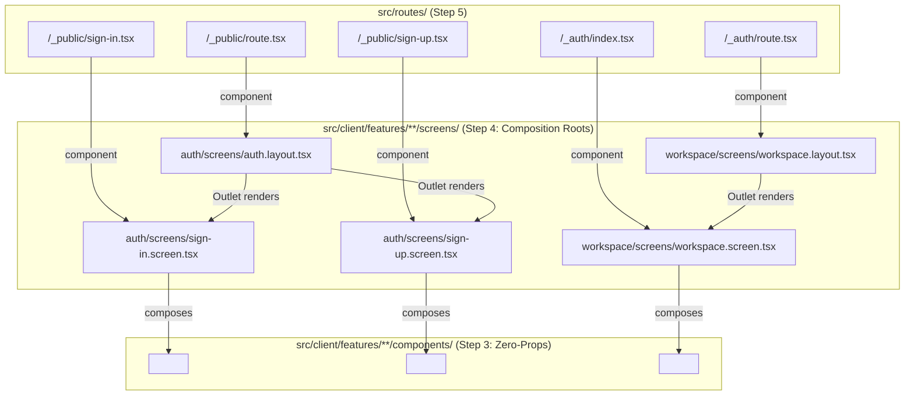

# Milestone 3 — Frontend Step 4: Feature Auth & Workspace Screens (src/client/features/**/screens/)

หลังจากที่เราสร้าง Zero-Props Components ครบทุกชิ้นใน Step 3 แล้ว ขั้นตอนต่อไปคือการสร้างเลเยอร์ **Screens (`src/client/features/**/screens/*.tsx`)** ซึ่งทำหน้าที่เป็น **Composition Root** ประจำแต่ละหน้าจอและแต่ละ Layout Group เพื่อเตรียมให้ TanStack Router File Routes (ใน Step 5) นำไปเรียกใช้งาน

---

## 1. เป้าหมายและขอบเขต Boundary (Boundary Context & Goal)

เป้าหมายของ Step นี้คือการสร้าง Layout Screens และ Page Screens สำหรับกลุ่มหน้าสาธารณะ (`auth`) และกลุ่มหน้าภายในระบบ (`workspace`) โดยทำหน้าที่จัดวางโครงสร้างหน้าจอ (`<AppShellMain>`, `<Outlet />`) และนำ Zero-Props Components มาประกอบเข้าด้วยกันโดยไม่มี Business Logic หรือการส่ง Props ข้ามคอมโพเนนต์

### ตารางสรุปไฟล์ใน Step นี้

| ลำดับ | เส้นทางไฟล์ (File Path) | หน้าที่ความรับผิดชอบ (Responsibility) |
| :--- | :--- | :--- |
| 1 | `src/client/features/auth/screens/auth.layout.tsx` | Layout Screen สำหรับกลุ่มหน้า `/_public` จัดกึ่งกลางหน้าจอด้วย `AppShellMain` (`max-w-md`) และเรนเดอร์ `<Outlet />` |
| 2 | `src/client/features/auth/screens/sign-in.screen.tsx` | Composition Root ของหน้า `/sign-in` เรนเดอร์ `<SignInForm />` |
| 3 | `src/client/features/auth/screens/sign-up.screen.tsx` | Composition Root ของหน้า `/sign-up` เรนเดอร์ `<SignUpForm />` |
| 4 | `src/client/features/workspace/screens/workspace.layout.tsx` | Layout Screen สำหรับกลุ่มหน้า `/_auth` เรนเดอร์ `<Outlet />` สำหรับหน้าภายในระบบที่ผ่านการยืนยันตัวตนแล้ว |
| 5 | `src/client/features/workspace/screens/workspace.screen.tsx` | Composition Root ของหน้าหลัก `/` เรนเดอร์ `<WorkspaceSessionCard />` (ใน Milestone 3) และการ์ดภาพรวมแดชบอร์ด (เมื่อต่อยอดใน Milestone 8) |

### แผนผังการประกอบหน้าจอผ่าน Composition Root (Screen Composition Hierarchy)



---

## 2. ทฤษฎี ความสำคัญ และกฎสถาปัตยกรรมเฉพาะ Boundary นี้

### 2.1 บทบาทของ Screen ในฐานะ Composition Root (`.agents/rules/client.md` ข้อ 1–3)
1. **Route รู้เพียงว่า URL ใช้ Screen ใด (ข้อ 1)**:
   - ไฟล์ใน `src/routes/**` มีหน้าที่ดูแลเฉพาะเรื่อง URL Routing, Search Validation, Route Guard (`beforeLoad`), และการ Preload ข้อมูล (`loader`) เท่านั้น ห้ามไฟล์ Route นำเอา Component ย่อยจาก `features/**/components/*` มาจัดวาง Layout เองโดยตรง แต่ต้องชี้ `component` มาที่ `features/**/screens/*.tsx` เสมอ
2. **Screen คือ Composition Root ประจำหน้านั้น (ข้อ 2)**:
   - `Screen` เป็นผู้กำหนดโครงสร้าง Layout ของหน้าจอ (เช่น การใช้ `<AppShellMain>`, การแบ่ง Grid หรือลำดับการจัดวางการ์ด) และนำ Zero-Props Components จาก `features/**/components/*.tsx` มาวางเรียงกัน
3. **Screen ต้องเป็น Pure Presentation ปราศจาก Logic (ข้อ 3)**:
   - ห้ามเรียก `useQuery`, `useMutation`, `useState` หรือเขียน Business Logic ใดๆ ในไฟล์ Screen เด็ดขาด เพื่อให้การอ่านไฟล์ Screen เปรียบเสมือนการอ่านสารบัญโครงสร้างของหน้านั้นๆ อย่างชัดเจนภายในไม่กี่บรรทัด

---

## 3. ลงมือเขียนโค้ด (Step-by-Step Implementation)

### 3.1 สร้าง Layout Screen สำหรับหน้า Authentication (`src/client/features/auth/screens/auth.layout.tsx`)

สร้างไฟล์ `src/client/features/auth/screens/auth.layout.tsx`:

```tsx
import { Outlet } from "@tanstack/react-router";
import { AppShellMain } from "#/client/shared/components/app-shell";

export function AuthLayout() {
	return (
		<AppShellMain className="mx-auto flex w-full max-w-md flex-1 items-center justify-center py-8">
			<Outlet />
		</AppShellMain>
	);
}
```

**คำอธิบายโค้ด:**
- ใช้ `<AppShellMain>` จาก Shared Primitives พร้อมจัดความกว้างสูงสุด `max-w-md` (448px) และจัดกึ่งกลางทั้งแนวตั้งและแนวนอน (`flex-1 items-center justify-center`) เพื่อให้ทั้งหน้า `/sign-in` และ `/sign-up` ที่เรนเดอร์ผ่าน `<Outlet />` แสดงผลอยู่กลางหน้าจออย่างสมดุลโดยไม่ต้องเขียน Layout ซ้ำในแต่ละหน้า

---

### 3.2 สร้าง Screen สำหรับหน้าเข้าสู่ระบบ (`src/client/features/auth/screens/sign-in.screen.tsx`)

สร้างไฟล์ `src/client/features/auth/screens/sign-in.screen.tsx`:

```tsx
import { SignInForm } from "../components/sign-in-form";

export function SignInScreen() {
	return <SignInForm />;
}
```

**คำอธิบายโค้ด:**
- ทำหน้าที่เป็น Composition Root ของหน้าเข้าสู่ระบบ โดยเรนเดอร์ `<SignInForm />` แบบ Zero Props ภายใต้กรอบ `<AuthLayout />`

---

### 3.3 สร้าง Screen สำหรับหน้าสมัครสมาชิก (`src/client/features/auth/screens/sign-up.screen.tsx`)

สร้างไฟล์ `src/client/features/auth/screens/sign-up.screen.tsx`:

```tsx
import { SignUpForm } from "../components/sign-up-form";

export function SignUpScreen() {
	return <SignUpForm />;
}
```

**คำอธิบายโค้ด:**
- ทำหน้าที่เป็น Composition Root ของหน้าสมัครสมาชิก โดยเรนเดอร์ `<SignUpForm />` แบบ Zero Props ภายใต้กรอบ `<AuthLayout />`

---

### 3.4 สร้าง Layout Screen สำหรับพื้นที่ทำงานที่ยืนยันตัวตนแล้ว (`src/client/features/workspace/screens/workspace.layout.tsx`)

สร้างไฟล์ `src/client/features/workspace/screens/workspace.layout.tsx`:

```tsx
import { Outlet } from "@tanstack/react-router";

export function WorkspaceLayout() {
	return <Outlet />;
}
```

**คำอธิบายโค้ด:**
- ทำหน้าที่เป็น Layout Wrapper สำหรับ Pathless Route `/_auth` โดยส่งต่อการเรนเดอร์ไปยังหน้าลูกผ่าน `<Outlet />` และปล่อยให้แต่ละหน้าภายใน `/_auth` (เช่น หน้า Workspace, หน้า Projects, หน้า Admin) กำหนดความกว้างและ `<AppShellMain>` ของตนเองได้อย่างอิสระ

---

### 3.5 สร้าง Screen สำหรับหน้าหลัก Workspace (`src/client/features/workspace/screens/workspace.screen.tsx`)

สำหรับไฟล์ `src/client/features/workspace/screens/workspace.screen.tsx`:
- ใน **Milestone 3** เป้าหมายของเราคือการแสดงผลและทดสอบระบบ Session & RBAC ผ่าน `<WorkspaceSessionCard />` (และแทนที่ `HomeScreen` เดิมจาก Milestone 2)
- ต่อมาใน **Milestone 8** เมื่อเราสร้างระบบ Projects, Tasks และ Activity Logs เสร็จแล้ว เราจะนำการ์ดแดชบอร์ด (`<WorkspaceSummaryCards />`, `<WorkspaceMyTasksCard />`, `<WorkspaceActiveProjectsCard />`, `<WorkspaceRecentActivityCard />`) มาวางเพิ่มเหนือ `<WorkspaceSessionCard />`
- ด้านล่างนี้แสดงโค้ดฉบับเต็มทั้ง **เวอร์ชันสำหรับ Milestone 3** และ **เวอร์ชันสมบูรณ์ใน Milestone 8**:

#### เวอร์ชันสำหรับ Milestone 3 (เรนเดอร์ `<WorkspaceSessionCard />` เพื่อตรวจสอบ Session & RBAC)

```tsx
import { LayoutDashboard } from "lucide-react";
import { AppShellMain } from "#/client/shared/components/app-shell";
import {
	Card,
	CardDescription,
	CardHeader,
	CardTitle,
} from "#/client/shared/shadcn/components/ui/card";
import { WorkspaceSessionCard } from "../components/workspace-session-card";

export function WorkspaceScreen() {
	return (
		<AppShellMain className="mx-auto max-w-6xl py-8">
			<Card>
				<CardHeader>
					<div className="flex items-center gap-2">
						<LayoutDashboard
							className="size-5 text-primary"
							aria-hidden="true"
						/>
						<div className="flex flex-col gap-0.5">
							<CardTitle className="text-xl">
								ภาพรวมพื้นที่ทำงาน TaskFlow
							</CardTitle>
							<CardDescription>
								ติดตามงานที่ได้รับมอบหมาย โครงการล่าสุด และความเคลื่อนไหวทั้งหมดในที่เดียว
							</CardDescription>
						</div>
					</div>
				</CardHeader>
			</Card>

			<WorkspaceSessionCard />
		</AppShellMain>
	);
}
```

#### เวอร์ชันสมบูรณ์ใน Repository (เมื่อต่อยอดเพิ่ม Dashboard Cards ใน Milestone 8)

```tsx
import { LayoutDashboard } from "lucide-react";
import { AppButtonLink } from "#/client/shared/components/app-link";
import { AppShellMain } from "#/client/shared/components/app-shell";
import {
	Card,
	CardDescription,
	CardHeader,
	CardTitle,
} from "#/client/shared/shadcn/components/ui/card";
import { WorkspaceActiveProjectsCard } from "../components/workspace-active-projects-card";
import { WorkspaceMyTasksCard } from "../components/workspace-my-tasks-card";
import { WorkspaceRecentActivityCard } from "../components/workspace-recent-activity-card";
import { WorkspaceSessionCard } from "../components/workspace-session-card";
import { WorkspaceSummaryCards } from "../components/workspace-summary-cards";

export function WorkspaceScreen() {
	return (
		<AppShellMain className="mx-auto max-w-6xl py-8">
			<Card>
				<CardHeader>
					<div className="flex flex-wrap items-center justify-between gap-3">
						<div className="flex items-center gap-2">
							<LayoutDashboard
								className="size-5 text-primary"
								aria-hidden="true"
							/>
							<div className="flex flex-col gap-0.5">
								<CardTitle className="text-xl">
									ภาพรวมพื้นที่ทำงาน TaskFlow
								</CardTitle>
								<CardDescription>
									ติดตามงานที่ได้รับมอบหมาย โครงการล่าสุด และความเคลื่อนไหวทั้งหมดในที่เดียว
								</CardDescription>
							</div>
						</div>
						<AppButtonLink to="/projects" variant="outline" size="sm">
							จัดการโครงการทั้งหมด
						</AppButtonLink>
					</div>
				</CardHeader>
			</Card>

			<WorkspaceSummaryCards />
			<WorkspaceMyTasksCard />

			<div className="grid gap-4 lg:grid-cols-2">
				<WorkspaceActiveProjectsCard />
				<WorkspaceRecentActivityCard />
			</div>

			<WorkspaceSessionCard />
		</AppShellMain>
	);
}
```

**คำอธิบายโค้ด:**
- สังเกตว่าการขยายฟีเจอร์จาก Milestone 3 ไปสู่ Milestone 8 ใน `WorkspaceScreen` ทำได้ง่ายมากเพียงแค่นำ Zero-Props Components ตัวใหม่มาวางเรียงลงใน `<AppShellMain>` โดยที่ `<WorkspaceSessionCard />` เดิมไม่ต้องถูกแก้ไขเลยแม้แต่บรรทัดเดียว

---

## 4. การตรวจสอบความถูกต้องและ Git Commit (Verification & Commit)

ตรวจสอบการจัดรูปแบบและกฎ Lint ด้วย Biome:

```bash
bun run typecheck
bun run format
bun run check
```

บันทึกการเปลี่ยนแปลงของ Step 4 ลงใน Git Repository:

```bash
git add src/client/features/auth/screens/ src/client/features/workspace/screens/
git commit -m "milestone-3.frontend.step-4: Feature Auth & Workspace Composition Screens"
```
