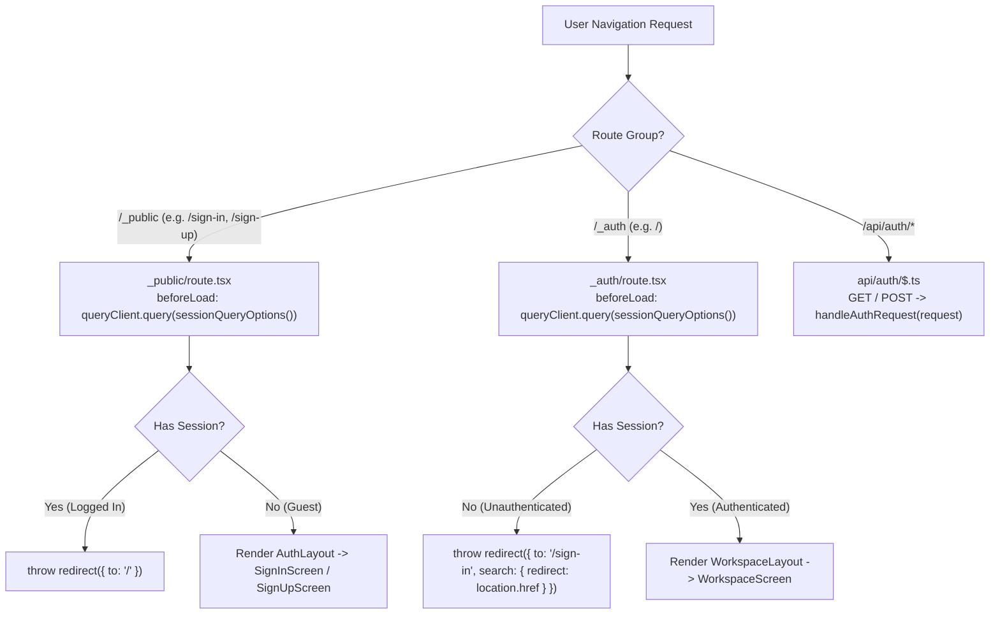

# Milestone 3 — Frontend Step 5: Auth API & Guarded File Routes (src/routes/)

มาถึงขั้นตอนสุดท้ายของ Milestone 3! ในขั้นตอนนี้เราจะเชื่อมโยงทุกเลเยอร์ทั้งฝั่ง Backend และ Frontend เข้ากับระบบ Routing ของ **TanStack Start / TanStack Router** ในโฟลเดอร์ `src/routes/` ได้แก่ การเปิด API Endpoint สำหรับ Better Auth (`/api/auth/$`), การสร้าง Pathless Layout Route สำหรับหน้าสาธารณะ (`/_public`) และหน้าที่ต้องยืนยันตัวตน (`/_auth`) พร้อมระบบ Route Guard (`beforeLoad`)

---

## 1. เป้าหมายและขอบเขต Boundary (Boundary Context & Goal)

เป้าหมายของ Step นี้คือการกำหนดโครงสร้าง URL Routes และป้องกันการเข้าถึงหน้าภายในระบบโดยไม่ได้รับอนุญาตตั้งแต่ระดับ Router (`beforeLoad`) ร่วมกับการใช้ `queryClient.query(sessionQueryOptions())` เพื่อให้ทั้ง SSR และ Client Navigation ตรวจสอบสิทธิ์ได้อย่างรวดเร็วและปลอดภัย

### ตารางสรุปไฟล์ใน Step นี้

| ลำดับ | เส้นทางไฟล์ (File Path) | หน้าที่ความรับผิดชอบ (Responsibility) |
| :--- | :--- | :--- |
| 1 | `src/routes/api/auth/$.ts` | Catch-all Server API Route (`/api/auth/*`) ส่งต่อ HTTP `GET` และ `POST` ไปยัง `handleAuthRequest` ของ Better Auth |
| 2 | `src/routes/_public/route.tsx` | Pathless Layout Route สำหรับหน้าสาธารณะ ถ้าตรวจพบว่ามี Session อยู่แล้วจะ `redirect({ to: "/" })` ทันที |
| 3 | `src/routes/_public/sign-in.tsx` | File Route สำหรับ `/sign-in` ตรวจสอบ Search Param `?redirect=...` ด้วย Zod และเรนเดอร์ `SignInScreen` |
| 4 | `src/routes/_public/sign-up.tsx` | File Route สำหรับ `/sign-up` เรนเดอร์ `SignUpScreen` |
| 5 | `src/routes/_auth/route.tsx` | Pathless Layout Route สำหรับหน้าที่ต้องล็อกอิน ถ้าไม่มี Session จะ `redirect({ to: "/sign-in", search: { redirect: location.href } })` |
| 6 | `src/routes/_auth/index.tsx` | File Route สำหรับหน้าหลัก `/` (ย้ายมาจาก `src/routes/index.tsx` เดิม) เรนเดอร์ `WorkspaceScreen` |

### แผนผังการทำงานของ Route Guards (Route Protection & Redirect Flow)



---

## 2. ทฤษฎี ความสำคัญ และกฎสถาปัตยกรรมเฉพาะ Boundary นี้

### 2.1 การใช้ Pathless Layout Routes (`_public` และ `_auth`)
ตามกฎ `.agents/rules/client.md` (ข้อ 16) และ `.agents/rules/architecture.md`:
- ใน TanStack Router โฟลเดอร์ที่ขึ้นต้นด้วยเครื่องหมายขีดล่าง (`_`) เช่น `src/routes/_public/` และ `src/routes/_auth/` คือ **Pathless Layout Routes** หมายความว่าชื่อ `_public` และ `_auth` จะไม่ไปปรากฏอยู่ใน URL จริงของผู้ใช้ (เช่น `src/routes/_public/sign-in.tsx` จะมี URL คือ `/sign-in` และ `src/routes/_auth/index.tsx` จะมี URL คือ `/`)
- ข้อดีคือเราสามารถเขียนลอจิก `beforeLoad` เพื่อตรวจสอบ Session ไว้ที่ไฟล์ `route.tsx` ของกลุ่มเพียงจุดเดียว แล้วทุกหน้าลูกที่อยู่ภายใต้โฟลเดอร์นั้นจะได้รับการคุ้มครองจาก Route Guard โดยอัตโนมัติ ไม่ต้องคัดลอกโค้ดตรวจสอบสิทธิ์ไปวางซ้ำทุกไฟล์

### 2.2 การทำงานร่วมกันระหว่าง `beforeLoad` กับ `context.queryClient`
- ใน `src/routes/__root.tsx` (ที่เราตั้งค่าไว้ใน Milestone 2) เราได้ส่ง `{ queryClient }` เข้าไปใน Router Context แล้ว
- ดังนั้นใน `beforeLoad: async ({ context }) => { ... }` ของทั้ง `/_public` และ `/_auth` เราจึงเรียกใช้ `await context.queryClient.query(sessionQueryOptions())` ได้โดยตรง:
  - หากเพิ่งเปิดหน้าเว็บครั้งแรกหรือ Cache หมดอายุ (`staleTime: 60_000`) ระบบจะเรียก `getSessionFn()` ไปยัง Server และนำผลลัพธ์มาเก็บลง Cache
  - เมื่อหน้าจอเรนเดอร์ Component ลูกที่เรียก `useSession()` หรือ `useWorkspaceSession()` คอมโพเนนต์เหล่านั้นจะได้รับข้อมูลจาก Cache ทันทีโดยไม่ต้องโหลดซ้ำ

### 2.3 การลบ `src/routes/index.tsx` เดิมจาก Milestone 2
- ใน Milestone 2 เราเคยมีไฟล์ `src/routes/index.tsx` ที่ชี้ไปยัง `/` แบบสาธารณะ
- ใน Milestone 3 หน้าหลัก `/` ของแอปพลิเคชันจะต้องอยู่ภายใต้การคุ้มครองของ Route Guard (`/_auth`) เราจึงสร้างไฟล์ `src/routes/_auth/index.tsx` ขึ้นมาแทน และ **ต้องลบไฟล์ `src/routes/index.tsx` เดิมออก** เพื่อไม่ให้เกิด Route Path Collision ที่ `/`

---

## 3. ลงมือเขียนโค้ด (Step-by-Step Implementation)

### 3.1 สร้าง Catch-all API Route สำหรับ Better Auth (`src/routes/api/auth/$.ts`)

สร้างไฟล์ `src/routes/api/auth/$.ts` เพื่อเปิด HTTP Endpoint `/api/auth/*` เชื่อมต่อกับ `handleAuthRequest`:

```typescript
import { createFileRoute } from "@tanstack/react-router";
import { handleAuthRequest } from "#/server-functions/auth/handle-auth-request";

export const Route = createFileRoute("/api/auth/$")({
	server: {
		handlers: {
			GET: ({ request }) => handleAuthRequest(request),
			POST: ({ request }) => handleAuthRequest(request),
		},
	},
});
```

**คำอธิบายโค้ด:**
- สัญลักษณ์ `$` ในชื่อไฟล์ `$.ts` คือ Splat / Catch-all Route ของ TanStack Start ซึ่งจะดักจับทุก Path ภายใต้ `/api/auth/...`
- กำหนด `server.handlers` สำหรับทั้งเมธอด `GET` และ `POST` ให้ส่งอ็อบเจกต์ `request` (Web Standard `Request`) ไปยังฟังก์ชัน `handleAuthRequest(request)` ใน `src/server-functions/auth/handle-auth-request.ts`

---

### 3.2 สร้าง Pathless Layout Route สำหรับหน้าสาธารณะ (`src/routes/_public/route.tsx`)

สร้างไฟล์ `src/routes/_public/route.tsx`:

```tsx
import { createFileRoute, redirect } from "@tanstack/react-router";
import { sessionQueryOptions } from "#/client/caches/auth/queries/session.query";
import { AuthLayout } from "#/client/features/auth/screens/auth.layout";

export const Route = createFileRoute("/_public")({
	beforeLoad: async ({ context }) => {
		const session = await context.queryClient.query(sessionQueryOptions());
		if (session) {
			throw redirect({
				to: "/",
			});
		}
	},
	component: AuthLayout,
});
```

**คำอธิบายโค้ด:**
- `beforeLoad`: ตรวจสอบว่าหากผู้ใช้มี Session (ล็อกอินอยู่แล้ว) แต่พยายามเปิดหน้า `/sign-in` หรือ `/sign-up` ระบบจะ `throw redirect({ to: "/" })` เพื่อส่งกลับไปยังหน้า Workspace ทันที
- `component`: กำหนดให้ใช้ `AuthLayout` เป็นโครงสร้างครอบหน้าลูกทั้งหมดในกลุ่ม `/_public`

---

### 3.3 สร้าง File Route สำหรับหน้าเข้าสู่ระบบ (`src/routes/_public/sign-in.tsx`)

สร้างไฟล์ `src/routes/_public/sign-in.tsx`:

```tsx
import { createFileRoute } from "@tanstack/react-router";
import { z } from "zod";
import { SignInScreen } from "#/client/features/auth/screens/sign-in.screen";

const signInSearchSchema = z.object({
	redirect: z.string().optional(),
});

export const Route = createFileRoute("/_public/sign-in")({
	validateSearch: signInSearchSchema,
	component: SignInScreen,
});
```

**คำอธิบายโค้ด:**
- `validateSearch: signInSearchSchema`: ใช้ Zod Schema ตรวจสอบ Query Parameter `?redirect=...` บน URL เพื่อให้เมื่อ Route Guard ของ `/_auth` ส่งผู้ใช้มายังหน้า `/sign-in?redirect=...` ค่า Search Parameter จะมี Type Safety และพร้อมให้ `useSignInForm()` ดึงไปใช้งานต่อ
- `component: SignInScreen`: ชี้ไปยัง Composition Root ของหน้าเข้าสู่ระบบตามกฎ `.agents/rules/client.md` (ข้อ 1)

---

### 3.4 สร้าง File Route สำหรับหน้าสมัครสมาชิก (`src/routes/_public/sign-up.tsx`)

สร้างไฟล์ `src/routes/_public/sign-up.tsx`:

```tsx
import { createFileRoute } from "@tanstack/react-router";
import { SignUpScreen } from "#/client/features/auth/screens/sign-up.screen";

export const Route = createFileRoute("/_public/sign-up")({
	component: SignUpScreen,
});
```

**คำอธิบายโค้ด:**
- ผูก URL `/sign-up` (ภายใต้กลุ่ม `/_public`) เข้ากับ `SignUpScreen`

---

### 3.5 สร้าง Pathless Layout Route สำหรับหน้าที่ต้องยืนยันตัวตน (`src/routes/_auth/route.tsx`)

สร้างไฟล์ `src/routes/_auth/route.tsx`:

```tsx
import { createFileRoute, redirect } from "@tanstack/react-router";
import { sessionQueryOptions } from "#/client/caches/auth/queries/session.query";
import { WorkspaceLayout } from "#/client/features/workspace/screens/workspace.layout";

export const Route = createFileRoute("/_auth")({
	beforeLoad: async ({ context, location }) => {
		const session = await context.queryClient.query(sessionQueryOptions());

		if (!session) {
			throw redirect({
				to: "/sign-in",
				search: { redirect: location.href },
			});
		}
		return session;
	},
	component: WorkspaceLayout,
});
```

**คำอธิบายโค้ด:**
- `beforeLoad`: ดึงข้อมูล Session ผ่าน `context.queryClient.query(sessionQueryOptions())`
  - หากไม่มี Session (`!session`) จะโยน `redirect` ไปยัง `/sign-in` พร้อมแนบ `search: { redirect: location.href }` เพื่อจดจำ URL เดิมที่ผู้ใช้ต้องการเข้าถึง
  - หากมี Session จะคืนค่า `session` ออกไป และอนุญาตให้เรนเดอร์ `WorkspaceLayout` รวมถึงหน้าลูกที่อยู่ภายใต้ `/_auth`

---

### 3.6 สร้าง File Route สำหรับหน้าหลักภายใต้ `/_auth` (`src/routes/_auth/index.tsx`)

สำหรับไฟล์ `src/routes/_auth/index.tsx`:
- ใน **Milestone 3** เรายังไม่มีระบบตารางงานและแดชบอร์ดของ Milestone 8 ดังนั้นไฟล์ `src/routes/_auth/index.tsx` ใน Milestone 3 จะทำหน้าที่เรนเดอร์ `WorkspaceScreen` อย่างเรียบง่าย
- ต่อมาใน **Milestone 8** เราจะเพิ่มเติม `validateSearch: myTasksSearchSchema` และ `loader` สำหรับดึงข้อมูล `workspaceOverviewQueryOptions()` และ `myAssignedTasksQueryOptions(deps)`
- ด้านล่างนี้แสดงโค้ดฉบับเต็มทั้ง **เวอร์ชันสำหรับ Milestone 3** และ **เวอร์ชันสมบูรณ์ใน Milestone 8**:

#### เวอร์ชันสำหรับ Milestone 3 (เรนเดอร์ `WorkspaceScreen`)

```tsx
import { createFileRoute } from "@tanstack/react-router";
import { WorkspaceScreen } from "#/client/features/workspace/screens/workspace.screen";

export const Route = createFileRoute("/_auth/")({
	component: WorkspaceScreen,
});
```

#### เวอร์ชันสมบูรณ์ใน Repository (เมื่อเติม `validateSearch` และ `loader` ของตารางงานใน Milestone 8)

```tsx
import { createFileRoute } from "@tanstack/react-router";
import { myAssignedTasksQueryOptions } from "#/client/caches/workspace/queries/my-assigned-tasks.query";
import { workspaceOverviewQueryOptions } from "#/client/caches/workspace/queries/workspace-overview.query";
import { WorkspaceScreen } from "#/client/features/workspace/screens/workspace.screen";
import { myTasksSearchSchema } from "#/shared/schemas/workspace.schema";

export const Route = createFileRoute("/_auth/")({
	validateSearch: myTasksSearchSchema,
	loaderDeps: ({ search }) => search,
	loader: ({ context, deps }) =>
		Promise.all([
			context.queryClient.query(workspaceOverviewQueryOptions()),
			context.queryClient.query(myAssignedTasksQueryOptions(deps)),
		]),
	component: WorkspaceScreen,
});
```

---

### 3.7 ลบไฟล์ `src/routes/index.tsx` เดิม และสร้าง Route Tree ใหม่

เนื่องจากเราย้าย Route ของหน้าหลัก `/` มาไว้ที่ `src/routes/_auth/index.tsx` แล้ว ให้ลบไฟล์ `src/routes/index.tsx` (รวมถึงโฟลเดอร์ `src/client/features/home/` จาก Milestone 2 หากไม่ได้ใช้งานแล้ว) และสั่งให้ TanStack Router CLI อัปเดตไฟล์ `src/routeTree.gen.ts`:

```bash
rm -f src/routes/index.tsx
bun run generate-routes
```

---

## 4. การตรวจสอบความถูกต้องและ Git Commit (Verification & Commit)

### 4.1 ตรวจสอบ Type, Lint และ Build

รันคำสั่งตรวจสอบความถูกต้องทั้งหมดของโปรเจกต์:

```bash
bun run generate-routes
bun run typecheck
bun run format
bun run check
```

### 4.2 ขั้นตอนการทดสอบใช้งานจริงท้าย Milestone 3 (End-to-End Verification)

เปิดเซิร์ฟเวอร์พัฒนาด้วยคำสั่ง `bun run dev` แล้วทดสอบ Flow การทำงานของระบบ Authentication & System RBAC ตามลำดับดังนี้:

1. **ทดสอบ Route Guard (`_auth` Redirect)**:
   - เปิดเบราว์เซอร์ไปที่ `http://localhost:3000/` (ขณะที่ยังไม่ได้ล็อกอิน)
   - ระบบจะต้องดีด (Redirect) ไปที่หน้า `http://localhost:3000/sign-in?redirect=%2F` โดยอัตโนมัติ
2. **ทดสอบการสมัครสมาชิกใหม่ (`/sign-up`)**:
   - คลิกปุ่ม **"สมัครสมาชิกใหม่"** ด้านล่างการ์ดเข้าสู่ระบบเพื่อไปยัง `/sign-up`
   - ทดลองกรอกรหัสผ่านสองช่องไม่ตรงกันแล้วคลิกนอกช่อง (`onBlur`) จะเห็นข้อความแจ้งเตือน `"รหัสผ่านทั้งสองช่องไม่ตรงกัน"`
   - กรอกข้อมูลให้ถูกต้อง (เช่น ชื่อ `"Test Member"`, อีเมล `"user1@taskflow.local"`, รหัสผ่าน `"Password123!"`) แล้วกด **"สมัครสมาชิก"**
   - ระบบจะแสดง Toast `"สร้างบัญชีผู้ใช้งานสำเร็จ"`, สร้าง Session อัตโนมัติ และพาเข้าสู่หน้า `/` พร้อมแสดงบทบาทระดับระบบเป็น `member` และสิทธิ์เริ่มต้นของสมาชิกบนการ์ด `WorkspaceSessionCard`
3. **ทดสอบการออกจากระบบ (`Sign-out`)**:
   - คลิกที่ปุ่มชื่อผู้ใช้มุมขวาบน (`AuthHeaderControls`) แล้วเลือกเมนู **"ออกจากระบบ"**
   - ระบบจะล้าง Cache, แสดง Toast `"ออกจากระบบแล้ว"` และพากลับไปยังหน้า `/sign-in`
4. **ทดสอบล็อกอินด้วยบัญชีผู้ดูแลระบบเริ่มต้น (`System Admin`)**:
   - ในหน้า `/sign-in` กรอกอีเมล `admin@taskflow.local` และรหัสผ่าน `Password123!` (จากข้อมูล Seed ใน Milestone 3 Backend) แล้วกด **"เข้าสู่ระบบ"**
   - ระบบจะพาเข้าสู่หน้า `/` บนการ์ด `WorkspaceSessionCard` จะแสดงบทบาท `system_admin` พร้อมรายการสิทธิ์ระดับระบบครบทุกสิทธิ์ (`user:read`, `user:Manage`, `role:read`, `role:manage`, `project:create` ฯลฯ)
5. **ทดสอบ `requireAuthMiddleware` บน `WorkspaceSessionCard`**:
   - คลิกปุ่ม **"ทดสอบการตรวจสอบสิทธิ์"** ด้านล่างการ์ด `WorkspaceSessionCard`
   - ระบบจะยิง RPC ไปยัง `getAuthCheckFn` แสดง Toast `"ยืนยันตัวตนสำเร็จ"` และแสดงข้อความยืนยันอีเมลพร้อมจำนวนสิทธิ์ระดับระบบที่ตรวจพบ

### 4.3 บันทึกการเปลี่ยนแปลงลง Git Repository

```bash
git add src/routes/ src/routeTree.gen.ts
git commit -m "milestone-3.frontend.step-5: Auth API Route, Public Routes & Authed Route Guard"
```
