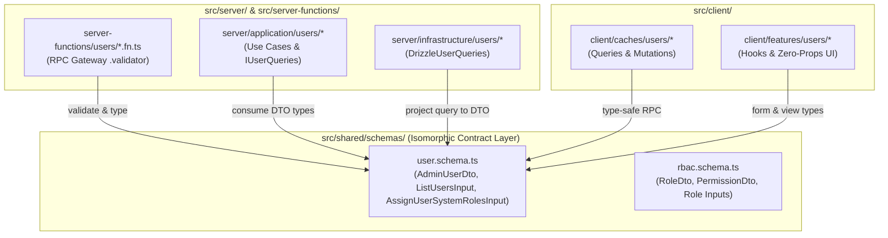

# Milestone 4 — Backend Step 1: Shared User Schemas (src/shared/schemas/)

ในก้าวแรกของ **Milestone 4 (RBAC Roles, Permissions & User Administration)** เราจะเริ่มต้นที่ชั้น **Isomorphic Shared Boundary (`src/shared/schemas/`)** เพื่อนิยามสัญญาข้อมูล (Data Contracts) สำหรับระบบจัดการรายชื่อผู้ใช้งาน (User Administration) และการกำหนดบทบาทระดับระบบ (System Roles Assignment) ให้พร้อมใช้งานร่วมกันทั้งฝั่ง Server และ Client

> [!NOTE]
> สำหรับสัญญาข้อมูลฝั่ง RBAC (`src/shared/schemas/rbac.schema.ts` เช่น `roleDtoSchema`, `permissionDtoSchema`, `createRoleInputSchema`, `updateRolePermissionsInputSchema`, `deleteRoleInputSchema`) เราได้วางรากฐานไว้ตั้งแต่ Milestone 1 แล้ว ใน Step นี้เราจึงโฟกัสที่การสร้าง `src/shared/schemas/user.schema.ts` เพื่อเติมเต็มสัญญาข้อมูลฝั่ง User Management ให้สมบูรณ์

---

## 1. เป้าหมายและขอบเขต Boundary (Boundary Context & Goal)

เป้าหมายของ Step นี้คือการสร้างไฟล์ `src/shared/schemas/user.schema.ts` เพื่อเป็น **Single Source of Truth** ของโครงสร้างข้อมูลผู้ใช้งานในมุมมองของผู้ดูแลระบบ (Admin User DTO) และ Input Payload สำหรับค้นหาผู้ใช้งานและกำหนด System Roles

### ตารางสรุปไฟล์ใน Step นี้

| ลำดับ | เส้นทางไฟล์ (File Path) | บทบาทหน้าที่ (Responsibility) |
| :--- | :--- | :--- |
| 1 | `src/shared/schemas/user.schema.ts` | นิยาม Zod Schemas และ TypeScript Types สำหรับข้อมูลผู้ใช้งานในหน้า Admin (`AdminUserDto`), ข้อมูลสรุปบทบาท (`AdminUserRoleSummary`), พารามิเตอร์ค้นหาผู้ใช้งาน (`ListUsersInput`) และข้อมูลนำเข้าสำหรับการกำหนดบทบาทระดับระบบ (`AssignUserSystemRolesInput`) |

### แผนผังการพึ่งพาระหว่างเลเยอร์ (Architecture Dependency Flow)



---

## 2. ทฤษฎี ความสำคัญ และกฎสถาปัตยกรรมเฉพาะ Boundary นี้

### 2.1 เหตุผลเชิงวิศวกรรมของ Isomorphic Shared Schema
ในระบบที่มีการจัดการสิทธิ์และบทบาทของผู้ใช้งาน (User & Role Management) ข้อมูลที่ส่งไปมาระหว่างตารางรายชื่อผู้ใช้บนหน้าเว็บ (Client) กับฐานข้อมูล (Server) ต้องมีโครงสร้างที่ตรงกัน 100%:
1. **ป้องกัน Schema Drift**: หากฝั่ง Server คืนค่า `systemRoles` เป็น Array ของ Object `{ id, name, slug }` แต่ฝั่ง Client เข้าใจว่าเป็น Array ของ `string` จะทำให้เกิด Runtime Crash ทันที การรวมศูนย์ไว้ที่ `src/shared/schemas/user.schema.ts` ทำให้ทั้งสองฝั่งอ้างอิง Type เดียวกันเสมอ
2. **Runtime Validation ที่ด่านหน้า (Fail-fast Gateway)**: เมื่อผู้ใช้กดบันทึกการเปลี่ยนบทบาทใน Dialog ข้อมูลที่ส่งผ่านเครือข่ายจะถูกตรวจสอบด้วย `assignUserSystemRolesInputSchema` บนชั้น `server-functions/` ก่อนถึง Use Case

### 2.2 การออกแบบ `assignUserSystemRolesInputSchema` และกฎการตรวจสอบความถูกต้อง
- **`userId: z.string().min(1, "กรุณาระบุรหัสผู้ใช้งาน")`**: บังคับด้วย `.min(1)` ว่าต้องระบุรหัสผู้ใช้งานเป้าหมายเสมอ ห้ามส่งค่าว่างเข้ามายังระบบ (และในระดับฟอร์ม/ธุรกิจ เมื่อผสานกับการจัดการบทบาท จะช่วยป้องกันการส่งคำขอที่ขาดข้อมูลสำคัญหรือทำให้เกิดสถานะผู้ใช้งานที่ผิดปกติ)
- **`roleIds: z.array(z.uuid("รหัสบทบาทไม่ถูกต้อง"))`**: บังคับให้ทุกสมาชิกในอาร์เรย์ต้องมีรูปแบบเป็น UUID ที่ถูกต้องตามมาตรฐาน ป้องกันการส่งรหัสปลอมหรือ string ที่ไม่ใช่ UUID เข้าไปค้นหาในฐานข้อมูล PostgreSQL (ซึ่งจะเกิด Database Cast Error หากไม่ใช่ UUID)

### 2.3 กฎจาก `.agents/rules/` ที่บังคับใช้
- **`globals.md` (Shared Schemas ข้อ 1–4)**:
  - `shared/schemas/**` คือ Source of Truth กลางของ Data Contract ระหว่าง Server และ Client
  - ต้องเริ่มจาก Zod Schema เสมอ แล้ว derive Type ด้วย `z.infer<typeof ...>` ห้ามเขียน `interface` หรือ `type` แยกต่างหากด้วยมือ
  - ใช้เฉพาะกับข้อมูลที่ข้าม Application Boundary เท่านั้น
- **`globals.md` (Global ข้อ 3–4)**:
  - ใช้ Named Import (`import { z } from "zod"`) ห้ามใช้ wildcard import

---

## 3. ลงมือเขียนโค้ด (Step-by-Step Implementation)

### 3.1 สร้างไฟล์ `src/shared/schemas/user.schema.ts`

สร้างไฟล์ `src/shared/schemas/user.schema.ts` และใส่โค้ดฉบับเต็มดังนี้:

```typescript
import { z } from "zod";

export const adminUserRoleSummarySchema = z.object({
	id: z.uuid(),
	name: z.string(),
	slug: z.string(),
});
export type AdminUserRoleSummary = z.infer<typeof adminUserRoleSummarySchema>;

export const adminUserDtoSchema = z.object({
	id: z.string(),
	name: z.string(),
	email: z.email(),
	emailVerified: z.boolean(),
	createdAt: z.string(),
	systemRoles: z.array(adminUserRoleSummarySchema),
});
export type AdminUserDto = z.infer<typeof adminUserDtoSchema>;

export const listUsersInputSchema = z.object({
	search: z.string().trim().max(100).optional(),
});
export type ListUsersInput = z.infer<typeof listUsersInputSchema>;

export const assignUserSystemRolesInputSchema = z.object({
	userId: z.string().min(1, "กรุณาระบุรหัสผู้ใช้งาน"),
	roleIds: z.array(z.uuid("รหัสบทบาทไม่ถูกต้อง")),
});
export type AssignUserSystemRolesInput = z.infer<
	typeof assignUserSystemRolesInputSchema
>;
```

#### คำอธิบายการทำงานทีละส่วน:
1. **`adminUserRoleSummarySchema` & `AdminUserRoleSummary`**:
   - เป็น Schema ย่อยสำหรับแสดงป้ายกำกับ (Badge) ของบทบาทระดับระบบที่ผู้ใช้แต่ละคนถืออยู่ โดยเก็บเฉพาะ `id` (UUID), `name` (ชื่อที่แสดงผล เช่น `"Super Admin"`) และ `slug` (รหัสอ้างอิง เช่น `"super_admin"`) โดยไม่ต้องแบก `permissionIds` ทั้งหมดมาในตารางรายชื่อผู้ใช้
2. **`adminUserDtoSchema` & `AdminUserDto`**:
   - โครงสร้างข้อมูลหลักสำหรับแสดงผลในตารางจัดการผู้ใช้งาน (User Management Table) ประกอบด้วยข้อมูลพื้นฐานจากตาราง `user` (`id`, `name`, `email`, `emailVerified`, `createdAt` ในรูปแบบ ISO String) พร้อมอาร์เรย์ `systemRoles`
3. **`listUsersInputSchema` & `ListUsersInput`**:
   - สัญญาข้อมูลขาเข้าสำหรับการค้นหารายชื่อผู้ใช้งาน รองรับ `search` แบบ `.optional()` ที่ตัดช่องว่างหัวท้ายอัตโนมัติด้วย `.trim()` และจำกัดความยาวไม่เกิน 100 ตัวอักษร เพื่อความปลอดภัยในการทำ Query `ILIKE`
4. **`assignUserSystemRolesInputSchema` & `AssignUserSystemRolesInput`**:
   - สัญญาข้อมูลขาเข้าสำหรับคำสั่งกำหนดหรือเปลี่ยนบทบาทระดับระบบของผู้ใช้งาน บังคับ `userId` ต้องไม่เป็นค่าว่าง (`.min(1)`) และ `roleIds` ต้องเป็นอาร์เรย์ของ UUID ที่ถูกต้อง

---

## 4. การตรวจสอบความถูกต้องและ Git Commit (Verification & Commit)

ตรวจสอบความถูกต้องของ Type และรูปแบบโค้ดด้วย Bun:

```bash
bun run typecheck
bun run format
bun run check
```

เมื่อตรวจสอบผ่านเรียบร้อยแล้ว ให้ทำการบันทึก进度เข้าสู่ Git Repository:

```bash
git add src/shared/schemas/user.schema.ts
git commit -m "milestone-4.backend.step-1: Shared User Schemas"
```
