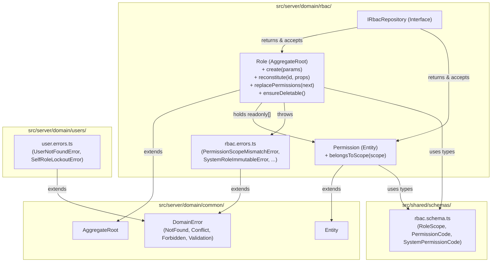

# Milestone 4 — Backend Step 2: Domain RBAC & Users (src/server/domain/rbac/ & src/server/domain/users/)

ใน Step ที่ 2 ของฝั่ง Backend เราจะเข้าสู่แกนกลางที่สำคัญที่สุดของระบบตามสถาปัตยกรรม **Domain-Driven Design (DDD)** และ **Clean Architecture** นั่นคือชั้น **Domain Layer (`src/server/domain/rbac/` และ `src/server/domain/users/`)** ซึ่งทำหน้าที่ปกป้องกฎทางธุรกิจ (Business Invariants) ของบทบาท (Role), สิทธิ์การใช้งาน (Permission) และการจัดการผู้ใช้งาน โดยไม่พึ่งพา Database ORM หรือ HTTP Framework ใดๆ ทั้งสิ้น

---

## 1. เป้าหมายและขอบเขต Boundary (Boundary Context & Goal)

เป้าหมายของ Step นี้คือการสร้าง Domain Entities (`Permission`), Aggregate Root (`Role`), Domain Errors (`rbac.errors.ts`, `user.errors.ts`) และ Repository Interface (`IRbacRepository`) เพื่อกำหนดกฎเหล็กทางธุรกิจของระบบ RBAC

### ตารางสรุปไฟล์ใน Step นี้

| ลำดับ | เส้นทางไฟล์ (File Path) | บทบาทหน้าที่ (Responsibility) |
| :--- | :--- | :--- |
| 1 | `src/server/domain/rbac/permission.entity.ts` | Domain Entity แทนสิทธิ์การเข้าถึงแต่ละรายการ พร้อมเมธอดตรวจสอบขอบเขต (`belongsToScope`) |
| 2 | `src/server/domain/rbac/role.entity.ts` | Aggregate Root แทนบทบาทในระบบ ควบคุม Invariants การสร้าง การเปลี่ยนสิทธิ์ และการลบ |
| 3 | `src/server/domain/rbac/rbac.errors.ts` | Domain Errors เฉพาะทางของโมดูล RBAC (เช่น Scope ไม่ตรงกัน, การแก้ไข System Role ที่ห้ามแตะต้อง) |
| 4 | `src/server/domain/rbac/rbac.repository.ts` | สัญญาการเข้าถึงข้อมูล (`IRbacRepository`) สำหรับจัดการ `Role`, `Permission` และ `UserSystemAccess` |
| 5 | `src/server/domain/users/user.errors.ts` | Domain Errors เฉพาะทางของโมดูล Users (ไม่พบผู้ใช้ และป้องกันการถอดสิทธิ์ตัวเองจนล็อกเอาต์) |

### แผนผังโครงสร้าง Domain Model (Domain Class & Boundary Diagram)



---

## 2. ทฤษฎี ความสำคัญ และกฎสถาปัตยกรรมเฉพาะ Boundary นี้

### 2.1 Tactical DDD ใน `Role` Aggregate Root
ในระบบ RBAC ของ TaskFlow บทบาท (`Role`) ไม่ใช่แค่โครงสร้างเก็บข้อมูล (Anemic Model) แต่เป็น **Aggregate Root** ที่ทำหน้าที่เป็น Consistency Boundary คอยพิทักษ์กฎทางธุรกิจที่สำคัญดังนี้:

1. **การแยก `Role.create(...)` กับ `Role.reconstitute(...)` (`server.md` ข้อ 5)**:
   - **`Role.create(params)`**: เป็น Static Factory Method สำหรับสร้าง Custom Role ใหม่จากศูนย์ ทำหน้าที่ `.trim()` ชื่อและคำอธิบาย, แปลง `slug` เป็นตัวพิมพ์เล็ก, ตรวจสอบความยาวชื่อ (2–100 ตัวอักษร) และรูปแบบ `ROLE_SLUG_PATTERN`, ตรวจสอบความสอดคล้องของ Scope กับ Permissions, บังคับให้ `isSystem: false` เสมอ (ผู้ใช้ไม่สามารถสร้าง System Role เองได้) และสร้าง UUID ใหม่พร้อมตั้งค่า `createdAt` / `updatedAt`
   - **`Role.reconstitute(id, props)`**: ใช้สำหรับคืนสภาพ (Reconstitute) ข้อมูลที่มีอยู่แล้วจากฐานข้อมูลภายในชั้น Infrastructure Repository เท่านั้น ไม่ต้องสร้าง UUID ใหม่และไม่ต้องบังคับ `isSystem: false` เพราะฐานข้อมูลมีทั้ง System Role และ Custom Role
   - **`private constructor`**: ปิดกั้นไม่ให้ชั้น Use Case สั่ง `new Role(...)` เองโดยตรง

2. **กฎ Invariant ห้ามผูก Permission ข้าม Scope (`PermissionScopeMismatchError` / RolePermissionScopeMismatch)**:
   - ระบบแบ่งบทบาทออกเป็น 2 ระดับ คือ `"system"` (เช่น Super Admin, Member) และ `"project"` (เช่น Project Owner, Project Member)
   - ทั้งใน `Role.create(...)` และ `role.replacePermissions(...)` จะเรียกเมธอด `Role.validatePermissionsForScope(scope, permissions)` ซึ่งวนลูปตรวจ `permission.belongsToScope(scope)` ทุกตัว
   - หากมีใครพยายามนำ Project Permission (เช่น `task:create`) ไปผูกกับ System Role หรือนำ System Permission (เช่น `user:assign_role`) ไปผูกกับ Project Role ระบบจะโยน `PermissionScopeMismatchError` ทันที พร้อมขจัดรายการ Permission ที่ซ้ำกันด้วย `Map<string, Permission>`

3. **กฎ Invariant ห้ามลบ System Role และห้ามถอดสิทธิ์หลักของ `super_admin` (`SystemRoleImmutableError` / SystemRoleModification)**:
   - **การลบ (`ensureDeletable()`)**: หากบทบาทมี `isSystem === true` เมื่อเรียก `role.ensureDeletable()` จะโยน `SystemRoleImmutableError` ทันที เพื่อป้องกันไม่ให้บทบาทตั้งต้นของระบบถูกลบ
   - **การแก้ไขสิทธิ์ของ `super_admin` (`replacePermissions()`)**: แม้ระบบจะอนุญาตให้ปรับแต่งสิทธิ์ได้ แต่ถ้าบทบาทคือ `"super_admin"` ระบบจะตรวจสอบว่าสิทธิ์หลัก 4 รายการ (`role:read`, `role:manage`, `user:read`, `user:assign_role`) ยังอยู่ครบหรือไม่ หากขาดหายไปแม้แต่ตัวเดียวจะโยน `SystemRoleImmutableError` เพื่อป้องกันผู้ดูแลระบบเผลอถอดสิทธิ์จัดการระบบของตัวเองออกจนไม่มีใครเข้าหน้า Admin ได้อีก

### 2.2 กฎจาก `.agents/rules/server.md` ที่บังคับใช้
- **ข้อ 1 (Inward-only Dependency Rule)**: `src/server/domain/` ห้าม import สิ่งใดจาก `application/`, `infrastructure/`, `composition/` หรือ `server-functions/` เด็ดขาด อนุญาตเฉพาะ `shared/schemas/` เท่านั้น
- **ข้อ 4 (Rich Domain Model & Encapsulation)**: ซ่อน State ไว้ใน `protected props` เปิดให้อ่านผ่าน `get` เท่านั้น และเปลี่ยนสถานะผ่าน Domain Methods (`replacePermissions`, `ensureDeletable`)
- **ข้อ 5 (Factory vs Reconstitution)**: แยก `Role.create(...)` กับ `Role.reconstitute(...)` อย่างชัดเจน
- **ข้อ 6 (Pure Repository Interface)**: `IRbacRepository` รับและคืนค่าเฉพาะ Domain Entity (`Role`, `Permission`) หรือ Primitives เท่านั้น ห้ามอ้างอิง Drizzle Row หรือ SQL Types
- **ข้อ 7 (Transport-Agnostic Domain Errors)**: สร้าง Error โดยสืบทอดจาก `NotFoundDomainError`, `ConflictDomainError`, `ForbiddenDomainError`, `ValidationDomainError` ใน `common/errors.ts` โดยไม่ผูกกับ HTTP Status Code โดยตรง

---

## 3. ลงมือเขียนโค้ด (Step-by-Step Implementation)

### 3.1 สร้างไฟล์ `src/server/domain/rbac/permission.entity.ts`

สร้าง Entity แทนสิทธิ์การใช้งาน 1 รายการ ซึ่งมีหน้าที่เก็บข้อมูลสิทธิ์และตรวจสอบว่าตนเองอยู่ใน `RoleScope` ที่ระบุหรือไม่:

```typescript
import type { PermissionCode, RoleScope } from "#/shared/schemas/rbac.schema";
import { Entity } from "../common/entity.base";

export interface PermissionProps {
	readonly code: PermissionCode;
	readonly scope: RoleScope;
	readonly description: string;
	readonly createdAt: Date;
}

export class Permission extends Entity<PermissionProps> {
	private constructor(id: string, props: PermissionProps) {
		super(id, props);
	}

	static reconstitute(id: string, props: PermissionProps): Permission {
		return new Permission(id, props);
	}

	get code(): PermissionCode {
		return this.props.code;
	}

	get scope(): RoleScope {
		return this.props.scope;
	}

	get description(): string {
		return this.props.description;
	}

	get createdAt(): Date {
		return this.props.createdAt;
	}

	belongsToScope(scope: RoleScope): boolean {
		return this.props.scope === scope;
	}
}
```

#### คำอธิบายการทำงาน:
- เนื่องจากรายการ `Permission` ในระบบเป็น Catalog มาตรฐานที่ถูก Seed ลงฐานข้อมูลตั้งแต่เริ่มต้น (ผู้ใช้ไม่ได้สร้าง Permission Code ใหม่เองผ่าน UI) จึงมีเฉพาะ `Permission.reconstitute(id, props)` สำหรับโหลดข้อมูลจากฐานข้อมูลขึ้นมาเป็น Entity
- เมธอด `belongsToScope(scope: RoleScope)` ช่วยให้ `Role` Aggregate Root สอบถามได้ว่า Permission ตัวนี้สังกัดอยู่ใน Scope (`"system"` หรือ `"project"`) ตรงกับของ Role หรือไม่

---

### 3.2 สร้างไฟล์ `src/server/domain/rbac/rbac.errors.ts`

สร้างคลาสข้อผิดพลาดทางธุรกิจสำหรับโมดูล RBAC:

```typescript
import type { PermissionCode, RoleScope } from "#/shared/schemas/rbac.schema";
import {
	ConflictDomainError,
	ForbiddenDomainError,
	NotFoundDomainError,
	ValidationDomainError,
} from "../common/errors";

export class RoleNotFoundError extends NotFoundDomainError {
	constructor(identifier: string) {
		super(`ไม่พบบทบาทที่ระบุ (${identifier})`);
	}
}

export class RoleSlugAlreadyExistsError extends ConflictDomainError {
	constructor(slug: string) {
		super(`รหัสอ้างอิง '${slug}' ถูกใช้งานแล้ว กรุณาใช้รหัสอ้างอิงอื่น`);
	}
}

export class SystemRoleImmutableError extends ForbiddenDomainError {
	constructor(message: string) {
		super(message);
	}
}

export class PermissionScopeMismatchError extends ValidationDomainError {
	constructor(permissionCode: PermissionCode, targetScope: RoleScope) {
		super(
			`ไม่สามารถผูกสิทธิ์ '${permissionCode}' เข้ากับบทบาทระดับ '${targetScope}' ได้`,
		);
	}
}

export class UnknowPermissionError extends NotFoundDomainError {
	constructor() {
		super("พบสิทธิ์การเข้าถึงบางรายการที่ไม่มีอยู่ในระบบ");
	}
}

export class RoleInUseError extends ConflictDomainError {
	constructor() {
		super("ไม่สามารถลบบทบาทนี้ได้ เนื่องจากยังมีผู้ใช้งานหรือสมาชิกในโครงการถือสิทธิ์นี้อยู่");
	}
}
```

#### คำอธิบายการทำงาน:
- `RoleNotFoundError`: โยนเมื่อค้นหา Role ด้วย ID หรือ Slug ไม่พบ
- `RoleSlugAlreadyExistsError`: โยนเมื่อพยายามสร้าง Role ใหม่ด้วย `slug` ที่ซ้ำกับที่มีอยู่แล้ว
- `SystemRoleImmutableError`: โยนเมื่อพยายามลบ System Role หรือพยายามถอดสิทธิ์หลักของ `super_admin`
- `PermissionScopeMismatchError`: โยนเมื่อพยายามนำ Permission ที่มี Scope ไม่ตรงกับ Role มาผูกเข้าด้วยกัน
- `UnknowPermissionError`: โยนเมื่อส่ง `permissionIds` ที่ไม่มีอยู่จริงในระบบเข้ามา
- `RoleInUseError`: โยนเมื่อพยายามลบ Role ที่ยังมีผู้ใช้งานหรือสมาชิกในโปรเจกต์ถือครองอยู่ (Foreign Key Constraint)

---

### 3.3 สร้างไฟล์ `src/server/domain/rbac/role.entity.ts`

สร้าง `Role` Aggregate Root ที่รวบรวมกฎทางธุรกิจทั้งหมดของบทบาทไว้ในที่เดียว:

```typescript
import type {
	PermissionCode,
	RoleScope,
	SystemPermissionCode,
} from "#/shared/schemas/rbac.schema";
import { AggregateRoot } from "../common/aggregate-root.base";
import { ValidationDomainError } from "../common/errors";
import type { Permission } from "./permission.entity";
import { SYSTEM_PERMISSIONS } from "./permission-codes";
import {
	PermissionScopeMismatchError,
	SystemRoleImmutableError,
} from "./rbac.errors";

const ROLE_SLUG_PATTERN = /^[a-z][a-z0-9_]*$/;
const SUPER_ADMIN_SLUG = "super_admin";
const PROTECTED_SUPER_ADMIN_PERMISSIONS: readonly SystemPermissionCode[] = [
	SYSTEM_PERMISSIONS.ROLE_READ,
	SYSTEM_PERMISSIONS.ROLE_MANAGE,
	SYSTEM_PERMISSIONS.USER_READ,
	SYSTEM_PERMISSIONS.USER_ASSIGN_ROLE,
];

export interface RoleProps {
	readonly name: string;
	readonly slug: string;
	readonly scope: RoleScope;
	readonly description: string;
	readonly isSystem: boolean;
	readonly permissions: readonly Permission[];
	readonly createdAt: Date;
	readonly updatedAt: Date;
}

export interface CreateRoleParams {
	readonly name: string;
	readonly slug: string;
	readonly scope: RoleScope;
	readonly description: string;
	readonly permissions: readonly Permission[];
}

export class Role extends AggregateRoot<RoleProps> {
	private constructor(id: string, props: RoleProps) {
		super(id, props);
	}

	static create(params: CreateRoleParams): Role {
		const trimmedName = params.name.trim();
		const normalizedSlug = params.slug.trim().toLowerCase();
		const trimmedDescription = params.description.trim();

		if (trimmedName.length < 2 || trimmedName.length > 100) {
			throw new ValidationDomainError("ชื่อบทบาทต้องมีความยาวระหว่าง 2-100 ตัวอักษร");
		}
		if (!ROLE_SLUG_PATTERN.test(normalizedSlug)) {
			throw new ValidationDomainError(
				"Slug ต้องขึ้นต้นด้วยตัวอักษรพิมพ์เล็ก a-z และใช้ได้เฉพาะ a-z, 0-9 หรือ _",
			);
		}

		const validatedPermissions = Role.validatePermissionsForScope(
			params.scope,
			params.permissions,
		);

		const now = new Date();
		return new Role(crypto.randomUUID(), {
			name: trimmedName,
			slug: normalizedSlug,
			scope: params.scope,
			description: trimmedDescription,
			isSystem: false,
			permissions: validatedPermissions,
			createdAt: now,
			updatedAt: now,
		});
	}

	static reconstitute(id: string, props: RoleProps): Role {
		return new Role(id, props);
	}

	get name(): string {
		return this.props.name;
	}

	get slug(): string {
		return this.props.slug;
	}

	get scope(): RoleScope {
		return this.props.scope;
	}

	get description(): string {
		return this.props.description;
	}

	get isSystem(): boolean {
		return this.props.isSystem;
	}

	get permissions(): readonly Permission[] {
		return this.props.permissions;
	}

	get createdAt(): Date {
		return this.props.createdAt;
	}

	get updatedAt(): Date {
		return this.props.updatedAt;
	}

	hasPermission(code: PermissionCode): boolean {
		return this.props.permissions.some(
			(permission) => permission.code === code,
		);
	}

	replacePermissions(nextPermissions: readonly Permission[]): void {
		const validatedPermissions = Role.validatePermissionsForScope(
			this.props.scope,
			nextPermissions,
		);

		if (this.props.slug === SUPER_ADMIN_SLUG) {
			const grantedCodes = new Set(
				validatedPermissions.map((permission) => permission.code),
			);
			const missingProtected = PROTECTED_SUPER_ADMIN_PERMISSIONS.some(
				(code) => !grantedCodes.has(code),
			);
			if (missingProtected) {
				throw new SystemRoleImmutableError(
					"ไม่สามารถถอดสิทธิ์หลักของ Super Admin ออกได้ (ป้องกันการล็อกตัวเองออกจากระบบ)",
				);
			}
		}

		this.props = {
			...this.props,
			permissions: validatedPermissions,
			updatedAt: new Date(),
		};
	}

	ensureDeletable(): void {
		if (this.props.isSystem) {
			throw new SystemRoleImmutableError(
				`ไม่สามารถลบ System Role ตั้งต้น '${this.props.name}' ได้`,
			);
		}
	}

	private static validatePermissionsForScope(
		scope: RoleScope,
		permissions: readonly Permission[],
	): Permission[] {
		const uniqueById = new Map<string, Permission>();

		for (const permission of permissions) {
			if (!permission.belongsToScope(scope)) {
				throw new PermissionScopeMismatchError(permission.code, scope);
			}
			uniqueById.set(permission.id, permission);
		}

		return [...uniqueById.values()];
	}
}
```

#### คำอธิบายการทำงาน:
- **`Role.create(params)`**: ตรวจสอบความถูกต้องของ `name` และ `slug`, ตรวจสอบว่า `permissions` ทุกตัวมี `scope` ตรงกับ `params.scope` ผ่าน `validatePermissionsForScope`, กำหนด `isSystem: false` และสร้างอินสแตนซ์ใหม่ด้วย `crypto.randomUUID()`
- **`hasPermission(code)`**: ตรวจสอบว่าบทบาทนี้มีสิทธิ์ตามรหัส `PermissionCode` ที่ระบุหรือไม่ (นำไปใช้ตรวจสอบป้องกัน Self-Lockout ตอนกำหนดบทบาทให้ผู้ใช้งาน)
- **`replacePermissions(nextPermissions)`**: อัปเดตชุดสิทธิ์ใหม่ของบทบาท โดยตรวจ Scope Mismatch ก่อนเสมอ และหากบทบาทเป็น `super_admin` จะบังคับว่าต้องมีสิทธิ์ใน `PROTECTED_SUPER_ADMIN_PERMISSIONS` ครบทุกตัว จากนั้นจึงอัปเดต `this.props` แบบ Immutable พร้อมปรับเวลา `updatedAt`
- **`ensureDeletable()`**: ตรวจสอบว่าหาก `this.props.isSystem` เป็น `true` จะไม่อนุญาตให้ลบและโยน `SystemRoleImmutableError` ทันที

---

### 3.4 สร้างไฟล์ `src/server/domain/rbac/rbac.repository.ts`

นิยาม Repository Interface สำหรับโมดูล RBAC:

```typescript
import type { SystemPermissionCode } from "#/shared/schemas/rbac.schema";
import type { Permission } from "./permission.entity";
import type { Role } from "./role.entity";

export interface UserSystemAccess {
	readonly roleSlugs: string[];
	readonly systemPermissions: SystemPermissionCode[];
}

export interface IRbacRepository {
	findAllRoles(): Promise<Role[]>;
	findRoleById(roleId: string): Promise<Role | null>;
	findRoleBySlug(slug: string): Promise<Role | null>;
	findRolesByIds(roleIds: readonly string[]): Promise<Role[]>;
	findAllPermissions(): Promise<Permission[]>;
	findPermissionsByIds(
		permissionsIds: readonly string[],
	): Promise<Permission[]>;
	saveRole(role: Role): Promise<void>;
	deleteRole(roleId: string): Promise<boolean>;
	getUserSystemAccess(userId: string): Promise<UserSystemAccess>;
	replaceUserSystemRoles(
		userId: string,
		roleIds: readonly string[],
	): Promise<void>;
}
```

#### คำอธิบายการทำงาน:
- `IRbacRepository` ทำหน้าที่เป็นสัญญา (Contract) ที่ชั้น Application เรียกใช้ และชั้น Infrastructure (`DrizzleRbacRepository`) นำไป Implement
- สังเกตว่าไม่มีการส่ง `tx` (Transaction Object) เข้าไปในพารามิเตอร์ของเมธอดใดเลย ตามกฎ `server.md` ข้อ 16 เพราะการจัดการ Transaction จะถูกควบคุมผ่าน `AsyncLocalStorage` ในชั้น Infrastructure

---

### 3.5 สร้างไฟล์ `src/server/domain/users/user.errors.ts`

สร้าง Domain Errors สำหรับโมดูลการจัดการผู้ใช้งาน:

```typescript
import { ForbiddenDomainError, NotFoundDomainError } from "../common/errors";

export class UserNotFoundError extends NotFoundDomainError {
	constructor(userId: string) {
		super(`ไม่พบบัญชีผู้ใช้งาน (${userId})`);
	}
}

export class SelfRoleLockoutError extends ForbiddenDomainError {
	constructor() {
		super(
			"ไม่สามารถบันทึกรายการเปลี่ยนแปลงได้ เนื่องจากจะทำให้บัญชีของคุณเองสูญเสียสิทธิ์ 'user:assign_role'",
		);
	}
}
```

#### คำอธิบายการทำงาน:
- `UserNotFoundError`: โยนเมื่อผู้ดูแลระบบพยายามกำหนดบทบาทให้กับ `userId` ที่ไม่มีอยู่จริงในระบบ
- `SelfRoleLockoutError`: โยนเมื่อผู้ดูแลระบบแก้ไขบทบาทของบัญชีตัวเอง แล้วบทบาทใหม่ที่เลือกไม่มีสิทธิ์ `'user:assign_role'` อยู่เลย ซึ่งจะทำให้ตัวเองถูกตัดสิทธิ์จากการจัดการบทบาททันที

---

## 4. การตรวจสอบความถูกต้องและ Git Commit (Verification & Commit)

ตรวจสอบความถูกต้องของ Type และ Linter ด้วยคำสั่ง:

```bash
bun run typecheck
bun run format
bun run check
```

จากนั้นทำการ Commit ไฟล์ในชั้น Domain ทั้ง 5 ไฟล์:

```bash
git add src/server/domain/rbac/permission.entity.ts src/server/domain/rbac/role.entity.ts src/server/domain/rbac/rbac.errors.ts src/server/domain/rbac/rbac.repository.ts src/server/domain/users/user.errors.ts
git commit -m "milestone-4.backend.step-2: Domain RBAC Entities, Aggregate Root & Repository Interface"
```
