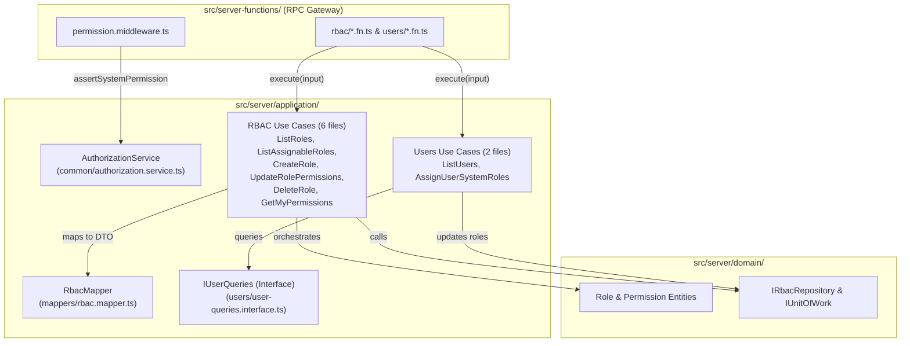

# Milestone 4 — Backend Step 3: Application RBAC, Users & Authorization Service (src/server/application/)

ใน Step ที่ 3 เราจะสร้างชั้น **Application Layer (`src/server/application/`)** ซึ่งทำหน้าที่เป็น **Workflow Orchestrator** คอยประสานงานระหว่าง Domain Entities (`Role`, `Permission`), Repository Interfaces (`IRbacRepository`, `IUserQueries`), Unit of Work (`IUnitOfWork`) และแปลงผลลัพธ์ออกเป็น DTO ผ่าน Data Mapper (`RbacMapper`) เพื่อส่งต่อไปยังชั้น Gateway

---

## 1. เป้าหมายและขอบเขต Boundary (Boundary Context & Goal)

เป้าหมายของ Step นี้คือการสร้างบริการตรวจสอบสิทธิ์กลาง (`AuthorizationService`), ตัวแปลงข้อมูล (`RbacMapper`), Use Cases สำหรับจัดการบทบาทและสิทธิ์ 6 รายการ และ Use Cases สำหรับจัดการรายชื่อผู้ใช้งานและกำหนด System Roles อีก 2 รายการ (พร้อม Query Interface `IUserQueries`) รวมทั้งหมด 11 ไฟล์

### ตารางสรุปไฟล์ใน Step นี้

| ลำดับ | เส้นทางไฟล์ (File Path) | บทบาทหน้าที่ (Responsibility) |
| :--- | :--- | :--- |
| 1 | `src/server/application/common/authorization.service.ts` | บริการกลางสำหรับตรวจสอบและบังคับใช้สิทธิ์ระดับ System และ Project (`assertSystemPermission`, `assertProjectPermission`, `canReadProject`) |
| 2 | `src/server/application/mappers/rbac.mapper.ts` | แปลง `Role` และ `Permission` Domain Entities ให้เป็น `RoleDto` และ `PermissionDto` |
| 3 | `src/server/application/rbac/list-roles.use-case.ts` | ดึงรายการบทบาททั้งหมดพร้อม Catalog สิทธิ์ทั้งหมดในระบบ |
| 4 | `src/server/application/rbac/list-assignable-roles.use-case.ts` | ดึงเฉพาะบทบาทระดับ `"system"` ที่สามารถนำไปกำหนดให้ผู้ใช้งานได้ |
| 5 | `src/server/application/rbac/create-role.use-case.ts` | สร้าง Custom Role ใหม่ภายใต้ Transaction พร้อมตรวจสอบ Slug ซ้ำและรหัสสิทธิ์ |
| 6 | `src/server/application/rbac/update-role-permissions.use-case.ts` | อัปเดตชุดสิทธิ์ของบทบาทภายใต้ Transaction |
| 7 | `src/server/application/rbac/delete-role.use-case.ts` | ลบ Custom Role ภายใต้ Transaction หลังจากตรวจ `role.ensureDeletable()` |
| 8 | `src/server/application/rbac/get-my-permissions.use-case.ts` | ดึงรายชื่อ `systemRoles` และ `systemPermissions` ของผู้ใช้งานปัจจุบัน |
| 9 | `src/server/application/users/user-queries.interface.ts` | นิยาม Interface `IUserQueries` สำหรับ CQRS Read Projection ของข้อมูลผู้ใช้งาน |
| 10 | `src/server/application/users/list-users.use-case.ts` | ค้นหาและดึงรายชื่อผู้ใช้งานทั้งหมดสำหรับหน้า Admin |
| 11 | `src/server/application/users/assign-user-system-roles.use-case.ts` | กำหนดบทบาทระดับระบบให้ผู้ใช้งาน พร้อมป้องกันการถอดสิทธิ์ตัวเอง (`SelfRoleLockoutError`) |

### แผนผังการไหลของงานในชั้น Application (Application Layer Orchestration Flow)



---

## 2. ทฤษฎี ความสำคัญ และกฎสถาปัตยกรรมเฉพาะ Boundary นี้

### 2.1 การทำ Data Mapper (`RbacMapper.toRoleDto` & `toPermissionDto`)
ตามกฎ `server.md` ข้อ 11 **ห้ามส่ง Domain Entity ข้าม Application Layer ออกไปยัง Gateway หรือ Presentation โดยตรง**:
- ใน `Role` Aggregate Root เราเก็บ `permissions` เป็น `readonly Permission[]` (Object ของ Entity) และเก็บ `createdAt`, `updatedAt` เป็น `Date`
- แต่ฝั่ง Client และ RPC Transport ต้องการข้อมูลที่ Serialize เป็น JSON ได้ง่ายและสะดวกต่อการผูกกับ UI Matrix คือ `permissionIds: string[]`, `permissionCodes: PermissionCode[]` และวันที่ในรูปแบบ ISO String (`toISOString()`)
- `RbacMapper` จึงทำหน้าที่เป็น **Anti-Corruption Layer** แปลง `Role` และ `Permission` ให้กลายเป็น `RoleDto` และ `PermissionDto` ตามสัญญาใน `shared/schemas/rbac.schema.ts`

### 2.2 ทำไมต้องแยก `ListAssignableRolesUseCase` (ป้องกัน Logic รั่วไปชั้น Server Function)
ในหน้าจัดการผู้ใช้งาน (User Management) ผู้ดูแลระบบสามารถกำหนดได้เฉพาะบทบาทที่มี `scope === "system"` เท่านั้น (ไม่สามารถนำบทบาทระดับ `"project"` เช่น Project Owner มาผูกเป็นบทบาทระดับระบบได้):
- หากเราใช้ `listRolesUseCase` ใน `list-assignable-roles.fn.ts` แล้วเขียน `.filter((role) => role.scope === "system")` ไว้ในไฟล์ Server Function จะถือว่า **ละเมิดกฎ Thin Driving Adapter (`server.md` ข้อ 18 และ `architecture.md`)** เพราะเป็นการนำ Business Filtering Logic ไปวางไว้ในชั้น RPC Gateway
- ดังนั้นเราจึงสร้าง `ListAssignableRolesUseCase` แยกออกมาเป็น Use Case เฉพาะ เพื่อคัดกรองเฉพาะบทบาทระดับ `"system"` และแปลงเป็น `RoleDto[]` ให้เสร็จสิ้นภายในชั้น Application

### 2.3 กฎป้องกันการล็อกตัวเองออกจากระบบใน `AssignUserSystemRolesUseCase`
เมื่อผู้ดูแลระบบเปลี่ยนบทบาทของผู้ใช้งาน ระบบต้องตรวจสอบ Invariants สำคัญใน `AssignUserSystemRolesUseCase`:
1. **ตรวจสอบว่ามีผู้ใช้งานอยู่จริง (`userQueries.existsById`)**: หากไม่พบ โยน `UserNotFoundError`
2. **ตรวจสอบว่าทุก `roleId` มีอยู่จริงและเป็นระดับ `"system"` เท่านั้น**: หากมีบทบาทระดับ `"project"` ปะปนมา จะโยน `ValidationDomainError("สามารถกำหนดได้เฉพาะบทบาทระดับ 'system' ให้ผู้ใช้งานเท่านั้น")`
3. **ป้องกันการถอดสิทธิ์ผู้ดูแลระบบของตัวเอง (`SelfRoleLockoutError`)**:
   - หากผู้ดำเนินการกำลังแก้ไขบทบาทของตัวเอง (`input.actorUserId === input.payload.userId`) ระบบจะตรวจสอบว่าในชุดบทบาทใหม่ (`roles`) ที่เลือกมานั้น ยังคงมีบทบาทอย่างน้อย 1 บทบาทที่ถือสิทธิ์ `SYSTEM_PERMISSIONS.USER_ASSIGN_ROLE` (`"user:assign_role"`) เช่น บทบาท `super_admin` อยู่หรือไม่
   - หากไม่มีเลย (เช่น เผลอถอด `super_admin` ออกจากตัวเองจนเหลือแค่ `member` หรือไม่เหลือสิทธิ์จัดการบทบาท) ระบบจะโยน `SelfRoleLockoutError` เพื่อป้องกันไม่ให้ผู้ดูแลระบบสูญเสียสิทธิ์ในการบริหารจัดการผู้ใช้งานและล็อกตัวเองออกจากระบบ

### 2.4 กฎจาก `.agents/rules/server.md` ที่บังคับใช้
- **ข้อ 8 (1 File per Use Case)**: แยก 1 ไฟล์ต่อ 1 Use Case โดยมีเมธอด `execute(...)` และระบุ Explicit Return Type เสมอ
- **ข้อ 9 (Explicit Input Object)**: นิยาม Interface Input ประจำแต่ละ Use Case (เช่น `CreateRoleUseCaseInput`, `AssignUserSystemRolesUseCaseInput`) แทนการส่ง positional arguments หลายตัว
- **ข้อ 10 (Use Case as Orchestrator)**: Use Case ทำหน้าที่เพียงประสานงานและควบคุม Workflow ไม่เขียนคำสั่ง Drizzle ORM หรือ SQL โดยตรง
- **ข้อ 12 (Atomic Transaction via `IUnitOfWork`)**: ทุก Use Case ที่มีการเปลี่ยนแปลงข้อมูล (`CreateRoleUseCase`, `UpdateRolePermissionsUseCase`, `DeleteRoleUseCase`, `AssignUserSystemRolesUseCase`) ต้องรันภายใต้ `this.unitOfWork.withTransaction(...)` เสมอ
- **ข้อ 15 (CQRS Query Projections)**: สำหรับการดึงตารางรายชื่อผู้ใช้งานพร้อมบทบาท (`ListUsersUseCase`) อนุญาตให้ใช้ `IUserQueries` เพื่อทำ Direct Projection ออกมาเป็น `AdminUserDto[]` ได้โดยตรงเพื่อประสิทธิภาพสูงสุด

---

## 3. ลงมือเขียนโค้ด (Step-by-Step Implementation)

### 3.1 สร้างไฟล์ `src/server/application/common/authorization.service.ts`

สร้างบริการกลางสำหรับตรวจสอบสิทธิ์ทั้งระดับ System และระดับ Project (ครบทั้ง 73 บรรทัด):

```typescript
import { ForbiddenDomainError } from "#/server/domain/common/errors";
import {
	hasPermission,
	PROJECT_PERMISSIONS,
	SYSTEM_PERMISSIONS,
} from "#/server/domain/rbac/permission-codes";
import type {
	ProjectPermissionCode,
	SystemPermissionCode,
} from "#/shared/schemas/rbac.schema";

export class AuthorizationService {
	hasSystemPermission(
		grantedPermissions: readonly string[],
		requiredPermission: SystemPermissionCode,
	): boolean {
		return hasPermission(grantedPermissions, requiredPermission);
	}

	assertSystemPermission(
		grantedPermissions: readonly string[],
		requiredPermission: SystemPermissionCode,
	): void {
		if (!this.hasSystemPermission(grantedPermissions, requiredPermission)) {
			throw new ForbiddenDomainError(
				`ไม่มีสิทธิ์ดำเนินการ: ต้องมีสิทธิ์ '${requiredPermission}'`,
			);
		}
	}

	hasProjectPermission(
		grantedPermissions: readonly string[],
		requiredPermission: ProjectPermissionCode,
	): boolean {
		return hasPermission(grantedPermissions, requiredPermission);
	}

	assertProjectPermission(
		grantedPermissions: readonly string[],
		requiredPermission: ProjectPermissionCode,
	): void {
		if (!this.hasProjectPermission(grantedPermissions, requiredPermission)) {
			throw new ForbiddenDomainError(
				`ไม่มีสิทธิ์ดำเนินการในโปรเจกต์นี้: ต้องมีสิทธิ์ '${requiredPermission}'`,
			);
		}
	}

	canReadProject(
		actorSystemPermissions: readonly string[],
		projectPermissions: readonly string[],
	): boolean {
		return (
			this.hasSystemPermission(
				actorSystemPermissions,
				SYSTEM_PERMISSIONS.PROJECT_READ_ALL,
			) ||
			this.hasProjectPermission(
				projectPermissions,
				PROJECT_PERMISSIONS.PROJECT_READ,
			)
		);
	}

	assertProjectReadAccess(
		actorSystemPermissions: readonly string[],
		projectPermissions: readonly string[],
	): void {
		if (!this.canReadProject(actorSystemPermissions, projectPermissions)) {
			throw new ForbiddenDomainError("คุณไม่มีสิทธิ์เข้าถึงโครงการนี้");
		}
	}
}
```

#### คำอธิบายการทำงาน:
- `hasSystemPermission` / `assertSystemPermission`: ตรวจสอบว่าผู้ใช้งานมีสิทธิ์ระดับระบบตามที่ระบุหรือไม่ หากไม่มี `assertSystemPermission` จะโยน `ForbiddenDomainError` (ซึ่งถูกแปลงเป็น HTTP 403 ที่ชั้น Middleware)
- `hasProjectPermission` / `assertProjectPermission`: ตรวจสอบสิทธิ์ภายในขอบเขตของโปรเจกต์
- `canReadProject` / `assertProjectReadAccess`: ตรวจสอบว่าผู้ใช้งานสามารถอ่านข้อมูลโปรเจกต์ได้หรือไม่ โดยอนุญาตหากมีสิทธิ์ระดับระบบ `project:read_all` หรือมีสิทธิ์ระดับโปรเจกต์ `project:read`

---

### 3.2 สร้างไฟล์ `src/server/application/mappers/rbac.mapper.ts`

สร้างคลาส Mapper สำหรับแปลง Entity เป็น DTO:

```typescript
import type { Permission } from "#/server/domain/rbac/permission.entity";
import type { Role } from "#/server/domain/rbac/role.entity";
import type { PermissionDto, RoleDto } from "#/shared/schemas/rbac.schema";

export class RbacMapper {
	static toPermissionDto(permission: Permission): PermissionDto {
		return {
			id: permission.id,
			code: permission.code,
			scope: permission.scope,
			description: permission.description,
		};
	}

	static toRoleDto(role: Role): RoleDto {
		return {
			id: role.id,
			name: role.name,
			slug: role.slug,
			scope: role.scope,
			description: role.description,
			isSystem: role.isSystem,
			permissionIds: role.permissions.map((permission) => permission.id),
			permissionCodes: role.permissions.map((permission) => permission.code),
			createdAt: role.createdAt.toISOString(),
			updatedAt: role.updatedAt.toISOString(),
		};
	}
}
```

#### คำอธิบายการทำงาน:
- `RbacMapper.toPermissionDto`: แปลง `Permission` Entity เป็น `PermissionDto`
- `RbacMapper.toRoleDto`: แปลง `Role` Aggregate Root เป็น `RoleDto` โดยสกัดทั้ง `permissionIds` และ `permissionCodes` ออกมาเป็น Array เพื่อให้ตาราง Permission Matrix ฝั่ง Frontend นำไปใช้งานได้ทันที

---

### 3.3 สร้างไฟล์ `src/server/application/rbac/list-roles.use-case.ts`

```typescript
import type { IRbacRepository } from "#/server/domain/rbac/rbac.repository";
import type { ListRolesResultDto } from "#/shared/schemas/rbac.schema";
import { RbacMapper } from "../mappers/rbac.mapper";

export class ListRolesUseCase {
	constructor(private readonly rbacRepository: IRbacRepository) {}

	async execute(): Promise<ListRolesResultDto> {
		const [roles, permissions] = await Promise.all([
			this.rbacRepository.findAllRoles(),
			this.rbacRepository.findAllPermissions(),
		]);

		return {
			roles: roles.map((role) => RbacMapper.toRoleDto(role)),
			permissions: permissions.map((permission) =>
				RbacMapper.toPermissionDto(permission),
			),
		};
	}
}
```

#### คำอธิบายการทำงาน:
- ใช้ `Promise.all` ดึงทั้งรายการบทบาททั้งหมด (`findAllRoles()`) และรายการสิทธิ์ทั้งหมด (`findAllPermissions()`) พร้อมกันแบบขนาน แล้วแปลงเป็น `ListRolesResultDto` ด้วย `RbacMapper`

---

### 3.4 สร้างไฟล์ `src/server/application/rbac/list-assignable-roles.use-case.ts`

```typescript
import type { IRbacRepository } from "#/server/domain/rbac/rbac.repository";
import type { RoleDto } from "#/shared/schemas/rbac.schema";
import { RbacMapper } from "../mappers/rbac.mapper";

export class ListAssignableRolesUseCase {
	constructor(private readonly rbacRepository: IRbacRepository) {}

	async execute(): Promise<RoleDto[]> {
		const roles = await this.rbacRepository.findAllRoles();
		return roles
			.filter((role) => role.scope === "system")
			.map((role) => RbacMapper.toRoleDto(role));
	}
}
```

#### คำอธิบายการทำงาน:
- ดึงบทบาททั้งหมดจาก Repository แล้วคัดกรองเฉพาะบทบาทที่มี `role.scope === "system"` ภายในชั้น Application เพื่อนำไปแสดงในตัวเลือกกำหนดบทบาทของผู้ใช้งาน (User Role Assignment Dialog) โดยไม่ปล่อยให้ Logic การกรองรั่วไหลไปอยู่ชั้น Server Function

---

### 3.5 สร้างไฟล์ `src/server/application/rbac/create-role.use-case.ts`

```typescript
import type { IUnitOfWork } from "#/server/domain/common/unit-of-work.interface";
import {
	RoleSlugAlreadyExistsError,
	UnknowPermissionError,
} from "#/server/domain/rbac/rbac.errors";
import type { IRbacRepository } from "#/server/domain/rbac/rbac.repository";
import { Role } from "#/server/domain/rbac/role.entity";
import type { CreateRoleInput, RoleDto } from "#/shared/schemas/rbac.schema";
import { RbacMapper } from "../mappers/rbac.mapper";

export interface CreateRoleUseCaseInput {
	payload: CreateRoleInput;
}

export class CreateRoleUseCase {
	constructor(
		private readonly rbacRepository: IRbacRepository,
		private readonly unitOfWork: IUnitOfWork,
	) {}

	async execute(input: CreateRoleUseCaseInput): Promise<RoleDto> {
		return this.unitOfWork.withTransaction(async () => {
			const existingRole = await this.rbacRepository.findRoleBySlug(
				input.payload.slug,
			);
			if (existingRole) {
				throw new RoleSlugAlreadyExistsError(input.payload.slug);
			}

			const uniquePermissionIds = [...new Set(input.payload.permissionIds)];
			const permissions =
				await this.rbacRepository.findPermissionsByIds(uniquePermissionIds);

			if (permissions.length !== uniquePermissionIds.length) {
				throw new UnknowPermissionError();
			}

			const role = Role.create({
				name: input.payload.name,
				slug: input.payload.slug,
				scope: input.payload.scope,
				description: input.payload.description,
				permissions,
			});

			await this.rbacRepository.saveRole(role);

			return RbacMapper.toRoleDto(role);
		});
	}
}
```

#### คำอธิบายการทำงาน:
- รันภายใต้ `unitOfWork.withTransaction(...)` เพื่อรับประกันความถูกต้องแบบ Atomic
- ตรวจสอบว่า `slug` ซ้ำหรือไม่ด้วย `findRoleBySlug` หากซ้ำโยน `RoleSlugAlreadyExistsError`
- โหลด `Permission` Entities จาก `uniquePermissionIds` หากจำนวนที่พบในฐานข้อมูลไม่ตรงกับจำนวนที่ส่งมา แปลว่ามี ID แปลกปลอม ให้โยน `UnknowPermissionError`
- สร้าง Aggregate Root ผ่าน `Role.create(...)` (ซึ่งจะตรวจสอบ Scope Mismatch ให้อัตโนมัติ) บันทึกลงฐานข้อมูลด้วย `saveRole(role)` และแปลงเป็น `RoleDto` ส่งกลับ

---

### 3.6 สร้างไฟล์ `src/server/application/rbac/update-role-permissions.use-case.ts`

```typescript
import type { IUnitOfWork } from "#/server/domain/common/unit-of-work.interface";
import {
	RoleNotFoundError,
	UnknowPermissionError,
} from "#/server/domain/rbac/rbac.errors";
import type { IRbacRepository } from "#/server/domain/rbac/rbac.repository";
import type {
	RoleDto,
	UpdateRolePermissionsInput,
} from "#/shared/schemas/rbac.schema";
import { RbacMapper } from "../mappers/rbac.mapper";

export interface UpdateRolePermissionsUseCaseInput {
	payload: UpdateRolePermissionsInput;
}

export class UpdateRolePermissionsUseCase {
	constructor(
		private readonly rbacRepository: IRbacRepository,
		private readonly unitOfWork: IUnitOfWork,
	) {}

	async execute(input: UpdateRolePermissionsUseCaseInput): Promise<RoleDto> {
		return this.unitOfWork.withTransaction(async () => {
			const role = await this.rbacRepository.findRoleById(input.payload.roleId);
			if (!role) {
				throw new RoleNotFoundError(input.payload.roleId);
			}

			const uniquePermissionIds = [...new Set(input.payload.permissionIds)];
			const permissions =
				await this.rbacRepository.findPermissionsByIds(uniquePermissionIds);
			if (permissions.length !== uniquePermissionIds.length) {
				throw new UnknowPermissionError();
			}

			role.replacePermissions(permissions);
			await this.rbacRepository.saveRole(role);

			return RbacMapper.toRoleDto(role);
		});
	}
}
```

#### คำอธิบายการทำงาน:
- ดึง `Role` จาก `findRoleById` และดึงชุด `Permission` จาก `findPermissionsByIds`
- สั่ง `role.replacePermissions(permissions)` เพื่อให้ Aggregate Root ตรวจสอบทั้ง Scope Mismatch และการปกป้องสิทธิ์หลักของ `super_admin`
- บันทึกการเปลี่ยนแปลงผ่าน `saveRole(role)` และคืนค่าเป็น `RoleDto`

---

### 3.7 สร้างไฟล์ `src/server/application/rbac/delete-role.use-case.ts`

```typescript
import type { IUnitOfWork } from "#/server/domain/common/unit-of-work.interface";
import { RoleNotFoundError } from "#/server/domain/rbac/rbac.errors";
import type { IRbacRepository } from "#/server/domain/rbac/rbac.repository";
import type { DeleteRoleInput } from "#/shared/schemas/rbac.schema";

export interface DeleteRoleUseCaseInput {
	payload: DeleteRoleInput;
}

export class DeleteRoleUseCase {
	constructor(
		private readonly rbacRepository: IRbacRepository,
		private readonly unitOfWork: IUnitOfWork,
	) {}

	async execute(input: DeleteRoleUseCaseInput): Promise<void> {
		await this.unitOfWork.withTransaction(async () => {
			const role = await this.rbacRepository.findRoleById(input.payload.roleId);
			if (!role) {
				throw new RoleNotFoundError(input.payload.roleId);
			}

			role.ensureDeletable();

			const deleted = await this.rbacRepository.deleteRole(role.id);

			if (!deleted) {
				throw new RoleNotFoundError(role.id);
			}
		});
	}
}
```

#### คำอธิบายการทำงาน:
- โหลด `Role` ขึ้นมาแล้วเรียก `role.ensureDeletable()` เพื่อป้องกันการลบ System Role (`isSystem: true`)
- เรียก `this.rbacRepository.deleteRole(role.id)` (หากมีผู้ใช้งานหรือสมาชิกในโปรเจกต์ผูกกับบทบาทนี้อยู่ ชั้น Repository จะดักจับ Foreign Key Violation และโยน `RoleInUseError`)

---

### 3.8 สร้างไฟล์ `src/server/application/rbac/get-my-permissions.use-case.ts`

```typescript
import type { IRbacRepository } from "#/server/domain/rbac/rbac.repository";
import type { MyPermissionsDto } from "#/shared/schemas/rbac.schema";

export interface GetMyPermissionsUseCaseInput {
	userId: string;
}

export class GetMyPermissionsUseCase {
	constructor(private readonly rbacRepository: IRbacRepository) {}

	async execute(
		input: GetMyPermissionsUseCaseInput,
	): Promise<MyPermissionsDto> {
		const access = await this.rbacRepository.getUserSystemAccess(input.userId);

		return {
			systemRoles: access.roleSlugs,
			systemPermissions: access.systemPermissions,
		};
	}
}
```

#### คำอธิบายการทำงาน:
- ดึงข้อมูล `roleSlugs` และ `systemPermissions` ของผู้ใช้งานจาก `rbacRepository.getUserSystemAccess(input.userId)` เพื่อส่งกลับเป็น `MyPermissionsDto` ให้ฝั่ง Client ใช้ตรวจสอบสิทธิ์การแสดงผลเมนูและปุ่มต่างๆ

---

### 3.9 สร้างไฟล์ `src/server/application/users/user-queries.interface.ts`

```typescript
import type { AdminUserDto } from "#/shared/schemas/user.schema";

export interface IUserQueries {
	listAdminUsers(search?: string): Promise<AdminUserDto[]>;
	existsById(userId: string): Promise<boolean>;
}
```

#### คำอธิบายการทำงาน:
- นิยามสัญญา `IUserQueries` สำหรับการคิวรีข้อมูลผู้ใช้งานแบบ Read Projection (`listAdminUsers`) และตรวจสอบการมีอยู่ของบัญชีผู้ใช้ (`existsById`) ตามหลัก CQRS (`server.md` ข้อ 15)

---

### 3.10 สร้างไฟล์ `src/server/application/users/list-users.use-case.ts`

```typescript
import type {
	AdminUserDto,
	ListUsersInput,
} from "#/shared/schemas/user.schema";
import type { IUserQueries } from "./user-queries.interface";

export interface ListUsersUseCaseInput {
	payload: ListUsersInput;
}

export class ListUsersUseCase {
	constructor(private readonly userQueries: IUserQueries) {}

	async execute(input: ListUsersUseCaseInput): Promise<AdminUserDto[]> {
		return this.userQueries.listAdminUsers(input.payload.search);
	}
}
```

#### คำอธิบายการทำงาน:
- รับคำค้นหา `input.payload.search` แล้วส่งต่อไปยัง `this.userQueries.listAdminUsers(...)` เพื่อดึงรายการ `AdminUserDto[]`

---

### 3.11 สร้างไฟล์ `src/server/application/users/assign-user-system-roles.use-case.ts`

```typescript
import { ValidationDomainError } from "#/server/domain/common/errors";
import type { IUnitOfWork } from "#/server/domain/common/unit-of-work.interface";
import { SYSTEM_PERMISSIONS } from "#/server/domain/rbac/permission-codes";
import { RoleNotFoundError } from "#/server/domain/rbac/rbac.errors";
import type { IRbacRepository } from "#/server/domain/rbac/rbac.repository";
import {
	SelfRoleLockoutError,
	UserNotFoundError,
} from "#/server/domain/users/user.errors";
import type { AssignUserSystemRolesInput } from "#/shared/schemas/user.schema";
import type { IUserQueries } from "./user-queries.interface";

export interface AssignUserSystemRolesUseCaseInput {
	actorUserId: string;
	payload: AssignUserSystemRolesInput;
}

export class AssignUserSystemRolesUseCase {
	constructor(
		private readonly rbacRepository: IRbacRepository,
		private readonly userQueries: IUserQueries,
		private readonly unitOfWork: IUnitOfWork,
	) {}

	async execute(input: AssignUserSystemRolesUseCaseInput): Promise<void> {
		await this.unitOfWork.withTransaction(async () => {
			const userExists = await this.userQueries.existsById(
				input.payload.userId,
			);
			if (!userExists) {
				throw new UserNotFoundError(input.payload.userId);
			}

			const uniqueRoleIds = [...new Set(input.payload.roleIds)];
			const roles = await this.rbacRepository.findRolesByIds(uniqueRoleIds);

			if (roles.length !== uniqueRoleIds.length) {
				throw new RoleNotFoundError("roleIds");
			}

			const hasNonSystemRole = roles.some((role) => role.scope !== "system");
			if (hasNonSystemRole) {
				throw new ValidationDomainError(
					"สามารถกำหนดได้เฉพาะบทบาทระดับ 'system' ให้ผู้ใช้งานเท่านั้น",
				);
			}

			if (input.actorUserId === input.payload.userId) {
				const retainsAssignRole = roles.some((role) =>
					role.hasPermission(SYSTEM_PERMISSIONS.USER_ASSIGN_ROLE),
				);
				if (!retainsAssignRole) {
					throw new SelfRoleLockoutError();
				}
			}

			await this.rbacRepository.replaceUserSystemRoles(
				input.payload.userId,
				uniqueRoleIds,
			);
		});
	}
}
```

#### คำอธิบายการทำงาน:
- รันภายใต้ `this.unitOfWork.withTransaction(...)`
- ตรวจสอบว่าผู้ใช้งานเป้าหมายมีตัวตนจริงด้วย `userQueries.existsById(input.payload.userId)`
- โหลด `Role` Entities ทั้งหมดตาม `uniqueRoleIds` ตรวจสอบว่าพบครบทุกตัว และทุกตัวต้องมี `role.scope === "system"` เท่านั้น
- ตรวจสอบว่าหาก `input.actorUserId === input.payload.userId` (ผู้ดูแลกำลังแก้บทบาทของตัวเอง) ในรายการ `roles` ใหม่ต้องมีอย่างน้อย 1 บทบาทที่มีสิทธิ์ `SYSTEM_PERMISSIONS.USER_ASSIGN_ROLE` มิฉะนั้นจะโยน `SelfRoleLockoutError`
- สุดท้ายจึงเรียก `this.rbacRepository.replaceUserSystemRoles(input.payload.userId, uniqueRoleIds)` เพื่อบันทึกบทบาทใหม่ลงตาราง `user_roles`

---

## 4. การตรวจสอบความถูกต้องและ Git Commit (Verification & Commit)

รันคำสั่งตรวจสอบ Type และ Linter:

```bash
bun run typecheck
bun run format
bun run check
```

ทำการ Commit ไฟล์ทั้ง 11 ไฟล์ในชั้น Application:

```bash
git add src/server/application/common/authorization.service.ts src/server/application/mappers/rbac.mapper.ts src/server/application/rbac/ src/server/application/users/
git commit -m "milestone-4.backend.step-3: Application RBAC, Users Use Cases & Authorization Service"
```
