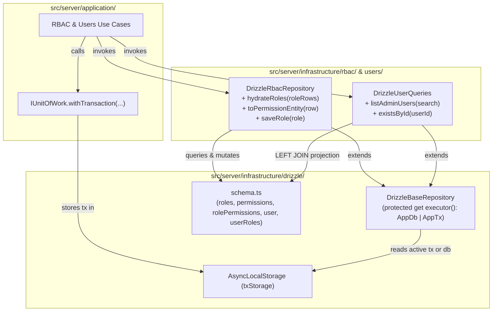

# Milestone 4 — Backend Step 4: Infrastructure RBAC & Users (src/server/infrastructure/rbac/ & users/)

ใน Step ที่ 4 เราจะลงมือสร้างชั้น **Infrastructure Layer (`src/server/infrastructure/rbac/` และ `src/server/infrastructure/users/`)** เพื่อเชื่อมต่อสัญญานามธรรมจากชั้น Domain (`IRbacRepository`) และชั้น Application (`IUserQueries`) เข้ากับฐานข้อมูล PostgreSQL จริงผ่าน **Drizzle ORM** โดยเน้นประสิทธิภาพการคิวรีระดับสูง (Single Round-trip / Batch Hydration) และการควบคุม Transaction อัตโนมัติผ่าน `this.executor`

---

## 1. เป้าหมายและขอบเขต Boundary (Boundary Context & Goal)

เป้าหมายของ Step นี้คือการสร้าง Concrete Repository สำหรับโมดูล RBAC (`DrizzleRbacRepository`) และ Concrete Query Service สำหรับโมดูล Users (`DrizzleUserQueries`) ที่สืบทอดจาก `DrizzleBaseRepository`

### ตารางสรุปไฟล์ใน Step นี้

| ลำดับ | เส้นทางไฟล์ (File Path) | บทบาทหน้าที่ (Responsibility) |
| :--- | :--- | :--- |
| 1 | `src/server/infrastructure/rbac/drizzle-rbac.repository.ts` | Implement `IRbacRepository` ด้วย Drizzle ORM จัดการ Persistence ของ `Role` Aggregate Root, `Permission` Entity และตารางเชื่อม `role_permissions` / `user_roles` |
| 2 | `src/server/infrastructure/users/drizzle-user.queries.ts` | Implement `IUserQueries` ด้วยเทคนิค CQRS Read Projection คิวรีตาราง `user` ร่วมกับ `user_roles` และ `roles` ออกเป็น `AdminUserDto[]` โดยตรง |

### แผนผังการเชื่อมต่อฐานข้อมูลและ Reconstitution (Infrastructure Data Flow)



---

## 2. ทฤษฎี ความสำคัญ และกฎสถาปัตยกรรมเฉพาะ Boundary นี้

### 2.1 การ Reconstitute `Role` Aggregate Root แบบปราศจาก N+1 Queries (`server.md` ข้อ 13–14)
`Role` Aggregate Root 1 ตัว ประกอบด้วยข้อมูลจากตารางหลัก `roles` และรายการ `Permission` Entities ที่เชื่อมโยงผ่านตารางกลาง `role_permissions` ไปยังตาราง `permissions`:
- หากเราดึง `roles` มา 10 แถว แล้ววนลูป `for (const role of roles)` เพื่อยิง Query ดึง `permissions` ทีละ Role จะเกิดปัญหา **N+1 Queries** (รวม 1 + 10 = 11 Round-trips)
- ใน `DrizzleRbacRepository` เราจึงออกแบบเมธอด `private async hydrateRoles(roleRows)` ที่รวบรวม `roleIds` ทั้งหมดไปคิวรี `rolePermissions` INNER JOIN `permissions` ด้วยเงื่อนไข `inArray(rolePermissions.roleId, roleIds)` **เพียงครั้งเดียว (Batch Query)**
- จากนั้นจัดกลุ่ม `Permission` Entities ลงใน `Map<string, Permission[]>` ในหน่วยความจำ แล้วเรียก `Role.reconstitute(row.id, ...)` เพื่อประกอบร่าง Aggregate Root กลับมาอย่างสมบูรณ์โดยไม่ให้รายละเอียดของ Drizzle Row รั่วไหลออกนอก Repository

### 2.2 การทำงานร่วมกันระหว่าง `IUnitOfWork` และ `this.executor` (`server.md` ข้อ 16)
- ในเมธอด `saveRole(role)` เราต้องทำหลายคำสั่งต่อเนื่องกัน:
  1. Upsert แถวในตาราง `roles` ด้วย `.onConflictDoUpdate(...)`
  2. ลบรายการสิทธิ์เดิมใน `role_permissions`
  3. Insert รายการสิทธิ์ชุดใหม่เข้าไปใน `role_permissions`
- ทั้ง 3 คำสั่งนี้เรียกผ่าน `this.executor` (ซึ่งได้มาจาก `DrizzleBaseRepository`) เมื่อ Use Case ห่อหุ้มการทำงานด้วย `this.unitOfWork.withTransaction(...)` ตัว `DrizzleUnitOfWork` จะเก็บ Transaction Object (`tx`) ไว้ใน `AsyncLocalStorage` (`txStorage`) ทำให้ `this.executor` คืนค่า `tx` เดียวกันโดยอัตโนมัติทุกคำสั่ง โดยไม่ต้องส่งพารามิเตอร์ `tx` เข้ามาใน `saveRole(role, tx)` เลย

### 2.3 การแปลง Foreign Key Error เป็น Domain Error (`RoleInUseError`)
- ใน `deleteRole(roleId)` เราสั่ง `.delete(roles).where(eq(roles.id, roleId)).returning({ id: roles.id })` จบใน Single Round-trip (`server.md` ข้อ 14)
- หากบทบาทนั้นยังมีผู้ใช้งาน (`user_roles`) หรือสมาชิกโปรเจกต์ (`project_members`) อ้างอิงอยู่ PostgreSQL จะโยน Error Code `"23503"` (`foreign_key_violation`)
- ฟังก์ชันช่วย `hasPgErrorCode(error, "23503")` จะตรวจจับรหัสนี้ (รวมถึงกรณีที่ถูกห่ออยู่ใน `error.cause` ของ Drizzle) แล้วแปลงเป็น `RoleInUseError` ซึ่งเป็น Domain Error ที่สื่อความหมายชัดเจนให้ผู้ใช้งานทราบ

### 2.4 การทำ CQRS Read Projection ใน `DrizzleUserQueries` (`server.md` ข้อ 15)
- สำหรับหน้าตารางจัดการผู้ใช้งาน (`listAdminUsers`) เป็นการทำงานแบบ Read-only ที่ต้องการข้อมูลจากตาราง `user` พร้อมรายชื่อบทบาทระดับ `"system"` ของผู้ใช้แต่ละคน
- แทนที่จะโหลด Aggregate Root เต็มรูปแบบ เราใช้ `DrizzleUserQueries` ทำ `LEFT JOIN` ระหว่าง `user`, `userRoles` และ `roles` (เฉพาะ `roles.scope = 'system'`) ใน Query เดียว แล้วรวบรวมแถวผลลัพธ์ด้วย `Map<string, AdminUserDto>` ออกมาเป็น DTO พร้อมใช้งานทันที

---

## 3. ลงมือเขียนโค้ด (Step-by-Step Implementation)

### 3.1 สร้างไฟล์ `src/server/infrastructure/rbac/drizzle-rbac.repository.ts`

สร้างไฟล์ `src/server/infrastructure/rbac/drizzle-rbac.repository.ts` และใส่โค้ดฉบับเต็มดังนี้:

```typescript
import { and, asc, eq, inArray } from "drizzle-orm";
import { Permission } from "#/server/domain/rbac/permission.entity";
import { RoleInUseError } from "#/server/domain/rbac/rbac.errors";
import type {
	IRbacRepository,
	UserSystemAccess,
} from "#/server/domain/rbac/rbac.repository";
import { Role } from "#/server/domain/rbac/role.entity";
import { DrizzleBaseRepository } from "#/server/infrastructure/drizzle/base.repository";
import type { AppDb, AppTx } from "#/server/infrastructure/drizzle/db";
import {
	permissions,
	rolePermissions,
	roles,
	userRoles,
} from "#/server/infrastructure/drizzle/schema";
import type { SystemPermissionCode } from "#/shared/schemas/rbac.schema";
import {
	permissionCodeSchema,
	systemPermissionCodeSchema,
} from "#/shared/schemas/rbac.schema";

type PermissionRow = typeof permissions.$inferSelect;
type RoleRow = typeof roles.$inferSelect;

function hasPgErrorCode(error: unknown, targetCode: string): boolean {
	if (typeof error !== "object" || error === null) {
		return false;
	}
	if ("code" in error && error.code === targetCode) {
		return true;
	}
	if ("cause" in error) {
		return hasPgErrorCode(error.cause, targetCode);
	}
	return false;
}

export class DrizzleRbacRepository
	extends DrizzleBaseRepository<AppDb, AppTx>
	implements IRbacRepository
{
	async findAllRoles(): Promise<Role[]> {
		const roleRows = await this.executor
			.select()
			.from(roles)
			.orderBy(asc(roles.scope), asc(roles.name));

		return this.hydrateRoles(roleRows);
	}

	async findRoleById(roleId: string): Promise<Role | null> {
		const [roleRow] = await this.executor
			.select()
			.from(roles)
			.where(eq(roles.id, roleId))
			.limit(1);

		if (!roleRow) {
			return null;
		}

		const [hydrated] = await this.hydrateRoles([roleRow]);
		return hydrated ?? null;
	}

	async findRoleBySlug(slug: string): Promise<Role | null> {
		const [roleRow] = await this.executor
			.select()
			.from(roles)
			.where(eq(roles.slug, slug))
			.limit(1);

		if (!roleRow) {
			return null;
		}

		const [hydrated] = await this.hydrateRoles([roleRow]);
		return hydrated ?? null;
	}

	async findRolesByIds(roleIds: readonly string[]): Promise<Role[]> {
		if (roleIds.length === 0) {
			return [];
		}

		const roleRows = await this.executor
			.select()
			.from(roles)
			.where(inArray(roles.id, [...roleIds]))
			.orderBy(asc(roles.name));

		return this.hydrateRoles(roleRows);
	}

	async findAllPermissions(): Promise<Permission[]> {
		const rows = await this.executor
			.select()
			.from(permissions)
			.orderBy(asc(permissions.scope), asc(permissions.code));

		return rows.map((row) => this.toPermissionEntity(row));
	}

	async findPermissionsByIds(
		permissionIds: readonly string[],
	): Promise<Permission[]> {
		if (permissionIds.length === 0) {
			return [];
		}

		const rows = await this.executor
			.select()
			.from(permissions)
			.where(inArray(permissions.id, [...permissionIds]));

		return rows.map((row) => this.toPermissionEntity(row));
	}

	async saveRole(role: Role): Promise<void> {
		await this.executor
			.insert(roles)
			.values({
				id: role.id,
				name: role.name,
				slug: role.slug,
				scope: role.scope,
				description: role.description,
				isSystem: role.isSystem,
				createdAt: role.createdAt,
				updatedAt: role.updatedAt,
			})
			.onConflictDoUpdate({
				target: roles.id,
				set: {
					name: role.name,
					description: role.description,
					updatedAt: role.updatedAt,
				},
			});

		await this.executor
			.delete(rolePermissions)
			.where(eq(rolePermissions.roleId, role.id));

		if (role.permissions.length > 0) {
			await this.executor.insert(rolePermissions).values(
				role.permissions.map((permission) => ({
					roleId: role.id,
					permissionId: permission.id,
				})),
			);
		}
	}

	async deleteRole(roleId: string): Promise<boolean> {
		try {
			const deleted = await this.executor
				.delete(roles)
				.where(eq(roles.id, roleId))
				.returning({ id: roles.id });

			return deleted.length > 0;
		} catch (error) {
			if (hasPgErrorCode(error, "23503")) {
				throw new RoleInUseError();
			}
			throw error;
		}
	}

	async getUserSystemAccess(userId: string): Promise<UserSystemAccess> {
		const rows = await this.executor
			.select({
				roleSlug: roles.slug,
				permissionCode: permissions.code,
			})
			.from(userRoles)
			.innerJoin(roles, eq(userRoles.roleId, roles.id))
			.leftJoin(rolePermissions, eq(roles.id, rolePermissions.roleId))
			.leftJoin(permissions, eq(rolePermissions.permissionId, permissions.id))
			.where(and(eq(userRoles.userId, userId), eq(roles.scope, "system")));

		const roleSlugSet = new Set<string>();
		const permissionSet = new Set<SystemPermissionCode>();

		for (const row of rows) {
			roleSlugSet.add(row.roleSlug);
			if (row.permissionCode) {
				const parsed = systemPermissionCodeSchema.safeParse(row.permissionCode);
				if (parsed.success) {
					permissionSet.add(parsed.data);
				}
			}
		}

		return {
			roleSlugs: [...roleSlugSet].sort(),
			systemPermissions: [...permissionSet].sort(),
		};
	}

	async replaceUserSystemRoles(
		userId: string,
		roleIds: readonly string[],
	): Promise<void> {
		await this.executor.delete(userRoles).where(eq(userRoles.userId, userId));

		if (roleIds.length > 0) {
			await this.executor.insert(userRoles).values(
				roleIds.map((roleId) => ({
					userId,
					roleId,
				})),
			);
		}
	}

	private async hydrateRoles(roleRows: readonly RoleRow[]): Promise<Role[]> {
		if (roleRows.length === 0) {
			return [];
		}

		const roleIds = roleRows.map((row) => row.id);
		const mappingRows = await this.executor
			.select({
				roleId: rolePermissions.roleId,
				permission: permissions,
			})
			.from(rolePermissions)
			.innerJoin(permissions, eq(rolePermissions.permissionId, permissions.id))
			.where(inArray(rolePermissions.roleId, roleIds))
			.orderBy(asc(permissions.code));

		const permissionsByRoleId = new Map<string, Permission[]>();
		for (const row of mappingRows) {
			const entity = this.toPermissionEntity(row.permission);
			const current = permissionsByRoleId.get(row.roleId) ?? [];
			current.push(entity);
			permissionsByRoleId.set(row.roleId, current);
		}

		return roleRows.map((row) =>
			Role.reconstitute(row.id, {
				name: row.name,
				slug: row.slug,
				scope: row.scope,
				description: row.description,
				isSystem: row.isSystem,
				permissions: permissionsByRoleId.get(row.id) ?? [],
				createdAt: row.createdAt,
				updatedAt: row.updatedAt,
			}),
		);
	}

	private toPermissionEntity(row: PermissionRow): Permission {
		return Permission.reconstitute(row.id, {
			code: permissionCodeSchema.parse(row.code),
			scope: row.scope,
			description: row.description,
			createdAt: row.createdAt,
		});
	}
}
```

#### คำอธิบายการทำงาน:
- **`findAllRoles`, `findRoleById`, `findRoleBySlug`, `findRolesByIds`**: ดึงข้อมูลแถวจากตาราง `roles` แล้วส่งต่อไปยัง `this.hydrateRoles(...)` เพื่อผูก `Permission[]` และคืนสภาพเป็น `Role` Aggregate Root
- **`saveRole(role)`**: ใช้ `.onConflictDoUpdate` บน `roles.id` เพื่อรองรับทั้งการสร้าง Role ใหม่และการอัปเดต Role เดิมในเมธอดเดียว ตามด้วยการปรับปรุงตารางเชื่อม `rolePermissions`
- **`getUserSystemAccess(userId)`**: JOIN ตาราง `userRoles` -> `roles` -> `rolePermissions` -> `permissions` เฉพาะบทบาทระดับ `"system"` เพื่อรวบรวม `roleSlugs` และ `systemPermissions` ที่ไม่ซ้ำกันของUser
- **`replaceUserSystemRoles(userId, roleIds)`**: ลบการผูกบทบาทเดิมของผู้ใช้ใน `userRoles` และ Insert ชุด `roleIds` ใหม่เข้าไป

---

### 3.2 สร้างไฟล์ `src/server/infrastructure/users/drizzle-user.queries.ts`

สร้างไฟล์ `src/server/infrastructure/users/drizzle-user.queries.ts` และใส่โค้ดฉบับเต็มดังนี้:

```typescript
import { and, asc, eq, ilike, or } from "drizzle-orm";
import type { IUserQueries } from "#/server/application/users/user-queries.interface";
import { DrizzleBaseRepository } from "#/server/infrastructure/drizzle/base.repository";
import type { AppDb, AppTx } from "#/server/infrastructure/drizzle/db";
import { roles, user, userRoles } from "#/server/infrastructure/drizzle/schema";
import type { AdminUserDto } from "#/shared/schemas/user.schema";

export class DrizzleUserQueries
	extends DrizzleBaseRepository<AppDb, AppTx>
	implements IUserQueries
{
	async listAdminUsers(search?: string): Promise<AdminUserDto[]> {
		const trimmedSearch = search?.trim() ?? "";
		const searchPattern = `%${trimmedSearch}%`;
		const searchFilter = trimmedSearch
			? or(ilike(user.name, searchPattern), ilike(user.email, searchPattern))
			: undefined;

		const rows = await this.executor
			.select({
				userId: user.id,
				userName: user.name,
				userEmail: user.email,
				emailVerified: user.emailVerified,
				createdAt: user.createdAt,
				roleId: roles.id,
				roleName: roles.name,
				roleSlug: roles.slug,
			})
			.from(user)
			.leftJoin(userRoles, eq(user.id, userRoles.userId))
			.leftJoin(
				roles,
				and(eq(userRoles.roleId, roles.id), eq(roles.scope, "system")),
			)
			.where(searchFilter)
			.orderBy(asc(user.createdAt), asc(roles.name));

		const userMap = new Map<string, AdminUserDto>();

		for (const row of rows) {
			let entry = userMap.get(row.userId);
			if (!entry) {
				entry = {
					id: row.userId,
					name: row.userName,
					email: row.userEmail,
					emailVerified: row.emailVerified,
					createdAt: row.createdAt.toISOString(),
					systemRoles: [],
				};
				userMap.set(row.userId, entry);
			}

			if (row.roleId && row.roleName && row.roleSlug) {
				entry.systemRoles.push({
					id: row.roleId,
					name: row.roleName,
					slug: row.roleSlug,
				});
			}
		}

		return [...userMap.values()];
	}

	async existsById(userId: string): Promise<boolean> {
		const [found] = await this.executor
			.select({ id: user.id })
			.from(user)
			.where(eq(user.id, userId))
			.limit(1);

		return Boolean(found);
	}
}
```

#### คำอธิบายการทำงาน:
- **`listAdminUsers(search)`**:
  - หากมีคำค้นหา `search` จะสร้างเงื่อนไข `or(ilike(user.name, searchPattern), ilike(user.email, searchPattern))` เพื่อค้นหาแบบ Case-insensitive ทั้งจากชื่อและอีเมล
  - ใช้ `leftJoin` เพื่อดึงผู้ใช้ทุกคนแม้ว่าบางคนอาจจะยังไม่มีแถวใน `userRoles` และกรอง `eq(roles.scope, "system")` ในเงื่อนไข JOIN
  - วนลูปจัดกลุ่มแถวด้วย `userMap` เพื่อรวม `systemRoles` ของผู้ใช้แต่ละคนเข้าเป็นอาร์เรย์ภายใต้ `AdminUserDto` เดียวกัน
- **`existsById(userId)`**: คิวรีเฉพาะคอลัมน์ `{ id: user.id }` พร้อม `.limit(1)` เพื่อตรวจสอบการมีอยู่ของผู้ใช้อย่างรวดเร็วและประหยัดหน่วยความจำที่สุด

---

## 4. การตรวจสอบความถูกต้องและ Git Commit (Verification & Commit)

รันคำสั่งตรวจสอบ Type และ Linter:

```bash
bun run typecheck
bun run format
bun run check
```

ทำการ Commit ไฟล์ในชั้น Infrastructure ทั้ง 2 ไฟล์:

```bash
git add src/server/infrastructure/rbac/drizzle-rbac.repository.ts src/server/infrastructure/users/drizzle-user.queries.ts
git commit -m "milestone-4.backend.step-4: Infrastructure Drizzle RBAC Repository & User Queries"
```
