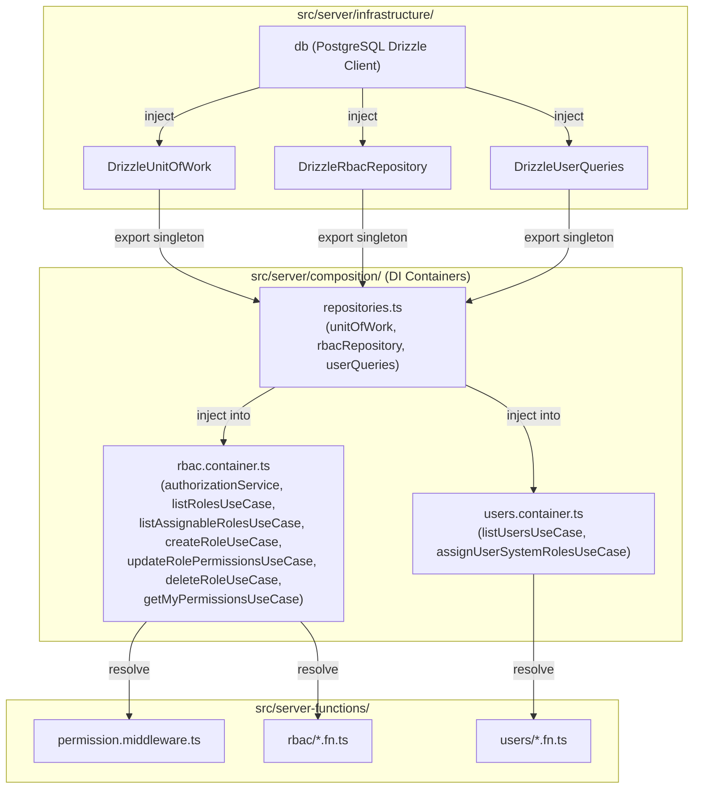

# Milestone 4 — Backend Step 5: Composition RBAC & Users (src/server/composition/)

ใน Step ที่ 5 เราจะประกอบร่าง Object Graph ของโมดูล RBAC และ Users ในชั้น **Composition Layer (`src/server/composition/`)** ด้วยเทคนิค **Pure Manual Dependency Injection (DI)** ตามกฎ `server.md` ข้อ 17 เพื่อให้ Use Cases และ Services พร้อมถูกเรียกใช้งานจากชั้น `server-functions/` โดยที่แต่ละเลเยอร์ไม่ต้อง `new` Concrete Repository เอง

---

## 1. เป้าหมายและขอบเขต Boundary (Boundary Context & Goal)

เป้าหมายของ Step นี้คือการลงทะเบียน Singleton Instances ของ `rbacRepository` และ `userQueries` ใน `src/server/composition/repositories.ts` และสร้าง DI Container ประจำโมดูล ได้แก่ `src/server/composition/rbac.container.ts` และ `src/server/composition/users.container.ts`

### ตารางสรุปไฟล์ใน Step นี้

| ลำดับ | เส้นทางไฟล์ (File Path) | บทบาทหน้าที่ (Responsibility) |
| :--- | :--- | :--- |
| 1 | `src/server/composition/repositories.ts` | สร้าง Singleton Instances ของ Infrastructure Repositories (`rbacRepository`, `userQueries`) และ `unitOfWork` จาก `db` |
| 2 | `src/server/composition/rbac.container.ts` | ประกอบร่าง `AuthorizationService` และ Use Cases ทั้ง 6 ตัวของโมดูล RBAC |
| 3 | `src/server/composition/users.container.ts` | ประกอบร่าง Use Cases ทั้ง 2 ตัวของโมดูล Users (`listUsersUseCase`, `assignUserSystemRolesUseCase`) |

### แผนผังการประกอบ Object Graph (DI Composition Graph)



---

## 2. ทฤษฎี ความสำคัญ และกฎสถาปัตยกรรมเฉพาะ Boundary นี้

### 2.1 ทำไมต้องใช้ Pure Manual Dependency Injection (`server.md` ข้อ 17)
1. **รักษาความบริสุทธิ์ของ Application Layer**: Use Cases ใน `src/server/application/` รู้จักเฉพาะ Interface (`IRbacRepository`, `IUserQueries`, `IUnitOfWork`) เท่านั้น ไม่รู้จัก `DrizzleRbacRepository` หรือ `db`
2. **โปร่งใสและตรวจสอบได้ด้วย TypeScript Compiler**: การผูก Dependency ด้วยมือใน `src/server/composition/*.container.ts` ไม่ต้องพึ่งพา Reflection, Decorators หรือ Heavy DI Container ทำให้ไม่มี Runtime Overhead และหากส่ง Dependency ผิดประเภท TypeScript จะแจ้งเตือนทันทีตั้งแต่ตอนเขียนโค้ด
3. **แบ่ง Container ตาม Bounded Context / Module**: แยก `rbac.container.ts` และ `users.container.ts` ออกจากกันอย่างชัดเจน แต่ทั้งคู่สามารถแชร์ Singleton `rbacRepository`, `userQueries` และ `unitOfWork` จาก `repositories.ts` ร่วมกันได้

### 2.2 กฎจาก `.agents/rules/` ที่บังคับใช้
- **`server.md` ข้อ 17 (Composition Layer: Pure Dependency Injection)**:
  - สร้าง Repository และ Unit of Work Singletons ใน `server/composition/repositories.ts`
  - ประกอบ Use Cases ประจำแต่ละโมดูลใน `server/composition/<module>.container.ts`
  - ห้าม Use Case หรือ Server Function สั่ง `new ConcreteRepository()` ด้วยตัวเอง
- **`globals.md` ข้อ 5 (No Barrel Files)**:
  - ให้ชั้น `server-functions/` import Use Case จากไฟล์ `<module>.container.ts` ที่เป็นเจ้าของโดยตรง

---

## 3. ลงมือเขียนโค้ด (Step-by-Step Implementation)

### 3.1 อัปเดต/ตรวจสอบไฟล์ `src/server/composition/repositories.ts`

ในไฟล์ `src/server/composition/repositories.ts` เราสร้างและส่งออก `unitOfWork`, `rbacRepository` และ `userQueries` ร่วมกับ Repositories ของโมดูลอื่นๆ ในระบบดังนี้:

```typescript
import type { AppTx } from "#/server/infrastructure/drizzle/db";
import { db } from "#/server/infrastructure/drizzle/db";
import { DrizzleUnitOfWork } from "#/server/infrastructure/drizzle/unit-of-work";
import { DrizzleProjectQueries } from "#/server/infrastructure/projects/drizzle-project.queries";
import { DrizzleProjectRepository } from "#/server/infrastructure/projects/drizzle-project.repository";
import { DrizzleRbacRepository } from "#/server/infrastructure/rbac/drizzle-rbac.repository";
import { DrizzleTaskQueries } from "#/server/infrastructure/tasks/drizzle-task.queries";
import { DrizzleTaskRepository } from "#/server/infrastructure/tasks/drizzle-task.repository";
import { DrizzleUserQueries } from "#/server/infrastructure/users/drizzle-user.queries";
import { DrizzleWorkspaceQueries } from "#/server/infrastructure/workspace/drizzle-workspace.queries";

export const unitOfWork = new DrizzleUnitOfWork<AppTx>(db);
export const rbacRepository = new DrizzleRbacRepository(db);
export const userQueries = new DrizzleUserQueries(db);
export const projectRepository = new DrizzleProjectRepository(db);
export const projectQueries = new DrizzleProjectQueries(db);
export const taskRepository = new DrizzleTaskRepository(db);
export const taskQueries = new DrizzleTaskQueries(db);
export const workspaceQueries = new DrizzleWorkspaceQueries(db);
```

#### คำอธิบายการทำงาน:
- `unitOfWork = new DrizzleUnitOfWork<AppTx>(db)`: ตัวควบคุม Transaction กลางของระบบ
- `rbacRepository = new DrizzleRbacRepository(db)`: อินสแตนซ์ของ Repository สำหรับจัดการบทบาทและสิทธิ์
- `userQueries = new DrizzleUserQueries(db)`: อินสแตนซ์ของ Query Service สำหรับดึงข้อมูลผู้ใช้งานในหน้า Admin

---

### 3.2 สร้างไฟล์ `src/server/composition/rbac.container.ts`

สร้างไฟล์ `src/server/composition/rbac.container.ts` เพื่อประกอบร่าง `AuthorizationService` และ Use Cases ทั้ง 6 ตัวของโมดูล RBAC:

```typescript
import { AuthorizationService } from "#/server/application/common/authorization.service";
import { CreateRoleUseCase } from "#/server/application/rbac/create-role.use-case";
import { DeleteRoleUseCase } from "#/server/application/rbac/delete-role.use-case";
import { GetMyPermissionsUseCase } from "#/server/application/rbac/get-my-permissions.use-case";
import { ListAssignableRolesUseCase } from "#/server/application/rbac/list-assignable-roles.use-case";
import { ListRolesUseCase } from "#/server/application/rbac/list-roles.use-case";
import { UpdateRolePermissionsUseCase } from "#/server/application/rbac/update-role-permissions.use-case";
import { rbacRepository, unitOfWork } from "./repositories";

export const authorizationService = new AuthorizationService();
export const listRolesUseCase = new ListRolesUseCase(rbacRepository);
export const listAssignableRolesUseCase = new ListAssignableRolesUseCase(
	rbacRepository,
);
export const createRoleUseCase = new CreateRoleUseCase(
	rbacRepository,
	unitOfWork,
);
export const updateRolePermissionsUseCase = new UpdateRolePermissionsUseCase(
	rbacRepository,
	unitOfWork,
);
export const deleteRoleUseCase = new DeleteRoleUseCase(
	rbacRepository,
	unitOfWork,
);
export const getMyPermissionsUseCase = new GetMyPermissionsUseCase(
	rbacRepository,
);
```

#### คำอธิบายการทำงาน:
- Use Cases ที่เป็นการอ่านข้อมูล (`listRolesUseCase`, `listAssignableRolesUseCase`, `getMyPermissionsUseCase`) ได้รับเฉพาะ `rbacRepository`
- Use Cases ที่เป็นการเขียนหรือลบข้อมูล (`createRoleUseCase`, `updateRolePermissionsUseCase`, `deleteRoleUseCase`) ได้รับทั้ง `rbacRepository` และ `unitOfWork` เพื่อเปิดใช้งาน Transaction

---

### 3.3 สร้างไฟล์ `src/server/composition/users.container.ts`

สร้างไฟล์ `src/server/composition/users.container.ts` เพื่อประกอบร่าง Use Cases ของโมดูล Users:

```typescript
import { AssignUserSystemRolesUseCase } from "#/server/application/users/assign-user-system-roles.use-case";
import { ListUsersUseCase } from "#/server/application/users/list-users.use-case";
import { rbacRepository, unitOfWork, userQueries } from "./repositories";

export const listUsersUseCase = new ListUsersUseCase(userQueries);
export const assignUserSystemRolesUseCase = new AssignUserSystemRolesUseCase(
	rbacRepository,
	userQueries,
	unitOfWork,
);
```

#### คำอธิบายการทำงาน:
- `listUsersUseCase`: รับ `userQueries` เพื่อคิวรีรายชื่อผู้ใช้และบทบาทแบบ Read Projection
- `assignUserSystemRolesUseCase`: รับทั้ง `rbacRepository` (เพื่อตรวจสอบและบันทึกบทบาท), `userQueries` (เพื่อตรวจสอบว่ามีผู้ใช้อยู่จริง) และ `unitOfWork` (เพื่อควบคุม Transaction)

---

## 4. การตรวจสอบความถูกต้องและ Git Commit (Verification & Commit)

รันคำสั่งตรวจสอบความถูกต้องของ Type และ Linter:

```bash
bun run typecheck
bun run format
bun run check
```

ทำการ Commit ไฟล์ในชั้น Composition:

```bash
git add src/server/composition/repositories.ts src/server/composition/rbac.container.ts src/server/composition/users.container.ts
git commit -m "milestone-4.backend.step-5: Composition RBAC & Users DI Containers"
```
