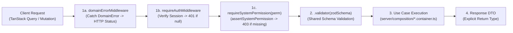

# Milestone 4 — Backend Step 6: Server Functions RBAC, Users & Permission Middleware (src/server-functions/)

ใน Step ที่ 6 (ก้าวสุดท้ายของฝั่ง Backend ใน Milestone 4) เราจะสร้างชั้น **RPC Gateway (`src/server-functions/`)** ซึ่งทำหน้าที่เป็น **Thin Driving Adapter** เชื่อมต่อระหว่างฝั่ง Client กับ Use Cases บนฝั่ง Server พร้อมสร้าง Middleware Factory **`requireSystemPermission(permission)`** เพื่อตรวจสอบสิทธิ์ระดับระบบตั้งแต่ด่านหน้าก่อนเข้าถึงตัว Handler

---

## 1. เป้าหมายและขอบเขต Boundary (Boundary Context & Goal)

เป้าหมายของ Step นี้คือการสร้าง Middleware ตรวจสอบสิทธิ์ (`permission.middleware.ts`), Server Functions สำหรับจัดการบทบาทและสิทธิ์ (`src/server-functions/rbac/*.fn.ts` จำนวน 6 ไฟล์) และ Server Functions สำหรับจัดการผู้ใช้งานและกำหนดบทบาท (`src/server-functions/users/*.fn.ts` จำนวน 2 ไฟล์) รวมทั้งหมด 9 ไฟล์

### ตารางสรุปไฟล์ใน Step นี้

| ลำดับ | เส้นทางไฟล์ (File Path) | บทบาทหน้าที่ (Responsibility) |
| :--- | :--- | :--- |
| 1 | `src/server-functions/middlewares/permission.middleware.ts` | Middleware Factory `requireSystemPermission(permission)` ตรวจสอบสิทธิ์ระดับระบบต่อยอดจาก `requireAuthMiddleware` |
| 2 | `src/server-functions/rbac/list-roles.fn.ts` | RPC Endpoint (`GET`) ดึงรายการบทบาทและสิทธิ์ทั้งหมด (ต้องมีสิทธิ์ `role:read`) |
| 3 | `src/server-functions/rbac/list-assignable-roles.fn.ts` | RPC Endpoint (`GET`) ดึงบทบาทระดับระบบที่นำไปกำหนดให้ผู้ใช้ได้ (ต้องมีสิทธิ์ `user:assign_role`) |
| 4 | `src/server-functions/rbac/create-role.fn.ts` | RPC Endpoint (`POST`) สร้างบทบาทใหม่ (ต้องมีสิทธิ์ `role:manage`) |
| 5 | `src/server-functions/rbac/update-role-permissions.fn.ts` | RPC Endpoint (`POST`) อัปเดตสิทธิ์ของบทบาท (ต้องมีสิทธิ์ `role:manage`) |
| 6 | `src/server-functions/rbac/delete-role.fn.ts` | RPC Endpoint (`POST`) ลบบทบาทที่กำหนดเอง (ต้องมีสิทธิ์ `role:manage`) |
| 7 | `src/server-functions/rbac/get-my-permissions.fn.ts` | RPC Endpoint (`GET`) ดึงสิทธิ์ระดับระบบของผู้ใช้งานที่ล็อกอินอยู่ |
| 8 | `src/server-functions/users/list-users.fn.ts` | RPC Endpoint (`GET`) ค้นหาและดึงรายชื่อผู้ใช้งานสำหรับหน้า Admin (ต้องมีสิทธิ์ `user:read`) |
| 9 | `src/server-functions/users/assign-user-roles.fn.ts` | RPC Endpoint (`POST`) กำหนดบทบาทระดับระบบให้ผู้ใช้งาน (ต้องมีสิทธิ์ `user:assign_role`) |

### แผนผังการทำงานของ Standard 4-Stage RPC Pipeline



---

## 2. ทฤษฎี ความสำคัญ และกฎสถาปัตยกรรมเฉพาะ Boundary นี้

### 2.1 กลไกการทำงานของ `requireSystemPermission(permission)` Middleware Factory
แทนที่เราจะต้องเขียนโค้ดตรวจสอบ Session และเรียก `authorizationService.assertSystemPermission(...)` ซ้ำๆ ในทุก `.handler(...)` ของ Server Function เราออกแบบ **Middleware Factory Function** ชื่อ `requireSystemPermission(requiredPermission: SystemPermissionCode)`:
1. **การเรียงลำดับ Middleware Chain (`.middleware([domainErrorMiddleware, requireAuthMiddleware])`)**:
   - `domainErrorMiddleware` อยู่ชั้นนอกสุด คอยดักจับ `DomainError` ทุกชนิด (เช่น `ForbiddenDomainError` -> HTTP 403, `NotFoundDomainError` -> HTTP 404, `ConflictDomainError` -> HTTP 409, `ValidationDomainError` -> HTTP 400)
   - `requireAuthMiddleware` รันถัดมาเพื่อดึง `authSession` จาก Request Headers หากยังไม่ล็อกอินจะตั้งสถานะ HTTP 401 และโยน Error ทันที แต่หากล็อกอินแล้วจะแนบ `context.authSession` ส่งต่อมาให้
2. **การตรวจสอบสิทธิ์ด้วย `authorizationService.assertSystemPermission`**:
   - ใน `.server(async ({ context, next }) => ...)` ตัว `requireSystemPermission` สามารถเข้าถึง `context.authSession.user.systemPermissions` ได้อย่าง Type-safe
   - เมื่อเรียก `authorizationService.assertSystemPermission(context.authSession.user.systemPermissions, requiredPermission)` หากผู้ใช้ไม่มีสิทธิ์ที่ระบุ ระบบจะโยน `ForbiddenDomainError` ซึ่งจะถูก `domainErrorMiddleware` แปลงเป็น HTTP Status `403 Forbidden` โดยอัตโนมัติ
   - หากมีสิทธิ์ครบถ้วน จะเรียก `return next({ context: { authSession: context.authSession } })` เพื่อส่งต่อ `authSession` เข้าไปยัง `.handler` ของ Server Function

### 2.2 กฎจาก `.agents/rules/` ที่บังคับใช้
- **`architecture.md` (Server Functions Standard Pipeline & Invariants)**:
  1. **Thin Adapter**: มีหน้าที่เฉพาะประสานงานระดับ Transport ห้ามเขียน Business Logic, `.filter()` หรือเรียก Database โดยตรง
  2. **One Function per File (`*.fn.ts`)**: แยก 1 RPC Endpoint ต่อ 1 ไฟล์ และตั้งชื่อตัวแปรลงท้ายด้วย `Fn` (เช่น `listRolesFn`, `assignUserRolesFn`)
  3. **Shared Contract Only**: ตรวจสอบ Input Payload ด้วย Schema จาก `src/shared/schemas/**` ผ่าน `.validator()` และระบุ Explicit Return Type ที่ `.handler(async (...): Promise<...> => ...)` เสมอ
  4. **DI Resolution**: ดึง Use Case มาจาก `src/server/composition/*.container.ts` เท่านั้น

---

## 3. ลงมือเขียนโค้ด (Step-by-Step Implementation)

### 3.1 สร้างไฟล์ `src/server-functions/middlewares/permission.middleware.ts`

```typescript
import { createMiddleware } from "@tanstack/react-start";
import { authorizationService } from "#/server/composition/rbac.container";
import type { SystemPermissionCode } from "#/shared/schemas/rbac.schema";
import { requireAuthMiddleware } from "./auth.middleware";
import { domainErrorMiddleware } from "./domain-error.middleware";

export function requireSystemPermission(
	requiredPermission: SystemPermissionCode,
) {
	return createMiddleware({ type: "function" })
		.middleware([domainErrorMiddleware, requireAuthMiddleware])
		.server(async ({ context, next }) => {
			authorizationService.assertSystemPermission(
				context.authSession.user.systemPermissions,
				requiredPermission,
			);

			return next({
				context: {
					authSession: context.authSession,
				},
			});
		});
}
```

#### คำอธิบายการทำงาน:
- เป็น Higher-Order Function ที่รับ `requiredPermission` (Type-safe ด้วย `SystemPermissionCode`) แล้วคืนค่า TanStack Start Function Middleware ที่ผูกทั้ง `domainErrorMiddleware` และ `requireAuthMiddleware` ไว้ในตัวเดียว ทำให้ไฟล์ `*.fn.ts` เรียกใช้เพียง `.middleware([requireSystemPermission("...")])` บรรทัดเดียวได้อย่างสะอาดตา

---

### 3.2 สร้างไฟล์ `src/server-functions/rbac/list-roles.fn.ts`

```typescript
import { createServerFn } from "@tanstack/react-start";
import { listRolesUseCase } from "#/server/composition/rbac.container";
import { requireSystemPermission } from "#/server-functions/middlewares/permission.middleware";
import type { ListRolesResultDto } from "#/shared/schemas/rbac.schema";

export const listRolesFn = createServerFn({ method: "GET" })
	.middleware([requireSystemPermission("role:read")])
	.handler(async (): Promise<ListRolesResultDto> => {
		return listRolesUseCase.execute();
	});
```

#### คำอธิบายการทำงาน:
- บังคับสิทธิ์ `"role:read"` ก่อนดึงรายการบทบาททั้งหมดและ Permission Catalog ผ่าน `listRolesUseCase.execute()`

---

### 3.3 สร้างไฟล์ `src/server-functions/rbac/list-assignable-roles.fn.ts`

```typescript
import { createServerFn } from "@tanstack/react-start";
import { listAssignableRolesUseCase } from "#/server/composition/rbac.container";
import { requireSystemPermission } from "#/server-functions/middlewares/permission.middleware";
import type { RoleDto } from "#/shared/schemas/rbac.schema";

export const listAssignableRolesFn = createServerFn({ method: "GET" })
	.middleware([requireSystemPermission("user:assign_role")])
	.handler(async (): Promise<RoleDto[]> => {
		return listAssignableRolesUseCase.execute();
	});
```

#### คำอธิบายการทำงาน:
- บังคับสิทธิ์ `"user:assign_role"` (เพื่อให้ผู้ดูแลที่มีสิทธิ์กำหนดบทบาทผู้ใช้สามารถดึงตัวเลือกบทบาทระดับระบบไปแสดงใน Dialog ได้ แม้จะไม่มีสิทธิ์ `"role:read"` สำหรับเข้าหน้า Roles Matrix ก็ตาม) และเรียก `listAssignableRolesUseCase.execute()` โดยตรง

---

### 3.4 สร้างไฟล์ `src/server-functions/rbac/create-role.fn.ts`

```typescript
import { createServerFn } from "@tanstack/react-start";
import { createRoleUseCase } from "#/server/composition/rbac.container";
import { requireSystemPermission } from "#/server-functions/middlewares/permission.middleware";
import type { RoleDto } from "#/shared/schemas/rbac.schema";
import { createRoleInputSchema } from "#/shared/schemas/rbac.schema";

export const createRoleFn = createServerFn({ method: "POST" })
	.middleware([requireSystemPermission("role:manage")])
	.validator(createRoleInputSchema)
	.handler(async ({ data }): Promise<RoleDto> => {
		return createRoleUseCase.execute({ payload: data });
	});
```

#### คำอธิบายการทำงาน:
- บังคับสิทธิ์ `"role:manage"`, ตรวจสอบข้อมูลขาเข้าด้วย `createRoleInputSchema` และส่งต่อไปยัง `createRoleUseCase.execute({ payload: data })`

---

### 3.5 สร้างไฟล์ `src/server-functions/rbac/update-role-permissions.fn.ts`

```typescript
import { createServerFn } from "@tanstack/react-start";
import { updateRolePermissionsUseCase } from "#/server/composition/rbac.container";
import { requireSystemPermission } from "#/server-functions/middlewares/permission.middleware";
import type { RoleDto } from "#/shared/schemas/rbac.schema";
import { updateRolePermissionsInputSchema } from "#/shared/schemas/rbac.schema";

export const updateRolePermissionsFn = createServerFn({ method: "POST" })
	.middleware([requireSystemPermission("role:manage")])
	.validator(updateRolePermissionsInputSchema)
	.handler(async ({ data }): Promise<RoleDto> => {
		return updateRolePermissionsUseCase.execute({ payload: data });
	});
```

#### คำอธิบายการทำงาน:
- บังคับสิทธิ์ `"role:manage"`, ตรวจสอบข้อมูลด้วย `updateRolePermissionsInputSchema` และเรียก `updateRolePermissionsUseCase.execute({ payload: data })`

---

### 3.6 สร้างไฟล์ `src/server-functions/rbac/delete-role.fn.ts`

```typescript
import { createServerFn } from "@tanstack/react-start";
import { deleteRoleUseCase } from "#/server/composition/rbac.container";
import { requireSystemPermission } from "#/server-functions/middlewares/permission.middleware";
import { deleteRoleInputSchema } from "#/shared/schemas/rbac.schema";

export const deleteRoleFn = createServerFn({ method: "POST" })
	.middleware([requireSystemPermission("role:manage")])
	.validator(deleteRoleInputSchema)
	.handler(async ({ data }): Promise<{ success: true }> => {
		await deleteRoleUseCase.execute({ payload: data });
		return { success: true };
	});
```

#### คำอธิบายการทำงาน:
- บังคับสิทธิ์ `"role:manage"`, ตรวจสอบ `roleId` ด้วย `deleteRoleInputSchema`, เรียก `deleteRoleUseCase.execute({ payload: data })` และคืนค่า `{ success: true }`

---

### 3.7 สร้างไฟล์ `src/server-functions/rbac/get-my-permissions.fn.ts`

```typescript
import { createServerFn } from "@tanstack/react-start";
import { getMyPermissionsUseCase } from "#/server/composition/rbac.container";
import { requireAuthMiddleware } from "#/server-functions/middlewares/auth.middleware";
import { domainErrorMiddleware } from "#/server-functions/middlewares/domain-error.middleware";
import type { MyPermissionsDto } from "#/shared/schemas/rbac.schema";

export const getMyPermissionsFn = createServerFn({ method: "GET" })
	.middleware([domainErrorMiddleware, requireAuthMiddleware])
	.handler(async ({ context }): Promise<MyPermissionsDto> => {
		return getMyPermissionsUseCase.execute({
			userId: context.authSession.user.id,
		});
	});
```

#### คำอธิบายการทำงาน:
- ใช้เฉพาะ `[domainErrorMiddleware, requireAuthMiddleware]` เนื่องจากผู้ใช้ทุกคนที่ล็อกอินแล้วต้องสามารถดึงรายการสิทธิ์ของตัวเอง (`MyPermissionsDto`) ไปใช้แสดงผล UI ได้

---

### 3.8 สร้างไฟล์ `src/server-functions/users/list-users.fn.ts`

```typescript
import { createServerFn } from "@tanstack/react-start";
import { listUsersUseCase } from "#/server/composition/users.container";
import { requireSystemPermission } from "#/server-functions/middlewares/permission.middleware";
import type { AdminUserDto } from "#/shared/schemas/user.schema";
import { listUsersInputSchema } from "#/shared/schemas/user.schema";

export const listUsersFn = createServerFn({ method: "GET" })
	.middleware([requireSystemPermission("user:read")])
	.validator(listUsersInputSchema)
	.handler(async ({ data }): Promise<AdminUserDto[]> => {
		return listUsersUseCase.execute({ payload: data });
	});
```

#### คำอธิบายการทำงาน:
- บังคับสิทธิ์ `"user:read"`, ตรวจสอบพารามิเตอร์ค้นหาด้วย `listUsersInputSchema` และส่งต่อไปยัง `listUsersUseCase.execute({ payload: data })`

---

### 3.9 สร้างไฟล์ `src/server-functions/users/assign-user-roles.fn.ts`

```typescript
import { createServerFn } from "@tanstack/react-start";
import { assignUserSystemRolesUseCase } from "#/server/composition/users.container";
import { requireSystemPermission } from "#/server-functions/middlewares/permission.middleware";
import { assignUserSystemRolesInputSchema } from "#/shared/schemas/user.schema";

export const assignUserRolesFn = createServerFn({ method: "POST" })
	.middleware([requireSystemPermission("user:assign_role")])
	.validator(assignUserSystemRolesInputSchema)
	.handler(async ({ context, data }): Promise<{ success: true }> => {
		await assignUserSystemRolesUseCase.execute({
			actorUserId: context.authSession.user.id,
			payload: data,
		});
		return { success: true };
	});
```

#### คำอธิบายการทำงาน:
- บังคับสิทธิ์ `"user:assign_role"` และตรวจสอบข้อมูลด้วย `assignUserSystemRolesInputSchema`
- ส่งทั้ง `actorUserId: context.authSession.user.id` (รหัสของผู้ดูแลที่กำลังกดบันทึก) และ `payload: data` เข้าไปยัง `assignUserSystemRolesUseCase.execute(...)` เพื่อให้ Use Case ตรวจสอบป้องกันการถอดสิทธิ์ตัวเอง (`SelfRoleLockoutError`) ได้อย่างแม่นยำ

---

## 4. การตรวจสอบความถูกต้องและ Git Commit (Verification & Commit)

รันคำสั่งตรวจสอบความถูกต้องของ Type และ Linter ทั้งโปรเจกต์:

```bash
bun run typecheck
bun run format
bun run check
```

ทำการ Commit ไฟล์ในชั้น Server Functions ทั้ง 9 ไฟล์:

```bash
git add src/server-functions/middlewares/permission.middleware.ts src/server-functions/rbac/ src/server-functions/users/
git commit -m "milestone-4.backend.step-6: Permission Middleware & RBAC/Users Server Functions"
```
