# Milestone 4 — Frontend Step 1: Client Caches RBAC & Users (src/client/caches/rbac/ & users/)

ในขั้นตอนนี้เราจะเริ่มพัฒนาฝั่ง Frontend ของ **Milestone 4 (RBAC & User Administration)** โดยเริ่มจากชั้นล่างสุดของ Client Architecture คือ **Client Caches Layer (`src/client/caches/`)** ซึ่งทำหน้าที่เป็นศูนย์กลางจัดการ Server State ทั้งหมดของโมดูล `rbac` และ `users` ผ่าน TanStack Query

---

## 1. เป้าหมายและขอบเขต Boundary (Boundary Context & Goal)

### เป้าหมายของ Step นี้
1. สร้าง **Query Key Factories** (`rbacKeys`, `usersKeys`) เพื่อจัดการ Cache Keys แบบ Hierarchical และ Type-safe
2. สร้าง **Query Options** สำหรับดึงรายการบทบาท (`rolesListQueryOptions`), บทบาทระดับระบบที่มอบหมายได้ (`assignableRolesQueryOptions`), สิทธิ์ของผู้ใช้ปัจจุบัน (`myPermissionsQueryOptions`) และรายชื่อผู้ใช้งานทั้งหมดในระบบ (`adminUsersQueryOptions`)
3. สร้าง **Mutation Hooks** สำหรับสร้างบทบาท (`useCreateRoleMutation`), อัปเดตตารางสิทธิ์ (`useUpdateRolePermissionsMutation`), ลบบทบาท (`useDeleteRoleMutation`) และกำหนดบทบาทให้ผู้ใช้งาน (`useAssignUserRolesMutation`) พร้อมจัดการ **Cross-Cache Invalidation** และ **Centralized Toast Feedback**

### ตารางสรุปไฟล์ใน Step นี้

| ลำดับ | Path ของไฟล์ | บทบาทหน้าที่ (Responsibility) |
| :--- | :--- | :--- |
| 1 | `src/client/caches/rbac/keys.ts` | Query Key Factory สำหรับโดเมน RBAC (`all`, `roles`, `assignableRoles`, `myPermissions`) |
| 2 | `src/client/caches/rbac/queries/roles.query.ts` | `queryOptions` สำหรับดึงบทบาททั้งหมดพร้อมรายการสิทธิ์ในระบบ (`listRolesFn`) |
| 3 | `src/client/caches/rbac/queries/assignable-roles.query.ts` | `queryOptions` สำหรับดึงบทบาทระดับ `system` ที่นำไปผูกกับผู้ใช้ได้ (`listAssignableRolesFn`) |
| 4 | `src/client/caches/rbac/queries/my-permissions.query.ts` | `queryOptions` สำหรับดึงรหัสสิทธิ์ของผู้ใช้ปัจจุบัน (`getMyPermissionsFn`) |
| 5 | `src/client/caches/rbac/mutates/create-role.mutate.ts` | Mutation Hook สำหรับสร้างบทบาทใหม่ และ Invalidate `rbacKeys.all` |
| 6 | `src/client/caches/rbac/mutates/update-role-permissions.mutate.ts` | Mutation Hook สำหรับบันทึก Permission Matrix พร้อมทำ Cross-Cache Invalidation |
| 7 | `src/client/caches/rbac/mutates/delete-role.mutate.ts` | Mutation Hook สำหรับลบบทบาทแบบ Custom พร้อมทำ Cross-Cache Invalidation |
| 8 | `src/client/caches/users/keys.ts` | Query Key Factory สำหรับโดเมน Users (`all`, `list(search)`) |
| 9 | `src/client/caches/users/queries/users.query.ts` | `queryOptions` สำหรับค้นหาและดึงรายชื่อผู้ใช้งานในระบบ (`listUsersFn`) |
| 10 | `src/client/caches/users/mutates/assign-user-roles.mutate.ts` | Mutation Hook สำหรับมอบหมาย System Roles ให้ผู้ใช้งาน พร้อมทำ Cross-Cache Invalidation |

### แผนผังสถาปัตยกรรมและทิศทางการไหลของข้อมูล (Mermaid Diagram)

```mermaid
flowchart TD
    subgraph UI_Hooks["Feature Hooks & Route Loaders"]
        RL["Route Loaders (admin/roles, admin/users)"]
        FH["Feature Hooks (rbac & users)"]
    end

    subgraph Client_Caches["src/client/caches/ (Server-State Ownership)"]
        subgraph RBAC_Cache["caches/rbac/"]
            RK["rbacKeys (keys.ts)"]
            RQ1["rolesListQueryOptions"]
            RQ2["assignableRolesQueryOptions"]
            RQ3["myPermissionsQueryOptions"]
            RM1["useCreateRoleMutation"]
            RM2["useUpdateRolePermissionsMutation"]
            RM3["useDeleteRoleMutation"]
        end

        subgraph Users_Cache["caches/users/"]
            UK["usersKeys (keys.ts)"]
            UQ1["adminUsersQueryOptions(search)"]
            UM1["useAssignUserRolesMutation"]
        end

        subgraph Auth_Cache["caches/auth/"]
            AK["authKeys.session()"]
        end
    end

    subgraph RPC_Gateway["src/server-functions/ (RPC Gateway)"]
        SF_RBAC["rbac/*.fn.ts"]
        SF_USERS["users/*.fn.ts"]
    end

    RL -->|preload| RQ1
    RL -->|preload| UQ1
    FH -->|useQuery / useMutation| RBAC_Cache
    FH -->|useQuery / useMutation| Users_Cache

    RQ1 & RQ2 & RQ3 & RM1 & RM2 & RM3 -->|invoke RPC| SF_RBAC
    UQ1 & UM1 -->|invoke RPC| SF_USERS

    RM2 & RM3 -.->|"Cross-Cache Invalidate"| RK
    RM2 & RM3 -.->|"Cross-Cache Invalidate"| UK
    RM2 & RM3 -.->|"Cross-Cache Invalidate"| AK

    UM1 -.->|"Cross-Cache Invalidate"| UK
    UM1 -.->|"Cross-Cache Invalidate"| RQ3
    UM1 -.->|"Cross-Cache Invalidate"| AK
```



---

## 2. ทฤษฎี ความสำคัญ และกฎสถาปัตยกรรมเฉพาะ Boundary นี้

### 2.1 กฎสถาปัตยกรรมที่บังคับใช้ (`.agents/rules/client.md` & `server.md`)
- **`server.md` ข้อ 3 (Centralized Server-State Ownership)**: อนุญาตให้เฉพาะ Route (`beforeLoad`, `loader`) และ `client/caches/**` เท่านั้นที่เรียก `server-functions/` ได้ ห้าม Screen, Component หรือ Feature Hook เรียก `server-functions/` โดยตรงเด็ดขาด
- **`client.md` ข้อ 8 (Single Owner of Mutation Feedback)**: Success/Error Toast ของการเปลี่ยนแปลงข้อมูลบนเซิร์ฟเวอร์ (create/update/delete) เป็นส่วนหนึ่งของ Server-State Lifecycle จึงต้องกำหนดไว้ที่ `meta: { successToast: "..." }` ใน `client/caches/**/mutates/*.mutate.ts` เท่านั้น เพื่อให้ Global `MutationCache` ใน `src/client/caches/global.ts` เป็นผู้ยิง Sonner Toast อัตโนมัติ ไม่มีการเขียน `toast.success()` กระจายใน Component หรือ Hook
- **`globals.md` ข้อ 2 & 3 (Import Discipline)**: แยก `import type` ออกจาก Runtime Import อย่างชัดเจน และใช้ Relative Import ไม่เกิน `../` (หากข้ามโมดูลให้ใช้ `#/` เช่น `#/client/caches/auth/keys`)

### 2.2 ทำไมต้องทำ Cross-Cache Invalidation ข้าม 3 โดเมน (`rbacKeys`, `usersKeys`, `authKeys`)?
ในระบบที่มี RBAC (Role-Based Access Control) ข้อมูลของ **Roles**, **Users** และ **Current Session** มีความสัมพันธ์เชื่อมโยงกันโดยตรง:
1. **เมื่อแก้ไขสิทธิ์ของบทบาท (`updateRolePermissions`) หรือลบบทบาท (`deleteRole`)**:
   - ข้อมูลในหน้าจัดการบทบาท (`rbacKeys.all`) เปลี่ยนแปลง
   - รายการบทบาทที่ผูกอยู่กับผู้ใช้แต่ละคนในตารางหน้า Users (`usersKeys.all`) อาจเปลี่ยนแปลง (เช่น ชื่อหรือบทบาทที่ถูกลบหายไปจากรายการ `systemRoles` ของผู้ใช้)
   - ที่สำคัญที่สุด: **หากผู้ดูแลระบบที่กำลังล็อกอินอยู่ถือบทบาทที่เพิ่งถูกแก้ไขหรือถูกลบ** รายการ `user.systemPermissions` ใน `authKeys.session()` จะเปลี่ยนไปทันที การ Invalidate `authKeys.session()` จึงทำให้เมนู `<WorkspaceNav />` และปุ่มควบคุมสิทธิ์ต่างๆ บนหน้าจออัปเดตสถานะตามสิทธิ์ใหม่แบบ Real-time โดยไม่ต้องกด Refresh หน้าเว็บ!
2. **เมื่อมอบหมายบทบาทใหม่ให้ผู้ใช้งาน (`assignUserRoles`)**:
   - ตารางรายชื่อผู้ใช้งาน (`usersKeys.all`) ต้องโหลดข้อมูล `systemRoles` ใหม่
   - สิทธิ์ของผู้ใช้ปัจจุบัน (`rbacKeys.myPermissions()`) และ Session ปัจจุบัน (`authKeys.session()`) ต้องถูก Invalidate เผื่อกรณีที่ผู้ดูแลระบบปรับเปลี่ยนบทบาทของบัญชีตัวเอง

---

## 3. ลงมือเขียนโค้ด (Step-by-Step Implementation)

### 3.1 สร้าง Query Key Factory สำหรับ RBAC (`src/client/caches/rbac/keys.ts`)

สร้างไฟล์ `src/client/caches/rbac/keys.ts` เพื่อรวบรวม Query Keys ของโดเมน RBAC ให้มีราก (`all: ["rbac"]`) เดียวกัน เมื่อสั่ง Invalidate ที่ `rbacKeys.all` จะสามารถล้าง Cache ย่อยทั้งหมดในโดเมน RBAC ได้ในคำสั่งเดียว

```typescript
export const rbacKeys = {
	all: ["rbac"] as const,
	roles: () => [...rbacKeys.all, "roles"] as const,
	assignableRoles: () => [...rbacKeys.all, "assignable-roles"] as const,
	myPermissions: () => [...rbacKeys.all, "my-permissions"] as const,
};
```

---

### 3.2 สร้าง Query Options สำหรับดึงรายการบทบาทและสิทธิ์ (`src/client/caches/rbac/queries/roles.query.ts`)

สร้างไฟล์ `src/client/caches/rbac/queries/roles.query.ts` สำหรับดึงทั้ง `roles` และ `permissions` ทั้งหมดในระบบไปแสดงในหน้า `/admin/roles` โดยใช้ `queryOptions` ของ TanStack Query เพื่อให้ใช้ร่วมกันได้ทั้งใน Route `loader` และ `useQuery`

```typescript
import { queryOptions } from "@tanstack/react-query";
import { listRolesFn } from "#/server-functions/rbac/list-roles.fn";
import { rbacKeys } from "../keys";

export function rolesListQueryOptions() {
	return queryOptions({
		queryKey: rbacKeys.roles(),
		queryFn: () => listRolesFn(),
		staleTime: 30_000,
	});
}
```

---

### 3.3 สร้าง Query Options สำหรับดึงบทบาทที่มอบหมายได้ (`src/client/caches/rbac/queries/assignable-roles.query.ts`)

สร้างไฟล์ `src/client/caches/rbac/queries/assignable-roles.query.ts` สำหรับดึงรายการบทบาทเพื่อนำไปแสดงใน Dialog กำหนดบทบาทให้ผู้ใช้ (`AssignUserRolesDialog`) ซึ่งต้องการเพียงสิทธิ์ `user:assign_role` ในการเรียกดู

```typescript
import { queryOptions } from "@tanstack/react-query";
import { listAssignableRolesFn } from "#/server-functions/rbac/list-assignable-roles.fn";
import { rbacKeys } from "../keys";

export function assignableRolesQueryOptions() {
	return queryOptions({
		queryKey: rbacKeys.assignableRoles(),
		queryFn: () => listAssignableRolesFn(),
		staleTime: 30_000,
	});
}
```

---

### 3.4 สร้าง Query Options สำหรับดึงสิทธิ์ของตนเอง (`src/client/caches/rbac/queries/my-permissions.query.ts`)

สร้างไฟล์ `src/client/caches/rbac/queries/my-permissions.query.ts` เชื่อมต่อกับ `getMyPermissionsFn`

```typescript
import { queryOptions } from "@tanstack/react-query";
import { getMyPermissionsFn } from "#/server-functions/rbac/get-my-permissions.fn";
import { rbacKeys } from "../keys";

export function myPermissionsQueryOptions() {
	return queryOptions({
		queryKey: rbacKeys.myPermissions(),
		queryFn: () => getMyPermissionsFn(),
		staleTime: 30_000,
	});
}
```

---

### 3.5 สร้าง Mutation Hook สำหรับสร้างบทบาทใหม่ (`src/client/caches/rbac/mutates/create-role.mutate.ts`)

สร้างไฟล์ `src/client/caches/rbac/mutates/create-role.mutate.ts` โดยรับ `CreateRoleInput` จาก Shared Schema ส่งเข้า `createRoleFn` พร้อมกำหนด `meta.successToast` และสั่ง Invalidate `rbacKeys.all` เมื่อสร้างสำเร็จ

```typescript
import { useMutation, useQueryClient } from "@tanstack/react-query";
import { createRoleFn } from "#/server-functions/rbac/create-role.fn";
import type { CreateRoleInput } from "#/shared/schemas/rbac.schema";
import { rbacKeys } from "../keys";

export function useCreateRoleMutation() {
	const queryClient = useQueryClient();

	return useMutation({
		mutationFn: (input: CreateRoleInput) => createRoleFn({ data: input }),
		meta: {
			successToast: "สร้างบทบาทใหม่สำเร็จ",
		},
		onSuccess: async () => {
			await queryClient.invalidateQueries({ queryKey: rbacKeys.all });
		},
	});
}
```

---

### 3.6 สร้าง Mutation Hook สำหรับบันทึกสิทธิ์ประจำบทบาท (`src/client/caches/rbac/mutates/update-role-permissions.mutate.ts`)

สร้างไฟล์ `src/client/caches/rbac/mutates/update-role-permissions.mutate.ts` เมื่อบันทึกสำเร็จจะทำ **Cross-Cache Invalidation** พร้อมกันแบบขนานด้วย `Promise.all` ทั้ง `rbacKeys.all`, `usersKeys.all` และ `authKeys.session()`

```typescript
import { useMutation, useQueryClient } from "@tanstack/react-query";
import { authKeys } from "#/client/caches/auth/keys";
import { usersKeys } from "#/client/caches/users/keys";
import { updateRolePermissionsFn } from "#/server-functions/rbac/update-role-permissions.fn";
import type { UpdateRolePermissionsInput } from "#/shared/schemas/rbac.schema";
import { rbacKeys } from "../keys";

export function useUpdateRolePermissionsMutation() {
	const queryClient = useQueryClient();

	return useMutation({
		mutationFn: (input: UpdateRolePermissionsInput) =>
			updateRolePermissionsFn({ data: input }),
		meta: {
			successToast: "บันทึกสิทธิ์ของบทบาทสำเร็จ",
		},
		onSuccess: async () => {
			await Promise.all([
				queryClient.invalidateQueries({ queryKey: rbacKeys.all }),
				queryClient.invalidateQueries({ queryKey: usersKeys.all }),
				queryClient.invalidateQueries({ queryKey: authKeys.session() }),
			]);
		},
	});
}
```

---

### 3.7 สร้าง Mutation Hook สำหรับลบบทบาท (`src/client/caches/rbac/mutates/delete-role.mutate.ts`)

สร้างไฟล์ `src/client/caches/rbac/mutates/delete-role.mutate.ts` สำหรับลบบทบาทแบบ Custom และสั่ง Invalidate ข้ามทั้ง 3 Caches (`rbacKeys.all`, `usersKeys.all`, `authKeys.session()`) เช่นเดียวกับการแก้ไขสิทธิ์

```typescript
import { useMutation, useQueryClient } from "@tanstack/react-query";
import { authKeys } from "#/client/caches/auth/keys";
import { usersKeys } from "#/client/caches/users/keys";
import { deleteRoleFn } from "#/server-functions/rbac/delete-role.fn";
import type { DeleteRoleInput } from "#/shared/schemas/rbac.schema";
import { rbacKeys } from "../keys";

export function useDeleteRoleMutation() {
	const queryClient = useQueryClient();

	return useMutation({
		mutationFn: (input: DeleteRoleInput) => deleteRoleFn({ data: input }),
		meta: {
			successToast: "ลบบทบาทสำเร็จ",
		},
		onSuccess: async () => {
			await Promise.all([
				queryClient.invalidateQueries({ queryKey: rbacKeys.all }),
				queryClient.invalidateQueries({ queryKey: usersKeys.all }),
				queryClient.invalidateQueries({ queryKey: authKeys.session() }),
			]);
		},
	});
}
```

---

### 3.8 สร้าง Query Key Factory สำหรับ Users (`src/client/caches/users/keys.ts`)

สร้างไฟล์ `src/client/caches/users/keys.ts` โดย `usersKeys.list(search)` จะผูกคำค้นหา (`search`) เข้าเป็นส่วนหนึ่งของ Query Key เพื่อให้ TanStack Query แยก Cache ตามคำค้นหาและทำ Automatic Refetch เมื่อคำค้นหาเปลี่ยน

```typescript
export const usersKeys = {
	all: ["users"] as const,
	list: (search: string) => [...usersKeys.all, "list", search] as const,
};
```

---

### 3.9 สร้าง Query Options สำหรับดึงและค้นหารายชื่อผู้ใช้ (`src/client/caches/users/queries/users.query.ts`)

สร้างไฟล์ `src/client/caches/users/queries/users.query.ts` โดยทำ Normalization คำค้นหาด้วย `.trim()` ก่อนนำไปสร้าง `queryKey` และส่งเป็น Payload ให้ `listUsersFn`

```typescript
import { queryOptions } from "@tanstack/react-query";
import { listUsersFn } from "#/server-functions/users/list-users.fn";
import { usersKeys } from "../keys";

export function adminUsersQueryOptions(search = "") {
	const normalizedSearch = search.trim();

	return queryOptions({
		queryKey: usersKeys.list(normalizedSearch),
		queryFn: () =>
			listUsersFn({
				data: {
					search: normalizedSearch || undefined,
				},
			}),
		staleTime: 30_000,
	});
}
```

---

### 3.10 สร้าง Mutation Hook สำหรับมอบหมายบทบาทระบบให้ผู้ใช้ (`src/client/caches/users/mutates/assign-user-roles.mutate.ts`)

สร้างไฟล์ `src/client/caches/users/mutates/assign-user-roles.mutate.ts` เพื่อเรียก `assignUserRolesFn` และเมื่อสำเร็จให้ Invalidate ทั้ง `usersKeys.all`, `rbacKeys.myPermissions()` และ `authKeys.session()`

```typescript
import { useMutation, useQueryClient } from "@tanstack/react-query";
import { authKeys } from "#/client/caches/auth/keys";
import { rbacKeys } from "#/client/caches/rbac/keys";
import { assignUserRolesFn } from "#/server-functions/users/assign-user-roles.fn";
import type { AssignUserSystemRolesInput } from "#/shared/schemas/user.schema";
import { usersKeys } from "../keys";

export function useAssignUserRolesMutation() {
	const queryClient = useQueryClient();

	return useMutation({
		mutationFn: (input: AssignUserSystemRolesInput) =>
			assignUserRolesFn({ data: input }),
		meta: {
			successToast: "กำหนดบทบาทระบบให้ผู้ใช้งานสำเร็จ",
		},
		onSuccess: async () => {
			await Promise.all([
				queryClient.invalidateQueries({ queryKey: usersKeys.all }),
				queryClient.invalidateQueries({ queryKey: rbacKeys.myPermissions() }),
				queryClient.invalidateQueries({ queryKey: authKeys.session() }),
			]);
		},
	});
}
```

---

## 4. การตรวจสอบความถูกต้องและ Git Commit (Verification & Commit)

### 4.1 ตรวจสอบ Type Safety และ Linting
รันคำสั่งตรวจสอบด้วย `bun` เพื่อยืนยันว่าการเชื่อมโยงระหว่าง `client/caches/` กับ `server-functions/` และ `shared/schemas/` ถูกต้องสมบูรณ์ไม่มี Type Error:

```bash
bun run typecheck
bun run format
bun run check
```

### 4.2 บันทึกการเปลี่ยนแปลงลง Git (Git Commit)
เมื่อตรวจสอบผ่านเรียบร้อยแล้ว ให้ Stage เฉพาะไฟล์ใน Step นี้และทำการ Commit:

```bash
git add src/client/caches/rbac/ src/client/caches/users/
git commit -m "milestone-4.frontend.step-1: Client Caches RBAC & Users"
```
