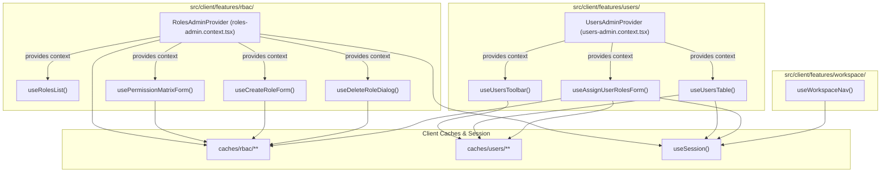

# Milestone 4 — Frontend Step 2: Feature RBAC, Users & Workspace Nav Contexts/Hooks (src/client/features/**/contexts/ & hooks/)

หลังจากที่เราเตรียม Server-State Layer (`src/client/caches/rbac/` และ `src/client/caches/users/`) เสร็จใน Step 1 แล้ว ในขั้นตอนนี้เราจะสร้าง **Feature Compound Contexts** และ **Single-Responsibility Hooks** สำหรับฟีเจอร์ `rbac`, `users` และ `workspace` เพื่อเป็นเจ้าของ State, Form Validation, Table Logic และ UI Interactions ทั้งหมดภายใต้สถาปัตยกรรม **Zero Props**

---

## 1. เป้าหมายและขอบเขต Boundary (Boundary Context & Goal)

### เป้าหมายของ Step นี้
1. สร้าง **Feature Compound Contexts** (`RolesAdminProvider`, `UsersAdminProvider`) เพื่อเป็นตัวกลางแชร์ Shared UI State (เช่น บทบาทที่กำลังเลือกอยู่, คำค้นหาแบบ Debounce, สถานะการเปิด/ปิด Dialog) ระหว่าง Components พี่น้องในหน้าเดียวกันโดยไม่ต้องส่ง Props (`Prop Drilling`)
2. สร้าง **Single-Responsibility Hooks** ประจำแต่ละ Component ของฟีเจอร์ `rbac` (4 Hooks), `users` (3 Hooks) และ `workspace` (1 Hook) เพื่อให้แต่ละ Component ใน Step 3 เรียกใช้งานได้โดยตรงแบบ **Zero Props**

### ตารางสรุปไฟล์ใน Step นี้

| ลำดับ | Path ของไฟล์ | บทบาทหน้าที่ (Responsibility) |
| :--- | :--- | :--- |
| 1 | `src/client/features/rbac/contexts/roles-admin.context.tsx` | Compound Context ของหน้าจัดการบทบาท ดูแลรายการ Roles/Permissions, บทบาทที่ถูกเลือก (`selectedRole`) และสถานะของ Create/Delete Dialog |
| 2 | `src/client/features/rbac/hooks/use-roles-list.ts` | Hook สำหรับ `RolesListCard` ดึงรายการบทบาท สถานะการเลือก และปุ่มเปิด Dialog สร้าง/ลบบทบาท |
| 3 | `src/client/features/rbac/hooks/use-permission-matrix-form.ts` | Hook สำหรับ `PermissionMatrixCard` กรอง Permission ตาม `scope` ของบทบาท และจัดการฟอร์มบันทึกสิทธิ์ด้วย `useAppForm` |
| 4 | `src/client/features/rbac/hooks/use-create-role-form.ts` | Hook สำหรับ `CreateRoleDialog` จัดการฟอร์มสร้างบทบาทใหม่ และเลือกบทบาทที่เพิ่งสร้างให้อัตโนมัติ |
| 5 | `src/client/features/rbac/hooks/use-delete-role-dialog.ts` | Hook สำหรับ `DeleteRoleDialog` จัดการการยืนยันลบบทบาทแบบ Custom |
| 6 | `src/client/features/users/contexts/users-admin.context.tsx` | Compound Context ของหน้าจัดการผู้ใช้ ดูแล `searchInput`, `debouncedSearch` (250ms) และ `editingUser` สำหรับ Dialog กำหนดบทบาท |
| 7 | `src/client/features/users/hooks/use-users-toolbar.ts` | Hook สำหรับ `UsersToolbar` จัดการช่องค้นหา ปุ่มล้างคำค้นหา และจำนวนผู้ใช้งานทั้งหมด |
| 8 | `src/client/features/users/hooks/use-users-table.ts` | Hook สำหรับ `UsersTable` สร้างอินสแตนซ์ของ TanStack Table (`useTable`) พร้อมตรวจสอบสิทธิ์ `user:assign_role` |
| 9 | `src/client/features/users/hooks/use-assign-user-roles-form.ts` | Hook สำหรับ `AssignUserRolesDialog` ดึงบทบาทระดับระบบที่มอบหมายได้ และจัดการฟอร์มบันทึกบทบาทของผู้ใช้ |
| 10 | `src/client/features/workspace/hooks/use-workspace-nav.ts` | Hook สำหรับ `WorkspaceNav` ตรวจสอบสิทธิ์ `role:read` / `user:read` และคำนวณ Active Route ของแถบเมนูนำทางหลัก |

### แผนผังสถาปัตยกรรมและการกระจาย State ผ่าน Context & Hooks (Mermaid Diagram)



---

## 2. ทฤษฎี ความสำคัญ และกฎสถาปัตยกรรมเฉพาะ Boundary นี้

### 2.1 กฎสถาปัตยกรรมที่บังคับใช้ (`architecture.md` & `.agents/rules/client.md` ข้อ 2–6)
1. **Zero Props Architecture (`client.md` ข้อ 2 & 3)**:
   - ห้ามส่ง State, Data, Callback หรือ Configuration ผ่าน Props เข้าสู่ Feature Components (`features/**/components/*.tsx`)
   - Component มีหน้าที่เฉพาะ Declarative UI เท่านั้น ส่วน State, Data Fetching, การคำนวณ และการจัดการ Event ทั้งหมดต้องอยู่ใน `features/**/hooks/*.ts`
2. **ห้ามเปลี่ยนรูป Prop Drilling หรือสร้าง God Hook (`client.md` ข้อ 4, 5 & 6)**:
   - ห้ามสร้าง God Hook ตัวเดียวที่ระดับ Screen แล้วส่งค่าต่อให้ลูกๆ หรือใช้ `ReturnType<typeof useX>` มาทำเป็น Props
   - ให้แยก **1 Hook ต่อ 1 Cohesive Scope of Work** เช่น `useRolesList` สำหรับรายการบทบาทซ้ายมือ, `usePermissionMatrixForm` สำหรับฟอร์มตารางสิทธิ์ขวามือ, `useCreateRoleForm` สำหรับ Dialog สร้างบทบาท และ `useDeleteRoleDialog` สำหรับ Dialog ยืนยันการลบ
3. **การแชร์ State ข้าม Component พี่น้องด้วย Feature Compound Context (`architecture.md`)**:
   - เมื่อผู้ใช้คลิกเลือกบทบาทใน `<RolesListCard />` ตารางสิทธิ์ใน `<PermissionMatrixCard />` ต้องเปลี่ยนตามทันที หรือเมื่อพิมพ์ค้นหาใน `<UsersToolbar />` ตารางใน `<UsersTable />` ต้องกรองข้อมูลตามคำค้นหา
   - แทนที่จะยก State ไปไว้ใน Screen แล้วส่ง Props ลงมา เราใช้ **Feature Compound Context** (`RolesAdminProvider` และ `UsersAdminProvider`) เป็นตัวถือ Shared Coordination State ประจำหน้านั้น แล้วให้แต่ละ Single-Responsibility Hook ดึงเฉพาะค่าที่เกี่ยวข้องกับหน้าที่ของตนออกไปใช้

---

## 3. ลงมือเขียนโค้ด (Step-by-Step Implementation)

### 3.1 สร้าง Context สำหรับหน้าจัดการบทบาท (`src/client/features/rbac/contexts/roles-admin.context.tsx`)

สร้างไฟล์ `src/client/features/rbac/contexts/roles-admin.context.tsx` ทำหน้าที่ดึงรายการบทบาทและสิทธิ์ผ่าน `rolesListQueryOptions()`, ตรวจสอบสิทธิ์ `role:manage` จาก Session และบริหารสถานะว่ากำลังเลือกบทบาทใดอยู่ (`selectedRole` โดยหากยังไม่ได้เลือกจะใช้บทบาทแรกสุดเป็นค่าเริ่มต้น) รวมถึงสถานะเปิด/ปิดของ Create Dialog และ Delete Dialog

```tsx
import { useQuery } from "@tanstack/react-query";
import type { ReactNode } from "react";
import { createContext, useContext, useMemo, useState } from "react";
import { rolesListQueryOptions } from "#/client/caches/rbac/queries/roles.query";
import { useSession } from "#/client/features/auth/hooks/use-session";
import type { PermissionDto, RoleDto } from "#/shared/schemas/rbac.schema";

interface RolesAdminContextValue {
	roles: readonly RoleDto[];
	permissions: readonly PermissionDto[];
	selectedRole: RoleDto | null;
	isPending: boolean;
	canManageRoles: boolean;
	isCreateDialogOpen: boolean;
	deletingRole: RoleDto | null;
	selectRole: (roleId: string) => void;
	openCreateDialog: () => void;
	closeCreateDialog: () => void;
	requestDeleteRole: (role: RoleDto) => void;
	closeDeleteDialog: () => void;
}

const RolesAdminContext = createContext<RolesAdminContextValue | null>(null);

export function RolesAdminProvider({ children }: { children: ReactNode }) {
	const { session } = useSession();
	const { data, isPending } = useQuery(rolesListQueryOptions());

	const [activeRoleId, setActiveRoleId] = useState<string | null>(null);
	const [isCreateDialogOpen, setIsCreateDialogOpen] = useState(false);
	const [deletingRole, setDeletingRole] = useState<RoleDto | null>(null);

	const roles = data?.roles ?? [];
	const permissions = data?.permissions ?? [];
	const canManageRoles =
		session?.user.systemPermissions.includes("role:manage") ?? false;

	const selectedRole = useMemo(() => {
		if (roles.length === 0) {
			return null;
		}
		return roles.find((role) => role.id === activeRoleId) ?? roles[0];
	}, [roles, activeRoleId]);

	const value: RolesAdminContextValue = {
		roles,
		permissions,
		selectedRole,
		isPending,
		canManageRoles,
		isCreateDialogOpen,
		deletingRole,
		selectRole: (roleId) => setActiveRoleId(roleId),
		openCreateDialog: () => setIsCreateDialogOpen(true),
		closeCreateDialog: () => setIsCreateDialogOpen(false),
		requestDeleteRole: (role) => setDeletingRole(role),
		closeDeleteDialog: () => setDeletingRole(null),
	};

	return (
		<RolesAdminContext.Provider value={value}>
			{children}
		</RolesAdminContext.Provider>
	);
}

export function useRolesAdminContext(): RolesAdminContextValue {
	const ctx = useContext(RolesAdminContext);
	if (!ctx) {
		throw new Error(
			"useRolesAdminContext must be used inside <RolesAdminProvider>",
		);
	}
	return ctx;
}
```

---

### 3.2 สร้าง Hook สำหรับการ์ดรายการบทบาท (`src/client/features/rbac/hooks/use-roles-list.ts`)

สร้างไฟล์ `src/client/features/rbac/hooks/use-roles-list.ts` เพื่อส่งมอบเฉพาะ State และ Action ที่การ์ดรายการบทบาทด้านซ้าย (`RolesListCard`) ต้องใช้งาน

```typescript
import { useRolesAdminContext } from "../contexts/roles-admin.context";

export function useRolesList() {
	const {
		roles,
		selectedRole,
		isPending,
		canManageRoles,
		selectRole,
		openCreateDialog,
		requestDeleteRole,
	} = useRolesAdminContext();

	return {
		roles,
		selectedRoleId: selectedRole?.id ?? null,
		isPending,
		canManageRoles,
		selectRole,
		openCreateDialog,
		requestDeleteRole,
	};
}
```

---

### 3.3 สร้าง Hook สำหรับฟอร์มตารางสิทธิ์ (`src/client/features/rbac/hooks/use-permission-matrix-form.ts`)

สร้างไฟล์ `src/client/features/rbac/hooks/use-permission-matrix-form.ts` ทำหน้าที่:
1. กรอง `scopedPermissions` ให้แสดงเฉพาะสิทธิ์ที่มี `scope` (`system` หรือ `project`) ตรงกับบทบาทที่กำลังเลือกอยู่
2. สร้างฟอร์มด้วย `useAppForm` และตรวจสอบด้วย `updateRolePermissionsInputSchema`
3. ซิงก์ค่าในฟอร์มด้วย `useEffect` (`form.reset(...)`) ทุกครั้งที่ผู้ใช้สลับเลือกบทบาทอื่นในรายการด้านซ้าย
4. มีฟังก์ชัน `togglePermissionId` สำหรับเพิ่มหรือถอดรหัสสิทธิ์เมื่อผู้ใช้ติ๊ก Checkbox

```typescript
import { useEffect, useMemo } from "react";
import { useUpdateRolePermissionsMutation } from "#/client/caches/rbac/mutates/update-role-permissions.mutate";
import { useAppForm } from "#/client/shared/components/app-form";
import { updateRolePermissionsInputSchema } from "#/shared/schemas/rbac.schema";
import { useRolesAdminContext } from "../contexts/roles-admin.context";

export function usePermissionMatrixForm() {
	const { selectedRole, permissions, canManageRoles, isPending } =
		useRolesAdminContext();
	const updateMutation = useUpdateRolePermissionsMutation();

	const scopedPermissions = useMemo(() => {
		if (!selectedRole) {
			return [];
		}
		return permissions.filter(
			(permission) => permission.scope === selectedRole.scope,
		);
	}, [permissions, selectedRole]);

	const form = useAppForm({
		defaultValues: {
			roleId: selectedRole?.id ?? "",
			permissionIds: selectedRole?.permissionIds ?? [],
		},
		validators: {
			onSubmit: updateRolePermissionsInputSchema,
		},
		onSubmit: async ({ value }) => {
			try {
				await updateMutation.mutateAsync(value);
			} catch {
				// Error toast is centrally handled by MutationCache in client/caches/global.ts
				return;
			}
		},
	});

	useEffect(() => {
		if (!selectedRole) {
			return;
		}
		form.reset({
			roleId: selectedRole.id,
			permissionIds: selectedRole.permissionIds,
		});
	}, [selectedRole, form]);

	const togglePermissionId = (
		currentIds: readonly string[],
		targetId: string,
		checked: boolean,
	): string[] => {
		if (checked) {
			return currentIds.includes(targetId)
				? [...currentIds]
				: [...currentIds, targetId];
		}
		return currentIds.filter((id) => id !== targetId);
	};

	return {
		isPending,
		selectedRole,
		scopedPermissions,
		canManageRoles,
		form,
		togglePermissionId,
	};
}
```

---

### 3.4 สร้าง Hook สำหรับฟอร์มสร้างบทบาทใหม่ (`src/client/features/rbac/hooks/use-create-role-form.ts`)

สร้างไฟล์ `src/client/features/rbac/hooks/use-create-role-form.ts` สำหรับควบคุม `CreateRoleDialog` เมื่อสร้างบทบาทใหม่สำเร็จ จะเรียก `selectRole(createdRole.id)` เพื่อสลับตารางสิทธิ์ไปที่บทบาทใหม่ทันที แล้วล้างฟอร์มพร้อมปิด Dialog

```typescript
import { useCreateRoleMutation } from "#/client/caches/rbac/mutates/create-role.mutate";
import type { AppFormSelectOption } from "#/client/shared/components/app-form";
import { useAppForm } from "#/client/shared/components/app-form";
import type { RoleScope } from "#/shared/schemas/rbac.schema";
import { createRoleInputSchema } from "#/shared/schemas/rbac.schema";
import { useRolesAdminContext } from "../contexts/roles-admin.context";

export const ROLE_SCOPE_OPTIONS: readonly AppFormSelectOption[] = [
	{ label: "System Level (system)", value: "system" },
	{ label: "Project Level (project)", value: "project" },
];

export function useCreateRoleForm() {
	const { isCreateDialogOpen, closeCreateDialog, selectRole } =
		useRolesAdminContext();
	const createRoleMutation = useCreateRoleMutation();

	const form = useAppForm({
		defaultValues: {
			name: "",
			slug: "",
			scope: "system" as RoleScope,
			description: "",
			permissionIds: [] as string[],
		},
		validators: {
			onBlur: createRoleInputSchema,
			onSubmit: createRoleInputSchema,
		},
		onSubmit: async ({ value }) => {
			try {
				const createdRole = await createRoleMutation.mutateAsync(value);
				selectRole(createdRole.id);
				form.reset();
				closeCreateDialog();
			} catch {
				// Error toast is centrally handled by MutationCache in client/caches/global.ts
				return;
			}
		},
	});

	const handleOpenChange = (open: boolean) => {
		if (!open) {
			form.reset();
			closeCreateDialog();
		}
	};

	return {
		isOpen: isCreateDialogOpen,
		handleOpenChange,
		form,
	};
}
```

---

### 3.5 สร้าง Hook สำหรับ Dialog ยืนยันการลบบทบาท (`src/client/features/rbac/hooks/use-delete-role-dialog.ts`)

สร้างไฟล์ `src/client/features/rbac/hooks/use-delete-role-dialog.ts` สำหรับควบคุม `DeleteRoleDialog`

```typescript
import { useDeleteRoleMutation } from "#/client/caches/rbac/mutates/delete-role.mutate";
import { useRolesAdminContext } from "../contexts/roles-admin.context";

export function useDeleteRoleDialog() {
	const { deletingRole, closeDeleteDialog } = useRolesAdminContext();
	const deleteMutation = useDeleteRoleMutation();

	const handleOpenChange = (open: boolean) => {
		if (!open) {
			closeDeleteDialog();
		}
	};

	const handleConfirmDelete = async () => {
		if (!deletingRole) {
			return;
		}
		try {
			await deleteMutation.mutateAsync({ roleId: deletingRole.id });
			closeDeleteDialog();
		} catch {
			// Error toast is centrally handled by MutationCache in client/caches/global.ts
			return;
		}
	};

	return {
		deletingRole,
		isDeleting: deleteMutation.isPending,
		handleOpenChange,
		handleConfirmDelete,
	};
}
```

---

### 3.6 สร้าง Context สำหรับหน้าจัดการผู้ใช้งาน (`src/client/features/users/contexts/users-admin.context.tsx`)

สร้างไฟล์ `src/client/features/users/contexts/users-admin.context.tsx` ทำหน้าที่จัดการคำค้นหา (`searchInput`), ทำ Debounce คำค้นหาที่ `250ms` (`debouncedSearch`) เพื่อไม่ให้ยิง RPC ถี่เกินไปขณะพิมพ์ และเก็บข้อมูลผู้ใช้ที่กำลังถูกเปิด Dialog กำหนดบทบาท (`editingUser`)

```tsx
import type { ReactNode } from "react";
import { createContext, useContext, useEffect, useState } from "react";
import type { AdminUserDto } from "#/shared/schemas/user.schema";

interface UsersAdminContextValue {
	searchInput: string;
	debouncedSearch: string;
	editingUser: AdminUserDto | null;
	setSearchInput: (value: string) => void;
	openAssignRolesDialog: (user: AdminUserDto) => void;
	closeAssignRolesDialog: () => void;
}

const UsersAdminContext = createContext<UsersAdminContextValue | null>(null);

export function UsersAdminProvider({ children }: { children: ReactNode }) {
	const [searchInput, setSearchInput] = useState("");
	const [debouncedSearch, setDebouncedSearch] = useState("");
	const [editingUser, setEditingUser] = useState<AdminUserDto | null>(null);

	useEffect(() => {
		const timer = setTimeout(() => {
			setDebouncedSearch(searchInput.trim());
		}, 250);

		return () => clearTimeout(timer);
	}, [searchInput]);

	const value: UsersAdminContextValue = {
		searchInput,
		debouncedSearch,
		editingUser,
		setSearchInput,
		openAssignRolesDialog: (user) => setEditingUser(user),
		closeAssignRolesDialog: () => setEditingUser(null),
	};

	return (
		<UsersAdminContext.Provider value={value}>
			{children}
		</UsersAdminContext.Provider>
	);
}

export function useUsersAdminContext(): UsersAdminContextValue {
	const ctx = useContext(UsersAdminContext);
	if (!ctx) {
		throw new Error(
			"useUsersAdminContext must be used inside <UsersAdminProvider>",
		);
	}
	return ctx;
}
```

---

### 3.7 สร้าง Hook สำหรับแถบเครื่องมือค้นหาผู้ใช้ (`src/client/features/users/hooks/use-users-toolbar.ts`)

สร้างไฟล์ `src/client/features/users/hooks/use-users-toolbar.ts` โดยอ่าน `searchInput` และ `debouncedSearch` จาก Context พร้อมดึงจำนวนผู้ใช้งานที่ค้นหาพบจาก `adminUsersQueryOptions(debouncedSearch)` (ซึ่งใช้ Cache ร่วมกับตารางโดยอัตโนมัติ)

```typescript
import { useQuery } from "@tanstack/react-query";
import { adminUsersQueryOptions } from "#/client/caches/users/queries/users.query";
import { useUsersAdminContext } from "../contexts/users-admin.context";

export function useUsersToolbar() {
	const { searchInput, debouncedSearch, setSearchInput } =
		useUsersAdminContext();
	const { data, isFetching } = useQuery(
		adminUsersQueryOptions(debouncedSearch),
	);

	return {
		searchInput,
		totalCount: data?.length ?? 0,
		isFetching,
		handleSearchChange: (value: string) => setSearchInput(value),
		handleClearSearch: () => setSearchInput(""),
	};
}
```

---

### 3.8 สร้าง Hook สำหรับตารางรายชื่อผู้ใช้งาน (`src/client/features/users/hooks/use-users-table.ts`)

สร้างไฟล์ `src/client/features/users/hooks/use-users-table.ts` โดยใช้ `@tanstack/react-table` (`tableFeatures`, `createColumnHelper`, `useTable`) กำหนดคอลัมน์ของตารางผู้ใช้งาน และตรวจสอบสิทธิ์ `user:assign_role` จาก Session

```typescript
import { useQuery } from "@tanstack/react-query";
import {
	createColumnHelper,
	tableFeatures,
	useTable,
} from "@tanstack/react-table";
import { adminUsersQueryOptions } from "#/client/caches/users/queries/users.query";
import { useSession } from "#/client/features/auth/hooks/use-session";
import type { AdminUserDto } from "#/shared/schemas/user.schema";
import { useUsersAdminContext } from "../contexts/users-admin.context";

const userTableFeatures = tableFeatures({});
const userColumnHelper = createColumnHelper<
	typeof userTableFeatures,
	AdminUserDto
>();

const userTableColumns = userColumnHelper.columns([
	userColumnHelper.accessor("name", {
		header: "ชื่อผู้ใช้งาน",
	}),
	userColumnHelper.accessor("email", {
		header: "อีเมล",
	}),
	userColumnHelper.accessor("systemRoles", {
		header: "System Roles",
	}),
	userColumnHelper.accessor("createdAt", {
		header: "วันที่สร้างบัญชี",
	}),
	userColumnHelper.display({
		id: "actions",
		header: "จัดการสิทธิ์",
	}),
]);

export function useUsersTable() {
	const { session } = useSession();
	const { debouncedSearch, openAssignRolesDialog } = useUsersAdminContext();
	const { data: users = [], isPending } = useQuery(
		adminUsersQueryOptions(debouncedSearch),
	);

	const canAssignRoles =
		session?.user.systemPermissions.includes("user:assign_role") ?? false;

	const table = useTable({
		features: userTableFeatures,
		columns: userTableColumns,
		data: users,
		getRowId: (row) => row.id,
	});

	return {
		table,
		columnCount: userTableColumns.length,
		isPending,
		canAssignRoles,
		openAssignRolesDialog,
	};
}
```

---

### 3.9 สร้าง Hook สำหรับฟอร์มกำหนดบทบาทระบบให้ผู้ใช้ (`src/client/features/users/hooks/use-assign-user-roles-form.ts`)

สร้างไฟล์ `src/client/features/users/hooks/use-assign-user-roles-form.ts` สำหรับควบคุม `AssignUserRolesDialog` โดยจะโหลด `assignableRolesQueryOptions()` เฉพาะเมื่อผู้ใช้มีสิทธิ์ `user:assign_role` และมีการเปิด Dialog เลือกผู้ใช้ (`enabled: canAssignRoles && Boolean(editingUser)`) เท่านั้น

```typescript
import { useQuery } from "@tanstack/react-query";
import { useEffect } from "react";
import { assignableRolesQueryOptions } from "#/client/caches/rbac/queries/assignable-roles.query";
import { useAssignUserRolesMutation } from "#/client/caches/users/mutates/assign-user-roles.mutate";
import { useSession } from "#/client/features/auth/hooks/use-session";
import { useAppForm } from "#/client/shared/components/app-form";
import { assignUserSystemRolesInputSchema } from "#/shared/schemas/user.schema";
import { useUsersAdminContext } from "../contexts/users-admin.context";

export function useAssignUserRolesForm() {
	const { session } = useSession();
	const { editingUser, closeAssignRolesDialog } = useUsersAdminContext();
	const canAssignRoles =
		session?.user.systemPermissions.includes("user:assign_role") ?? false;

	const { data: systemRoles = [], isPending: isLoadingRoles } = useQuery({
		...assignableRolesQueryOptions(),
		enabled: canAssignRoles && Boolean(editingUser),
	});

	const assignMutation = useAssignUserRolesMutation();

	const form = useAppForm({
		defaultValues: {
			userId: editingUser?.id ?? "",
			roleIds: editingUser?.systemRoles.map((role) => role.id) ?? [],
		},
		validators: {
			onSubmit: assignUserSystemRolesInputSchema,
		},
		onSubmit: async ({ value }) => {
			try {
				await assignMutation.mutateAsync(value);
				closeAssignRolesDialog();
			} catch {
				// Error toast is centrally handled by MutationCache in client/caches/global.ts
				return;
			}
		},
	});

	useEffect(() => {
		if (!editingUser) {
			return;
		}
		form.reset({
			userId: editingUser.id,
			roleIds: editingUser.systemRoles.map((role) => role.id),
		});
	}, [editingUser, form]);

	const handleOpenChange = (open: boolean) => {
		if (!open) {
			closeAssignRolesDialog();
		}
	};

	const toggleRoleId = (
		currentIds: readonly string[],
		roleId: string,
		checked: boolean,
	): string[] => {
		if (checked) {
			return currentIds.includes(roleId)
				? [...currentIds]
				: [...currentIds, roleId];
		}
		return currentIds.filter((id) => id !== roleId);
	};

	return {
		editingUser,
		systemRoles,
		isLoadingRoles,
		handleOpenChange,
		form,
		toggleRoleId,
	};
}
```

---

### 3.10 สร้าง Hook สำหรับแถบนำทางหลักของพื้นที่ทำงาน (`src/client/features/workspace/hooks/use-workspace-nav.ts`)

สร้างไฟล์ `src/client/features/workspace/hooks/use-workspace-nav.ts` เพื่ออ่านสิทธิ์ `role:read` และ `user:read` จาก Session สำหรับซ่อน/แสดงปุ่มเมนูผู้ดูแลระบบ และตรวจเช็ก `pathname` ปัจจุบันจาก TanStack Router (`useRouterState`) เพื่อไฮไลต์ปุ่มเมนูที่กำลังเปิดอยู่

```typescript
import { useRouterState } from "@tanstack/react-router";
import { useSession } from "#/client/features/auth/hooks/use-session";

export function useWorkspaceNav() {
	const { session, isAuthenticated } = useSession();
	const pathname = useRouterState({
		select: (state) => state.location.pathname,
	});

	const grantedPermissions = session?.user.systemPermissions ?? [];
	const canReadRoles = grantedPermissions.includes("role:read");
	const canReadUsers = grantedPermissions.includes("user:read");

	return {
		isAuthenticated,
		canReadRoles,
		canReadUsers,
		isWorkspaceActive: pathname === "/",
		isProjectsActive: pathname.startsWith("/projects"),
		isRolesActive: pathname.startsWith("/admin/roles"),
		isUsersActive: pathname.startsWith("/admin/users"),
	};
}
```

---

## 4. การตรวจสอบความถูกต้องและ Git Commit (Verification & Commit)

### 4.1 ตรวจสอบ Type Safety และ Linting
รันคำสั่งตรวจสอบด้วย `bun` เพื่อยืนยันว่าทุก Context และ Hook ผ่านการตรวจ Type และ Biome Lint อย่างสมบูรณ์:

```bash
bun run typecheck
bun run format
bun run check
```

### 4.2 บันทึกการเปลี่ยนแปลงลง Git (Git Commit)
เมื่อตรวจสอบผ่านเรียบร้อยแล้ว ให้ Stage เฉพาะไฟล์ใน Step นี้และทำการ Commit:

```bash
git add src/client/features/rbac/contexts/ src/client/features/rbac/hooks/ src/client/features/users/contexts/ src/client/features/users/hooks/ src/client/features/workspace/hooks/
git commit -m "milestone-4.frontend.step-2: Feature RBAC, Users & Workspace Nav Contexts and Hooks"
```
