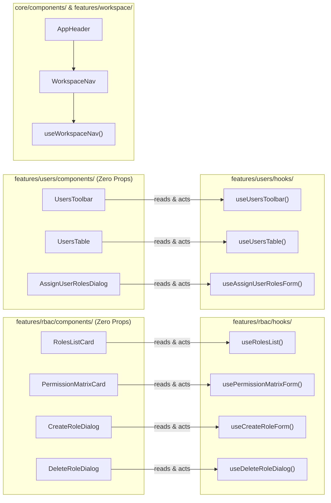

# Milestone 4 — Frontend Step 3: Feature RBAC, Users & Workspace Nav Components (src/client/features/**/components/)

ในขั้นตอนนี้เราจะสร้าง **Pure Presentation Components** แบบ **Zero Props** สำหรับหน้าจัดการบทบาท (`rbac`), หน้าจัดการผู้ใช้งาน (`users`) และแถบนำทางหลัก (`workspace-nav`) พร้อมทั้งเชื่อมต่อ `<WorkspaceNav />` เข้ากับ `<AppHeader />` เพื่อให้ผู้ใช้งานที่มีสิทธิ์สามารถคลิกเข้าสู่หน้าผู้ดูแลระบบได้จากแถบส่วนหัวของแอปพลิเคชัน

---

## 1. เป้าหมายและขอบเขต Boundary (Boundary Context & Goal)

### เป้าหมายของ Step นี้
1. สร้าง **Zero-Props Feature Components** ของโมดูล `rbac` ทั้ง 4 ส่วน (`RolesListCard`, `PermissionMatrixCard`, `CreateRoleDialog`, `DeleteRoleDialog`)
2. สร้าง **Zero-Props Feature Components** ของโมดูล `users` ทั้ง 3 ส่วน (`UsersToolbar`, `UsersTable`, `AssignUserRolesDialog`)
3. สร้าง **Zero-Props Navigation Component** (`WorkspaceNav`) ที่ซ่อน/แสดงปุ่มเมนูตามสิทธิ์ใน Session และนำเข้าสู่ `AppHeader`

### ตารางสรุปไฟล์ใน Step นี้

| ลำดับ | Path ของไฟล์ | บทบาทหน้าที่ (Responsibility) |
| :--- | :--- | :--- |
| 1 | `src/client/features/rbac/components/roles-list-card.tsx` | การ์ดแสดงรายการบทบาทด้านซ้าย ปุ่มสร้างบทบาท และปุ่มลบบทบาท (ซ่อนปุ่มลบสำหรับ System Role) |
| 2 | `src/client/features/rbac/components/permission-matrix-card.tsx` | การ์ดตารางสิทธิ์ (Permission Matrix) แสดงรายการ Checkbox ของสิทธิ์ตาม `scope` ของบทบาทที่เลือก |
| 3 | `src/client/features/rbac/components/create-role-dialog.tsx` | Dialog ฟอร์มสร้างบทบาทใหม่ (`name`, `slug`, `scope`, `description`) |
| 4 | `src/client/features/rbac/components/delete-role-dialog.tsx` | Dialog ยืนยันการลบบทบาทแบบ Custom |
| 5 | `src/client/features/users/components/users-toolbar.tsx` | แถบค้นหาผู้ใช้งานด้วยชื่อหรืออีเมล พร้อมแสดงจำนวนบัญชีทั้งหมด |
| 6 | `src/client/features/users/components/users-table.tsx` | ตารางแสดงรายชื่อผู้ใช้งาน บทบาทระดับระบบ วันที่สร้างบัญชี และปุ่มเปิด Dialog กำหนดบทบาท |
| 7 | `src/client/features/users/components/assign-user-roles-dialog.tsx` | Dialog เลือกติ๊กกำหนด System Roles ให้กับบัญชีผู้ใช้งานที่เลือก |
| 8 | `src/client/features/workspace/components/workspace-nav.tsx` | แถบเมนูนำทางบน Header ที่แสดงเมนูจัดการบทบาทและผู้ใช้งานเฉพาะผู้ที่มีสิทธิ์ `role:read` / `user:read` |
| 9 | `src/client/core/components/app-header.tsx` | อัปเดต Header หลักของแอปพลิเคชันให้แสดง `<WorkspaceNav />` ถัดจากโลโก้แบรนด์ |

### แผนผังความสัมพันธ์ระหว่าง Zero-Props Components กับ Hooks (Mermaid Diagram)



---

## 2. ทฤษฎี ความสำคัญ และกฎสถาปัตยกรรมเฉพาะ Boundary นี้

### 2.1 กฎสถาปัตยกรรมที่บังคับใช้ (`.agents/rules/client.md`)
- **Zero Props & Pure Presentation (`client.md` ข้อ 2 & 3)**:
  - ทุก Component ใน `src/client/features/**/components/*.tsx` ต้องประกาศเป็นฟังก์ชันที่ **ไม่รับ Props ใดๆ เลย** (เช่น `export function RolesListCard()`)
  - ห้ามเขียน Business Logic, การกรองข้อมูล หรือ `useState` / `useEffect` ในไฟล์ Component โดยเด็ดขาด ให้เรียกข้อมูลและ Event Handlers จาก Single-Responsibility Hook ประจำตัวเท่านั้น
- **Read-Only shadcn Primitives & Visual Boundary (`client.md` ข้อ 14 & 15)**:
  - ใช้ Primitive Components จาก `#/client/shared/shadcn/components/ui/*` (เช่น `<Card>`, `<Separator />`, `<Badge>`, `<Dialog>`, `<Table>`, `<Field>`) โดยไม่แก้ไขไฟล์ใน `shadcn/`
  - **ห้ามเติม `border-*` หรือ `ring-*` ใน `className` เองโดยพลการ** ให้ใช้ `<Card>` สำหรับกรอบคอนเทนเนอร์, `<Separator />` สำหรับเส้นคั่น และ `<Button variant="outline">` หรือ `<Badge variant="outline">` สำหรับขอบของปุ่ม/ป้ายกำกับเสมอ
- **SVG Icons เท่านั้น ห้ามใช้ Emoji (`client.md` ข้อ 18)**:
  - ใช้ไอคอนจาก `lucide-react` พร้อมระบุ `aria-hidden="true"` สำหรับไอคอนประกอบข้อความ และระบุ `aria-label` บนปุ่มที่มีเฉพาะไอคอน (เช่น ปุ่มลบบทบาท และปุ่มล้างคำค้นหา)
- **One Component per File (`client.md` ข้อ 19)**:
  - กำหนดให้ 1 ไฟล์ `.tsx` ใน `features/**` และ `core/**` มีเพียง 1 Component เท่านั้น ห้ามประกาศ Sub-component ย่อยไว้ในไฟล์เดียวกันเพื่อแอบส่ง Props

---

## 3. ลงมือเขียนโค้ด (Step-by-Step Implementation)

### 3.1 สร้างการ์ดรายการบทบาท (`src/client/features/rbac/components/roles-list-card.tsx`)

สร้างไฟล์ `src/client/features/rbac/components/roles-list-card.tsx` แสดงรายการบทบาททั้งหมด พร้อมสัญลักษณ์แม่กุญแจ (`<Lock />`) สำหรับบทบาทระดับระบบ (`role.isSystem`) และแสดงปุ่มลบบทบาท (`<Trash2 />`) เฉพาะเมื่อผู้ใช้มีสิทธิ์ `canManageRoles` และบทบาทนั้นไม่ใช่ System Role (`!role.isSystem`)

```tsx
import { Lock, Plus, Shield, Trash2 } from "lucide-react";
import { Badge } from "#/client/shared/shadcn/components/ui/badge";
import { Button } from "#/client/shared/shadcn/components/ui/button";
import {
	Card,
	CardContent,
	CardDescription,
	CardHeader,
	CardTitle,
} from "#/client/shared/shadcn/components/ui/card";
import { Separator } from "#/client/shared/shadcn/components/ui/separator";
import { Skeleton } from "#/client/shared/shadcn/components/ui/skeleton";
import { useRolesList } from "../hooks/use-roles-list";

export function RolesListCard() {
	const {
		roles,
		selectedRoleId,
		isPending,
		canManageRoles,
		selectRole,
		openCreateDialog,
		requestDeleteRole,
	} = useRolesList();

	return (
		<Card className="h-fit">
			<CardHeader>
				<div className="flex items-center justify-between gap-2">
					<div className="flex items-center gap-2">
						<Shield className="size-4 text-primary" aria-hidden="true" />
						<CardTitle>รายการบทบาท</CardTitle>
					</div>
					{canManageRoles ? (
						<Button type="button" size="sm" onClick={openCreateDialog}>
							<Plus aria-hidden="true" />
							<span>สร้างบทบาท</span>
						</Button>
					) : null}
				</div>
				<CardDescription>เลือกบทบาทเพื่อดูและกำหนดสิทธิ์ประจำบทบาท</CardDescription>
				<Separator />
			</CardHeader>
			<CardContent className="flex flex-col gap-1.5">
				{isPending ? (
					<div className="flex flex-col gap-2">
						<Skeleton className="h-12 w-full" />
						<Skeleton className="h-12 w-full" />
						<Skeleton className="h-12 w-full" />
					</div>
				) : (
					roles.map((role) => {
						const isSelected = role.id === selectedRoleId;

						return (
							<div key={role.id} className="flex items-center gap-1">
								<Button
									type="button"
									variant={isSelected ? "secondary" : "ghost"}
									className="h-auto min-w-0 flex-1 flex-col items-start gap-1 px-3 py-2.5 text-left"
									onClick={() => selectRole(role.id)}
								>
									<div className="flex w-full items-center justify-between gap-2">
										<span className="truncate font-medium">{role.name}</span>
										<Badge
											variant={role.scope === "system" ? "default" : "outline"}
										>
											{role.scope}
										</Badge>
									</div>
									<div className="flex items-center gap-1.5 text-xs text-muted-foreground">
										<span>{role.slug}</span>
										<span>({role.permissionIds.length} สิทธิ์)</span>
										{role.isSystem ? (
											<Lock className="size-3" aria-hidden="true" />
										) : null}
									</div>
								</Button>
								{canManageRoles && !role.isSystem ? (
									<Button
										type="button"
										variant="ghost"
										size="icon-sm"
										aria-label={`ลบบทบาท ${role.name}`}
										onClick={() => requestDeleteRole(role)}
									>
										<Trash2
											className="size-4 text-destructive"
											aria-hidden="true"
										/>
									</Button>
								) : null}
							</div>
						);
					})
				)}
			</CardContent>
		</Card>
	);
}
```

---

### 3.2 สร้างการ์ดตารางสิทธิ์ (`src/client/features/rbac/components/permission-matrix-card.tsx`)

สร้างไฟล์ `src/client/features/rbac/components/permission-matrix-card.tsx` แสดงรายละเอียดของบทบาทที่เลือกและรายการ Checkbox ของสิทธิ์ตามขอบเขต (`scopedPermissions`) หากผู้ใช้ไม่มีสิทธิ์ `canManageRoles` ตัว Checkbox จะถูก `disabled` และแสดงข้อความโหมดอ่านอย่างเดียวแทนปุ่มบันทึก

```tsx
import { KeyRound, Lock, ShieldCheck } from "lucide-react";
import { Badge } from "#/client/shared/shadcn/components/ui/badge";
import {
	Card,
	CardContent,
	CardDescription,
	CardFooter,
	CardHeader,
	CardTitle,
} from "#/client/shared/shadcn/components/ui/card";
import { Checkbox } from "#/client/shared/shadcn/components/ui/checkbox";
import {
	Field,
	FieldContent,
	FieldDescription,
	FieldGroup,
	FieldLabel,
} from "#/client/shared/shadcn/components/ui/field";
import { Separator } from "#/client/shared/shadcn/components/ui/separator";
import { Skeleton } from "#/client/shared/shadcn/components/ui/skeleton";
import { usePermissionMatrixForm } from "../hooks/use-permission-matrix-form";

export function PermissionMatrixCard() {
	const {
		isPending,
		selectedRole,
		scopedPermissions,
		canManageRoles,
		form,
		togglePermissionId,
	} = usePermissionMatrixForm();

	if (isPending) {
		return (
			<Card>
				<CardHeader>
					<Skeleton className="h-6 w-48" />
					<Skeleton className="h-4 w-72" />
				</CardHeader>
				<CardContent className="flex flex-col gap-3">
					<Skeleton className="h-12 w-full" />
					<Skeleton className="h-12 w-full" />
					<Skeleton className="h-12 w-full" />
				</CardContent>
			</Card>
		);
	}

	if (!selectedRole) {
		return (
			<Card>
				<CardHeader>
					<CardTitle>ตารางสิทธิ์</CardTitle>
					<CardDescription>
						เลือกบทบาทจากรายการด้านซ้ายเพื่อดูหรือแก้ไขสิทธิ์
					</CardDescription>
				</CardHeader>
			</Card>
		);
	}

	return (
		<Card>
			<CardHeader>
				<div className="flex flex-wrap items-center justify-between gap-2">
					<div className="flex items-center gap-2">
						<KeyRound className="size-5 text-primary" aria-hidden="true" />
						<CardTitle>{selectedRole.name}</CardTitle>
					</div>
					<div className="flex items-center gap-1.5">
						<Badge
							variant={selectedRole.scope === "system" ? "default" : "outline"}
						>
							ขอบเขต: {selectedRole.scope}
						</Badge>
						{selectedRole.isSystem ? (
							<Badge variant="secondary">
								<Lock aria-hidden="true" />
								<span>บทบาทระบบ</span>
							</Badge>
						) : null}
					</div>
				</div>
				<CardDescription>
					{selectedRole.description || `รหัสอ้างอิง: ${selectedRole.slug}`}
				</CardDescription>
				<Separator />
			</CardHeader>

			<form
				noValidate
				onSubmit={(event) => {
					event.preventDefault();
					event.stopPropagation();
					void form.handleSubmit();
				}}
			>
				<form.AppForm>
					<CardContent className="flex flex-col gap-4">
						<div className="flex items-center gap-2 text-xs text-muted-foreground">
							<ShieldCheck className="size-4 text-primary" aria-hidden="true" />
							<span>
								แสดงเฉพาะสิทธิ์ระดับ {selectedRole.scope} เพื่อแยกขอบเขตสิทธิ์อย่างชัดเจน
							</span>
						</div>

						<form.AppField name="permissionIds">
							{(field) => {
								const selectedIds = field.state.value;

								return (
									<FieldGroup className="gap-3">
										{scopedPermissions.map((permission) => {
											const isChecked = selectedIds.includes(permission.id);
											const checkboxId = `perm-${selectedRole.id}-${permission.id}`;

											return (
												<Field
													key={permission.id}
													orientation="horizontal"
													className="items-start"
												>
													<Checkbox
														id={checkboxId}
														checked={isChecked}
														disabled={!canManageRoles}
														onCheckedChange={(checked) => {
															field.handleChange(
																togglePermissionId(
																	selectedIds,
																	permission.id,
																	checked,
																),
															);
														}}
													/>
													<FieldContent>
														<FieldLabel htmlFor={checkboxId}>
															{permission.code}
														</FieldLabel>
														<FieldDescription>
															{permission.description}
														</FieldDescription>
													</FieldContent>
												</Field>
											);
										})}
									</FieldGroup>
								);
							}}
						</form.AppField>
					</CardContent>

					<Separator className="mt-6" />

					<CardFooter className="flex items-center justify-between gap-2 pt-6">
						<span className="text-xs text-muted-foreground">
							{canManageRoles
								? "การเปลี่ยนแปลงสิทธิ์จะมีผลกับผู้ใช้งานที่ถือบทบาทนี้ทันที"
								: "โหมดอ่านอย่างเดียว (ต้องมีสิทธิ์จัดการบทบาทเพื่อบันทึก)"}
						</span>
						{canManageRoles ? (
							<form.SubmitButton loadingLabel="กำลังบันทึกสิทธิ์...">
								บันทึกสิทธิ์
							</form.SubmitButton>
						) : null}
					</CardFooter>
				</form.AppForm>
			</form>
		</Card>
	);
}
```

---

### 3.3 สร้าง Dialog สำหรับสร้างบทบาทใหม่ (`src/client/features/rbac/components/create-role-dialog.tsx`)

สร้างไฟล์ `src/client/features/rbac/components/create-role-dialog.tsx` เชื่อมต่อกับ `useCreateRoleForm()`

```tsx
import { Button } from "#/client/shared/shadcn/components/ui/button";
import {
	Dialog,
	DialogContent,
	DialogDescription,
	DialogFooter,
	DialogHeader,
	DialogTitle,
} from "#/client/shared/shadcn/components/ui/dialog";
import { FieldGroup } from "#/client/shared/shadcn/components/ui/field";
import {
	ROLE_SCOPE_OPTIONS,
	useCreateRoleForm,
} from "../hooks/use-create-role-form";

export function CreateRoleDialog() {
	const { isOpen, handleOpenChange, form } = useCreateRoleForm();

	return (
		<Dialog open={isOpen} onOpenChange={handleOpenChange}>
			<DialogContent>
				<DialogHeader>
					<DialogTitle>สร้างบทบาทใหม่</DialogTitle>
					<DialogDescription>
						กำหนดชื่อ รหัสอ้างอิง และขอบเขตของบทบาท จากนั้นสามารถเลือกสิทธิ์บนตารางสิทธิ์ได้ทันที
					</DialogDescription>
				</DialogHeader>

				<form
					noValidate
					onSubmit={(event) => {
						event.preventDefault();
						event.stopPropagation();
						void form.handleSubmit();
					}}
				>
					<form.AppForm>
						<FieldGroup>
							<form.AppField name="name">
								{(field) => (
									<field.TextField
										label="ชื่อบทบาท"
										placeholder="เช่น ผู้ตรวจสอบความปลอดภัย"
									/>
								)}
							</form.AppField>

							<form.AppField name="slug">
								{(field) => (
									<field.TextField
										label="รหัสอ้างอิง"
										placeholder="เช่น security_auditor"
										description="ตัวอักษรพิมพ์เล็ก a-z, ตัวเลข 0-9 หรือ _"
									/>
								)}
							</form.AppField>

							<form.AppField name="scope">
								{(field) => (
									<field.SelectField
										label="ระดับสิทธิ์"
										options={ROLE_SCOPE_OPTIONS}
									/>
								)}
							</form.AppField>

							<form.AppField name="description">
								{(field) => (
									<field.TextareaField
										label="คำอธิบาย"
										placeholder="อธิบายบทบาทหน้าที่ของบทบาทนี้"
									/>
								)}
							</form.AppField>

							<DialogFooter>
								<Button
									type="button"
									variant="outline"
									onClick={() => handleOpenChange(false)}
								>
									ยกเลิก
								</Button>
								<form.SubmitButton loadingLabel="กำลังสร้างบทบาท...">
									สร้างบทบาท
								</form.SubmitButton>
							</DialogFooter>
						</FieldGroup>
					</form.AppForm>
				</form>
			</DialogContent>
		</Dialog>
	);
}
```

---

### 3.4 สร้าง Dialog ยืนยันการลบบทบาท (`src/client/features/rbac/components/delete-role-dialog.tsx`)

สร้างไฟล์ `src/client/features/rbac/components/delete-role-dialog.tsx` เชื่อมต่อกับ `useDeleteRoleDialog()`

```tsx
import { Button } from "#/client/shared/shadcn/components/ui/button";
import {
	Dialog,
	DialogContent,
	DialogDescription,
	DialogFooter,
	DialogHeader,
	DialogTitle,
} from "#/client/shared/shadcn/components/ui/dialog";
import { useDeleteRoleDialog } from "../hooks/use-delete-role-dialog";

export function DeleteRoleDialog() {
	const { deletingRole, isDeleting, handleOpenChange, handleConfirmDelete } =
		useDeleteRoleDialog();

	return (
		<Dialog open={Boolean(deletingRole)} onOpenChange={handleOpenChange}>
			<DialogContent>
				<DialogHeader>
					<DialogTitle>ยืนยันการลบบทบาท</DialogTitle>
					<DialogDescription>
						คุณต้องการลบบทบาท &ldquo;{deletingRole?.name}&rdquo; (
						{deletingRole?.slug}) ใช่หรือไม่? การกระทำนี้ไม่สามารถย้อนกลับได้
					</DialogDescription>
				</DialogHeader>
				<DialogFooter>
					<Button
						type="button"
						variant="outline"
						disabled={isDeleting}
						onClick={() => handleOpenChange(false)}
					>
						ยกเลิก
					</Button>
					<Button
						type="button"
						variant="destructive"
						disabled={isDeleting}
						onClick={() => void handleConfirmDelete()}
					>
						{isDeleting ? "กำลังลบ..." : "ยืนยันลบบทบาท"}
					</Button>
				</DialogFooter>
			</DialogContent>
		</Dialog>
	);
}
```

---

### 3.5 สร้างแถบเครื่องมือค้นหาผู้ใช้งาน (`src/client/features/users/components/users-toolbar.tsx`)

สร้างไฟล์ `src/client/features/users/components/users-toolbar.tsx` เชื่อมต่อกับ `useUsersToolbar()`

```tsx
import { Search, X } from "lucide-react";
import { Button } from "#/client/shared/shadcn/components/ui/button";
import { Input } from "#/client/shared/shadcn/components/ui/input";
import { useUsersToolbar } from "../hooks/use-users-toolbar";

export function UsersToolbar() {
	const {
		searchInput,
		totalCount,
		isFetching,
		handleSearchChange,
		handleClearSearch,
	} = useUsersToolbar();

	return (
		<div className="flex flex-wrap items-center justify-between gap-3">
			<div className="flex w-full max-w-sm items-center gap-2">
				<Search
					className="size-4 shrink-0 text-muted-foreground"
					aria-hidden="true"
				/>
				<Input
					type="search"
					value={searchInput}
					placeholder="ค้นหาด้วยชื่อหรืออีเมล..."
					aria-label="ค้นหาผู้ใช้งาน"
					onChange={(event) => handleSearchChange(event.target.value)}
				/>
				{searchInput ? (
					<Button
						type="button"
						variant="ghost"
						size="icon-sm"
						aria-label="ล้างคำค้นหา"
						onClick={handleClearSearch}
					>
						<X aria-hidden="true" />
					</Button>
				) : null}
			</div>

			<span className="text-xs text-muted-foreground">
				{isFetching ? "กำลังโหลดข้อมูล..." : `ทั้งหมด ${totalCount} บัญชี`}
			</span>
		</div>
	);
}
```

---

### 3.6 สร้างตารางรายชื่อผู้ใช้งาน (`src/client/features/users/components/users-table.tsx`)

สร้างไฟล์ `src/client/features/users/components/users-table.tsx` แสดงตารางด้วย `<Table>` ของ shadcn ร่วมกับ `table.FlexRender` จาก `@tanstack/react-table` พร้อมเรนเดอร์ `<Badge variant="secondary">` สำหรับคอลัมน์ `systemRoles` และปุ่มเปิด Dialog กำหนดบทบาทสำหรับคอลัมน์ `actions`

```tsx
import { UserCog } from "lucide-react";
import { Badge } from "#/client/shared/shadcn/components/ui/badge";
import { Button } from "#/client/shared/shadcn/components/ui/button";
import { Skeleton } from "#/client/shared/shadcn/components/ui/skeleton";
import {
	Table,
	TableBody,
	TableCell,
	TableHead,
	TableHeader,
	TableRow,
} from "#/client/shared/shadcn/components/ui/table";
import { useUsersTable } from "../hooks/use-users-table";

export function UsersTable() {
	const {
		table,
		columnCount,
		isPending,
		canAssignRoles,
		openAssignRolesDialog,
	} = useUsersTable();

	if (isPending) {
		return (
			<div className="flex flex-col gap-2">
				<Skeleton className="h-10 w-full" />
				<Skeleton className="h-12 w-full" />
				<Skeleton className="h-12 w-full" />
			</div>
		);
	}

	const rows = table.getRowModel().rows;

	return (
		<Table>
			<TableHeader>
				{table.getHeaderGroups().map((headerGroup) => (
					<TableRow key={headerGroup.id}>
						{headerGroup.headers.map((header) => (
							<TableHead key={header.id}>
								{header.isPlaceholder ? null : (
									<table.FlexRender header={header} />
								)}
							</TableHead>
						))}
					</TableRow>
				))}
			</TableHeader>
			<TableBody>
				{rows.length === 0 ? (
					<TableRow>
						<TableCell
							colSpan={columnCount}
							className="h-24 text-center text-muted-foreground"
						>
							ไม่พบบัญชีผู้ใช้งานที่ตรงกับเงื่อนไข
						</TableCell>
					</TableRow>
				) : (
					rows.map((row) => (
						<TableRow key={row.id}>
							{row.getAllCells().map((cell) => {
								if (cell.column.id === "systemRoles") {
									return (
										<TableCell key={cell.id}>
											<div className="flex flex-wrap gap-1">
												{row.original.systemRoles.length > 0 ? (
													row.original.systemRoles.map((role) => (
														<Badge key={role.id} variant="secondary">
															{role.name}
														</Badge>
													))
												) : (
													<span className="text-xs text-muted-foreground">
														ไม่มีบทบาทระดับระบบ
													</span>
												)}
											</div>
										</TableCell>
									);
								}

								if (cell.column.id === "createdAt") {
									return (
										<TableCell
											key={cell.id}
											className="text-xs text-muted-foreground"
										>
											{new Date(row.original.createdAt).toLocaleDateString()}
										</TableCell>
									);
								}

								if (cell.column.id === "actions") {
									return (
										<TableCell key={cell.id}>
											{canAssignRoles ? (
												<Button
													type="button"
													variant="outline"
													size="sm"
													onClick={() => openAssignRolesDialog(row.original)}
												>
													<UserCog aria-hidden="true" />
													<span>กำหนดบทบาท</span>
												</Button>
											) : (
												<span className="text-xs text-muted-foreground">
													อ่านอย่างเดียว
												</span>
											)}
										</TableCell>
									);
								}

								return (
									<TableCell key={cell.id}>
										<table.FlexRender cell={cell} />
									</TableCell>
								);
							})}
						</TableRow>
					))
				)}
			</TableBody>
		</Table>
	);
}
```

---

### 3.7 สร้าง Dialog กำหนดบทบาทระดับระบบให้ผู้ใช้ (`src/client/features/users/components/assign-user-roles-dialog.tsx`)

สร้างไฟล์ `src/client/features/users/components/assign-user-roles-dialog.tsx` เชื่อมต่อกับ `useAssignUserRolesForm()`

```tsx
import { Button } from "#/client/shared/shadcn/components/ui/button";
import { Checkbox } from "#/client/shared/shadcn/components/ui/checkbox";
import {
	Dialog,
	DialogContent,
	DialogDescription,
	DialogFooter,
	DialogHeader,
	DialogTitle,
} from "#/client/shared/shadcn/components/ui/dialog";
import {
	Field,
	FieldContent,
	FieldDescription,
	FieldGroup,
	FieldLabel,
} from "#/client/shared/shadcn/components/ui/field";
import { Skeleton } from "#/client/shared/shadcn/components/ui/skeleton";
import { useAssignUserRolesForm } from "../hooks/use-assign-user-roles-form";

export function AssignUserRolesDialog() {
	const {
		editingUser,
		systemRoles,
		isLoadingRoles,
		handleOpenChange,
		form,
		toggleRoleId,
	} = useAssignUserRolesForm();

	return (
		<Dialog open={Boolean(editingUser)} onOpenChange={handleOpenChange}>
			<DialogContent>
				<DialogHeader>
					<DialogTitle>กำหนดบทบาทระดับระบบ</DialogTitle>
					<DialogDescription>
						เลือกบทบาทระดับระบบสำหรับบัญชี {editingUser?.name} ({editingUser?.email})
					</DialogDescription>
				</DialogHeader>

				<form
					noValidate
					onSubmit={(event) => {
						event.preventDefault();
						event.stopPropagation();
						void form.handleSubmit();
					}}
				>
					<form.AppForm>
						<FieldGroup>
							{isLoadingRoles ? (
								<div className="flex flex-col gap-2">
									<Skeleton className="h-10 w-full" />
									<Skeleton className="h-10 w-full" />
								</div>
							) : (
								<form.AppField name="roleIds">
									{(field) => {
										const selectedRoleIds = field.state.value;

										return (
											<FieldGroup className="gap-3">
												{systemRoles.map((role) => {
													const checkboxId = `assign-role-${role.id}`;
													const isChecked = selectedRoleIds.includes(role.id);

													return (
														<Field
															key={role.id}
															orientation="horizontal"
															className="items-start"
														>
															<Checkbox
																id={checkboxId}
																checked={isChecked}
																onCheckedChange={(checked) => {
																	field.handleChange(
																		toggleRoleId(
																			selectedRoleIds,
																			role.id,
																			checked,
																		),
																	);
																}}
															/>
															<FieldContent>
																<FieldLabel htmlFor={checkboxId}>
																	{role.name} ({role.slug})
																</FieldLabel>
																<FieldDescription>
																	{role.description ||
																		`${role.permissionIds.length} สิทธิ์`}
																</FieldDescription>
															</FieldContent>
														</Field>
													);
												})}
											</FieldGroup>
										);
									}}
								</form.AppField>
							)}

							<DialogFooter>
								<Button
									type="button"
									variant="outline"
									onClick={() => handleOpenChange(false)}
								>
									ยกเลิก
								</Button>
								<form.SubmitButton loadingLabel="กำลังบันทึก...">
									บันทึกบทบาท
								</form.SubmitButton>
							</DialogFooter>
						</FieldGroup>
					</form.AppForm>
				</form>
			</DialogContent>
		</Dialog>
	);
}
```

---

### 3.8 สร้างแถบเมนูนำทางหลัก (`src/client/features/workspace/components/workspace-nav.tsx`)

สร้างไฟล์ `src/client/features/workspace/components/workspace-nav.tsx` สำหรับแสดงปุ่มลิงก์นำทางหลักบน Header โดยใช้ `<AppButtonLink>`

> [!NOTE]
> **หมายเหตุเกี่ยวกับลิงก์ `/projects` ใน Milestone 4**:
> เนื่องจาก `<AppButtonLink>` ตรวจสอบชื่อ Route แบบ Type-safe จาก `routeTree.gen.ts` หากในขณะที่คุณกำลังทำ Milestone 4 ยังไม่ได้สร้างไฟล์ Route `src/routes/_auth/projects/index.tsx` (ซึ่งจะสร้างใน Milestone 5) คุณสามารถคอมเมนต์หรือเว้นเฉพาะบล็อก `<AppButtonLink to="/projects">...</AppButtonLink>` ไว้ชั่วคราวก่อน แล้วค่อยเปิดใช้งานเมื่อเริ่ม Milestone 5 ได้ ส่วนโค้ดด้านล่างนี้คือฉบับสมบูรณ์ของ Repository

```tsx
import {
	FolderKanban,
	LayoutDashboard,
	ShieldCheck,
	Users,
} from "lucide-react";
import { AppButtonLink } from "#/client/shared/components/app-link";
import { useWorkspaceNav } from "../hooks/use-workspace-nav";

export function WorkspaceNav() {
	const {
		isAuthenticated,
		canReadRoles,
		canReadUsers,
		isWorkspaceActive,
		isProjectsActive,
		isRolesActive,
		isUsersActive,
	} = useWorkspaceNav();

	if (!isAuthenticated) {
		return null;
	}

	return (
		<div className="flex flex-wrap items-center gap-1">
			<AppButtonLink
				to="/"
				variant={isWorkspaceActive ? "secondary" : "ghost"}
				size="sm"
			>
				<LayoutDashboard aria-hidden="true" />
				<span>พื้นที่ทำงาน</span>
			</AppButtonLink>

			<AppButtonLink
				to="/projects"
				variant={isProjectsActive ? "secondary" : "ghost"}
				size="sm"
			>
				<FolderKanban aria-hidden="true" />
				<span>โครงการ</span>
			</AppButtonLink>

			{canReadRoles ? (
				<AppButtonLink
					to="/admin/roles"
					variant={isRolesActive ? "secondary" : "ghost"}
					size="sm"
				>
					<ShieldCheck aria-hidden="true" />
					<span>จัดการบทบาท</span>
				</AppButtonLink>
			) : null}

			{canReadUsers ? (
				<AppButtonLink
					to="/admin/users"
					variant={isUsersActive ? "secondary" : "ghost"}
					size="sm"
				>
					<Users aria-hidden="true" />
					<span>ผู้ใช้งาน</span>
				</AppButtonLink>
			) : null}
		</div>
	);
}
```

---

### 3.9 อัปเดต Header หลักให้แสดง `<WorkspaceNav />` (`src/client/core/components/app-header.tsx`)

อัปเดตไฟล์ `src/client/core/components/app-header.tsx` โดยนำ `<WorkspaceNav />` มาวางคู่กับ `<AppBrand>` ภายใน `<AppShellHeader>` แบบ Zero Props

```tsx
import { AuthHeaderControls } from "#/client/features/auth/components/auth-header-controls";
import { WorkspaceNav } from "#/client/features/workspace/components/workspace-nav";
import {
	AppBrand,
	AppBrandIdentity,
	AppBrandLink,
	AppBrandLogo,
} from "#/client/shared/components/app-brand";
import { AppShellHeader } from "#/client/shared/components/app-shell";
import { AppThemeSwitcher } from "#/client/shared/components/app-theme-switcher";

export function AppHeader() {
	return (
		<AppShellHeader>
			<nav className="flex w-full max-w-6xl flex-wrap items-center justify-between gap-3">
				<div className="flex flex-wrap items-center gap-3">
					<AppBrand>
						<AppBrandLink to="/">
							<AppBrandLogo />
							<AppBrandIdentity>TaskFlow</AppBrandIdentity>
						</AppBrandLink>
					</AppBrand>
					<WorkspaceNav />
				</div>
				<div className="flex items-center gap-2">
					<AuthHeaderControls />
					<AppThemeSwitcher />
				</div>
			</nav>
		</AppShellHeader>
	);
}
```

---

## 4. การตรวจสอบความถูกต้องและ Git Commit (Verification & Commit)

### 4.1 ตรวจสอบ Linting และ Formatting
รันคำสั่งตรวจสอบด้วย `bun` (สำหรับ Typecheck เต็มรูปแบบของ `<AppButtonLink to="/admin/roles">` และ `<AppButtonLink to="/admin/users">` จะสมบูรณ์ทันทีหลังจากเราสร้าง File Routes และรัน `bun run generate-routes` ใน Step 5):

```bash
bun run typecheck
bun run format
bun run check
```

### 4.2 บันทึกการเปลี่ยนแปลงลง Git (Git Commit)
เมื่อตรวจสอบเรียบร้อยแล้ว ให้ Stage เฉพาะไฟล์ใน Step นี้และทำการ Commit:

```bash
git add src/client/features/rbac/components/ src/client/features/users/components/ src/client/features/workspace/components/workspace-nav.tsx src/client/core/components/app-header.tsx
git commit -m "milestone-4.frontend.step-3: Zero-Props RBAC, Users & Workspace Nav Components"
```
