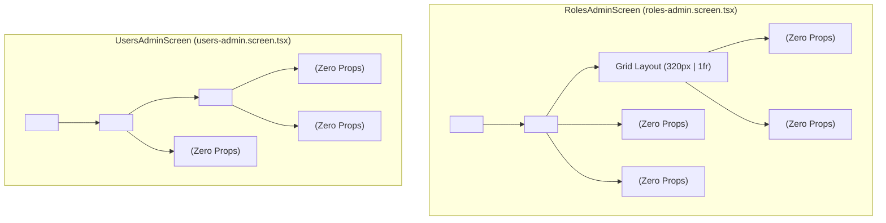

# Milestone 4 — Frontend Step 4: Feature RBAC & Users Screens (src/client/features/**/screens/)

ในขั้นตอนนี้เราจะสร้าง **Screen Composition Roots** สำหรับหน้าจัดการบทบาท (`RolesAdminScreen`) และหน้าจัดการผู้ใช้งาน (`UsersAdminScreen`) ซึ่งทำหน้าที่นำ **Feature Compound Context Provider** จาก Step 2 มาครอบ **Zero-Props Components** จาก Step 3 เข้าด้วยกันภายใต้โครงสร้าง Layout มาตรฐานของแอปพลิเคชัน

---

## 1. เป้าหมายและขอบเขต Boundary (Boundary Context & Goal)

### เป้าหมายของ Step นี้
1. สร้าง `RolesAdminScreen` (`src/client/features/rbac/screens/roles-admin.screen.tsx`) เพื่อประกอบหน้าจัดการบทบาทและตารางสิทธิ์แบบ 2 คอลัมน์ (`md:grid-cols-[320px_1fr]`) พร้อม Dialog สร้างและลบบทบาทภายใต้ `<RolesAdminProvider>`
2. สร้าง `UsersAdminScreen` (`src/client/features/users/screens/users-admin.screen.tsx`) เพื่อประกอบหน้าค้นหาและจัดการบทบาทระดับระบบของผู้ใช้งานทั้งหมดในระบบภายใต้ `<UsersAdminProvider>`

### ตารางสรุปไฟล์ใน Step นี้

| ลำดับ | Path ของไฟล์ | บทบาทหน้าที่ (Responsibility) |
| :--- | :--- | :--- |
| 1 | `src/client/features/rbac/screens/roles-admin.screen.tsx` | Screen Composition Root ของหน้า `/admin/roles` ครอบด้วย `<RolesAdminProvider>` และวาง `RolesListCard`, `PermissionMatrixCard`, `CreateRoleDialog`, `DeleteRoleDialog` แบบ Zero Props |
| 2 | `src/client/features/users/screens/users-admin.screen.tsx` | Screen Composition Root ของหน้า `/admin/users` ครอบด้วย `<UsersAdminProvider>` และวาง `UsersToolbar`, `UsersTable`, `AssignUserRolesDialog` แบบ Zero Props |

### แผนผังโครงสร้างการประกอบ UI ใน Screen Composition Root (Mermaid Diagram)



---

## 2. ทฤษฎี ความสำคัญ และกฎสถาปัตยกรรมเฉพาะ Boundary นี้

### 2.1 กฎสถาปัตยกรรมที่บังคับใช้ (`.agents/rules/client.md` & `architecture.md`)
1. **Screen คือ Composition Root ประจำหน้านั้น (`client.md` ข้อ 1 & 2)**:
   - Route (`src/routes/**`) มีหน้าที่เพียงชี้ว่า URL นั้นใช้ Screen ใด แต่การจัดวางโครงสร้างหน้าจอ (Page Heading, Grid Layout, Card Container, Dialog Mounting) เป็นหน้าที่ของ `features/**/screens/*.tsx`
   - ทุก Feature Component ที่ถูกนำมาวางใน Screen (`<RolesListCard />`, `<PermissionMatrixCard />`, `<CreateRoleDialog />`, `<DeleteRoleDialog />`, `<UsersToolbar />`, `<UsersTable />`, `<AssignUserRolesDialog />`) ต้องถูกเรียกแบบ **Zero Props** 100%
2. **การวาง Feature Compound Context Provider ที่ระดับ Screen (`architecture.md`)**:
   - การวาง `<RolesAdminProvider>` ไว้ที่ชั้นนอกสุดของ `RolesAdminScreen` และวาง `<UsersAdminProvider>` ไว้ที่ชั้นนอกสุดของ `UsersAdminScreen` ทำให้เกิด **Scoped State Boundary** ประจำหน้านั้นๆ:
     - เมื่อผู้ใช้เปิดหน้า `/admin/roles` ทั้ง 4 Components ภายในจะมองเห็น `RolesAdminContext` เดียวกันทันทีโดยไม่ต้องส่ง Props แม้แต่ตัวเดียว
     - เมื่อผู้ใช้เปลี่ยนหน้าออกไป (Unmount Screen) State ชั่วคราวใน Context (เช่น `activeRoleId`, `searchInput`, สถานะเปิด/ปิด Dialog) จะถูกทำลายทิ้งอย่างสะอาดโดยไม่ค้างรบกวนหน้าอื่นในระบบ
3. **Pure Presentation ใน Screen (`client.md` ข้อ 3 & 15)**:
   - ภายในไฟล์ Screen ไม่มี `useState`, `useQuery` หรือ Event Handler ใดๆ เลย มีเพียงโครงสร้าง Layout (`<AppShellMain>`, `<Card>`, `<Separator />`) และการจัดวาง Component เท่านั้น

---

## 3. ลงมือเขียนโค้ด (Step-by-Step Implementation)

### 3.1 สร้าง Screen สำหรับหน้าจัดการบทบาทและตารางสิทธิ์ (`src/client/features/rbac/screens/roles-admin.screen.tsx`)

สร้างไฟล์ `src/client/features/rbac/screens/roles-admin.screen.tsx` โดยใช้ `<RolesAdminProvider>` ครอบ `<AppShellMain>` ซึ่งแบ่งพื้นที่แสดงผลเป็น 2 คอลัมน์ด้วย `grid gap-6 md:grid-cols-[320px_1fr]` สำหรับ `<RolesListCard />` ทางด้านซ้าย และ `<PermissionMatrixCard />` ทางด้านขวา พร้อมวาง `<CreateRoleDialog />` และ `<DeleteRoleDialog />` ไว้ใน Tree เดียวกัน

```tsx
import { ShieldCheck } from "lucide-react";
import { AppShellMain } from "#/client/shared/components/app-shell";
import { CreateRoleDialog } from "../components/create-role-dialog";
import { DeleteRoleDialog } from "../components/delete-role-dialog";
import { PermissionMatrixCard } from "../components/permission-matrix-card";
import { RolesListCard } from "../components/roles-list-card";
import { RolesAdminProvider } from "../contexts/roles-admin.context";

export function RolesAdminScreen() {
	return (
		<RolesAdminProvider>
			<AppShellMain className="mx-auto max-w-6xl py-8">
				<div className="flex flex-col gap-1">
					<div className="flex items-center gap-2">
						<ShieldCheck className="size-6 text-primary" aria-hidden="true" />
						<h1 className="text-2xl font-semibold tracking-tight">
							บทบาทและตารางสิทธิ์
						</h1>
					</div>
					<p className="text-sm text-muted-foreground">
						จัดการบทบาทและกำหนดสิทธิ์แบบละเอียดตามขอบเขต
					</p>
				</div>

				<div className="grid gap-6 md:grid-cols-[320px_1fr]">
					<RolesListCard />
					<PermissionMatrixCard />
				</div>

				<CreateRoleDialog />
				<DeleteRoleDialog />
			</AppShellMain>
		</RolesAdminProvider>
	);
}
```

---

### 3.2 สร้าง Screen สำหรับหน้าจัดการผู้ใช้งาน (`src/client/features/users/screens/users-admin.screen.tsx`)

สร้างไฟล์ `src/client/features/users/screens/users-admin.screen.tsx` โดยใช้ `<UsersAdminProvider>` ครอบ `<AppShellMain>` ภายในประกอบด้วย `<Card>` ที่บรรจุ `<UsersToolbar />` และ `<UsersTable />` พร้อมวาง `<AssignUserRolesDialog />` ไว้ภายนอก Card แต่อยู่ภายใต้ Provider เดียวกัน

```tsx
import { Users } from "lucide-react";
import { AppShellMain } from "#/client/shared/components/app-shell";
import {
	Card,
	CardContent,
	CardDescription,
	CardHeader,
	CardTitle,
} from "#/client/shared/shadcn/components/ui/card";
import { Separator } from "#/client/shared/shadcn/components/ui/separator";
import { AssignUserRolesDialog } from "../components/assign-user-roles-dialog";
import { UsersTable } from "../components/users-table";
import { UsersToolbar } from "../components/users-toolbar";
import { UsersAdminProvider } from "../contexts/users-admin.context";

export function UsersAdminScreen() {
	return (
		<UsersAdminProvider>
			<AppShellMain className="mx-auto max-w-6xl py-8">
				<Card>
					<CardHeader>
						<div className="flex items-center gap-2">
							<Users className="size-5 text-primary" aria-hidden="true" />
							<CardTitle>ผู้ใช้งานพื้นที่ทำงานและบทบาทระดับระบบ</CardTitle>
						</div>
						<CardDescription>
							รายชื่อผู้ใช้งานทั้งหมดในระบบและการมอบหมายบทบาทระดับระบบ
						</CardDescription>
						<Separator />
					</CardHeader>
					<CardContent className="flex flex-col gap-4">
						<UsersToolbar />
						<UsersTable />
					</CardContent>
				</Card>

				<AssignUserRolesDialog />
			</AppShellMain>
		</UsersAdminProvider>
	);
}
```

---

## 4. การตรวจสอบความถูกต้องและ Git Commit (Verification & Commit)

### 4.1 ตรวจสอบ Linting และ Formatting
รันคำสั่งตรวจสอบด้วย `bun` เพื่อยืนยันความถูกต้องของโครงสร้างโค้ดและการ Import:

```bash
bun run typecheck
bun run format
bun run check
```

### 4.2 บันทึกการเปลี่ยนแปลงลง Git (Git Commit)
เมื่อตรวจสอบเรียบร้อยแล้ว ให้ Stage เฉพาะไฟล์ใน Step นี้และทำการ Commit:

```bash
git add src/client/features/rbac/screens/ src/client/features/users/screens/
git commit -m "milestone-4.frontend.step-4: Feature RBAC & Users Admin Screens"
```
