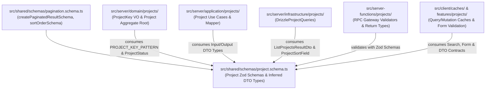

# Milestone 5 — Backend Step 1: Shared Project Schemas (src/shared/schemas/)

## 1. เป้าหมายและขอบเขต Boundary (Boundary Context & Goal)

ใน **Milestone 5 (Projects Directory & Lifecycle Management)** เราจะเริ่มสร้างระบบบริหารจัดการโครงการ (Projects) ตั้งแต่การค้นหา กรอง เรียงลำดับ แบ่งหน้า (Server-Side Pagination) การสร้างโครงการใหม่ การแก้ไขรายละเอียดโครงการ ไปจนถึงการเปลี่ยนสถานะโครงการระหว่าง `active` และ `archived` (Archive / Restore Lifecycle)

ตามกฎสถาปัตยกรรมของโปรเจกต์ **TaskFlow** การพัฒนาทุกฟีเจอร์ที่ต้องส่งข้อมูลข้ามขอบเขตระหว่าง Client และ Server ต้องเริ่มต้นที่เลเยอร์ **`src/shared/schemas/`** เสมอ เพื่อสร้าง **Single Source of Truth** ของ Data Contract ด้วย Zod Schema ก่อนจะลงมือเขียน Domain, Application, Infrastructure หรือ UI

> [!NOTE]
> ไฟล์ `src/shared/schemas/project.schema.ts` ในขั้นตอนนี้จะนิยามเฉพาะส่วนของ **Milestone 5** (การค้นหาโครงการ, การสร้าง/แก้ไข/จัดเก็บ/กู้คืนโครงการ และ DTO สำหรับรายการโครงการ) ส่วน Schema ของหน้ารายละเอียดโครงการ (Project Detail), สมาชิกโครงการ (Project Members) และประวัติกิจกรรม (Activity Logs) จะนำมาต่อเติมแบบ **Additive** ใน **Milestone 6**

### ตารางสรุปไฟล์ใน Step นี้

| ลำดับ | เส้นทางไฟล์ (Path) | หน้าที่ความรับผิดชอบ (Responsibility) |
| :--- | :--- | :--- |
| 1 | `src/shared/schemas/project.schema.ts` | นิยาม Regex Pattern ของรหัสโครงการ (`PROJECT_KEY_PATTERN`), Enum สถานะโครงการ, Search/Pagination Params Schema, Input Schemas สำหรับสร้าง/แก้ไข/เปลี่ยนสถานะโครงการ และ Output DTO Schemas สำหรับรายการโครงการแบบแบ่งหน้า |

### แผนภาพสถาปัตยกรรมและทิศทางการพึ่งพา (Architecture & Dependency Flow)



---

## 2. ทฤษฎี ความสำคัญ และกฎสถาปัตยกรรมเฉพาะ Boundary นี้

### 2.1 กฎ Shared Schemas จาก `.agents/rules/globals.md`
1. **`shared/schemas/**` คือ Source of Truth กลางของ Data Contract (Shared Schemas ข้อ 1–3)**:
   - ห้ามให้ `server/` และ `client/` นิยาม Type หรือ Shape ของข้อมูลเดียวกันแยกกันเด็ดขาด
   - ทุก Contract ต้องเริ่มจาก Zod Schema แล้วสกัด TypeScript Type ออกมาด้วย `z.infer<typeof ...>` เสมอ เพื่อให้การตรวจสอบข้อมูลตอนรันไทม์ (Runtime Validation) และการตรวจสอบชนิดข้อมูลตอนคอมไพล์ (Compile-Time Type Checking) ตรงกัน 100%
2. **Isomorphic Purity (`architecture.md`)**:
   - โค้ดใน `src/shared/schemas/` ต้องเป็น Isomorphic (รันได้ทั้งบน Browser และ Server Runtime) ห้าม import โมดูลของ Database, Drizzle ORM, Node.js APIs หรือ React Hooks เข้ามาปะปนโดยเด็ดขาด
3. **Resilient URL Search Params (`projectsSearchSchema`)**:
   - สำหรับพารามิเตอร์ที่ใช้บน URL Query String (`search`, `status`, `sortBy`, `sortOrder`, `page`, `pageSize`) เราใช้ `.default(...).catch(...)` ของ Zod เพื่อรับประกันว่าแม้ผู้ใช้พิมพ์ URL ผิดพลาดหรือส่งค่าแปลกปลอมเข้ามาใน Query String ระบบก็จะสามารถ Fallback กลับไปยังค่ามาตรฐานได้อย่างปลอดภัยโดยไม่ทำให้หน้าเว็บพัง
4. **Reusable Pagination Factory (`createPaginatedResultSchema`)**:
   - แทนที่จะเขียนโครงสร้าง `{ items, total, page, pageSize, totalPages }` ซ้ำซ้อนในทุกโมดูล เราเรียกใช้ฟังก์ชัน `createPaginatedResultSchema(projectListItemDtoSchema)` จาก `./pagination.schema` เพื่อรักษามาตรฐานข้อมูลแบ่งหน้าให้เหมือนกันทั้งระบบ (DRY Principle)

---

## 3. ลงมือเขียนโค้ด (Step-by-Step Implementation)

### 3.1 ไฟล์ `src/shared/schemas/project.schema.ts` (ส่วนของ Milestone 5)

สร้างไฟล์ `src/shared/schemas/project.schema.ts` เพื่อนิยามสัญญากลางสำหรับระบบบริหารจัดการโครงการใน Milestone 5:

```typescript
import { z } from "zod";
import {
	createPaginatedResultSchema,
	DEFAULT_PAGE,
	DEFAULT_PAGE_SIZE,
	sortOrderSchema,
} from "./pagination.schema";

export const PROJECT_KEY_PATTERN = /^[A-Z][A-Z0-9]{1,9}$/;

export const projectStatusSchema = z.enum(["active", "archived"]);
export type ProjectStatus = z.infer<typeof projectStatusSchema>;

export const projectStatusFilterSchema = z.enum(["all", "active", "archived"]);
export type ProjectStatusFilter = z.infer<typeof projectStatusFilterSchema>;

export const projectSortFieldSchema = z.enum([
	"key",
	"name",
	"status",
	"createdAt",
	"updatedAt",
]);
export type ProjectSortField = z.infer<typeof projectSortFieldSchema>;

export const projectsSearchSchema = z.object({
	search: z.string().trim().max(100).default("").catch(""),
	status: projectStatusFilterSchema.default("all").catch("all"),
	sortBy: projectSortFieldSchema.default("updatedAt").catch("updatedAt"),
	sortOrder: sortOrderSchema.default("desc").catch("desc"),
	page: z.number().int().min(1).default(DEFAULT_PAGE).catch(DEFAULT_PAGE),
	pageSize: z
		.number()
		.int()
		.min(1)
		.max(100)
		.default(DEFAULT_PAGE_SIZE)
		.catch(DEFAULT_PAGE_SIZE),
});
export type ProjectsSearch = z.infer<typeof projectsSearchSchema>;

export const createProjectInputSchema = z.object({
	key: z
		.string()
		.trim()
		.toUpperCase()
		.min(2, "รหัสโครงการต้องมีอย่างน้อย 2 ตัวอักษร")
		.max(10, "รหัสโครงการต้องไม่เกิน 10 ตัวอักษร")
		.regex(
			PROJECT_KEY_PATTERN,
			"รหัสโครงการต้องขึ้นต้นด้วยตัวอักษรภาษาอังกฤษ A-Z และตามด้วย A-Z หรือ 0-9 เท่านั้น",
		),
	name: z
		.string()
		.trim()
		.min(2, "ชื่อโครงการต้องมีอย่างน้อย 2 ตัวอักษร")
		.max(150, "ชื่อโครงการต้องไม่เกิน 150 ตัวอักษร"),
	description: z.string().trim().max(1000, "คำอธิบายต้องไม่เกิน 1000 ตัวอักษร"),
});
export type CreateProjectInput = z.infer<typeof createProjectInputSchema>;

export const updateProjectInputSchema = z.object({
	projectId: z.uuid("รหัสโครงการไม่ถูกต้อง"),
	name: z
		.string()
		.trim()
		.min(2, "ชื่อโครงการต้องมีอย่างน้อย 2 ตัวอักษร")
		.max(150, "ชื่อโครงการต้องไม่เกิน 150 ตัวอักษร"),
	description: z.string().trim().max(1000, "คำอธิบายต้องไม่เกิน 1000 ตัวอักษร"),
});
export type UpdateProjectInput = z.infer<typeof updateProjectInputSchema>;

export const projectActionInputSchema = z.object({
	projectId: z.uuid("รหัสโปรเจกต์ไม่ถูกต้อง"),
});
export type ProjectActionInput = z.infer<typeof projectActionInputSchema>;

export const projectDtoSchema = z.object({
	id: z.uuid(),
	key: z.string(),
	name: z.string(),
	description: z.string(),
	status: projectStatusSchema,
	taskSequence: z.number().int().nonnegative(),
	createdById: z.string(),
	createdAt: z.string(),
	updatedAt: z.string(),
});
export type ProjectDto = z.infer<typeof projectDtoSchema>;

export const projectListItemDtoSchema = z.object({
	id: z.uuid(),
	key: z.string(),
	name: z.string(),
	description: z.string(),
	status: projectStatusSchema,
	taskSequence: z.number().int().nonnegative(),
	createdById: z.string(),
	createdByName: z.string(),
	memberCount: z.number().int().nonnegative(),
	taskCount: z.number().int().nonnegative(),
	myRoleName: z.string().nullable(),
	canUpdate: z.boolean(),
	createdAt: z.string(),
	updatedAt: z.string(),
});
export type ProjectListItemDto = z.infer<typeof projectListItemDtoSchema>;

export const listProjectsResultDtoSchema = createPaginatedResultSchema(
	projectListItemDtoSchema,
);
export type ListProjectsResultDto = z.infer<typeof listProjectsResultDtoSchema>;
```

**คำอธิบายโค้ดอย่างละเอียด:**
- `PROJECT_KEY_PATTERN = /^[A-Z][A-Z0-9]{1,9}$/`: กำหนดกฎของรหัสย่อโครงการ (Project Key เช่น `TF`, `ENG01`, `MOBILE2`) ให้ต้องขึ้นต้นด้วยตัวพิมพ์ใหญ่ภาษาอังกฤษ `A-Z` 1 ตัว และตามด้วย `A-Z` หรือตัวเลข `0-9` อีก 1 ถึง 9 ตัว (รวมความยาว 2–10 ตัวอักษร) โดยค่าคงที่นี้จะถูกนำไปใช้ซ้ำใน Value Object `ProjectKey` ของฝั่ง Domain ด้วย
- `projectStatusSchema` และ `projectStatusFilterSchema`:
  - `projectStatusSchema`: สถานะจริงของโครงการในฐานข้อมูลและ Domain (`"active"` หรือ `"archived"`)
  - `projectStatusFilterSchema`: ตัวกรองสถานะสำหรับหน้า Projects Directory ที่เพิ่มตัวเลือก `"all"` สำหรับแสดงทุกสถานะ
- `projectSortFieldSchema`: กำหนดคอลัมน์ที่อนุญาตให้เรียงลำดับได้ (`"key"`, `"name"`, `"status"`, `"createdAt"`, `"updatedAt"`) เพื่อป้องกันการส่งชื่อคอลัมน์แปลกปลอมเข้าสู่ชั้น Query
- `projectsSearchSchema`: Schema สำหรับตรวจสอบพารามิเตอร์การค้นหา กรอง เรียงลำดับ และแบ่งหน้าใน URL Search Params ของ TanStack Router และ Input ของ `listProjectsFn`
- `createProjectInputSchema`: ตรวจสอบข้อมูลสำหรับการสร้างโครงการใหม่ โดยแปลง `key` เป็นตัวพิมพ์ใหญ่อัตโนมัติ (`.trim().toUpperCase()`) ก่อนตรวจความยาวและ Regex พร้อมตรวจสอบความยาวของ `name` (2–150 ตัวอักษร) และ `description` (ไม่เกิน 1,000 ตัวอักษร)
- `updateProjectInputSchema`: ตรวจสอบข้อมูลสำหรับการแก้ไขชื่อและคำอธิบายของโครงการที่ระบุด้วย `projectId` (สังเกตว่าไม่อนุญาตให้แก้ไข `key` หลังจากสร้างโครงการแล้ว เพราะ `key` ใช้เป็น Prefix ของรหัสงาน เช่น `TF-1`)
- `projectActionInputSchema`: Input Schema ที่รับเฉพาะ `projectId` (`z.uuid(...)`) สำหรับการสั่งเปลี่ยนสถานะโครงการ (`archiveProjectFn` และ `restoreProjectFn`)
- `projectDtoSchema` (`ProjectDto`): โครงสร้างข้อมูลมาตรฐานที่แปลงมาจาก `Project` Aggregate Root ผ่าน `ProjectMapper.toDto(project)` หลังจบคำสั่ง Write/Mutation
- `projectListItemDtoSchema` (`ProjectListItemDto`) และ `listProjectsResultDtoSchema` (`ListProjectsResultDto`): โครงสร้างข้อมูล Read Model Projection สำหรับแสดงในตารางและรายการโครงการ ซึ่งรวมข้อมูลจากการ Join และนับจำนวน (`createdByName`, `memberCount`, `taskCount`, `myRoleName`, `canUpdate`) มาให้พร้อมแสดงผลบน UI ทันที

---

## 4. การตรวจสอบความถูกต้องและ Git Commit (Verification & Commit)

ตรวจสอบความถูกต้องของโค้ดด้วย Biome และ TypeScript Compiler:

```bash
# 1. ตรวจสอบการจัดรูปแบบและกฎ Linter ด้วย Biome
bun run check

# 2. ตรวจสอบ Type Safety ด้วย TypeScript Compiler
bun run typecheck
```

เมื่อตรวจสอบผ่านเรียบร้อยแล้ว ให้ทำการบันทึกเข้าสู่ Git Repository:

```bash
git add src/shared/schemas/project.schema.ts
git commit -m "milestone-5.backend.step-1: Shared Project Schemas"
```
