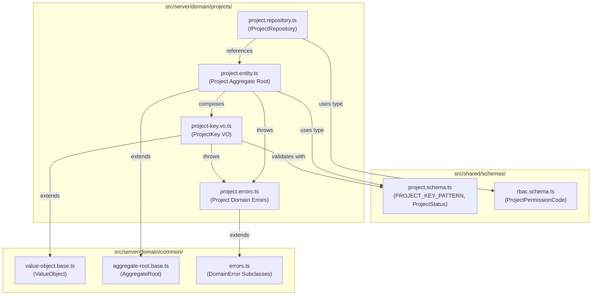

# Milestone 5 — Backend Step 2: Domain Projects (src/server/domain/projects/)

## 1. เป้าหมายและขอบเขต Boundary (Boundary Context & Goal)

ในขั้นตอนนี้เราจะออกแบบและพัฒนาแกนกลางทางธุรกิจของโมดูล Projects ภายในเลเยอร์ **`src/server/domain/projects/`** ตามหลัก **Tactical Domain-Driven Design (DDD)** ซึ่งประกอบด้วย:
1. **Value Object (`ProjectKey`)**: ควบคุมความถูกต้องและการทำ Normalization ของรหัสโครงการ (`key`) ให้เป็นตัวพิมพ์ใหญ่และตรงตามรูปแบบ `^[A-Z][A-Z0-9]{1,9}$` เสมอ
2. **Aggregate Root (`Project`)**: ปกป้องความถูกต้องของสถานะโครงการ (Consistency Boundary) ทั้งการสร้างโครงการใหม่ (`create`), การแก้ไขรายละเอียด (`updateDetails`), การจัดเก็บเข้ากรุ (`archive`), การกู้คืน (`restore`) และการตรวจสอบว่าโครงการต้องไม่ถูกจัดเก็บก่อนแก้ไขสมาชิกหรือแก้ไขงาน (`ensureActiveForMemberManagement`, `ensureActiveForTaskMutation`)
3. **Domain Errors (`project.errors.ts`)**: นิยามข้อผิดพลาดทางธุรกิจเฉพาะของโดเมน Projects โดยไม่ผูกติดกับ HTTP Status Code หรือโปรโตคอลเครือข่าย
4. **Repository Interface (`IProjectRepository`)**: กำหนดสัญญา (Contract) สำหรับการเข้าถึงและบันทึกข้อมูลโครงการ สมาชิก และประวัติกิจกรรม ตามหลัก Dependency Inversion Principle (DIP)

### ตารางสรุปไฟล์ใน Step นี้

| ลำดับ | เส้นทางไฟล์ (Path) | หน้าที่ความรับผิดชอบ (Responsibility) |
| :--- | :--- | :--- |
| 1 | `src/server/domain/projects/project-key.vo.ts` | Value Object ห่อหุ้มรหัสโครงการ ทำ Normalization (`trim().toUpperCase()`) และตรวจสอบด้วย `PROJECT_KEY_PATTERN` |
| 2 | `src/server/domain/projects/project.entity.ts` | Aggregate Root ของโครงการ ควบคุม Lifecycle (`active` ↔ `archived`) และ Invariants ของชื่อและคำอธิบาย |
| 3 | `src/server/domain/projects/project.errors.ts` | Custom Domain Errors ประจำโมดูล Projects สืบทอดจาก Base Domain Errors |
| 4 | `src/server/domain/projects/project.repository.ts` | Repository Interface (`IProjectRepository`) และ Parameter Interfaces สำหรับจัดการข้อมูลโครงการ |

### แผนภาพสถาปัตยกรรมและทิศทางการพึ่งพา (Architecture & Dependency Flow)



---

## 2. ทฤษฎี ความสำคัญ และกฎสถาปัตยกรรมเฉพาะ Boundary นี้

### 2.1 กฎ Domain Layer จาก `.agents/rules/server.md`
1. **Inward-Only Dependency Rule (ข้อ 1)**:
   - โค้ดใน `src/server/domain/projects/` ห้าม import สิ่งใดจาก `application/`, `infrastructure/`, `composition/` หรือ `server-functions/` เด็ดขาด อนุญาตให้พึ่งพาเฉพาะ `src/server/domain/common/` และ `src/shared/schemas/` เท่านั้น
2. **Rich Domain Model & Business Invariants (ข้อ 4)**:
   - ห้ามสร้าง Anemic Domain Model ที่มีเพียงตัวแปร Public Properties แล้วปล่อยให้ Use Case แก้ไขค่าโดยตรง
   - ในคลาส `Project` เราซ่อนสถานะไว้ใน `this.props` และเปิดให้อ่านผ่าน Readonly Getters เท่านั้น ส่วนการเปลี่ยนแปลงสถานะต้องทำผ่าน Domain Methods (`updateDetails`, `archive`, `restore`) ซึ่งจะตรวจสอบกฎทางธุรกิจทุกครั้ง เช่น **ห้ามแก้ไขรายละเอียดของโครงการที่อยู่ในสถานะ `archived`**
3. **แยกการสร้างใหม่ (`create`) ออกจาก Reconstitution (`reconstitute`) (ข้อ 5)**:
   - `Project.create(params)`: ใช้เมื่อผู้ใช้สร้างโครงการใหม่ในระบบ จะทำการสุ่ม `crypto.randomUUID()`, สร้าง `ProjectKey.create(params.key)`, ตรวจสอบความยาวของ `name` และ `description`, ตั้งค่าเริ่มต้น `status: "active"`, `taskSequence: 0` และกำหนด `createdAt` / `updatedAt` เป็นเวลาปัจจุบัน
   - `Project.reconstitute(id, props)` และ `ProjectKey.reconstitute(value)`: ใช้เฉพาะในชั้น Infrastructure Repository ตอนโหลดข้อมูลที่มีอยู่แล้วจากฐานข้อมูลกลับมาเป็น Domain Entity โดยไม่สุ่ม ID ใหม่หรือเปลี่ยนเวลา `createdAt`
4. **Pure Repository Interface (ข้อ 6 และ 16)**:
   - `IProjectRepository` นิยามเฉพาะเมธอดที่รับและคืนค่าเป็น Domain Entity หรือ Primitives เท่านั้น ห้ามอ้างอิงถึง Drizzle Table Schema หรือรับพารามิเตอร์ `tx` (Transaction Context) เข้ามาในเมธอด เพราะการจัดการ Transaction จะถูกซ่อนไว้เบื้องหลังผ่าน `AsyncLocalStorage` ในชั้น Infrastructure
5. **Transport-Agnostic Domain Errors (ข้อ 7)**:
   - ข้อผิดพลาดทุกคลาสใน `project.errors.ts` สืบทอดจาก `ValidationDomainError`, `ConflictDomainError`, `NotFoundDomainError`, `InvalidStateTransitionError` หรือ `ForbiddenDomainError` ใน `src/server/domain/common/errors.ts` โดยไม่ผูกกับ HTTP Status Code โดยตรง

---

## 3. ลงมือเขียนโค้ด (Step-by-Step Implementation)

### 3.1 ไฟล์ `src/server/domain/projects/project.errors.ts`

สร้างไฟล์ `src/server/domain/projects/project.errors.ts` สำหรับนิยามข้อผิดพลาดทางธุรกิจของโดเมน Projects (ในขั้นตอนนี้เรานิยามข้อผิดพลาดสำหรับ Milestone 5 และส่วนของสมาชิกโครงการที่จะใช้งานต่อเนื่องใน Milestone 6):

```typescript
import {
	ConflictDomainError,
	ForbiddenDomainError,
	InvalidStateTransitionError,
	NotFoundDomainError,
	ValidationDomainError,
} from "#/server/domain/common/errors";

export class InvalidProjectKeyError extends ValidationDomainError {
	constructor(rawKey: string) {
		super(
			`รหัสโครงการ '${rawKey}' ไม่ถูกต้อง ต้องเป็นตัวอักษร A-Z และตัวเลข 0-9 ความยาว 2–10 ตัวอักษร และขึ้นต้นด้วย A-Z`,
		);
	}
}

export class ProjectKeyAlreadyExistsError extends ConflictDomainError {
	constructor(key: string) {
		super(`รหัสโครงการ '${key}' ถูกใช้งานแล้ว กรุณาใช้รหัสอื่น`);
	}
}

export class ProjectNotFoundError extends NotFoundDomainError {
	constructor(identifier: string) {
		super(`ไม่พบโครงการที่ระบุ (${identifier})`);
	}
}

export class ProjectArchivedError extends InvalidStateTransitionError {
	constructor(message = "โครงการนี้อยู่ในสถานะถูกจัดเก็บ ไม่สามารถแก้ไขได้") {
		super(message);
	}
}

export class ProjectAlreadyActiveError extends InvalidStateTransitionError {
	constructor() {
		super("โครงการนี้อยู่ในสถานะใช้งานอยู่แล้ว");
	}
}

export class ProjectMemberAlreadyExistsError extends ConflictDomainError {
	constructor() {
		super("ผู้ใช้งานนี้เป็นสมาชิกของโปรเจกต์นี้อยู่แล้ว");
	}
}

export class ProjectMemberNotFoundError extends NotFoundDomainError {
	constructor(memberId: string) {
		super(`ไม่พบสมาชิกที่ระบุภายในโปรเจกต์ (${memberId})`);
	}
}

export class LastProjectOwnerError extends ForbiddenDomainError {
	constructor(
		message = "ไม่สามารถถอดหรือลดบทบาท Project Owner คนสุดท้ายของโปรเจกต์ได้",
	) {
		super(message);
	}
}

export class InvalidProjectRoleError extends ValidationDomainError {
	constructor() {
		super("สามารถมอบหมายได้เฉพาะ Role ระดับ 'project' ให้สมาชิกภายในโปรเจกต์เท่านั้น");
	}
}
```

**คำอธิบายโค้ด:**
- `InvalidProjectKeyError`: โยนเมื่อรหัสโครงการไม่ผ่านเงื่อนไข `PROJECT_KEY_PATTERN`
- `ProjectKeyAlreadyExistsError`: โยนเมื่อพยายามสร้างโครงการด้วย `key` ที่ซ้ำกับโครงการอื่นที่มีอยู่แล้วในระบบ
- `ProjectNotFoundError`: โยนเมื่อค้นหาโครงการด้วย `projectId` ไม่พบ
- `ProjectArchivedError`: โยนเมื่อพยายามแก้ไขรายละเอียด จัดเก็บซ้ำ จัดการสมาชิก หรือจัดการงานในโครงการที่ถูกจัดเก็บ (`archived`) ไปแล้ว
- `ProjectAlreadyActiveError`: โยนเมื่อพยายามสั่งกู้คืน (`restore()`) โครงการที่มีสถานะเป็น `active` อยู่แล้ว

---

### 3.2 ไฟล์ `src/server/domain/projects/project-key.vo.ts`

สร้างไฟล์ `src/server/domain/projects/project-key.vo.ts` เพื่อนิยาม Value Object สำหรับรหัสย่อโครงการ:

```typescript
import { ValueObject } from "#/server/domain/common/value-object.base";
import { PROJECT_KEY_PATTERN } from "#/shared/schemas/project.schema";
import { InvalidProjectKeyError } from "./project.errors";

interface ProjectKeyProps {
	readonly value: string;
}

export class ProjectKey extends ValueObject<ProjectKeyProps> {
	private constructor(props: ProjectKeyProps) {
		super(props);
	}

	static create(rawKey: string): ProjectKey {
		const normalized = rawKey.trim().toUpperCase();
		if (!PROJECT_KEY_PATTERN.test(normalized)) {
			throw new InvalidProjectKeyError(rawKey);
		}
		return new ProjectKey({ value: normalized });
	}

	static reconstitute(value: string): ProjectKey {
		return new ProjectKey({ value });
	}

	get value(): string {
		return this.props.value;
	}
}
```

**คำอธิบายโค้ด:**
- `ProjectKey.create(rawKey)`: ทำ Normalization ด้วยการตัดช่องว่างหัวท้ายและแปลงเป็นตัวพิมพ์ใหญ่ (`rawKey.trim().toUpperCase()`) ก่อนตรวจสอบด้วย `PROJECT_KEY_PATTERN` หากไม่ตรงตามรูปแบบจะโยน `InvalidProjectKeyError` ทันที ทำให้มั่นใจได้ 100% ว่าทุกอินสแตนซ์ของ `ProjectKey` ในระบบมีรูปแบบที่ถูกต้องเสมอ
- `ProjectKey.reconstitute(value)`: ใช้สำหรับแปลงข้อมูลจากฐานข้อมูลกลับมาเป็น `ProjectKey`

---

### 3.3 ไฟล์ `src/server/domain/projects/project.entity.ts`

สร้างไฟล์ `src/server/domain/projects/project.entity.ts` เพื่อนิยาม `Project` Aggregate Root:

```typescript
import { AggregateRoot } from "#/server/domain/common/aggregate-root.base";
import { ValidationDomainError } from "#/server/domain/common/errors";
import type { ProjectStatus } from "#/shared/schemas/project.schema";
import {
	ProjectAlreadyActiveError,
	ProjectArchivedError,
} from "./project.errors";
import { ProjectKey } from "./project-key.vo";

export interface ProjectProps {
	readonly key: ProjectKey;
	readonly name: string;
	readonly description: string;
	readonly status: ProjectStatus;
	readonly taskSequence: number;
	readonly createdById: string;
	readonly createdAt: Date;
	readonly updatedAt: Date;
}

export interface CreateProjectParams {
	readonly key: string;
	readonly name: string;
	readonly description: string;
	readonly createdById: string;
}

export class Project extends AggregateRoot<ProjectProps> {
	private constructor(id: string, props: ProjectProps) {
		super(id, props);
	}

	static create(params: CreateProjectParams): Project {
		const projectKey = ProjectKey.create(params.key);
		const validatedName = Project.validateName(params.name);
		const validatedDescription = Project.validateDescription(
			params.description,
		);
		const now = new Date();

		return new Project(crypto.randomUUID(), {
			key: projectKey,
			name: validatedName,
			description: validatedDescription,
			status: "active",
			taskSequence: 0,
			createdById: params.createdById,
			createdAt: now,
			updatedAt: now,
		});
	}

	static reconstitute(id: string, props: ProjectProps): Project {
		return new Project(id, props);
	}

	get key(): ProjectKey {
		return this.props.key;
	}

	get name(): string {
		return this.props.name;
	}

	get description(): string {
		return this.props.description;
	}

	get status(): ProjectStatus {
		return this.props.status;
	}

	get taskSequence(): number {
		return this.props.taskSequence;
	}

	get createdById(): string {
		return this.props.createdById;
	}

	get createdAt(): Date {
		return this.props.createdAt;
	}

	get updatedAt(): Date {
		return this.props.updatedAt;
	}

	updateDetails(name: string, description: string): void {
		if (this.props.status === "archived") {
			throw new ProjectArchivedError(
				"ไม่สามารถแก้ไขรายละเอียดโครงการที่ถูกจัดเก็บแล้ว กรุณากู้คืนก่อน",
			);
		}

		this.props = {
			...this.props,
			name: Project.validateName(name),
			description: Project.validateDescription(description),
			updatedAt: new Date(),
		};
	}

	archive(): void {
		if (this.props.status === "archived") {
			throw new ProjectArchivedError("โครงการนี้ถูกจัดเก็บไว้แล้ว");
		}

		this.props = {
			...this.props,
			status: "archived",
			updatedAt: new Date(),
		};
	}

	restore(): void {
		if (this.props.status === "active") {
			throw new ProjectAlreadyActiveError();
		}

		this.props = {
			...this.props,
			status: "active",
			updatedAt: new Date(),
		};
	}

	ensureActiveForMemberManagement(): void {
		if (this.props.status === "archived") {
			throw new ProjectArchivedError(
				"ไม่สามารถจัดการสมาชิกในโครงการที่ถูกจัดเก็บแล้วได้ กรุณากู้คืนโครงการก่อน",
			);
		}
	}

	ensureActiveForTaskMutation(): void {
		if (this.props.status === "archived") {
			throw new ProjectArchivedError(
				"ไม่สามารถสร้าง แก้ไข หรือดำเนินการกับงานในโครงการที่ถูกจัดเก็บแล้วได้ กรุณากู้คืนโครงการก่อน",
			);
		}
	}

	private static validateName(rawName: string): string {
		const trimmed = rawName.trim();
		if (trimmed.length < 2 || trimmed.length > 150) {
			throw new ValidationDomainError(
				"ชื่อโครงการต้องมีความยาวระหว่าง 2–150 ตัวอักษร",
			);
		}
		return trimmed;
	}

	private static validateDescription(rawDescription: string): string {
		const trimmed = rawDescription.trim();
		if (trimmed.length > 1000) {
			throw new ValidationDomainError("คำอธิบายโครงการต้องไม่เกิน 1000 ตัวอักษร");
		}
		return trimmed;
	}
}
```

**คำอธิบายโค้ด:**
- `Project.create(params)`: Factory Method สำหรับสร้าง Aggregate Root ตัวใหม่ โดยตรวจสอบ `key` ผ่าน `ProjectKey.create`, ตรวจสอบ `name` (2–150 ตัวอักษร) และ `description` (ไม่เกิน 1,000 ตัวอักษร) พร้อมตั้งค่าเริ่มต้น `status: "active"` และ `taskSequence: 0`
- `updateDetails(name, description)`: ตรวจสอบก่อนว่าโครงการต้องไม่อยู่ในสถานะ `"archived"` หากถูกจัดเก็บอยู่จะโยน `ProjectArchivedError` ทันที จากนั้นจึงอัปเดต `name`, `description` และ `updatedAt` แบบ Immutable (`this.props = { ...this.props, ... }`)
- `archive()` และ `restore()`: ควบคุม State Transition ระหว่าง `"active"` และ `"archived"` โดยป้องกันการสั่งซ้ำสถานะเดิมอย่างรัดกุม
- `ensureActiveForMemberManagement()` และ `ensureActiveForTaskMutation()`: Guard Methods ที่เปิดให้ Use Case ของการจัดการสมาชิก (Milestone 6) และการจัดการงาน (Milestone 7) เรียกใช้เพื่อบังคับกฎ Read-Only เมื่อโครงการอยู่ในสถานะ `"archived"`

---

### 3.4 ไฟล์ `src/server/domain/projects/project.repository.ts` (ส่วนของ Milestone 5)

สร้างไฟล์ `src/server/domain/projects/project.repository.ts` เพื่อกำหนดสัญญาของ `IProjectRepository` สำหรับ Milestone 5 (โดยเมธอดจัดการสมาชิกและการรันลำดับเลขงานจะนำมาต่อเติมใน Milestone 6 และ 7):

```typescript
import type { ProjectPermissionCode } from "#/shared/schemas/rbac.schema";
import type { Project } from "./project.entity";

export interface AddProjectMemberParams {
	readonly id: string;
	readonly projectId: string;
	readonly userId: string;
	readonly roleId: string;
}

export interface RecordProjectActivityParams {
	readonly projectId: string;
	readonly taskId?: string | null;
	readonly actorId: string;
	readonly action: string;
	readonly metadata?: Record<string, unknown>;
}

export interface IProjectRepository {
	findById(projectId: string): Promise<Project | null>;
	findByKey(key: string): Promise<Project | null>;
	save(project: Project): Promise<void>;
	addMember(params: AddProjectMemberParams): Promise<void>;
	recordActivity(params: RecordProjectActivityParams): Promise<void>;
	getUserProjectPermissions(
		projectId: string,
		userId: string,
	): Promise<ProjectPermissionCode[]>;
}
```

**คำอธิบายโค้ด:**
- `findById(projectId)` และ `findByKey(key)`: ค้นหาและคืนค่าเป็น `Project` Aggregate Root (หรือ `null` หากไม่พบ)
- `save(project)`: บันทึกสถานะของ `Project` Aggregate Root (รองรับทั้งการสร้างใหม่และการอัปเดตผ่าน Upsert ในชั้น Infrastructure)
- `addMember(params)`: เพิ่มสมาชิกเข้าสู่โครงการ (ใช้ใน `CreateProjectUseCase` เพื่อผูกผู้สร้างโครงการเข้ากับบทบาท `project_owner` โดยอัตโนมัติ)
- `recordActivity(params)`: บันทึก Audit Trail / Activity Log ของโครงการ (เช่น `"project.created"`, `"project.updated"`, `"project.archived"`, `"project.restored"`)
- `getUserProjectPermissions(projectId, userId)`: ดึงรายการรหัสสิทธิ์ระดับโครงการ (`ProjectPermissionCode[]`) ที่ผู้ใช้งานได้รับจากบทบาทภายในโครงการนั้น เพื่อนำไปตรวจสอบสิทธิ์กับ `AuthorizationService`

---

## 4. การตรวจสอบความถูกต้องและ Git Commit (Verification & Commit)

ตรวจสอบความถูกต้องของโค้ดด้วย Biome, TypeScript Compiler และสคริปต์ตรวจสอบสถาปัตยกรรม:

```bash
# 1. ตรวจสอบการจัดรูปแบบและกฎ Linter ด้วย Biome
bun run check

# 2. ตรวจสอบ Type Safety ด้วย TypeScript Compiler
bun run typecheck

# 3. ตรวจสอบกฎขอบเขตสถาปัตยกรรม (Architecture Audit)
bun run audit
```

เมื่อทุกอย่างผ่านเรียบร้อยแล้ว ให้ทำการบันทึกเข้าสู่ Git Repository:

```bash
git add src/server/domain/projects/project.errors.ts src/server/domain/projects/project-key.vo.ts src/server/domain/projects/project.entity.ts src/server/domain/projects/project.repository.ts
git commit -m "milestone-5.backend.step-2: Domain Project Aggregate Root, ProjectKey Value Object & Repository Interface"
```
