# Milestone 5 — Backend Step 3: Application Projects & Mapper (src/server/application/projects/ & mappers/)

## 1. เป้าหมายและขอบเขต Boundary (Boundary Context & Goal)

ในขั้นตอนนี้เราจะพัฒนาเลเยอร์ **Application (`src/server/application/`)** สำหรับโมดูล Projects ซึ่งทำหน้าที่เป็น **Workflow Orchestrator** ประสานงานระหว่าง Domain Entities, Repository Interfaces, Authorization Service, Unit of Work และ Data Mapper โดยแยกความรับผิดชอบออกเป็น 7 ไฟล์ตามหลัก **Single Responsibility Principle (1 ไฟล์ต่อ 1 Use Case)** ได้แก่:
1. **`ProjectMapper`**: แปลง `Project` Aggregate Root ให้เป็น `ProjectDto` เพื่อป้องกันไม่ให้ Domain Model รั่วไหลออกไปนอก Application Layer
2. **`IProjectQueries`**: กำหนดสัญญาสำหรับฝั่งการอ่านข้อมูล (CQRS Read Model Query Interface)
3. **`CreateProjectUseCase`**: สร้างโครงการใหม่ ผูกผู้สร้างเป็น `project_owner` และบันทึก `activity_logs` ภายใต้ ACID Transaction เดียวกัน
4. **`UpdateProjectUseCase`**: ตรวจสอบสิทธิ์ `project:update` สั่ง Aggregate Root แก้ไขชื่อ/คำอธิบาย และบันทึก `activity_logs`
5. **`ArchiveProjectUseCase`**: ตรวจสอบสิทธิ์ `project:update` สั่ง Aggregate Root เปลี่ยนสถานะเป็น `archived` และบันทึก `activity_logs`
6. **`RestoreProjectUseCase`**: ตรวจสอบสิทธิ์ `project:update` สั่ง Aggregate Root กู้คืนสถานะเป็น `active` และบันทึก `activity_logs`
7. **`ListProjectsUseCase`**: ตรวจสอบว่าผู้เรียกมีสิทธิ์ระดับระบบ `project:read_all` หรือไม่ แล้วส่งต่อไปยัง `IProjectQueries.listProjects` เพื่อดึงข้อมูลแบบแบ่งหน้า

### ตารางสรุปไฟล์ใน Step นี้

| ลำดับ | เส้นทางไฟล์ (Path) | หน้าที่ความรับผิดชอบ (Responsibility) |
| :--- | :--- | :--- |
| 1 | `src/server/application/mappers/project.mapper.ts` | แปลง `Project` Aggregate Root เป็น `ProjectDto` |
| 2 | `src/server/application/projects/project-queries.interface.ts` | นิยาม `IProjectQueries` และ `ListProjectsQueryInput` สำหรับ CQRS Read Projection |
| 3 | `src/server/application/projects/create-project.use-case.ts` | Use Case สร้างโครงการใหม่ + ผูกผู้สร้างเป็น `project_owner` + บันทึก Activity Log ใน Transaction เดียว |
| 4 | `src/server/application/projects/update-project.use-case.ts` | Use Case แก้ไขชื่อและคำอธิบายโครงการภายใต้การตรวจสิทธิ์ `project:update` |
| 5 | `src/server/application/projects/archive-project.use-case.ts` | Use Case จัดเก็บโครงการ (`archive`) ภายใต้การตรวจสิทธิ์ `project:update` |
| 6 | `src/server/application/projects/restore-project.use-case.ts` | Use Case กู้คืนโครงการ (`restore`) ภายใต้การตรวจสิทธิ์ `project:update` |
| 7 | `src/server/application/projects/list-projects.use-case.ts` | Use Case ดึงรายการโครงการแบบแบ่งหน้า โดยคำนวณ `includeAllProjects` จากสิทธิ์ `project:read_all` |

### แผนภาพสถาปัตยกรรมและทิศทางการพึ่งพา (Architecture & Dependency Flow)

```mermaid
flowchart TD
    subgraph ApplicationProjects["src/server/application/projects/ & mappers/"]
        LIST_UC["ListProjectsUseCase"]
        CREATE_UC["CreateProjectUseCase"]
        UPDATE_UC["UpdateProjectUseCase"]
        ARCHIVE_UC["ArchiveProjectUseCase"]
        RESTORE_UC["RestoreProjectUseCase"]
        MAPPER["ProjectMapper.toDto()"]
        QUERIES_IF["IProjectQueries (Interface)"]
    end

    subgraph ApplicationCommon["src/server/application/common/"]
        AUTHZ["AuthorizationService"]
    end

    subgraph DomainLayer["src/server/domain/"]
        UOW["IUnitOfWork.withTransaction()"]
        PROJ_ENT["Project Aggregate Root"]
        PROJ_REPO["IProjectRepository"]
        RBAC_REPO["IRbacRepository"]
    end

    LIST_UC -->|checks project:read_all| AUTHZ
    LIST_UC -->|queries| QUERIES_IF

    CREATE_UC -->|creates| PROJ_ENT
    CREATE_UC -->|wraps atomic tx| UOW
    CREATE_UC -->|persists| PROJ_REPO
    CREATE_UC -->|looks up project_owner role| RBAC_REPO
    CREATE_UC -->|maps DTO| MAPPER

    UPDATE_UC & ARCHIVE_UC & RESTORE_UC -->|wraps atomic tx| UOW
    UPDATE_UC & ARCHIVE_UC & RESTORE_UC -->|asserts project:update| AUTHZ
    UPDATE_UC & ARCHIVE_UC & RESTORE_UC -->|mutates| PROJ_ENT
    UPDATE_UC & ARCHIVE_UC & RESTORE_UC -->|persists & logs| PROJ_REPO
    UPDATE_UC & ARCHIVE_UC & RESTORE_UC -->|maps DTO| MAPPER
```



---

## 2. ทฤษฎี ความสำคัญ และกฎสถาปัตยกรรมเฉพาะ Boundary นี้

### 2.1 กฎ Application Layer จาก `.agents/rules/server.md`
1. **1 ไฟล์ต่อ 1 Use Case (ข้อ 8)**:
   - แยกแต่ละ Use Case ออกเป็นไฟล์เดี่ยว (`create-project.use-case.ts`, `update-project.use-case.ts`, `archive-project.use-case.ts`, `restore-project.use-case.ts`, `list-projects.use-case.ts`) โดยมีคลาสเดี่ยวและเมธอด `execute(input)` พร้อมระบุ Explicit Return Type เสมอ ห้ามยุบรวมเป็น `ProjectsService` ขนาดใหญ่
2. **Input Object Contract (ข้อ 9)**:
   - ทุก Use Case นิยาม Interface สำหรับ Input Object ของตนเอง เช่น `CreateProjectUseCaseInput`, `UpdateProjectUseCaseInput` แทนการส่ง Positional Arguments หลายตัวเรียงกัน
3. **Pure Orchestration & Anti-Corruption Mapper (ข้อ 10–11)**:
   - Use Case มีหน้าที่เพียงประสานงานเท่านั้น: ดึง Entity จาก Repository → ตรวจสอบสิทธิ์ผ่าน `AuthorizationService` → เรียก Domain Method บน Entity → บันทึกผ่าน Repository → แปลงเป็น DTO ด้วย `ProjectMapper.toDto(project)` (导入ผ่าน Path Alias `#/server/application/mappers/project.mapper`)
4. **Atomic Multi-Table Operations ด้วย `IUnitOfWork.withTransaction(...)` (ข้อ 12)**:
   - ใน `CreateProjectUseCase` การสร้างโครงการ 1 โครงการต้องเขียนข้อมูลลง 3 ตารางพร้อมกัน ได้แก่:
     1. ตาราง `projects` (`this.projectRepository.save(project)`)
     2. ตาราง `project_members` เพื่อผูกผู้สร้างเป็น `project_owner` (`this.projectRepository.addMember(...)`)
     3. ตาราง `activity_logs` เพื่อบันทึกเหตุการณ์ `"project.created"` (`this.projectRepository.recordActivity(...)`)
   - หากขั้นตอนใดขั้นตอนหนึ่งล้มเหลว (เช่น ไม่พบบทบาท `project_owner` หรือเกิด Unique Key Conflict) `this.unitOfWork.withTransaction(...)` จะสั่ง Rollback ทั้งหมดโดยอัตโนมัติ รับประกันว่าจะไม่มีโครงการกำพร้าที่ไร้ `project_owner` เกิดขึ้นในฐานข้อมูลเด็ดขาด
   - เช่นเดียวกัน ใน `UpdateProjectUseCase`, `ArchiveProjectUseCase` และ `RestoreProjectUseCase` เราครอบ `this.unitOfWork.withTransaction(...)` เพื่อให้การอัปเดตสถานะในตาราง `projects` และการบันทึกประวัติลง `activity_logs` สำเร็จหรือล้มเหลวไปพร้อมกันเสมอ

---

## 3. ลงมือเขียนโค้ด (Step-by-Step Implementation)

### 3.1 ไฟล์ `src/server/application/mappers/project.mapper.ts`

สร้างไฟล์ `src/server/application/mappers/project.mapper.ts` สำหรับแปลง `Project` Aggregate Root ให้เป็น `ProjectDto`:

```typescript
import type { Project } from "#/server/domain/projects/project.entity";
import type { ProjectDto } from "#/shared/schemas/project.schema";

export class ProjectMapper {
	static toDto(project: Project): ProjectDto {
		return {
			id: project.id,
			key: project.key.value,
			name: project.name,
			description: project.description,
			status: project.status,
			taskSequence: project.taskSequence,
			createdById: project.createdById,
			createdAt: project.createdAt.toISOString(),
			updatedAt: project.updatedAt.toISOString(),
		};
	}
}
```

**คำอธิบายโค้ด:**
- แกะค่า `project.key.value` จาก Value Object `ProjectKey` ออกเป็น `string` และแปลง `Date` (`createdAt`, `updatedAt`) เป็น ISO-8601 String เพื่อให้สามารถส่งข้าม RPC Gateway ไปยังฝั่ง Client ได้อย่างปลอดภัย

---

### 3.2 ไฟล์ `src/server/application/projects/project-queries.interface.ts` (ส่วนของ Milestone 5)

สร้างไฟล์ `src/server/application/projects/project-queries.interface.ts` เพื่อนิยาม Interface สำหรับการคิวรีข้อมูลโครงการแบบ Read Projection (ส่วนเมธอดสำหรับหน้า Project Detail, Members และ Activity จะนำมาต่อเติมใน Milestone 6):

```typescript
import type {
	ListProjectsResultDto,
	ProjectsSearch,
} from "#/shared/schemas/project.schema";

export interface ListProjectsQueryInput {
	readonly actorUserId: string;
	readonly includeAllProjects: boolean;
	readonly params: ProjectsSearch;
}

export interface IProjectQueries {
	listProjects(input: ListProjectsQueryInput): Promise<ListProjectsResultDto>;
}
```

**คำอธิบายโค้ด:**
- `ListProjectsQueryInput`: รับ `actorUserId` (รหัสผู้ใช้งานที่กำลังดูรายการ), `includeAllProjects` (เป็น `true` เมื่อผู้ใช้งานมีสิทธิ์ระดับระบบ `project:read_all` ซึ่งสามารถมองเห็นทุกโครงการในระบบแม้ไม่ได้เป็นสมาชิก) และ `params` (`ProjectsSearch` ที่ผ่านการตรวจสอบจาก Zod Schema แล้ว)

---

### 3.3 ไฟล์ `src/server/application/projects/create-project.use-case.ts`

สร้างไฟล์ `src/server/application/projects/create-project.use-case.ts`:

```typescript
import { ProjectMapper } from "#/server/application/mappers/project.mapper";
import type { IUnitOfWork } from "#/server/domain/common/unit-of-work.interface";
import { Project } from "#/server/domain/projects/project.entity";
import { ProjectKeyAlreadyExistsError } from "#/server/domain/projects/project.errors";
import type { IProjectRepository } from "#/server/domain/projects/project.repository";
import { RoleNotFoundError } from "#/server/domain/rbac/rbac.errors";
import type { IRbacRepository } from "#/server/domain/rbac/rbac.repository";
import type {
	CreateProjectInput,
	ProjectDto,
} from "#/shared/schemas/project.schema";

const PROJECT_OWNER_ROLE_SLUG = "project_owner";

export interface CreateProjectUseCaseInput {
	actorUserId: string;
	payload: CreateProjectInput;
}

export class CreateProjectUseCase {
	constructor(
		private readonly projectRepository: IProjectRepository,
		private readonly rbacRepository: IRbacRepository,
		private readonly unitOfWork: IUnitOfWork,
	) {}

	async execute(input: CreateProjectUseCaseInput): Promise<ProjectDto> {
		const project = Project.create({
			key: input.payload.key,
			name: input.payload.name,
			description: input.payload.description,
			createdById: input.actorUserId,
		});

		return this.unitOfWork.withTransaction(async () => {
			const existing = await this.projectRepository.findByKey(
				project.key.value,
			);
			if (existing) {
				throw new ProjectKeyAlreadyExistsError(project.key.value);
			}

			const ownerRole = await this.rbacRepository.findRoleBySlug(
				PROJECT_OWNER_ROLE_SLUG,
			);
			if (!ownerRole) {
				throw new RoleNotFoundError(PROJECT_OWNER_ROLE_SLUG);
			}

			await this.projectRepository.save(project);

			await this.projectRepository.addMember({
				id: crypto.randomUUID(),
				projectId: project.id,
				userId: input.actorUserId,
				roleId: ownerRole.id,
			});

			await this.projectRepository.recordActivity({
				projectId: project.id,
				actorId: input.actorUserId,
				action: "project.created",
				metadata: {
					key: project.key.value,
					name: project.name,
				},
			});

			return ProjectMapper.toDto(project);
		});
	}
}
```

**คำอธิบายโค้ด:**
1. สร้าง `Project` Aggregate Root ผ่าน `Project.create(...)` เพื่อตรวจสอบ Domain Invariants ของ `key`, `name` และ `description` ตั้งแต่นอก Transaction
2. เปิด Transaction ด้วย `this.unitOfWork.withTransaction(...)`:
   - ตรวจสอบว่ามีโครงการที่ใช้ `project.key.value` นี้อยู่แล้วหรือไม่ หากมีให้โยน `ProjectKeyAlreadyExistsError`
   - ดึงข้อมูลบทบาทระบบ `project_owner` จาก `this.rbacRepository.findRoleBySlug("project_owner")` หากไม่พบให้โยน `RoleNotFoundError`
   - บันทึกโครงการลงตาราง `projects` ด้วย `this.projectRepository.save(project)`
   - เพิ่มผู้สร้างโครงการ (`input.actorUserId`) เข้าเป็นสมาชิกคนแรกของโครงการด้วยบทบาท `project_owner` ผ่าน `this.projectRepository.addMember(...)`
   - บันทึกประวัติกิจกรรม `"project.created"` พร้อมแนบ `metadata: { key, name }` ลงตาราง `activity_logs`
3. แปลง `project` เป็น `ProjectDto` ด้วย `ProjectMapper.toDto(project)` แล้วส่งคืนผลลัพธ์

---

### 3.4 ไฟล์ `src/server/application/projects/update-project.use-case.ts`

สร้างไฟล์ `src/server/application/projects/update-project.use-case.ts`:

```typescript
import type { AuthorizationService } from "#/server/application/common/authorization.service";
import { ProjectMapper } from "#/server/application/mappers/project.mapper";
import type { IUnitOfWork } from "#/server/domain/common/unit-of-work.interface";
import { ProjectNotFoundError } from "#/server/domain/projects/project.errors";
import type { IProjectRepository } from "#/server/domain/projects/project.repository";
import { PROJECT_PERMISSIONS } from "#/server/domain/rbac/permission-codes";
import type {
	ProjectDto,
	UpdateProjectInput,
} from "#/shared/schemas/project.schema";

export interface UpdateProjectUseCaseInput {
	actorUserId: string;
	payload: UpdateProjectInput;
}

export class UpdateProjectUseCase {
	constructor(
		private readonly projectRepository: IProjectRepository,
		private readonly authorizationService: AuthorizationService,
		private readonly unitOfWork: IUnitOfWork,
	) {}

	async execute(input: UpdateProjectUseCaseInput): Promise<ProjectDto> {
		return this.unitOfWork.withTransaction(async () => {
			const project = await this.projectRepository.findById(
				input.payload.projectId,
			);
			if (!project) {
				throw new ProjectNotFoundError(input.payload.projectId);
			}

			const grantedPermissions =
				await this.projectRepository.getUserProjectPermissions(
					project.id,
					input.actorUserId,
				);
			this.authorizationService.assertProjectPermission(
				grantedPermissions,
				PROJECT_PERMISSIONS.PROJECT_UPDATE,
			);

			project.updateDetails(input.payload.name, input.payload.description);
			await this.projectRepository.save(project);

			await this.projectRepository.recordActivity({
				projectId: project.id,
				actorId: input.actorUserId,
				action: "project.updated",
				metadata: {
					name: project.name,
				},
			});

			return ProjectMapper.toDto(project);
		});
	}
}
```

**คำอธิบายโค้ด:**
- โหลด `Project` Aggregate Root จาก `findById` หากไม่พบจะโยน `ProjectNotFoundError`
- ดึงสิทธิ์ของผู้ใช้ภายในโครงการนั้นผ่าน `getUserProjectPermissions` และตรวจสอบว่าต้องมีสิทธิ์ `project:update` (`PROJECT_PERMISSIONS.PROJECT_UPDATE`) ด้วย `authorizationService.assertProjectPermission(...)`
- เรียก `project.updateDetails(...)` (ซึ่งจะโยน `ProjectArchivedError` ทันทีหากโครงการอยู่ในสถานะ `archived`) จากนั้นบันทึกการเปลี่ยนแปลงและบันทึก Activity Log `"project.updated"` ใน Transaction เดียวกัน

---

### 3.5 ไฟล์ `src/server/application/projects/archive-project.use-case.ts`

สร้างไฟล์ `src/server/application/projects/archive-project.use-case.ts`:

```typescript
import type { AuthorizationService } from "#/server/application/common/authorization.service";
import { ProjectMapper } from "#/server/application/mappers/project.mapper";
import type { IUnitOfWork } from "#/server/domain/common/unit-of-work.interface";
import { ProjectNotFoundError } from "#/server/domain/projects/project.errors";
import type { IProjectRepository } from "#/server/domain/projects/project.repository";
import { PROJECT_PERMISSIONS } from "#/server/domain/rbac/permission-codes";
import type {
	ProjectActionInput,
	ProjectDto,
} from "#/shared/schemas/project.schema";

export interface ArchiveProjectUseCaseInput {
	actorUserId: string;
	payload: ProjectActionInput;
}

export class ArchiveProjectUseCase {
	constructor(
		private readonly projectRepository: IProjectRepository,
		private readonly authorizationService: AuthorizationService,
		private readonly unitOfWork: IUnitOfWork,
	) {}

	async execute(input: ArchiveProjectUseCaseInput): Promise<ProjectDto> {
		return this.unitOfWork.withTransaction(async () => {
			const project = await this.projectRepository.findById(
				input.payload.projectId,
			);
			if (!project) {
				throw new ProjectNotFoundError(input.payload.projectId);
			}

			const grantedPermissions =
				await this.projectRepository.getUserProjectPermissions(
					project.id,
					input.actorUserId,
				);
			this.authorizationService.assertProjectPermission(
				grantedPermissions,
				PROJECT_PERMISSIONS.PROJECT_UPDATE,
			);

			project.archive();
			await this.projectRepository.save(project);

			await this.projectRepository.recordActivity({
				projectId: project.id,
				actorId: input.actorUserId,
				action: "project.archived",
				metadata: { key: project.key.value },
			});

			return ProjectMapper.toDto(project);
		});
	}
}
```

**คำอธิบายโค้ด:**
- ตรวจสอบสิทธิ์ `project:update` ของผู้เรียกภายในโครงการนั้น จากนั้นเรียก `project.archive()` เพื่อเปลี่ยนสถานะเป็น `"archived"` บันทึกข้อมูลและบันทึก Activity Log `"project.archived"`

---

### 3.6 ไฟล์ `src/server/application/projects/restore-project.use-case.ts`

สร้างไฟล์ `src/server/application/projects/restore-project.use-case.ts`:

```typescript
import type { AuthorizationService } from "#/server/application/common/authorization.service";
import { ProjectMapper } from "#/server/application/mappers/project.mapper";
import type { IUnitOfWork } from "#/server/domain/common/unit-of-work.interface";
import { ProjectNotFoundError } from "#/server/domain/projects/project.errors";
import type { IProjectRepository } from "#/server/domain/projects/project.repository";
import { PROJECT_PERMISSIONS } from "#/server/domain/rbac/permission-codes";
import type {
	ProjectActionInput,
	ProjectDto,
} from "#/shared/schemas/project.schema";

export interface RestoreProjectUseCaseInput {
	actorUserId: string;
	payload: ProjectActionInput;
}

export class RestoreProjectUseCase {
	constructor(
		private readonly projectRepository: IProjectRepository,
		private readonly authorizationService: AuthorizationService,
		private readonly unitOfWork: IUnitOfWork,
	) {}

	async execute(input: RestoreProjectUseCaseInput): Promise<ProjectDto> {
		return this.unitOfWork.withTransaction(async () => {
			const project = await this.projectRepository.findById(
				input.payload.projectId,
			);
			if (!project) {
				throw new ProjectNotFoundError(input.payload.projectId);
			}

			const grantedPermissions =
				await this.projectRepository.getUserProjectPermissions(
					project.id,
					input.actorUserId,
				);
			this.authorizationService.assertProjectPermission(
				grantedPermissions,
				PROJECT_PERMISSIONS.PROJECT_UPDATE,
			);

			project.restore();
			await this.projectRepository.save(project);

			await this.projectRepository.recordActivity({
				projectId: project.id,
				actorId: input.actorUserId,
				action: "project.restored",
				metadata: { key: project.key.value },
			});

			return ProjectMapper.toDto(project);
		});
	}
}
```

**คำอธิบายโค้ด:**
- ตรวจสอบสิทธิ์ `project:update` ของผู้เรียกภายในโครงการนั้น จากนั้นเรียก `project.restore()` เพื่อเปลี่ยนสถานะจาก `"archived"` กลับมาเป็น `"active"` บันทึกข้อมูลและบันทึก Activity Log `"project.restored"`

---

### 3.7 ไฟล์ `src/server/application/projects/list-projects.use-case.ts`

สร้างไฟล์ `src/server/application/projects/list-projects.use-case.ts`:

```typescript
import type { AuthorizationService } from "#/server/application/common/authorization.service";
import { SYSTEM_PERMISSIONS } from "#/server/domain/rbac/permission-codes";
import type {
	ListProjectsResultDto,
	ProjectsSearch,
} from "#/shared/schemas/project.schema";
import type { IProjectQueries } from "./project-queries.interface";

export interface ListProjectsUseCaseInput {
	actorUserId: string;
	actorSystemPermissions: readonly string[];
	payload: ProjectsSearch;
}

export class ListProjectsUseCase {
	constructor(
		private readonly projectQueries: IProjectQueries,
		private readonly authorizationService: AuthorizationService,
	) {}

	async execute(
		input: ListProjectsUseCaseInput,
	): Promise<ListProjectsResultDto> {
		const includeAllProjects = this.authorizationService.hasSystemPermission(
			input.actorSystemPermissions,
			SYSTEM_PERMISSIONS.PROJECT_READ_ALL,
		);

		return this.projectQueries.listProjects({
			actorUserId: input.actorUserId,
			includeAllProjects,
			params: input.payload,
		});
	}
}
```

**คำอธิบายโค้ด:**
- ตรวจสอบว่าผู้เรียกมีสิทธิ์ระดับระบบ `project:read_all` (`SYSTEM_PERMISSIONS.PROJECT_READ_ALL` เช่น `system_admin`) หรือไม่
- หากมีสิทธิ์ `project:read_all` จะส่ง `includeAllProjects: true` ไปยัง `this.projectQueries.listProjects(...)` เพื่อดึงโครงการทั้งหมดในระบบ แต่หากไม่มี จะส่ง `includeAllProjects: false` เพื่อกรองเฉพาะโครงการที่ผู้ใช้งานคนนั้นเป็นสมาชิกอยู่

---

## 4. การตรวจสอบความถูกต้องและ Git Commit (Verification & Commit)

ตรวจสอบความถูกต้องของโค้ดด้วย Biome, TypeScript Compiler และสคริปต์ตรวจสอบสถาปัตยกรรม:

```bash
# 1. ตรวจสอบการจัดรูปแบบและกฎ Linter ด้วย Biome
bun run check

# 2. ตรวจสอบ Type Safety ด้วย TypeScript Compiler
bun run typecheck

# 3. ตรวจสอบกฎขอบเขตสถาปัตยกรรม (Architecture Audit)
bun run audit
```

เมื่อทุกอย่างผ่านเรียบร้อยแล้ว ให้ทำการบันทึกเข้าสู่ Git Repository:

```bash
git add src/server/application/mappers/project.mapper.ts src/server/application/projects/project-queries.interface.ts src/server/application/projects/create-project.use-case.ts src/server/application/projects/update-project.use-case.ts src/server/application/projects/archive-project.use-case.ts src/server/application/projects/restore-project.use-case.ts src/server/application/projects/list-projects.use-case.ts
git commit -m "milestone-5.backend.step-3: Application Projects Use Cases, Query Interface & Mapper"
```
