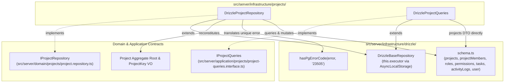

# Milestone 5 — Backend Step 4: Infrastructure Projects (src/server/infrastructure/projects/)

## 1. เป้าหมายและขอบเขต Boundary (Boundary Context & Goal)

ในขั้นตอนนี้เราจะพัฒนาชั้น **Infrastructure (`src/server/infrastructure/projects/`)** เพื่อเชื่อมต่อสัญญาระดับ Domain (`IProjectRepository`) และ Application (`IProjectQueries`) เข้ากับฐานข้อมูล PostgreSQL จริงผ่าน **Drizzle ORM** โดยแบ่งออกเป็น 2 คลาสตามหลักการแยกฝั่งเขียนและฝั่งอ่าน (CQRS Separation):
1. **`DrizzleProjectRepository` (`drizzle-project.repository.ts`)**: รับผิดชอบฝั่ง Command / Domain Persistence ทำการแปลงข้อมูลระหว่างแถวในฐานข้อมูล (`ProjectRow`) กับ `Project` Aggregate Root (`toEntity`), บันทึกข้อมูลแบบ Upsert (`onConflictDoUpdate`), ดักจับ PostgreSQL Unique Constraint Violation (`23505`) เพื่อแปลงเป็น `ProjectKeyAlreadyExistsError`, เพิ่มสมาชิกโครงการ, บันทึก `activity_logs` และดึงสิทธิ์ระดับโครงการของผู้ใช้งาน
2. **`DrizzleProjectQueries` (`drizzle-project.queries.ts`)**: รับผิดชอบฝั่ง Query / Read Model Projection ทำการดึงรายการโครงการแบบ **Server-Side Pagination + Search + Status Filter + Multi-Column Sort** พร้อมคำนวณจำนวนสมาชิก (`memberCount`), จำนวนงาน (`taskCount`), ชื่อบทบาทของผู้ใช้งาน (`myRoleName`) และสิทธิ์แก้ไขโครงการ (`canUpdate`) ด้วย Batch Query แบบขนาน (`Promise.all` + `inArray`) เพื่อป้องกันปัญหา N+1 Queries

### ตารางสรุปไฟล์ใน Step นี้

| ลำดับ | เส้นทางไฟล์ (Path) | หน้าที่ความรับผิดชอบ (Responsibility) |
| :--- | :--- | :--- |
| 1 | `src/server/infrastructure/projects/drizzle-project.repository.ts` | Implement `IProjectRepository` ด้วย Drizzle ORM พร้อม `toEntity` Reconstitution และการแปลงรหัสข้อผิดพลาด `23505` |
| 2 | `src/server/infrastructure/projects/drizzle-project.queries.ts` | Implement `IProjectQueries` สำหรับดึงรายการโครงการแบบแบ่งหน้า ค้นหา กรอง เรียงลำดับ และรวมข้อมูลสถิติแบบไร้ N+1 |

### แผนภาพสถาปัตยกรรมและทิศทางการพึ่งพา (Architecture & Dependency Flow)



---

## 2. ทฤษฎี ความสำคัญ และกฎสถาปัตยกรรมเฉพาะ Boundary นี้

### 2.1 กฎ Infrastructure Layer จาก `.agents/rules/server.md`
1. **Persistence Encapsulation & `private toEntity(row)` (ข้อ 13)**:
   - `DrizzleProjectRepository` ซ่อนโครงสร้างแถวของ Drizzle (`type ProjectRow = typeof projects.$inferSelect`) ไว้ภายในคลาส และแปลงกลับเป็น `Project` Aggregate Root ผ่านเมธอด `private toEntity(row: ProjectRow): Project` โดยเรียก `Project.reconstitute(...)` และ `ProjectKey.reconstitute(...)`
2. **Single Round-Trip Upsert & Unique Constraint Translation (ข้อ 14)**:
   - เมธอด `save(project)` ใช้คำสั่ง `.insert(projects).values(...).onConflictDoUpdate({ target: projects.id, set: ... })` เพื่อรองรับทั้งการสร้างโครงการใหม่และการอัปเดตโครงการที่มีอยู่แล้วในคำสั่ง SQL เดียว
   - แม้ว่าใน `CreateProjectUseCase` จะตรวจสอบ `findByKey` ก่อนบันทึกแล้ว แต่ในระบบที่มีการเรียกพร้อมกันสูง (Concurrent Requests) อาจเกิด Race Condition ที่สองคำขอส่ง `key` เดียวกันเข้ามาพร้อมกัน ฐานข้อมูล PostgreSQL จะปกป้องความถูกต้องขั้นสุดท้ายด้วย Unique Index บนคอลัมน์ `projects.key` และโยนข้อผิดพลาดรหัส `"23505"` (`unique_violation`) ออกมา ซึ่งเราดักจับด้วย `hasPgErrorCode(error, "23505")` แล้วแปลงเป็น `ProjectKeyAlreadyExistsError` อย่างสะอาด
3. **CQRS Direct Projection & ป้องกัน N+1 Queries (ข้อ 14–15)**:
   - ใน `DrizzleProjectQueries.listProjects`:
     - **Visibility Filter**: หาก `includeAllProjects` เป็น `false` จะใช้ Subquery `exists(...)` ตรวจสอบว่า `actorUserId` ต้องเป็นสมาชิกในตาราง `project_members` ของโครงการนั้น
     - **Parallel Count & Page Fetch**: รันคำสั่ง `count()` เพื่อหาจำนวนรายการทั้งหมดและคำสั่ง `select()` ดึงเฉพาะแถวของหน้านั้น (`limit` + `offset`) พร้อมกันด้วย `Promise.all`
     - **Batch Aggregation (`inArray`)**: เมื่อได้ `pageProjectIds` ของหน้านั้นแล้ว (เช่น 10 โครงการ) จะดึงจำนวนสมาชิก (`memberCounts`), จำนวนงาน (`taskCounts`) และบทบาท/สิทธิ์ของผู้ใช้ปัจจุบัน (`myAccessRows`) สำหรับทุกโครงการในหน้านั้นพร้อมกันด้วย `inArray(..., pageProjectIds)` ใน `Promise.all` เพียงรอบเดียว แทนที่จะวนลูปยิง Query ทีละโครงการ (ป้องกัน N+1 Queries อย่างสมบูรณ์)
4. **Automatic Transaction Context Switching (ข้อ 16)**:
   - ทั้ง `DrizzleProjectRepository` และ `DrizzleProjectQueries` สืบทอดจาก `DrizzleBaseRepository<AppDb, AppTx>` เมื่อถูกเรียกภายใน `unitOfWork.withTransaction(...)` ตัวแปร `this.executor` จะสลับไปใช้ Transaction Client (`tx`) จาก `AsyncLocalStorage` โดยอัตโนมัติ

---

## 3. ลงมือเขียนโค้ด (Step-by-Step Implementation)

### 3.1 ไฟล์ `src/server/infrastructure/projects/drizzle-project.repository.ts` (ส่วนของ Milestone 5)

สร้างไฟล์ `src/server/infrastructure/projects/drizzle-project.repository.ts` เพื่อ Implement เมธอดทั้งหมดของ `IProjectRepository` ใน Milestone 5 (ส่วนเมธอดจัดการสมาชิกและการรันลำดับเลขงานจะนำมาต่อเติมใน Milestone 6 และ 7):

```typescript
import { and, eq } from "drizzle-orm";
import { Project } from "#/server/domain/projects/project.entity";
import { ProjectKeyAlreadyExistsError } from "#/server/domain/projects/project.errors";
import type {
	AddProjectMemberParams,
	IProjectRepository,
	RecordProjectActivityParams,
} from "#/server/domain/projects/project.repository";
import { ProjectKey } from "#/server/domain/projects/project-key.vo";
import { DrizzleBaseRepository } from "#/server/infrastructure/drizzle/base.repository";
import type { AppDb, AppTx } from "#/server/infrastructure/drizzle/db";
import { hasPgErrorCode } from "#/server/infrastructure/drizzle/pg-error";
import {
	activityLogs,
	permissions,
	projectMembers,
	projects,
	rolePermissions,
	roles,
} from "#/server/infrastructure/drizzle/schema";
import type { ProjectPermissionCode } from "#/shared/schemas/rbac.schema";
import { projectPermissionCodeSchema } from "#/shared/schemas/rbac.schema";

type ProjectRow = typeof projects.$inferSelect;

export class DrizzleProjectRepository
	extends DrizzleBaseRepository<AppDb, AppTx>
	implements IProjectRepository
{
	async findById(projectId: string): Promise<Project | null> {
		const [row] = await this.executor
			.select()
			.from(projects)
			.where(eq(projects.id, projectId))
			.limit(1);

		return row ? this.toEntity(row) : null;
	}

	async findByKey(key: string): Promise<Project | null> {
		const normalizedKey = key.trim().toUpperCase();
		const [row] = await this.executor
			.select()
			.from(projects)
			.where(eq(projects.key, normalizedKey))
			.limit(1);

		return row ? this.toEntity(row) : null;
	}

	async save(project: Project): Promise<void> {
		try {
			await this.executor
				.insert(projects)
				.values({
					id: project.id,
					key: project.key.value,
					name: project.name,
					description: project.description,
					status: project.status,
					taskSequence: project.taskSequence,
					createdById: project.createdById,
					createdAt: project.createdAt,
					updatedAt: project.updatedAt,
				})
				.onConflictDoUpdate({
					target: projects.id,
					set: {
						name: project.name,
						description: project.description,
						status: project.status,
						taskSequence: project.taskSequence,
						updatedAt: project.updatedAt,
					},
				});
		} catch (error) {
			if (hasPgErrorCode(error, "23505")) {
				throw new ProjectKeyAlreadyExistsError(project.key.value);
			}
			throw error;
		}
	}

	async addMember(params: AddProjectMemberParams): Promise<void> {
		await this.executor.insert(projectMembers).values({
			id: params.id,
			projectId: params.projectId,
			userId: params.userId,
			roleId: params.roleId,
		});
	}

	async recordActivity(params: RecordProjectActivityParams): Promise<void> {
		await this.executor.insert(activityLogs).values({
			projectId: params.projectId,
			taskId: params.taskId ?? null,
			actorId: params.actorId,
			action: params.action,
			metadata: params.metadata ?? {},
		});
	}

	async getUserProjectPermissions(
		projectId: string,
		userId: string,
	): Promise<ProjectPermissionCode[]> {
		const rows = await this.executor
			.select({
				permissionCode: permissions.code,
			})
			.from(projectMembers)
			.innerJoin(roles, eq(projectMembers.roleId, roles.id))
			.innerJoin(rolePermissions, eq(roles.id, rolePermissions.roleId))
			.innerJoin(permissions, eq(rolePermissions.permissionId, permissions.id))
			.where(
				and(
					eq(projectMembers.projectId, projectId),
					eq(projectMembers.userId, userId),
					eq(roles.scope, "project"),
				),
			);

		const permissionSet = new Set<ProjectPermissionCode>();
		for (const row of rows) {
			const parsed = projectPermissionCodeSchema.safeParse(row.permissionCode);
			if (parsed.success) {
				permissionSet.add(parsed.data);
			}
		}

		return [...permissionSet];
	}

	private toEntity(row: ProjectRow): Project {
		return Project.reconstitute(row.id, {
			key: ProjectKey.reconstitute(row.key),
			name: row.name,
			description: row.description,
			status: row.status,
			taskSequence: row.taskSequence,
			createdById: row.createdById,
			createdAt: row.createdAt,
			updatedAt: row.updatedAt,
		});
	}
}
```

**คำอธิบายโค้ด:**
- `save(project)`: ใช้ `.onConflictDoUpdate({ target: projects.id, set: ... })` เพื่อทำการ Insert หรือ Update ในคำสั่งเดียว และหากเกิด Unique Constraint Violation (`23505`) บนคอลัมน์ `projects.key` จะโยน `ProjectKeyAlreadyExistsError(project.key.value)`
- `getUserProjectPermissions(projectId, userId)`: Join ตาราง `project_members` → `roles` → `role_permissions` → `permissions` โดยกรองเฉพาะบทบาทระดับโครงการ (`eq(roles.scope, "project")`) และตรวจสอบความถูกต้องของแต่ละรหัสสิทธิ์ด้วย `projectPermissionCodeSchema.safeParse(...)` ก่อนคืนค่าเป็นอาร์เรย์ไร้ค่าซ้ำ (`Set`)
- `private toEntity(row)`: แปลงแถวจากตาราง `projects` ให้เป็น `Project` Aggregate Root ผ่าน `Project.reconstitute(...)`

---

### 3.2 ไฟล์ `src/server/infrastructure/projects/drizzle-project.queries.ts` (ส่วนของ Milestone 5)

สร้างไฟล์ `src/server/infrastructure/projects/drizzle-project.queries.ts` เพื่อ Implement `IProjectQueries.listProjects` สำหรับ Milestone 5 (ส่วนเมธอดสำหรับหน้า Project Detail, Members และ Activity จะนำมาต่อเติมใน Milestone 6):

```typescript
import type { SQL } from "drizzle-orm";
import {
	and,
	asc,
	count,
	desc,
	eq,
	exists,
	ilike,
	inArray,
	or,
	sql,
} from "drizzle-orm";
import type {
	IProjectQueries,
	ListProjectsQueryInput,
} from "#/server/application/projects/project-queries.interface";
import { DrizzleBaseRepository } from "#/server/infrastructure/drizzle/base.repository";
import type { AppDb, AppTx } from "#/server/infrastructure/drizzle/db";
import {
	permissions,
	projectMembers,
	projects,
	rolePermissions,
	roles,
	tasks,
	user,
} from "#/server/infrastructure/drizzle/schema";
import type {
	ListProjectsResultDto,
	ProjectListItemDto,
	ProjectSortField,
} from "#/shared/schemas/project.schema";

const SORT_COLUMN_MAP = {
	key: projects.key,
	name: projects.name,
	status: projects.status,
	createdAt: projects.createdAt,
	updatedAt: projects.updatedAt,
} as const satisfies Record<ProjectSortField, unknown>;

export class DrizzleProjectQueries
	extends DrizzleBaseRepository<AppDb, AppTx>
	implements IProjectQueries
{
	async listProjects(
		input: ListProjectsQueryInput,
	): Promise<ListProjectsResultDto> {
		const { actorUserId, includeAllProjects, params } = input;
		const conditions: SQL[] = [];

		if (!includeAllProjects) {
			conditions.push(
				exists(
					this.executor
						.select({ matched: sql`1` })
						.from(projectMembers)
						.where(
							and(
								eq(projectMembers.projectId, projects.id),
								eq(projectMembers.userId, actorUserId),
							),
						),
				),
			);
		}

		if (params.status !== "all") {
			conditions.push(eq(projects.status, params.status));
		}

		const trimmedSearch = params.search.trim();
		if (trimmedSearch.length > 0) {
			const pattern = `%${trimmedSearch}%`;
			const searchCondition = or(
				ilike(projects.key, pattern),
				ilike(projects.name, pattern),
				ilike(projects.description, pattern),
			);
			if (searchCondition) {
				conditions.push(searchCondition);
			}
		}

		const whereClause = conditions.length > 0 ? and(...conditions) : undefined;
		const sortColumn = SORT_COLUMN_MAP[params.sortBy];
		const primaryOrder =
			params.sortOrder === "asc" ? asc(sortColumn) : desc(sortColumn);
		const offset = (params.page - 1) * params.pageSize;

		const [[totalRow], pageRows] = await Promise.all([
			this.executor
				.select({ total: count() })
				.from(projects)
				.where(whereClause),
			this.executor
				.select({
					id: projects.id,
					key: projects.key,
					name: projects.name,
					description: projects.description,
					status: projects.status,
					taskSequence: projects.taskSequence,
					createdById: projects.createdById,
					createdByName: user.name,
					createdAt: projects.createdAt,
					updatedAt: projects.updatedAt,
				})
				.from(projects)
				.innerJoin(user, eq(projects.createdById, user.id))
				.where(whereClause)
				.orderBy(primaryOrder, asc(projects.id))
				.limit(params.pageSize)
				.offset(offset),
		]);

		const total = Number(totalRow?.total ?? 0);
		const totalPages = Math.max(1, Math.ceil(total / params.pageSize));

		if (pageRows.length === 0) {
			return {
				items: [],
				total,
				page: params.page,
				pageSize: params.pageSize,
				totalPages,
			};
		}

		const pageProjectIds = pageRows.map((row) => row.id);
		const [memberCounts, taskCounts, myAccessRows] = await Promise.all([
			this.executor
				.select({
					projectId: projectMembers.projectId,
					total: count(),
				})
				.from(projectMembers)
				.where(inArray(projectMembers.projectId, pageProjectIds))
				.groupBy(projectMembers.projectId),
			this.executor
				.select({
					projectId: tasks.projectId,
					total: count(),
				})
				.from(tasks)
				.where(inArray(tasks.projectId, pageProjectIds))
				.groupBy(tasks.projectId),
			this.executor
				.select({
					projectId: projectMembers.projectId,
					roleName: roles.name,
					permissionCode: permissions.code,
				})
				.from(projectMembers)
				.innerJoin(roles, eq(projectMembers.roleId, roles.id))
				.leftJoin(rolePermissions, eq(roles.id, rolePermissions.roleId))
				.leftJoin(permissions, eq(rolePermissions.permissionId, permissions.id))
				.where(
					and(
						inArray(projectMembers.projectId, pageProjectIds),
						eq(projectMembers.userId, actorUserId),
						eq(roles.scope, "project"),
					),
				),
		]);

		const memberCountMap = new Map(
			memberCounts.map((row) => [row.projectId, Number(row.total)]),
		);
		const taskCountMap = new Map(
			taskCounts.map((row) => [row.projectId, Number(row.total)]),
		);

		const roleNameByProjectId = new Map<string, string>();
		const canUpdateByProjectId = new Map<string, boolean>();
		for (const row of myAccessRows) {
			roleNameByProjectId.set(row.projectId, row.roleName);
			if (row.permissionCode === "project:update") {
				canUpdateByProjectId.set(row.projectId, true);
			}
		}

		const items: ProjectListItemDto[] = pageRows.map((row) => ({
			id: row.id,
			key: row.key,
			name: row.name,
			description: row.description,
			status: row.status,
			taskSequence: row.taskSequence,
			createdById: row.createdById,
			createdByName: row.createdByName,
			memberCount: memberCountMap.get(row.id) ?? 0,
			taskCount: taskCountMap.get(row.id) ?? 0,
			myRoleName: roleNameByProjectId.get(row.id) ?? null,
			canUpdate: canUpdateByProjectId.get(row.id) ?? false,
			createdAt: row.createdAt.toISOString(),
			updatedAt: row.updatedAt.toISOString(),
		}));

		return {
			items,
			total,
			page: params.page,
			pageSize: params.pageSize,
			totalPages,
		};
	}
}
```

**คำอธิบายโค้ด:**
- `SORT_COLUMN_MAP`: จับคู่ `ProjectSortField` เข้ากับคอลัมน์จริงของตาราง `projects` อย่างปลอดภัยด้วย `satisfies Record<ProjectSortField, unknown>` พร้อมเพิ่ม Tie-breaker `asc(projects.id)` ใน `.orderBy(primaryOrder, asc(projects.id))` เพื่อให้ลำดับของการแบ่งหน้าคงที่เสมอ (Deterministic Pagination)
- **การค้นหาแบบ Case-Insensitive (`ilike`)**: ค้นหาคำสำคัญพร้อมกันทั้งใน `projects.key`, `projects.name` และ `projects.description`
- **การรวมข้อมูลแบบ Batch (`memberCountMap`, `taskCountMap`, `roleNameByProjectId`, `canUpdateByProjectId`)**: ใช้ `Map` ในหน่วยความจำเพื่อประกอบร่าง `ProjectListItemDto` ด้วยความเร็วระดับ $O(N)$ โดยไม่ต้องยิง Query ซ้ำรายแถว

---

## 4. การตรวจสอบความถูกต้องและ Git Commit (Verification & Commit)

ตรวจสอบความถูกต้องของโค้ดด้วย Biome, TypeScript Compiler และสคริปต์ตรวจสอบสถาปัตยกรรม:

```bash
# 1. ตรวจสอบการจัดรูปแบบและกฎ Linter ด้วย Biome
bun run check

# 2. ตรวจสอบ Type Safety ด้วย TypeScript Compiler
bun run typecheck

# 3. ตรวจสอบกฎขอบเขตสถาปัตยกรรม (Architecture Audit)
bun run audit
```

เมื่อทุกอย่างผ่านเรียบร้อยแล้ว ให้ทำการบันทึกเข้าสู่ Git Repository:

```bash
git add src/server/infrastructure/projects/drizzle-project.repository.ts src/server/infrastructure/projects/drizzle-project.queries.ts
git commit -m "milestone-5.backend.step-4: Infrastructure Drizzle Project Repository & CQRS Queries"
```
