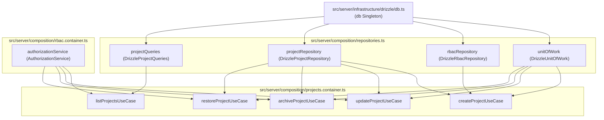

# Milestone 5 — Backend Step 5: Composition Projects (src/server/composition/)

## 1. เป้าหมายและขอบเขต Boundary (Boundary Context & Goal)

ในขั้นตอนนี้เราจะนำ `DrizzleProjectRepository`, `DrizzleProjectQueries` และ Use Cases ทั้ง 5 ตัวของ Milestone 5 มาประกอบร่างเข้าด้วยกันในเลเยอร์ **Composition (`src/server/composition/`)** ซึ่งเป็นศูนย์กลางของการทำ **Pure Manual Dependency Injection (DI)** ของฝั่ง Server:
1. ต่อเติมไฟล์ `src/server/composition/repositories.ts` เพื่อสร้าง Singleton Instances ของ `projectRepository` และ `projectQueries`
2. สร้างไฟล์ `src/server/composition/projects.container.ts` เพื่อประกอบ Use Cases ทั้ง 5 ตัวของ Milestone 5 (`listProjectsUseCase`, `createProjectUseCase`, `updateProjectUseCase`, `archiveProjectUseCase`, `restoreProjectUseCase`) พร้อมฉีด Dependencies (`projectRepository`, `projectQueries`, `rbacRepository`, `authorizationService`, `unitOfWork`) เข้าไปอย่างครบถ้วน

### ตารางสรุปไฟล์ใน Step นี้

| ลำดับ | เส้นทางไฟล์ (Path) | หน้าที่ความรับผิดชอบ (Responsibility) |
| :--- | :--- | :--- |
| 1 | `src/server/composition/repositories.ts` | สร้างและส่งออก Singleton Instances ของ `projectRepository` (`DrizzleProjectRepository`) และ `projectQueries` (`DrizzleProjectQueries`) |
| 2 | `src/server/composition/projects.container.ts` | ประกอบร่าง Use Cases ประจำโมดูล Projects สำหรับให้ชั้น `server-functions/projects/` เรียกใช้งาน |

### แผนภาพสถาปัตยกรรมและทิศทางการพึ่งพา (Architecture & Dependency Flow)



---

## 2. ทฤษฎี ความสำคัญ และกฎสถาปัตยกรรมเฉพาะ Boundary นี้

### 2.1 กฎ Composition Layer จาก `.agents/rules/server.md`
1. **Pure Manual Dependency Injection (ข้อ 17)**:
   - ห้าม Use Case สั่ง `new DrizzleProjectRepository(db)` หรือดึง `db` เข้ามาใช้เองโดยตรง
   - การผูก Concrete Infrastructure Classes (`DrizzleProjectRepository`, `DrizzleProjectQueries`) เข้ากับ Use Case Classes ต้องทำที่ `src/server/composition/` เท่านั้น เพื่อให้ Use Case พึ่งพาเฉพาะ Interface (`IProjectRepository`, `IProjectQueries`, `IRbacRepository`, `IUnitOfWork`) ตามหลัก Dependency Inversion Principle
2. **Zero Magic & Compile-Time Verification**:
   - การประกอบ Object Graph ด้วย TypeScript ล้วนโดยไม่ใช้ Reflection หรือ Decorator DI Framework ทำให้ TypeScript Compiler สามารถตรวจสอบความครบถ้วนของ Constructor Arguments ได้ทันทีตั้งแต่ตอนเขียนโค้ด และไม่มี Runtime Overhead ตอนเริ่มต้นเซิร์ฟเวอร์

---

## 3. ลงมือเขียนโค้ด (Step-by-Step Implementation)

### 3.1 ไฟล์ `src/server/composition/repositories.ts`

อัปเดตไฟล์ `src/server/composition/repositories.ts` เพื่อเพิ่ม `projectRepository` และ `projectQueries` ต่อจาก `unitOfWork`, `rbacRepository` และ `userQueries` ที่มีอยู่เดิม:

```typescript
import type { AppTx } from "#/server/infrastructure/drizzle/db";
import { db } from "#/server/infrastructure/drizzle/db";
import { DrizzleUnitOfWork } from "#/server/infrastructure/drizzle/unit-of-work";
import { DrizzleProjectQueries } from "#/server/infrastructure/projects/drizzle-project.queries";
import { DrizzleProjectRepository } from "#/server/infrastructure/projects/drizzle-project.repository";
import { DrizzleRbacRepository } from "#/server/infrastructure/rbac/drizzle-rbac.repository";
import { DrizzleUserQueries } from "#/server/infrastructure/users/drizzle-user.queries";

export const unitOfWork = new DrizzleUnitOfWork<AppTx>(db);
export const rbacRepository = new DrizzleRbacRepository(db);
export const userQueries = new DrizzleUserQueries(db);
export const projectRepository = new DrizzleProjectRepository(db);
export const projectQueries = new DrizzleProjectQueries(db);
```

**คำอธิบายโค้ด:**
- สร้าง `projectRepository` และ `projectQueries` โดยรับ `db` ตัวเดียวกัน ซึ่งทั้งคู่สืบทอดจาก `DrizzleBaseRepository` จึงสามารถทำงานร่วมกับ `unitOfWork` ผ่าน `AsyncLocalStorage` ได้โดยอัตโนมัติ

---

### 3.2 ไฟล์ `src/server/composition/projects.container.ts` (ส่วนของ Milestone 5)

สร้างไฟล์ `src/server/composition/projects.container.ts` เพื่อประกอบ Use Cases ทั้ง 5 ตัวของ Milestone 5 (ส่วน Use Cases ของ Project Detail, Delete, Members และ Activity จะนำมาต่อเติมใน Milestone 6):

```typescript
import { ArchiveProjectUseCase } from "#/server/application/projects/archive-project.use-case";
import { CreateProjectUseCase } from "#/server/application/projects/create-project.use-case";
import { ListProjectsUseCase } from "#/server/application/projects/list-projects.use-case";
import { RestoreProjectUseCase } from "#/server/application/projects/restore-project.use-case";
import { UpdateProjectUseCase } from "#/server/application/projects/update-project.use-case";
import { authorizationService } from "./rbac.container";
import {
	projectQueries,
	projectRepository,
	rbacRepository,
	unitOfWork,
} from "./repositories";

export const listProjectsUseCase = new ListProjectsUseCase(
	projectQueries,
	authorizationService,
);
export const createProjectUseCase = new CreateProjectUseCase(
	projectRepository,
	rbacRepository,
	unitOfWork,
);
export const updateProjectUseCase = new UpdateProjectUseCase(
	projectRepository,
	authorizationService,
	unitOfWork,
);
export const archiveProjectUseCase = new ArchiveProjectUseCase(
	projectRepository,
	authorizationService,
	unitOfWork,
);
export const restoreProjectUseCase = new RestoreProjectUseCase(
	projectRepository,
	authorizationService,
	unitOfWork,
);
```

**คำอธิบายโค้ด:**
- `listProjectsUseCase`: ใช้เฉพาะ `projectQueries` และ `authorizationService` เพราะเป็นการอ่านข้อมูลอย่างเดียว (Read-only CQRS Query)
- `createProjectUseCase`: ใช้ `projectRepository`, `rbacRepository` (สำหรับค้นหาบทบาท `project_owner`) และ `unitOfWork`
- `updateProjectUseCase`, `archiveProjectUseCase`, `restoreProjectUseCase`: ใช้ `projectRepository`, `authorizationService` (สำหรับตรวจสิทธิ์ `project:update` ระดับโครงการ) และ `unitOfWork`

---

## 4. การตรวจสอบความถูกต้องและ Git Commit (Verification & Commit)

ตรวจสอบความถูกต้องของโค้ดด้วย Biome, TypeScript Compiler และสคริปต์ตรวจสอบสถาปัตยกรรม:

```bash
# 1. ตรวจสอบการจัดรูปแบบและกฎ Linter ด้วย Biome
bun run check

# 2. ตรวจสอบ Type Safety ด้วย TypeScript Compiler
bun run typecheck

# 3. ตรวจสอบกฎขอบเขตสถาปัตยกรรม (Architecture Audit)
bun run audit
```

เมื่อทุกอย่างผ่านเรียบร้อยแล้ว ให้ทำการบันทึกเข้าสู่ Git Repository:

```bash
git add src/server/composition/repositories.ts src/server/composition/projects.container.ts
git commit -m "milestone-5.backend.step-5: Composition Projects DI Container"
```
