# Milestone 5 — Frontend Step 1: Client Caches Projects (src/client/caches/projects/)

ในขั้นตอนนี้ เราจะสร้างเลเยอร์ **Client Caches (`src/client/caches/projects/`)** ซึ่งเป็นจุดศูนย์กลางในการจัดการ Server State ของโมดูล Projects บนฝั่ง Frontend ด้วย **TanStack Query** ทำหน้าที่เชื่อมต่อกับ RPC Gateway (`src/server-functions/projects/*.fn.ts`) ที่เราสร้างไว้ในฝั่ง Backend พร้อมกำหนดกลยุทธ์การจำแคช (Query Keys & Stale Time), การสั่ง Invalidate ข้อมูลให้สดใหม่อัตโนมัติ และการแสดงผล Toast แจ้งเตือนสถานะการทำงานผ่าน `meta`

---

## 1. เป้าหมายและขอบเขต Boundary (Boundary Context & Goal)

ภายในสถาปัตยกรรมของโปรเจกต์ เลเยอร์ `src/client/caches/` ทำหน้าที่เป็นปราการด่านเดียวบนฝั่ง Client ที่ได้รับอนุญาตให้เรียกใช้งาน `src/server-functions/` (ร่วมกับ Route Loader) เพื่อป้องกันไม่ให้ Feature Hooks หรือ UI Components เรียก RPC กระจัดกระจายโดยตรง

### ตารางสรุปไฟล์ใน Step นี้

| ลำดับ | เส้นทางไฟล์ (File Path) | หน้าที่ความรับผิดชอบ (Responsibility) |
| :--- | :--- | :--- |
| 1 | `src/client/caches/projects/keys.ts` | Query Key Factory สำหรับสร้าง Cache Key ของโมดูล Projects อย่างเป็นลำดับชั้น (Hierarchical Keys) และ Type-safe |
| 2 | `src/client/caches/projects/queries/projects.query.ts` | นิยาม `projectsListQueryOptions` สำหรับดึงรายการโครงการแบบแบ่งหน้า ค้นหา กรอง และเรียงลำดับจาก Server |
| 3 | `src/client/caches/projects/mutates/create-project.mutate.ts` | Mutation Hook สำหรับสร้างโครงการใหม่ พร้อมแจ้งเตือน `successToast` และสั่ง Invalidate Cache ที่เกี่ยวข้อง |
| 4 | `src/client/caches/projects/mutates/update-project.mutate.ts` | Mutation Hook สำหรับแก้ไขข้อมูลพื้นฐานของโครงการ (ชื่อและคำอธิบาย) |
| 5 | `src/client/caches/projects/mutates/archive-project.mutate.ts` | Mutation Hook สำหรับเปลี่ยนสถานะโครงการเป็นเก็บถาวร (`archived`) |
| 6 | `src/client/caches/projects/mutates/restore-project.mutate.ts` | Mutation Hook สำหรับกู้คืนโครงการจากสถานะเก็บถาวรกลับมาใช้งาน (`active`) |

### แผนภาพสถาปัตยกรรมและการไหลของข้อมูล (Architecture & Data Flow)

```mermaid
flowchart TD
    subgraph ClientLayer["Client Feature & Route Layer"]
        LOADER["Route Loader (/_auth/projects/)"]
        HOOKS["Feature Hooks (useProjectsTable / Forms / Dialogs)"]
    end

    subgraph CacheLayer["Client Caches Boundary (src/client/caches/projects/)"]
        KEYS["keys.ts (projectsKeys Factory)"]
        QUERY["queries/projects.query.ts (projectsListQueryOptions)"]
        MUT_CREATE["mutates/create-project.mutate.ts"]
        MUT_UPDATE["mutates/update-project.mutate.ts"]
        MUT_ARCHIVE["mutates/archive-project.mutate.ts"]
        MUT_RESTORE["mutates/restore-project.mutate.ts"]
        GLOBAL_CACHE["QueryClient & Global MutationCache (Toast Meta)"]
    end

    subgraph GatewayLayer["RPC Gateway Boundary (src/server-functions/projects/)"]
        FN_LIST["listProjectsFn"]
        FN_CREATE["createProjectFn"]
        FN_UPDATE["updateProjectFn"]
        FN_ARCHIVE["archiveProjectFn"]
        FN_RESTORE["restoreProjectFn"]
    end

    LOADER -->|prefetch / query| QUERY
    HOOKS -->|useQuery + keepPreviousData| QUERY
    HOOKS -->|mutateAsync| MUT_CREATE
    HOOKS -->|mutateAsync| MUT_UPDATE
    HOOKS -->|mutateAsync| MUT_ARCHIVE
    HOOKS -->|mutateAsync| MUT_RESTORE

    QUERY -->|uses key| KEYS
    MUT_CREATE -->|invalidateQueries| KEYS
    MUT_UPDATE -->|invalidateQueries| KEYS
    MUT_ARCHIVE -->|invalidateQueries| KEYS
    MUT_RESTORE -->|invalidateQueries| KEYS

    MUT_CREATE -.->|triggers meta.successToast| GLOBAL_CACHE
    MUT_UPDATE -.->|triggers meta.successToast| GLOBAL_CACHE
    MUT_ARCHIVE -.->|triggers meta.successToast| GLOBAL_CACHE
    MUT_RESTORE -.->|triggers meta.successToast| GLOBAL_CACHE

    QUERY -->|invokes RPC| FN_LIST
    MUT_CREATE -->|invokes RPC| FN_CREATE
    MUT_UPDATE -->|invokes RPC| FN_UPDATE
    MUT_ARCHIVE -->|invokes RPC| FN_ARCHIVE
    MUT_RESTORE -->|invokes RPC| FN_RESTORE
```



---

## 2. ทฤษฎี ความสำคัญ และกฎสถาปัตยกรรมเฉพาะ Boundary นี้

### 2.1 กฎสถาปัตยกรรมจาก `.agents/rules/client.md` และ `architecture.md`
1. **การรวมศูนย์ Server-State Ownership (`architecture.md` & `server.md` ข้อ 3)**:
   - อนุญาตให้เฉพาะ Route (`beforeLoad`, `loader`) และ `src/client/caches/**` เท่านั้นที่เรียกใช้งาน `src/server-functions/**` ได้
   - ห้าม Screen, Component หรือ Feature Hook เรียก Server Functions ตรงๆ เด็ดขาด เพื่อให้การจัดการ Network I/O, Stale Time และ Cache Invalidation ถูกรวมศูนย์อยู่ที่เดียว
2. **การจัดการ Mutation Feedback แบบรวมศูนย์ (`client.md` ข้อ 8)**:
   - **"Success/Error ของ mutation เป็นส่วนหนึ่งของ server-state lifecycle และควรมี owner เดียว"**
   - ให้กำหนดข้อความแจ้งเตือนผ่าน `meta: { successToast: "..." }` ภายใน Mutation Hook ที่อยู่ใน `src/client/caches/**` เท่านั้น ซึ่งจะถูกดักจับโดย `MutationCache` ใน `src/client/caches/global.ts` เพื่อแสดง Sonner Toast โดยอัตโนมัติ
   - ห้ามเขียน `toast.success(...)` หรือ `toast.error(...)` สำหรับ Server Mutation กระจายอยู่ใน Feature Hooks หรือ Components
3. **การใช้ Shared Contract (`globals.md` Shared Schemas ข้อ 1–3)**:
   - พารามิเตอร์สำหรับค้นหา (`ProjectsSearch`) และ Input DTO ของทุก Mutation (`CreateProjectInput`, `UpdateProjectInput`, `ProjectActionInput`) ต้องนำเข้าด้วย `import type` จาก `#/shared/schemas/project.schema` เสมอ

### 2.2 การออกแบบ Hierarchical Query Keys (`projectsKeys`)
การออกแบบ Query Key ให้เป็นลำดับชั้น (Hierarchy) เช่น `["projects", "list", params]` ช่วยให้เราสามารถควบคุมขอบเขตของการล้างแคช (Cache Invalidation) ได้อย่างแม่นยำ:
- เมื่อสั่ง `queryClient.invalidateQueries({ queryKey: projectsKeys.all })` (ซึ่งมีค่าเป็น `["projects"]`) TanStack Query จะทำการ Invalidate ทุก Query ที่ขึ้นต้นด้วย `["projects"]` ทั้งหมด ไม่ว่าจะเป็นรายการตารางที่อยู่หน้าใด คำค้นหาใด หรือหน้ารายละเอียดโครงการใดก็ตาม
- ในขณะเดียวกัน การนำ `params: ProjectsSearch` (`page`, `pageSize`, `search`, `status`, `sortBy`, `sortOrder`) เข้าไปเป็นส่วนหนึ่งของ `projectsKeys.list(params)` ทำให้แต่ละเงื่อนไขการค้นหาและการแบ่งหน้ามีช่องเก็บแคชแยกกันอย่างอิสระ เมื่อผู้ใช้กดย้อนกลับมายังหน้าที่เคยเปิดแล้ว ข้อมูลจะแสดงผลได้ทันทีโดยไม่ต้องรอโหลดใหม่หากยังไม่เกิน `staleTime` (30 วินาที)

### 2.3 การป้องกันตารางกระพริบด้วย `placeholderData: keepPreviousData`
เมื่อทำงานร่วมกับ `projectsListQueryOptions(params)` สำหรับตารางแบบ Server-Side Pagination, Sorting และ Filtering ทุกครั้งที่ผู้ใช้คลิกเปลี่ยนหน้า (เช่น จากหน้า 1 ไปหน้า 2) หรือคลิกหัวคอลัมน์เพื่อเรียงลำดับใหม่ ค่า `params` จะเปลี่ยนไป ส่งผลให้ `queryKey: projectsKeys.list(params)` เปลี่ยนเป็น Key ใหม่ที่ยังไม่มีข้อมูลในแคช

หากไม่ใช้ `keepPreviousData`:
- ทันทีที่เปลี่ยนหน้า สถานะของ Query จะกลายเป็น `isPending: true` และ `data` จะกลายเป็น `undefined` ชั่วคราว
- ตารางจะถูกยุบหายไปหรือสลับเป็น Skeleton Loading ทั้งตาราง ทำให้หน้าจอกระพริบ (Layout Shift / UI Flicker)

เมื่อผสาน `projectsListQueryOptions(search)` เข้ากับ `placeholderData: keepPreviousData` ใน `useQuery` (ซึ่งเราจะนำไปใช้ใน `useProjectsTable` และ `useProjectsToolbar` ใน Step 2):
- TanStack Query จะคงข้อมูลของหน้าก่อนหน้า (`previousData`) เอาไว้บนหน้าจอระหว่างที่กำลังดึงข้อมูลชุดใหม่ในพื้นหลัง (`isFetching: true` แต่ `isPending: false`)
- ผู้ใช้จึงเห็นตารางเดิมแสดงอยู่โดยไม่กระพริบ พร้อมตัวหมุนสถานะโหลด (`isFetching`) เล็กๆ ที่แถบเครื่องมือ เมื่อข้อมูลชุดใหม่มาถึงจึงสลับแถวในตารางอย่างนุ่มนวล

---

## 3. ลงมือเขียนโค้ด (Step-by-Step Implementation)

### 3.1 ไฟล์ `src/client/caches/projects/keys.ts`

สร้างไฟล์ Query Key Factory สำหรับโมดูล Projects โดยนิยามทั้ง `all` และ `list(params)` ที่ใช้งานทันทีใน Milestone 5 รวมถึงเตรียม `detail`, `members` และ `activity` ล่วงหน้าสำหรับหน้ารายละเอียดโครงการใน Milestone 6:

```typescript
import type { ProjectsSearch } from "#/shared/schemas/project.schema";

export const projectsKeys = {
	all: ["projects"] as const,
	list: (params: ProjectsSearch) =>
		[...projectsKeys.all, "list", params] as const,
	detail: (projectId: string) =>
		[...projectsKeys.all, "detail", projectId] as const,
	members: (projectId: string) =>
		[...projectsKeys.all, "members", projectId] as const,
	activity: (projectId: string) =>
		[...projectsKeys.all, "activity", projectId] as const,
};
```

**คำอธิบายโค้ด:**
- `all: ["projects"] as const`: เป็น Root Key ของโมดูล Projects ทั้งหมด ใช้สำหรับสั่ง Invalidate ข้อมูลทุกส่วนของโครงการในครั้งเดียวเมื่อเกิดการเปลี่ยนแปลงสถานะ
- `list: (params: ProjectsSearch) => [...projectsKeys.all, "list", params] as const`: ผูกอ็อบเจกต์ `ProjectsSearch` เข้ากับ Query Key เพื่อให้ TanStack Query แยกแคชตามหน้า คำค้นหา ตัวกรองสถานะ และการเรียงลำดับโดยอัตโนมัติ
- `detail`, `members`, `activity`: เตรียมโครงสร้าง Key แบบรับ `projectId` สำหรับรองรับการดึงข้อมูลเชิงลึกของแต่ละโครงการใน Milestone 6

---

### 3.2 ไฟล์ `src/client/caches/projects/queries/projects.query.ts`

สร้างฟังก์ชัน `projectsListQueryOptions` ด้วย helper `queryOptions` จาก `@tanstack/react-query` เพื่อให้สามารถนำไปใช้ซ้ำได้ทั้งใน Route Loader (`context.queryClient.query(...)`) และใน Feature Hooks (`useQuery(...)`):

```typescript
import { queryOptions } from "@tanstack/react-query";
import { listProjectsFn } from "#/server-functions/projects/list-projects.fn";
import type { ProjectsSearch } from "#/shared/schemas/project.schema";
import { projectsKeys } from "../keys";

export function projectsListQueryOptions(params: ProjectsSearch) {
	return queryOptions({
		queryKey: projectsKeys.list(params),
		queryFn: () => listProjectsFn({ data: params }),
		staleTime: 30_000,
	});
}
```

**คำอธิบายโค้ด:**
- ใช้ `queryOptions({...})` เพื่อผูก Type ของ `queryKey` และผลลัพธ์จาก `listProjectsFn` (`PaginatedProjectsDto`) เข้าด้วยกันอย่างสมบูรณ์
- กำหนด `staleTime: 30_000` (30 วินาที) เพื่อลดการยิง Network Request ซ้ำซ้อนเมื่อผู้ใช้สลับหน้าไปมาหรือเมื่อ Route Loader เพิ่งโหลดข้อมูลเสร็จก่อนที่ Component จะ Mount

---

### 3.3 ไฟล์ `src/client/caches/projects/mutates/create-project.mutate.ts`

สร้าง Mutation Hook สำหรับการสร้างโครงการใหม่:

> [!NOTE]
> **หมายเหตุเกี่ยวกับ `workspaceKeys.all` สำหรับการทำตามลำดับ Milestone:**
> ในโค้ดฉบับสมบูรณ์ของโปรเจกต์ด้านล่าง จะมีการนำเข้า `workspaceKeys` จาก `#/client/caches/workspace/keys` เพื่อสั่ง Invalidate ข้อมูลสรุปหน้า Dashboard (`workspaceKeys.all`) ไปพร้อมกันด้วย อย่างไรก็ตาม โมดูล `workspace` จะถูกสร้างใน **Milestone 8** ดังนั้นหากคุณกำลังเขียนโค้ดไล่ตามลำดับใน **Milestone 5** ให้สั่ง Invalidate เฉพาะ `projectsKeys.all` ก่อน แล้วจึงกลับมาเพิ่ม `workspaceKeys.all` เมื่อถึง Milestone 8

**โค้ดสำหรับช่วง Milestone 5 (ก่อนมีโมดูล Workspace ใน Milestone 8):**

```typescript
import { useMutation, useQueryClient } from "@tanstack/react-query";
import { createProjectFn } from "#/server-functions/projects/create-project.fn";
import type { CreateProjectInput } from "#/shared/schemas/project.schema";
import { projectsKeys } from "../keys";

export function useCreateProjectMutation() {
	const queryClient = useQueryClient();
	return useMutation({
		mutationFn: (input: CreateProjectInput) => createProjectFn({ data: input }),
		meta: {
			successToast: "สร้างโครงการใหม่สำเร็จ",
		},
		onSuccess: async () => {
			await queryClient.invalidateQueries({ queryKey: projectsKeys.all });
		},
	});
}
```

**โค้ดฉบับเต็มใน Repository ปัจจุบัน (เมื่อเชื่อมโยงกับ `workspaceKeys.all` ใน Milestone 8 แล้ว):**

```typescript
import { useMutation, useQueryClient } from "@tanstack/react-query";
import { workspaceKeys } from "#/client/caches/workspace/keys";
import { createProjectFn } from "#/server-functions/projects/create-project.fn";
import type { CreateProjectInput } from "#/shared/schemas/project.schema";
import { projectsKeys } from "../keys";

export function useCreateProjectMutation() {
	const queryClient = useQueryClient();
	return useMutation({
		mutationFn: (input: CreateProjectInput) => createProjectFn({ data: input }),
		meta: {
			successToast: "สร้างโครงการใหม่สำเร็จ",
		},
		onSuccess: async () => {
			await Promise.all([
				queryClient.invalidateQueries({ queryKey: projectsKeys.all }),
				queryClient.invalidateQueries({ queryKey: workspaceKeys.all }),
			]);
		},
	});
}
```

**คำอธิบายโค้ด:**
- `mutationFn` รับ `input: CreateProjectInput` และส่งต่อไปยัง `createProjectFn({ data: input })`
- `meta: { successToast: "สร้างโครงการใหม่สำเร็จ" }` แจ้งให้ Global Mutation Cache แสดง Toast สีเขียวทันทีที่สร้างโครงการสำเร็จ
- `onSuccess` สั่ง `invalidateQueries` ที่ `projectsKeys.all` เพื่อให้ตารางรายการโครงการดึงข้อมูลล่าสุดมาแสดงทันที (และใน Milestone 8 จะสั่ง Invalidate `workspaceKeys.all` ควบคู่กันผ่าน `Promise.all`)

---

### 3.4 ไฟล์ `src/client/caches/projects/mutates/update-project.mutate.ts`

สร้าง Mutation Hook สำหรับการแก้ไขชื่อและคำอธิบายของโครงการ:

```typescript
import { useMutation, useQueryClient } from "@tanstack/react-query";
import { updateProjectFn } from "#/server-functions/projects/update-project.fn";
import type { UpdateProjectInput } from "#/shared/schemas/project.schema";
import { projectsKeys } from "../keys";

export function useUpdateProjectMutation() {
	const queryClient = useQueryClient();

	return useMutation({
		mutationFn: (input: UpdateProjectInput) => updateProjectFn({ data: input }),
		meta: { successToast: "บันทึกการแก้ไขโครงการสำเร็จ" },
		onSuccess: async () => {
			await queryClient.invalidateQueries({ queryKey: projectsKeys.all });
		},
	});
}
```

**คำอธิบายโค้ด:**
- เรียกใช้ `updateProjectFn({ data: input })` ด้วยข้อมูลชนิด `UpdateProjectInput` (`projectId`, `name`, `description`)
- เมื่อบันทึกสำเร็จ จะแสดง Toast `"บันทึกการแก้ไขโครงการสำเร็จ"` และล้างแคชภายใต้ `projectsKeys.all` ทั้งหมด

---

### 3.5 ไฟล์ `src/client/caches/projects/mutates/archive-project.mutate.ts`

สร้าง Mutation Hook สำหรับการเก็บถาวรโครงการ (`archive`):

> [!NOTE]
> เช่นเดียวกับ `create-project.mutate.ts` ในช่วง **Milestone 5** คุณสามารถสั่ง Invalidate เฉพาะ `projectsKeys.all` ก่อนได้ และเมื่อถึง **Milestone 8** จึงเพิ่มการ Invalidate `workspaceKeys.all` เพื่อให้ตัวเลขสถิติโครงการที่ใช้งานอยู่ในหน้า Workspace อัปเดตตรงกัน

**โค้ดสำหรับช่วง Milestone 5 (ก่อนมีโมดูล Workspace ใน Milestone 8):**

```typescript
import { useMutation, useQueryClient } from "@tanstack/react-query";
import { archiveProjectFn } from "#/server-functions/projects/archive-project.fn";
import type { ProjectActionInput } from "#/shared/schemas/project.schema";
import { projectsKeys } from "../keys";

export function useArchiveProjectMutation() {
	const queryClient = useQueryClient();

	return useMutation({
		mutationFn: (input: ProjectActionInput) =>
			archiveProjectFn({ data: input }),
		meta: {
			successToast: "เก็บถาวรโครงการเรียบร้อยแล้ว",
		},
		onSuccess: async () => {
			await queryClient.invalidateQueries({ queryKey: projectsKeys.all });
		},
	});
}
```

**โค้ดฉบับเต็มใน Repository ปัจจุบัน (เมื่อเชื่อมโยงกับ `workspaceKeys.all` ใน Milestone 8 แล้ว):**

```typescript
import { useMutation, useQueryClient } from "@tanstack/react-query";
import { workspaceKeys } from "#/client/caches/workspace/keys";
import { archiveProjectFn } from "#/server-functions/projects/archive-project.fn";
import type { ProjectActionInput } from "#/shared/schemas/project.schema";
import { projectsKeys } from "../keys";

export function useArchiveProjectMutation() {
	const queryClient = useQueryClient();

	return useMutation({
		mutationFn: (input: ProjectActionInput) =>
			archiveProjectFn({ data: input }),
		meta: {
			successToast: "เก็บถาวรโครงการเรียบร้อยแล้ว",
		},
		onSuccess: async () => {
			await Promise.all([
				queryClient.invalidateQueries({ queryKey: projectsKeys.all }),
				queryClient.invalidateQueries({ queryKey: workspaceKeys.all }),
			]);
		},
	});
}
```

---

### 3.6 ไฟล์ `src/client/caches/projects/mutates/restore-project.mutate.ts`

สร้าง Mutation Hook สำหรับการกู้คืนโครงการกลับมาเป็นสถานะใช้งานปกติ (`active`):

**โค้ดสำหรับช่วง Milestone 5 (ก่อนมีโมดูล Workspace ใน Milestone 8):**

```typescript
import { useMutation, useQueryClient } from "@tanstack/react-query";
import { restoreProjectFn } from "#/server-functions/projects/restore-project.fn";
import type { ProjectActionInput } from "#/shared/schemas/project.schema";
import { projectsKeys } from "../keys";

export function useRestoreProjectMutation() {
	const queryClient = useQueryClient();

	return useMutation({
		mutationFn: (input: ProjectActionInput) =>
			restoreProjectFn({ data: input }),
		meta: {
			successToast: "คืนค่าโครงการเรียบร้อยแล้ว",
		},
		onSuccess: async () => {
			await queryClient.invalidateQueries({ queryKey: projectsKeys.all });
		},
	});
}
```

**โค้ดฉบับเต็มใน Repository ปัจจุบัน (เมื่อเชื่อมโยงกับ `workspaceKeys.all` ใน Milestone 8 แล้ว):**

```typescript
import { useMutation, useQueryClient } from "@tanstack/react-query";
import { workspaceKeys } from "#/client/caches/workspace/keys";
import { restoreProjectFn } from "#/server-functions/projects/restore-project.fn";
import type { ProjectActionInput } from "#/shared/schemas/project.schema";
import { projectsKeys } from "../keys";

export function useRestoreProjectMutation() {
	const queryClient = useQueryClient();

	return useMutation({
		mutationFn: (input: ProjectActionInput) =>
			restoreProjectFn({ data: input }),
		meta: {
			successToast: "คืนค่าโครงการเรียบร้อยแล้ว",
		},
		onSuccess: async () => {
			await Promise.all([
				queryClient.invalidateQueries({ queryKey: projectsKeys.all }),
				queryClient.invalidateQueries({ queryKey: workspaceKeys.all }),
			]);
		},
	});
}
```

---

## 4. การตรวจสอบความถูกต้องและ Git Commit (Verification & Commit)

หลังจากสร้างไฟล์ทั้ง 6 ใน `src/client/caches/projects/` เรียบร้อยแล้ว ให้ตรวจสอบความถูกต้องของ Type และรูปแบบโค้ดด้วยคำสั่งต่อไปนี้:

```bash
bun run typecheck
bun run format
bun run check
```

เมื่อตรวจสอบผ่านโดยไม่มีข้อผิดพลาด ให้ทำการบันทึก Commit ประจำ Step นี้:

```bash
git add src/client/caches/projects/
git commit -m "milestone-5.frontend.step-1: Client Caches Projects Queries & Mutations"
```
