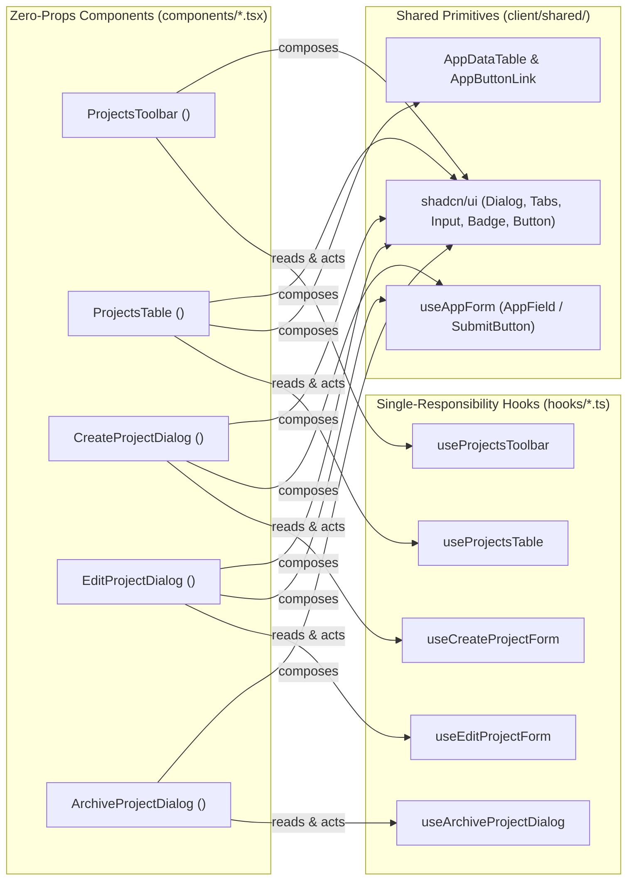

# Milestone 5 — Frontend Step 3: Feature Projects Zero-Props Components (src/client/features/projects/components/)

ในขั้นตอนนี้ เราจะสร้าง **Presentation Components แบบ Zero Props** ทั้ง 5 ตัวสำหรับฟีเจอร์ Projects ได้แก่ แถบเครื่องมือค้นหาและกรองสถานะ (`ProjectsToolbar`), ตารางแสดงรายการโครงการ (`ProjectsTable`), กล่องสร้างโครงการใหม่ (`CreateProjectDialog`), กล่องแก้ไขโครงการ (`EditProjectDialog`) และกล่องยืนยันการเก็บถาวร/กู้คืนโครงการ (`ArchiveProjectDialog`) โดยที่ทุก Component ไม่มีพารามิเตอร์ Props ใดๆ เลย แต่เชื่อมต่อกับ Single-Responsibility Hook ของตนเองโดยตรง

---

## 1. เป้าหมายและขอบเขต Boundary (Boundary Context & Goal)

ภายใต้สถาปัตยกรรม `src/client/features/projects/components/` คอมโพเนนต์ทุกไฟล์มีหน้าที่เพียงจัดวาง Declarative JSX และเชื่อมต่อกับ Shared UI Primitives (`AppDataTable`, `AppButtonLink`, `AppForm` และ shadcn/ui primitives) โดยอ่านค่าและเรียก Action ผ่าน Feature Hooks ที่สร้างไว้ใน Step 2 เท่านั้น

### ตารางสรุปไฟล์ใน Step นี้

| ลำดับ | เส้นทางไฟล์ (File Path) | หน้าที่ความรับผิดชอบ (Responsibility) |
| :--- | :--- | :--- |
| 1 | `src/client/features/projects/components/projects-toolbar.tsx` | แสดงช่องค้นหาโครงการ, ปุ่มล้างคำค้นหา, แท็บกรองสถานะ (`ทั้งหมด` / `ใช้งานอยู่` / `เก็บถาวร`), ไอคอนโหลดเบื้องหลัง และปุ่มเปิดกล่องสร้างโครงการ |
| 2 | `src/client/features/projects/components/projects-table.tsx` | แสดงตารางรายการโครงการด้วย `AppDataTable` พร้อมลิงก์ไปยังหน้ารายละเอียดโครงการ สถานะ สมาชิก งานทั้งหมด บทบาท และปุ่มจัดการ |
| 3 | `src/client/features/projects/components/create-project-dialog.tsx` | แสดง Modal Dialog พร้อมฟอร์มสำหรับกรอกรหัสโครงการ (`key`), ชื่อโครงการ (`name`) และคำอธิบาย (`description`) |
| 4 | `src/client/features/projects/components/edit-project-dialog.tsx` | แสดง Modal Dialog พร้อมฟอร์มแก้ไขชื่อและคำอธิบายโครงการ (แสดง `key` เป็น Badge อ่านอย่างเดียว) |
| 5 | `src/client/features/projects/components/archive-project-dialog.tsx` | แสดง Modal Dialog ยืนยันการเก็บถาวร (`archive`) หรือกู้คืน (`restore`) โครงการ |

### แผนภาพความสัมพันธ์ระหว่าง Zero-Props Components และ Hooks



---

## 2. ทฤษฎี ความสำคัญ และกฎสถาปัตยกรรมเฉพาะ Boundary นี้

### 2.1 กฎสถาปัตยกรรมจาก `.agents/rules/client.md`
1. **Zero Props Architecture (`client.md` ข้อ 2–5)**:
   - ห้ามประกาศ Props, รับพารามิเตอร์ หรือ destructure props ภายใน Feature Components (`export function ProjectsToolbar()`, `export function ProjectsTable()` ต้องมีวงเล็บว่างเสมอ)
   - แต่ละ Component เรียกใช้ Hook เฉพาะส่วนของตัวเองโดยตรง ทำให้เมื่อ State ภายใน `useCreateProjectForm` เปลี่ยนแปลง (เช่น ผู้ใช้กำลังพิมพ์ในฟอร์มสร้างโครงการ) จะมีเพียง `<CreateProjectDialog />` เท่านั้นที่ Re-render โดยไม่กระทบ `<ProjectsTable />` หรือ `<ProjectsToolbar />`
2. **One Component per File (`client.md` ข้อ 19)**:
   - กำหนดให้ 1 ไฟล์ `.tsx` ใน `features/**` สร้างได้เพียง 1 Component เท่านั้น และห้ามประกาศ Sub-component ซ้อนภายในไฟล์เดียวกัน เพื่อป้องกันการแอบส่ง Props ภายในไฟล์และรักษาความโปร่งใสของ Ownership
3. **การใช้ Design System Primitives และ SVG Icons (`client.md` ข้อ 14, 15, 18)**:
   - ใช้ `<Badge>`, `<Button>`, `<Tabs>`, `<Dialog>`, `<Input>` จาก `#/client/shared/shadcn/components/ui/*` โดยไม่เติม `border-*` หรือ `ring-*` เองโดยพลการ
   - ใช้ไอคอนจาก `lucide-react` (`Search`, `X`, `Loader2`, `Plus`, `Users`, `ListTodo`, `Pencil`, `Archive`, `RotateCcw`) พร้อมระบุ `aria-hidden="true"` เพื่อรองรับ Accessibility อย่างครบถ้วน

---

## 3. ลงมือเขียนโค้ด (Step-by-Step Implementation)

### 3.1 ไฟล์ `src/client/features/projects/components/projects-toolbar.tsx`

สร้างคอมโพเนนต์แถบเครื่องมือสำหรับค้นหา กรองสถานะ และเปิดกล่องสร้างโครงการใหม่:

```tsx
import { Loader2, Plus, Search, X } from "lucide-react";
import { Button } from "#/client/shared/shadcn/components/ui/button";
import { Input } from "#/client/shared/shadcn/components/ui/input";
import {
	Tabs,
	TabsList,
	TabsTrigger,
} from "#/client/shared/shadcn/components/ui/tabs";
import { useProjectsToolbar } from "../hooks/use-projects-toolbar";

export function ProjectsToolbar() {
	const {
		searchInput,
		status,
		isFetching,
		canCreateProject,
		setSearchInput,
		handleClearSearch,
		handleStatusChange,
		openCreateDialog,
	} = useProjectsToolbar();

	return (
		<div className="flex flex-wrap items-center justify-between gap-3">
			<div className="flex flex-wrap items-center gap-3">
				<div className="flex w-64 items-center gap-2">
					<Search
						className="size-4 shrink-0 text-muted-foreground"
						aria-hidden="true"
					/>
					<Input
						type="search"
						value={searchInput}
						placeholder="ค้นหารหัสหรือชื่อโครงการ..."
						aria-label="ค้นหาโครงการ"
						onChange={(event) => setSearchInput(event.target.value)}
					/>
					{searchInput ? (
						<Button
							type="button"
							variant="ghost"
							size="icon-sm"
							aria-label="ล้างคำค้นหา"
							onClick={handleClearSearch}
						>
							<X aria-hidden="true" />
						</Button>
					) : null}
				</div>

				<Tabs value={status} onValueChange={handleStatusChange}>
					<TabsList>
						<TabsTrigger value="all">ทั้งหมด</TabsTrigger>
						<TabsTrigger value="active">ใช้งานอยู่</TabsTrigger>
						<TabsTrigger value="archived">เก็บถาวร</TabsTrigger>
					</TabsList>
				</Tabs>

				{isFetching ? (
					<Loader2
						className="size-4 animate-spin text-muted-foreground"
						aria-hidden="true"
					/>
				) : null}
			</div>

			{canCreateProject ? (
				<Button type="button" size="sm" onClick={openCreateDialog}>
					<Plus aria-hidden="true" />
					<span>สร้างโครงการ</span>
				</Button>
			) : null}
		</div>
	);
}
```

**คำอธิบายโค้ด:**
- เชื่อมต่อกับ `useProjectsToolbar()` โดยตรงโดยไม่รับ Props
- แสดงปุ่มล้างคำค้นหา (`<X />`) เฉพาะเมื่อ `searchInput` มีข้อความอยู่
- ใช้ `<Tabs>` ในการสลับตัวกรองสถานะระหว่าง `"all"`, `"active"` และ `"archived"`
- แสดงปุ่ม `"สร้างโครงการ"` เฉพาะเมื่อผู้ใช้มีสิทธิ์ `canCreateProject` (`project:create`)

---

### 3.2 ไฟล์ `src/client/features/projects/components/projects-table.tsx`

สร้างคอมโพเนนต์ตารางรายการโครงการด้วย `AppDataTable`:

> [!NOTE]
> **หมายเหตุเกี่ยวกับลิงก์ `/projects/$projectId`:**
> ในคอลัมน์รหัส (`key`) และชื่อโครงการ (`name`) ของตารางด้านล่าง ชื่อโครงการจะถูกห่อด้วย `<AppButtonLink to="/projects/$projectId" params={{ projectId: project.id }}>` เพื่อนำทางไปยังหน้ารายละเอียดโครงการ ซึ่ง Route `/_auth/projects/$projectId` จะถูกสร้างและทำงานอย่างสมบูรณ์ใน **Milestone 6** (หากคุณกำลังทำตามลำดับใน Milestone 5 และยังไม่ได้สร้าง Route ของ Milestone 6 สามารถใช้ `to="/projects"` ชั่วคราวเพื่อให้ `typecheck` ผ่าน หรือรอให้ถึง Milestone 6 เมื่อ `routeTree.gen.ts` รู้จัก `/projects/$projectId` แล้ว)

```tsx
import { Archive, ListTodo, Pencil, RotateCcw, Users } from "lucide-react";
import { AppDataTable } from "#/client/shared/components/app-data-table";
import { AppButtonLink } from "#/client/shared/components/app-link";
import { Badge } from "#/client/shared/shadcn/components/ui/badge";
import { Button } from "#/client/shared/shadcn/components/ui/button";
import { useProjectsTable } from "../hooks/use-projects-table";

export function ProjectsTable() {
	const {
		table,
		columnCount,
		isPending,
		openEditDialog,
		requestArchiveToggle,
	} = useProjectsTable();

	return (
		<AppDataTable
			table={table}
			columnCount={columnCount}
			isLoading={isPending}
			emptyMessage="ไม่พบโครงการที่ตรงกับเงื่อนไขหรือยังไม่มีโครงการในระบบ"
			renderCell={(cell) => {
				const project = cell.row.original;

				if (cell.column.id === "key") {
					return <Badge variant="outline">{project.key}</Badge>;
				}

				if (cell.column.id === "name") {
					return (
						<div className="flex max-w-xs flex-col gap-0.5">
							<AppButtonLink
								to="/projects/$projectId"
								params={{ projectId: project.id }}
								variant="link"
								size="sm"
								className="h-auto justify-start p-0 text-left font-medium"
							>
								<span className="truncate">{project.name}</span>
							</AppButtonLink>
							{project.description ? (
								<span className="truncate text-xs text-muted-foreground">
									{project.description}
								</span>
							) : null}
						</div>
					);
				}

				if (cell.column.id === "status") {
					return (
						<Badge
							variant={project.status === "active" ? "default" : "secondary"}
						>
							{project.status === "active" ? "ใช้งานอยู่" : "เก็บถาวร"}
						</Badge>
					);
				}

				if (cell.column.id === "memberCount") {
					return (
						<div className="flex items-center gap-1.5 text-muted-foreground">
							<Users className="size-3.5" aria-hidden="true" />
							<span>{project.memberCount}</span>
						</div>
					);
				}

				if (cell.column.id === "taskCount") {
					return (
						<div className="flex items-center gap-1.5 text-muted-foreground">
							<ListTodo className="size-3.5" aria-hidden="true" />
							<span>{project.taskCount}</span>
						</div>
					);
				}

				if (cell.column.id === "myRoleName") {
					return project.myRoleName ? (
						<Badge variant="secondary">{project.myRoleName}</Badge>
					) : (
						<span className="text-xs text-muted-foreground">
							สิทธิ์อ่านทั้งหมดระดับระบบ
						</span>
					);
				}

				if (cell.column.id === "updatedAt") {
					return (
						<span className="text-xs text-muted-foreground">
							{new Date(project.updatedAt).toLocaleString()}
						</span>
					);
				}

				if (cell.column.id === "actions") {
					if (!project.canUpdate) {
						return (
							<span className="text-xs text-muted-foreground">อ่านอย่างเดียว</span>
						);
					}

					const isArchived = project.status === "archived";

					return (
						<div className="flex items-center gap-1.5">
							<Button
								type="button"
								variant="outline"
								size="sm"
								disabled={isArchived}
								onClick={() => openEditDialog(project)}
							>
								<Pencil aria-hidden="true" />
								<span>แก้ไข</span>
							</Button>
							{isArchived ? (
								<Button
									type="button"
									variant="outline"
									size="sm"
									onClick={() => requestArchiveToggle(project, "restore")}
								>
									<RotateCcw aria-hidden="true" />
									<span>กู้คืน</span>
								</Button>
							) : (
								<Button
									type="button"
									variant="destructive"
									size="sm"
									onClick={() => requestArchiveToggle(project, "archive")}
								>
									<Archive aria-hidden="true" />
									<span>เก็บถาวร</span>
								</Button>
							)}
						</div>
					);
				}

				return <table.FlexRender cell={cell} />;
			}}
		/>
	);
}
```

**คำอธิบายโค้ด:**
- ใช้ `AppDataTable` ในการแสดงผลตารางพร้อมระบบเรียงลำดับหัวคอลัมน์และแถบเปลี่ยนหน้าด้านล่าง
- คอลัมน์ `myRoleName`: หากผู้ใช้เป็นสมาชิกในโครงการจะแสดง `<Badge variant="secondary">{project.myRoleName}</Badge>` แต่หากผู้ใช้เข้าถึงได้ด้วยสิทธิ์ระดับระบบ (`project:read_all`) โดยไม่ได้เป็นสมาชิกในโครงการ จะแสดงข้อความ `"สิทธิ์อ่านทั้งหมดระดับระบบ"`
- คอลัมน์ `actions`: ตรวจสอบ `project.canUpdate` จาก DTO ที่คำนวณมาจาก Backend หากไม่มีสิทธิ์แก้ไขจะแสดง `"อ่านอย่างเดียว"` หากมีสิทธิ์จะแสดงปุ่ม `"แก้ไข"` (ปิดการใช้งานเมื่อโครงการถูกเก็บถาวรอยู่) และสลับปุ่มระหว่าง `"เก็บถาวร"` กับ `"กู้คืน"` ตามสถานะปัจจุบันของโครงการ

---

### 3.3 ไฟล์ `src/client/features/projects/components/create-project-dialog.tsx`

สร้างคอมโพเนนต์ Modal Dialog สำหรับสร้างโครงการใหม่:

```tsx
import { Button } from "#/client/shared/shadcn/components/ui/button";
import {
	Dialog,
	DialogContent,
	DialogDescription,
	DialogFooter,
	DialogHeader,
	DialogTitle,
} from "#/client/shared/shadcn/components/ui/dialog";
import { FieldGroup } from "#/client/shared/shadcn/components/ui/field";
import { useCreateProjectForm } from "../hooks/use-create-project-form";

export function CreateProjectDialog() {
	const { isOpen, handleOpenChange, form } = useCreateProjectForm();

	return (
		<Dialog open={isOpen} onOpenChange={handleOpenChange}>
			<DialogContent>
				<DialogHeader>
					<DialogTitle>สร้างโครงการใหม่</DialogTitle>
					<DialogDescription>
						คุณจะได้รับบทบาทเจ้าของโครงการนี้โดยอัตโนมัติ
					</DialogDescription>
				</DialogHeader>

				<form
					noValidate
					onSubmit={(event) => {
						event.preventDefault();
						event.stopPropagation();
						void form.handleSubmit();
					}}
				>
					<form.AppForm>
						<FieldGroup>
							<form.AppField name="key">
								{(field) => (
									<field.TextField
										label="รหัสโครงการ"
										placeholder="เช่น TSK"
										description="ตัวอักษรภาษาอังกฤษ A-Z และ 0-9 ยาว 2–10 ตัว (แก้ไขภายหลังไม่ได้)"
									/>
								)}
							</form.AppField>

							<form.AppField name="name">
								{(field) => (
									<field.TextField
										label="ชื่อโครงการ"
										placeholder="เช่น ระบบจัดการงานหลัก TaskFlow"
									/>
								)}
							</form.AppField>

							<form.AppField name="description">
								{(field) => (
									<field.TextareaField
										label="คำอธิบาย"
										placeholder="รายละเอียดเป้าหมายและขอบเขตของโครงการ"
									/>
								)}
							</form.AppField>

							<DialogFooter>
								<Button
									type="button"
									variant="outline"
									onClick={() => handleOpenChange(false)}
								>
									ยกเลิก
								</Button>
								<form.SubmitButton loadingLabel="กำลังสร้างโครงการ...">
									สร้างโครงการ
								</form.SubmitButton>
							</DialogFooter>
						</FieldGroup>
					</form.AppForm>
				</form>
			</DialogContent>
		</Dialog>
	);
}
```

**คำอธิบายโค้ด:**
- เชื่อมต่อกับ `useCreateProjectForm()` เพื่อรับ `isOpen`, `handleOpenChange` และ `form`
- ใช้ `form.AppField` ร่วมกับ `field.TextField` สำหรับ `key` และ `name` และใช้ `field.TextareaField` สำหรับ `description` พร้อมแสดง `form.SubmitButton` ที่จัดการสถานะ Loading ขณะกำลังส่งข้อมูลโดยอัตโนมัติ

---

### 3.4 ไฟล์ `src/client/features/projects/components/edit-project-dialog.tsx`

สร้างคอมโพเนนต์ Modal Dialog สำหรับแก้ไขข้อมูลโครงการ:

```tsx
import { Badge } from "#/client/shared/shadcn/components/ui/badge";
import { Button } from "#/client/shared/shadcn/components/ui/button";
import {
	Dialog,
	DialogContent,
	DialogDescription,
	DialogFooter,
	DialogHeader,
	DialogTitle,
} from "#/client/shared/shadcn/components/ui/dialog";
import { FieldGroup } from "#/client/shared/shadcn/components/ui/field";
import { useEditProjectForm } from "../hooks/use-edit-project-form";

export function EditProjectDialog() {
	const { editingProject, handleOpenChange, form } = useEditProjectForm();

	return (
		<Dialog open={Boolean(editingProject)} onOpenChange={handleOpenChange}>
			<DialogContent>
				<DialogHeader>
					<div className="flex items-center gap-2">
						<DialogTitle>แก้ไขโครงการ</DialogTitle>
						{editingProject ? (
							<Badge variant="outline">{editingProject.key}</Badge>
						) : null}
					</div>
					<DialogDescription>
						ปรับปรุงชื่อและคำอธิบายโครงการ (รหัสโครงการไม่สามารถเปลี่ยนแปลงได้)
					</DialogDescription>
				</DialogHeader>

				<form
					noValidate
					onSubmit={(event) => {
						event.preventDefault();
						event.stopPropagation();
						void form.handleSubmit();
					}}
				>
					<form.AppForm>
						<FieldGroup>
							<form.AppField name="name">
								{(field) => (
									<field.TextField label="ชื่อโครงการ" placeholder="ชื่อโครงการ" />
								)}
							</form.AppField>

							<form.AppField name="description">
								{(field) => (
									<field.TextareaField
										label="คำอธิบาย"
										placeholder="รายละเอียดโครงการ"
									/>
								)}
							</form.AppField>

							<DialogFooter>
								<Button
									type="button"
									variant="outline"
									onClick={() => handleOpenChange(false)}
								>
									ยกเลิก
								</Button>
								<form.SubmitButton loadingLabel="กำลังบันทึก...">
									บันทึกการแก้ไข
								</form.SubmitButton>
							</DialogFooter>
						</FieldGroup>
					</form.AppForm>
				</form>
			</DialogContent>
		</Dialog>
	);
}
```

**คำอธิบายโค้ด:**
- เปิด Dialog เมื่อ `Boolean(editingProject)` เป็นจริง
- แสดงรหัสโครงการ (`editingProject.key`) เป็น `<Badge variant="outline">` บนส่วนหัวของ Dialog เพื่อเน้นย้ำกฎทางธุรกิจว่ารหัสโครงการไม่สามารถแก้ไขได้หลังจากสร้างแล้ว

---

### 3.5 ไฟล์ `src/client/features/projects/components/archive-project-dialog.tsx`

สร้างคอมโพเนนต์ Modal Dialog สำหรับยืนยันการเก็บถาวรหรือกู้คืนโครงการ:

```tsx
import { Button } from "#/client/shared/shadcn/components/ui/button";
import {
	Dialog,
	DialogContent,
	DialogDescription,
	DialogFooter,
	DialogHeader,
	DialogTitle,
} from "#/client/shared/shadcn/components/ui/dialog";
import { useArchiveProjectDialog } from "../hooks/use-archive-project-dialog";

export function ArchiveProjectDialog() {
	const { archiveTarget, isSubmitting, handleOpenChange, handleConfirm } =
		useArchiveProjectDialog();

	const isArchiveMode = archiveTarget?.mode === "archive";

	return (
		<Dialog open={Boolean(archiveTarget)} onOpenChange={handleOpenChange}>
			<DialogContent>
				<DialogHeader>
					<DialogTitle>
						{isArchiveMode ? "ยืนยันการเก็บถาวรโครงการ" : "ยืนยันการกู้คืนโครงการ"}
					</DialogTitle>
					<DialogDescription>
						{isArchiveMode
							? `โครงการ "${archiveTarget?.project.name}" (${archiveTarget?.project.key}) จะถูกเก็บถาวรและไม่สามารถแก้ไขรายละเอียดหรือสร้างงานใหม่ได้จนกว่าจะกู้คืน`
							: `ต้องการเปิดใช้งานโครงการ "${archiveTarget?.project.name}" (${archiveTarget?.project.key}) กลับมาใช้งานอีกครั้งหรือไม่?`}
					</DialogDescription>
				</DialogHeader>
				<DialogFooter>
					<Button
						type="button"
						variant="outline"
						disabled={isSubmitting}
						onClick={() => handleOpenChange(false)}
					>
						ยกเลิก
					</Button>
					<Button
						type="button"
						variant={isArchiveMode ? "destructive" : "default"}
						disabled={isSubmitting}
						onClick={() => void handleConfirm()}
					>
						{isSubmitting
							? "กำลังดำเนินการ..."
							: isArchiveMode
								? "ยืนยันเก็บถาวร"
								: "ยืนยันกู้คืน"}
					</Button>
				</DialogFooter>
			</DialogContent>
		</Dialog>
	);
}
```

**คำอธิบายโค้ด:**
- ปรับเปลี่ยนหัวข้อ (`DialogTitle`), คำอธิบายผลกระทบ (`DialogDescription`) และสีของปุ่มยืนยัน (`variant="destructive"` สำหรับการเก็บถาวร และ `variant="default"` สำหรับการกู้คืน) ตามค่า `isArchiveMode`

---

## 4. การตรวจสอบความถูกต้องและ Git Commit (Verification & Commit)

ตรวจสอบรูปแบบโค้ดและ Type ด้วยคำสั่ง:

```bash
bun run typecheck
bun run format
bun run check
```

ทำการบันทึก Commit สำหรับ Zero-Props Components ทั้ง 5 ไฟล์:

```bash
git add src/client/features/projects/components/
git commit -m "milestone-5.frontend.step-3: Zero-Props Projects Table, Toolbar & Dialog Components"
```
