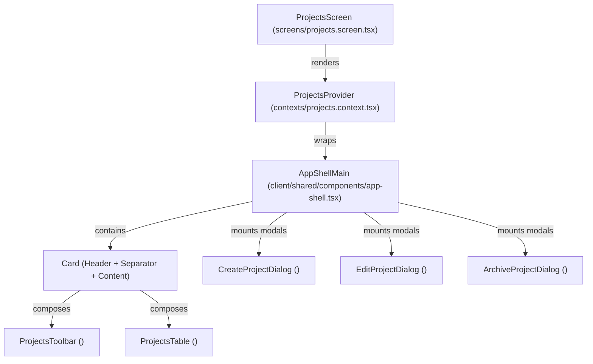

# Milestone 5 — Frontend Step 4: Feature Projects Screen (src/client/features/projects/screens/)

ในขั้นตอนนี้ เราจะสร้าง **`ProjectsScreen` (`src/client/features/projects/screens/projects.screen.tsx`)** ซึ่งทำหน้าที่เป็น **Composition Root** ประจำหน้ารายการโครงการทั้งหมด โดยนำ `ProjectsProvider` และ Zero-Props Components ทั้ง 5 ตัวที่เราสร้างไว้ใน Step 3 มาประกอบเข้ากับโครงสร้าง Layout ของแอปพลิเคชันอย่างสะอาดและปราศจาก Business Logic

---

## 1. เป้าหมายและขอบเขต Boundary (Boundary Context & Goal)

ภายในสถาปัตยกรรม `src/client/features/projects/screens/` เลเยอร์ Screen เป็นจุดเชื่อมต่อเดียวที่อนุญาตให้ไฟล์ Route (`src/routes/_auth/projects/index.tsx`) นำไปใช้งานเพื่อแสดงผลหน้าจอ โดย Screen มีหน้าที่เพียงจัดวางโครงสร้างภาพรวมของหน้า (Layout Shell, Card Container, Header) ห่อหุ้มด้วย Feature Context Provider และวาง Zero-Props Components ลงในตำแหน่งที่เหมาะสม

### ตารางสรุปไฟล์ใน Step นี้

| ลำดับ | เส้นทางไฟล์ (File Path) | หน้าที่ความรับผิดชอบ (Responsibility) |
| :--- | :--- | :--- |
| 1 | `src/client/features/projects/screens/projects.screen.tsx` | Composition Root ของหน้ารายการโครงการ ประกอบ `ProjectsProvider`, `AppShellMain`, `Card`, `ProjectsToolbar`, `ProjectsTable` และ Dialog ทั้ง 3 ตัวแบบ Zero Props |

### แผนภาพการประกอบสร้างภายใน Screen Composition Root



---

## 2. ทฤษฎี ความสำคัญ และกฎสถาปัตยกรรมเฉพาะ Boundary นี้

### 2.1 กฎสถาปัตยกรรมจาก `.agents/rules/client.md`
1. **Screen คือ Composition Root ในการประกอบ UI ประจำหน้านั้น (`client.md` ข้อ 2)**:
   - ให้ `features/**/screens/*.tsx` ทำหน้าที่เป็น Composition Root ประกอบโครงสร้าง Layout และเรียก Feature Components จาก `features/**/components/*.tsx` แบบ **Zero Props**
   - ห้ามส่ง State, Data, Behavior, Callback, Configuration, `children`, `className` หรือค่าใดๆ ผ่าน Props เข้าสู่ Feature Components เด็ดขาด
2. **Screen เป็น Pure Presentation ห้ามมี Logic (`client.md` ข้อ 3)**:
   - สังเกตว่าภายใน `ProjectsScreen` จะไม่มีการเรียกใช้ `useState`, `useEffect`, `useQuery` หรือ Hook ใดๆ เลยแม้แต่ตัวเดียว ทำให้ `ProjectsScreen` ไม่เคยถูกบังคับให้ Re-render ทั้งหน้าเมื่อสถานะย่อยภายใน Toolbar, Table หรือ Dialog เปลี่ยนแปลง
3. **Visual Boundary จาก Design System เดียวกัน (`client.md` ข้อ 15)**:
   - ใช้ `<Card>`, `<CardHeader>`, `<CardTitle>`, `<CardDescription>`, `<CardContent>` และ `<Separator />` จาก `#/client/shared/shadcn/components/ui/*` ในการสร้างกรอบคอนเทนเนอร์และเส้นคั่นส่วนหัว โดยไม่เขียน `border-*` เองโดยพลการ

### 2.2 การทำงานร่วมกันของ `ProjectsProvider` และ Zero-Props Components
ใน `ProjectsScreen`:
- `<ProjectsProvider>` ถูกวางครอบไว้ที่ระดับนอกสุดของหน้าจอ เพื่อให้ทั้ง `<ProjectsToolbar />`, `<ProjectsTable />` และกลุ่ม Dialog ทั้ง 3 (`<CreateProjectDialog />`, `<EditProjectDialog />`, `<ArchiveProjectDialog />`) อยู่ภายใต้ Context Tree เดียวกัน
- เมื่อผู้ใช้คลิกปุ่ม `"สร้างโครงการ"` ใน `<ProjectsToolbar />` ฟังก์ชัน `openCreateDialog()` ใน Context จะเปลี่ยนสถานะ `isCreateDialogOpen` เป็น `true` ส่งผลให้ `<CreateProjectDialog />` ที่วางไว้ด้านล่างของ `AppShellMain` เปิดขึ้นทันทีโดยที่ `ProjectsScreen` ไม่ต้องรับส่ง Props ใดๆ เลย
- เช่นเดียวกัน เมื่อผู้ใช้คลิกปุ่ม `"แก้ไข"` หรือ `"เก็บถาวร"` / `"กู้คืน"` ในแถวใดแถวหนึ่งของ `<ProjectsTable />` ข้อมูล `ProjectListItemDto` ของแถวนั้นจะถูกส่งเข้า Context ผ่าน `openEditDialog(project)` หรือ `requestArchiveToggle(project, mode)` ทำให้ `<EditProjectDialog />` หรือ `<ArchiveProjectDialog />` เปิดขึ้นมาพร้อมข้อมูลโครงการเป้าหมายทันที

---

## 3. ลงมือเขียนโค้ด (Step-by-Step Implementation)

### 3.1 ไฟล์ `src/client/features/projects/screens/projects.screen.tsx`

สร้างไฟล์ Composition Root สำหรับหน้ารายการโครงการทั้งหมด:

```tsx
import { FolderKanban } from "lucide-react";
import { AppShellMain } from "#/client/shared/components/app-shell";
import {
	Card,
	CardContent,
	CardDescription,
	CardHeader,
	CardTitle,
} from "#/client/shared/shadcn/components/ui/card";
import { Separator } from "#/client/shared/shadcn/components/ui/separator";
import { ArchiveProjectDialog } from "../components/archive-project-dialog";
import { CreateProjectDialog } from "../components/create-project-dialog";
import { EditProjectDialog } from "../components/edit-project-dialog";
import { ProjectsTable } from "../components/projects-table";
import { ProjectsToolbar } from "../components/projects-toolbar";
import { ProjectsProvider } from "../contexts/projects.context";

export function ProjectsScreen() {
	return (
		<ProjectsProvider>
			<AppShellMain className="mx-auto max-w-6xl py-8">
				<Card>
					<CardHeader>
						<div className="flex items-center gap-2">
							<FolderKanban
								className="size-5 text-primary"
								aria-hidden="true"
							/>
							<CardTitle>รายการโครงการทั้งหมด</CardTitle>
						</div>
						<CardDescription>
							รายการโครงการทั้งหมดที่คุณมีสิทธิ์เข้าถึง (รองรับการค้นหา การเรียงลำดับ
							และแบ่งหน้า)
						</CardDescription>
						<Separator />
					</CardHeader>
					<CardContent className="flex flex-col gap-4">
						<ProjectsToolbar />
						<ProjectsTable />
					</CardContent>
				</Card>

				<CreateProjectDialog />
				<EditProjectDialog />
				<ArchiveProjectDialog />
			</AppShellMain>
		</ProjectsProvider>
	);
}
```

**คำอธิบายโค้ด:**
- ใช้ `AppShellMain` จาก `#/client/shared/components/app-shell` เพื่อกำหนดพื้นที่เนื้อหาหลักของหน้าให้มีความกว้างสูงสุด `max-w-6xl` จัดกึ่งกลาง (`mx-auto`) และเว้นระยะขอบบนล่าง (`py-8`) สอดคล้องกับหน้าอื่นๆ ในระบบ
- ภายใน `<CardHeader>` แสดงไอคอน `<FolderKanban />` คู่กับ `<CardTitle>` และ `<CardDescription>` คั่นด้วย `<Separator />`
- ภายใน `<CardContent>` วาง `<ProjectsToolbar />` เหนือ `<ProjectsTable />` โดยเว้นระยะห่าง `gap-4`
- วาง `<CreateProjectDialog />`, `<EditProjectDialog />` และ `<ArchiveProjectDialog />` ไว้ภายใน `<ProjectsProvider>` เพื่อให้พร้อมเปิดแสดงผลเมื่อผู้ใช้สั่งงานจาก Toolbar หรือ Table

---

## 4. การตรวจสอบความถูกต้องและ Git Commit (Verification & Commit)

ตรวจสอบความถูกต้องของโค้ดด้วยคำสั่ง:

```bash
bun run typecheck
bun run format
bun run check
```

ทำการบันทึก Commit สำหรับ `ProjectsScreen`:

```bash
git add src/client/features/projects/screens/projects.screen.tsx
git commit -m "milestone-5.frontend.step-4: Feature Projects Screen Composition Root"
```
