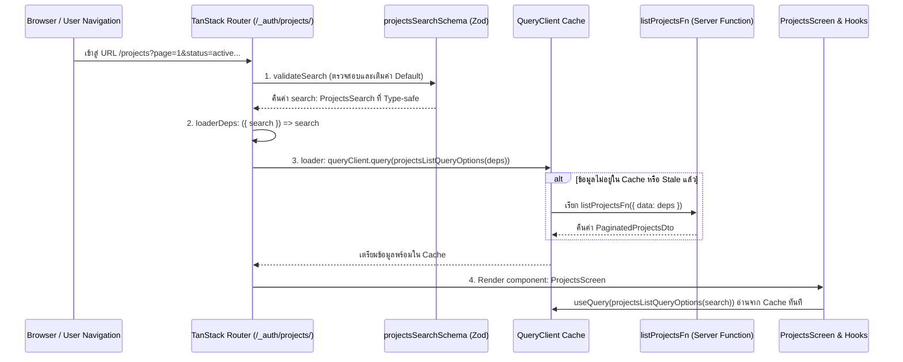

# Milestone 5 — Frontend Step 5: Projects File Route (src/routes/_auth/projects/)

ในขั้นตอนสุดท้ายของ Milestone 5 เราจะสร้างไฟล์ **File-based Route (`src/routes/_auth/projects/index.tsx`)** ของ TanStack Router เพื่อเปิดใช้งาน URL `/projects` ภายใต้กลุ่มหน้าที่ต้องยืนยันตัวตน (`/_auth`) พร้อมผูกการตรวจสอบ URL Search Params (`validateSearch`), การระบุตัวแปรพึ่งพาของ Loader (`loaderDeps`) และการโหลดข้อมูลล่วงหน้าตั้งแต่ระดับ SSR / Route Navigation (`loader`) เข้ากับ `ProjectsScreen`

---

## 1. เป้าหมายและขอบเขต Boundary (Boundary Context & Goal)

ตามสถาปัตยกรรม `src/routes/` ไฟล์ Route มีหน้าที่รับผิดชอบเฉพาะเรื่อง **Routing Concerns** เท่านั้น ได้แก่ การผูก URL Path เข้ากับ Screen, การตรวจสอบความถูกต้องของ Search Params (`validateSearch`), การดึงข้อมูลล่วงหน้าใส่ TanStack Query Cache (`loader`) และการอ้างอิง `component: ProjectsScreen` โดยไม่นำ UI Components ย่อยมาประกอบเองในไฟล์ Route

### ตารางสรุปไฟล์ใน Step นี้

| ลำดับ | เส้นทางไฟล์ (File Path) | หน้าที่ความรับผิดชอบ (Responsibility) |
| :--- | :--- | :--- |
| 1 | `src/routes/_auth/projects/index.tsx` | นิยาม File Route `/_auth/projects/` พร้อม `validateSearch`, `loaderDeps`, `loader` และผูก `component: ProjectsScreen` |

### แผนภาพวงจรการทำงานของ TanStack Router & Query Loader



---

## 2. ทฤษฎี ความสำคัญ และกฎสถาปัตยกรรมเฉพาะ Boundary นี้

### 2.1 กฎสถาปัตยกรรมจาก `.agents/rules/client.md` และ `architecture.md`
1. **Route รู้เพียงว่า URL ใช้ Screen ใด (`client.md` ข้อ 1)**:
   - ให้ Route UI แสดงผลผ่าน `component: ProjectsScreen` จาก `#/client/features/projects/screens/projects.screen` เท่านั้น
   - ห้าม Route นำเข้าหรือประกอบ UI จาก `features/**/components/*` โดยตรง
2. **การอยู่ภายใต้ Route Guard Protection (`/_auth`)**:
   - การวางไฟล์ไว้ที่ `src/routes/_auth/projects/index.tsx` ทำให้หน้า `/projects` สืบทอดการตรวจสอบสิทธิ์จาก Pathless Layout Route `src/routes/_auth.tsx` โดยอัตโนมัติ (ตรวจสอบ Session ใน `beforeLoad` หากยังไม่ได้เข้าสู่ระบบจะถูก Redirect ไปยัง `/sign-in` ทันที และได้รับการครอบด้วย Navigation Shell ของระบบ)

### 2.2 การทำงานประสานกันของ `validateSearch`, `loaderDeps` และ `loader`
จุดเด่นสำคัญของ TanStack Start + TanStack Router + TanStack Query คือการผสาน URL Search Params เข้ากับ SSR/Isomorphic Loader อย่างเป็นระบบผ่าน 3 ขั้นตอน:

1. **`validateSearch: projectsSearchSchema`**:
   - ทุกครั้งที่ผู้ใช้เปิดหน้า `/projects` (ไม่ว่าจะพิมพ์ URL ตรงๆ เช่น `/projects` เปล่าๆ หรือมี Query String เช่น `/projects?page=2&status=archived`) TanStack Router จะนำ Search Params ไปผ่าน `projectsSearchSchema`
   - หากพารามิเตอร์ใดไม่ได้ระบุมาหรือมีค่าไม่ถูกต้อง `.catch(...)` ใน Zod Schema จะเติมค่าเริ่มต้นที่ปลอดภัยให้ทันที (`page: 1`, `pageSize: 10`, `search: ""`, `status: "all"`, `sortBy: "updatedAt"`, `sortOrder: "desc"`)
2. **`loaderDeps: ({ search }) => search`**:
   - ปกติแล้ว `loader` ของ Route จะทำงานเมื่อ Path Params เปลี่ยน แต่สำหรับตารางที่พึ่งพา Search Params การกำหนด `loaderDeps: ({ search }) => search` เป็นการบอก TanStack Router ว่า **"เมื่อใดก็ตามที่ค่าใน `search` เปลี่ยนแปลง (เช่น เปลี่ยนหน้า เปลี่ยนคำค้นหา เปลี่ยนตัวกรองสถานะ หรือเปลี่ยนการเรียงลำดับ) ให้ถือว่า Dependencies ของ Loader เปลี่ยน และต้องรัน `loader` ใหม่ด้วยค่า `deps` ล่าสุด"**
3. **`loader: ({ context, deps }) => context.queryClient.query(projectsListQueryOptions(deps))`**:
   - สั่งให้ `queryClient` ดึงข้อมูลรายการโครงการตามเงื่อนไข `deps` ตั้งแต่ระดับ Route Navigation / SSR ก่อนที่หน้าจอจะแสดงผลครั้งแรก
   - เมื่อ `ProjectsScreen` และ `useProjectsTable` เรนเดอร์ขึ้นมา ข้อมูลจะรออยู่ใน TanStack Query Cache เรียบร้อยแล้วภายใต้ `projectsKeys.list(search)` เดียวกันเป๊ะ จึงแสดงผลตารางได้ทันทีโดยไม่ติดหน้าว่างตอนเปิดหน้าแรก

---

## 3. ลงมือเขียนโค้ด (Step-by-Step Implementation)

### 3.1 ไฟล์ `src/routes/_auth/projects/index.tsx`

สร้างไฟล์ Route สำหรับหน้ารายการโครงการ `/projects`:

```tsx
import { createFileRoute } from "@tanstack/react-router";
import { projectsListQueryOptions } from "#/client/caches/projects/queries/projects.query";
import { ProjectsScreen } from "#/client/features/projects/screens/projects.screen";
import { projectsSearchSchema } from "#/shared/schemas/project.schema";

export const Route = createFileRoute("/_auth/projects/")({
	validateSearch: projectsSearchSchema,
	loaderDeps: ({ search }) => search,
	loader: ({ context, deps }) =>
		context.queryClient.query(projectsListQueryOptions(deps)),
	component: ProjectsScreen,
});
```

**คำอธิบายโค้ด:**
- `createFileRoute("/_auth/projects/")`: ลงทะเบียน Route สำหรับ URL `/projects` ที่อยู่ภายใต้ Layout `/_auth`
- `validateSearch: projectsSearchSchema`: ใช้ Shared Zod Schema จาก `#/shared/schemas/project.schema` เป็นตัวตรวจสอบ URL Search Params
- `loaderDeps` และ `loader`: ส่งค่า `search` ที่ผ่านการตรวจสอบแล้วไปยัง `projectsListQueryOptions(deps)` เพื่อโหลดข้อมูลลง `context.queryClient`
- `component: ProjectsScreen`: มอบหมายการแสดงผลทั้งหมดให้ `ProjectsScreen`

---

## 4. การตรวจสอบความถูกต้องและ Git Commit (Verification & Commit)

### 4.1 การสร้าง Route Tree และตรวจสอบ Type
เมื่อสร้างไฟล์ Route ใหม่ใน `src/routes/` ให้รันคำสั่งสร้าง Route Tree ของ TanStack Router แล้วตรวจสอบความถูกต้องของโค้ดทั้งหมด:

```bash
bun run generate-routes
bun run typecheck
bun run format
bun run check
```

### 4.2 ขั้นตอนการทดสอบใช้งานจริงท้าย Milestone 5 (End-to-End Manual Verification)
รันเซิร์ฟเวอร์พัฒนาด้วยคำสั่ง `bun run dev` แล้วเปิดเบราว์เซอร์ไปที่ `http://localhost:3000/projects` เพื่อทดสอบฟีเจอร์ทั้งหมดของ Milestone 5 ตามลำดับดังนี้:

1. **การสร้างโครงการหลายรายการ (Create Projects)**:
   - คลิกปุ่ม **"สร้างโครงการ"** มุมขวาบนของตาราง
   - ทดสอบกรอกรหัสโครงการ เช่น `TSK`, `HR`, `FIN`, `OPS` พร้อมชื่อและคำอธิบาย แล้วกด **"สร้างโครงการ"**
   - ตรวจสอบว่ามี Toast แจ้งเตือน `"สร้างโครงการใหม่สำเร็จ"` แสดงขึ้น และรายการโครงการใหม่ปรากฏในตารางทันทีพร้อมบทบาทของฉันเป็น `Project Owner`
   - ทดสอบสร้างโครงการซ้ำด้วยรหัส `TSK` เดิม เพื่อตรวจสอบว่า Backend ปฏิเสธด้วย Domain Error และแสดงข้อความแจ้งเตือนอย่างถูกต้อง
2. **การค้นหาแบบ Debounce (Search)**:
   - พิมพ์คำค้นหาในช่อง `"ค้นหารหัสหรือชื่อโครงการ..."` เช่น `TSK` หรือบางส่วนของชื่อโครงการ
   - สังเกตว่าหลังหยุดพิมพ์ประมาณ 300ms URL จะอัปเดตเป็น `?search=TSK...` และตารางจะแสดงเฉพาะโครงการที่ตรงกับคำค้นหา จากนั้นกดปุ่มกากบาท (`X`) เพื่อล้างคำค้นหา
3. **การกรองสถานะและการเก็บถาวร/กู้คืนโครงการ (Archive / Restore & Status Filter)**:
   - ในแถวของโครงการใดโครงการหนึ่ง คลิกปุ่ม **"เก็บถาวร"** แล้วกด **"ยืนยันเก็บถาวร"** ในกล่องโต้ตอบ
   - ตรวจสอบว่าสถานะของโครงการเปลี่ยนเป็น Badge `"เก็บถาวร"` และปุ่ม `"แก้ไข"` ถูกปิดการใช้งาน (Disabled)
   - ทดสอบสลับแท็บตัวกรองสถานะด้านบนระหว่าง **"ทั้งหมด"**, **"ใช้งานอยู่"** (`status=active`) และ **"เก็บถาวร"** (`status=archived`)
   - ในแท็บ **"เก็บถาวร"** คลิกปุ่ม **"กู้คืน"** แล้วกด **"ยืนยันกู้คืน"** เพื่อเปลี่ยนสถานะโครงการกลับมาเป็น `"ใช้งานอยู่"`
4. **การแก้ไขโครงการ (Update Project)**:
   - คลิกปุ่ม **"แก้ไข"** บนโครงการที่อยู่ในสถานะใช้งานอยู่
   - ตรวจสอบว่ากล่องแก้ไขแสดงรหัสโครงการ (`key`) เป็น Badge และเติมชื่อ/คำอธิบายเดิมลงในฟอร์มอัตโนมัติ
   - ลองเปลี่ยนชื่อและคำอธิบายแล้วกด **"บันทึกการแก้ไข"** ตารางจะต้องอัปเดตข้อมูลใหม่ทันที
5. **การเรียงลำดับคอลัมน์ การเปลี่ยนหน้า และการคงสถานะผ่าน URL เมื่อกด Refresh Browser**:
   - คลิกที่หัวคอลัมน์ **"Key"**, **"ชื่อโปรเจกต์"**, **"สถานะ"** หรือ **"อัปเดตล่าสุด"** เพื่อสลับการเรียงลำดับ (`asc` / `desc`) โดยสังเกตว่าตารางไม่กระพริบหายไปขณะโหลดด้วย `keepPreviousData`
   - ลองเปลี่ยนหน้าหรือปรับจำนวนแถวต่อหน้า (`pageSize`) จากนั้นกดปุ่ม **Refresh (F5)** บนเบราว์เซอร์
   - ตรวจสอบว่าหลัง Refresh เสร็จสิ้น ตารางยังคงอยู่ที่หน้าเดิม คำค้นหาเดิม ตัวกรองสถานะเดิม และลำดับการเรียงเดิมทุกประการตามค่าใน URL Search Params

### 4.3 บันทึก Git Commit ประจำ Step 5

```bash
git add src/routes/_auth/projects/index.tsx src/routeTree.gen.ts
git commit -m "milestone-5.frontend.step-5: Projects File Route with URL Search Validation & SSR Loader"
```
