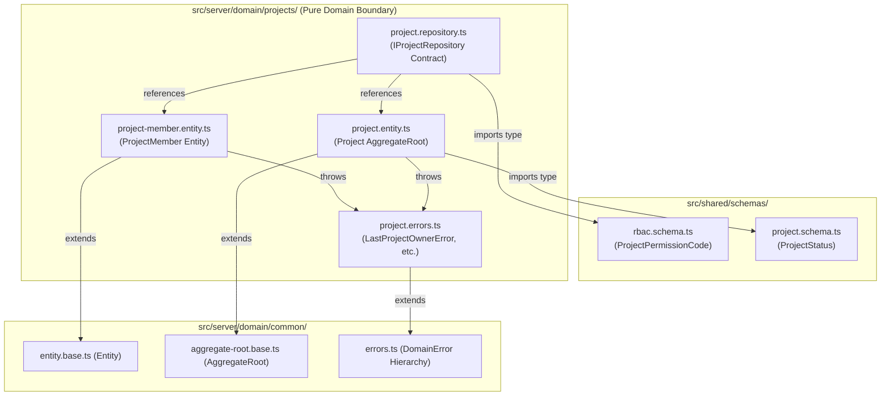

# Milestone 6 — Backend Step 2: Domain Project Member & Scoped Rules (src/server/domain/projects/)

ในขั้นตอนนี้เราจะยกระดับ **Domain Layer (`src/server/domain/projects/`)** เพื่อรองรับการบริหารจัดการสมาชิกภายในโครงการอย่างสมบูรณ์ตามหลัก **Tactical Domain-Driven Design (DDD)** โดยสร้าง `ProjectMember` Entity ที่ปกป้องกฎเหล็กสำคัญของระบบ นั่นคือ **Last-Owner Invariant (ห้ามถอดหรือลดบทบาทเจ้าของโครงการคนสุดท้าย)** พร้อมต่อเติม Domain Errors และสัญญา `IProjectRepository` ให้ครอบคลุมการจัดการสมาชิกและการลบโครงการ

---

## 1. เป้าหมายและขอบเขต Boundary (Boundary Context & Goal)

### เป้าหมายของ Step นี้
1. สร้าง `ProjectMember` Entity (`project-member.entity.ts`) ที่ห่อหุ้มสถานะของสมาชิกภายในโครงการ และบังคับใช้กฎ **Last-Owner Invariant** ผ่านเมธอด `changeRole(...)` และ `ensureRemovable(...)`
2. ต่อเติมคลาสข้อผิดพลาดทางธุรกิจใน `project.errors.ts` ได้แก่ `ProjectMemberAlreadyExistsError`, `ProjectMemberNotFoundError`, `LastProjectOwnerError` และ `InvalidProjectRoleError`
3. ต่อเติมสัญญา `IProjectRepository` ใน `project.repository.ts` ให้รองรับการค้นหาสมาชิกตาม `memberId` หรือ `userId`, การบันทึก/ถอดสมาชิก, การนับจำนวนสมาชิกตาม `roleSlug` (`countMembersWithRoleSlug`) และการลบโครงการ (`delete`)

### ตารางสรุปไฟล์ใน Step นี้

| เส้นทางไฟล์ (File Path) | บทบาทหน้าที่ (Responsibility) |
| :--- | :--- |
| `src/server/domain/projects/project-member.entity.ts` | Domain Entity ตัวแทนสมาชิกในโครงการ พร้อมพฤติกรรม `isOwner()`, `changeRole()` และ `ensureRemovable()` |
| `src/server/domain/projects/project.errors.ts` | นิยาม Custom Domain Errors ประจำโมดูล Projects ครบทุกกรณีทางธุรกิจ |
| `src/server/domain/projects/project.repository.ts` | สัญญา Repository Interface (`IProjectRepository`) สำหรับ Aggregate `Project` และ `ProjectMember` |

### แผนผังสถาปัตยกรรมและทิศทางการพึ่งพา (Boundary Dependency Flow)



---

## 2. ทฤษฎี ความสำคัญ และกฎสถาปัตยกรรมเฉพาะ Boundary นี้

### 2.1 กฎ Tactical DDD จาก `.agents/rules/server.md`
- **Pure Domain Boundary (ข้อ 1)**: ไฟล์ทั้งหมดใน `src/server/domain/projects/` ห้ามนำเข้าสิ่งใดจาก `application/`, `infrastructure/` หรือ Drizzle ORM เด็ดขาด อนุญาตเฉพาะ Base Classes ใน `domain/common/` และ Types จาก `shared/schemas/` เท่านั้น
- **Rich Domain Model & Encapsulation (ข้อ 4)**: `ProjectMember` ซ่อน `props` ไว้ภายในคลาส เปิดให้อ่านค่าผ่าน `get` properties เท่านั้น และบังคับให้การเปลี่ยนบทบาทต้องเรียกผ่านเมธอด `member.changeRole(nextRoleId, nextRoleSlug, ownerCount)` แทนการแก้ไข property โดยตรง
- **Creation vs Reconstitution Separation (ข้อ 5)**:
  - ใช้ `ProjectMember.create(params)` เมื่อเพิ่มสมาชิกคนใหม่เข้าสู่โครงการ (สร้าง UUID ใหม่และตั้งเวลา `joinedAt: new Date()`)
  - ใช้ `ProjectMember.reconstitute(id, props)` เฉพาะภายใน Repository เมื่อโหลดข้อมูลสมาชิกที่มีอยู่แล้วมาจากฐานข้อมูล
- **Pure Repository Contract (ข้อ 6)**: `IProjectRepository` รับและคืนค่าเฉพาะ Domain Objects (`Project`, `ProjectMember`) หรือ Primitives เท่านั้น ไม่มีชนิดข้อมูลของตาราง Drizzle ปะปน

### 2.2 กฎเหล็ก Last-Owner Invariant (`LastProjectOwnerError`)
ในระบบการจัดการโครงการแบบกระจายสิทธิ์ หากโครงการใดไม่มีผู้ถือบทบาท `project_owner` (`PROJECT_OWNER_ROLE_SLUG = "project_owner"`) เหลืออยู่เลย โครงการนั้นจะกลายเป็น **Orphaned Project** ที่ไม่มีใครสามารถจัดการสมาชิกหรือตั้งค่าสำคัญได้อีกต่อไป ดังนั้น `ProjectMember` จึงบังคับใช้กฎ Invariant 2 จุด:
1. **การเปลี่ยนบทบาท (`changeRole`)**: หากสมาชิกคนนั้นปัจจุบันเป็น `project_owner` (`this.isOwner() === true`) และกำลังจะถูกเปลี่ยนไปเป็นบทบาทอื่น (`nextRoleSlug !== PROJECT_OWNER_ROLE_SLUG`) ในขณะที่ทั้งโครงการเหลือ `project_owner` เพียงคนเดียวหรือน้อยกว่า (`ownerCount <= 1`) ระบบจะโยน `LastProjectOwnerError` ทันที
2. **การถอดสมาชิกออกจากโครงการ (`ensureRemovable`)**: หากสมาชิกที่กำลังจะถูกลบเป็น `project_owner` และ `ownerCount <= 1` ระบบจะโยน `LastProjectOwnerError` เพื่อสกัดกั้นการลบก่อนถึงชั้น Database

นอกจากนี้ ในฝั่ง `Project` Aggregate Root (`src/server/domain/projects/project.entity.ts`) ยังมีเมธอด `project.ensureActiveForMemberManagement()` ซึ่งตรวจสอบว่าหากโครงการอยู่ในสถานะ `"archived"` จะโยน `ProjectArchivedError` ทันที เพื่อห้ามเพิ่ม เปลี่ยนบทบาท หรือถอดสมาชิกในโครงการที่ถูกจัดเก็บไปแล้ว

---

## 3. ลงมือเขียนโค้ด (Step-by-Step Implementation)

### 3.1 ไฟล์ `src/server/domain/projects/project-member.entity.ts`

สร้างไฟล์ `src/server/domain/projects/project-member.entity.ts` สำหรับแทนสมาชิกแต่ละคนภายในโครงการ:

```typescript
import { Entity } from "#/server/domain/common/entity.base";
import { LastProjectOwnerError } from "./project.errors";

export const PROJECT_OWNER_ROLE_SLUG = "project_owner";

export interface ProjectMemberProps {
	readonly projectId: string;
	readonly userId: string;
	readonly roleId: string;
	readonly roleSlug: string;
	readonly joinedAt: Date;
}

export interface CreateProjectMemberParams {
	readonly projectId: string;
	readonly userId: string;
	readonly roleId: string;
	readonly roleSlug: string;
}

export class ProjectMember extends Entity<ProjectMemberProps> {
	private constructor(id: string, props: ProjectMemberProps) {
		super(id, props);
	}

	static create(params: CreateProjectMemberParams): ProjectMember {
		return new ProjectMember(crypto.randomUUID(), {
			projectId: params.projectId,
			userId: params.userId,
			roleId: params.roleId,
			roleSlug: params.roleSlug,
			joinedAt: new Date(),
		});
	}

	static reconstitute(id: string, props: ProjectMemberProps): ProjectMember {
		return new ProjectMember(id, props);
	}

	get projectId(): string {
		return this.props.projectId;
	}

	get userId(): string {
		return this.props.userId;
	}

	get roleId(): string {
		return this.props.roleId;
	}

	get roleSlug(): string {
		return this.props.roleSlug;
	}

	get joinedAt(): Date {
		return this.props.joinedAt;
	}

	isOwner(): boolean {
		return this.props.roleSlug === PROJECT_OWNER_ROLE_SLUG;
	}

	changeRole(
		nextRoleId: string,
		nextRoleSlug: string,
		ownerCount: number,
	): void {
		if (
			this.isOwner() &&
			nextRoleSlug !== PROJECT_OWNER_ROLE_SLUG &&
			ownerCount <= 1
		) {
			throw new LastProjectOwnerError(
				"ไม่สามารถเปลี่ยนบทบาทของเจ้าของโครงการคนสุดท้ายได้ กรุณาตั้งเจ้าของโครงการคนอื่นเพิ่มก่อน",
			);
		}

		this.props = {
			...this.props,
			roleId: nextRoleId,
			roleSlug: nextRoleSlug,
		};
	}

	ensureRemovable(ownerCount: number): void {
		if (this.isOwner() && ownerCount <= 1) {
			throw new LastProjectOwnerError(
				"ไม่สามารถลบเจ้าของโครงการคนสุดท้ายออกจากโครงการได้",
			);
		}
	}
}
```

#### คำอธิบายโค้ดอย่างละเอียด
- **`PROJECT_OWNER_ROLE_SLUG`**: ค่าคงที่ `"project_owner"` ที่ใช้ตรวจสอบสถานะความเป็นเจ้าของโครงการ
- **`ProjectMember.create(...)` & `ProjectMember.reconstitute(...)`**: แยก Factory สร้างสมาชิกใหม่ (สุ่ม UUID ด้วย `crypto.randomUUID()` และกำหนด `joinedAt` เป็นเวลาปัจจุบัน) ออกจากเมธอดคืนสภาพข้อมูลจากฐานข้อมูล
- **`changeRole(nextRoleId, nextRoleSlug, ownerCount)`**: ตรวจสอบกฎ Last-Owner Invariant ก่อนอัปเดต `roleId` และ `roleSlug` แบบ Immutable (`this.props = { ...this.props, ... }`)
- **`ensureRemovable(ownerCount)`**: ตรวจสอบว่าสามารถถอดสมาชิกคนนี้ออกจากโครงการได้หรือไม่โดยไม่ทำให้โครงการขาดเจ้าของ

---

### 3.2 ไฟล์ `src/server/domain/projects/project.errors.ts`

อัปเดตไฟล์ `src/server/domain/projects/project.errors.ts` เพื่อรวม Domain Errors สำหรับการจัดการสมาชิกและขอบเขตของบทบาท โดยโค้ดฉบับเต็มทั้งไฟล์มีดังนี้:

```typescript
import {
	ConflictDomainError,
	ForbiddenDomainError,
	InvalidStateTransitionError,
	NotFoundDomainError,
	ValidationDomainError,
} from "#/server/domain/common/errors";

export class InvalidProjectKeyError extends ValidationDomainError {
	constructor(rawKey: string) {
		super(
			`รหัสโครงการ '${rawKey}' ไม่ถูกต้อง ต้องเป็นตัวอักษร A-Z และตัวเลข 0-9 ความยาว 2–10 ตัวอักษร และขึ้นต้นด้วย A-Z`,
		);
	}
}

export class ProjectKeyAlreadyExistsError extends ConflictDomainError {
	constructor(key: string) {
		super(`รหัสโครงการ '${key}' ถูกใช้งานแล้ว กรุณาใช้รหัสอื่น`);
	}
}

export class ProjectNotFoundError extends NotFoundDomainError {
	constructor(identifier: string) {
		super(`ไม่พบโครงการที่ระบุ (${identifier})`);
	}
}

export class ProjectArchivedError extends InvalidStateTransitionError {
	constructor(message = "โครงการนี้อยู่ในสถานะถูกจัดเก็บ ไม่สามารถแก้ไขได้") {
		super(message);
	}
}

export class ProjectAlreadyActiveError extends InvalidStateTransitionError {
	constructor() {
		super("โครงการนี้อยู่ในสถานะใช้งานอยู่แล้ว");
	}
}

export class ProjectMemberAlreadyExistsError extends ConflictDomainError {
	constructor() {
		super("ผู้ใช้งานนี้เป็นสมาชิกของโปรเจกต์นี้อยู่แล้ว");
	}
}

export class ProjectMemberNotFoundError extends NotFoundDomainError {
	constructor(memberId: string) {
		super(`ไม่พบสมาชิกที่ระบุภายในโปรเจกต์ (${memberId})`);
	}
}

export class LastProjectOwnerError extends ForbiddenDomainError {
	constructor(
		message = "ไม่สามารถถอดหรือลดบทบาท Project Owner คนสุดท้ายของโปรเจกต์ได้",
	) {
		super(message);
	}
}

export class InvalidProjectRoleError extends ValidationDomainError {
	constructor() {
		super("สามารถมอบหมายได้เฉพาะ Role ระดับ 'project' ให้สมาชิกภายในโปรเจกต์เท่านั้น");
	}
}
```

#### คำอธิบายโค้ดอย่างละเอียด
- **`ProjectMemberAlreadyExistsError` (`ConflictDomainError`)**: โยนเมื่อพยายามเพิ่มผู้ใช้ที่เป็นสมาชิกในโครงการนั้นอยู่แล้วซ้ำอีกครั้ง
- **`ProjectMemberNotFoundError` (`NotFoundDomainError`)**: โยนเมื่อไม่พบรายการสมาชิกตาม `memberId` ภายในโครงการที่ระบุ
- **`LastProjectOwnerError` (`ForbiddenDomainError`)**: โยนเมื่อฝ่าฝืนกฎห้ามถอดหรือลดบทบาทเจ้าของโครงการคนสุดท้าย
- **`InvalidProjectRoleError` (`ValidationDomainError`)**: โยนเมื่อผู้เรียกส่ง `roleId` ที่มี `scope` ไม่ใช่ `"project"` (เช่น ส่งบทบาทระดับ `"system"` เข้ามา)

---

### 3.3 ไฟล์ `src/server/domain/projects/project.repository.ts`

อัปเดตไฟล์ `src/server/domain/projects/project.repository.ts` ให้มีสัญญาเมธอดครบทั้งหมดสำหรับทั้ง `Project` และ `ProjectMember`:

```typescript
import type { ProjectPermissionCode } from "#/shared/schemas/rbac.schema";
import type { Project } from "./project.entity";
import type { ProjectMember } from "./project-member.entity";

export interface AddProjectMemberParams {
	readonly id: string;
	readonly projectId: string;
	readonly userId: string;
	readonly roleId: string;
}

export interface RecordProjectActivityParams {
	readonly projectId: string;
	readonly taskId?: string | null;
	readonly actorId: string;
	readonly action: string;
	readonly metadata?: Record<string, unknown>;
}

export interface IProjectRepository {
	findById(projectId: string): Promise<Project | null>;
	findByKey(key: string): Promise<Project | null>;
	save(project: Project): Promise<void>;
	delete(projectId: string): Promise<boolean>;
	addMember(params: AddProjectMemberParams): Promise<void>;
	findMemberById(
		projectId: string,
		memberId: string,
	): Promise<ProjectMember | null>;
	findMemberByUserId(
		projectId: string,
		userId: string,
	): Promise<ProjectMember | null>;
	saveMember(member: ProjectMember): Promise<void>;
	removeMember(projectId: string, memberId: string): Promise<boolean>;
	incrementTaskSequence(projectId: string): Promise<number>;
	countMembersWithRoleSlug(
		projectId: string,
		roleSlug: string,
	): Promise<number>;
	recordActivity(params: RecordProjectActivityParams): Promise<void>;
	getUserProjectPermissions(
		projectId: string,
		userId: string,
	): Promise<ProjectPermissionCode[]>;
}
```

#### คำอธิบายโค้ดอย่างละเอียด
- **`delete(projectId)`**: ลบโครงการออกจากระบบและคืนค่า `boolean` ว่ามีแถวถูกลบจริงหรือไม่
- **`findMemberById(projectId, memberId)` & `findMemberByUserId(projectId, userId)`**: ค้นหาสมาชิกภายใต้ขอบเขต `projectId` เสมอ (ป้องกันปัญหา Cross-Project Member Access) แล้วคืนค่าเป็น `ProjectMember` Entity
- **`saveMember(member)` & `removeMember(projectId, memberId)`**: บันทึกการเพิ่มหรืออัปเดตบทบาทของ `ProjectMember` และลบสมาชิกออกจากโครงการ
- **`countMembersWithRoleSlug(projectId, roleSlug)`**: นับจำนวนสมาชิกที่ถือบทบาทตาม `roleSlug` (เช่น `"project_owner"`) ภายในโครงการ เพื่อส่งค่า `ownerCount` ให้กับเมธอด `member.changeRole(...)` และ `member.ensureRemovable(...)`

---

## 4. การตรวจสอบความถูกต้องและ Git Commit (Verification & Commit)

ตรวจสอบความถูกต้องของชนิดข้อมูลและกฎ Linter ด้วยคำสั่ง:

```bash
bun run typecheck
bun run check
```

จากนั้นทำการ Commit การเปลี่ยนแปลงของ Step ที่ 2:

```bash
git add src/server/domain/projects/project-member.entity.ts src/server/domain/projects/project.errors.ts src/server/domain/projects/project.repository.ts
git commit -m "milestone-6.backend.step-2: Domain ProjectMember Entity, Last-Owner Invariant & Repository Contract"
```
