# Milestone 6 — Backend Step 3: Application Project Detail, Members & Scoped Auth (src/server/application/)

ในขั้นตอนที่ 3 นี้ เราจะสร้าง **Application Layer (`src/server/application/projects/`)** สำหรับขับเคลื่อน Use Cases ทั้ง 7 รายการของหน้า Project Detail Workspace ได้แก่ การดึงข้อมูลรายละเอียดโครงการ การลบโครงการ การดึงรายชื่อสมาชิก การเพิ่มสมาชิกใหม่ การเปลี่ยนบทบาทสมาชิก การถอดสมาชิก และการดึงประวัติกิจกรรม พร้อมต่อเติมสัญญา `IProjectQueries` ให้ครบทั้ง 4 เมธอดตามแนวทาง **CQRS Read Projections** และบังคับใช้การตรวจสอบสิทธิ์ระดับโครงการ (`assertProjectReadAccess` เทียบกับ `assertProjectPermission`) ร่วมกับธุรกรรมแบบ Atomic ผ่าน `IUnitOfWork`

---

## 1. เป้าหมายและขอบเขต Boundary (Boundary Context & Goal)

### เป้าหมายของ Step นี้
1. ต่อเติมสัญญา `IProjectQueries` (`project-queries.interface.ts`) ให้ครบทั้ง 4 เมธอด (`listProjects`, `findProjectDetailById`, `listProjectMembers`, `listProjectActivity`)
2. สร้าง Read Use Cases 3 รายการ (`GetProjectDetailUseCase`, `ListProjectMembersUseCase`, `ListProjectActivityUseCase`) ที่ตรวจสอบสิทธิ์การเข้าถึงระดับโครงการผ่าน `authorizationService.assertProjectReadAccess(...)`
3. สร้าง Command Use Cases 4 รายการ (`DeleteProjectUseCase`, `AddProjectMemberUseCase`, `ChangeProjectMemberRoleUseCase`, `RemoveProjectMemberUseCase`) ที่ทำงานภายใต้ `unitOfWork.withTransaction(...)` ตรวจสอบสิทธิ์ระดับโครงการผ่าน `authorizationService.assertProjectPermission(...)` และบันทึก Audit Trail ลงใน `activity_logs`

### ตารางสรุปไฟล์ใน Step นี้

| เส้นทางไฟล์ (File Path) | บทบาทหน้าที่ (Responsibility) |
| :--- | :--- |
| `src/server/application/projects/project-queries.interface.ts` | สัญญา CQRS Query Interface สำหรับการดึงข้อมูล Read Projections ของโมดูล Projects ทั้ง 4 รูปแบบ |
| `src/server/application/projects/get-project-detail.use-case.ts` | Use Case ดึงรายละเอียดโครงการพร้อมบทบาทและสิทธิ์ของผู้ใช้ปัจจุบัน |
| `src/server/application/projects/delete-project.use-case.ts` | Use Case ลบโครงการอย่างถาวรภายใต้สิทธิ์ `project:delete` |
| `src/server/application/projects/list-project-members.use-case.ts` | Use Case ดึงรายชื่อสมาชิกโครงการ บทบาทที่เลือกได้ และรายชื่อผู้ใช้ที่สามารถเชิญเข้าโครงการ |
| `src/server/application/projects/add-project-member.use-case.ts` | Use Case เพิ่มสมาชิกใหม่เข้าสู่โครงการ พร้อมตรวจสถานะโครงการ ตรวจ Scope บทบาท และบันทึก Activity Log |
| `src/server/application/projects/change-project-member-role.use-case.ts` | Use Case เปลี่ยนบทบาทของสมาชิกภายในโครงการ พร้อมตรวจกฎ Last-Owner Invariant และบันทึก Activity Log |
| `src/server/application/projects/remove-project-member.use-case.ts` | Use Case ถอดสมาชิกออกจากโครงการ พร้อมตรวจกฎ Last-Owner Invariant และบันทึก Activity Log |
| `src/server/application/projects/list-project-activity.use-case.ts` | Use Case ดึงประวัติกิจกรรมล่าสุดภายในโครงการ |

### แผนผังสถาปัตยกรรมและทิศทางการพึ่งพา (Boundary Dependency Flow)

```mermaid
flowchart TD
    subgraph APP_PROJ["src/server/application/projects/ (Use Cases & Query Contract)"]
        Q_INT["project-queries.interface.ts (IProjectQueries)"]
        UC_DET["get-project-detail.use-case.ts"]
        UC_DEL["delete-project.use-case.ts"]
        UC_LMEM["list-project-members.use-case.ts"]
        UC_ADD["add-project-member.use-case.ts"]
        UC_CHG["change-project-member-role.use-case.ts"]
        UC_REM["remove-project-member.use-case.ts"]
        UC_ACT["list-project-activity.use-case.ts"]
    end

    subgraph APP_COMMON["src/server/application/common/ & users/"]
        AUTH_SVC["authorization.service.ts (AuthorizationService)"]
        USER_Q["user-queries.interface.ts (IUserQueries)"]
    end

    subgraph DOMAIN["src/server/domain/ (Pure Domain Layer)"]
        UOW["common/unit-of-work.interface.ts (IUnitOfWork)"]
        PROJ_REPO["projects/project.repository.ts (IProjectRepository)"]
        PROJ_MEM["projects/project-member.entity.ts (ProjectMember)"]
        RBAC_REPO["rbac/rbac.repository.ts (IRbacRepository)"]
    end

    UC_DET -->|queries| Q_INT
    UC_DET -->|assertProjectReadAccess| AUTH_SVC
    UC_LMEM -->|queries| Q_INT
    UC_LMEM -->|assertProjectReadAccess| AUTH_SVC
    UC_ACT -->|queries| Q_INT
    UC_ACT -->|assertProjectReadAccess| AUTH_SVC

    UC_DEL -->|withTransaction| UOW
    UC_DEL -->|assertProjectPermission| AUTH_SVC
    UC_DEL -->|mutates| PROJ_REPO

    UC_ADD -->|withTransaction| UOW
    UC_ADD -->|assertProjectPermission| AUTH_SVC
    UC_ADD -->|checks user| USER_Q
    UC_ADD -->|checks role| RBAC_REPO
    UC_ADD -->|creates| PROJ_MEM
    UC_ADD -->|saves & logs| PROJ_REPO

    UC_CHG -->|withTransaction| UOW
    UC_CHG -->|assertProjectPermission| AUTH_SVC
    UC_CHG -->|checks role| RBAC_REPO
    UC_CHG -->|mutates| PROJ_MEM
    UC_CHG -->|saves & logs| PROJ_REPO

    UC_REM -->|withTransaction| UOW
    UC_REM -->|assertProjectPermission| AUTH_SVC
    UC_REM -->|validates| PROJ_MEM
    UC_REM -->|removes & logs| PROJ_REPO
```



---

## 2. ทฤษฎี ความสำคัญ และกฎสถาปัตยกรรมเฉพาะ Boundary นี้

### 2.1 กฎ Application Layer จาก `.agents/rules/server.md`
1. **One File per Use Case (ข้อ 8)**: แยก 1 ไฟล์ต่อ 1 Use Case อย่างชัดเจน โดยมีคลาสเดี่ยวและเมธอด `execute(input)` พร้อมระบุ Return Type อย่างชัดเจน
2. **Explicit Input Object Contract (ข้อ 9)**: ทุก Use Case รับพารามิเตอร์ตัวเดียวเป็น Input Interface (เช่น `AddProjectMemberUseCaseInput`) ที่ประกอบด้วยข้อมูลผู้กระทำ (`actorUserId`, `actorSystemPermissions`) และ `payload` ที่ผ่านการตรวจสอบจาก Shared Schema แล้ว
3. **Orchestration Only (ข้อ 10)**: Use Case ทำหน้าที่ประสานงาน (ดึงข้อมูล -> ตรวจสิทธิ์ -> เรียกเมธอดบน Domain Entity -> บันทึกผ่าน Repository) โดยไม่เขียนคำสั่ง SQL/Drizzle เอง และไม่นำกฎ Last-Owner Invariant มาเขียนซ้ำนอก `ProjectMember` Entity
4. **Atomic Multi-Table Operations with `IUnitOfWork` (ข้อ 12)**: การเพิ่ม เปลี่ยนบทบาท หรือถอดสมาชิก ต้องมีการเปลี่ยนแปลงตาราง `project_members` ควบคู่กับการบันทึกแถวใหม่ลงตาราง `activity_logs` เสมอ จึงต้องครอบด้วย `this.unitOfWork.withTransaction(async () => { ... })` เพื่อรับประกันว่าหากขั้นตอนใดล้มเหลว ระบบจะ Rollback ทั้งหมดพร้อมกัน
5. **CQRS Read Projections (ข้อ 15)**: สำหรับการอ่านข้อมูลที่ต้องรวมหลายตาราง (`GetProjectDetailUseCase`, `ListProjectMembersUseCase`, `ListProjectActivityUseCase`) เราเรียกใช้ `IProjectQueries` เพื่อคืนค่า DTO โดยตรงโดยไม่ต้อง Reconstitute Domain Entity ทั้งก้อน

### 2.2 การตรวจสอบสิทธิ์ระดับโครงการ: `assertProjectReadAccess` vs `assertProjectPermission`
ใน `AuthorizationService` (`src/server/application/common/authorization.service.ts`) มีกลไกตรวจสอบสิทธิ์สำหรับโครงการ 2 รูปแบบที่แตกต่างกันตามบริบท:
1. **`assertProjectReadAccess(actorSystemPermissions, projectPermissions)`**:
   - ใช้กับ **Read Use Cases** (`GetProjectDetailUseCase`, `ListProjectMembersUseCase`, `ListProjectActivityUseCase`)
   - อนุญาตให้เข้าถึงได้หากผู้ใช้มีสิทธิ์ระดับระบบ `project:read_all` (เช่น System Admin ที่ต้องการตรวจสอบโครงการใดๆ ในระบบแม้ไม่ได้เป็นสมาชิก) **หรือ** เป็นสมาชิกในโครงการนั้นที่มีสิทธิ์ระดับโครงการ `project:read`
2. **`assertProjectPermission(grantedPermissions, requiredPermission)`**:
   - ใช้กับ **Mutation/Command Use Cases** (`DeleteProjectUseCase` ใช้ `project:delete`, ส่วน `AddProjectMemberUseCase`, `ChangeProjectMemberRoleUseCase`, `RemoveProjectMemberUseCase` ใช้ `project:manage_members`)
   - บังคับว่าผู้กระทำต้องได้รับสิทธิ์ระดับโครงการนั้นๆ จากการเป็นสมาชิกในโครงการ (`grantedPermissions` จาก `projectRepository.getUserProjectPermissions(project.id, input.actorUserId)`) เท่านั้น

---

## 3. ลงมือเขียนโค้ด (Step-by-Step Implementation)

### 3.1 ไฟล์ `src/server/application/projects/project-queries.interface.ts`

อัปเดตไฟล์ `src/server/application/projects/project-queries.interface.ts` ให้มีครบทั้ง 4 เมธอดสำหรับการอ่านข้อมูลโครงการ:

```typescript
import type {
	ActivityLogDto,
	ListProjectMembersResultDto,
	ListProjectsResultDto,
	ProjectDetailDto,
	ProjectsSearch,
} from "#/shared/schemas/project.schema";

export interface ListProjectsQueryInput {
	readonly actorUserId: string;
	readonly includeAllProjects: boolean;
	readonly params: ProjectsSearch;
}

export interface IProjectQueries {
	listProjects(input: ListProjectsQueryInput): Promise<ListProjectsResultDto>;
	findProjectDetailById(
		projectId: string,
		actorUserId: string,
	): Promise<ProjectDetailDto | null>;
	listProjectMembers(projectId: string): Promise<ListProjectMembersResultDto>;
	listProjectActivity(
		projectId: string,
		limit: number,
	): Promise<ActivityLogDto[]>;
}
```

#### คำอธิบายโค้ดอย่างละเอียด
- **`findProjectDetailById(projectId, actorUserId)`**: ดึงข้อมูลรายละเอียดโครงการพร้อมคำนวณ `myRole` และ `myPermissions` ของ `actorUserId` มาในคราวเดียว
- **`listProjectMembers(projectId)`**: ดึงรายชื่อสมาชิกปัจจุบัน รายการบทบาทระดับ `project` และรายชื่อผู้ใช้ที่ยังไม่ได้เป็นสมาชิกของโครงการนี้
- **`listProjectActivity(projectId, limit)`**: ดึงประวัติกิจกรรมล่าสุดของโครงการตามจำนวน `limit`

---

### 3.2 ไฟล์ `src/server/application/projects/get-project-detail.use-case.ts`

สร้างไฟล์ `src/server/application/projects/get-project-detail.use-case.ts`:

```typescript
import { ProjectNotFoundError } from "#/server/domain/projects/project.errors";
import type {
	GetProjectDetailInput,
	ProjectDetailDto,
} from "#/shared/schemas/project.schema";
import type { AuthorizationService } from "../common/authorization.service";
import type { IProjectQueries } from "./project-queries.interface";

export interface GetProjectDetailUseCaseInput {
	actorUserId: string;
	actorSystemPermissions: readonly string[];
	payload: GetProjectDetailInput;
}

export class GetProjectDetailUseCase {
	constructor(
		private readonly projectQueries: IProjectQueries,
		private readonly authorizationService: AuthorizationService,
	) {}

	async execute(
		input: GetProjectDetailUseCaseInput,
	): Promise<ProjectDetailDto> {
		const detail = await this.projectQueries.findProjectDetailById(
			input.payload.projectId,
			input.actorUserId,
		);

		if (!detail) {
			throw new ProjectNotFoundError(input.payload.projectId);
		}

		this.authorizationService.assertProjectReadAccess(
			input.actorSystemPermissions,
			detail.myPermissions,
		);

		return detail;
	}
}
```

#### คำอธิบายโค้ดอย่างละเอียด
- ดึง `detail` จาก `this.projectQueries.findProjectDetailById(...)` ซึ่งภายในมี `detail.myPermissions` ติดมาด้วยแล้ว
- หากไม่พบโครงการ จะโยน `ProjectNotFoundError` ก่อนตรวจสิทธิ์
- จากนั้นตรวจสิทธิ์การอ่านด้วย `this.authorizationService.assertProjectReadAccess(input.actorSystemPermissions, detail.myPermissions)` โดยไม่ต้องคิวรีสิทธิ์ซ้ำอีกครั้ง

---

### 3.3 ไฟล์ `src/server/application/projects/delete-project.use-case.ts`

สร้างไฟล์ `src/server/application/projects/delete-project.use-case.ts`:

```typescript
import type { AuthorizationService } from "#/server/application/common/authorization.service";
import type { IUnitOfWork } from "#/server/domain/common/unit-of-work.interface";
import { ProjectNotFoundError } from "#/server/domain/projects/project.errors";
import type { IProjectRepository } from "#/server/domain/projects/project.repository";
import { PROJECT_PERMISSIONS } from "#/server/domain/rbac/permission-codes";
import type { ProjectActionInput } from "#/shared/schemas/project.schema";

export interface DeleteProjectUseCaseInput {
	actorUserId: string;
	payload: ProjectActionInput;
}

export class DeleteProjectUseCase {
	constructor(
		private readonly projectRepository: IProjectRepository,
		private readonly authorizationService: AuthorizationService,
		private readonly unitOfWork: IUnitOfWork,
	) {}

	async execute(input: DeleteProjectUseCaseInput): Promise<void> {
		await this.unitOfWork.withTransaction(async () => {
			const project = await this.projectRepository.findById(
				input.payload.projectId,
			);
			if (!project) {
				throw new ProjectNotFoundError(input.payload.projectId);
			}

			const grantedPermissions =
				await this.projectRepository.getUserProjectPermissions(
					project.id,
					input.actorUserId,
				);
			this.authorizationService.assertProjectPermission(
				grantedPermissions,
				PROJECT_PERMISSIONS.PROJECT_DELETE,
			);

			const deleted = await this.projectRepository.delete(project.id);
			if (!deleted) {
				throw new ProjectNotFoundError(project.id);
			}
		});
	}
}
```

#### คำอธิบายโค้ดอย่างละเอียด
- ทำงานภายใต้ `unitOfWork.withTransaction(...)`
- ตรวจสอบว่ามีโครงการอยู่จริง ดึงสิทธิ์ระดับโครงการของผู้กระทำ แล้วบังคับว่าต้องมีสิทธิ์ `PROJECT_PERMISSIONS.PROJECT_DELETE` (`"project:delete"`) ก่อนสั่งลบโครงการ

---

### 3.4 ไฟล์ `src/server/application/projects/list-project-members.use-case.ts`

สร้างไฟล์ `src/server/application/projects/list-project-members.use-case.ts`:

```typescript
import { ProjectNotFoundError } from "#/server/domain/projects/project.errors";
import type { IProjectRepository } from "#/server/domain/projects/project.repository";
import type {
	GetProjectDetailInput,
	ListProjectMembersResultDto,
} from "#/shared/schemas/project.schema";
import type { AuthorizationService } from "../common/authorization.service";
import type { IProjectQueries } from "./project-queries.interface";

export interface ListProjectMembersUseCaseInput {
	actorUserId: string;
	actorSystemPermissions: readonly string[];
	payload: GetProjectDetailInput;
}

export class ListProjectMembersUseCase {
	constructor(
		private readonly projectRepository: IProjectRepository,
		private readonly projectQueries: IProjectQueries,
		private readonly authorizationService: AuthorizationService,
	) {}

	async execute(
		input: ListProjectMembersUseCaseInput,
	): Promise<ListProjectMembersResultDto> {
		const [project, projectPermissions] = await Promise.all([
			this.projectRepository.findById(input.payload.projectId),
			this.projectRepository.getUserProjectPermissions(
				input.payload.projectId,
				input.actorUserId,
			),
		]);

		if (!project) {
			throw new ProjectNotFoundError(input.payload.projectId);
		}

		this.authorizationService.assertProjectReadAccess(
			input.actorSystemPermissions,
			projectPermissions,
		);

		return this.projectQueries.listProjectMembers(project.id);
	}
}
```

#### คำอธิบายโค้ดอย่างละเอียด
- ดึงข้อมูลโครงการและสิทธิ์ระดับโครงการของผู้ใช้พร้อมกันแบบขนานด้วย `Promise.all([...])` เพื่อลด Latency
- ตรวจสอบว่าพบโครงการและผู้เรียกมีสิทธิ์อ่านข้อมูลโครงการ (`assertProjectReadAccess`) ก่อนเรียก `this.projectQueries.listProjectMembers(project.id)`

---

### 3.5 ไฟล์ `src/server/application/projects/add-project-member.use-case.ts`

สร้างไฟล์ `src/server/application/projects/add-project-member.use-case.ts`:

```typescript
import type { AuthorizationService } from "#/server/application/common/authorization.service";
import type { IUserQueries } from "#/server/application/users/user-queries.interface";
import type { IUnitOfWork } from "#/server/domain/common/unit-of-work.interface";
import {
	InvalidProjectRoleError,
	ProjectMemberAlreadyExistsError,
	ProjectNotFoundError,
} from "#/server/domain/projects/project.errors";
import type { IProjectRepository } from "#/server/domain/projects/project.repository";
import { ProjectMember } from "#/server/domain/projects/project-member.entity";
import { PROJECT_PERMISSIONS } from "#/server/domain/rbac/permission-codes";
import { RoleNotFoundError } from "#/server/domain/rbac/rbac.errors";
import type { IRbacRepository } from "#/server/domain/rbac/rbac.repository";
import { UserNotFoundError } from "#/server/domain/users/user.errors";
import type { AddProjectMemberInput } from "#/shared/schemas/project.schema";

export interface AddProjectMemberUseCaseInput {
	actorUserId: string;
	payload: AddProjectMemberInput;
}

export class AddProjectMemberUseCase {
	constructor(
		private readonly projectRepository: IProjectRepository,
		private readonly rbacRepository: IRbacRepository,
		private readonly userQueries: IUserQueries,
		private readonly authorizationService: AuthorizationService,
		private readonly unitOfWork: IUnitOfWork,
	) {}

	async execute(input: AddProjectMemberUseCaseInput): Promise<void> {
		await this.unitOfWork.withTransaction(async () => {
			const project = await this.projectRepository.findById(
				input.payload.projectId,
			);
			if (!project) {
				throw new ProjectNotFoundError(input.payload.projectId);
			}

			const grantedPermissions =
				await this.projectRepository.getUserProjectPermissions(
					project.id,
					input.actorUserId,
				);
			this.authorizationService.assertProjectPermission(
				grantedPermissions,
				PROJECT_PERMISSIONS.PROJECT_MANAGE_MEMBERS,
			);

			project.ensureActiveForMemberManagement();

			const userExists = await this.userQueries.existsById(
				input.payload.userId,
			);
			if (!userExists) {
				throw new UserNotFoundError(input.payload.userId);
			}

			const existingMember = await this.projectRepository.findMemberByUserId(
				project.id,
				input.payload.userId,
			);
			if (existingMember) {
				throw new ProjectMemberAlreadyExistsError();
			}

			const role = await this.rbacRepository.findRoleById(input.payload.roleId);
			if (!role) {
				throw new RoleNotFoundError(input.payload.roleId);
			}
			if (role.scope !== "project") {
				throw new InvalidProjectRoleError();
			}

			const member = ProjectMember.create({
				projectId: project.id,
				userId: input.payload.userId,
				roleId: role.id,
				roleSlug: role.slug,
			});

			await this.projectRepository.saveMember(member);

			await this.projectRepository.recordActivity({
				projectId: project.id,
				actorId: input.actorUserId,
				action: "project.member_added",
				metadata: {
					targetUserId: member.userId,
					roleSlug: role.slug,
					roleName: role.name,
				},
			});
		});
	}
}
```

#### คำอธิบายโค้ดอย่างละเอียด
1. ตรวจสอบการมีอยู่ของโครงการ และตรวจสิทธิ์ `project:manage_members` ของผู้กระทำ
2. เรียก `project.ensureActiveForMemberManagement()` เพื่อป้องกันการเพิ่มสมาชิกในโครงการที่ถูกจัดเก็บ (`archived`)
3. ตรวจสอบว่าผู้ใช้เป้าหมายมีตัวตนจริง (`userQueries.existsById`) และยังไม่ได้เป็นสมาชิกของโครงการนี้ (`findMemberByUserId`)
4. ตรวจสอบว่า `roleId` ที่ระบุมีอยู่จริงและมี `role.scope === "project"` เท่านั้น หากไม่ใช่จะโยน `InvalidProjectRoleError`
5. สร้าง `ProjectMember.create(...)` บันทึกผ่าน `saveMember(member)` และบันทึกประวัติกิจกรรม `"project.member_added"` ภายใน Transaction เดียวกัน

---

### 3.6 ไฟล์ `src/server/application/projects/change-project-member-role.use-case.ts`

สร้างไฟล์ `src/server/application/projects/change-project-member-role.use-case.ts`:

```typescript
import type { IUnitOfWork } from "#/server/domain/common/unit-of-work.interface";
import {
	InvalidProjectRoleError,
	ProjectMemberNotFoundError,
	ProjectNotFoundError,
} from "#/server/domain/projects/project.errors";
import type { IProjectRepository } from "#/server/domain/projects/project.repository";
import { PROJECT_OWNER_ROLE_SLUG } from "#/server/domain/projects/project-member.entity";
import { PROJECT_PERMISSIONS } from "#/server/domain/rbac/permission-codes";
import { RoleNotFoundError } from "#/server/domain/rbac/rbac.errors";
import type { IRbacRepository } from "#/server/domain/rbac/rbac.repository";
import type { ChangeProjectMemberRoleInput } from "#/shared/schemas/project.schema";
import type { AuthorizationService } from "../common/authorization.service";

export interface ChangeProjectMemberRoleUseCaseInput {
	actorUserId: string;
	payload: ChangeProjectMemberRoleInput;
}

export class ChangeProjectMemberRoleUseCase {
	constructor(
		private readonly projectRepository: IProjectRepository,
		private readonly rbacRepository: IRbacRepository,
		private readonly authorizationService: AuthorizationService,
		private readonly unitOfWork: IUnitOfWork,
	) {}

	async execute(input: ChangeProjectMemberRoleUseCaseInput): Promise<void> {
		await this.unitOfWork.withTransaction(async () => {
			const project = await this.projectRepository.findById(
				input.payload.projectId,
			);
			if (!project) {
				throw new ProjectNotFoundError(input.payload.projectId);
			}

			const grantedPermissions =
				await this.projectRepository.getUserProjectPermissions(
					project.id,
					input.actorUserId,
				);
			this.authorizationService.assertProjectPermission(
				grantedPermissions,
				PROJECT_PERMISSIONS.PROJECT_MANAGE_MEMBERS,
			);

			project.ensureActiveForMemberManagement();

			const member = await this.projectRepository.findMemberById(
				project.id,
				input.payload.memberId,
			);
			if (!member) {
				throw new ProjectMemberNotFoundError(input.payload.memberId);
			}

			const nextRole = await this.rbacRepository.findRoleById(
				input.payload.roleId,
			);
			if (!nextRole) {
				throw new RoleNotFoundError(input.payload.roleId);
			}
			if (nextRole.scope !== "project") {
				throw new InvalidProjectRoleError();
			}

			const previousRoleSlug = member.roleSlug;
			const ownerCount = await this.projectRepository.countMembersWithRoleSlug(
				project.id,
				PROJECT_OWNER_ROLE_SLUG,
			);

			member.changeRole(nextRole.id, nextRole.slug, ownerCount);
			await this.projectRepository.saveMember(member);

			await this.projectRepository.recordActivity({
				projectId: project.id,
				actorId: input.actorUserId,
				action: "project.member_role_changed",
				metadata: {
					targetUserId: member.userId,
					previousRoleSlug,
					nextRoleSlug: nextRole.slug,
					nextRoleName: nextRole.name,
				},
			});
		});
	}
}
```

#### คำอธิบายโค้ดอย่างละเอียด
- ดึงข้อมูล `member` จาก `findMemberById(project.id, input.payload.memberId)` และตรวจสอบบทบาทใหม่ `nextRole` ว่าอยู่ใน Scope `"project"`
- นับจำนวนเจ้าของโครงการปัจจุบันด้วย `countMembersWithRoleSlug(project.id, PROJECT_OWNER_ROLE_SLUG)` แล้วส่งเข้า `member.changeRole(nextRole.id, nextRole.slug, ownerCount)`
- หากสมาชิกคนนี้เป็น `project_owner` คนสุดท้ายและกำลังจะถูกลดบทบาท `member.changeRole(...)` จะโยน `LastProjectOwnerError` ทันที
- บันทึกการเปลี่ยนแปลงผ่าน `saveMember(member)` และบันทึก Activity Log `"project.member_role_changed"` พร้อมระบุ `previousRoleSlug` และ `nextRoleSlug`

---

### 3.7 ไฟล์ `src/server/application/projects/remove-project-member.use-case.ts`

สร้างไฟล์ `src/server/application/projects/remove-project-member.use-case.ts`:

```typescript
import type { IUnitOfWork } from "#/server/domain/common/unit-of-work.interface";
import {
	ProjectMemberNotFoundError,
	ProjectNotFoundError,
} from "#/server/domain/projects/project.errors";
import type { IProjectRepository } from "#/server/domain/projects/project.repository";
import { PROJECT_OWNER_ROLE_SLUG } from "#/server/domain/projects/project-member.entity";
import { PROJECT_PERMISSIONS } from "#/server/domain/rbac/permission-codes";
import type { RemoveProjectMemberInput } from "#/shared/schemas/project.schema";
import type { AuthorizationService } from "../common/authorization.service";

export interface RemoveProjectMemberUseCaseInput {
	actorUserId: string;
	payload: RemoveProjectMemberInput;
}

export class RemoveProjectMemberUseCase {
	constructor(
		private readonly projectRepository: IProjectRepository,
		private readonly authotizationService: AuthorizationService,
		private readonly unitOfWork: IUnitOfWork,
	) {}

	async execute(input: RemoveProjectMemberUseCaseInput): Promise<void> {
		await this.unitOfWork.withTransaction(async () => {
			const project = await this.projectRepository.findById(
				input.payload.projectId,
			);
			if (!project) {
				throw new ProjectNotFoundError(input.payload.projectId);
			}

			const grantedPermissions =
				await this.projectRepository.getUserProjectPermissions(
					project.id,
					input.actorUserId,
				);
			this.authotizationService.assertProjectPermission(
				grantedPermissions,
				PROJECT_PERMISSIONS.PROJECT_MANAGE_MEMBERS,
			);

			project.ensureActiveForMemberManagement();

			const member = await this.projectRepository.findMemberById(
				project.id,
				input.payload.memberId,
			);
			if (!member) {
				throw new ProjectMemberNotFoundError(input.payload.memberId);
			}

			const ownerCount = await this.projectRepository.countMembersWithRoleSlug(
				project.id,
				PROJECT_OWNER_ROLE_SLUG,
			);
			member.ensureRemovable(ownerCount);

			const removed = await this.projectRepository.removeMember(
				project.id,
				member.id,
			);

			if (!removed) {
				throw new ProjectMemberNotFoundError(member.id);
			}

			await this.projectRepository.recordActivity({
				projectId: project.id,
				actorId: input.actorUserId,
				action: "project.member_removed",
				metadata: {
					targetUserId: member.userId,
					removedRoleSlug: member.roleSlug,
				},
			});
		});
	}
}
```

#### คำอธิบายโค้ดอย่างละเอียด
- ตรวจสอบสิทธิ์ `project:manage_members` และตรวจสอบว่าโครงการยังอยู่ในสถานะ Active (`ensureActiveForMemberManagement()`)
- โหลดข้อมูลสมาชิก นับจำนวนเจ้าของโครงการ (`ownerCount`) และเรียก `member.ensureRemovable(ownerCount)` เพื่อป้องกันการลบ `project_owner` คนสุดท้าย
- ลบแถวสมาชิกด้วย `removeMember(project.id, member.id)` และบันทึก Activity Log `"project.member_removed"`

---

### 3.8 ไฟล์ `src/server/application/projects/list-project-activity.use-case.ts`

สร้างไฟล์ `src/server/application/projects/list-project-activity.use-case.ts`:

```typescript
import type { AuthorizationService } from "#/server/application/common/authorization.service";
import { ProjectNotFoundError } from "#/server/domain/projects/project.errors";
import type { IProjectRepository } from "#/server/domain/projects/project.repository";
import type {
	ActivityLogDto,
	ListProjectActivityInput,
} from "#/shared/schemas/project.schema";
import type { IProjectQueries } from "./project-queries.interface";

export interface ListProjectActivityUseCaseInput {
	actorUserId: string;
	actorSystemPermissions: readonly string[];
	payload: ListProjectActivityInput;
}

export class ListProjectActivityUseCase {
	constructor(
		private readonly projectRepository: IProjectRepository,
		private readonly projectQueries: IProjectQueries,
		private readonly authorizationService: AuthorizationService,
	) {}

	async execute(
		input: ListProjectActivityUseCaseInput,
	): Promise<ActivityLogDto[]> {
		const [project, projectPermissions] = await Promise.all([
			this.projectRepository.findById(input.payload.projectId),
			this.projectRepository.getUserProjectPermissions(
				input.payload.projectId,
				input.actorUserId,
			),
		]);

		if (!project) {
			throw new ProjectNotFoundError(input.payload.projectId);
		}

		this.authorizationService.assertProjectReadAccess(
			input.actorSystemPermissions,
			projectPermissions,
		);

		return this.projectQueries.listProjectActivity(
			project.id,
			input.payload.limit,
		);
	}
}
```

#### คำอธิบายโค้ดอย่างละเอียด
- ดึงข้อมูลโครงการควบคู่กับสิทธิ์ระดับโครงการของผู้ใช้แบบขนาน (`Promise.all`)
- ตรวจสอบสิทธิ์การอ่านด้วย `assertProjectReadAccess` ก่อนเรียก `this.projectQueries.listProjectActivity(project.id, input.payload.limit)`

---

## 4. การตรวจสอบความถูกต้องและ Git Commit (Verification & Commit)

ตรวจสอบความถูกต้องของชนิดข้อมูลและกฎ Linter ด้วยคำสั่ง:

```bash
bun run typecheck
bun run check
```

จากนั้นทำการ Commit สำหรับ Step ที่ 3:

```bash
git add src/server/application/projects/project-queries.interface.ts src/server/application/projects/get-project-detail.use-case.ts src/server/application/projects/delete-project.use-case.ts src/server/application/projects/list-project-members.use-case.ts src/server/application/projects/add-project-member.use-case.ts src/server/application/projects/change-project-member-role.use-case.ts src/server/application/projects/remove-project-member.use-case.ts src/server/application/projects/list-project-activity.use-case.ts
git commit -m "milestone-6.backend.step-3: Application Project Detail, Members & Activity Use Cases"
```
