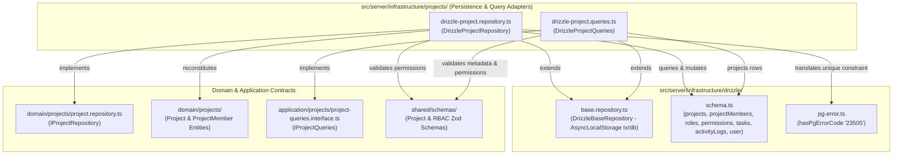

# Milestone 6 — Backend Step 4: Infrastructure Project Detail & Members (src/server/infrastructure/projects/)

ในขั้นตอนที่ 4 นี้ เราจะลงมือเขียนโค้ดในชั้น **Infrastructure Layer (`src/server/infrastructure/projects/`)** ด้วย **Drizzle ORM** เพื่อทำให้สัญญา `IProjectRepository` และ `IProjectQueries` ทำงานร่วมกับฐานข้อมูล PostgreSQL ได้อย่างสมบูรณ์และมีประสิทธิภาพสูงสุด โดยเน้นเทคนิคการทำ Single Round-trip Upsert/Delete และการคิวรีแบบขนาน (`Promise.all`) ร่วมกับ `NOT EXISTS` Subquery เพื่อป้องกันปัญหา **N+1 Queries** อย่างเด็ดขาด

---

## 1. เป้าหมายและขอบเขต Boundary (Boundary Context & Goal)

### เป้าหมายของ Step นี้
1. ต่อเติม `DrizzleProjectRepository` (`drizzle-project.repository.ts`) ให้รองรับการลบโครงการ (`delete`), การค้นหาและคืนสภาพ `ProjectMember` (`findMemberById`, `findMemberByUserId`), การบันทึกสมาชิกแบบ Upsert (`saveMember`), การถอดสมาชิก (`removeMember`), และการนับจำนวนสมาชิกตามรหัสบทบาท (`countMembersWithRoleSlug`)
2. ต่อเติม `DrizzleProjectQueries` (`drizzle-project.queries.ts`) ให้รองรับเมธอด `findProjectDetailById`, `listProjectMembers` และ `listProjectActivity` ด้วย Direct DTO Projection ที่ปราศจาก N+1 Queries

### ตารางสรุปไฟล์ใน Step นี้

| เส้นทางไฟล์ (File Path) | บทบาทหน้าที่ (Responsibility) |
| :--- | :--- |
| `src/server/infrastructure/projects/drizzle-project.repository.ts` | Implement `IProjectRepository` ด้วย Drizzle ORM จัดการ Persistence ของ `Project`, `ProjectMember`, `activityLogs` และการดึงสิทธิ์ระดับโครงการ |
| `src/server/infrastructure/projects/drizzle-project.queries.ts` | Implement `IProjectQueries` ด้วย Drizzle ORM สำหรับการดึงข้อมูล Read Projections ทั้ง 4 เมธอด (`listProjects`, `findProjectDetailById`, `listProjectMembers`, `listProjectActivity`) |

### แผนผังสถาปัตยกรรมและทิศทางการพึ่งพา (Boundary Dependency Flow)



---

## 2. ทฤษฎี ความสำคัญ และกฎสถาปัตยกรรมเฉพาะ Boundary นี้

### 2.1 กฎ Infrastructure & High Performance จาก `.agents/rules/server.md`
1. **Persistence Encapsulation (ข้อ 13)**: `DrizzleProjectRepository` แปลงข้อมูลจากแถวในตาราง (`projects`, `projectMembers` JOIN `roles`) กลับเป็น Domain Entity (`Project.reconstitute(...)`, `ProjectMember.reconstitute(...)`) เสมอ ไม่ปล่อยให้ Drizzle Row หลุดออกไปสู่ Application Layer
2. **Single Round-trip Mutations & Upsert (ข้อ 14)**:
   - ใน `saveMember(member)` ใช้ `.insert(projectMembers).values(...).onConflictDoUpdate({ target: projectMembers.id, set: { roleId: member.roleId } })` ทำให้ใช้เมธอดเดียวได้ทั้งการเพิ่มสมาชิกใหม่และการเปลี่ยนบทบาทสมาชิกเดิม พร้อมดักจับรหัสข้อผิดพลาด PostgreSQL `"23505"` (Unique Violation บน `(project_id, user_id)`) เพื่อแปลงเป็น `ProjectMemberAlreadyExistsError`
   - ใน `delete(projectId)` และ `removeMember(projectId, memberId)` ใช้ `.delete(...).where(...).returning({ id: ... })` เพื่อลบและตรวจสอบผลลัพธ์จบในคำสั่งเดียว
3. **Automatic Transaction Participation via `this.executor` (ข้อ 16)**: ทั้ง `DrizzleProjectRepository` และ `DrizzleProjectQueries` สืบทอดจาก `DrizzleBaseRepository<AppDb, AppTx>` เมื่อถูกเรียกภายใน `unitOfWork.withTransaction(...)` ตัวแปร `this.executor` จะสลับไปใช้ Transaction (`tx`) จาก `AsyncLocalStorage` โดยอัตโนมัติ

### 2.2 การคิวรี `myPermissions` และการป้องกัน N+1 Queries ใน `DrizzleProjectQueries`
1. **`findProjectDetailById(projectId, actorUserId)`**:
   - คิวรีที่ 1: ดึงข้อมูลหลักของโครงการพร้อม JOIN ชื่อผู้สร้าง (`user.name`)
   - คิวรีชุดที่ 2 (รันพร้อมกันด้วย `Promise.all`):
     - นับจำนวนสมาชิกทั้งหมดของโครงการ (`count()` จาก `projectMembers`)
     - นับจำนวนงานทั้งหมดของโครงการ (`count()` จาก `tasks`)
     - ดึงบทบาทและรหัสสิทธิ์ทั้งหมดของ `actorUserId` ในโครงการนี้ผ่านการ JOIN `projectMembers -> roles -> rolePermissions -> permissions` โดยใช้ `leftJoin` ที่ตารางสิทธิ์ เพื่อให้แม้บทบาทนั้นจะไม่มีสิทธิ์ย่อยเลย เราก็ยังได้ข้อมูล `myRole` (`id`, `name`, `slug`) กลับมาอย่างถูกต้อง
2. **`listProjectMembers(projectId)`**:
   - รัน 3 คิวรีแบบขนานด้วย `Promise.all` (ไม่มีการวนลูปยิงคิวรีรายคน):
     - ดึงรายชื่อสมาชิกทั้งหมดในโครงการพร้อม JOIN `user` และ `roles`
     - ดึงบทบาทระดับ `"project"` ทั้งหมดพร้อมสิทธิ์ย่อย (`roles` LEFT JOIN `rolePermissions` LEFT JOIN `permissions`) แล้วนำมาจัดกลุ่มในหน่วยความจำด้วย `Map<string, ProjectRoleOptionDto>`
     - ดึงรายชื่อผู้ใช้ที่สามารถเชิญเข้าโครงการได้ (`invitableUsers`) ด้วยเงื่อนไข SQL `notExists(...)` ที่กรองเฉพาะผู้ใช้ที่ยังไม่มีแถวใน `projectMembers` ของโครงการนี้ในระดับ Database ทันที
3. **`listProjectActivity(projectId, limit)`**:
   - ดึงประวัติกิจกรรมเรียงจากใหม่ไปเก่า (`desc(activityLogs.createdAt)`) พร้อม `innerJoin` ตาราง `user` เพื่อดึงชื่อและอีเมลของผู้กระทำในคิวรีเดียว และตรวจสอบความถูกต้องของ `metadata` ด้วย `activityLogMetadataSchema.safeParse(row.metadata)`

---

## 3. ลงมือเขียนโค้ด (Step-by-Step Implementation)

### 3.1 ไฟล์ `src/server/infrastructure/projects/drizzle-project.repository.ts`

อัปเดตไฟล์ `src/server/infrastructure/projects/drizzle-project.repository.ts` โดยโค้ดฉบับเต็มทั้งไฟล์มีดังนี้:

```typescript
import { and, count, eq, sql } from "drizzle-orm";
import { Project } from "#/server/domain/projects/project.entity";
import {
	ProjectKeyAlreadyExistsError,
	ProjectMemberAlreadyExistsError,
	ProjectNotFoundError,
} from "#/server/domain/projects/project.errors";
import type {
	AddProjectMemberParams,
	IProjectRepository,
	RecordProjectActivityParams,
} from "#/server/domain/projects/project.repository";
import { ProjectKey } from "#/server/domain/projects/project-key.vo";
import { ProjectMember } from "#/server/domain/projects/project-member.entity";
import { DrizzleBaseRepository } from "#/server/infrastructure/drizzle/base.repository";
import type { AppDb, AppTx } from "#/server/infrastructure/drizzle/db";
import { hasPgErrorCode } from "#/server/infrastructure/drizzle/pg-error";
import {
	activityLogs,
	permissions,
	projectMembers,
	projects,
	rolePermissions,
	roles,
} from "#/server/infrastructure/drizzle/schema";
import type { ProjectPermissionCode } from "#/shared/schemas/rbac.schema";
import { projectPermissionCodeSchema } from "#/shared/schemas/rbac.schema";

type ProjectRow = typeof projects.$inferSelect;

export class DrizzleProjectRepository
	extends DrizzleBaseRepository<AppDb, AppTx>
	implements IProjectRepository
{
	async findById(projectId: string): Promise<Project | null> {
		const [row] = await this.executor
			.select()
			.from(projects)
			.where(eq(projects.id, projectId))
			.limit(1);

		return row ? this.toEntity(row) : null;
	}

	async findByKey(key: string): Promise<Project | null> {
		const normalizedKey = key.trim().toUpperCase();
		const [row] = await this.executor
			.select()
			.from(projects)
			.where(eq(projects.key, normalizedKey))
			.limit(1);

		return row ? this.toEntity(row) : null;
	}

	async save(project: Project): Promise<void> {
		try {
			await this.executor
				.insert(projects)
				.values({
					id: project.id,
					key: project.key.value,
					name: project.name,
					description: project.description,
					status: project.status,
					taskSequence: project.taskSequence,
					createdById: project.createdById,
					createdAt: project.createdAt,
					updatedAt: project.updatedAt,
				})
				.onConflictDoUpdate({
					target: projects.id,
					set: {
						name: project.name,
						description: project.description,
						status: project.status,
						taskSequence: project.taskSequence,
						updatedAt: project.updatedAt,
					},
				});
		} catch (error) {
			if (hasPgErrorCode(error, "23505")) {
				throw new ProjectKeyAlreadyExistsError(project.key.value);
			}
			throw error;
		}
	}

	async delete(projectId: string): Promise<boolean> {
		const deleted = await this.executor
			.delete(projects)
			.where(eq(projects.id, projectId))
			.returning({ id: projects.id });

		return deleted.length > 0;
	}

	async addMember(params: AddProjectMemberParams): Promise<void> {
		await this.executor.insert(projectMembers).values({
			id: params.id,
			projectId: params.projectId,
			userId: params.userId,
			roleId: params.roleId,
		});
	}

	async findMemberById(
		projectId: string,
		memberId: string,
	): Promise<ProjectMember | null> {
		const [row] = await this.executor
			.select({
				id: projectMembers.id,
				projectId: projectMembers.projectId,
				userId: projectMembers.userId,
				roleId: projectMembers.roleId,
				roleSlug: roles.slug,
				joinedAt: projectMembers.joinedAt,
			})
			.from(projectMembers)
			.innerJoin(roles, eq(projectMembers.roleId, roles.id))
			.where(
				and(
					eq(projectMembers.id, memberId),
					eq(projectMembers.projectId, projectId),
				),
			)
			.limit(1);

		return row ? ProjectMember.reconstitute(row.id, row) : null;
	}

	async findMemberByUserId(
		projectId: string,
		userId: string,
	): Promise<ProjectMember | null> {
		const [row] = await this.executor
			.select({
				id: projectMembers.id,
				projectId: projectMembers.projectId,
				userId: projectMembers.userId,
				roleId: projectMembers.roleId,
				roleSlug: roles.slug,
				joinedAt: projectMembers.joinedAt,
			})
			.from(projectMembers)
			.innerJoin(roles, eq(projectMembers.roleId, roles.id))
			.where(
				and(
					eq(projectMembers.projectId, projectId),
					eq(projectMembers.userId, userId),
				),
			)
			.limit(1);

		return row ? ProjectMember.reconstitute(row.id, row) : null;
	}

	async saveMember(member: ProjectMember): Promise<void> {
		try {
			await this.executor
				.insert(projectMembers)
				.values({
					id: member.id,
					projectId: member.projectId,
					userId: member.userId,
					roleId: member.roleId,
					joinedAt: member.joinedAt,
				})
				.onConflictDoUpdate({
					target: projectMembers.id,
					set: {
						roleId: member.roleId,
					},
				});
		} catch (error) {
			if (hasPgErrorCode(error, "23505")) {
				throw new ProjectMemberAlreadyExistsError();
			}
			throw error;
		}
	}

	async removeMember(projectId: string, memberId: string): Promise<boolean> {
		const deleted = await this.executor
			.delete(projectMembers)
			.where(
				and(
					eq(projectMembers.id, memberId),
					eq(projectMembers.projectId, projectId),
				),
			)
			.returning({ id: projectMembers.id });

		return deleted.length > 0;
	}

	async incrementTaskSequence(projectId: string): Promise<number> {
		const [updated] = await this.executor
			.update(projects)
			.set({
				taskSequence: sql`${projects.taskSequence} + 1`,
				updatedAt: new Date(),
			})
			.where(eq(projects.id, projectId))
			.returning({ taskSequence: projects.taskSequence });

		if (!updated) {
			throw new ProjectNotFoundError(projectId);
		}

		return updated.taskSequence;
	}

	async countMembersWithRoleSlug(
		projectId: string,
		roleSlug: string,
	): Promise<number> {
		const [row] = await this.executor
			.select({ total: count() })
			.from(projectMembers)
			.innerJoin(roles, eq(projectMembers.roleId, roles.id))
			.where(
				and(eq(projectMembers.projectId, projectId), eq(roles.slug, roleSlug)),
			);

		return Number(row?.total ?? 0);
	}

	async recordActivity(params: RecordProjectActivityParams): Promise<void> {
		await this.executor.insert(activityLogs).values({
			projectId: params.projectId,
			taskId: params.taskId ?? null,
			actorId: params.actorId,
			action: params.action,
			metadata: params.metadata ?? {},
		});
	}

	async getUserProjectPermissions(
		projectId: string,
		userId: string,
	): Promise<ProjectPermissionCode[]> {
		const rows = await this.executor
			.select({
				permissionCode: permissions.code,
			})
			.from(projectMembers)
			.innerJoin(roles, eq(projectMembers.roleId, roles.id))
			.innerJoin(rolePermissions, eq(roles.id, rolePermissions.roleId))
			.innerJoin(permissions, eq(rolePermissions.permissionId, permissions.id))
			.where(
				and(
					eq(projectMembers.projectId, projectId),
					eq(projectMembers.userId, userId),
					eq(roles.scope, "project"),
				),
			);

		const permissionSet = new Set<ProjectPermissionCode>();
		for (const row of rows) {
			const parsed = projectPermissionCodeSchema.safeParse(row.permissionCode);
			if (parsed.success) {
				permissionSet.add(parsed.data);
			}
		}

		return [...permissionSet];
	}

	private toEntity(row: ProjectRow): Project {
		return Project.reconstitute(row.id, {
			key: ProjectKey.reconstitute(row.key),
			name: row.name,
			description: row.description,
			status: row.status,
			taskSequence: row.taskSequence,
			createdById: row.createdById,
			createdAt: row.createdAt,
			updatedAt: row.updatedAt,
		});
	}
}
```

#### คำอธิบายโค้ดอย่างละเอียด
- **`findMemberById` & `findMemberByUserId` (บรรทัดที่ 107–157)**:
  - ใช้ `.innerJoin(roles, eq(projectMembers.roleId, roles.id))` เพื่อดึง `roleSlug: roles.slug` มาพร้อมกับแถวสมาชิก แล้วแปลงกลับเป็น `ProjectMember.reconstitute(row.id, row)` เพื่อให้ Domain Entity สามารถตรวจสอบ `isOwner()` ได้ทันที
- **`saveMember` (บรรทัดที่ 159–182)**:
  - ใช้ `.onConflictDoUpdate` บน `projectMembers.id` เพื่อรองรับทั้งการเพิ่มสมาชิกใหม่และการอัปเดต `roleId`
- **`countMembersWithRoleSlug` (บรรทัดที่ 215–228)**:
  - นับจำนวนสมาชิกในโครงการที่มี `roles.slug` ตรงกับที่ระบุ (เช่น `"project_owner"`) ด้วย SQL `COUNT(*)`

---

### 3.2 ไฟล์ `src/server/infrastructure/projects/drizzle-project.queries.ts`

อัปเดตไฟล์ `src/server/infrastructure/projects/drizzle-project.queries.ts` ให้ครบทั้ง 4 เมธอด โดยโค้ดฉบับเต็มทั้งไฟล์มีดังนี้:

```typescript
import type { SQL } from "drizzle-orm";
import {
	and,
	asc,
	count,
	desc,
	eq,
	exists,
	ilike,
	inArray,
	notExists,
	or,
	sql,
} from "drizzle-orm";
import type {
	IProjectQueries,
	ListProjectsQueryInput,
} from "#/server/application/projects/project-queries.interface";
import { DrizzleBaseRepository } from "#/server/infrastructure/drizzle/base.repository";
import type { AppDb, AppTx } from "#/server/infrastructure/drizzle/db";
import {
	activityLogs,
	permissions,
	projectMembers,
	projects,
	rolePermissions,
	roles,
	tasks,
	user,
} from "#/server/infrastructure/drizzle/schema";
import type {
	ActivityLogDto,
	ListProjectMembersResultDto,
	ListProjectsResultDto,
	ProjectDetailDto,
	ProjectListItemDto,
	ProjectRoleOptionDto,
	ProjectRoleSummary,
	ProjectSortField,
} from "#/shared/schemas/project.schema";
import { activityLogMetadataSchema } from "#/shared/schemas/project.schema";
import type { ProjectPermissionCode } from "#/shared/schemas/rbac.schema";
import { projectPermissionCodeSchema } from "#/shared/schemas/rbac.schema";

const SORT_COLUMN_MAP = {
	key: projects.key,
	name: projects.name,
	status: projects.status,
	createdAt: projects.createdAt,
	updatedAt: projects.updatedAt,
} as const satisfies Record<ProjectSortField, unknown>;

export class DrizzleProjectQueries
	extends DrizzleBaseRepository<AppDb, AppTx>
	implements IProjectQueries
{
	async listProjects(
		input: ListProjectsQueryInput,
	): Promise<ListProjectsResultDto> {
		const { actorUserId, includeAllProjects, params } = input;
		const conditions: SQL[] = [];

		if (!includeAllProjects) {
			conditions.push(
				exists(
					this.executor
						.select({ matched: sql`1` })
						.from(projectMembers)
						.where(
							and(
								eq(projectMembers.projectId, projects.id),
								eq(projectMembers.userId, actorUserId),
							),
						),
				),
			);
		}

		if (params.status !== "all") {
			conditions.push(eq(projects.status, params.status));
		}

		const trimmedSearch = params.search.trim();
		if (trimmedSearch.length > 0) {
			const pattern = `%${trimmedSearch}%`;
			const searchCondition = or(
				ilike(projects.key, pattern),
				ilike(projects.name, pattern),
				ilike(projects.description, pattern),
			);
			if (searchCondition) {
				conditions.push(searchCondition);
			}
		}

		const whereClause = conditions.length > 0 ? and(...conditions) : undefined;
		const sortColumn = SORT_COLUMN_MAP[params.sortBy];
		const primaryOrder =
			params.sortOrder === "asc" ? asc(sortColumn) : desc(sortColumn);
		const offset = (params.page - 1) * params.pageSize;

		const [[totalRow], pageRows] = await Promise.all([
			this.executor
				.select({ total: count() })
				.from(projects)
				.where(whereClause),
			this.executor
				.select({
					id: projects.id,
					key: projects.key,
					name: projects.name,
					description: projects.description,
					status: projects.status,
					taskSequence: projects.taskSequence,
					createdById: projects.createdById,
					createdByName: user.name,
					createdAt: projects.createdAt,
					updatedAt: projects.updatedAt,
				})
				.from(projects)
				.innerJoin(user, eq(projects.createdById, user.id))
				.where(whereClause)
				.orderBy(primaryOrder, asc(projects.id))
				.limit(params.pageSize)
				.offset(offset),
		]);

		const total = Number(totalRow?.total ?? 0);
		const totalPages = Math.max(1, Math.ceil(total / params.pageSize));

		if (pageRows.length === 0) {
			return {
				items: [],
				total,
				page: params.page,
				pageSize: params.pageSize,
				totalPages,
			};
		}

		const pageProjectIds = pageRows.map((row) => row.id);
		const [memberCounts, taskCounts, myAccessRows] = await Promise.all([
			this.executor
				.select({
					projectId: projectMembers.projectId,
					total: count(),
				})
				.from(projectMembers)
				.where(inArray(projectMembers.projectId, pageProjectIds))
				.groupBy(projectMembers.projectId),
			this.executor
				.select({
					projectId: tasks.projectId,
					total: count(),
				})
				.from(tasks)
				.where(inArray(tasks.projectId, pageProjectIds))
				.groupBy(tasks.projectId),
			this.executor
				.select({
					projectId: projectMembers.projectId,
					roleName: roles.name,
					permissionCode: permissions.code,
				})
				.from(projectMembers)
				.innerJoin(roles, eq(projectMembers.roleId, roles.id))
				.leftJoin(rolePermissions, eq(roles.id, rolePermissions.roleId))
				.leftJoin(permissions, eq(rolePermissions.permissionId, permissions.id))
				.where(
					and(
						inArray(projectMembers.projectId, pageProjectIds),
						eq(projectMembers.userId, actorUserId),
						eq(roles.scope, "project"),
					),
				),
		]);

		const memberCountMap = new Map(
			memberCounts.map((row) => [row.projectId, Number(row.total)]),
		);
		const taskCountMap = new Map(
			taskCounts.map((row) => [row.projectId, Number(row.total)]),
		);

		const roleNameByProjectId = new Map<string, string>();
		const canUpdateByProjectId = new Map<string, boolean>();
		for (const row of myAccessRows) {
			roleNameByProjectId.set(row.projectId, row.roleName);
			if (row.permissionCode === "project:update") {
				canUpdateByProjectId.set(row.projectId, true);
			}
		}

		const items: ProjectListItemDto[] = pageRows.map((row) => ({
			id: row.id,
			key: row.key,
			name: row.name,
			description: row.description,
			status: row.status,
			taskSequence: row.taskSequence,
			createdById: row.createdById,
			createdByName: row.createdByName,
			memberCount: memberCountMap.get(row.id) ?? 0,
			taskCount: taskCountMap.get(row.id) ?? 0,
			myRoleName: roleNameByProjectId.get(row.id) ?? null,
			canUpdate: canUpdateByProjectId.get(row.id) ?? false,
			createdAt: row.createdAt.toISOString(),
			updatedAt: row.updatedAt.toISOString(),
		}));

		return {
			items,
			total,
			page: params.page,
			pageSize: params.pageSize,
			totalPages,
		};
	}

	async findProjectDetailById(
		projectId: string,
		actorUserId: string,
	): Promise<ProjectDetailDto | null> {
		const [projectRow] = await this.executor
			.select({
				id: projects.id,
				key: projects.key,
				name: projects.name,
				description: projects.description,
				status: projects.status,
				taskSequence: projects.taskSequence,
				createdById: projects.createdById,
				createdByName: user.name,
				createdAt: projects.createdAt,
				updatedAt: projects.updatedAt,
			})
			.from(projects)
			.innerJoin(user, eq(projects.createdById, user.id))
			.where(eq(projects.id, projectId))
			.limit(1);

		if (!projectRow) {
			return null;
		}

		const [[memberCountRow], [taskCountRow], myAccessRows] = await Promise.all([
			this.executor
				.select({ total: count() })
				.from(projectMembers)
				.where(eq(projectMembers.projectId, projectId)),
			this.executor
				.select({ total: count() })
				.from(tasks)
				.where(eq(tasks.projectId, projectId)),
			this.executor
				.select({
					roleId: roles.id,
					roleName: roles.name,
					roleSlug: roles.slug,
					permissionCode: permissions.code,
				})
				.from(projectMembers)
				.innerJoin(roles, eq(projectMembers.roleId, roles.id))
				.leftJoin(rolePermissions, eq(roles.id, rolePermissions.roleId))
				.leftJoin(permissions, eq(rolePermissions.permissionId, permissions.id))
				.where(
					and(
						eq(projectMembers.projectId, projectId),
						eq(projectMembers.userId, actorUserId),
						eq(roles.scope, "project"),
					),
				),
		]);

		let myRole: ProjectRoleSummary | null = null;
		const myPermissionSet = new Set<ProjectPermissionCode>();

		for (const row of myAccessRows) {
			myRole = {
				id: row.roleId,
				name: row.roleName,
				slug: row.roleSlug,
			};
			if (row.permissionCode) {
				const parsed = projectPermissionCodeSchema.safeParse(
					row.permissionCode,
				);
				if (parsed.success) {
					myPermissionSet.add(parsed.data);
				}
			}
		}

		return {
			id: projectRow.id,
			key: projectRow.key,
			name: projectRow.name,
			description: projectRow.description,
			status: projectRow.status,
			taskSequence: projectRow.taskSequence,
			createdById: projectRow.createdById,
			createdByName: projectRow.createdByName,
			memberCount: Number(memberCountRow?.total ?? 0),
			taskCount: Number(taskCountRow?.total ?? 0),
			myRole,
			myPermissions: [...myPermissionSet].sort(),
			createdAt: projectRow.createdAt.toISOString(),
			updatedAt: projectRow.updatedAt.toISOString(),
		};
	}

	async listProjectMembers(
		projectId: string,
	): Promise<ListProjectMembersResultDto> {
		const [memberRows, rolePermissionRows, invitableUserRows] =
			await Promise.all([
				this.executor
					.select({
						id: projectMembers.id,
						projectId: projectMembers.projectId,
						userId: user.id,
						userName: user.name,
						userEmail: user.email,
						roleId: roles.id,
						roleName: roles.name,
						roleSlug: roles.slug,
						joinedAt: projectMembers.joinedAt,
					})
					.from(projectMembers)
					.innerJoin(user, eq(projectMembers.userId, user.id))
					.innerJoin(roles, eq(projectMembers.roleId, roles.id))
					.where(eq(projectMembers.projectId, projectId))
					.orderBy(asc(roles.name), asc(user.name)),
				this.executor
					.select({
						roleId: roles.id,
						roleName: roles.name,
						roleSlug: roles.slug,
						roleDescription: roles.description,
						isSystem: roles.isSystem,
						permissionCode: permissions.code,
					})
					.from(roles)
					.leftJoin(rolePermissions, eq(roles.id, rolePermissions.roleId))
					.leftJoin(
						permissions,
						eq(rolePermissions.permissionId, permissions.id),
					)
					.where(eq(roles.scope, "project"))
					.orderBy(asc(roles.name), asc(permissions.code)),
				this.executor
					.select({
						id: user.id,
						name: user.name,
						email: user.email,
					})
					.from(user)
					.where(
						notExists(
							this.executor
								.select({ matched: sql`1` })
								.from(projectMembers)
								.where(
									and(
										eq(projectMembers.projectId, projectId),
										eq(projectMembers.userId, user.id),
									),
								),
						),
					)
					.orderBy(asc(user.name)),
			]);

		const roleOptionMap = new Map<string, ProjectRoleOptionDto>();
		for (const row of rolePermissionRows) {
			let entry = roleOptionMap.get(row.roleId);
			if (!entry) {
				entry = {
					id: row.roleId,
					name: row.roleName,
					slug: row.roleSlug,
					description: row.roleDescription,
					isSystem: row.isSystem,
					permissions: [],
				};
				roleOptionMap.set(row.roleId, entry);
			}
			if (row.permissionCode) {
				const parsed = projectPermissionCodeSchema.safeParse(
					row.permissionCode,
				);
				if (parsed.success) {
					entry.permissions.push(parsed.data);
				}
			}
		}

		return {
			members: memberRows.map((row) => ({
				id: row.id,
				projectId: row.projectId,
				userId: row.userId,
				userName: row.userName,
				userEmail: row.userEmail,
				roleId: row.roleId,
				roleName: row.roleName,
				roleSlug: row.roleSlug,
				isOwnerRole: row.roleSlug === "project_owner",
				joinedAt: row.joinedAt.toISOString(),
			})),
			availableRoles: [...roleOptionMap.values()],
			invitableUsers: invitableUserRows,
		};
	}

	async listProjectActivity(
		projectId: string,
		limit: number,
	): Promise<ActivityLogDto[]> {
		const rows = await this.executor
			.select({
				id: activityLogs.id,
				projectId: activityLogs.projectId,
				taskId: activityLogs.taskId,
				actorId: activityLogs.actorId,
				actorName: user.name,
				actorEmail: user.email,
				action: activityLogs.action,
				metadata: activityLogs.metadata,
				createdAt: activityLogs.createdAt,
			})
			.from(activityLogs)
			.innerJoin(user, eq(activityLogs.actorId, user.id))
			.where(eq(activityLogs.projectId, projectId))
			.orderBy(desc(activityLogs.createdAt))
			.limit(limit);

		return rows.map((row) => {
			const parsedMetadata = activityLogMetadataSchema.safeParse(row.metadata);
			return {
				id: row.id,
				projectId: row.projectId,
				taskId: row.taskId,
				actorId: row.actorId,
				actorName: row.actorName,
				actorEmail: row.actorEmail,
				action: row.action,
				metadata: parsedMetadata.success ? parsedMetadata.data : {},
				createdAt: row.createdAt.toISOString(),
			};
		});
	}
}
```

#### คำอธิบายโค้ดอย่างละเอียด
- **`findProjectDetailById` (บรรทัดที่ 220–310)**:
  - ใช้ `Promise.all` ดึงจำนวนสมาชิก จำนวนงาน และรายการสิทธิ์ของผู้ใช้ปัจจุบันในคราวเดียว
  - เรียงลำดับ `[...myPermissionSet].sort()` เพื่อให้ผลลัพธ์มีลำดับคงที่ (Deterministic)
- **`listProjectMembers` (บรรทัดที่ 312–414)**:
  - คืนค่า `isOwnerRole: row.roleSlug === "project_owner"` สำหรับสมาชิกแต่ละคน
  - ใช้ `notExists(...)` กรองรายชื่อ `invitableUsers` ในระดับ SQL โดยตรง
- **`listProjectActivity` (บรรทัดที่ 416–452)**:
  - ใช้ `activityLogMetadataSchema.safeParse(row.metadata)` เพื่อแปลงชนิดข้อมูล JSONB จากฐานข้อมูลเป็น `ActivityLogMetadata` อย่างปลอดภัย

---

## 4. การตรวจสอบความถูกต้องและ Git Commit (Verification & Commit)

ตรวจสอบ Type Safety และมาตรฐานโค้ดด้วยคำสั่ง:

```bash
bun run typecheck
bun run check
```

จากนั้นทำการ Commit สำหรับ Step ที่ 4:

```bash
git add src/server/infrastructure/projects/drizzle-project.repository.ts src/server/infrastructure/projects/drizzle-project.queries.ts
git commit -m "milestone-6.backend.step-4: Infrastructure Drizzle Project Detail, Members & Activity Implementation"
```
