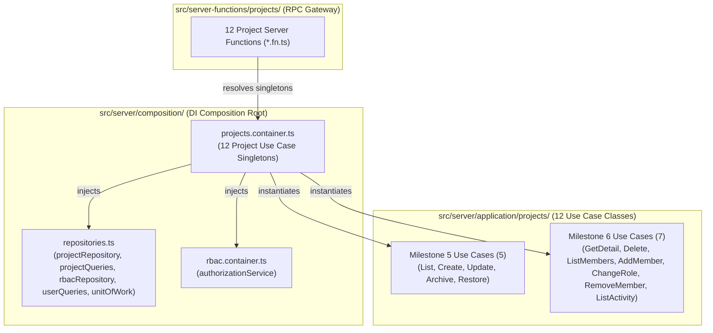

# Milestone 6 — Backend Step 5: Composition Project Detail & Members (src/server/composition/)

ในขั้นตอนที่ 5 นี้ เราจะต่อเติม **Composition Layer (`src/server/composition/projects.container.ts`)** ซึ่งเป็นศูนย์รวม Dependency Injection (Pure Manual DI) ของโมดูล Projects เพื่อประกอบสร้าง (Wire) Use Case Instances ใหม่ทั้ง 7 รายการจาก Step 3 เข้ากับ Concrete Repositories, Query Services, `authorizationService` และ `unitOfWork` จนครบทั้ง 12 Use Cases ของโมดูล Projects พร้อมส่งออกไปให้ชั้น Server Functions เรียกใช้งาน

---

## 1. เป้าหมายและขอบเขต Boundary (Boundary Context & Goal)

### เป้าหมายของ Step นี้
1. ต่อเติม `src/server/composition/projects.container.ts` ให้สร้าง Singleton Instances ของ Use Cases ใหม่ทั้ง 7 รายการ ได้แก่ `getProjectDetailUseCase`, `deleteProjectUseCase`, `listProjectMembersUseCase`, `addProjectMemberUseCase`, `changeProjectMemberRoleUseCase`, `removeProjectMemberUseCase` และ `listProjectActivityUseCase`
2. ผูก Dependencies ข้ามโมดูลอย่างโปร่งใสผ่าน Constructor Injection (เช่น `rbacRepository`, `userQueries`, `authorizationService`, `unitOfWork`) โดยไม่ต้องแก้ไขโค้ดภายใน Use Case หรือสร้าง Instance ซ้ำซ้อนในชั้น Gateway

### ตารางสรุปไฟล์ใน Step นี้

| เส้นทางไฟล์ (File Path) | บทบาทหน้าที่ (Responsibility) |
| :--- | :--- |
| `src/server/composition/projects.container.ts` | DI Container ประจำโมดูล Projects ที่ประกอบสร้างและส่งออก Use Case Singletons ทั้ง 12 รายการ |

### แผนผังสถาปัตยกรรมและทิศทางการพึ่งพา (Boundary Dependency Flow)



---

## 2. ทฤษฎี ความสำคัญ และกฎสถาปัตยกรรมเฉพาะ Boundary นี้

### 2.1 กฎ Pure Manual Dependency Injection จาก `.agents/rules/server.md`
ตามกฎ `server.md` ข้อ 17 และ `architecture.md`:
1. **Pure Manual DI without Magic Frameworks**: เราไม่ใช้ DI Container ที่พึ่งพา Decorators หรือ Reflection (`reflect-metadata`) แต่ใช้การส่ง Dependencies ผ่าน Constructor โดยตรงใน `src/server/composition/*.container.ts` ทำให้ TypeScript ตรวจสอบความครบถ้วนของ Dependencies ได้ตั้งแต่ตอน Compile-time 100%
2. **No Direct Instantiation Outside Composition**: ห้ามชั้น `server-functions/` หรือ `application/` สั่ง `new DrizzleProjectRepository()` หรือ `new AddProjectMemberUseCase(...)` เองเด็ดขาด ทุกการเรียกใช้งานต้องดึง Singleton Instance ที่ประกอบเสร็จแล้วจาก `src/server/composition/` เท่านั้น
3. **Cross-Module Collaborators Reuse**: ใน `AddProjectMemberUseCase` และ `ChangeProjectMemberRoleUseCase` ที่ต้องตรวจสอบข้อมูลผู้ใช้และบทบาท เราเพียงแค่นำ `userQueries` และ `rbacRepository` ที่ประกาศไว้แล้วใน `repositories.ts` มาฉีดเข้า Constructor โดยตรง

---

## 3. ลงมือเขียนโค้ด (Step-by-Step Implementation)

### 3.1 ไฟล์ `src/server/composition/projects.container.ts`

อัปเดตไฟล์ `src/server/composition/projects.container.ts` เพื่อประกอบ Use Cases ทั้ง 12 รายการของโมดูล Projects โดยโค้ดฉบับเต็มทั้งไฟล์มีดังนี้:

```typescript
import { ArchiveProjectUseCase } from "#/server/application/projects/archive-project.use-case";
import { CreateProjectUseCase } from "#/server/application/projects/create-project.use-case";
import { ListProjectsUseCase } from "#/server/application/projects/list-projects.use-case";
import { RestoreProjectUseCase } from "#/server/application/projects/restore-project.use-case";
import { UpdateProjectUseCase } from "#/server/application/projects/update-project.use-case";
import { AddProjectMemberUseCase } from "../application/projects/add-project-member.use-case";
import { ChangeProjectMemberRoleUseCase } from "../application/projects/change-project-member-role.use-case";
import { DeleteProjectUseCase } from "../application/projects/delete-project.use-case";
import { GetProjectDetailUseCase } from "../application/projects/get-project-detail.use-case";
import { ListProjectActivityUseCase } from "../application/projects/list-project-activity.use-case";
import { ListProjectMembersUseCase } from "../application/projects/list-project-members.use-case";
import { RemoveProjectMemberUseCase } from "../application/projects/remove-project-member.use-case";
import { authorizationService } from "./rbac.container";
import {
	projectQueries,
	projectRepository,
	rbacRepository,
	unitOfWork,
	userQueries,
} from "./repositories";

export const listProjectsUseCase = new ListProjectsUseCase(
	projectQueries,
	authorizationService,
);
export const createProjectUseCase = new CreateProjectUseCase(
	projectRepository,
	rbacRepository,
	unitOfWork,
);
export const updateProjectUseCase = new UpdateProjectUseCase(
	projectRepository,
	authorizationService,
	unitOfWork,
);
export const archiveProjectUseCase = new ArchiveProjectUseCase(
	projectRepository,
	authorizationService,
	unitOfWork,
);
export const restoreProjectUseCase = new RestoreProjectUseCase(
	projectRepository,
	authorizationService,
	unitOfWork,
);
export const getProjectDetailUseCase = new GetProjectDetailUseCase(
	projectQueries,
	authorizationService,
);
export const deleteProjectUseCase = new DeleteProjectUseCase(
	projectRepository,
	authorizationService,
	unitOfWork,
);
export const listProjectMembersUseCase = new ListProjectMembersUseCase(
	projectRepository,
	projectQueries,
	authorizationService,
);
export const addProjectMemberUseCase = new AddProjectMemberUseCase(
	projectRepository,
	rbacRepository,
	userQueries,
	authorizationService,
	unitOfWork,
);
export const changeProjectMemberRoleUseCase =
	new ChangeProjectMemberRoleUseCase(
		projectRepository,
		rbacRepository,
		authorizationService,
		unitOfWork,
	);
export const removeProjectMemberUseCase = new RemoveProjectMemberUseCase(
	projectRepository,
	authorizationService,
	unitOfWork,
);
export const listProjectActivityUseCase = new ListProjectActivityUseCase(
	projectRepository,
	projectQueries,
	authorizationService,
);
```

#### คำอธิบายโค้ดอย่างละเอียด
- **Read Use Cases (`getProjectDetailUseCase`, `listProjectMembersUseCase`, `listProjectActivityUseCase`)**:
  - รับ `projectQueries` และ `authorizationService` (โดย `listProjectMembersUseCase` และ `listProjectActivityUseCase` รับ `projectRepository` เพิ่มเติมเพื่อตรวจสอบการมีอยู่ของโครงการและดึงสิทธิ์ระดับโครงการของผู้เรียก)
- **Command Use Cases (`deleteProjectUseCase`, `addProjectMemberUseCase`, `changeProjectMemberRoleUseCase`, `removeProjectMemberUseCase`)**:
  - รับ `projectRepository`, `authorizationService` และ `unitOfWork` ทุกตัว เพื่อให้การลบโครงการและการจัดการสมาชิกทำงานภายใต้ ACID Transaction เสมอ
  - `addProjectMemberUseCase` รับ `rbacRepository` และ `userQueries` เพิ่มเติมสำหรับตรวจสอบความถูกต้องของบทบาทและตัวตนของผู้ใช้ที่ถูกเชิญเข้าโครงการ

---

## 4. การตรวจสอบความถูกต้องและ Git Commit (Verification & Commit)

ตรวจสอบความถูกต้องของชนิดข้อมูลและกฎ Linter ด้วยคำสั่ง:

```bash
bun run typecheck
bun run check
```

จากนั้นทำการ Commit สำหรับ Step ที่ 5:

```bash
git add src/server/composition/projects.container.ts
git commit -m "milestone-6.backend.step-5: Composition Project Detail & Members DI Wiring"
```
