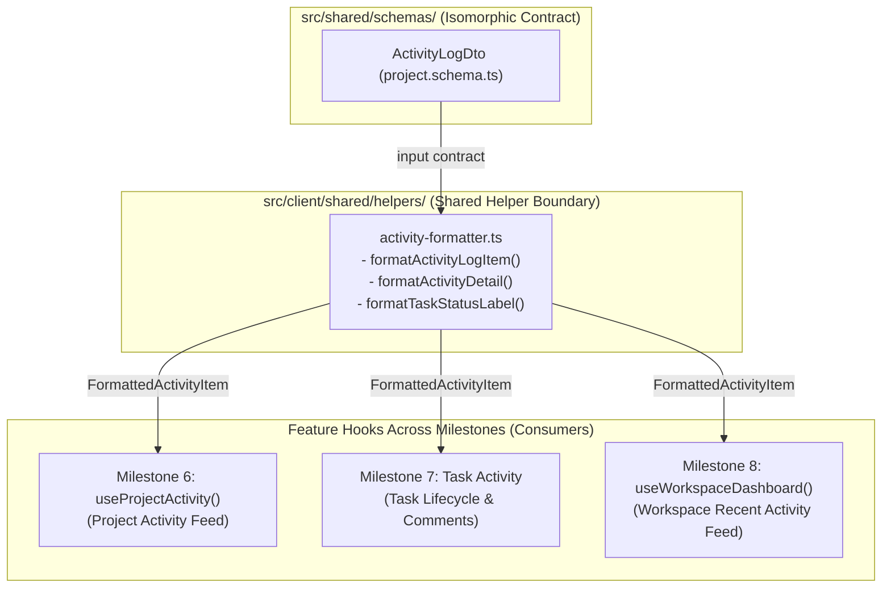

# Milestone 6 — Frontend Step 1: Client Shared Activity Formatter (src/client/shared/helpers/)

ในขั้นตอนนี้เราจะเริ่มต้นพัฒนาฝั่ง Frontend ของ **Milestone 6 (Project Detail, Project-Scoped RBAC Members & Activity Log)** โดยเริ่มจากเลเยอร์พื้นฐานที่ใช้ร่วมกันข้ามฟีเจอร์ คือ **Client Shared Helpers (`src/client/shared/helpers/`)** เพื่อสร้างตัวแปลงข้อมูลประวัติกิจกรรม (`activity-formatter.ts`) ที่เปลี่ยนข้อมูลดิบจาก `ActivityLogDto` ให้กลายเป็นข้อความภาษาไทยที่พร้อมแสดงผลบน UI อย่างสม่ำเสมอทั่วทั้งแอปพลิเคชัน

---

## 1. เป้าหมายและขอบเขต Boundary (Boundary Context & Goal)

### เป้าหมายของ Step นี้
1. สร้าง **Shared Helper (`activity-formatter.ts`)** สำหรับแปลง `ActivityLogDto` จาก Shared Schema ให้เป็น View Model มาตรฐาน `FormattedActivityItem`
2. รองรับการแปลรหัสเหตุการณ์ (`action`) และข้อมูลประกอบ (`metadata`) ทั้งในระดับโครงการ (`project.*`) และระดับงาน (`task.*`) ล่วงหน้าในที่เดียว
3. วางรากฐานตามหลัก **Single Abstraction / DRY Across Features (`globals.md` ข้อ 7)** เพื่อให้ทั้งหน้าประวัติกิจกรรมของโครงการ (Milestone 6), ประวัติความเคลื่อนไหวของงาน (Milestone 7) และหน้า Workspace Dashboard (Milestone 8) เรียกใช้ตัวแปลงชุดเดียวกันโดยไม่ต้องเขียนซ้ำ

### ตารางสรุปไฟล์ใน Step นี้

| ลำดับ | Path ของไฟล์ | บทบาทหน้าที่ (Responsibility) |
| :--- | :--- | :--- |
| 1 | `src/client/shared/helpers/activity-formatter.ts` | ฟังก์ชันบริสุทธิ์ (`Pure Helper`) สำหรับแปลง `ActivityLogDto` เป็น `FormattedActivityItem` พร้อมข้อความหัวข้อ รายละเอียดเชิงบริบท และเวลาที่จัดรูปแบบแล้ว |

### แผนผังสถาปัตยกรรมและการนำ Shared Helper ไปใช้ร่วมกัน (Mermaid Diagram)



---

## 2. ทฤษฎี ความสำคัญ และกฎสถาปัตยกรรมเฉพาะ Boundary นี้

### 2.1 ทำไมต้องแยก Activity Formatter ไว้ใน `src/client/shared/helpers/` ตั้งแต่วันแรก?
ในระบบบริหารจัดการโครงการอย่าง Taskflow ข้อมูลประวัติกิจกรรม (`ActivityLogDto`) ไม่ได้ถูกแสดงผลเพียงแค่ในแท็บ **ประวัติกิจกรรมของโครงการ (`Project Activity`)** เท่านั้น แต่ยังถูกนำไปใช้ในอีกหลายบริบทของระบบ ได้แก่:
- **Project Activity Feed (Milestone 6)**: แสดงประวัติการสร้าง/แก้ไขโครงการ การเพิ่ม/เปลี่ยนบทบาท/ลบสมาชิก และความเคลื่อนไหวของงานในโครงการนั้น
- **Task Activity & Audit Trail (Milestone 7)**: แสดงการเปลี่ยนสถานะงาน (`todo -> in_progress -> done`), การมอบหมายผู้รับผิดชอบ (`task.assigned`), และการแสดงความคิดเห็น (`task.comment_added`)
- **Workspace Dashboard Recent Activity (Milestone 8)**: แสดงฟีดกิจกรรมล่าสุดจากทุกโครงการที่ผู้ใช้มีสิทธิ์เข้าถึงรวมกันในหน้าแรกของ Workspace

หากเราเขียนลอจิกการแปลงคำอธิบายกิจกรรม (`formatActivityDescription` / `formatActivityDetail`), การจัดรูปแบบเวลา (`formatActivityTimestamp` / `createdAtLabel`) และการเตรียมข้อมูลผู้กระทำ (`actorName`, `actorEmail` หรือการคำนวณอักษรย่อ `computeActivityInitials`) กระจายไว้ใน Hook เฉพาะของแต่ละฟีเจอร์ จะเกิดการคัดลอกโค้ดซ้ำซ้อน (Code Duplication) ทันที และเมื่อต้องการเพิ่ม Action ใหม่หรือปรับสำนวนภาษาไทย จะต้องตามไปแก้หลายจุด

การออกแบบ `formatActivityLogItem` ไว้ใน `src/client/shared/helpers/activity-formatter.ts` ตั้งแต่วันแรกจึงเป็นการปฏิบัติตามกฎสถาปัตยกรรมอย่างเคร่งครัด:
- **`globals.md` ข้อ 7 (No Duplicate Abstractions)**: ไม่สร้างหลาย Abstraction สำหรับปัญหาเดียวกัน โดยรวมศูนย์ฟังก์ชันแปลง `ActivityLogDto` ไว้ที่ `client/shared/helpers/` เพียงจุดเดียว
- **`client.md` ข้อ 3 (Pure Presentation vs. Hook/Helper Logic)**: ห้ามเขียนการคำนวณหรือการแปลงข้อมูล (`switch/if-else` แปลง `metadata` หรือ `new Date(...).toLocaleString()`) ลงใน JSX ของ Component โดยตรง ให้เตรียมข้อมูลผ่าน Hook ที่เรียกใช้ Helper จนได้ `FormattedActivityItem` ที่พร้อมแสดงผลทันที
- **`globals.md` ข้อ 1–4 (Shared Schemas)**: รับข้อมูลเข้าเป็น `ActivityLogDto` จาก `#/shared/schemas/project.schema` โดยตรง ไม่สร้าง Type ของข้อมูลดิบซ้ำในฝั่ง Client

### 2.2 การตรวจสอบชนิดข้อมูลของ `metadata` อย่างปลอดภัย (Defensive Metadata Narrowing)
เนื่องจากคอลัมน์ `metadata` ของตาราง `activity_logs` มีโครงสร้างแบบยืดหยุ่น (`Record<string, unknown>`) ตามประเภทของเหตุการณ์ ฟังก์ชัน `formatActivityDetail(log)` จึงใช้ Type Narrowing ด้วย `typeof metadata.xxx === "string"` ก่อนดึงค่ามาประกอบข้อความเสมอ เพื่อรับประกันว่าจะไม่เกิด Runtime Error หรือแสดงคำว่า `undefined` บนหน้าจอ แม้ข้อมูล `metadata` บางฟิลด์จะไม่ได้ถูกส่งมา

---

## 3. ลงมือเขียนโค้ด (Step-by-Step Implementation)

### 3.1 สร้างตัวแปลงข้อมูลประวัติกิจกรรม (`src/client/shared/helpers/activity-formatter.ts`)

สร้างไฟล์ `src/client/shared/helpers/activity-formatter.ts` โดยมีองค์ประกอบหลักดังนี้:
1. **`FormattedActivityItem`**: Interface ของข้อมูลที่จัดรูปแบบเสร็จสมบูรณ์ ประกอบด้วย `id`, `title` (ชื่อเหตุการณ์ภาษาไทย), `detail` (รายละเอียดเชิงบริบทจาก `metadata`), `actorName`, `actorEmail` และ `createdAtLabel` (วันเวลาที่แปลงเป็นรูปแบบท้องถิ่นแล้ว)
2. **`ACTION_LABELS`**: พจนานุกรมแปลงรหัส `action` ทั้งหมดของระบบ (ทั้ง `project.*` และ `task.*`) ให้เป็นหัวข้อภาษาไทยที่เข้าใจง่าย
3. **`TASK_STATUS_DISPLAY_LABELS` & `formatTaskStatusLabel`**: แปลงรหัสสถานะงาน (`todo`, `in_progress`, `in_review`, `done`, `cancelled`) ให้เป็นชื่อสถานะภาษาไทยเมื่อแสดงประวัติการเปลี่ยนสถานะงาน (`task.status_changed`)
4. **`formatActivityDetail(log)`**: วิเคราะห์ `log.action` คู่กับ `log.metadata` เพื่อสร้างข้อความอธิบายรายละเอียดของแต่ละเหตุการณ์ เช่น `"TF-1: ต้องทำ -> เริ่มดำเนินการ"`, `"มอบบทบาท Contributor"` หรือ `"เปลี่ยนจาก contributor เป็น Project Owner"`
5. **`formatActivityLogItem(log)`**: ฟังก์ชันหลักที่ Export ออกไปให้ Feature Hooks (`useProjectActivity` และ `useWorkspaceDashboard`) เรียกใช้งานผ่าน `logs.map(formatActivityLogItem)`

```typescript
import type { ActivityLogDto } from "#/shared/schemas/project.schema";

export interface FormattedActivityItem {
	readonly id: string;
	readonly title: string;
	readonly detail: string;
	readonly actorName: string;
	readonly actorEmail: string;
	readonly createdAtLabel: string;
}

const ACTION_LABELS: Record<string, string> = {
	"project.created": "สร้างโปรเจกต์ใหม่",
	"project.updated": "แก้ไขรายละเอียดโปรเจกต์",
	"project.archived": "เก็บถาวรโปรเจกต์",
	"project.restored": "กู้คืนโปรเจกต์กลับมาใช้งาน",
	"project.member_added": "เพิ่มสมาชิกเข้าโปรเจกต์",
	"project.member_role_changed": "เปลี่ยนบทบาทของสมาชิก",
	"project.member_removed": "นำสมาชิกออกจากโปรเจกต์",
	"task.created": "สร้างงานใหม่",
	"task.updated": "แก้ไขรายละเอียดงาน",
	"task.status_changed": "เปลี่ยนสถานะงาน",
	"task.assigned": "อัปเดตผู้รับผิดชอบงาน",
	"task.deleted": "ลบงาน",
	"task.comment_added": "แสดงความคิดเห็นบนงาน",
	"task.comment_deleted": "ลบความคิดเห็นบนงาน",
};

const TASK_STATUS_DISPLAY_LABELS: Record<string, string> = {
	todo: "ต้องทำ",
	in_progress: "เริ่มดำเนินการ",
	in_review: "รอตรวจสอบ",
	done: "เสร็จสิ้น",
	cancelled: "ยกเลิก",
};

function formatTaskStatusLabel(rawStatus: string): string {
	return TASK_STATUS_DISPLAY_LABELS[rawStatus] ?? rawStatus;
}

function formatActivityDetail(log: ActivityLogDto): string {
	const metadata = log.metadata;

	if (
		log.action === "task.status_changed" &&
		typeof metadata.code === "string" &&
		typeof metadata.previousStatus === "string" &&
		typeof metadata.nextStatus === "string"
	) {
		return `${metadata.code}: ${formatTaskStatusLabel(metadata.previousStatus)} -> ${formatTaskStatusLabel(metadata.nextStatus)}`;
	}

	if (log.action === "task.assigned" && typeof metadata.code === "string") {
		return metadata.nextAssigneeId === null
			? `${metadata.code}: ถอดผู้รับผิดชอบ`
			: `${metadata.code}: มอบหมายผู้รับผิดชอบใหม่`;
	}

	if (
		(log.action === "task.created" ||
			log.action === "task.updated" ||
			log.action === "task.deleted") &&
		typeof metadata.code === "string" &&
		typeof metadata.title === "string"
	) {
		return `${metadata.code} — ${metadata.title}`;
	}

	if (
		(log.action === "task.comment_added" ||
			log.action === "task.comment_deleted") &&
		typeof metadata.code === "string"
	) {
		return `บน Task ${metadata.code}`;
	}

	if (
		log.action === "project.member_added" &&
		typeof metadata.roleName === "string"
	) {
		return `มอบบทบาท ${metadata.roleName}`;
	}
	if (
		log.action === "project.member_role_changed" &&
		typeof metadata.previousRoleSlug === "string" &&
		typeof metadata.nextRoleName === "string"
	) {
		return `เปลี่ยนจาก ${metadata.previousRoleSlug} เป็น ${metadata.nextRoleName}`;
	}
	if (
		log.action === "project.member_removed" &&
		typeof metadata.removedRoleSlug === "string"
	) {
		return `บทบาทเดิม ${metadata.removedRoleSlug}`;
	}
	if (typeof metadata.name === "string") {
		return `โปรเจกต์ ${metadata.name}`;
	}
	if (typeof metadata.key === "string") {
		return `รหัส ${metadata.key}`;
	}
	return log.action;
}

export function formatActivityLogItem(
	log: ActivityLogDto,
): FormattedActivityItem {
	return {
		id: log.id,
		title: ACTION_LABELS[log.action] ?? log.action,
		detail: formatActivityDetail(log),
		actorName: log.actorName,
		actorEmail: log.actorEmail,
		createdAtLabel: new Date(log.createdAt).toLocaleString(),
	};
}
```

---

## 4. การตรวจสอบความถูกต้องและ Git Commit (Verification & Commit)

### 4.1 ตรวจสอบ Type Safety และ Linting
รันคำสั่งตรวจสอบด้วย `bun` เพื่อยืนยันว่าไฟล์ `activity-formatter.ts` สอดคล้องกับ `ActivityLogDto` ใน Shared Schema และผ่านกฎ Biome Linter / TypeScript Compiler:

```bash
bun run typecheck
bun run format
bun run check
```

### 4.2 บันทึกการเปลี่ยนแปลงลง Git (Git Commit)
เมื่อตรวจสอบผ่านเรียบร้อยแล้ว ให้ Stage ไฟล์และทำการ Commit ประจำ Step นี้:

```bash
git add src/client/shared/helpers/activity-formatter.ts
git commit -m "milestone-6.frontend.step-1: Client Shared Activity Formatter Helper"
```
