# Milestone 6 — Frontend Step 2: Client Caches Project Detail & Members (src/client/caches/projects/)

ในขั้นตอนนี้เราจะขยาย **Client Caches Layer (`src/client/caches/projects/`)** เพื่อรองรับการดึงข้อมูลเชิงลึกของโครงการ (`detail`), รายชื่อสมาชิกและบทบาทในโครงการ (`members`), ประวัติกิจกรรมของโครงการ (`activity`) รวมถึงสร้าง Mutation Hooks สำหรับการลบโครงการถาวรและการบริหารจัดการสมาชิกภายในโครงการ (`add`, `changeRole`, `remove`)

---

## 1. เป้าหมายและขอบเขต Boundary (Boundary Context & Goal)

### เป้าหมายของ Step นี้
1. ขยาย **Query Key Factory (`projectsKeys`)** ให้ครอบคลุม Sub-resources ของแต่ละโครงการ ได้แก่ `detail(projectId)`, `members(projectId)` และ `activity(projectId)`
2. สร้าง **Query Options** ทั้ง 3 ตัว (`projectDetailQueryOptions`, `projectMembersQueryOptions`, `projectActivityQueryOptions`) สำหรับใช้งานร่วมกันระหว่าง Route `loader` และ Feature Hooks
3. สร้าง **Mutation Hooks** สำหรับการลบโครงการถาวร (`useDeleteProjectMutation`) และการจัดการสมาชิกโครงการ (`useAddProjectMemberMutation`, `useChangeProjectMemberRoleMutation`, `useRemoveProjectMemberMutation`) พร้อมจัดการ Cache Removal / Invalidation และ Centralized Toast Feedback

### ตารางสรุปไฟล์ใน Step นี้

| ลำดับ | Path ของไฟล์ | บทบาทหน้าที่ (Responsibility) |
| :--- | :--- | :--- |
| 1 | `src/client/caches/projects/keys.ts` | Query Key Factory ของโดเมน Projects (`all`, `list`, `detail`, `members`, `activity`) |
| 2 | `src/client/caches/projects/queries/project-detail.query.ts` | `queryOptions` สำหรับดึงข้อมูลโครงการพร้อมบทบาทและสิทธิ์ของผู้ใช้ปัจจุบัน (`getProjectDetailFn`) |
| 3 | `src/client/caches/projects/queries/project-members.query.ts` | `queryOptions` สำหรับดึงรายชื่อสมาชิก บทบาทที่เลือกได้ และผู้ใช้ที่เชิญเข้าโครงการได้ (`listProjectMembersFn`) |
| 4 | `src/client/caches/projects/queries/project-activity.query.ts` | `queryOptions` สำหรับดึงประวัติกิจกรรมล่าสุด 50 รายการของโครงการ (`listProjectActivityFn`) |
| 5 | `src/client/caches/projects/mutates/delete-project.mutate.ts` | Mutation Hook สำหรับลบโครงการถาวร พร้อมล้าง Cache ของโครงการที่ถูกลบ (`removeQueries`) และ Invalidate รายการโครงการ/Workspace |
| 6 | `src/client/caches/projects/mutates/add-project-member.mutate.ts` | Mutation Hook สำหรับเพิ่มสมาชิกเข้าโครงการ (`addProjectMemberFn`) และ Invalidate `projectsKeys.all` |
| 7 | `src/client/caches/projects/mutates/change-project-member-role.mutate.ts` | Mutation Hook สำหรับเปลี่ยนบทบาทของสมาชิกในโครงการ (`changeProjectMemberRoleFn`) และ Invalidate `projectsKeys.all` |
| 8 | `src/client/caches/projects/mutates/remove-project-member.mutate.ts` | Mutation Hook สำหรับนำสมาชิกออกจากโครงการ (`removeProjectMemberFn`) และ Invalidate `projectsKeys.all` |

### แผนผังสถาปัตยกรรมและทิศทางการไหลของข้อมูล (Mermaid Diagram)

```mermaid
flowchart TD
    subgraph Consumers["Route Loaders & Feature Hooks"]
        RL["Nested Route Loaders\n(/projects/$projectId/*)"]
        FH["Project Feature Hooks\n(useProjectDetail, useProjectMembersTable, ...)"]
    end

    subgraph Projects_Cache["src/client/caches/projects/ (Server-State Layer)"]
        PK["projectsKeys (keys.ts)\n- all\n- list(params)\n- detail(projectId)\n- members(projectId)\n- activity(projectId)"]
        Q1["projectDetailQueryOptions(projectId)"]
        Q2["projectMembersQueryOptions(projectId)"]
        Q3["projectActivityQueryOptions(projectId)"]
        M1["useDeleteProjectMutation"]
        M2["useAddProjectMemberMutation"]
        M3["useChangeProjectMemberRoleMutation"]
        M4["useRemoveProjectMemberMutation"]
    end

    subgraph Workspace_Cache["src/client/caches/workspace/"]
        WK["workspaceKeys.all"]
    end

    subgraph RPC_Gateway["src/server-functions/projects/ (RPC Gateway)"]
        SF1["getProjectDetailFn"]
        SF2["listProjectMembersFn"]
        SF3["listProjectActivityFn"]
        SF4["deleteProjectFn"]
        SF5["addProjectMemberFn"]
        SF6["changeProjectMemberRoleFn"]
        SF7["removeProjectMemberFn"]
    end

    RL -->|preload| Q1 & Q2 & Q3
    FH -->|useQuery| Q1 & Q2 & Q3
    FH -->|useMutation| M1 & M2 & M3 & M4

    Q1 --> SF1
    Q2 --> SF2
    Q3 --> SF3
    M1 --> SF4
    M2 --> SF5
    M3 --> SF6
    M4 --> SF7

    M1 -.->|"removeQueries (detail, members, activity)"| PK
    M1 -.->|"invalidateQueries"| PK
    M1 -.->|"invalidateQueries"| WK
    M2 & M3 & M4 -.->|"invalidateQueries (projectsKeys.all)"| PK
```



---

## 2. ทฤษฎี ความสำคัญ และกฎสถาปัตยกรรมเฉพาะ Boundary นี้

### 2.1 กฎสถาปัตยกรรมที่บังคับใช้ (`.agents/rules/client.md` & `server.md`)
- **`server.md` ข้อ 3 (Centralized Server-State Ownership)**: ห้าม Screen, Component หรือ Feature Hook เรียก `server-functions/` โดยตรง การติดต่อ RPC Gateway ทั้งหมดต้องผ่าน `client/caches/**` เท่านั้น
- **`client.md` ข้อ 8 (Single Owner of Mutation Feedback)**: ข้อความแจ้งเตือนเมื่อทำรายการสำเร็จ (`meta.successToast`) ต้องกำหนดไว้ใน Mutation Hook ภายใน `client/caches/projects/mutates/*.mutate.ts` เท่านั้น เพื่อให้ Global `MutationCache` ใน `src/client/caches/global.ts` แสดง Toast อัตโนมัติ

### 2.2 ทำไมการจัดการสมาชิก (`add`, `changeRole`, `remove`) จึงสั่ง Invalidate ที่ระดับ `projectsKeys.all`?
เมื่อมีการเพิ่มสมาชิก เปลี่ยนบทบาท หรือถอดสมาชิกออกจากโครงการ ข้อมูลที่ได้รับผลกระทบไม่ได้มีเพียงแค่ตารางสมาชิก (`projectsKeys.members(projectId)`) เท่านั้น แต่ยังส่งผลต่อ:
1. **`projectsKeys.detail(projectId)`**: จำนวนสมาชิก (`memberCount`) ในการ์ดสรุปข้อมูลโครงการและบนปุ่มแท็บ `สมาชิก (N)` เปลี่ยนแปลง และหากผู้ใช้ที่ถูกลดสิทธิ์คือผู้ที่กำลังเปิดหน้าอยู่ ค่า `myRole` และ `myPermissions` ใน `projectDetail` ก็จะเปลี่ยนไปด้วย
2. **`projectsKeys.activity(projectId)`**: ทุกครั้งที่มีการเปลี่ยนแปลงสมาชิก ระบบฝั่ง Backend จะบันทึก `ActivityLog` รายการใหม่ (`project.member_added`, `project.member_role_changed`, `project.member_removed`) เสมอ
3. **`projectsKeys.list(params)`**: การ์ดโครงการในหน้ารายการโครงการแสดงจำนวนสมาชิก (`memberCount`) เช่นกัน

ดังนั้น การออกแบบ `projectsKeys` แบบ Hierarchical ที่มีรากเดียวกันคือ `projectsKeys.all: ["projects"]` แล้วสั่ง `queryClient.invalidateQueries({ queryKey: projectsKeys.all })` เพียงบรรทัดเดียว จึงช่วยให้ทั้ง `list`, `detail`, `members` และ `activity` ซิงค์ข้อมูลล่าสุดตรงกันทั้งหมดโดยอัตโนมัติ

### 2.3 ทำไม `useDeleteProjectMutation` ต้องเรียก `removeQueries` ก่อน `invalidateQueries`?
เมื่อผู้ใช้กดยืนยันลบโครงการถาวรจากหน้า `/projects/$projectId` ขณะที่กำลังสั่ง `navigate({ to: "/projects" })` หากเราสั่ง `invalidateQueries({ queryKey: projectsKeys.all })` ทันทีโดยไม่ลบ Cache ของโครงการที่เพิ่งถูกลบออกไปก่อน TanStack Query จะพยายามสั่ง Refetch `detail(projectId)`, `members(projectId)` หรือ `activity(projectId)` ที่ยัง Mount อยู่ในหน้าปัจจุบัน ซึ่งจะยิงไปหาโครงการที่ไม่มีอยู่แล้วบนเซิร์ฟเวอร์และเกิด Error 404/Forbidden โดยไม่จำเป็น

การเรียก `queryClient.removeQueries(...)` สำหรับ `detail`, `members` และ `activity` ของ `variables.projectId` ก่อนสั่ง `invalidateQueries` จึงช่วยถอด Query ของโครงการที่ถูกลบออกจากหน่วยความจำอย่างสะอาดหมดจด

---

## 3. ลงมือเขียนโค้ด (Step-by-Step Implementation)

### 3.1 อัปเดต Query Key Factory (`src/client/caches/projects/keys.ts`)

อัปเดตไฟล์ `src/client/caches/projects/keys.ts` ให้มีครบทั้ง `all`, `list`, `detail`, `members` และ `activity`:

```typescript
import type { ProjectsSearch } from "#/shared/schemas/project.schema";

export const projectsKeys = {
	all: ["projects"] as const,
	list: (params: ProjectsSearch) =>
		[...projectsKeys.all, "list", params] as const,
	detail: (projectId: string) =>
		[...projectsKeys.all, "detail", projectId] as const,
	members: (projectId: string) =>
		[...projectsKeys.all, "members", projectId] as const,
	activity: (projectId: string) =>
		[...projectsKeys.all, "activity", projectId] as const,
};
```

---

### 3.2 สร้าง Query Options สำหรับข้อมูลรายละเอียดโครงการ (`src/client/caches/projects/queries/project-detail.query.ts`)

สร้างไฟล์ `src/client/caches/projects/queries/project-detail.query.ts` เพื่อเรียก `getProjectDetailFn({ data: { projectId } })` ซึ่งคืนค่าข้อมูลโครงการพร้อม `myRole` และ `myPermissions` ของผู้ใช้ในโครงการนั้น:

```typescript
import { queryOptions } from "@tanstack/react-query";
import { getProjectDetailFn } from "#/server-functions/projects/get-project-detail.fn";
import { projectsKeys } from "../keys";

export function projectDetailQueryOptions(projectId: string) {
	return queryOptions({
		queryKey: projectsKeys.detail(projectId),
		queryFn: () => getProjectDetailFn({ data: { projectId } }),
		staleTime: 30_000,
	});
}
```

---

### 3.3 สร้าง Query Options สำหรับข้อมูลสมาชิกในโครงการ (`src/client/caches/projects/queries/project-members.query.ts`)

สร้างไฟล์ `src/client/caches/projects/queries/project-members.query.ts` เพื่อเรียก `listProjectMembersFn({ data: { projectId } })` ซึ่งคืนค่าทั้ง `members`, `availableRoles` (บทบาทระดับ `project`) และ `invitableUsers` (รายชื่อผู้ใช้ในระบบที่ยังไม่ได้เป็นสมาชิกของโครงการนี้):

```typescript
import { queryOptions } from "@tanstack/react-query";
import { listProjectMembersFn } from "#/server-functions/projects/list-project-members.fn";
import { projectsKeys } from "../keys";

export function projectMembersQueryOptions(projectId: string) {
	return queryOptions({
		queryKey: projectsKeys.members(projectId),
		queryFn: () => listProjectMembersFn({ data: { projectId } }),
		staleTime: 30_000,
	});
}
```

---

### 3.4 สร้าง Query Options สำหรับประวัติกิจกรรมของโครงการ (`src/client/caches/projects/queries/project-activity.query.ts`)

สร้างไฟล์ `src/client/caches/projects/queries/project-activity.query.ts` เพื่อดึงประวัติกิจกรรมล่าสุด 50 รายการของโครงการ (`limit: 50`) โดยกำหนด `staleTime: 15_000` (15 วินาที):

```typescript
import { queryOptions } from "@tanstack/react-query";
import { listProjectActivityFn } from "#/server-functions/projects/list-project-activity.fn";
import { projectsKeys } from "../keys";

export function projectActivityQueryOptions(projectId: string) {
	return queryOptions({
		queryKey: projectsKeys.activity(projectId),
		queryFn: () => listProjectActivityFn({ data: { projectId, limit: 50 } }),
		staleTime: 15_000,
	});
}
```

---

### 3.5 สร้าง Mutation Hook สำหรับลบโครงการถาวร (`src/client/caches/projects/mutates/delete-project.mutate.ts`)

สร้างไฟล์ `src/client/caches/projects/mutates/delete-project.mutate.ts` เพื่อเรียก `deleteProjectFn` เมื่อสำเร็จจะสั่ง `removeQueries` ล้าง Cache เฉพาะของ `projectId` ที่ถูกลบออกก่อน แล้วจึงสั่ง `invalidateQueries` ที่ `projectsKeys.all` และ `workspaceKeys.all`:

```typescript
import { useMutation, useQueryClient } from "@tanstack/react-query";
import { workspaceKeys } from "#/client/caches/workspace/keys";
import { deleteProjectFn } from "#/server-functions/projects/delete-project.fn";
import type { ProjectActionInput } from "#/shared/schemas/project.schema";
import { projectsKeys } from "../keys";

export function useDeleteProjectMutation() {
	const queryClient = useQueryClient();

	return useMutation({
		mutationFn: (input: ProjectActionInput) => deleteProjectFn({ data: input }),
		meta: {
			successToast: "ลบโครงการถาวรเรียบร้อยแล้ว",
		},
		onSuccess: async (_data, variables) => {
			queryClient.removeQueries({
				queryKey: projectsKeys.detail(variables.projectId),
			});
			queryClient.removeQueries({
				queryKey: projectsKeys.members(variables.projectId),
			});
			queryClient.removeQueries({
				queryKey: projectsKeys.activity(variables.projectId),
			});
			await Promise.all([
				queryClient.invalidateQueries({ queryKey: projectsKeys.all }),
				queryClient.invalidateQueries({ queryKey: workspaceKeys.all }),
			]);
		},
	});
}
```

---

### 3.6 สร้าง Mutation Hook สำหรับเพิ่มสมาชิกเข้าโครงการ (`src/client/caches/projects/mutates/add-project-member.mutate.ts`)

สร้างไฟล์ `src/client/caches/projects/mutates/add-project-member.mutate.ts` เชื่อมต่อกับ `addProjectMemberFn`:

```typescript
import { useMutation, useQueryClient } from "@tanstack/react-query";
import { addProjectMemberFn } from "#/server-functions/projects/add-project-member.fn";
import type { AddProjectMemberInput } from "#/shared/schemas/project.schema";
import { projectsKeys } from "../keys";

export function useAddProjectMemberMutation() {
	const queryClient = useQueryClient();

	return useMutation({
		mutationFn: (input: AddProjectMemberInput) =>
			addProjectMemberFn({ data: input }),
		meta: {
			successToast: "เพิ่มสมาชิกเข้าโครงการสำเร็จ",
		},
		onSuccess: async () => {
			await queryClient.invalidateQueries({ queryKey: projectsKeys.all });
		},
	});
}
```

---

### 3.7 สร้าง Mutation Hook สำหรับเปลี่ยนบทบาทสมาชิกในโครงการ (`src/client/caches/projects/mutates/change-project-member-role.mutate.ts`)

สร้างไฟล์ `src/client/caches/projects/mutates/change-project-member-role.mutate.ts` เชื่อมต่อกับ `changeProjectMemberRoleFn`:

```typescript
import { useMutation, useQueryClient } from "@tanstack/react-query";
import { changeProjectMemberRoleFn } from "#/server-functions/projects/change-project-member-role.fn";
import type { ChangeProjectMemberRoleInput } from "#/shared/schemas/project.schema";
import { projectsKeys } from "../keys";

export function useChangeProjectMemberRoleMutation() {
	const queryClient = useQueryClient();

	return useMutation({
		mutationFn: (input: ChangeProjectMemberRoleInput) =>
			changeProjectMemberRoleFn({ data: input }),
		meta: {
			successToast: "เปลี่ยนบทบาทของสมาชิกสำเร็จ",
		},
		onSuccess: async () => {
			await queryClient.invalidateQueries({ queryKey: projectsKeys.all });
		},
	});
}
```

---

### 3.8 สร้าง Mutation Hook สำหรับนำสมาชิกออกจากโครงการ (`src/client/caches/projects/mutates/remove-project-member.mutate.ts`)

สร้างไฟล์ `src/client/caches/projects/mutates/remove-project-member.mutate.ts` เชื่อมต่อกับ `removeProjectMemberFn`:

```typescript
import { useMutation, useQueryClient } from "@tanstack/react-query";
import { removeProjectMemberFn } from "#/server-functions/projects/remove-project-member.fn";
import type { RemoveProjectMemberInput } from "#/shared/schemas/project.schema";
import { projectsKeys } from "../keys";

export function useRemoveProjectMemberMutation() {
	const queryClient = useQueryClient();

	return useMutation({
		mutationFn: (input: RemoveProjectMemberInput) =>
			removeProjectMemberFn({ data: input }),
		meta: {
			successToast: "นำสมาชิกออกจากโครงการแล้ว",
		},
		onSuccess: async () => {
			await queryClient.invalidateQueries({ queryKey: projectsKeys.all });
		},
	});
}
```

---

## 4. การตรวจสอบความถูกต้องและ Git Commit (Verification & Commit)

### 4.1 ตรวจสอบ Type Safety และ Linting
รันคำสั่งตรวจสอบด้วย `bun` เพื่อยืนยันว่าทุก Query และ Mutation ใน `src/client/caches/projects/` สอดคล้องกับ Server Functions และ Shared Schemas:

```bash
bun run typecheck
bun run format
bun run check
```

### 4.2 บันทึกการเปลี่ยนแปลงลง Git (Git Commit)
เมื่อตรวจสอบผ่านเรียบร้อยแล้ว ให้ Stage ไฟล์และทำการ Commit ประจำ Step นี้:

```bash
git add src/client/caches/projects/
git commit -m "milestone-6.frontend.step-2: Client Caches Project Detail, Members & Activity"
```
