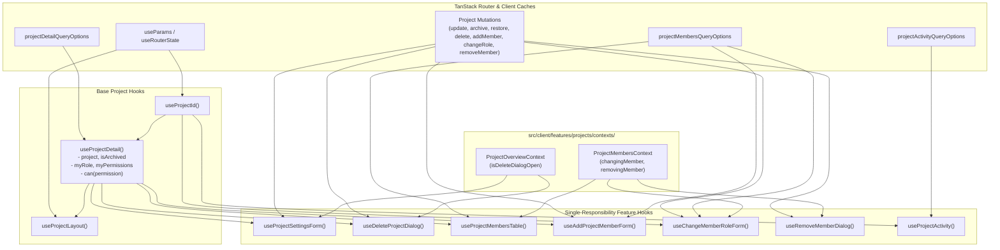

# Milestone 6 — Frontend Step 3: Feature Project Detail Contexts & Hooks (src/client/features/projects/)

ในขั้นตอนนี้เราจะสร้าง **Compound Contexts (`contexts/`)** และ **Single-Responsibility Hooks (`hooks/`)** สำหรับฟีเจอร์รายละเอียดโครงการ (`Project Detail`), การตั้งค่าโครงการ (`Project Settings`), การจัดการสมาชิกและบทบาทระดับโครงการ (`Project Members`) และประวัติกิจกรรมของโครงการ (`Project Activity`) โดยแยก Logic ทั้งหมดออกจาก UI อย่างเด็ดขาดตามหลัก **Zero Props Architecture**

---

## 1. เป้าหมายและขอบเขต Boundary (Boundary Context & Goal)

### เป้าหมายของ Step นี้
1. สร้าง **Feature Contexts** 2 ตัว (`ProjectOverviewProvider`, `ProjectMembersProvider`) สำหรับแชร์สถานะการเปิด/ปิด Dialog ระหว่าง Card/Table กับ Dialog Component โดยไม่ส่ง Props
2. สร้าง **Core Project Hooks** (`useProjectId`, `useProjectDetail`, `useProjectLayout`) เพื่อเป็นแกนกลางในการดึง `projectId` จาก URL, คำนวณสิทธิ์ระดับโครงการ (`can(permission)`) และตรวจสอบแท็บที่กำลังเปิดใช้งาน (`Active Tab`)
3. สร้าง **Cohesive Single-Responsibility Hooks** แยกตามหน้าที่ของแต่ละ Component (`useProjectSettingsForm`, `useDeleteProjectDialog`, `useProjectMembersTable`, `useAddProjectMemberForm`, `useChangeMemberRoleForm`, `useRemoveMemberDialog`, `useProjectActivity`)

### ตารางสรุปไฟล์ใน Step นี้

| ลำดับ | Path ของไฟล์ | บทบาทหน้าที่ (Responsibility) |
| :--- | :--- | :--- |
| 1 | `src/client/features/projects/contexts/project-overview.context.tsx` | Context ถือสถานะ `isDeleteDialogOpen` สำหรับหน้าภาพรวมและตั้งค่าโครงการ |
| 2 | `src/client/features/projects/contexts/project-members.context.tsx` | Context ถือสถานะ `changingMember` และ `removingMember` สำหรับหน้าจัดการสมาชิกโครงการ |
| 3 | `src/client/features/projects/hooks/use-project-id.ts` | ดึง `projectId` จาก Route Params ของ TanStack Router อย่างปลอดภัย |
| 4 | `src/client/features/projects/hooks/use-project-detail.ts` | ดึงข้อมูลโครงการ (`projectDetailQueryOptions`) พร้อมคำนวณ `isArchived`, `myRole`, `myPermissions` และฟังก์ชัน `can(permission)` |
| 5 | `src/client/features/projects/hooks/use-project-layout.ts` | คำนวณสถานะ Active ของแต่ละแท็บใน `ProjectHeader` (`isOverviewActive`, `isTasksActive`, `isMembersActive`, `isActivityActive`) |
| 6 | `src/client/features/projects/hooks/use-project-settings-form.ts` | จัดการฟอร์มแก้ไขชื่อ/คำอธิบายโครงการ, ปุ่มสลับสถานะ Archive/Restore และการเปิด Dialog ลบโครงการ |
| 7 | `src/client/features/projects/hooks/use-delete-project-dialog.ts` | จัดการยืนยันการลบโครงการถาวรและสั่ง `navigate({ to: "/projects" })` เมื่อลบสำเร็จ |
| 8 | `src/client/features/projects/hooks/use-project-members-table.ts` | ผูกข้อมูลสมาชิกเข้ากับ TanStack Table (`useTable`) พร้อมตรวจสอบสิทธิ์ `project:manage_members` |
| 9 | `src/client/features/projects/hooks/use-add-project-member-form.ts` | จัดการฟอร์มเพิ่มสมาชิกเข้าโครงการ พร้อมแปลง `invitableUsers` และ `availableRoles` เป็น `SelectOption[]` |
| 10 | `src/client/features/projects/hooks/use-change-member-role-form.ts` | จัดการฟอร์มเปลี่ยนบทบาทของสมาชิกที่ถูกเลือกใน `ChangeMemberRoleDialog` |
| 11 | `src/client/features/projects/hooks/use-remove-member-dialog.ts` | จัดการยืนยันการนำสมาชิกออกจากโครงการใน `RemoveMemberDialog` |
| 12 | `src/client/features/projects/hooks/use-project-activity.ts` | ดึงประวัติกิจกรรมของโครงการและแปลงเป็น `FormattedActivityItem[]` ผ่าน `formatActivityLogItem` |

### แผนผังความสัมพันธ์ของ Contexts และ Hooks (Mermaid Diagram)



---

## 2. ทฤษฎี ความสำคัญ และกฎสถาปัตยกรรมเฉพาะ Boundary นี้

### 2.1 การแยก Single-Responsibility Hooks รายส่วน (`client.md` ข้อ 3, 4, 5, 6, 7)
ในหน้ารายละเอียดโครงการที่มีทั้งแท็บตั้งค่า แท็บสมาชิก และแท็บประวัติกิจกรรม หากเรารวมทุกอย่างไว้ใน Hook เดียว (เช่น `useProjectPage()`) จะเกิด **God Hook** ที่รวมทั้ง 3 Queries, 6 Mutations, 3 Forms, TanStack Table และ Dialog State เข้าด้วยกัน ส่งผลให้ทุกการพิมพ์ในฟอร์มหรือการเปิด Dialog ทำให้ทั้งหน้าเกิด Re-render Cascade

ตามกฎ **`client.md` ข้อ 6 และข้อ 7 (Single Responsibility & High Cohesion)** เราจึงแยก Hook ตามขอบเขตความรับผิดชอบที่ชัดเจน:
1. **`useProjectDetail`**: เป็น Hook พื้นฐานสำหรับอ่านข้อมูลโครงการและตรวจสอบสิทธิ์ระดับโครงการ (`can("project:update")`, `can("project:delete")`, `can("project:manage_members")`) โดยที่ TanStack Query จะช่วย Deduplicate Request ให้ทุก Component ที่เรียก `useProjectDetail()` อ่านข้อมูลจาก Cache ก้อนเดียวกันโดยไม่ยิง Network ซ้ำ
2. **`useProjectSettingsForm` vs `useDeleteProjectDialog`**: แยกการทำงานของฟอร์มแก้ไขชื่อ/คำอธิบายและปุ่มสลับ Archive/Restore ออกจากลอจิกของ Dialog ยืนยันการลบโครงการ โดยเชื่อมโยงการเปิด/ปิด Dialog ผ่าน `ProjectOverviewContext`
3. **`useProjectMembersTable` vs `useAddProjectMemberForm` vs `useChangeMemberRoleForm` vs `useRemoveMemberDialog`**: ในหน้าจัดการสมาชิก แต่ละส่วนมี Lifecycle ของตนเอง ตารางสมาชิกใช้ `@tanstack/react-table` ส่วนการ์ดเพิ่มสมาชิกและ Dialog เปลี่ยนบทบาทใช้ `useAppForm` แยกกัน และสื่อสารว่ากำลังเลือกแก้ไขหรือลบสมาชิกคนใดผ่าน `ProjectMembersContext`

### 2.2 การคำนวณสิทธิ์ระดับโครงการใน `useProjectDetail`
ใน Milestone 6 ระบบรองรับ **Project-Scoped RBAC** ซึ่งผู้ใช้แต่ละคนจะมีสิทธิ์ภายในแต่ละโครงการแตกต่างกันตามบทบาทที่ได้รับมอบหมายในโครงการนั้น (หรือได้รับสิทธิ์ผ่าน System-wide Permission เช่น `project:manage_any`)
- Backend คำนวณ Effective Permissions ของผู้ใช้สำหรับโครงการนั้นแล้วแนบมาใน `project.myPermissions` (`ProjectPermissionCode[]`)
- `useProjectDetail` จึงเปิดเมธอด `can(permission: ProjectPermissionCode): boolean` ที่ห่อด้วย `useCallback` เพื่อให้ Hook อื่นๆ นำไปคำนวณสถานะ UI ได้อย่างตรงไปตรงมา เช่น:
  - `const canUpdate = can("project:update");`
  - `const canDelete = can("project:delete");`
  - `const canManageMembers = can("project:manage_members");`

---

## 3. ลงมือเขียนโค้ด (Step-by-Step Implementation)

### 3.1 สร้าง Context สำหรับหน้าภาพรวมโครงการ (`src/client/features/projects/contexts/project-overview.context.tsx`)

สร้างไฟล์ `src/client/features/projects/contexts/project-overview.context.tsx` เพื่อดูแลสถานะการเปิด/ปิด `DeleteProjectDialog` ระหว่าง `ProjectSettingsCard` และ `DeleteProjectDialog`:

```tsx
import type { ReactNode } from "react";
import { createContext, useContext, useState } from "react";

interface ProjectOverviewContextValue {
	isDeleteDialogOpen: boolean;
	openDeleteDialog: () => void;
	closeDeleteDialog: () => void;
}

const ProjectOverviewContext =
	createContext<ProjectOverviewContextValue | null>(null);

export function ProjectOverviewProvider({ children }: { children: ReactNode }) {
	const [isDeleteDialogOpen, setIsDeleteDialogOpen] = useState(false);

	const value: ProjectOverviewContextValue = {
		isDeleteDialogOpen,
		openDeleteDialog: () => setIsDeleteDialogOpen(true),
		closeDeleteDialog: () => setIsDeleteDialogOpen(false),
	};

	return (
		<ProjectOverviewContext.Provider value={value}>
			{children}
		</ProjectOverviewContext.Provider>
	);
}

export function useProjectOverviewContext(): ProjectOverviewContextValue {
	const ctx = useContext(ProjectOverviewContext);
	if (!ctx) {
		throw new Error(
			"useProjectOverviewContext must be used inside <ProjectOverviewProvider>",
		);
	}
	return ctx;
}
```

---

### 3.2 สร้าง Context สำหรับหน้าจัดการสมาชิกโครงการ (`src/client/features/projects/contexts/project-members.context.tsx`)

สร้างไฟล์ `src/client/features/projects/contexts/project-members.context.tsx` เพื่อถือข้อมูลสมาชิกที่กำลังถูกเลือกเปลี่ยนบทบาท (`changingMember`) หรือกำลังถูกเลือกนำออกจากโครงการ (`removingMember`):

```tsx
import type { ReactNode } from "react";
import { createContext, useContext, useState } from "react";
import type { ProjectMemberDto } from "#/shared/schemas/project.schema";

interface ProjectMembersContextValue {
	changingMember: ProjectMemberDto | null;
	removingMember: ProjectMemberDto | null;
	openChangeRoleDialog: (member: ProjectMemberDto) => void;
	closeChangeRoleDialog: () => void;
	openRemoveDialog: (member: ProjectMemberDto) => void;
	closeRemoveDialog: () => void;
}

const ProjectMembersContext = createContext<ProjectMembersContextValue | null>(
	null,
);

export function ProjectMembersProvider({ children }: { children: ReactNode }) {
	const [changingMember, setChangingMember] = useState<ProjectMemberDto | null>(
		null,
	);
	const [removingMember, setRemovingMember] = useState<ProjectMemberDto | null>(
		null,
	);

	const value: ProjectMembersContextValue = {
		changingMember,
		removingMember,
		openChangeRoleDialog: (member) => setChangingMember(member),
		closeChangeRoleDialog: () => setChangingMember(null),
		openRemoveDialog: (member) => setRemovingMember(member),
		closeRemoveDialog: () => setRemovingMember(null),
	};

	return (
		<ProjectMembersContext.Provider value={value}>
			{children}
		</ProjectMembersContext.Provider>
	);
}

export function useProjectMembersContext(): ProjectMembersContextValue {
	const ctx = useContext(ProjectMembersContext);
	if (!ctx) {
		throw new Error(
			"useProjectMembersContext must be used inside <ProjectMembersProvider>",
		);
	}
	return ctx;
}
```

---

### 3.3 สร้าง Hook ดึงรหัสโครงการจาก URL (`src/client/features/projects/hooks/use-project-id.ts`)

สร้างไฟล์ `src/client/features/projects/hooks/use-project-id.ts` เพื่ออ่านพารามิเตอร์ `projectId` จาก Route ปัจจุบันด้วย `useParams({ strict: false })` เพื่อให้เรียกใช้ได้จากทุก Nested Route ภายใต้ `/projects/$projectId`:

```typescript
import { useParams } from "@tanstack/react-router";

export function useProjectId(): string {
	const params = useParams({ strict: false });
	return "projectId" in params && typeof params.projectId === "string"
		? params.projectId
		: "";
}
```

---

### 3.4 สร้าง Hook ข้อมูลรายละเอียดโครงการและสิทธิ์ (`src/client/features/projects/hooks/use-project-detail.ts`)

สร้างไฟล์ `src/client/features/projects/hooks/use-project-detail.ts` เพื่อดึงข้อมูลโครงการจาก `projectDetailQueryOptions(projectId)` พร้อมคืนค่า `isArchived`, `myRole`, `myPermissions` และฟังก์ชันตรวจสอบสิทธิ์ `can`:

```typescript
import { useQuery } from "@tanstack/react-query";
import { useCallback } from "react";
import { projectDetailQueryOptions } from "#/client/caches/projects/queries/project-detail.query";
import type { ProjectPermissionCode } from "#/shared/schemas/rbac.schema";
import { useProjectId } from "./use-project-id";

export function useProjectDetail() {
	const projectId = useProjectId();
	const { data: project, isPending } = useQuery({
		...projectDetailQueryOptions(projectId),
		enabled: Boolean(projectId),
	});

	const myPermissions = project?.myPermissions ?? [];

	const can = useCallback(
		(permission: ProjectPermissionCode) => myPermissions.includes(permission),
		[myPermissions],
	);

	return {
		projectId,
		project: project ?? null,
		isPending,
		isArchived: project?.status === "archived",
		myRole: project?.myRole ?? null,
		myPermissions,
		can,
	};
}
```

---

### 3.5 สร้าง Hook สำหรับส่วนหัวและแท็บนำทางของโครงการ (`src/client/features/projects/hooks/use-project-layout.ts`)

สร้างไฟล์ `src/client/features/projects/hooks/use-project-layout.ts` เพื่อตรวจสอบ `pathname` ปัจจุบันจาก TanStack Router และคำนวณว่าแท็บใดใน `ProjectHeader` กำลัง Active อยู่:

```typescript
import { useRouterState } from "@tanstack/react-router";
import { useProjectDetail } from "./use-project-detail";

export function useProjectLayout() {
	const { projectId, project, isPending } = useProjectDetail();
	const pathname = useRouterState({
		select: (state) => state.location.pathname,
	});

	const basePath = `/projects/${projectId}`;

	return {
		projectId,
		project,
		isPending,
		isOverviewActive: pathname === basePath || pathname === `${basePath}/`,
		isTasksActive: pathname.startsWith(`${basePath}/tasks`),
		isMembersActive: pathname.startsWith(`${basePath}/members`),
		isActivityActive: pathname.startsWith(`${basePath}/activity`),
	};
}
```

---

### 3.6 สร้าง Hook สำหรับฟอร์มตั้งค่าโครงการ (`src/client/features/projects/hooks/use-project-settings-form.ts`)

สร้างไฟล์ `src/client/features/projects/hooks/use-project-settings-form.ts` สำหรับควบคุมฟอร์มแก้ไขชื่อและคำอธิบายโครงการด้วย `useAppForm` ร่วมกับ `updateProjectInputSchema`, ซิงค์ค่าเริ่มต้นด้วย `useEffect` เมื่อข้อมูลโครงการเปลี่ยน, และจัดการปุ่มสลับสถานะเก็บถาวร/กู้คืน (`handleToggleStatus`):

```typescript
import { useEffect } from "react";
import { useArchiveProjectMutation } from "#/client/caches/projects/mutates/archive-project.mutate";
import { useRestoreProjectMutation } from "#/client/caches/projects/mutates/restore-project.mutate";
import { useUpdateProjectMutation } from "#/client/caches/projects/mutates/update-project.mutate";
import { useAppForm } from "#/client/shared/components/app-form";
import { updateProjectInputSchema } from "#/shared/schemas/project.schema";
import { useProjectOverviewContext } from "../contexts/project-overview.context";
import { useProjectDetail } from "./use-project-detail";

export function useProjectSettingsForm() {
	const { project, isArchived, can } = useProjectDetail();
	const { openDeleteDialog } = useProjectOverviewContext();
	const updateMutation = useUpdateProjectMutation();
	const archiveMutation = useArchiveProjectMutation();
	const restoreMutation = useRestoreProjectMutation();

	const canUpdate = can("project:update");
	const canDelete = can("project:delete");
	const isTogglingStatus =
		archiveMutation.isPending || restoreMutation.isPending;

	const form = useAppForm({
		defaultValues: {
			projectId: project?.id ?? "",
			name: project?.name ?? "",
			description: project?.description ?? "",
		},
		validators: {
			onBlur: updateProjectInputSchema,
			onSubmit: updateProjectInputSchema,
		},
		onSubmit: async ({ value }) => {
			try {
				await updateMutation.mutateAsync(value);
			} catch {
				// Error toast is centrally handled by MutationCache in client/caches/global.ts
				return;
			}
		},
	});

	useEffect(() => {
		if (!project) {
			return;
		}
		form.reset({
			projectId: project.id,
			name: project.name,
			description: project.description,
		});
	}, [project, form]);

	const handleToggleStatus = async () => {
		if (!project) {
			return;
		}
		try {
			if (isArchived) {
				await restoreMutation.mutateAsync({ projectId: project.id });
				return;
			}
			await archiveMutation.mutateAsync({ projectId: project.id });
		} catch {
			// Error toast is centrally handled by MutationCache in client/caches/global.ts
			return;
		}
	};

	return {
		project,
		isArchived,
		canUpdate,
		canDelete,
		isTogglingStatus,
		form,
		handleToggleStatus,
		openDeleteDialog,
	};
}
```

---

### 3.7 สร้าง Hook สำหรับ Dialog ยืนยันการลบโครงการ (`src/client/features/projects/hooks/use-delete-project-dialog.ts`)

สร้างไฟล์ `src/client/features/projects/hooks/use-delete-project-dialog.ts` เพื่อจัดการคำสั่งลบโครงการถาวร เมื่อลบสำเร็จจะปิด Dialog และนำทางผู้ใช้กลับไปยังหน้ารายการโครงการ (`/projects`):

```typescript
import { useNavigate } from "@tanstack/react-router";
import { useDeleteProjectMutation } from "#/client/caches/projects/mutates/delete-project.mutate";
import { useProjectOverviewContext } from "../contexts/project-overview.context";
import { useProjectDetail } from "./use-project-detail";

export function useDeleteProjectDialog() {
	const navigate = useNavigate();
	const { project } = useProjectDetail();
	const { isDeleteDialogOpen, closeDeleteDialog } = useProjectOverviewContext();
	const deleteMutation = useDeleteProjectMutation();

	const handleOpenChange = (open: boolean) => {
		if (!open) {
			closeDeleteDialog();
		}
	};

	const handleConfirmDelete = async () => {
		if (!project) {
			return;
		}
		try {
			await deleteMutation.mutateAsync({ projectId: project.id });
			closeDeleteDialog();
			await navigate({ to: "/projects" });
		} catch {
			// Error toast is centrally handled by MutationCache in client/caches/global.ts
			return;
		}
	};

	return {
		project,
		isOpen: isDeleteDialogOpen,
		isDeleting: deleteMutation.isPending,
		handleOpenChange,
		handleConfirmDelete,
	};
}
```

---

### 3.8 สร้าง Hook สำหรับตารางสมาชิกโครงการ (`src/client/features/projects/hooks/use-project-members-table.ts`)

สร้างไฟล์ `src/client/features/projects/hooks/use-project-members-table.ts` โดยนิยาม Column Definitions ด้วย `createColumnHelper` ของ `@tanstack/react-table` และเชื่อมกับข้อมูลสมาชิกจาก `projectMembersQueryOptions(projectId)` พร้อมส่งเมธอดเปิด Dialog เปลี่ยนบทบาทและนำสมาชิกออกให้ Component เรียกใช้:

```typescript
import { useQuery } from "@tanstack/react-query";
import {
	createColumnHelper,
	tableFeatures,
	useTable,
} from "@tanstack/react-table";
import { projectMembersQueryOptions } from "#/client/caches/projects/queries/project-members.query";
import type { ProjectMemberDto } from "#/shared/schemas/project.schema";
import { useProjectMembersContext } from "../contexts/project-members.context";
import { useProjectDetail } from "./use-project-detail";

const membersTableFeatures = tableFeatures({});
const memberColumnHelper = createColumnHelper<
	typeof membersTableFeatures,
	ProjectMemberDto
>();

const memberTableColumns = memberColumnHelper.columns([
	memberColumnHelper.accessor("userName", {
		header: "สมาชิก",
	}),
	memberColumnHelper.accessor("roleName", {
		header: "Project Role",
	}),
	memberColumnHelper.accessor("joinedAt", {
		header: "วันที่เข้าร่วม",
	}),
	memberColumnHelper.display({
		id: "actions",
		header: "จัดการ",
	}),
]);

export function useProjectMembersTable() {
	const { projectId, isArchived, can } = useProjectDetail();
	const { openChangeRoleDialog, openRemoveDialog } = useProjectMembersContext();
	const { data, isPending } = useQuery({
		...projectMembersQueryOptions(projectId),
		enabled: Boolean(projectId),
	});

	const canManageMembers = can("project:manage_members");
	const members = data?.members ?? [];

	const table = useTable({
		features: membersTableFeatures,
		columns: memberTableColumns,
		data: members,
		getRowId: (row) => row.id,
	});

	return {
		table,
		columnCount: memberTableColumns.length,
		memberCount: members.length,
		isPending,
		canManageMembers,
		isArchived,
		openChangeRoleDialog,
		openRemoveDialog,
	};
}
```

---

### 3.9 สร้าง Hook สำหรับฟอร์มเพิ่มสมาชิกเข้าโครงการ (`src/client/features/projects/hooks/use-add-project-member-form.ts`)

สร้างไฟล์ `src/client/features/projects/hooks/use-add-project-member-form.ts` เพื่อเตรียมตัวเลือกผู้ใช้งานที่ยังไม่ได้อยู่ในโครงการ (`userOptions`) และบทบาทระดับโครงการ (`roleOptions`) พร้อมผูกเข้ากับ `useAppForm` และ `addProjectMemberInputSchema`:

```typescript
import { useQuery } from "@tanstack/react-query";
import { useEffect, useMemo } from "react";
import { useAddProjectMemberMutation } from "#/client/caches/projects/mutates/add-project-member.mutate";
import { projectMembersQueryOptions } from "#/client/caches/projects/queries/project-members.query";
import type { AppFormSelectOption } from "#/client/shared/components/app-form";
import { useAppForm } from "#/client/shared/components/app-form";
import { addProjectMemberInputSchema } from "#/shared/schemas/project.schema";
import { useProjectDetail } from "./use-project-detail";

export function useAddProjectMemberForm() {
	const { projectId, isArchived, can } = useProjectDetail();
	const { data } = useQuery({
		...projectMembersQueryOptions(projectId),
		enabled: Boolean(projectId),
	});
	const addMutation = useAddProjectMemberMutation();

	const canManageMembers = can("project:manage_members");

	const userOptions: AppFormSelectOption[] = useMemo(
		() =>
			(data?.invitableUsers ?? []).map((invitableUser) => ({
				label: `${invitableUser.name} (${invitableUser.email})`,
				value: invitableUser.id,
			})),
		[data?.invitableUsers],
	);

	const roleOptions: AppFormSelectOption[] = useMemo(
		() =>
			(data?.availableRoles ?? []).map((role) => ({
				label: `${role.name} (${role.permissions.length} permissions)`,
				value: role.id,
			})),
		[data?.availableRoles],
	);

	const form = useAppForm({
		defaultValues: {
			projectId,
			userId: "",
			roleId: "",
		},
		validators: {
			onSubmit: addProjectMemberInputSchema,
		},
		onSubmit: async ({ value }) => {
			try {
				await addMutation.mutateAsync(value);
				form.reset({
					projectId,
					userId: "",
					roleId: "",
				});
			} catch {
				// Error toast is centrally handled by MutationCache in client/caches/global.ts
				return;
			}
		},
	});

	useEffect(() => {
		form.setFieldValue("projectId", projectId);
	}, [projectId, form]);

	return {
		canManageMembers,
		isArchived,
		userOptions,
		roleOptions,
		hasInvitableUsers: userOptions.length > 0,
		form,
	};
}
```

---

### 3.10 สร้าง Hook สำหรับฟอร์มเปลี่ยนบทบาทสมาชิก (`src/client/features/projects/hooks/use-change-member-role-form.ts`)

สร้างไฟล์ `src/client/features/projects/hooks/use-change-member-role-form.ts` สำหรับควบคุมฟอร์มใน `ChangeMemberRoleDialog` โดยจะรีเซ็ตค่าเริ่มต้นของฟอร์มตามข้อมูล `changingMember` ที่ถูกเลือกจากตารางสมาชิก:

```typescript
import { useQuery } from "@tanstack/react-query";
import { useEffect, useMemo } from "react";
import { useChangeProjectMemberRoleMutation } from "#/client/caches/projects/mutates/change-project-member-role.mutate";
import { projectMembersQueryOptions } from "#/client/caches/projects/queries/project-members.query";
import type { AppFormSelectOption } from "#/client/shared/components/app-form";
import { useAppForm } from "#/client/shared/components/app-form";
import { changeProjectMemberRoleInputSchema } from "#/shared/schemas/project.schema";
import { useProjectMembersContext } from "../contexts/project-members.context";
import { useProjectId } from "./use-project-id";

export function useChangeMemberRoleForm() {
	const projectId = useProjectId();
	const { changingMember, closeChangeRoleDialog } = useProjectMembersContext();
	const { data } = useQuery({
		...projectMembersQueryOptions(projectId),
		enabled: Boolean(projectId),
	});
	const changeMutation = useChangeProjectMemberRoleMutation();

	const roleOptions: AppFormSelectOption[] = useMemo(
		() =>
			(data?.availableRoles ?? []).map((role) => ({
				label: `${role.name} (${role.permissions.length} permissions)`,
				value: role.id,
			})),
		[data?.availableRoles],
	);

	const form = useAppForm({
		defaultValues: {
			projectId,
			memberId: changingMember?.id ?? "",
			roleId: changingMember?.roleId ?? "",
		},
		validators: {
			onSubmit: changeProjectMemberRoleInputSchema,
		},
		onSubmit: async ({ value }) => {
			try {
				await changeMutation.mutateAsync(value);
				closeChangeRoleDialog();
			} catch {
				// Error toast is centrally handled by MutationCache in client/caches/global.ts
				return;
			}
		},
	});

	useEffect(() => {
		if (!changingMember) {
			return;
		}
		form.reset({
			projectId: changingMember.projectId,
			memberId: changingMember.id,
			roleId: changingMember.roleId,
		});
	}, [changingMember, form]);

	const handleOpenChange = (open: boolean) => {
		if (!open) {
			closeChangeRoleDialog();
		}
	};

	return {
		changingMember,
		roleOptions,
		handleOpenChange,
		form,
	};
}
```

---

### 3.11 สร้าง Hook สำหรับ Dialog ยืนยันการนำสมาชิกออก (`src/client/features/projects/hooks/use-remove-member-dialog.ts`)

สร้างไฟล์ `src/client/features/projects/hooks/use-remove-member-dialog.ts` เพื่อจัดการคำสั่งนำสมาชิกออกจากโครงการผ่าน `useRemoveProjectMemberMutation` (หากพยายามลบ `Project Owner` คนสุดท้าย เซิร์ฟเวอร์จะปฏิเสธด้วย Domain Error และ Global `MutationCache` จะแสดง Error Toast อัตโนมัติ):

```typescript
import { useRemoveProjectMemberMutation } from "#/client/caches/projects/mutates/remove-project-member.mutate";
import { useProjectMembersContext } from "../contexts/project-members.context";

export function useRemoveMemberDialog() {
	const { removingMember, closeRemoveDialog } = useProjectMembersContext();
	const removeMutation = useRemoveProjectMemberMutation();

	const handleOpenChange = (open: boolean) => {
		if (!open) {
			closeRemoveDialog();
		}
	};

	const handleConfirmRemove = async () => {
		if (!removingMember) {
			return;
		}
		try {
			await removeMutation.mutateAsync({
				projectId: removingMember.projectId,
				memberId: removingMember.id,
			});
			closeRemoveDialog();
		} catch {
			// Error toast is centrally handled by MutationCache in client/caches/global.ts
			return;
		}
	};

	return {
		removingMember,
		isRemoving: removeMutation.isPending,
		handleOpenChange,
		handleConfirmRemove,
	};
}
```

---

### 3.12 สร้าง Hook สำหรับดึงและจัดรูปแบบประวัติกิจกรรมโครงการ (`src/client/features/projects/hooks/use-project-activity.ts`)

สร้างไฟล์ `src/client/features/projects/hooks/use-project-activity.ts` โดยดึงข้อมูลจาก `projectActivityQueryOptions(projectId)` แล้วแปลงด้วย `formatActivityLogItem` ที่เราสร้างไว้ใน Step 1 ภายใต้ `useMemo`:

```typescript
import { useQuery } from "@tanstack/react-query";
import { useMemo } from "react";
import { projectActivityQueryOptions } from "#/client/caches/projects/queries/project-activity.query";
import { formatActivityLogItem } from "#/client/shared/helpers/activity-formatter";
import { useProjectId } from "./use-project-id";

export function useProjectActivity() {
	const projectId = useProjectId();
	const { data: logs = [], isPending } = useQuery({
		...projectActivityQueryOptions(projectId),
		enabled: Boolean(projectId),
	});

	const items = useMemo(() => logs.map(formatActivityLogItem), [logs]);

	return {
		items,
		isPending,
	};
}
```

---

## 4. การตรวจสอบความถูกต้องและ Git Commit (Verification & Commit)

### 4.1 ตรวจสอบ Type Safety และ Linting
รันคำสั่งตรวจสอบด้วย `bun` เพื่อยืนยันว่า Contexts และ Hooks ทั้ง 12 ไฟล์ทำงานร่วมกับ Caches และ Shared Schemas ได้โดยไม่มีข้อผิดพลาด:

```bash
bun run typecheck
bun run format
bun run check
```

### 4.2 บันทึกการเปลี่ยนแปลงลง Git (Git Commit)
เมื่อตรวจสอบผ่านเรียบร้อยแล้ว ให้ Stage เฉพาะไฟล์ใน Step นี้และทำการ Commit:

```bash
git add src/client/features/projects/contexts/ src/client/features/projects/hooks/
git commit -m "milestone-6.frontend.step-3: Feature Project Detail Contexts & Hooks"
```
