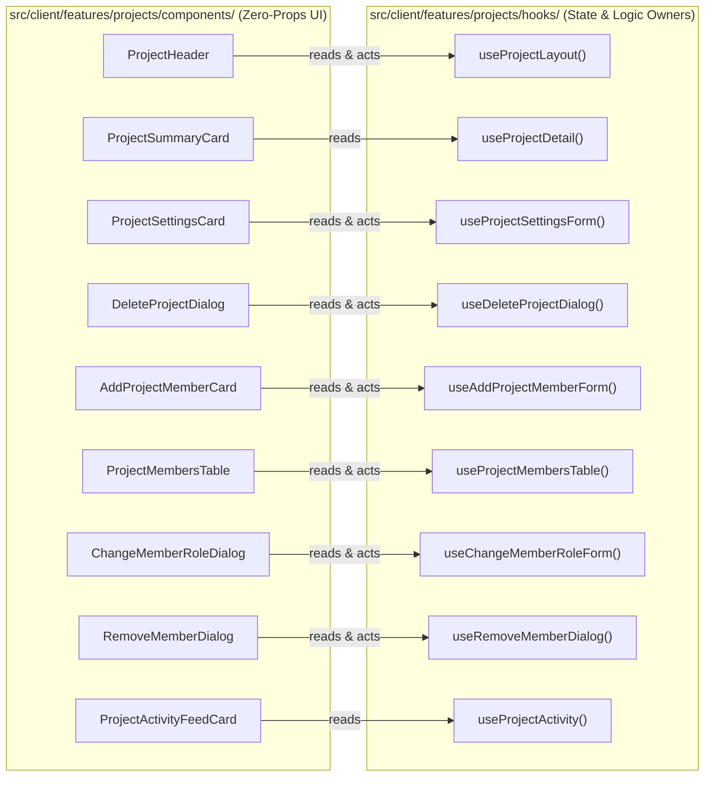

# Milestone 6 — Frontend Step 4: Feature Project Detail Zero-Props Components (src/client/features/projects/components/)

ในขั้นตอนนี้เราจะสร้าง **Zero-Props Presentation Components (`src/client/features/projects/components/`)** ทั้ง 9 ไฟล์ สำหรับแสดงผลส่วนหัวของโครงการและแท็บนำทาง (`ProjectHeader`), การ์ดสรุปข้อมูลและสิทธิ์ในโครงการ (`ProjectSummaryCard`), การ์ดตั้งค่าโครงการ (`ProjectSettingsCard`), Dialog ยืนยันการลบโครงการ (`DeleteProjectDialog`), การ์ดเพิ่มสมาชิก (`AddProjectMemberCard`), ตารางรายชื่อสมาชิก (`ProjectMembersTable`), Dialog เปลี่ยนบทบาทและนำสมาชิกออก (`ChangeMemberRoleDialog`, `RemoveMemberDialog`) รวมถึงการ์ดแสดงประวัติกิจกรรมของโครงการ (`ProjectActivityFeedCard`)

---

## 1. เป้าหมายและขอบเขต Boundary (Boundary Context & Goal)

### เป้าหมายของ Step นี้
1. สร้าง **Zero-Props Feature Components** ทั้ง 9 ไฟล์ โดยทุก Component ไม่รับ Props ใดๆ (`() => JSX.Element`) และเรียกใช้ Single-Responsibility Hook ประจำตัวโดยตรง
2. แสดงผล UI ที่ปรับเปลี่ยนตามสิทธิ์ระดับโครงการของผู้ใช้ (`canUpdate`, `canDelete`, `canManageMembers`) และสถานะของโครงการ (`isArchived`) อย่างชัดเจน
3. รักษามาตรฐาน Design System ของโปรเจกต์โดยใช้ shadcn Primitives (`Card`, `Badge`, `Table`, `Dialog`, `Separator`, `Skeleton`, `FieldGroup`) และไอคอนจาก `lucide-react` โดยไม่เติม Custom Border (`border-*`, `ring-*`) หรือใช้ Emoji บน UI

### ตารางสรุปไฟล์ใน Step นี้

| ลำดับ | Path ของไฟล์ | บทบาทหน้าที่ (Responsibility) |
| :--- | :--- | :--- |
| 1 | `src/client/features/projects/components/project-header.tsx` | ส่วนหัวของหน้ารายละเอียดโครงการ แสดงรหัส ชื่อ สถานะ บทบาทของผู้ใช้ และแท็บนำทางย่อย 4 แท็บ |
| 2 | `src/client/features/projects/components/project-summary-card.tsx` | การ์ดแสดงข้อมูลสรุปของโครงการ บทบาทของผู้ใช้ปัจจุบัน และรายการรหัสสิทธิ์ที่มีผล (`myPermissions`) |
| 3 | `src/client/features/projects/components/project-settings-card.tsx` | การ์ดฟอร์มแก้ไขชื่อ/คำอธิบายโครงการ ปุ่มสลับสถานะเก็บถาวร/กู้คืน และปุ่มเปิด Dialog ลบโครงการ |
| 4 | `src/client/features/projects/components/delete-project-dialog.tsx` | Dialog ยืนยันการลบโครงการถาวร |
| 5 | `src/client/features/projects/components/add-project-member-card.tsx` | การ์ดฟอร์มเพิ่มสมาชิกใหม่เข้าโครงการพร้อมเลือกบทบาทระดับโครงการ |
| 6 | `src/client/features/projects/components/project-members-table.tsx` | ตารางแสดงรายชื่อสมาชิกในโครงการ บทบาท (`Crown` สำหรับ Owner) วันที่เข้าร่วม และปุ่มจัดการ |
| 7 | `src/client/features/projects/components/change-member-role-dialog.tsx` | Dialog ฟอร์มเปลี่ยนบทบาทของสมาชิกในโครงการ |
| 8 | `src/client/features/projects/components/remove-member-dialog.tsx` | Dialog ยืนยันการนำสมาชิกออกจากโครงการ |
| 9 | `src/client/features/projects/components/project-activity-feed-card.tsx` | การ์ดแสดงรายการประวัติกิจกรรมทั้งหมดที่เกิดขึ้นภายในโครงการ |

### แผนผังการจับคู่ระหว่าง Zero-Props Components กับ Hooks (Mermaid Diagram)



---

## 2. ทฤษฎี ความสำคัญ และกฎสถาปัตยกรรมเฉพาะ Boundary นี้

### 2.1 กฎสถาปัตยกรรมที่บังคับใช้ (`.agents/rules/client.md`)
- **`client.md` ข้อ 2 & 3 (Zero Props & Pure Presentation)**: ทุก Component ใน `src/client/features/projects/components/*.tsx` ห้ามประกาศ Props Interface หรือรับพารามิเตอร์ใดๆ ทั้งสิ้น โดยทำหน้าที่เฉพาะ Declarative JSX และเรียกข้อมูล/Callback จาก Hook ประจำตัวเท่านั้น
- **`client.md` ข้อ 15 (Visual Boundary Discipline)**: ห้ามเขียน `border-*` หรือ `ring-*` ใน `className` โดยพลการ ให้ใช้ `<Card>`, `<Separator />`, `<Badge variant="outline">` และ `<Button variant="outline">` จาก shadcn primitives เท่านั้น
- **`client.md` ข้อ 18 (No Emoji / Use Lucide Icons)**: ใช้ SVG Icons จาก `lucide-react` (`Settings`, `Users`, `Activity`, `ListTodo`, `KeyRound`, `Crown`, `UserPlus`, `UserCog`, `UserMinus`, `Archive`, `RotateCcw`, `Trash2`, `ShieldAlert`, `Lock`, `Clock`) พร้อมระบุ `aria-hidden="true"`
- **`client.md` ข้อ 19 (One Component per File)**: แยก 1 ไฟล์ `.tsx` ต่อ 1 Component อย่างเคร่งครัด ไม่สร้าง Nested Sub-component ภายในไฟล์

### 2.2 การสะท้อนสถานะสิทธิ์ (`Permission-Aware UI`) และสถานะโครงการ (`Archived Lock`)
ใน Component ชุดนี้ เราออกแบบให้ผู้ใช้รับรู้สถานะสิทธิ์ของตนเองอย่างโปร่งใส:
1. **`ProjectSummaryCard`**: แสดงทั้งชื่อบทบาทในโครงการ (`myRole`) และรายการ Permission Codes ทั้งหมดที่ผู้ใช้มีในโครงการนั้น (`project:view`, `project:update`, `task:create`, ฯลฯ) หากเป็นผู้ดูแลระบบที่เข้าดูผ่านสิทธิ์ระดับระบบโดยไม่ได้เป็นสมาชิกของโครงการ จะแสดงข้อความแจ้งเตือนว่ากำลังเข้าดูในโหมดอ่านอย่างเดียวผ่านสิทธิ์ระดับระบบ
2. **`ProjectSettingsCard` และ `AddProjectMemberCard`**:
   - หากผู้ใช้ไม่มีสิทธิ์ (`!canUpdate` หรือ `!canManageMembers`) ฟอร์มจะถูกปิดเป็นโหมดอ่านอย่างเดียวพร้อมข้อความอธิบายชัดเจน
   - หากโครงการอยู่ในสถานะเก็บถาวร (`isArchived === true`) ช่องกรอกข้อมูลและปุ่มเพิ่ม/แก้ไขสมาชิกจะถูกล็อก (`disabled`) เพื่อบังคับให้ต้องกู้คืนโครงการกลับมาเป็นสถานะใช้งานอยู่ (`active`) ก่อนจึงจะแก้ไขข้อมูลได้ (สอดคล้องกับ Business Invariant ในฝั่ง Domain)

---

## 3. ลงมือเขียนโค้ด (Step-by-Step Implementation)

### 3.1 สร้างส่วนหัวของหน้ารายละเอียดโครงการ (`src/client/features/projects/components/project-header.tsx`)

สร้างไฟล์ `src/client/features/projects/components/project-header.tsx` สำหรับแสดงปุ่มย้อนกลับไปหน้ารายการโครงการ, รหัสและชื่อโครงการ, สถานะโครงการ, บทบาทของผู้ใช้ปัจจุบัน และแถบปุ่มนำทางย่อย 4 แท็บ ได้แก่ **ภาพรวม & ตั้งค่า**, **สมาชิก**, **ประวัติกิจกรรม** และ **งานทั้งหมด**

> [!NOTE]
> สังเกตว่าใน `ProjectHeader` มีปุ่มแท็บ **"งานทั้งหมด"** (`to="/projects/$projectId/tasks"`) เตรียมไว้ให้พร้อมใช้งานแล้ว โดยแท็บนี้จะทำงานอย่างสมบูรณ์เมื่อเราสร้าง Route และหน้ากระดานงาน (`/projects/$projectId/tasks`) ใน **Milestone 7** (หากในระหว่าง Milestone 6TypeScript แจ้งเตือนเรื่อง Route `/projects/$projectId/tasks` ยังไม่ถูกสร้าง ให้ทราบว่าเป็นลิงก์ที่เตรียมเชื่อมต่อไปยัง Milestone 7)

```tsx
import { Activity, ArrowLeft, ListTodo, Settings, Users } from "lucide-react";
import { AppButtonLink } from "#/client/shared/components/app-link";
import { Badge } from "#/client/shared/shadcn/components/ui/badge";
import {
	Card,
	CardDescription,
	CardHeader,
	CardTitle,
} from "#/client/shared/shadcn/components/ui/card";
import { Separator } from "#/client/shared/shadcn/components/ui/separator";
import { Skeleton } from "#/client/shared/shadcn/components/ui/skeleton";
import { useProjectLayout } from "../hooks/use-project-layout";

export function ProjectHeader() {
	const {
		projectId,
		project,
		isPending,
		isOverviewActive,
		isTasksActive,
		isMembersActive,
		isActivityActive,
	} = useProjectLayout();

	return (
		<Card>
			<CardHeader className="gap-4">
				<div className="flex flex-wrap items-center justify-between gap-3">
					<div className="flex flex-wrap items-center gap-2.5">
						<AppButtonLink to="/projects" variant="ghost" size="sm">
							<ArrowLeft aria-hidden="true" />
							<span>โครงการทั้งหมด</span>
						</AppButtonLink>
						{isPending ? (
							<Skeleton className="h-6 w-48" />
						) : project ? (
							<>
								<Badge variant="outline">{project.key}</Badge>
								<CardTitle className="text-xl">{project.name}</CardTitle>
								<Badge
									variant={
										project.status === "active" ? "default" : "secondary"
									}
								>
									{project.status === "active" ? "ใช้งานอยู่" : "เก็บถาวร"}
								</Badge>
							</>
						) : null}
					</div>

					{project ? (
						<Badge variant="secondary">
							{project.myRole
								? `บทบาท: ${project.myRole.name}`
								: "สิทธิ์อ่านทั้งหมดระดับระบบ"}
						</Badge>
					) : null}
				</div>

				{project?.description ? (
					<CardDescription>{project.description}</CardDescription>
				) : null}

				<Separator />

				<div className="flex flex-wrap items-center gap-1.5">
					<AppButtonLink
						to="/projects/$projectId"
						params={{ projectId }}
						variant={isOverviewActive ? "secondary" : "ghost"}
						size="sm"
					>
						<Settings aria-hidden="true" />
						<span>ภาพรวม &amp; ตั้งค่า</span>
					</AppButtonLink>
					<AppButtonLink
						to="/projects/$projectId/members"
						params={{ projectId }}
						variant={isMembersActive ? "secondary" : "ghost"}
						size="sm"
					>
						<Users aria-hidden="true" />
						<span>สมาชิก{project ? ` (${project.memberCount})` : ""}</span>
					</AppButtonLink>
					<AppButtonLink
						to="/projects/$projectId/activity"
						params={{ projectId }}
						variant={isActivityActive ? "secondary" : "ghost"}
						size="sm"
					>
						<Activity aria-hidden="true" />
						<span>ประวัติกิจกรรม</span>
					</AppButtonLink>
					<AppButtonLink
						to="/projects/$projectId/tasks"
						params={{ projectId }}
						variant={isTasksActive ? "secondary" : "ghost"}
						size="sm"
					>
						<ListTodo aria-hidden="true" />
						<span>งานทั้งหมด {project ? ` (${project.taskCount})` : ""}</span>
					</AppButtonLink>
				</div>
			</CardHeader>
		</Card>
	);
}
```

---

### 3.2 สร้างการ์ดข้อมูลสรุปและสิทธิ์ในโครงการ (`src/client/features/projects/components/project-summary-card.tsx`)

สร้างไฟล์ `src/client/features/projects/components/project-summary-card.tsx` เพื่อแสดงผู้สร้างโครงการ, จำนวนสมาชิกและงาน, ลำดับรหัสงานล่าสุด (`{key}-{taskSequence}`), บทบาทของผู้ใช้ในโครงการนี้ และรายการรหัสสิทธิ์ระดับโครงการที่มีผล (`myPermissions`):

```tsx
import { KeyRound, ShieldAlert } from "lucide-react";
import { Badge } from "#/client/shared/shadcn/components/ui/badge";
import {
	Card,
	CardContent,
	CardDescription,
	CardHeader,
	CardTitle,
} from "#/client/shared/shadcn/components/ui/card";
import { Separator } from "#/client/shared/shadcn/components/ui/separator";
import { Skeleton } from "#/client/shared/shadcn/components/ui/skeleton";
import { useProjectDetail } from "../hooks/use-project-detail";

export function ProjectSummaryCard() {
	const { project, isPending, myRole, myPermissions } = useProjectDetail();

	if (isPending || !project) {
		return (
			<Card>
				<CardHeader>
					<Skeleton className="h-6 w-40" />
				</CardHeader>
				<CardContent className="flex flex-col gap-3">
					<Skeleton className="h-16 w-full" />
					<Skeleton className="h-16 w-full" />
				</CardContent>
			</Card>
		);
	}

	return (
		<Card className="h-fit">
			<CardHeader>
				<div className="flex items-center gap-2">
					<KeyRound className="size-5 text-primary" aria-hidden="true" />
					<CardTitle>ข้อมูลโครงการและสิทธิ์ของคุณ</CardTitle>
				</div>
				<CardDescription>
					สิทธิ์ที่มีผลซึ่งคำนวณจากบทบาทของคุณภายในโครงการนี้
				</CardDescription>
				<Separator />
			</CardHeader>
			<CardContent className="flex flex-col gap-4 text-sm">
				<div className="grid grid-cols-2 gap-3">
					<div className="flex flex-col gap-0.5">
						<span className="text-xs text-muted-foreground">ผู้สร้างโครงการ</span>
						<span className="font-medium">{project.createdByName}</span>
					</div>
					<div className="flex flex-col gap-0.5">
						<span className="text-xs text-muted-foreground">สมาชิก / งาน</span>
						<span className="font-medium">
							{project.memberCount} คน / {project.taskCount} งาน
						</span>
					</div>
					<div className="flex flex-col gap-0.5">
						<span className="text-xs text-muted-foreground">
							บทบาทในโครงการนี้
						</span>
						<div>
							<Badge variant="secondary">
								{myRole
									? `${myRole.name} (${myRole.slug})`
									: "สิทธิ์อ่านทั้งหมดระดับระบบ"}
							</Badge>
						</div>
					</div>
					<div className="flex flex-col gap-0.5">
						<span className="text-xs text-muted-foreground">ลำดับงานล่าสุด</span>
						<span className="font-medium">
							{project.key}-{project.taskSequence}
						</span>
					</div>
				</div>

				<Separator />

				<div className="flex flex-col gap-2">
					<span className="text-xs font-medium text-muted-foreground">
						สิทธิ์ระดับโครงการที่มีผล ({myPermissions.length})
					</span>
					{myPermissions.length > 0 ? (
						<div className="flex flex-wrap gap-1.5">
							{myPermissions.map((code) => (
								<Badge key={code} variant="outline">
									{code}
								</Badge>
							))}
						</div>
					) : (
						<div className="flex items-center gap-2 text-xs text-muted-foreground">
							<ShieldAlert className="size-4" aria-hidden="true" />
							<span>เข้าดูในโหมดอ่านอย่างเดียวผ่านสิทธิ์อ่านโครงการทั้งหมดระดับระบบ</span>
						</div>
					)}
				</div>
			</CardContent>
		</Card>
	);
}
```

---

### 3.3 สร้างการ์ดตั้งค่าโครงการ (`src/client/features/projects/components/project-settings-card.tsx`)

สร้างไฟล์ `src/client/features/projects/components/project-settings-card.tsx` สำหรับแก้ไขชื่อและคำอธิบายโครงการ, ปุ่มสลับสถานะเก็บถาวร (`Archive`) / กู้คืน (`Restore`) และปุ่มเปิด Dialog ลบโครงการถาวร:

```tsx
import { Archive, RotateCcw, Settings, Trash2 } from "lucide-react";
import { Button } from "#/client/shared/shadcn/components/ui/button";
import {
	Card,
	CardContent,
	CardDescription,
	CardFooter,
	CardHeader,
	CardTitle,
} from "#/client/shared/shadcn/components/ui/card";
import { FieldGroup } from "#/client/shared/shadcn/components/ui/field";
import { Separator } from "#/client/shared/shadcn/components/ui/separator";
import { useProjectSettingsForm } from "../hooks/use-project-settings-form";

export function ProjectSettingsCard() {
	const {
		project,
		isArchived,
		canUpdate,
		canDelete,
		isTogglingStatus,
		form,
		handleToggleStatus,
		openDeleteDialog,
	} = useProjectSettingsForm();

	if (!project) {
		return null;
	}

	return (
		<Card className="h-fit">
			<CardHeader>
				<div className="flex items-center gap-2">
					<Settings className="size-5 text-primary" aria-hidden="true" />
					<CardTitle>ตั้งค่าโครงการ</CardTitle>
				</div>
				<CardDescription>
					{canUpdate
						? "แก้ไขข้อมูลโครงการ เปลี่ยนสถานะเก็บถาวร หรือกู้คืน"
						: "โหมดอ่านอย่างเดียว (ต้องมีสิทธิ์แก้ไขโครงการ)"}
				</CardDescription>
				<Separator />
			</CardHeader>

			<form
				noValidate
				onSubmit={(event) => {
					event.preventDefault();
					event.stopPropagation();
					void form.handleSubmit();
				}}
			>
				<form.AppForm>
					<CardContent className="flex flex-col gap-4">
						{isArchived && canUpdate ? (
							<p className="text-xs text-muted-foreground">
								โครงการนี้ถูกเก็บถาวรอยู่ กรุณากู้คืนเป็นใช้งานอยู่ ก่อนจึงจะแก้ไขชื่อและคำอธิบายได้
							</p>
						) : null}

						<FieldGroup>
							<form.AppField name="name">
								{(field) => (
									<field.TextField
										label="ชื่อโครงการ"
										disabled={!canUpdate || isArchived}
									/>
								)}
							</form.AppField>

							<form.AppField name="description">
								{(field) => (
									<field.TextareaField
										label="คำอธิบาย"
										disabled={!canUpdate || isArchived}
									/>
								)}
							</form.AppField>
						</FieldGroup>
					</CardContent>

					{canUpdate || canDelete ? (
						<>
							<Separator className="mt-6" />
							<CardFooter className="flex flex-wrap items-center justify-between gap-2 pt-6">
								{canUpdate ? (
									<div className="flex flex-wrap items-center gap-2">
										<form.SubmitButton
											disabled={isArchived}
											loadingLabel="กำลังบันทึก..."
										>
											บันทึกการแก้ไข
										</form.SubmitButton>

										<Button
											type="button"
											variant={isArchived ? "outline" : "secondary"}
											disabled={isTogglingStatus}
											onClick={() => void handleToggleStatus()}
										>
											{isArchived ? (
												<>
													<RotateCcw aria-hidden="true" />
													<span>กู้คืน</span>
												</>
											) : (
												<>
													<Archive aria-hidden="true" />
													<span>เก็บถาวร</span>
												</>
											)}
										</Button>
									</div>
								) : (
									<span />
								)}

								{canDelete ? (
									<Button
										type="button"
										variant="destructive"
										onClick={openDeleteDialog}
									>
										<Trash2 aria-hidden="true" />
										<span>ลบโครงการ</span>
									</Button>
								) : null}
							</CardFooter>
						</>
					) : null}
				</form.AppForm>
			</form>
		</Card>
	);
}
```

---

### 3.4 สร้าง Dialog ยืนยันการลบโครงการถาวร (`src/client/features/projects/components/delete-project-dialog.tsx`)

สร้างไฟล์ `src/client/features/projects/components/delete-project-dialog.tsx`:

```tsx
import { Button } from "#/client/shared/shadcn/components/ui/button";
import {
	Dialog,
	DialogContent,
	DialogDescription,
	DialogFooter,
	DialogHeader,
	DialogTitle,
} from "#/client/shared/shadcn/components/ui/dialog";
import { useDeleteProjectDialog } from "../hooks/use-delete-project-dialog";

export function DeleteProjectDialog() {
	const { project, isOpen, isDeleting, handleOpenChange, handleConfirmDelete } =
		useDeleteProjectDialog();

	return (
		<Dialog open={isOpen} onOpenChange={handleOpenChange}>
			<DialogContent>
				<DialogHeader>
					<DialogTitle>ยืนยันการลบโครงการถาวร</DialogTitle>
					<DialogDescription>
						โครงการ &ldquo;{project?.name}&rdquo; ({project?.key}) รวมถึงสมาชิก
						งาน และประวัติกิจกรรมทั้งหมดจะถูกลบถาวรและไม่สามารถกู้คืนได้
					</DialogDescription>
				</DialogHeader>
				<DialogFooter>
					<Button
						type="button"
						variant="outline"
						disabled={isDeleting}
						onClick={() => handleOpenChange(false)}
					>
						ยกเลิก
					</Button>
					<Button
						type="button"
						variant="destructive"
						disabled={isDeleting}
						onClick={() => void handleConfirmDelete()}
					>
						{isDeleting ? "กำลังลบ..." : "ยืนยันลบถาวร"}
					</Button>
				</DialogFooter>
			</DialogContent>
		</Dialog>
	);
}
```

---

### 3.5 สร้างการ์ดเพิ่มสมาชิกเข้าโครงการ (`src/client/features/projects/components/add-project-member-card.tsx`)

สร้างไฟล์ `src/client/features/projects/components/add-project-member-card.tsx` สำหรับเลือกผู้ใช้งานและบทบาทระดับโครงการเพื่อเพิ่มเข้าเป็นสมาชิก โดยแสดงข้อความแจ้งสถานะอย่างเหมาะสมเมื่อผู้ใช้ไม่มีสิทธิ์จัดการสมาชิก, โครงการถูกเก็บถาวร, หรือผู้ใช้ทุกคนในระบบเป็นสมาชิกครบแล้ว:

```tsx
import { Lock, ShieldAlert, UserPlus } from "lucide-react";
import {
	Card,
	CardContent,
	CardDescription,
	CardHeader,
	CardTitle,
} from "#/client/shared/shadcn/components/ui/card";
import { FieldGroup } from "#/client/shared/shadcn/components/ui/field";
import { Separator } from "#/client/shared/shadcn/components/ui/separator";
import { useAddProjectMemberForm } from "../hooks/use-add-project-member-form";

export function AddProjectMemberCard() {
	const {
		canManageMembers,
		isArchived,
		userOptions,
		roleOptions,
		hasInvitableUsers,
		form,
	} = useAddProjectMemberForm();

	return (
		<Card className="h-fit">
			<CardHeader>
				<div className="flex items-center gap-2">
					<UserPlus className="size-5 text-primary" aria-hidden="true" />
					<CardTitle>เพิ่มสมาชิกเข้าโครงการ</CardTitle>
				</div>
				<CardDescription>
					กำหนดบทบาทระดับโครงการให้ผู้ใช้งานเฉพาะภายในโครงการนี้
				</CardDescription>
				<Separator />
			</CardHeader>
			<CardContent>
				{!canManageMembers ? (
					<div className="flex items-center gap-2 text-sm text-muted-foreground">
						<ShieldAlert className="size-4 shrink-0" aria-hidden="true" />
						<span>คุณอยู่ในโหมดอ่านอย่างเดียว (ต้องมีสิทธิ์จัดการสมาชิกโครงการ)</span>
					</div>
				) : isArchived ? (
					<div className="flex items-center gap-2 text-sm text-muted-foreground">
						<Lock className="size-4 shrink-0" aria-hidden="true" />
						<span>โครงการนี้ถูกเก็บถาวรแล้ว ไม่สามารถเพิ่มหรือแก้ไขสมาชิกได้</span>
					</div>
				) : !hasInvitableUsers ? (
					<p className="text-sm text-muted-foreground">
						ผู้ใช้งานทั้งหมดในระบบเป็นสมาชิกของโครงการนี้เรียบร้อยแล้ว
					</p>
				) : (
					<form
						noValidate
						onSubmit={(event) => {
							event.preventDefault();
							event.stopPropagation();
							void form.handleSubmit();
						}}
					>
						<form.AppForm>
							<FieldGroup>
								<form.AppField name="userId">
									{(field) => (
										<field.SelectField
											label="ผู้ใช้งาน"
											placeholder="เลือกผู้ใช้งานที่ต้องการเชิญ..."
											options={userOptions}
										/>
									)}
								</form.AppField>

								<form.AppField name="roleId">
									{(field) => (
										<field.SelectField
											label="บทบาทในโครงการ"
											placeholder="เลือกบทบาทในโครงการ..."
											options={roleOptions}
										/>
									)}
								</form.AppField>

								<form.SubmitButton
									className="w-full"
									loadingLabel="กำลังเพิ่มสมาชิก..."
								>
									เพิ่มสมาชิก
								</form.SubmitButton>
							</FieldGroup>
						</form.AppForm>
					</form>
				)}
			</CardContent>
		</Card>
	);
}
```

---

### 3.6 สร้างตารางรายชื่อสมาชิกภายในโครงการ (`src/client/features/projects/components/project-members-table.tsx`)

สร้างไฟล์ `src/client/features/projects/components/project-members-table.tsx` สำหรับแสดงตารางสมาชิก บทบาทในโครงการ (แสดงไอคอน `Crown` สำหรับบทบาท `Project Owner`) วันที่เข้าร่วม และปุ่มเปลี่ยนบทบาท/นำออก:

```tsx
import { Crown, UserCog, UserMinus, Users } from "lucide-react";
import { Badge } from "#/client/shared/shadcn/components/ui/badge";
import { Button } from "#/client/shared/shadcn/components/ui/button";
import {
	Card,
	CardContent,
	CardDescription,
	CardHeader,
	CardTitle,
} from "#/client/shared/shadcn/components/ui/card";
import { Separator } from "#/client/shared/shadcn/components/ui/separator";
import { Skeleton } from "#/client/shared/shadcn/components/ui/skeleton";
import {
	Table,
	TableBody,
	TableCell,
	TableHead,
	TableHeader,
	TableRow,
} from "#/client/shared/shadcn/components/ui/table";
import { useProjectMembersTable } from "../hooks/use-project-members-table";

export function ProjectMembersTable() {
	const {
		table,
		columnCount,
		memberCount,
		isPending,
		canManageMembers,
		isArchived,
		openChangeRoleDialog,
		openRemoveDialog,
	} = useProjectMembersTable();

	const rows = table.getRowModel().rows;

	return (
		<Card>
			<CardHeader>
				<div className="flex items-center gap-2">
					<Users className="size-5 text-primary" aria-hidden="true" />
					<CardTitle>สมาชิกภายในโครงการ ({memberCount})</CardTitle>
				</div>
				<CardDescription>
					รายชื่อสมาชิกและบทบาทเฉพาะโครงการนี้ (ป้องกันการลบเจ้าของคนสุดท้าย)
				</CardDescription>
				<Separator />
			</CardHeader>
			<CardContent>
				{isPending ? (
					<div className="flex flex-col gap-2">
						<Skeleton className="h-10 w-full" />
						<Skeleton className="h-12 w-full" />
					</div>
				) : (
					<Table>
						<TableHeader>
							{table.getHeaderGroups().map((headerGroup) => (
								<TableRow key={headerGroup.id}>
									{headerGroup.headers.map((header) => (
										<TableHead key={header.id}>
											{header.isPlaceholder ? null : (
												<table.FlexRender header={header} />
											)}
										</TableHead>
									))}
								</TableRow>
							))}
						</TableHeader>
						<TableBody>
							{rows.length === 0 ? (
								<TableRow>
									<TableCell
										colSpan={columnCount}
										className="h-20 text-center text-muted-foreground"
									>
										ยังไม่มีสมาชิกในโครงการ
									</TableCell>
								</TableRow>
							) : (
								rows.map((row) => (
									<TableRow key={row.id}>
										{row.getAllCells().map((cell) => {
											const member = row.original;

											if (cell.column.id === "userName") {
												return (
													<TableCell key={cell.id}>
														<div className="flex flex-col">
															<span className="font-medium">
																{member.userName}
															</span>
															<span className="text-xs text-muted-foreground">
																{member.userEmail}
															</span>
														</div>
													</TableCell>
												);
											}

											if (cell.column.id === "roleName") {
												return (
													<TableCell key={cell.id}>
														<Badge
															variant={
																member.isOwnerRole ? "default" : "secondary"
															}
														>
															{member.isOwnerRole ? (
																<Crown aria-hidden="true" />
															) : null}
															<span>{member.roleName}</span>
														</Badge>
													</TableCell>
												);
											}

											if (cell.column.id === "joinedAt") {
												return (
													<TableCell
														key={cell.id}
														className="text-xs text-muted-foreground"
													>
														{new Date(member.joinedAt).toLocaleDateString()}
													</TableCell>
												);
											}

											if (cell.column.id === "actions") {
												if (!canManageMembers || isArchived) {
													return (
														<TableCell
															key={cell.id}
															className="text-xs text-muted-foreground"
														>
															{isArchived ? "ล็อก (เก็บถาวร)" : "อ่านอย่างเดียว"}
														</TableCell>
													);
												}

												return (
													<TableCell key={cell.id}>
														<div className="flex items-center gap-1.5">
															<Button
																type="button"
																variant="outline"
																size="sm"
																onClick={() => openChangeRoleDialog(member)}
															>
																<UserCog aria-hidden="true" />
																<span>เปลี่ยนบทบาท</span>
															</Button>
															<Button
																type="button"
																variant="destructive"
																size="sm"
																onClick={() => openRemoveDialog(member)}
															>
																<UserMinus aria-hidden="true" />
																<span>นำออก</span>
															</Button>
														</div>
													</TableCell>
												);
											}

											return (
												<TableCell key={cell.id}>
													<table.FlexRender cell={cell} />
												</TableCell>
											);
										})}
									</TableRow>
								))
							)}
						</TableBody>
					</Table>
				)}
			</CardContent>
		</Card>
	);
}
```

---

### 3.7 สร้าง Dialog เปลี่ยนบทบาทของสมาชิก (`src/client/features/projects/components/change-member-role-dialog.tsx`)

สร้างไฟล์ `src/client/features/projects/components/change-member-role-dialog.tsx`:

```tsx
import { Button } from "#/client/shared/shadcn/components/ui/button";
import {
	Dialog,
	DialogContent,
	DialogDescription,
	DialogFooter,
	DialogHeader,
	DialogTitle,
} from "#/client/shared/shadcn/components/ui/dialog";
import { FieldGroup } from "#/client/shared/shadcn/components/ui/field";
import { useChangeMemberRoleForm } from "../hooks/use-change-member-role-form";

export function ChangeMemberRoleDialog() {
	const { changingMember, roleOptions, handleOpenChange, form } =
		useChangeMemberRoleForm();

	return (
		<Dialog open={Boolean(changingMember)} onOpenChange={handleOpenChange}>
			<DialogContent>
				<DialogHeader>
					<DialogTitle>เปลี่ยนบทบาทของสมาชิก</DialogTitle>
					<DialogDescription>
						เลือกบทบาทใหม่สำหรับ {changingMember?.userName} (
						{changingMember?.userEmail})
					</DialogDescription>
				</DialogHeader>

				<form
					noValidate
					onSubmit={(event) => {
						event.preventDefault();
						event.stopPropagation();
						void form.handleSubmit();
					}}
				>
					<form.AppForm>
						<FieldGroup>
							<form.AppField name="roleId">
								{(field) => (
									<field.SelectField
										label="บทบาทใหม่ในโครงการ"
										placeholder="เลือกบทบาทในโครงการ..."
										options={roleOptions}
									/>
								)}
							</form.AppField>

							<DialogFooter>
								<Button
									type="button"
									variant="outline"
									onClick={() => handleOpenChange(false)}
								>
									ยกเลิก
								</Button>
								<form.SubmitButton loadingLabel="กำลังบันทึก...">
									บันทึกบทบาท
								</form.SubmitButton>
							</DialogFooter>
						</FieldGroup>
					</form.AppForm>
				</form>
			</DialogContent>
		</Dialog>
	);
}
```

---

### 3.8 สร้าง Dialog ยืนยันการนำสมาชิกออก (`src/client/features/projects/components/remove-member-dialog.tsx`)

สร้างไฟล์ `src/client/features/projects/components/remove-member-dialog.tsx`:

```tsx
import { Button } from "#/client/shared/shadcn/components/ui/button";
import {
	Dialog,
	DialogContent,
	DialogDescription,
	DialogFooter,
	DialogHeader,
	DialogTitle,
} from "#/client/shared/shadcn/components/ui/dialog";
import { useRemoveMemberDialog } from "../hooks/use-remove-member-dialog";

export function RemoveMemberDialog() {
	const { removingMember, isRemoving, handleOpenChange, handleConfirmRemove } =
		useRemoveMemberDialog();

	return (
		<Dialog open={Boolean(removingMember)} onOpenChange={handleOpenChange}>
			<DialogContent>
				<DialogHeader>
					<DialogTitle>ยืนยันการนำสมาชิกออก</DialogTitle>
					<DialogDescription>
						คุณต้องการนำ {removingMember?.userName} ({removingMember?.roleName})
						ออกจากโครงการนี้ใช่หรือไม่?
					</DialogDescription>
				</DialogHeader>
				<DialogFooter>
					<Button
						type="button"
						variant="outline"
						disabled={isRemoving}
						onClick={() => handleOpenChange(false)}
					>
						ยกเลิก
					</Button>
					<Button
						type="button"
						variant="destructive"
						disabled={isRemoving}
						onClick={() => void handleConfirmRemove()}
					>
						{isRemoving ? "กำลังนำออก..." : "ยืนยันนำออก"}
					</Button>
				</DialogFooter>
			</DialogContent>
		</Dialog>
	);
}
```

---

### 3.9 สร้างการ์ดแสดงประวัติกิจกรรมของโครงการ (`src/client/features/projects/components/project-activity-feed-card.tsx`)

สร้างไฟล์ `src/client/features/projects/components/project-activity-feed-card.tsx` เพื่อแสดงรายการ `FormattedActivityItem` จาก `useProjectActivity()` พร้อมเส้นคั่น `<Separator />` ระหว่างแต่ละรายการ:

```tsx
import { Activity, Clock } from "lucide-react";
import {
	Card,
	CardContent,
	CardDescription,
	CardHeader,
	CardTitle,
} from "#/client/shared/shadcn/components/ui/card";
import { Separator } from "#/client/shared/shadcn/components/ui/separator";
import { Skeleton } from "#/client/shared/shadcn/components/ui/skeleton";
import { useProjectActivity } from "../hooks/use-project-activity";

export function ProjectActivityFeedCard() {
	const { items, isPending } = useProjectActivity();

	return (
		<Card>
			<CardHeader>
				<div className="flex items-center gap-2">
					<Activity className="size-5 text-primary" aria-hidden="true" />
					<CardTitle>ประวัติกิจกรรมของโครงการ</CardTitle>
				</div>
				<CardDescription>
					บันทึกเหตุการณ์สำคัญทั้งหมดที่เกิดขึ้นภายในโครงการ
				</CardDescription>
				<Separator />
			</CardHeader>
			<CardContent className="flex flex-col gap-3">
				{isPending ? (
					<div className="flex flex-col gap-2">
						<Skeleton className="h-14 w-full" />
						<Skeleton className="h-14 w-full" />
					</div>
				) : items.length === 0 ? (
					<p className="text-sm text-muted-foreground">
						ยังไม่มีประวัติกิจกรรมในโครงการนี้
					</p>
				) : (
					items.map((item, index) => (
						<div key={item.id} className="flex flex-col gap-3">
							<div className="flex flex-wrap items-start justify-between gap-2 text-sm">
								<div className="flex flex-col gap-0.5">
									<span className="font-medium text-foreground">
										{item.title}
									</span>
									<span className="text-xs text-muted-foreground">
										{item.detail} &mdash; โดย {item.actorName} (
										{item.actorEmail})
									</span>
								</div>
								<div className="flex items-center gap-1 text-xs text-muted-foreground">
									<Clock className="size-3.5" aria-hidden="true" />
									<span>{item.createdAtLabel}</span>
								</div>
							</div>
							{index < items.length - 1 ? <Separator /> : null}
						</div>
					))
				)}
			</CardContent>
		</Card>
	);
}
```

---

## 4. การตรวจสอบความถูกต้องและ Git Commit (Verification & Commit)

### 4.1 ตรวจสอบ Formatting และ Linting
รันคำสั่งตรวจสอบด้วย `bun` เพื่อตรวจสอบความถูกต้องของโค้ดและกฎ Biome:

```bash
bun run typecheck
bun run format
bun run check
```

### 4.2 บันทึกการเปลี่ยนแปลงลง Git (Git Commit)
Stage เฉพาะไฟล์ Component ทั้ง 9 ไฟล์ใน Step นี้และทำการ Commit:

```bash
git add src/client/features/projects/components/project-header.tsx src/client/features/projects/components/project-summary-card.tsx src/client/features/projects/components/project-settings-card.tsx src/client/features/projects/components/delete-project-dialog.tsx src/client/features/projects/components/add-project-member-card.tsx src/client/features/projects/components/project-members-table.tsx src/client/features/projects/components/change-member-role-dialog.tsx src/client/features/projects/components/remove-member-dialog.tsx src/client/features/projects/components/project-activity-feed-card.tsx
git commit -m "milestone-6.frontend.step-4: Zero-Props Project Detail, Settings, Members & Activity Components"
```
