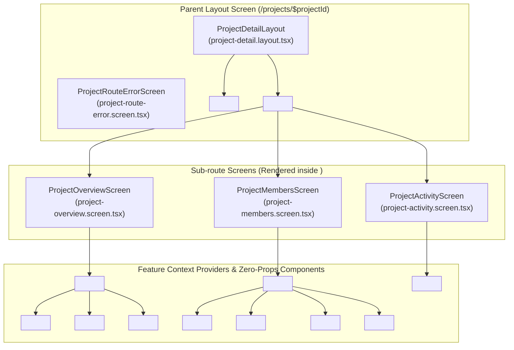

# Milestone 6 — Frontend Step 5: Feature Project Detail Screens (src/client/features/projects/screens/)

ในขั้นตอนนี้เราจะสร้าง **Composition Root Screens (`src/client/features/projects/screens/`)** ทั้ง 5 ไฟล์ เพื่อทำหน้าที่ประกอบร่าง Zero-Props Components และ Context Providers สำหรับโครงสร้าง Nested Layout ของโครงการ (`ProjectDetailLayout`), หน้าแจ้งเตือนเมื่อไม่มีสิทธิ์หรือโครงการไม่มีอยู่จริง (`ProjectRouteErrorScreen`), หน้าภาพรวมและตั้งค่าโครงการ (`ProjectOverviewScreen`), หน้าจัดการสมาชิกโครงการ (`ProjectMembersScreen`) และหน้าประวัติกิจกรรมของโครงการ (`ProjectActivityScreen`)

---

## 1. เป้าหมายและขอบเขต Boundary (Boundary Context & Goal)

### เป้าหมายของ Step นี้
1. สร้าง **Layout Screen (`ProjectDetailLayout`)** สำหรับแสดง `<ProjectHeader />` ค้างไว้ด้านบน และเรนเดอร์เนื้อหาของแต่ละแท็บย่อยผ่าน `<Outlet />` ของ TanStack Router
2. สร้าง **Error Boundary Screen (`ProjectRouteErrorScreen`)** สำหรับแสดงผลเมื่อผู้ใช้พยายามเข้าถึงโครงการที่ไม่มีสิทธิ์ดู (`ForbiddenError`) หรือไม่มีอยู่ในระบบ (`ProjectNotFoundError`)
3. สร้าง **Sub-route Screens (`ProjectOverviewScreen`, `ProjectMembersScreen`, `ProjectActivityScreen`)** ที่ห่อหุ้ม Context Provider ประจำหน้าและจัดวาง Grid Layout สำหรับ Zero-Props Components

### ตารางสรุปไฟล์ใน Step นี้

| ลำดับ | Path ของไฟล์ | บทบาทหน้าที่ (Responsibility) |
| :--- | :--- | :--- |
| 1 | `src/client/features/projects/screens/project-detail.layout.tsx` | Layout Screen ระดับ `/projects/$projectId` ประกอบ `<AppShellMain>`, `<ProjectHeader />` และ `<Outlet />` |
| 2 | `src/client/features/projects/screens/project-route-error.screen.tsx` | Error Screen สำหรับ `errorComponent` ของ Route `/projects/$projectId` เมื่อเข้าถึงไม่ได้หรือไม่มีโครงการ |
| 3 | `src/client/features/projects/screens/project-overview.screen.tsx` | Composition Root ของแท็บภาพรวม & ตั้งค่า (`/projects/$projectId/`) |
| 4 | `src/client/features/projects/screens/project-members.screen.tsx` | Composition Root ของแท็บสมาชิกโครงการ (`/projects/$projectId/members`) |
| 5 | `src/client/features/projects/screens/project-activity.screen.tsx` | Composition Root ของแท็บประวัติกิจกรรมโครงการ (`/projects/$projectId/activity`) |

### แผนผังการประกอบร่าง Screens, Context Providers และ Components (Mermaid Diagram)



---

## 2. ทฤษฎี ความสำคัญ และกฎสถาปัตยกรรมเฉพาะ Boundary นี้

### 2.1 กฎสถาปัตยกรรมที่บังคับใช้ (`.agents/rules/client.md`)
- **`client.md` ข้อ 1 (Route Knows Only Screen)**: ไฟล์ใน `src/routes/**` มีหน้าที่เฉพาะกำหนด URL, `loader`, `errorComponent` และ `component` โดยอ้างอิงไปยัง Screen ใน `src/client/features/**/screens/*.tsx` เท่านั้น ห้าม Route นำ Component ย่อยไปประกอบร่างเอง
- **`client.md` ข้อ 2 (Screen as Composition Root)**: Screen ทำหน้าที่เป็น Composition Root ประจำหน้านั้น โดยวางโครงสร้าง Grid/Layout, ครอบ Context Provider ที่จำเป็น และเรียกใช้ Feature Components แบบ **Zero Props** (ไม่มีการส่งค่าผ่าน props เข้าไปใน `<ProjectSummaryCard />`, `<ProjectSettingsCard />` ฯลฯ)
- **`client.md` ข้อ 3 (No Business Logic in Screen)**: ภายใน Screen ทั้ง 5 ไฟล์ไม่มี `useState`, `useQuery`, `useMutation` หรือ Event Handler ใดๆ เลย ทำให้โค้ดของแต่ละ Screen สั้น กระชับ และอ่านโครงสร้างหน้าจอออกได้ทันทีภายในไม่กี่บรรทัด

### 2.2 ทำไมต้องแยก `ProjectOverviewProvider` และ `ProjectMembersProvider` ไว้ที่ระดับ Sub-route Screen?
แทนที่จะนำ Context ทั้งหมดไปกองรวมกันที่ `ProjectDetailLayout` เราเลือกครอบ `ProjectOverviewProvider` เฉพาะใน `ProjectOverviewScreen` และครอบ `ProjectMembersProvider` เฉพาะใน `ProjectMembersScreen` เพราะ:
1. **Scoped State Lifecycle**: เมื่อผู้ใช้สลับแท็บจากหน้าสมาชิกไปหน้าประวัติกิจกรรม สถานะ Dialog ของหน้าสมาชิก (`changingMember`, `removingMember`) จะถูก Unmount และล้างค่าทิ้งโดยอัตโนมัติ
2. **Cohesion & Isolation**: หน้า `ProjectActivityScreen` ซึ่งไม่ต้องการ Dialog State ใดๆ เลย สามารถเรนเดอร์ `<ProjectActivityFeedCard />` ได้อย่างเบาเครื่องที่สุดโดยไม่ต้องแบก Context ที่ไม่ได้ใช้

---

## 3. ลงมือเขียนโค้ด (Step-by-Step Implementation)

### 3.1 สร้าง Layout Screen ของหน้ารายละเอียดโครงการ (`src/client/features/projects/screens/project-detail.layout.tsx`)

สร้างไฟล์ `src/client/features/projects/screens/project-detail.layout.tsx` เพื่อใช้เป็นโครงสร้างหลักของ `/projects/$projectId` โดยวาง `<ProjectHeader />` ไว้ด้านบนสุด และวาง `<Outlet />` สำหรับเรนเดอร์เนื้อหาของแต่ละแท็บย่อยด้านล่าง:

```tsx
import { Outlet } from "@tanstack/react-router";
import { AppShellMain } from "#/client/shared/components/app-shell";
import { ProjectHeader } from "../components/project-header";

export function ProjectDetailLayout() {
	return (
		<AppShellMain className="mx-auto max-w-6xl py-8">
			<ProjectHeader />
			<Outlet />
		</AppShellMain>
	);
}
```

---

### 3.2 สร้าง Error Screen สำหรับกรณีไม่มีสิทธิ์หรือโครงการไม่มีอยู่จริง (`src/client/features/projects/screens/project-route-error.screen.tsx`)

สร้างไฟล์ `src/client/features/projects/screens/project-route-error.screen.tsx` เพื่อผูกกับ `errorComponent` ของ Route `/projects/$projectId` เมื่อ `loader` โยนข้อผิดพลาด (เช่น ผู้ใช้ไม่ได้เป็นสมาชิกและไม่มีสิทธิ์ `project:view_any` หรือรหัสโครงการไม่มีอยู่ในระบบ):

```tsx
import { ShieldAlert } from "lucide-react";
import { AppButtonLink } from "#/client/shared/components/app-link";
import { AppShellMain } from "#/client/shared/components/app-shell";
import {
	Card,
	CardContent,
	CardDescription,
	CardHeader,
	CardTitle,
} from "#/client/shared/shadcn/components/ui/card";

export function ProjectRouteErrorScreen() {
	return (
		<AppShellMain className="mx-auto max-w-xl py-12">
			<Card>
				<CardHeader>
					<div className="flex items-center gap-2">
						<ShieldAlert
							className="size-5 text-destructive"
							aria-hidden="true"
						/>
						<CardTitle>ไม่สามารถเข้าถึงโครงการนี้ได้</CardTitle>
					</div>
					<CardDescription>
						คุณอาจไม่มีสิทธิ์เข้าดูโครงการนี้ หรือโครงการดังกล่าวไม่มีอยู่ในระบบ
					</CardDescription>
				</CardHeader>
				<CardContent>
					<AppButtonLink to="/projects" variant="outline" size="sm">
						กลับหน้ารายการโครงการ
					</AppButtonLink>
				</CardContent>
			</Card>
		</AppShellMain>
	);
}
```

---

### 3.3 สร้าง Screen แท็บภาพรวมและตั้งค่าโครงการ (`src/client/features/projects/screens/project-overview.screen.tsx`)

สร้างไฟล์ `src/client/features/projects/screens/project-overview.screen.tsx` โดยครอบด้วย `<ProjectOverviewProvider>` และจัดวาง `<ProjectSummaryCard />` คู่กับ `<ProjectSettingsCard />` ในเลย์เอาต์ 2 คอลัมน์ (`md:grid-cols-2`) พร้อม `<DeleteProjectDialog />`:

```tsx
import { DeleteProjectDialog } from "../components/delete-project-dialog";
import { ProjectSettingsCard } from "../components/project-settings-card";
import { ProjectSummaryCard } from "../components/project-summary-card";
import { ProjectOverviewProvider } from "../contexts/project-overview.context";

export function ProjectOverviewScreen() {
	return (
		<ProjectOverviewProvider>
			<div className="grid gap-6 md:grid-cols-2">
				<ProjectSummaryCard />
				<ProjectSettingsCard />
			</div>
			<DeleteProjectDialog />
		</ProjectOverviewProvider>
	);
}
```

---

### 3.4 สร้าง Screen แท็บจัดการสมาชิกโครงการ (`src/client/features/projects/screens/project-members.screen.tsx`)

สร้างไฟล์ `src/client/features/projects/screens/project-members.screen.tsx` โดยครอบด้วย `<ProjectMembersProvider>` และจัดวาง `<AddProjectMemberCard />` ทางซ้าย (`340px`) คู่กับ `<ProjectMembersTable />` ทางขวา (`1fr`) บนหน้าจอขนาดใหญ่ (`lg:grid-cols-[340px_1fr]`) พร้อม Dialog ทั้งสองตัว:

```tsx
import { AddProjectMemberCard } from "../components/add-project-member-card";
import { ChangeMemberRoleDialog } from "../components/change-member-role-dialog";
import { ProjectMembersTable } from "../components/project-members-table";
import { RemoveMemberDialog } from "../components/remove-member-dialog";
import { ProjectMembersProvider } from "../contexts/project-members.context";

export function ProjectMembersScreen() {
	return (
		<ProjectMembersProvider>
			<div className="grid gap-6 lg:grid-cols-[340px_1fr]">
				<AddProjectMemberCard />
				<ProjectMembersTable />
			</div>
			<ChangeMemberRoleDialog />
			<RemoveMemberDialog />
		</ProjectMembersProvider>
	);
}
```

---

### 3.5 สร้าง Screen แท็บประวัติกิจกรรมของโครงการ (`src/client/features/projects/screens/project-activity.screen.tsx`)

สร้างไฟล์ `src/client/features/projects/screens/project-activity.screen.tsx` เพื่อเรนเดอร์ `<ProjectActivityFeedCard />`:

```tsx
import { ProjectActivityFeedCard } from "../components/project-activity-feed-card";

export function ProjectActivityScreen() {
	return <ProjectActivityFeedCard />;
}
```

---

## 4. การตรวจสอบความถูกต้องและ Git Commit (Verification & Commit)

### 4.1 ตรวจสอบ Formatting และ Linting
รันคำสั่งตรวจสอบด้วย `bun` เพื่อยืนยันว่าทุก Screen ปฏิบัติตามกฎสถาปัตยกรรมและไม่มี Lint Error:

```bash
bun run typecheck
bun run format
bun run check
```

### 4.2 บันทึกการเปลี่ยนแปลงลง Git (Git Commit)
Stage ไฟล์ Screen ทั้ง 5 ไฟล์ใน Step นี้และทำการ Commit:

```bash
git add src/client/features/projects/screens/project-detail.layout.tsx src/client/features/projects/screens/project-route-error.screen.tsx src/client/features/projects/screens/project-overview.screen.tsx src/client/features/projects/screens/project-members.screen.tsx src/client/features/projects/screens/project-activity.screen.tsx
git commit -m "milestone-6.frontend.step-5: Feature Project Detail Layout, Error & Sub-route Screens"
```
